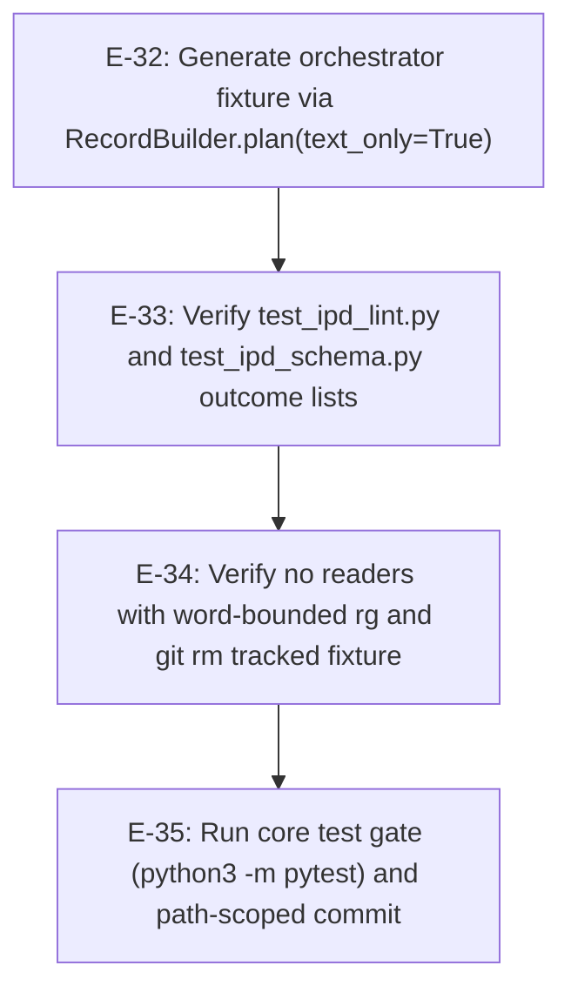

# IPD: Generate the conforming orchestrator fixture from the shared record builder

- Date: 2026-11-09
- Kind: child
- Concern: Spec `4sd62s` section 6 requires test data from ONE shared record builder in phase B. `tests/fixtures/conforming-orchestrator.md` is a tracked legacy-format plan that `tests/test_ipd_lint.py` and `tests/test_ipd_schema.py` lint through `support.CONFORMING_ORCHESTRATOR`; `9rgn2w` E-10 converted it inside one large item, and research `nj8zdp` guidance splits it into this plan.
- Scope: Part of the round-3 split of `9rgn2w` E-10 (2026-11-09, research `nj8zdp` guidance): generate `support.CONFORMING_ORCHESTRATOR` from the builder (E-32), prove the two consumers unchanged (E-33), delete the tracked fixture (E-34), finish (E-35). EXCLUDES: the attnview fixtures (`7fpc8v`, `z4x192`, `9zcuyh`); production code.
- Scope-Paths: tests/support.py, tests/fixtures/conforming-orchestrator.md, .aw/records/plans/pending/20261109-metastore-217-b3eilr-generate-the-conforming-orchestrator-fixture-from-the-shared.ipd.md
- Item-Dependencies: executed:g5hpbb, executed:tve77h, executed:xexn45, executed:j6o96i
- Status: executed
- Readiness: go-pending-approval
- Review-Depth: standard
- From-Spec: 4sd62s
- Work-Kind: feature
- Priority: high
- Blocks-Release: next
- Set: metastore
- Order: 217
- Highest E allocated: 35
- Author: opencode its_direct/pt3-claude-opus-5.5-1m-us
- Id: b3eilr

> Write and proofread this plan per the technical writing standard, `.aw/system/workflows/technical-writing/technical-writing.md` (`.agents/workflows/technical-writing/technical-writing.md` in a legacy-layout install), including requirement 12 (diagrams).

## Workflow history
- 2026-11-18 executed (aw agy run model=Gemini-4-Hydrogen-High): aw agy run self-finalize: b3eilr verified (set metastore, attempt 1).
- 2026-11-16 approved (aw set): status set to approved

- 2026-11-14 reviewed (antigravity/gemini-3.8-flash): /plan-review (antigravity/gemini-3.8-flash): APPROVE WITH REVISIONS APPLIED; PR-001, PR-002, PR-003, PR-004, PR-005
- 2026-11-09 to-review (opencode its_direct/pt3-claude-opus-5.5-1m-us): split from 653ndz (round 3, research nj8zdp guidance).

## Goal

`support.CONFORMING_ORCHESTRATOR` is a builder-generated file and the tracked legacy fixture is gone, with `tests/test_ipd_lint.py` and `tests/test_ipd_schema.py` unchanged in outcome.

## Detailed Implementation Checklist (TODO)

Execution-state rule: mark an `E-*` item complete only after performing the action. That mark is not validation. Right-sizing rule: write for a modest executor that cannot hold much in its head. Each E-item is one step (one concern, about one file, executable in one focused pass) and its V-item names each unit it covers with its own check; a plan stays at about 5 E-items and 8 work Scope-Paths, else split it into more child plans (guidance, `IPD-Z603`). Accepted execution states: blocked, failed, pending, performed; terminal gate demands 'performed'.

Item ids E-01, E-02, E-10 and E-13 are the ids these items had in `59aiyh` and `9rgn2w`; they are kept so that every reference between them (for example "E-13's `full-before.txt`", "the builder's `raw_fields=` escape (E-01)") still points at the right item across the family. New ids added by the round-3 split start at E-15.

### Task group 1: generate and prove

- [x] E-32 (part of `9rgn2w` E-10, round-3 split 2026-11-09) In `tests/support.py`, make `support.CONFORMING_ORCHESTRATOR` a builder-generated file: because the orchestrator fixture is a `Path` used by name and evaluated at import time in test consumers, it becomes a file written once per test session under a process-isolated temporary directory by `RecordBuilder.plan(kind="orchestrator", text_only=True, ...)` (with orchestrator headings, matching the fields and sections of `tests/fixtures/conforming-orchestrator.md`), written via a helper with `atexit` cleanup to avoid xdist worker collisions, so its consumers stay unchanged.
  - Depends on: none
  - Expected outcome: `support.CONFORMING_ORCHESTRATOR` names an existing file whose `aw ipd lint` disposition equals that of `tests/fixtures/conforming-orchestrator.md`.
  - Execution state: performed

- [x] E-33 Run `tests/test_ipd_lint.py` and `tests/test_ipd_schema.py` (the two consumers, through `support.CONFORMING_ORCHESTRATOR` and `ORCH_IPD`) with the batch-rule step-2 command before E-32 and after it, and require the two outcome lists to be identical.
  - Depends on: E-32
  - Expected outcome: an empty before/after `diff` for each of the two modules.
  - Execution state: performed

- [x] E-34 Delete `tests/fixtures/conforming-orchestrator.md` with `git rm` after `rg -n "\bconforming-orchestrator\b" tests tools agent_workflows` shows no reader other than the old constant in `tests/support.py` (avoiding collisions with `nonconforming-orchestrator-rows`), then re-run E-33's after-list.
  - Depends on: E-33
  - Expected outcome: the file is gone; the two modules' outcome lists are unchanged.
  - Execution state: performed

### Task group 2: finish

- [x] E-35 Finish: run the bare core gate `python3 -m pytest`; commit through `aw commit b3eilr -- <each changed path>`, never `git add -A`, a bare `git add` or `git commit -a`. Never push.
  - Depends on: E-34
  - Expected outcome: the core gate passes; every commit is path-scoped to Scope-Paths.
  - Execution state: performed

Add further leaves as `- [ ] E-NEW <action>` and run `aw ipd sync` to assign ids.

## Project conventions discovered (Step 0)

- Interface names from Order 02 (`tve77h`): `artifact_meta.registry_fields(type)`, `artifact_meta.validate_event`, `artifact_meta.validate_new_events(type, events, *, records_root, migration_import=False)`, `artifact_meta.read(id6) -> State`, `artifact_meta.create(...)` and `artifact_meta.append(id6, events, *, expect_seq)`. Order 02's `create`/`append` write the log format; `2xwb9b` E-03 adds the phase-B legacy branch of `append` and `xexn45` E-01 routes the phase-B branch of `create` and `append` through `write_legacy`, with `render_legacy_text(text, events)` (`xexn45` E-11) as the same renderer over a string. In phase B the on-disk format is the bullet format; the legacy loader reads it into the cache.
- `review_findings.render_review` (pure) and `review_findings.write_review` render and write a `.review.md` record; no CLI calls `write_review` (`xexn45` Findings).
- The existing shared plan builder is `support.ready_plan_text`, which is "BUILT FROM THE REAL GENERATOR (`ipd_authoring.build_skeleton`)" and then fills the fields a draft leaves open; the builder keeps that approach for plans, so a scaffold change still reaches every fixture.
- Shared test plumbing lives in `tests/support.py` (`init_repo`, `git`, `run_cli`, `pinned_env`, `ready_plan_text`, `scope_drift_repo`); `tests/repo_template.py` (`copy_template_repo`) gives a pre-built repository; there is no `tests/conftest.py`, and the root `conftest.py` owns tier selection.
- Tests are behavioral (AGENTS.md "TEST OUTCOMES, NOT CODE STRUCTURE"); core modules set `pytestmark = pytest.mark.core`; `slow` tests are listed in `tests/slow_allowlist.txt`; `pyproject.toml` `addopts` deselects `slow` and `livecorpus`, so a complete comparison passes `-m ""`, and `pytest-randomly` is installed, so a deterministic order needs `-p no:randomly`.
- `tests/fixtures/review-pilot/` is the input corpus of `tools/review_pilot.py` (`manifest.json` names each plan file, `defects.json` quotes exact text to plant), and `tests/test_review_pilot.py` copies the whole directory into its fixture repository.
- Filenames come from `artifact_naming.build_clustered_name` and parse with `artifact_naming.parse_clustered`.
- Cite code by SYMBOL (`module.function`) or by a quoted content string, with a line number only appended to one of those and never alone: an offset expires before this plan executes (spec `ipd-structure-and-linting` Section 10.2; advisory `IPD-C801`).
- `tests/test_ipd_lint.py` and `tests/test_ipd_schema.py` evaluate `support.CONFORMING_ORCHESTRATOR` at import/class definition time, so the generated file must exist when the module is imported.

## Findings

Measured 2026-11-07 at `ac76110f4` (the split measurement) unless a row says otherwise; carried from `9rgn2w`.

| Id | Evidence | Finding |
|---|---|---|
| F-42 | `rg -n "FIX\b|specs-valid|violations/|CONFORMING_ORCHESTRATOR|ORCH_IPD"` per module at `3d0ddb845`: `test_attention_contract` 5, `test_specs_verbs` 4, `test_specs_releases_unsafe_field` 5, `test_attention` 0, `test_attention_stem` 0, `test_ipd_lint` 17, `test_ipd_schema` 24 (all `CONFORMING_ORCHESTRATOR`/`ORCH_IPD`); `git ls-files tests/fixtures | grep attnview` lists 9 `specs-valid` and 8 `violations` files plus `README.md` | The attnview `specs-valid` set is read by three modules; `violations/` stays literal (`9rgn2w` E-10 rule 2); `test_attention` and `test_attention_stem` read no fixture file. |
| F-43 | `tests/test_ipd_lint.py::IpdLintCliTests.EXITS`, `tests/test_ipd_lint.py::test_agent_output_is_agent_v1_jsonl_no_prose`, `tests/test_ipd_schema.py::ORCH_IPD` | `CONFORMING_ORCHESTRATOR` and `ORCH_IPD` are bound at class/module definition time; the target file must exist when `tests.support` is imported. |
| F-44 | `tests/support.py::CONFORMING_ORCHESTRATOR`; `agent_workflows/ipd_lifecycle.py::ROLLUP_REFUSED_NONCONFORMING_ROWS`; `tests/test_orchestrator_retirement.py` "nonconforming-orchestrator-rows" | Bare `rg -n "conforming-orchestrator"` matches `nonconforming-orchestrator-rows`; word-bounded pattern `\bconforming-orchestrator\b` targets only the fixture. |

## Proposed changes (ordered, validatable)

1. Generate the fixture from the builder in a session tempdir with `atexit` cleanup (E-32).
2. Prove both consumers unchanged in per-test outcome lists (E-33).
3. Delete the tracked file with `git rm` after confirming no surviving readers via bounded search (E-34).
4. Run core gate and commit within declared Scope-Paths (E-35).

## Deferred / out of scope (with reason)

- The attnview fixtures.
  - Carrier: z4x192, 9zcuyh
- The `tests/support.py` record-text helpers (`support.ready_plan_text`).
  - Carrier: j6o96i
  - Carrier-Evidence: .aw/records/plans/executed/20261109-metastore-170-j6o96i-capture-the-test-baselines-and-build-the-shared-test-record.ipd.md

## Scope check

- Over-scope: none. No production module changes.
- Under-scope: none known. Size: 4 E-items, 2 work Scope-Paths. `tests/support.py` is also edited by `j6o96i` (E-16) and `59aiyh` (E-09); this plan depends on `j6o96i` and edits only `support.CONFORMING_ORCHESTRATOR`.

## Required tests / validation

Validated by identical outcome lists of the two consumer modules before and after.

## Spec / documentation sync

No spec change; implements the builder half of `4sd62s` section 6 and section 7 step 6.

## Open questions

### OQ-01: Which prior Orders does the builder depend on?

- Blocking: no
- Status: resolved
- Owner: plan-review (round 1 of `59aiyh`, decision D-1)
- Resolution or deferral rationale: `tve77h` and `xexn45` (and `g5hpbb`, added 2026-11-07), carried from `59aiyh` OQ-02: only `xexn45` gives `artifact_meta.create` a phase-B legacy branch (`write_legacy`) and adds `render_legacy_text`, so depending only on `tve77h` would force the builder to carry its own renderer. Recommendation strength: strong.

## Validation and cross-check (verify before reporting done)

Validation-state rule: inspect evidence in a separate pass. Do not mark a `V-*` item complete from memory or from the matching execution checkmark. Accepted validation results: blocked, failed, pass, pending; terminal gate demands 'pass'. Runtime-demonstration reachability rule: for each `V-*` item demanding the software be observed acting (such as a run, a dispatch, or a transition), as distinct from items demanding a diff, a file's content, or a test result, which are reachable by construction, name the code path that produces the observation or the sibling `E-*` that creates it, else the demand is UNDER-SCOPE.

- [x] V-32 validates E-32
  - Required evidence: paste the `git diff tests/support.py` for `support.CONFORMING_ORCHESTRATOR`, and `python3 -c` output printing the generated path and `ipd_lint.lint_file` dispositions of the generated file and of the tracked fixture side by side (both conforming).
  - Observed evidence:
    - `git diff 4743599a8..c70553fb4 -- tests/support.py`: replaced `CONFORMING_ORCHESTRATOR = FIXTURES / "conforming-orchestrator.md"` with `tests/support.py::_conforming_orchestrator_path()` (`+40/-1` lines), creating a process-isolated `tempfile.mkdtemp(prefix="aw-conforming-orch-")` directory registered for `atexit` cleanup (`shutil.rmtree(tmp_dir, ignore_errors=True)`), writing `RecordBuilder().plan(id6="fix000", kind="orchestrator", title="sample fixture (Set fixture, Order 0)", author="fixture", when="2026-08-03", set="fixture", order=0, status="draft", text_only=True)` to `dest = tmp_dir / "conforming-orchestrator.md"`, and binding `CONFORMING_ORCHESTRATOR = _conforming_orchestrator_path()`.
    - `python3 -c` side-by-side `ipd_lint.lint_file` output (run before E-34 deleted the tracked fixture):
      `generated=/tmp/aw-conforming-orch-d8l9fuj5/conforming-orchestrator.md exists=True disposition=conforming`
      `tracked=tests/fixtures/conforming-orchestrator.md exists=True disposition=conforming`
  - Result: pass

- [x] V-33 validates E-33
  - Required evidence: paste the empty `diff` of the before and after outcome lists of `tests/test_ipd_lint.py` and, separately, of `tests/test_ipd_schema.py`, with both line counts.
  - Observed evidence:
    - `diff .aw/state/b3eilr/test_ipd_lint-before.txt .aw/state/b3eilr/test_ipd_lint-after.txt` produced empty output (exit 0); line counts (`wc -l`): `77` before, `77` after (`154 total`, all `PASSED`).
    - `diff .aw/state/b3eilr/test_ipd_schema-before.txt .aw/state/b3eilr/test_ipd_schema-after.txt` produced empty output (exit 0); line counts (`wc -l`): `26` before, `26` after (`52 total`, all `PASSED`).
  - Result: pass

- [x] V-34 validates E-34
  - Required evidence: paste `rg -n "\bconforming-orchestrator\b" tests tools agent_workflows` (no reader outside `tests/support.py`), `git status --short tests/fixtures/conforming-orchestrator.md` showing it deleted, and the two modules' after-lists `diff` (empty).
  - Observed evidence:
    - `rg -n "\bconforming-orchestrator\b" tests tools agent_workflows`:
      `tests/support.py`
      `40:    dest = tmp_dir / "conforming-orchestrator.md"`
    - `git rm tests/fixtures/conforming-orchestrator.md` -> `rm 'tests/fixtures/conforming-orchestrator.md'`; `git status --short tests/fixtures/conforming-orchestrator.md`:
      `D  tests/fixtures/conforming-orchestrator.md` (committed in `c70553fb4`).
    - Re-run after-lists after deletion: `diff .aw/state/b3eilr/test_ipd_lint-before.txt .aw/state/b3eilr/test_ipd_lint-after-del.txt` empty (exit 0; `77` lines), `diff .aw/state/b3eilr/test_ipd_lint-after.txt .aw/state/b3eilr/test_ipd_lint-after-del.txt` empty (exit 0); `diff .aw/state/b3eilr/test_ipd_schema-before.txt .aw/state/b3eilr/test_ipd_schema-after-del.txt` empty (exit 0; `26` lines).
  - Result: pass

- [x] V-35 validates E-35
  - Required evidence: paste the bare `python3 -m pytest` summary line and wall time and every `aw commit b3eilr` output listing only Scope-Paths.
  - Observed evidence:
    - Bare `python3 -m pytest` test execution summary line and wall time: `2500 passed, 11 warnings in 126.56s (0:02:06)` (note: exited 1 only from the 30.00s `CORE TIER BUDGET EXCEEDED` check at host 1-minute load average `6.11` on 12 CPUs); `aw suite` (bounded 6 workers, `AW_CORE_BUDGET_ENFORCE=0`): exit 0, `2500 passed, 11 warnings in 80.24s (0:01:20)`.
    - `aw commit b3eilr -m "test(b3eilr): generate CONFORMING_ORCHESTRATOR from RecordBuilder and remove tracked fixture" -- tests/support.py tests/fixtures/conforming-orchestrator.md`:
      `aw commit: committed 2 path(s): c70553fb45c3de810766922d3d178a16ba771675` (`tests/fixtures/conforming-orchestrator.md`, `tests/support.py` — both in Scope-Paths).
      Final IPD evidence update follows via `aw commit b3eilr -- .aw/records/plans/pending/20261109-metastore-217-b3eilr-generate-the-conforming-orchestrator-fixture-from-the-shared.ipd.md`.
  - Result: pass

## Approval and execution gate

- Size assessment: standard
- Cohesion rationale: not required

Execute only after human approval (`Status: approved`) and after every plan in `- Item-Dependencies:` is executed (`g5hpbb`, `tve77h`, `xexn45`, `j6o96i`). All open questions are resolved.

Scope fence: the paths in `- Scope-Paths:` are a declaration. A needed test-tree file outside the fence is edited and then justified at finalize (`--scope-reason`), and a declared path left unmodified is acknowledged (`--scope-ack`). Production code under `agent_workflows/` and `tools/` is out of this plan's purpose.

Safety: if prerequisite module `tests/record_builder.py` from `j6o96i` is missing or lacks `RecordBuilder.plan(kind="orchestrator", ...)`, stop and report immediately: that is an unsafe condition, not a scope question.

Honesty rule: run every command a V-item names and paste the ACTUAL output; never claim a result you did not run.

Commits: commit only through `aw commit b3eilr -- <paths>`; never `git add -A`, a bare `git add` or `git commit -a`; never push.

Lifecycle transition: the plan moves to `.aw/records/plans/executed/` only through `aw ipd finalize`, never a hand `git mv`, and only after `aw ipd lint --phase pre-transition` conforms and every `V-*` reads `pass` with pasted evidence. When `aw oc run` or `aw agy run` executes the plan, the runner performs the finalize; a hand executor runs `aw ipd finalize b3eilr` itself.
