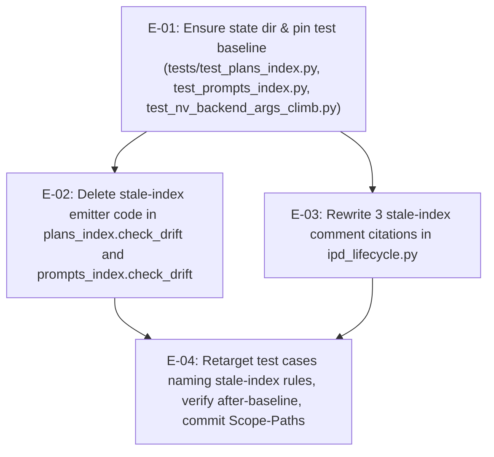

# IPD: Delete the stale-index emitters of the plans and prompts check_drift

- Date: 2026-11-09
- Kind: child
- Concern: Spec `4sd62s` 4.5 deletes `check.stale-index-*`. Today `plans_index.check_drift` and `prompts_index.check_drift` each emit `check.stale-index-missing` and `check.stale-index-stale` when an INDEX file is absent or out of date, and three `ipd_lifecycle` comments describe those rules. This is part 5 of the round-3 split of `q6epwc` (Order 41), carrying the plans, prompts and `ipd_lifecycle` subset of `q6epwc` E-05.
- Scope: delete the stale-index emitter code in `plans_index.check_drift` and `prompts_index.check_drift`, rewrite the three `stale-index` comments in `ipd_lifecycle`, and update the cases of `tests/test_plans_index.py`, `tests/test_prompts_index.py` and `tests/test_nv_backend_args_climb.py` that name a `check.stale-index-*` id. EXCLUDES: the `research_index` emitter and the two registry entries (Order 229), `doctor` (Order 225), and the INDEX-byte assertions of the same test modules (`snin8q`).
- Scope-Paths: agent_workflows/plans_index.py, agent_workflows/prompts_index.py, agent_workflows/ipd_lifecycle.py, tests/test_plans_index.py, tests/test_prompts_index.py, tests/test_nv_backend_args_climb.py, .aw/records/plans/pending/20261109-metastore-224-w819as-delete-the-stale-index-rules-from-the-registry-and-the-check.ipd.md
- Item-Dependencies: executed:1ajqaa, executed:59aiyh, executed:dcerjg, executed:ffceq0, executed:g5hpbb, executed:sdzcur, executed:t4gl15, executed:tqknnc
- Status: executed
- Readiness: go-pending-approval
- Review-Depth: standard
- From-Spec: 4sd62s
- Work-Kind: feature
- Priority: high
- Blocks-Release: next
- Set: metastore
- Order: 224
- Highest E allocated: 04
- Author: opencode its_direct/pt3-claude-opus-5.5-1m-us
- Id: w819as

> Write and proofread this plan per the technical writing standard, `.aw/system/workflows/technical-writing/technical-writing.md` (`.agents/workflows/technical-writing/technical-writing.md` in a legacy-layout install), including requirement 12 (diagrams).

## Workflow history
- 2026-11-23 executed (aw oc run model=uri/its_direct/pt3-claude-opus-5.5-1m-us variant=high profile=opus): aw oc run self-finalize: w819as verified (set metastore, attempt 1).
- 2026-11-16 approved (aw set): status set to approved

- 2026-11-14 reviewed (antigravity/gemini-3.8-flash): APPROVE WITH REVISIONS APPLIED; PR-001, PR-002, PR-003, PR-004, PR-005
- 2026-11-09 to-review (opencode its_direct/pt3-claude-opus-5.5-1m-us): split from q6epwc (round 3, research nj8zdp guidance).

## Goal

After this plan, `aw check plans --all` and `aw index prompts --check` report no `check.stale-index-*` finding, and no `ipd_lifecycle` comment names those rules; every other rule of the two `check_drift` functions still fires.

## Detailed Implementation Checklist (TODO)

Execution-state rule: mark an `E-*` item complete only after performing the action. That mark is not validation. Right-sizing rule: write for a modest executor that cannot hold much in its head. Each E-item is one step (one concern, about one file, executable in one focused pass) and its V-item names each unit it covers with its own check; a plan stays at about 5 E-items and 8 work Scope-Paths, else split it into more child plans (guidance, `IPD-Z603`). Accepted execution states: blocked, failed, pending, performed; terminal gate demands 'performed'.

`q6epwc` E-05's site list is split across Orders 224, 229 and 225; this plan takes the emitter lines in `plans_index.check_drift` (2) and `prompts_index.check_drift` (2), the 3 `ipd_lifecycle` comment lines, and the test module `tests/test_nv_backend_args_climb.py` from E-05's list, plus the `check.stale-index-*` cases of `tests/test_plans_index.py` and `tests/test_prompts_index.py` ("expected to change only where an assertion names a `check.stale-index-*` id, and each such case is pinned and mapped"). The registry entries stay until Order 229 removes the last emitter, so no rule is ever emitted unregistered (an unregistered rule falls through to `check_engine._DEFAULT_RULESPEC`, severity `error`).

PIN RULE (carried from `9o83cr`): before the edit, ensure the output directory exists (`mkdir -p .aw/state/w819as`) and save the named test modules' per-test outcome list (`python3 -m pytest -o addopts="" -m "" -p no:randomly -n 0 -rA <modules> | grep -E "^(PASSED|FAILED|ERROR|SKIPPED|XFAIL|XPASS) " | sed -E 's/ - .*//' | sort > .aw/state/w819as/<E>-before.txt`); after it, run the same command into `<E>-after.txt`. A retargeted test keeps every input case, so the after-list may rename a test but not drop a case; the evidence pastes both lists and maps each removed name to its successor. A test whose only subject is a deleted rule is deleted, and the mapping says "subject removed".

### Task group 1: pin, delete, retarget

- [x] E-01 Ensure `.aw/state/w819as` exists (`mkdir -p .aw/state/w819as`) and pin `tests/test_plans_index.py`, `tests/test_prompts_index.py` and `tests/test_nv_backend_args_climb.py` (PIN RULE, `E-01-before.txt`).
  - Depends on: none
  - Expected outcome: `.aw/state/w819as/E-01-before.txt` exists.
  - Execution state: performed

- [x] E-02 Delete the code in `plans_index.check_drift` and in `prompts_index.check_drift` that emits `check.stale-index-missing` and `check.stale-index-stale`; keep every other rule those functions emit (`name-metadata-mismatch`, `dangling-citation`).
  - Depends on: E-01
  - Expected outcome: `rg -n "stale-index" agent_workflows/plans_index.py agent_workflows/prompts_index.py` prints nothing.
  - Execution state: performed

- [x] E-03 In `agent_workflows/ipd_lifecycle.py`, rewrite the three comments that name `check.stale-index-missing` or `check.stale-index-stale` so they no longer describe the deleted rules.
  - Depends on: E-01
  - Expected outcome: `rg -n "stale-index" agent_workflows/ipd_lifecycle.py` prints nothing.
  - Execution state: performed

- [x] E-04 Retarget the cases that name a stale-index id: `test_stale_index_flagged` and `test_missing_index_is_informational_not_failing` in `tests/test_plans_index.py`; `test_check_drift_missing_index` and `test_check_drift_stale_index` in `tests/test_prompts_index.py` (and its module docstring lines); `test_assertion_d_outside_project_unaltered` in `tests/test_nv_backend_args_climb.py` (it expects two `check.stale-index-missing` diagnostics and now expects none). Save `E-04-after.txt`, run the three modules, and commit through `aw commit w819as -- <paths>` with only Scope-Paths files; never `git add -A`, a bare `git add` or `git commit -a`; never push.
  - Depends on: E-02, E-03
  - Expected outcome: the three modules pass; the mapping accounts for every case.
  - Execution state: performed

## Project conventions discovered (Step 0)

- Drift findings are `artifact_core.Drift(location, rule, detail)`; severities come from `check_engine.RULE_REGISTRY`.
- Cite code by SYMBOL (`module.function`) or by a quoted content string, with a line number only appended to one of those and never alone (advisory `IPD-C801`).

## Findings

Measured 2026-11-09 at `3d0ddb845`: `rg -n "stale-index" agent_workflows/plans_index.py agent_workflows/prompts_index.py agent_workflows/ipd_lifecycle.py` prints 2, 2 and 3 lines; `rg -c "stale-index"` in `tests/test_plans_index.py` 4, `tests/test_prompts_index.py` 4, `tests/test_nv_backend_args_climb.py` 2.

## Proposed changes (ordered, validatable)



1. Pin (E-01).
2. Delete the emitters (E-02) and comments (E-03).
3. Retarget and commit (E-04).

## Deferred / out of scope (with reason)

- The `research_index` emitter, the registry entries and the `check_engine` comments: Order 229. `doctor`: Order 225.
  - Carrier: q6epwc
- INDEX-byte assertions in `tests/test_plans_index.py` and `tests/test_prompts_index.py`: deleted with the writers.
  - Carrier: snin8q

## Scope check

- Over-scope: none.
- Under-scope: none known. Size: 4 E-items, 6 work Scope-Paths.

## Required tests / validation

Pinned and retargeted: `tests/test_plans_index.py`, `tests/test_prompts_index.py`, `tests/test_nv_backend_args_climb.py`. Commands: those three modules, then the bare core gate `python3 -m pytest`.

## Spec / documentation sync

No spec change; implements part of `4sd62s` 4.5.

## Open questions

### OQ-01: Is it safe to remove emitters before the registry entries?

- Blocking: no
- Status: resolved
- Owner: plan author
- Resolution or deferral rationale: Yes. A registered rule with no emitter is inert; the reverse order (registry first) would make a surviving emitter's finding fall to `check_engine._DEFAULT_RULESPEC` at severity `error`. Order 229 removes the last emitter and the entries together. Recommendation strength: strong.

## Validation and cross-check (verify before reporting done)

Validation-state rule: inspect evidence in a separate pass. Do not mark a `V-*` item complete from memory or from the matching execution checkmark. Accepted validation results: blocked, failed, pass, pending; terminal gate demands 'pass'. Runtime-demonstration reachability rule: for each `V-*` item demanding the software be observed acting (such as a run, a dispatch, or a transition), as distinct from items demanding a diff, a file's content, or a test result, which are reachable by construction, name the code path that produces the observation or the sibling `E-*` that creates it, else the demand is UNDER-SCOPE.

- [x] V-01 validates E-01
  - Required evidence: paste `wc -l .aw/state/w819as/E-01-before.txt` and one line from each of the three named modules.
  - Observed evidence:
    ```
$ wc -l .aw/state/w819as/E-01-before.txt
38 .aw/state/w819as/E-01-before.txt
PASSED tests/test_plans_index.py::CheckDriftTests::test_clean_after_regen
PASSED tests/test_prompts_index.py::IndexOutcomeWordsAreNotLifecycleStatusesTests::test_f_force_color_renders_generic_outcome_words_and_never_unknown_glyph
FAILED tests/test_nv_backend_args_climb.py::NvBackendArgsClimbTests::test_assertion_c_explicit_dir_does_not_climb
```
    Baseline note: 36 PASSED, 2 FAILED before any edit. Both FAILED cases are in `tests/test_nv_backend_args_climb.py` (`test_assertion_c_explicit_dir_does_not_climb`, `test_assertion_d_outside_project_unaltered`). They already failed because `tqknnc` made `aw index <type> --check` filter out `check.stale-index-*`, and the fixture's only "nonzero observable" was stale-index drift. `tqknnc`'s V-04 maps them to this plan ("`test_nv_backend_args_climb.py` (2) -> `w819as` (Order 224)"); E-04 retargets both.
  - Result: pass

- [x] V-02 validates E-02
  - Required evidence: paste `rg -n "stale-index" agent_workflows/plans_index.py agent_workflows/prompts_index.py` printing nothing, and `aw check plans --all --agent` on a fixture with a dangling plan citation and no INDEX file, showing `dangling-citation` and no `check.stale-index-*`. Code path: `check_engine.check_content` -> `plans_index.check_drift` (E-02).
  - Observed evidence:
    ```
$ rg -n "stale-index" agent_workflows/plans_index.py agent_workflows/prompts_index.py; echo "rc=$?"
rc=1

# Fixture: git-initialised tmp repo, `records_backend: repository`, one RecordBuilder plan
# (pending/20261123-fxset-01-fx0001-fx.ipd.md), DECISIONS.md "see PLAN-zqzqzq for that",
# no INDEX.json / INDEX.md anywhere (`ls .aw/records/plans` -> `pending`).
$ aw check plans --all --agent          # this branch
{"schema":"aw.agent/v1","kind":"result","cmd":"check","outcome":"conforms","exit":0,"verified":true,"complete":true,"target":"plans","findings":3,"findings_by_severity":{"error":0,"warning":0,"info":3},"evidence":["inventory","rules"],"diagnostics":[{"location":"DECISIONS.md:1","rule":"dangling-citation"},{"location":".aw/records/plans/pending/20261123-fxset-01-fx0001-fx.ipd.md","rule":"check.ipd-lint-diagnostic"},{"location":"<collisions>","rule":"check.collisions-not-checked"}],"next":"aw ipd board"}
rc=0
$ aw check plans --all --agent          # same fixture, `git archive HEAD` copy of the pre-change package
HEAD: ['check.stale-index-missing', 'check.stale-index-missing', 'dangling-citation', 'check.ipd-lint-diagnostic', 'check.collisions-not-checked']
$ aw check prompts --all --agent        # same fixture, empty prompts/pending, no INDEX files
{"schema":"aw.agent/v1","kind":"result","cmd":"check","outcome":"conforms","exit":0,"verified":true,"complete":true,"target":"prompts","findings":1,"findings_by_severity":{"error":0,"warning":0,"info":1},"diagnostics":[{"location":"<collisions>","rule":"check.collisions-not-checked"}],"next":null}
```
    `dangling-citation` still fires through `check_engine.check_content` -> `plans_index.check_drift`; the two `check.stale-index-missing` findings the pre-change package emitted are gone. `name-metadata-mismatch` still fires too: the retargeted `tests/test_nv_backend_args_climb.py` fixture asserts it through `aw index plans --check` (V-04), as do `test_name_metadata_mismatch_on_clustered_name` and `test_check_drift_name_metadata_mismatch`.
  - Result: pass

- [x] V-03 validates E-03
  - Required evidence: paste `rg -n "stale-index" agent_workflows/ipd_lifecycle.py` printing nothing, and the `git diff` hunks of the three comments.
  - Observed evidence:
    ```
$ rg -n "stale-index" agent_workflows/ipd_lifecycle.py; echo "rc=$?"
rc=1
$ git diff HEAD~1 -- agent_workflows/ipd_lifecycle.py   (commit a5707f414)
@@ -4624,10 +4624,10 @@ def _rollback_precommit(
-    so no finalize path writes the manifests. An absent manifest is only
-    `check.stale-index-missing` at severity `info`, and escalating a rollback
-    to `PHASE_UNKNOWN_OUTCOME` over a file `aw index plans` regenerates would block an operator for
-    no safety gain. This function's own failure arms (destination changed, origin holds a peer's
+    so no finalize path writes the manifests. An absent manifest is not drift at all (plan `w819as`
+    deleted the INDEX-file drift rules with the files), and escalating a rollback to
+    `PHASE_UNKNOWN_OUTCOME` over a file nothing reads any more would block an operator for no safety
+    gain. This function's own failure arms (destination changed, origin holds a peer's
```
    Count note: the plan's Findings measured 3 lines at `3d0ddb845`. At this branch's starting HEAD `3b9700a66` only 1 line remained, because `lywgzs` (commit `f18b701f5`) had already rewritten the other two (the plans-index refresh comments it deleted). The single remaining line is the one rewritten here (decision 147-w819as-D2).
  - Result: pass

- [x] V-04 validates E-04
  - Required evidence: paste `diff .aw/state/w819as/E-01-before.txt .aw/state/w819as/E-04-after.txt` with each removed name of the five named cases mapped, the summary line of `python3 -m pytest -o addopts="" tests/test_plans_index.py tests/test_prompts_index.py tests/test_nv_backend_args_climb.py` passing, and `git show --stat` of the `aw commit w819as` commit listing only Scope-Paths files.
  - Observed evidence:
    ```
$ diff .aw/state/w819as/E-01-before.txt .aw/state/w819as/E-04-after.txt
1,2d0
< FAILED tests/test_nv_backend_args_climb.py::NvBackendArgsClimbTests::test_assertion_c_explicit_dir_does_not_climb
< FAILED tests/test_nv_backend_args_climb.py::NvBackendArgsClimbTests::test_assertion_d_outside_project_unaltered
4a3,4
> PASSED tests/test_nv_backend_args_climb.py::NvBackendArgsClimbTests::test_assertion_c_explicit_dir_does_not_climb
> PASSED tests/test_nv_backend_args_climb.py::NvBackendArgsClimbTests::test_assertion_d_outside_project_unaltered
9c9
< PASSED tests/test_plans_index.py::CheckDriftTests::test_missing_index_is_informational_not_failing
---
> PASSED tests/test_plans_index.py::CheckDriftTests::test_missing_index_file_is_not_drift
11c11
< PASSED tests/test_plans_index.py::CheckDriftTests::test_stale_index_flagged
---
> PASSED tests/test_plans_index.py::CheckDriftTests::test_stale_index_file_is_not_drift
30c30
< PASSED tests/test_prompts_index.py::PromptsIndexTests::test_check_drift_missing_index
---
> PASSED tests/test_prompts_index.py::PromptsIndexTests::test_check_drift_missing_index_is_not_drift
32c32
< PASSED tests/test_prompts_index.py::PromptsIndexTests::test_check_drift_stale_index
---
> PASSED tests/test_prompts_index.py::PromptsIndexTests::test_check_drift_stale_index_is_not_drift

$ python3 -m pytest -o addopts="" tests/test_plans_index.py tests/test_prompts_index.py tests/test_nv_backend_args_climb.py
============================= 38 passed in 17.46s ==============================

$ python3 -m pytest   (bare core gate)
2896 passed, 1 skipped, 11 warnings in 184.74s (0:03:04)
Core tier wall time: 104.87s exceeded budget of 30.00s.   (budget overrun only; 0 failed; pre-existing, see tqknnc V-04)

$ git show --stat a5707f414
 agent_workflows/ipd_lifecycle.py    |  8 ++---
 agent_workflows/plans_index.py      | 64 ++++---------------------------------
 agent_workflows/prompts_index.py    | 43 -------------------------
 tests/test_nv_backend_args_climb.py | 28 +++++++++++-----
 tests/test_plans_index.py           | 30 +++++++----------
 tests/test_prompts_index.py         | 17 ++++------
 6 files changed, 49 insertions(+), 141 deletions(-)
```
    Mapping (38 before, 38 after; no case dropped): `test_stale_index_flagged` -> `test_stale_index_file_is_not_drift` (same input: a present, byte-unequal `INDEX.md`; now asserts no finding and exit 0). `test_missing_index_is_informational_not_failing` -> `test_missing_index_file_is_not_drift` (same input: `INDEX.json` deleted; now asserts no finding and exit 0). `test_check_drift_missing_index` -> `test_check_drift_missing_index_is_not_drift` (same input: no INDEX files). `test_check_drift_stale_index` -> `test_check_drift_stale_index_is_not_drift` (same inputs: clean then tampered `INDEX.json`). `test_assertion_d_outside_project_unaltered` keeps its name; it now expects only the `index-alias` notice instead of two `check.stale-index-missing`. `test_assertion_c_explicit_dir_does_not_climb` keeps its name; its shared fixture's "nonzero observable" is now a non-INDEX drift class: the second plan is written as `...-p00009-plan.ipd.md` with metadata Id `p00002` (`name-metadata-mismatch`), and the second research doc's frontmatter `set` is rewritten to disagree with its filename (`name-frontmatter-mismatch`) (decision 147-w819as-D1). A wider pin over 44 related test modules (`wide-before.txt` / `wide-after.txt`, 727 lines each) shows no other change except `tests/test_doctor.py::DoctorTests::test_untracked_dir_excluded_by_default` going from FAILED to PASSED.
  - Result: pass

## Approval and execution gate

- Size assessment: standard
- Cohesion rationale: not required

Execute only after human approval (`Status: approved`) and after every plan in `- Item-Dependencies:` is executed. Pin-first where an item deletes or retargets (PIN RULE above). Scope fence: the paths in `- Scope-Paths:` are a declaration; a needed file outside the fence is edited and then justified at finalize (`--scope-reason`), and a declared path left unmodified is acknowledged (`--scope-ack`). Safety stop: if prerequisite metastore symbols from `59aiyh`, `sdzcur`, or `tqknnc` are absent upon starting, stop and report rather than creating conflicting implementations. Honesty rule: paste the ACTUAL summary lines; never claim a result you did not run. Commits: only through `aw commit w819as -- <paths>` with only Scope-Paths files; never `git add -A`, a bare `git add` or `git commit -a`; never push. Lifecycle: the plan moves to `.aw/records/plans/executed/` only through finalize; when `aw oc run` or `aw agy run` executes the plan, the runner performs the finalize; a hand executor runs `aw ipd finalize w819as` itself after `aw ipd lint --phase pre-transition` conforms and every `V-*` reads `pass` with pasted evidence; never a hand `git mv` to `executed/`.
