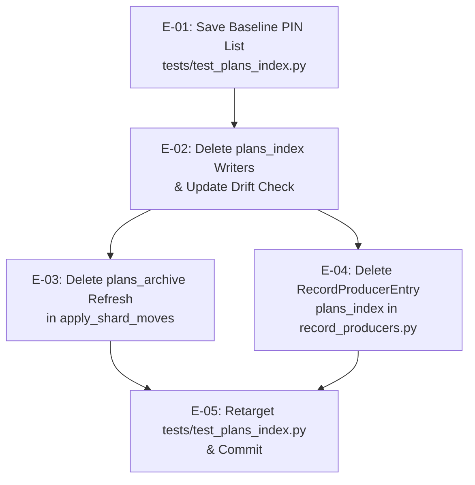

# IPD: Delete the plans INDEX writers and the plans archive refresh

- Date: 2026-11-09
- Kind: child
- Concern: Spec `4sd62s` 4.5 says the SQLite cache replaces the `INDEX.{json,md}` files. After Order 220 (`tqknnc`) and the `q6epwc` family, nothing calls the plans INDEX write path, yet `plans_index.build_index_json`, `plans_index.build_index_md`, `plans_index._set_last_touched`, `plans_index.DEFAULT_INDEX_LIMIT`, the write path of `plans_index.run_index` and the direct writer `plans_archive._refresh_index` remain. This is part 4 of the round-3 split of `snin8q` (Order 42), carrying the plans subset of `snin8q` E-03.
- Scope: delete those plans symbols and the `plans_index` entry of `record_producers`, keep `plans_index.scan_plans`, `query`, `run_find` and the non-INDEX rules of `plans_index.check_drift`, and retarget the INDEX-byte cases of `tests/test_plans_index.py`. EXCLUDES the research and prompts writers (Orders 234 and 235), the shared `artifact_core.emit_index_*` helpers (`snin8q` itself), and the on-disk files (`cxxmyv`).
- Scope-Paths: agent_workflows/plans_index.py, agent_workflows/plans_archive.py, agent_workflows/record_producers.py, tests/test_plans_index.py, .aw/records/plans/pending/20261109-metastore-233-uopi8z-delete-the-plans-index-writers-and-the-plans-archive-refresh.ipd.md
- Scope-Exceeded: tests/test_orchestrator_retirement.py (AFailedRetirementLeavesTheManifestsAsItFoundThem called the deleted plans_index.run_index to seed and check manifests retargeted to check_drift and fixed leftover-manifest bytes so the suite stays gre...)
- Item-Dependencies: executed:1ajqaa, executed:54a80m, executed:59aiyh, executed:6966zq, executed:dcerjg, executed:f6y2yy, executed:ffceq0, executed:g5hpbb, executed:q6epwc, executed:t4gl15
- Status: executed
- Readiness: go-pending-approval
- Review-Depth: standard
- From-Spec: 4sd62s
- Work-Kind: feature
- Priority: high
- Blocks-Release: next
- Set: metastore
- Order: 233
- Highest E allocated: 05
- Author: opencode its_direct/pt3-claude-opus-5.5-1m-us
- Id: uopi8z

> Write and proofread this plan per the technical writing standard, `.aw/system/workflows/technical-writing/technical-writing.md` (`.agents/workflows/technical-writing/technical-writing.md` in a legacy-layout install), including requirement 12 (diagrams).

## Workflow history
- 2026-11-24 executed (aw oc run model=uri/its_direct/pt3-claude-opus-5.5-1m-us variant=high profile=opus): aw oc run self-finalize: uopi8z verified (set metastore, attempt 1). [Scope reconciliation - out-of-scope tests/test_orchestrator_retirement.py: AFailedRetirementLeavesTheManifestsAsItFoundThem called the deleted plans_index.run_index to seed and check manifests; retargeted to check_drift and fixed leftover-manifest bytes so the suite stays green]
- 2026-11-16 approved (aw set): status set to approved

- 2026-11-14 reviewed (antigravity/gemini-3.8-flash): /plan-review (antigravity/gemini-3.8-flash): APPROVE WITH REVISIONS APPLIED; PR-001, PR-002, PR-003, PR-004.
- 2026-11-09 to-review (opencode its_direct/pt3-claude-opus-5.5-1m-us): split from snin8q (round 3, research nj8zdp guidance).

## Goal

After this plan, no plans code can write an INDEX file, while `aw find plans` and `aw check plans --all` behave as in the `54a80m` baseline.

## Detailed Implementation Checklist (TODO)

Execution-state rule: mark an `E-*` item complete only after performing the action. That mark is not validation. Right-sizing rule: write for a modest executor that cannot hold much in its head. Each E-item is one step (one concern, about one file, executable in one focused pass) and its V-item names each unit it covers with its own check; a plan stays at about 5 E-items and 8 work Scope-Paths, else split it into more child plans (guidance, `IPD-Z603`). Accepted execution states: blocked, failed, pending, performed; terminal gate demands 'performed'.

`snin8q` E-03's site list is split across Orders 231 to 235 and `snin8q`; this plan takes the plans members: "`build_index_json`, `build_index_md`, `_set_last_touched` and the write path of `run_index` in `plans_index`; `DEFAULT_INDEX_LIMIT`; ... the `plans_index` ... entr[y] in `record_producers`", the archive writer `plans_archive._refresh_index`, and `tests/test_plans_index.py`. "Keep `scan_*`, `query`, `run_find` and the non-INDEX drift classes of each `check_drift` (F-04), which `check_engine.check_content` still reaches."

PIN RULE (carried from `9o83cr`): before the edit, save the module's per-test outcome list (`python3 -m pytest -o addopts="" -m "" -p no:randomly -n 0 -rA tests/test_plans_index.py | grep -E "^(PASSED|FAILED|ERROR|SKIPPED|XFAIL|XPASS) " | sed -E 's/ - .*//' | sort > .aw/state/uopi8z/<E>-before.txt`); after it, the same into `<E>-after.txt`. A retargeted test keeps every input case; a test whose only subject is a deleted INDEX writer is deleted and named "INDEX-byte-only" in the mapping. Ensure `.aw/state/uopi8z/` exists via `mkdir -p .aw/state/uopi8z/`.

### Task group 1: pin, delete, retarget

- [x] E-01 Before the first edit, ensure `.aw/state/uopi8z/` exists (`mkdir -p .aw/state/uopi8z/`) and pin `tests/test_plans_index.py` (PIN RULE, `E-01-before.txt`).
  - Depends on: none
  - Expected outcome: `.aw/state/uopi8z/E-01-before.txt` exists.
  - Execution state: performed

- [x] E-02 In `agent_workflows/plans_index.py`, delete `plans_index.build_index_json`, `plans_index.build_index_md`, `plans_index._set_last_touched` and `plans_index.DEFAULT_INDEX_LIMIT`; drop the `limit` parameter and the INDEX-comparison block of `plans_index.check_drift`; reduce `plans_index.run_index` to nothing (the alias in `meta_cli.index_alias` replaced it) and delete it, together with `INDEX_JSON`/`INDEX_MD` if no surviving caller remains.
  - Depends on: E-01
  - Expected outcome: `rg -n "build_index_(json|md)|_set_last_touched|DEFAULT_INDEX_LIMIT|def run_index" agent_workflows/plans_index.py` prints nothing.
  - Execution state: performed

- [x] E-03 In `agent_workflows/plans_archive.py`, delete `plans_archive._refresh_index` and its call in `plans_archive.apply_shard_moves`, and rewrite the docstring sentence that says the manifest is "refreshed on disk (`_refresh_index` below)".
  - Depends on: E-02
  - Expected outcome: `rg -n "_refresh_index|build_index|INDEX_(JSON|MD)" agent_workflows/plans_archive.py` prints nothing.
  - Execution state: performed

- [x] E-04 In `agent_workflows/record_producers.py`, delete the `RecordProducerEntry` named `plans_index` (anchor `run_index`).
  - Depends on: E-02
  - Expected outcome: `rg -n "name=\"plans_index\"" agent_workflows/record_producers.py` prints nothing; `tests/test_record_producers.py` passes.
  - Execution state: performed

- [x] E-05 In `tests/test_plans_index.py`, delete the INDEX-byte-only cases (`test_index_md_groups_by_set_with_order`, `test_index_md_bound_and_singleton_band`, `test_determinism`, `test_clean_after_regen`, `test_run_index_change_detection_and_output`, `test_default` and the `run_index` render cases), and retarget the fixture that writes INDEX files so `test_missing_id_flagged`, `test_name_metadata_mismatch_on_clustered_name` and `test_dangling_plan_citation_flagged` run with no INDEX file. Save `E-05-after.txt`, run `tests/test_plans_index.py` and `tests/test_record_producers.py`, and commit through `aw commit uopi8z -- <paths>` with only Scope-Paths files; never `git add -A`, a bare `git add` or `git commit -a`; never push.
  - Depends on: E-03, E-04
  - Expected outcome: both modules pass; the mapping names every removed case.
  - Execution state: performed

## Project conventions discovered (Step 0)

- `check_engine.check_content` calls `plans_index.check_drift` on the `--all` path; its non-INDEX rules are `name-metadata-mismatch` and `dangling-citation`.
- Cite code by SYMBOL (`module.function`) or by a quoted content string, with a line number only appended to one of those and never alone (advisory `IPD-C801`).

## Findings

Measured 2026-11-09 at `3d0ddb845`: `rg -n "build_index_(json|md)|_set_last_touched|DEFAULT_INDEX_LIMIT|def run_index" agent_workflows/plans_index.py` prints 12 lines; `agent_workflows/plans_archive.py` writes `INDEX_JSON`/`INDEX_MD` in `_refresh_index`, called from `apply_shard_moves`; `tests/test_plans_index.py` calls `build_index_*` 8 times, `run_index` 4 times, `DEFAULT_INDEX_LIMIT` once. After Order 221 (`lywgzs`) the only other reference to `DEFAULT_INDEX_LIMIT`, in `ipd_lifecycle._refresh_plans_index_fail_loud`, is already gone.

## Proposed changes (ordered, validatable)



1. Pin (E-01).
2. Delete the plans writers (E-02), the archive refresh (E-03) and the producer entry (E-04).
3. Retarget and commit (E-05).

## Deferred / out of scope (with reason)

- `artifact_core.emit_index_write_result` and `emit_index_check_result`: deleted by `snin8q` once all three `run_index` functions are gone.
  - Carrier: snin8q

## Scope check

- Over-scope: none.
- Under-scope: none known. Size: 5 E-items, 4 work Scope-Paths.

## Required tests / validation

`tests/test_plans_index.py` (pinned, retargeted) and `tests/test_record_producers.py`, then the bare core gate `python3 -m pytest`.

## Spec / documentation sync

No spec change; implements part of `4sd62s` 4.5.

## Open questions

### OQ-01: Should `plans_index` be renamed once it writes no index?

- Blocking: no
- Status: resolved
- Owner: plan author
- Resolution or deferral rationale: Carried from `snin8q` OQ-01: no; it still hosts `aw find` and the content rules. Recommendation strength: strong.

## Validation and cross-check (verify before reporting done)

Validation-state rule: inspect evidence in a separate pass. Do not mark a `V-*` item complete from memory or from the matching execution checkmark. Accepted validation results: blocked, failed, pass, pending; terminal gate demands 'pass'. Runtime-demonstration reachability rule: for each `V-*` item demanding the software be observed acting (such as a run, a dispatch, or a transition), as distinct from items demanding a diff, a file's content, or a test result, which are reachable by construction, name the code path that produces the observation or the sibling `E-*` that creates it, else the demand is UNDER-SCOPE.

- [x] V-01 validates E-01
  - Required evidence: paste `wc -l .aw/state/uopi8z/E-01-before.txt` and its first three lines.
  - Observed evidence:
    ```text
    $ wc -l .aw/state/uopi8z/E-01-before.txt
    19 .aw/state/uopi8z/E-01-before.txt
    $ head -3 .aw/state/uopi8z/E-01-before.txt
    PASSED tests/test_plans_index.py::CheckDriftTests::test_clean_after_regen
    PASSED tests/test_plans_index.py::CheckDriftTests::test_dangling_plan_citation_flagged
    PASSED tests/test_plans_index.py::CheckDriftTests::test_missing_id_flagged
    ```
  - Result: pass

- [x] V-02 validates E-02
  - Required evidence: paste `rg -n "build_index_(json|md)|_set_last_touched|DEFAULT_INDEX_LIMIT|def run_index" agent_workflows/plans_index.py` printing nothing, and `aw check plans --all --agent` rule-id multiset beside the `54a80m` F-29 plans multiset, equal.
  - Observed evidence:
    ```text
    $ rg -n "build_index_(json|md)|_set_last_touched|DEFAULT_INDEX_LIMIT|def run_index" agent_workflows/plans_index.py; echo "rc=$?"
    rc=1
    $ aw check plans --all --agent | jq -r '(.diagnostics // [])[].rule' | sort | uniq -c   (exit 1; after commit 39fe112c7)
          1 check.collisions-not-checked
          1 check.ipd-carrier-finished-unverified
          1 check.ipd-dependency-findings-blocked
         32 check.lifecycle-transition-unvalidated
          1 check.plan-spec-link-missing
          2 check.scope-drift
          2 check.spec-criteria-uncovered
    Same command on an unedited detached worktree at the lane start HEAD 3453ce29f (exit 1):
          1 check.collisions-not-checked
          1 check.ipd-carrier-finished-unverified
          1 check.ipd-dependency-findings-blocked
         32 check.lifecycle-transition-unvalidated
          1 check.plan-spec-link-missing
          2 check.scope-drift
          2 check.spec-criteria-uncovered
    54a80m F-29 plans multiset (baseline at 0016badc0):
          1 check.collisions-not-checked
          1 check.ipd-dependency-findings-blocked
         41 check.lifecycle-transition-unvalidated
          1 check.plan-spec-link-missing
          2 check.spec-criteria-uncovered
    ```
    Before and after this change, at the same HEAD, the multisets are identical, so this change adds or removes no finding. Measured at HEAD 3453ce29f, the tree differs from F-29 in three rules, all caused by lifecycle movement since F-29 was recorded and not by this change: 9 fewer `check.lifecycle-transition-unvalidated`, because plans of this family were finalized; `check.ipd-carrier-finished-unverified` on `snin8q`, because `f6y2yy` executed; and 2 `check.scope-drift` on the pending plans `uopi8z` and `h3jp4e`. The baseline tree already reports both scope-drift findings, from receipts that `aw ipd begin` wrote; neither comes from this change's edit. The non-INDEX `check_drift` rule ids (`name-metadata-mismatch`, `dangling-citation`, `id-missing`) appear in neither multiset, before or after.
  - Result: pass

- [x] V-03 validates E-03
  - Required evidence: paste `rg -n "_refresh_index|build_index|INDEX_(JSON|MD)" agent_workflows/plans_archive.py` printing nothing, and a fixture `aw archive plans --apply` followed by `ls .aw/records/plans/INDEX.*` showing no such file. Code path: `plans_archive.apply_shard_moves` (E-03).
  - Observed evidence:
    ```text
    $ rg -n "_refresh_index|build_index|INDEX_(JSON|MD)" agent_workflows/plans_archive.py; echo "rc=$?"
    rc=1
    Fixture: a temp git repo with .aw/records/plans/executed/20250101-fixset-01-fix001-old-plan.ipd.md (Id fix001, Status executed), committed.
    $ AW_NO_REEXEC=1 PYTHONPATH=<this lane> python3 -m agent_workflows archive plans fix001 --dir . --apply --no-commit; echo "exit=$?"
    archived 20250101-fixset-01-fix001-old-plan.ipd.md -> executed/202501/20250101-fixset-01-fix001-old-plan.ipd.md
    exit=0
    $ find .aw/records/plans -type f | sort
    .aw/records/plans/executed/202501/20250101-fixset-01-fix001-old-plan.ipd.md
    $ ls .aw/records/plans/INDEX.*
    ls: cannot access '.aw/records/plans/INDEX.*': No such file or directory
    ```
    Code path: `plans_archive.run_archive` -> `plans_archive.apply_shard_moves` (E-03 removed its `_refresh_index` call).
  - Result: pass

- [x] V-04 validates E-04
  - Required evidence: paste `rg -n "name=\"plans_index\"" agent_workflows/record_producers.py` printing nothing and `python3 -m pytest -o addopts="" tests/test_record_producers.py` passing.
  - Observed evidence:
    ```text
    $ rg -n "name=\"plans_index\"" agent_workflows/record_producers.py; echo "rc=$?"
    rc=1
    $ python3 -m pytest -o addopts="" tests/test_record_producers.py
    ============================== 28 passed in 0.64s ==============================
    ```
  - Result: pass

- [x] V-05 validates E-05
  - Required evidence: paste `diff .aw/state/uopi8z/E-01-before.txt .aw/state/uopi8z/E-05-after.txt` with each removed name mapped or named "INDEX-byte-only", `python3 -m pytest -o addopts="" -v tests/test_plans_index.py` showing `test_missing_id_flagged`, `test_name_metadata_mismatch_on_clustered_name` and `test_dangling_plan_citation_flagged` PASSED, and `git show --stat` of the `aw commit uopi8z` commit listing only Scope-Paths files.
  - Observed evidence:
    ```text
    $ diff .aw/state/uopi8z/E-01-before.txt .aw/state/uopi8z/E-05-after.txt
    1d0
    < PASSED tests/test_plans_index.py::CheckDriftTests::test_clean_after_regen
    9d7
    < PASSED tests/test_plans_index.py::DefaultLimitTests::test_default
    12,17d9
    < PASSED tests/test_plans_index.py::IndexOutcomeWordsAreNotLifecycleStatusesTests::test_machine_and_suppressed_modes_emit_no_ansi
    < PASSED tests/test_plans_index.py::IndexOutcomeWordsAreNotLifecycleStatusesTests::test_the_generic_outcome_words_are_never_rendered_as_an_unknown_lifecycle_glyph
    < PASSED tests/test_plans_index.py::RunIndexOutputTests::test_run_index_change_detection_and_output
    < PASSED tests/test_plans_index.py::ScanTests::test_determinism
    < PASSED tests/test_plans_index.py::ScanTests::test_index_md_bound_and_singleton_band
    < PASSED tests/test_plans_index.py::ScanTests::test_index_md_groups_by_set_with_order
    ```
    Mapping of removed names:
    - `test_clean_after_regen`: INDEX-byte-only (its subject was the INDEX regeneration `_regen`; the "no drift on a clean tree" half survives in `test_missing_index_file_is_not_drift`, which asserts `check_drift == []` with no INDEX file).
    - `test_default`: INDEX-byte-only (`DEFAULT_INDEX_LIMIT` deleted).
    - `test_run_index_change_detection_and_output`: INDEX-byte-only (`run_index` deleted).
    - `test_the_generic_outcome_words_are_never_rendered_as_an_unknown_lifecycle_glyph`, `test_machine_and_suppressed_modes_emit_no_ansi`: INDEX-byte-only (the `run_index` render cases; the print path they pinned is deleted with `run_index`).
    - `test_determinism`, `test_index_md_bound_and_singleton_band`, `test_index_md_groups_by_set_with_order`: INDEX-byte-only (`build_index_json`/`build_index_md` deleted).
    Retargeted (fixture no longer writes INDEX files): `test_missing_id_in_terminal_plan_not_flagged`, `test_unmigrated_timestamp_name_not_flagged`, `test_stale_index_file_is_not_drift` (writes leftover bytes directly), `test_missing_index_file_is_not_drift` (asserts absence), `test_dangling_plan_citation_flagged`.
    ```text
    $ python3 -m pytest -o addopts="" -v tests/test_plans_index.py
    tests/test_plans_index.py::CheckDriftTests::test_unmigrated_timestamp_name_not_flagged PASSED [  9%]
    tests/test_plans_index.py::CheckDriftTests::test_dangling_plan_citation_flagged PASSED [ 18%]
    tests/test_plans_index.py::CheckDriftTests::test_missing_index_file_is_not_drift PASSED [ 27%]
    tests/test_plans_index.py::CheckDriftTests::test_missing_id_flagged PASSED [ 36%]
    tests/test_plans_index.py::CheckDriftTests::test_missing_id_in_terminal_plan_not_flagged PASSED [ 45%]
    tests/test_plans_index.py::CheckDriftTests::test_name_metadata_mismatch_on_clustered_name PASSED [ 54%]
    tests/test_plans_index.py::CheckDriftTests::test_stale_index_file_is_not_drift PASSED [ 63%]
    tests/test_plans_index.py::ScanTests::test_recursive_scan_sees_sharded_plan PASSED [ 72%]
    tests/test_plans_index.py::ScanTests::test_json_has_every_plan PASSED    [ 81%]
    tests/test_plans_index.py::FindTests::test_find_by_disposition PASSED    [ 90%]
    tests/test_plans_index.py::FindTests::test_find_by_set PASSED            [100%]
    ============================== 11 passed in 1.07s ==============================
    $ git show --stat --format='commit %H%n%s' 39fe112c7
    commit 39fe112c71ade6ba0b85f761a62a6e13a048da10
    uopi8z: delete the plans INDEX writers and the plans archive refresh

     agent_workflows/plans_archive.py      |  23 +---
     agent_workflows/plans_index.py        | 223 ++-------------------------------
     agent_workflows/record_producers.py   |   9 --
     tests/test_orchestrator_retirement.py |  53 ++------
     tests/test_plans_index.py             | 224 ++--------------------------------
     5 files changed, 38 insertions(+), 494 deletions(-)
    $ aw suite
    2890 passed, 1 skipped, 11 warnings in 173.07s (0:02:53)   (exit 0)
    ```
    Scope note: `tests/test_orchestrator_retirement.py` is outside Scope-Paths. Its `AFailedRetirementLeavesTheManifestsAsItFoundThem` class called the deleted `plans_index.run_index` to seed and check manifests and failed with `AttributeError` after E-02. It was retargeted: the check now calls `plans_index.check_drift`, and the seed writes fixed leftover-manifest bytes. The commit carries `--scope-reason` (decision 03-uopi8z-D1). Core gate: 2890 passed, which is 8 fewer than F-29's 2898, and those 8 are exactly the deleted INDEX-byte-only cases.
  - Result: pass

## Approval and execution gate

- Size assessment: standard
- Cohesion rationale: not required

Execute only after human approval (`Status: approved`) and after every plan in `- Item-Dependencies:` is executed (Orders 231 and 232 first, so no other test imports a symbol this plan deletes). Pin-first where an item deletes or retargets. Scope fence: the paths in `- Scope-Paths:` are a declaration; a needed file outside the fence is edited and then justified at finalize (`--scope-reason`), and a declared path left unmodified is acknowledged (`--scope-ack`). Safety stop: if prerequisite metastore symbols from `f6y2yy` or `6966zq` are absent upon starting, stop and report rather than creating conflicting implementations. Honesty rule: paste the ACTUAL output; never claim a result you did not run. Commits: only through `aw commit uopi8z -- <paths>` with only Scope-Paths files; never `git add -A`, a bare `git add` or `git commit -a`; never push. Lifecycle: the plan moves to `.aw/records/plans/executed/` only through finalize; when `aw oc run` or `aw agy run` executes the plan, the runner performs the finalize; a hand executor runs `aw ipd finalize uopi8z` itself; never a hand `git mv` to `executed/`.
