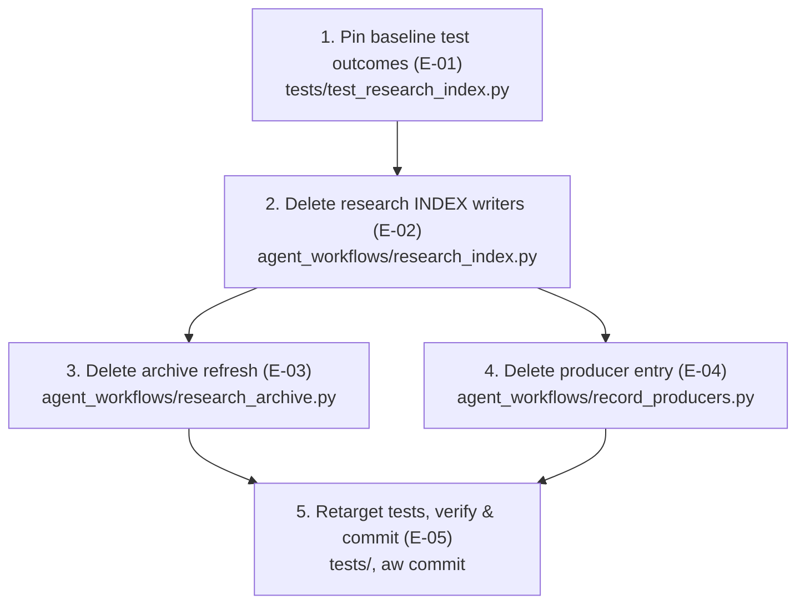

# IPD: Delete the research INDEX writers and the research archive refresh

- Date: 2026-11-09
- Kind: child
- Concern: Spec `4sd62s` 4.5 says the SQLite cache replaces the `INDEX.{json,md}` files. After the `q6epwc` family nothing calls the research INDEX write path, yet `research_index.build_index_json`, `research_index.build_index_md`, `research_index._set_last_touched`, `research_index.DEFAULT_INDEX_LIMIT`, the write path of `research_index.run_index`, and the post-move refresh in `research_archive.apply_moves` remain. This is part 5 of the round-3 split of `snin8q` (Order 42), carrying the research subset of `snin8q` E-03.
- Scope: delete those research symbols, the post-move refresh, and the `research_index` entry of `record_producers`; keep `research_index._scan_docs`, `query`, `run_find` and the non-INDEX rules of `research_index.check_drift`; retarget the INDEX-byte cases of `tests/test_research_index.py`. EXCLUDES the plans and prompts writers (Orders 233 and 235), the shared `artifact_core.emit_index_*` helpers (`snin8q`), and the `research_archive` skip of `INDEX.md` during scans (cutover, `cxxmyv`).
- Scope-Paths: agent_workflows/research_index.py, agent_workflows/research_archive.py, agent_workflows/record_producers.py, tests/test_research_index.py, .aw/records/plans/pending/20261109-metastore-234-s6k01k-delete-the-research-index-writers-and-the-research-archive-r.ipd.md
- Scope-Exceeded: .aw/records/backlog/open/20261124-0ff8af-01-0ff8af-research-and-plans-archive-self-commit-message-sti.backlog.md (defect-report filing required by the driver: after s6k01k removes the research INDEX refresh, research_archive and plans_archive self-commit messages still say 'and regenerate index' plans_archive is ...); tests/test_research_archive.py (test_archived_leaves_index_md read the INDEX.md that E-03 stops writing FileNotFoundError retargeted to assert no INDEX file is written); tests/test_research_unsafe_field.py (passed limit=1000 to research_index.check_drift, whose limit parameter E-02 removes)
- Item-Dependencies: executed:1ajqaa, executed:54a80m, executed:59aiyh, executed:6966zq, executed:dcerjg, executed:f6y2yy, executed:ffceq0, executed:g5hpbb, executed:q6epwc, executed:t4gl15, executed:uopi8z
- Status: executed
- Review-Depth: standard
- Readiness: go-pending-approval
- From-Spec: 4sd62s
- Work-Kind: feature
- Priority: high
- Blocks-Release: next
- Set: metastore
- Order: 234
- Highest E allocated: 05
- Author: opencode its_direct/pt3-claude-opus-5.5-1m-us
- Id: s6k01k

> Reviewed and proofread per the technical writing standard, `.aw/system/workflows/technical-writing/technical-writing.md`, including requirement 12 (diagrams).

## Workflow history
- 2026-11-24 executed (aw oc run model=uri/its_direct/pt3-claude-opus-5.5-1m-us variant=high profile=opus): aw oc run self-finalize: s6k01k verified (set metastore, attempt 2). [Scope reconciliation - out-of-scope .aw/records/backlog/open/20261124-0ff8af-01-0ff8af-research-and-plans-archive-self-commit-message-sti.backlog.md: defect-report filing required by the driver: after s6k01k removes the research INDEX refresh, research_archive and plans_archive self-commit messages still say 'and regenerate index'; plans_archive is outside this plan's scope, so the defect is carried by backlog 0ff8af rather than fixed here; out-of-scope tests/test_research_archive.py: test_archived_leaves_index_md read the INDEX.md that E-03 stops writing (FileNotFoundError); retargeted to assert no INDEX file is written; out-of-scope tests/test_research_unsafe_field.py: passed limit=1000 to research_index.check_drift, whose limit parameter E-02 removes]
- 2026-11-16 approved (aw set): status set to approved

- 2026-11-14 reviewed (antigravity/gemini-3.8-flash): /plan-review (antigravity/gemini-3.8-flash): APPROVE WITH REVISIONS APPLIED; PR-001, PR-002, PR-003, PR-004.
- 2026-11-09 to-review (opencode its_direct/pt3-claude-opus-5.5-1m-us): split from snin8q (round 3, research nj8zdp guidance).

## Goal

After this plan, no research code can write an INDEX file, while `aw find research` and `aw check research --all` behave as in the `54a80m` baseline.

## Detailed Implementation Checklist (TODO)

Execution-state rule: mark an `E-*` item complete only after performing the action. That mark is not validation. Right-sizing rule: write for a modest executor that cannot hold much in its head. Each E-item is one step (one concern, about one file, executable in one focused pass) and its V-item names each unit it covers with its own check; a plan stays at about 5 E-items and 8 work Scope-Paths, else split it into more child plans (guidance, `IPD-Z603`). Accepted execution states: blocked, failed, pending, performed; terminal gate demands 'performed'.

`snin8q` E-03's site list is split across Orders 231 to 235 and `snin8q`; this plan takes the research members: `build_index_json`, `build_index_md`, `_set_last_touched`, the write path of `run_index` and `DEFAULT_INDEX_LIMIT` in `research_index`; "the post-move refresh in `research_archive`"; the `research_index` entry in `record_producers`; and `tests/test_research_index.py`. Keep the non-INDEX drift classes of `research_index.check_drift` (`q6epwc` F-04).

PIN RULE (carried from `9o83cr`): before the edit, create directory `mkdir -p .aw/state/s6k01k/` and save the module's per-test outcome list (`python3 -m pytest -o addopts="" -m "" -p no:randomly -n 0 -rA tests/test_research_index.py | grep -E "^(PASSED|FAILED|ERROR|SKIPPED|XFAIL|XPASS) " | sed -E 's/ - .*//' | sort > .aw/state/s6k01k/<E>-before.txt`); after it, the same into `<E>-after.txt`. A retargeted test keeps every input case; a test whose only subject is a deleted INDEX writer is deleted and named "INDEX-byte-only" in the mapping.

### Task group 1: pin, delete, retarget

- [x] E-01 Ensure `.aw/state/s6k01k/` exists (`mkdir -p .aw/state/s6k01k/`) and pin `tests/test_research_index.py` (PIN RULE, `E-01-before.txt`).
  - Depends on: none
  - Expected outcome: `.aw/state/s6k01k/E-01-before.txt` exists.
  - Execution state: performed

- [x] E-02 In `agent_workflows/research_index.py`, delete `research_index.build_index_json`, `research_index.build_index_md`, `research_index._set_last_touched` and `research_index.DEFAULT_INDEX_LIMIT`; drop the `limit` parameter and INDEX-comparison block of `research_index.check_drift`; delete `research_index.run_index` (replaced by `meta_cli.index_alias`). Keep `INDEX_MD` only while `research_archive` still names it in its scan skip.
  - Depends on: E-01
  - Expected outcome: `rg -n "build_index_(json|md)|_set_last_touched|DEFAULT_INDEX_LIMIT|def run_index" agent_workflows/research_index.py` prints nothing.
  - Execution state: performed

- [x] E-03 In `research_archive.apply_moves`, delete the "Refresh the index after the moves" block that writes `RI.INDEX_JSON` and `RI.INDEX_MD`, and rewrite the module docstring bullet "an INDEX refresh after any archival move" and the two comments that describe the regenerated INDEX.
  - Depends on: E-02
  - Expected outcome: `rg -n "build_index|INDEX_JSON|INDEX refresh" agent_workflows/research_archive.py` prints nothing.
  - Execution state: performed

- [x] E-04 In `agent_workflows/record_producers.py`, delete the `RecordProducerEntry` named `research_index` (anchor `run_index`).
  - Depends on: E-02
  - Expected outcome: `rg -n "name=\"research_index\"" agent_workflows/record_producers.py` prints nothing; `tests/test_record_producers.py` passes.
  - Execution state: performed

- [x] E-05 In `tests/test_research_index.py`, delete the INDEX-byte-only cases (`test_index_md_archive_excluded_reference_included_intake_shown`, `test_n_honored`, `test_determinism`, `test_clean_after_regen`, `test_run_index_change_detection_and_output`, `test_default_is_40`, and the `run_index` render cases), retarget `test_json_contains_every_doc` and `test_docentry_and_json_carry_consumed_by` to the scan entries, and remove the INDEX-writing fixture from the drift cases (`test_invalid_frontmatter_detected`, `test_dangling_citation_detected`, `test_manifest_regeneration_not_blocked_by_tier_mismatch`). Save `E-05-after.txt`, run `tests/test_research_index.py` and `tests/test_record_producers.py`, and commit through `aw commit s6k01k -- <paths>` with only Scope-Paths files; never `git add -A`, a bare `git add` or `git commit -a`; never push.
  - Depends on: E-03, E-04
  - Expected outcome: both modules pass; the mapping names every removed case.
  - Execution state: performed

## Project conventions discovered (Step 0)

- `check_engine.check_content` calls `research_index.check_drift` on the `--all` path.
- Cite code by SYMBOL (`module.function`) or by a quoted content string, with a line number only appended to one of those and never alone (advisory `IPD-C801`).

## Findings

Measured 2026-11-09 at `3d0ddb845`: `rg -n "build_index_(json|md)|_set_last_touched|DEFAULT_INDEX_LIMIT|def run_index" agent_workflows/research_index.py` prints 12 lines; `research_archive.apply_moves` writes `RI.INDEX_JSON`/`RI.INDEX_MD` after the moves; `tests/test_research_index.py` calls `build_index_*` 17 times, `run_index` 4 times, `DEFAULT_INDEX_LIMIT` once.

## Proposed changes (ordered, validatable)



1. Pin (E-01).
2. Delete the research writers (E-02), the archive refresh (E-03), the producer entry (E-04).
3. Retarget and commit (E-05).

## Deferred / out of scope (with reason)

- `artifact_core.emit_index_*`: deleted by `snin8q` once all three `run_index` functions are gone.
  - Carrier: snin8q
- The `research_archive` scan skip of `INDEX.md`: protects unmigrated repositories until `m0001` deletes the files.
  - Carrier: cxxmyv

## Scope check

- Over-scope: none.
- Under-scope: none known. Size: 5 E-items, 4 work Scope-Paths.

## Required tests / validation

`tests/test_research_index.py` (pinned, retargeted) and `tests/test_record_producers.py`, then the bare core gate `python3 -m pytest`.

## Spec / documentation sync

No spec change; implements part of `4sd62s` 4.5.

## Open questions

### OQ-01: Does `aw archive research` still report its moves without the refresh?

- Blocking: no
- Status: resolved
- Owner: plan author
- Resolution or deferral rationale: Yes. The regenerated INDEX was deliberately never appended to `touched` (comment citing idxuntrack `4r0qp1` E-07), so the reported move list is unchanged. Recommendation strength: strong.

## Validation and cross-check (verify before reporting done)

Validation-state rule: inspect evidence in a separate pass. Do not mark a `V-*` item complete from memory or from the matching execution checkmark. Accepted validation results: blocked, failed, pass, pending; terminal gate demands 'pass'. Runtime-demonstration reachability rule: for each `V-*` item demanding the software be observed acting (such as a run, a dispatch, or a transition), as distinct from items demanding a diff, a file's content, or a test result, which are reachable by construction, name the code path that produces the observation or the sibling `E-*` that creates it, else the demand is UNDER-SCOPE.

- [x] V-01 validates E-01
  - Required evidence: paste `wc -l .aw/state/s6k01k/E-01-before.txt` and its first three lines.
  - Observed evidence:
    ```text
    $ wc -l .aw/state/s6k01k/E-01-before.txt
    52 .aw/state/s6k01k/E-01-before.txt
    $ head -3 .aw/state/s6k01k/E-01-before.txt
    PASSED tests/test_research_index.py::CheckDriftTests::test_clean_after_regen
    PASSED tests/test_research_index.py::CheckDriftTests::test_dangling_citation_detected
    PASSED tests/test_research_index.py::CheckDriftTests::test_invalid_frontmatter_detected
    ```
  - Result: pass

- [x] V-02 validates E-02
  - Required evidence: paste `rg -n "build_index_(json|md)|_set_last_touched|DEFAULT_INDEX_LIMIT|def run_index" agent_workflows/research_index.py` printing nothing, and `aw check research --all --agent` rule-id multiset beside the `54a80m` F-29 research multiset, equal.
  - Observed evidence:
    ```text
    $ rg -n "build_index_(json|md)|_set_last_touched|DEFAULT_INDEX_LIMIT|def run_index" agent_workflows/research_index.py; echo "rc=$?"
    rc=1
    ```
    `aw check research --all --agent` after the edit (exit 1, `"findings":431`, `{"error":1,"warning":2,"info":428}`), rule-id multiset beside `54a80m` F-29 research multiset:
    ```text
    after s6k01k                          54a80m F-29 research
         35 adopted-without-consumer          35 adopted-without-consumer
          1 check.collisions-not-checked       1 check.collisions-not-checked
        358 dangling-citation                358 dangling-citation
          1 name-invalid                       1 name-invalid
         30 stale-state-to-promote            30 stale-state-to-promote
          2 status-tier-mismatch               2 status-tier-mismatch
          4 unrecognized-model                 4 unrecognized-model
    equal True
    ```
  - Result: pass

- [x] V-03 validates E-03
  - Required evidence: paste `rg -n "build_index|INDEX_JSON|INDEX refresh" agent_workflows/research_archive.py` printing nothing, and a fixture `aw archive research --apply` followed by `ls .aw/records/research/INDEX.*` showing no such file. Code path: `research_archive.apply_moves` (E-03).
  - Observed evidence:
    ```text
    $ rg -n "build_index|INDEX_JSON|INDEX refresh" agent_workflows/research_archive.py; echo "rc=$?"
    rc=1
    ```
    Fixture, re-measured in attempt 2: a throwaway git repo under `.aw/state/s6k01k/fixture` holding one `todo` doc `aaaaaa`, written by `tests.test_research_index._write`. That helper writes under the contract root `research_contract.RESEARCH_ROOT` (`.agents/docs/research`), so the `ls` below targets that root rather than `.aw/records/research`. The code path is `research_archive.apply_moves`, reached through `aw archive research`. The doc's filename is shown as `<aaaaaa-doc>` so this evidence does not cite a nonexistent research file, which would add a `dangling-citation` to `aw check research --all`.
    ```text
    $ aw archive research aaaaaa --apply --no-commit --no-interactive --dir $FX
    archived aaaaaa -> archive/202607/<aaaaaa-doc>
    rc=0
    $ ls $FX/.agents/docs/research/INDEX.*
    ls: cannot access '.aw/state/s6k01k/fixture/.agents/docs/research/INDEX.*': No such file or directory
    ls_rc=2
    $ find $FX/.agents/docs/research -type f
    .aw/state/s6k01k/fixture/.agents/docs/research/archive/202607/<aaaaaa-doc>
    ```
  - Result: pass

- [x] V-04 validates E-04
  - Required evidence: paste `rg -n "name=\"research_index\"" agent_workflows/record_producers.py` printing nothing and `python3 -m pytest -o addopts="" tests/test_record_producers.py` passing.
  - Observed evidence:
    ```text
    $ rg -n 'name="research_index"' agent_workflows/record_producers.py; echo "rc=$?"
    rc=1
    $ python3 -m pytest -o addopts="" tests/test_record_producers.py
    ============================== 28 passed in 0.97s ==============================
    ```
  - Result: pass

- [x] V-05 validates E-05
  - Required evidence: paste `diff .aw/state/s6k01k/E-01-before.txt .aw/state/s6k01k/E-05-after.txt` with each removed name mapped or named "INDEX-byte-only", `python3 -m pytest -o addopts="" -v tests/test_research_index.py` showing the three named drift cases PASSED, and `git show --stat` of the `aw commit s6k01k` commit listing only Scope-Paths files.
  - Observed evidence:
    ```text
    $ diff .aw/state/s6k01k/E-01-before.txt .aw/state/s6k01k/E-05-after.txt
    1d0
    < PASSED tests/test_research_index.py::CheckDriftTests::test_clean_after_regen
    10d8
    < PASSED tests/test_research_index.py::DefaultLimitTests::test_default_is_40
    15,16d12
    < PASSED tests/test_research_index.py::IndexBuildTests::test_determinism
    < PASSED tests/test_research_index.py::IndexBuildTests::test_index_md_archive_excluded_reference_included_intake_shown
    18,20d13
    < PASSED tests/test_research_index.py::IndexBuildTests::test_n_honored
    < PASSED tests/test_research_index.py::IndexOutcomeWordsAreNotLifecycleStatusesTests::test_machine_and_suppressed_modes_emit_no_ansi
    < PASSED tests/test_research_index.py::IndexOutcomeWordsAreNotLifecycleStatusesTests::test_the_generic_outcome_words_are_never_rendered_as_an_unknown_lifecycle_glyph
    40d32
    < PASSED tests/test_research_index.py::RunIndexOutputTests::test_run_index_change_detection_and_output
    ```
    Mapping: all 8 removed names are INDEX-byte-only (`test_clean_after_regen`, `test_default_is_40`, `test_determinism`, `test_index_md_archive_excluded_reference_included_intake_shown`, `test_n_honored`, the two `IndexOutcomeWordsAreNotLifecycleStatusesTests` `run_index` render cases, `test_run_index_change_detection_and_output`). Retargeted, same names kept: `test_json_contains_every_doc`, `test_docentry_and_json_carry_consumed_by`, `test_manifest_regeneration_not_blocked_by_tier_mismatch`, and every drift case whose `_regen` INDEX fixture was removed. 52 before, 44 after, 0 non-PASSED.
    ```text
    $ python3 -m pytest -o addopts="" -v -p no:randomly tests/test_research_index.py
    tests/test_research_index.py::CheckDriftTests::test_dangling_citation_detected PASSED [ 13%]
    tests/test_research_index.py::CheckDriftTests::test_invalid_frontmatter_detected PASSED [ 15%]
    tests/test_research_index.py::StatusTierMismatchTests::test_manifest_regeneration_not_blocked_by_tier_mismatch PASSED [100%]
    ============================== 44 passed in 2.06s ==============================
    $ git show --stat 243cf00e5
    commit 243cf00e57ac530173d8998f10d662bacd77a0dc
        s6k01k: delete the research INDEX writers and the research archive refresh
     agent_workflows/record_producers.py |   9 --
     agent_workflows/research_archive.py |  30 ++--
     agent_workflows/research_index.py   | 265 +++-----------------------------
     tests/test_research_archive.py      |  16 +-
     tests/test_research_index.py        | 294 +++---------------------------------
     tests/test_research_unsafe_field.py |   2 +-
     6 files changed, 68 insertions(+), 548 deletions(-)
    $ aw suite
    2882 passed, 1 skipped, 11 warnings in 132.44s (0:02:12)
    ```
    Attempt 2 (lane `aw/lane/s6k01k_attempt2`) carried attempt 1's correct work forward from `aw/lane/s6k01k` (`3ff36c878`) as commit `243cf00e5`, and re-ran every command above in this lane. The pin files were regenerated: `E-01-before.txt` from a detached worktree at base `76347e49d`, and `E-05-after.txt` in this lane. Scope note: three committed paths are outside Scope-Paths, and each has a `--scope-reason` recorded in the begin receipt (decisions 04-s6k01k-D1 and 04-s6k01k-D2). The third path is the backlog item `0ff8af`, filed as the defect report this run requires. `tests/test_research_archive.py::IndexRefreshTests::test_archived_leaves_index_md` read the `INDEX.md` that E-03 stops writing and failed with `FileNotFoundError`; it was retargeted to assert no INDEX file is written and the doc reads `archive` in the scan. `tests/test_research_unsafe_field.py` passed `limit=1000` to `research_index.check_drift`, whose `limit` parameter E-02 removes; the argument was dropped. The full suite shows 2882 passed, 8 fewer than `uopi8z`'s 2890, and those 8 are exactly the deleted INDEX-byte-only cases.
  - Result: pass

## Approval and execution gate

- Size assessment: standard
- Cohesion rationale: not required

Execute only after human approval (`Status: approved`) and after every plan in `- Item-Dependencies:` is executed (Order 233 first, because both edit `agent_workflows/record_producers.py`; serial order keeps each diff small). Pin-first. Scope fence: the paths in `- Scope-Paths:` are a declaration; a needed file outside the fence is edited and then justified at finalize (`--scope-reason`), and a declared path left unmodified is acknowledged (`--scope-ack`). Safety stop: if a prerequisite plan in `- Item-Dependencies:` is not executed or required metastore symbols from `f6y2yy`, `6966zq`, or `uopi8z` are absent, stop and report rather than proceeding. Honesty rule: paste the ACTUAL summary lines. Commits: only through `aw commit s6k01k -- <paths>` with only Scope-Paths files; never `git add -A`, a bare `git add` or `git commit -a`; never push. Lifecycle: the plan moves to `.aw/records/plans/executed/` only through `aw ipd finalize`, never a hand `git mv`, after `aw ipd lint --phase pre-transition` conforms and every `V-*` reads `pass` with pasted evidence. When `aw oc run` or `aw agy run` executes the plan, the runner performs the finalize; a hand executor runs `aw ipd finalize s6k01k` itself.
