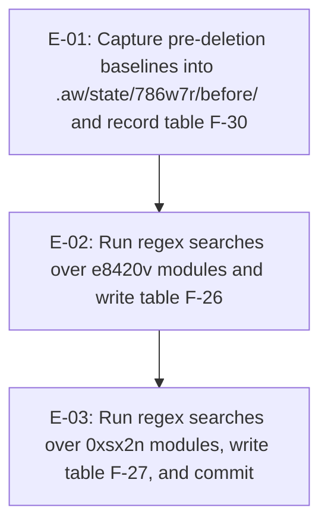

# IPD: Record the baseline for the remaining metadata regex deletions

- Date: 2026-11-09
- Kind: child
- Concern: Two families, `e8420v` (Order 45) and `0xsx2n` (Order 46), delete the remaining `^-` metadata regular expressions outside `artifact_meta` (spec `4sd62s` C5, 4.3). Each family's finishing item compares `aw check all`, `aw find plans` and `aw attention` against a baseline taken before any deletion, and its parts need a classified site table. `.aw/state/` does not travel between lane worktrees, so after the round-3 split both the baseline and the site tables must be committed in a plan file. This plan carries `e8420v` E-01 and `0xsx2n` E-01.
- Scope: run the read-only baseline commands and the `^-` site searches, and write tables F-26 (the `e8420v` modules) and F-27 (the `0xsx2n` modules) and baseline table F-30 into this plan; commit this plan file. EXCLUDES every code or test edit (Orders 239 to 249).
- Scope-Paths: .aw/records/plans/pending/20261109-metastore-238-786w7r-record-the-baseline-for-the-remaining-metadata-regex-deletio.ipd.md
- Scope-Exceeded: .aw/records/backlog/open/20261124-ebbfmn-01-ebbfmn-k6jd6l-left-five-metadata-regex-literals-in-specs.backlog.md (defect-report carrier: the driver prompt requires each finding of this turn to be filed with aw backlog new found by 786w7r E-02/E-03 site searches and cited in F-26/F-27 notes); .aw/records/backlog/open/20261124-hmtpj2-01-hmtpj2-ac-1-lit-search-misses-metadata-regex-literals-spl.backlog.md (defect-report carrier: the driver prompt requires each finding of this turn to be filed with aw backlog new found by 786w7r E-02/E-03 site searches and cited in F-26/F-27 notes); .aw/records/backlog/open/20261124-q2vkdv-01-q2vkdv-aw-check-all-agent-picks-a-different-top-level-nex.backlog.md (defect-report carrier required by the driver prompt found while re-verifying F-30); .aw/records/backlog/open/20261124-yb6z41-01-yb6z41-metastore-deletion-plans-243-247-248-delete-regex.backlog.md (defect-report carrier: the driver prompt requires each finding of this turn to be filed with aw backlog new found by 786w7r E-02/E-03 site searches and cited in F-26/F-27 notes)
- Item-Dependencies: executed:1ajqaa, executed:59aiyh, executed:dcerjg, executed:ffceq0, executed:g5hpbb, executed:k6jd6l, executed:t4gl15
- Status: executed
- Readiness: go-pending-approval
- Review-Depth: standard
- From-Spec: 4sd62s
- Work-Kind: feature
- Priority: high
- Blocks-Release: next
- Set: metastore
- Order: 238
- Highest E allocated: 03
- Author: opencode its_direct/pt3-claude-opus-5.5-1m-us
- Id: 786w7r

> Written to .aw/system/workflows/technical-writing/technical-writing.md. Every obligation, exact identifier, quotation, evidence record, and lifecycle status is preserved.

## Workflow history
- 2026-11-24 executed (aw oc run model=uri/its_direct/pt3-claude-opus-5.5-1m-us variant=high profile=opus): aw oc run self-finalize: 786w7r verified (set metastore, attempt 2). [Scope reconciliation - out-of-scope .aw/records/backlog/open/20261124-ebbfmn-01-ebbfmn-k6jd6l-left-five-metadata-regex-literals-in-specs.backlog.md: defect-report carrier: the driver prompt requires each finding of this turn to be filed with aw backlog new; found by 786w7r E-02/E-03 site searches and cited in F-26/F-27 notes; out-of-scope .aw/records/backlog/open/20261124-hmtpj2-01-hmtpj2-ac-1-lit-search-misses-metadata-regex-literals-spl.backlog.md: defect-report carrier: the driver prompt requires each finding of this turn to be filed with aw backlog new; found by 786w7r E-02/E-03 site searches and cited in F-26/F-27 notes; out-of-scope .aw/records/backlog/open/20261124-q2vkdv-01-q2vkdv-aw-check-all-agent-picks-a-different-top-level-nex.backlog.md: defect-report carrier required by the driver prompt; found while re-verifying F-30; out-of-scope .aw/records/backlog/open/20261124-yb6z41-01-yb6z41-metastore-deletion-plans-243-247-248-delete-regex.backlog.md: defect-report carrier: the driver prompt requires each finding of this turn to be filed with aw backlog new; found by 786w7r E-02/E-03 site searches and cited in F-26/F-27 notes]
- 2026-11-16 approved (aw set): status set to approved

- 2026-11-14 /plan-review (antigravity/gemini-3.8-flash): APPROVE WITH REVISIONS APPLIED; PR-001..PR-005 FIXED; review record .aw/records/reviews/20261109-metastore-238-786w7r-record-the-baseline-for-the-remaining-metadata-regex-deletio.review.md
- 2026-11-14 reviewed (aw set): APPROVE WITH REVISIONS APPLIED; PR-001..PR-005 FIXED
- 2026-11-09 to-review (opencode its_direct/pt3-claude-opus-5.5-1m-us): split from e8420v and 0xsx2n (round 3, research nj8zdp guidance).

## Goal

Commit, inside this plan, the pre-deletion baseline and the two classified site tables that every part of the `e8420v` and `0xsx2n` families reads.

## Detailed Implementation Checklist (TODO)

Execution-state rule: mark an `E-*` item complete only after performing the action. That mark is not validation. Right-sizing rule: write for a modest executor that cannot hold much in its head. Each E-item is one step (one concern, about one file, executable in one focused pass) and its V-item names each unit it covers with its own check; a plan stays at about 5 E-items and 8 work Scope-Paths, else split it into more child plans (guidance, `IPD-Z603`). Accepted execution states: blocked, failed, pending, performed; terminal gate demands 'performed'.

`e8420v` E-01 and `0xsx2n` E-01 are carried here: E-01 is their shared baseline, E-02 is `e8420v` E-01's search and table, E-03 is `0xsx2n` E-01's search and table. The regex used below is `LIT='re\.(compile|search|match|finditer|findall|sub|fullmatch)\(\s*r?["'"'"'](\(\?m\))?\^-'`.

### Task group 1: baseline and site tables

- [x] E-01 On the unedited tree, ensure directory `.aw/state/786w7r/before/` exists (`mkdir -p .aw/state/786w7r/before/`) and save under it the stdout and exit code of `aw check all --agent` and `aw check all --all --agent` (rule-id multisets, `jq -r '.diagnostics[].rule' | sort | uniq -c`), `aw find plans --agent`, `aw attention --format json`, and the bare core gate summary line of `python3 -m pytest`; copy every value into table F-30 of this plan (the `aw find` and `aw attention` outputs as line counts plus `sha256sum`).
  - Depends on: none
  - Expected outcome: F-30 holds every value.
  - Execution state: performed

- [x] E-02 Run `rg -n "$LIT"` over `agent_workflows/check_engine.py`, `agent_workflows/runner_shared.py`, `agent_workflows/status_set.py` and `agent_workflows/releases.py`, and `rg -n "_blob_text|_status_meta\b|_metadata_status\b|_front_matter_bullets" agent_workflows tools tests`; write table F-26: one row per hit, classed `delete (239)`, `delete (240)`, `delete (241)`, `delete (242)`, `delete (243)`, `body prose (N3)` or `already gone`, using the site lists in those plans.
  - Depends on: E-01
  - Expected outcome: F-26 has a class on every row.
  - Execution state: performed

- [x] E-03 Run `rg -n "$LIT"` over each module named in Orders 244 to 249 (listed in each plan's Scope-Paths) and write table F-27: one row per hit, classed `delete (244)` to `delete (249)`, `body prose (N3)`, `non-metadata` or `already gone`. Commit this plan file through `aw commit 786w7r -- <this plan's path>`; never `git add -A`, a bare `git add` or `git commit -a`; never push.
  - Depends on: E-02
  - Expected outcome: F-27 has a class on every row; the commit lists only this plan file.
  - Execution state: performed

## Project conventions discovered (Step 0)

- N3 keeps Markdown body bullets (open-question rows, E/V checklist fields, prose targets) out of `artifact_meta`; their patterns are `body prose` and stay.
- Cite code by SYMBOL (`module.function`) or by a quoted content string, with a line number only appended to one of those and never alone (advisory `IPD-C801`).

## Findings

| Id | Evidence | Finding |
|---|---|---|
| F-26 | (written by E-02) `^-` sites and parser references in `check_engine`, `runner_shared`, `status_set`, `releases`, each classed; rows below | 60 rows: 43 `LIT` hits plus 17 parser-reference hits. Classes: `delete (239)` 9, `delete (240)` 20, `delete (242)` 14, `delete (243)` 6, `body prose (N3)` 8, `already gone` 3; `delete (241)` 0 (see note). Read by Orders 239 to 243 and `e8420v`. |
| F-27 | (written by E-03) `^-` sites in the Order 244 to 249 modules, each classed; rows below | 39 rows. Classes: `delete (244)` 2, `delete (245)` 6, `delete (246)` 5, `delete (247)` 7, `delete (248)` 4, `delete (249)` 0, `body prose (N3)` 7, `non-metadata` 8 (6 of them test-module rows); `already gone` sites have no hit and are listed in the notes. Read by Orders 244 to 249 and `0xsx2n`; `non-metadata` rows feed the `9o83cr` E-14 exclusion file. |
| F-30 | (written by E-01) baseline exit codes, rule-id multisets, `aw find`/`aw attention` hashes, core gate line; values below | Compared by `e8420v` and `0xsx2n`. |

### F-30 baseline (E-01)

Captured 2026-11-24 in lane worktree `786w7r` at HEAD `56e9d649f` (unedited tree), saved under `.aw/state/786w7r/before/`.

| Command | Exit | Lines | sha256 / summary |
|---|---|---|---|
| `aw check all --agent` | 1 | 1 | `ee0ec355c7623afedfb0a42dc6236fe668fe80a765ba5b73b2f23e9a63554da0`; 93 findings (error 11, warning 2, info 80) |
| `aw check all --all --agent` | 1 | 1 | `039d81db9a4001b6c48a1541bb73e706d6080c76c441af563cbf987669b066ab`; 540 findings (error 16, warning 15, info 509) |
| `aw find plans --agent` | 0 | 1986 | `0f626c69d414081bedd1aa5640c96ce4b257db0a6a38251d14c7e0a9a7bc9af3`; summary `total 1985, emitted 1985, complete true` |
| `aw attention --format json` | 0 | 59797 | `9f31b69492959f1b474c62d06f2cbbffc75de109610186560edde793903476a3`; 3515 items |
| `python3 -m pytest` (bare core gate) | 1 | - | `2889 passed, 1 skipped, 11 warnings in 102.99s (0:01:42)`; re-run `2889 passed, 1 skipped, 11 warnings in 70.43s (0:01:10)`. Exit 1 is the `conftest.py` wall-time budget only ("Core tier wall time: 70.43s exceeded budget of 30.00s", host load 8.63 on 12 CPUs); no test failed (decision 15-786w7r-D1, backlog `6o5aan`). |

The `aw find` and `aw attention` hashes were re-taken once more on the same tree and matched, so both outputs are deterministic for an unchanged tree.

Attempt 2 re-capture (2026-11-24, lane worktree `786w7r_attempt2`, same HEAD `56e9d649f`, unedited tree): every exit code, both rule-id multisets, both `findings_by_severity` counts, the `aw find plans` sha256 (`0f626c69...`, 1986 lines) and the `aw attention` sha256 (`9f31b694...`, 59797 lines) matched the values above. The `aw check all --agent` stdout hashes did NOT match (`ee0e8613...` and `079ec4ee...` this time): two back-to-back runs on the same tree differ only in the top-level `next` hint (one run chose `aw group specs ayfyie ...`, the next a `aw rename prompts z1zu8c ...` hint). So the `aw check` stdout hash is not a stable comparison key; the families must compare the rule-id multisets, `findings_by_severity` and exit codes, which are stable. Core gate re-run: `2889 passed, 1 skipped, 11 warnings in 140.99s (0:02:20)`, exit 1 from the wall-time budget only ("Core tier wall time: 140.99s exceeded budget of 30.00s").

Rule-id multiset, `aw check all --agent` (`jq -r '.diagnostics[].rule' | sort | uniq -c`):

```text
      1 check.graduated-to-dangling
      1 check.identity-absent-from-name
      1 check.ipd-carrier-finished-unverified
     32 check.lifecycle-transition-unvalidated
      4 check.name-nonconformant
      1 check.plan-spec-link-missing
      6 check.prompt-metadata-missing
     42 check.source-test-citation-dangling
      2 check.spec-criteria-uncovered
      1 check.system-layout-missing
      2 spec.prose-dash
```

Rule-id multiset, `aw check all --all --agent`:

```text
     35 adopted-without-consumer
      1 check.graduated-to-dangling
     12 check.identity-absent-from-name
      1 check.ipd-carrier-finished-unverified
      1 check.ipd-dependency-findings-blocked
     32 check.lifecycle-transition-unvalidated
      7 check.name-nonconformant
      1 check.plan-spec-link-missing
      6 check.prompt-metadata-missing
     42 check.source-test-citation-dangling
      2 check.spec-criteria-uncovered
      1 check.system-layout-missing
    358 dangling-citation
      1 name-invalid
      4 spec.prose-dash
     30 stale-state-to-promote
      2 status-tier-mismatch
      4 unrecognized-model
```

### F-26 rows (E-02)

`LIT` hits per file: `check_engine` 22, `runner_shared` 15, `status_set` 0, `releases` 6 (43). Parser-reference hits: 17. Row numbers F26-1 to F26-43 are the `LIT` hits, F26-44 to F26-60 the parser references.

| Row | Hit | Enclosing symbol | Class | Note |
|---|---|---|---|---|
| F26-1 | `agent_workflows/check_engine.py` 2068 | `check_engine._ID_LINE_RE` | delete (240) | Order 240 group A |
| F26-2 | `agent_workflows/check_engine.py` 2069 | `check_engine._SET_LINE_RE` | delete (240) | Order 240 group A |
| F26-3 | `agent_workflows/check_engine.py` 3055 | `check_engine._IDENT_ID_BULLET_RE` | delete (240) | Order 240 group A |
| F26-4 | `agent_workflows/check_engine.py` 3057 | `check_engine._IDENT_SET_BULLET_RE` | delete (240) | Order 240 group A |
| F26-5 | `agent_workflows/check_engine.py` 3464 | `check_engine._STATUS_META_RE` | delete (240) | Order 240 group A |
| F26-6 | `agent_workflows/check_engine.py` 5632 | `check_engine._ITEM_ID_RE` | delete (240) | Order 240 group B |
| F26-7 | `agent_workflows/check_engine.py` 5633 | `check_engine._ITEM_PRIORITY_RE` | delete (240) | Order 240 group B |
| F26-8 | `agent_workflows/check_engine.py` 5636 | `check_engine._ITEM_WORK_KIND_RE` | delete (240) | Order 240 group B |
| F26-9 | `agent_workflows/check_engine.py` 5637 | `check_engine._META_BLOCKS_RELEASE_RE` | delete (240) | Order 240 group C |
| F26-10 | `agent_workflows/check_engine.py` 5639 | `check_engine._META_CLOSE_EVIDENCE_RE` | delete (240) | Order 240 group C |
| F26-11 | `agent_workflows/check_engine.py` 5640 | `check_engine._META_FROM_BACKLOG_RE` | delete (240) | Order 240 group C |
| F26-12 | `agent_workflows/check_engine.py` 5641 | `check_engine._ITEM_FROM_SPEC_RE` | delete (240) | Order 240 group C |
| F26-13 | `agent_workflows/check_engine.py` 5642 | `check_engine._PLAN_STATUS_RE` | delete (240) | Order 240 group A |
| F26-14 | `agent_workflows/check_engine.py` 8405 | `check_engine._ITEM_DEPENDENCIES_RE` | delete (240) | Order 240 group B |
| F26-15 | `agent_workflows/check_engine.py` 8406 | `check_engine._DATE_LINE_RE` | delete (240) | Order 240 group B |
| F26-16 | `agent_workflows/check_engine.py` 9112 | `check_engine._REVIEW_SUBJECT_TYPE_RE` | delete (240) | Order 240 group D |
| F26-17 | `agent_workflows/check_engine.py` 9696 | `check_engine._ITEM_FROM_SPEC_RE` | delete (240) | Order 240 group C |
| F26-18 | `agent_workflows/check_engine.py` 9802 | `check_engine._TARGET_BULLET_RE` | body prose (N3) | Concern/Scope/Scope-Paths prose targets (Order 241 keeps it) |
| F26-19 | `agent_workflows/check_engine.py` 9805 | `check_engine._FROM_SPEC_LINE_RE` | delete (240) | Order 240 group C |
| F26-20 | `agent_workflows/check_engine.py` 9806 | `check_engine._SCOPE_PATHS_LINE_RE` | delete (240) | Order 240 group D |
| F26-21 | `agent_workflows/check_engine.py` 10017 | `check_engine.parse_spec_acceptance_criteria()` | body prose (N3) | `^-+$` is a Markdown table divider (Order 241 keeps it) |
| F26-22 | `agent_workflows/check_engine.py` 11180 | `check_engine._CARRIER_DATE_RE` | delete (240) | Order 240 group D |
| F26-23 | `agent_workflows/releases.py` 44 | `releases._ID_RE` | delete (243) | Order 243 E-03 |
| F26-24 | `agent_workflows/releases.py` 45 | `releases._STATUS_RE` | delete (243) | Order 243 E-03 |
| F26-25 | `agent_workflows/releases.py` 46 | `releases._VERSION_RE` | delete (243) | Order 243 E-03 |
| F26-26 | `agent_workflows/releases.py` 50 | `releases._SUMMARY_RE` | delete (243) | Order 243 E-03 |
| F26-27 | `agent_workflows/releases.py` 515 | `releases._ITEM_FROM_BACKLOG_RE` | delete (243) | Order 243 E-03 |
| F26-28 | `agent_workflows/releases.py` 541 | `releases._ITEM_GRADUATED_TO_RE` | delete (243) | Order 243 E-03 |
| F26-29 | `agent_workflows/runner_shared.py` 244 | `runner_shared._SET_RE` | delete (242) | Order 242 E-02 |
| F26-30 | `agent_workflows/runner_shared.py` 245 | `runner_shared._ORDER_RE` | delete (242) | Order 242 E-02 |
| F26-31 | `agent_workflows/runner_shared.py` 262 | `runner_shared._KIND_RE` | delete (242) | Order 242 E-02 |
| F26-32 | `agent_workflows/runner_shared.py` 5715 | `runner_shared._HISTORY_BULLET_RE` | delete (242) | Order 242 E-02 |
| F26-33 | `agent_workflows/runner_shared.py` 5720 | `runner_shared._FRONT_MATTER_BULLET_RE` | delete (242) | Order 242 E-02 |
| F26-34 | `agent_workflows/runner_shared.py` 6801 | `runner_shared._HISTORY_BULLET_RE` | delete (242) | Order 242 E-02 |
| F26-35 | `agent_workflows/runner_shared.py` 22392 | `runner_shared.record_oq_answer()` | body prose (N3) | open-question row fields (Status/Blocking/Owner); Order 242 E-04 keeps `record_oq_answer` |
| F26-36 | `agent_workflows/runner_shared.py` 22396 | `runner_shared.record_oq_answer()` | body prose (N3) | open-question row fields (Status/Blocking/Owner); Order 242 E-04 keeps `record_oq_answer` |
| F26-37 | `agent_workflows/runner_shared.py` 22397 | `runner_shared.record_oq_answer()` | body prose (N3) | open-question row fields (Status/Blocking/Owner); Order 242 E-04 keeps `record_oq_answer` |
| F26-38 | `agent_workflows/runner_shared.py` 22425 | `runner_shared.record_oq_answer()` | body prose (N3) | open-question row fields (Status/Blocking/Owner); Order 242 E-04 keeps `record_oq_answer` |
| F26-39 | `agent_workflows/runner_shared.py` 22439 | `runner_shared.record_oq_answer()` | body prose (N3) | open-question row fields (Status/Blocking/Owner); Order 242 E-04 keeps `record_oq_answer` |
| F26-40 | `agent_workflows/runner_shared.py` 22440 | `runner_shared.record_oq_answer()` | body prose (N3) | open-question row fields (Status/Blocking/Owner); Order 242 E-04 keeps `record_oq_answer` |
| F26-41 | `agent_workflows/runner_shared.py` 33227 | `runner_shared.run_review_sequence._fail_incomplete()` | delete (242) | the `- Status:` rewrite to `to-review` (a WRITE) inside `run_review_sequence`; Order 242 E-03 |
| F26-42 | `agent_workflows/runner_shared.py` 54783 | `runner_shared.perform_coordinator_proposal_file()` | delete (242) | Order 242 E-04 |
| F26-43 | `agent_workflows/runner_shared.py` 54786 | `runner_shared.perform_coordinator_proposal_file()` | delete (242) | Order 242 E-04 |
| F26-44 | `tools/gate_drop_audit.py` 153 | `tools.gate_drop_audit.census()` | delete (239) | `_status_meta` caller; Order 239 E-03 retarget |
| F26-45 | `agent_workflows/prompts.py` 323 | `prompts.update_metadata_status()` | already gone | substring match of `prompts.update_metadata_status`, not `check_engine._metadata_status`; the `prompts` caller Order 239 names is gone |
| F26-46 | `agent_workflows/prompts.py` 389 | `prompts.inject_metadata_status` | already gone | substring match of `prompts.update_metadata_status`, not `check_engine._metadata_status`; the `prompts` caller Order 239 names is gone |
| F26-47 | `agent_workflows/check_engine.py` 3483 | `check_engine._blob_text()` | delete (239) | definition; Order 239 E-04 |
| F26-48 | `agent_workflows/check_engine.py` 3490 | `check_engine._metadata_status()` | delete (239) | definition; Order 239 E-04 |
| F26-49 | `agent_workflows/check_engine.py` 3498 | `check_engine._status_meta()` | delete (239) | definition; Order 239 E-04 |
| F26-50 | `agent_workflows/check_engine.py` 3500 | `check_engine._status_meta()` | delete (239) | definition; Order 239 E-04 |
| F26-51 | `agent_workflows/artifact_meta.py` 7239 | `artifact_meta._render_status()` | already gone | substring match of `prompts.update_metadata_status`, not `check_engine._metadata_status`; the `prompts` caller Order 239 names is gone |
| F26-52 | `agent_workflows/runner_shared.py` 5759 | `runner_shared._front_matter_bullets()` | delete (242) | `_front_matter_bullets` definition or call site; Order 242 E-01 |
| F26-53 | `agent_workflows/runner_shared.py` 5923 | `runner_shared.classify_records_only_front_matter_conflict()` | delete (242) | `_front_matter_bullets` definition or call site; Order 242 E-01 |
| F26-54 | `agent_workflows/runner_shared.py` 5924 | `runner_shared.classify_records_only_front_matter_conflict()` | delete (242) | `_front_matter_bullets` definition or call site; Order 242 E-01 |
| F26-55 | `agent_workflows/runner_shared.py` 5925 | `runner_shared.classify_records_only_front_matter_conflict()` | delete (242) | `_front_matter_bullets` definition or call site; Order 242 E-01 |
| F26-56 | `agent_workflows/runner_shared.py` 6333 | `runner_shared.apply_records_only_rederivation()` | delete (242) | `_front_matter_bullets` definition or call site; Order 242 E-01 |
| F26-57 | `tests/test_check_engine_status_meta.py` 25 | `tests.test_check_engine_status_meta.CheckEngineStatusMetaTests()` | delete (239) | test naming `_status_meta`; Order 239 E-05 retarget |
| F26-58 | `tests/test_check_engine_status_meta.py` 47 | `tests.test_check_engine_status_meta.test_status_meta_no_front_matter_fenced_quote_is_none()` | delete (239) | test naming `_status_meta`; Order 239 E-05 retarget |
| F26-59 | `tests/test_check_engine_status_meta.py` 73 | `tests.test_check_engine_status_meta.test_status_meta_front_matter_approved_with_fenced_quote()` | delete (239) | test naming `_status_meta`; Order 239 E-05 retarget |
| F26-60 | `tests/test_check_engine_status_meta.py` 98 | `tests.test_check_engine_status_meta.test_status_meta_headingless_first_bullet_approved()` | delete (239) | test naming `_status_meta`; Order 239 E-05 retarget |

Notes on F-26.

- `delete (241)` has no row. The six rule functions Order 241 names (`check_engine._artifact_compact_date`, `evaluate_handoff_ready`, `check_spec_review_attestation`, `find_obligations_carried_by`, `check_ipd_lint_reach`, `check_orchestrator_not_review_ready`) contain no `^-` literal at this HEAD (an AST scan of each body for `^-` printed 0 per function), so Order 241's E-01 to E-03 targets are `already gone`; its E-04 residue check (only `_TARGET_BULLET_RE` and the `parse_spec_acceptance_criteria` divider remain) is what Order 241 still has to show after Order 240.
- `status_set` is `already gone` for Order 243 E-01/E-02: `rg -c "$LIT" agent_workflows/status_set.py` prints 0, and `_ID_RE`, `_STATUS_RE`, `_SET_RE`, `_GATE_KIND_RE`, `_GATE_REF_RE`, `_GATE_SUMMARY_RE` each have 0 references there; `_format_status_transition_line` and `plan_priority_work_kind_problems` have no `^-` literal.
- Order 239 callers already gone: `hooks/ipd_dependency_statement_gate.py` and `status_set.py` have 0 `_blob_text`/`_status_meta` references; `runner_shared` has 0 `_metadata_status` references. Only `tools/gate_drop_audit.census` (F26-44), the three definitions (F26-47 to F26-50) and `tests/test_check_engine_status_meta.py` (F26-57 to F26-60) remain.
- Order 242: `_front_matter_bullets` has 0 references in `oc_runipd.py`/`agy_runipd.py` (re-exports already gone). Inline literals named in Order 242 E-04 for `declared_spec_paths`, `enforce_no_active_runner_conflict`, `reconcile_disposition` and `execute_item_core` are `already gone` (0 per function); only the two in `perform_coordinator_proposal_file` remain (F26-42, F26-43), not three. The `run_review_sequence` WRITE sits in the nested `_fail_incomplete` (F26-41).
- `record_oq_answer` (F26-35 to F26-40) is open-question row grammar, the two rows Order 242 E-04 expects to survive; `rg -U` shows two more multi-line literals there (`re.sub` and `rationale_pattern`) of the same class.
- F26-45, F26-46, F26-51 are substring hits of `prompts.update_metadata_status`, not `check_engine._metadata_status`.
- Callers outside the owning plan's Scope-Paths (backlog `yb6z41`): `attention.py` reads `releases._VERSION_RE` (Order 243 deletes it); `tests/fixtures/runner_shared_premove_fingerprints.json` names `runner_shared._SET_RE`/`_ORDER_RE` in captured AST text.
- Not seen by `LIT` (two-line literals): `check_engine._GRADUATED_LINE_RE`, `_IMPLEMENTING_LINE_RE` (history records) and `_REVIEW_SUBJECT_ID_RE` (a review `Subject-Id` bullet) have no owner (backlog `hmtpj2`).

### F-27 rows (E-03)

Per-module `LIT` hit counts (Scope-Paths of Orders 244 to 249, `.aw/` paths excluded):

```text
244: plans_index 0, plans_refs 3, plans_archive 0, tests/test_plans_archive 0, tests/test_plans_index 0
245: artifact_rename 5, artifact_refs 1, artifact_adopt 0, artifact_audit 0, tests/test_artifact_audit 0, tests/test_artifact_rename 0
246: ipd_lint 1, ipd_lifecycle 0, ipd_schema 5, ipd_authoring 2, tests/test_ipd_lint 0, tests/test_ipd_schema 0, tests/test_ipd_authoring 6
247: plan_readiness 5, readiness_recheck 1, coverage_record 2, orchestrator_readiness 0, tests/test_coverage_record 0, tests/test_orchestrator_readiness 0, tests/test_plan_readiness_recheck 0
248: attention 3, attention_contract 4, review_sequence 0, review_findings 0, research_index 0, tests/test_review_findings_gate 0, tests/test_attention 0, tests/test_review_sequence 0
249: production_checks 0, work_cmd 0, set_records 0, hooks/executed_transition_gate 0, cli 1, tests/test_production_checks_trace 0
total 39
```

| Row | Hit | Enclosing symbol | Class | Note |
|---|---|---|---|---|
| F27-1 | `agent_workflows/attention_contract.py` 661 | `attention_contract.GATE_KIND_RE` | delete (248) | Order 248 E-02 |
| F27-2 | `agent_workflows/attention_contract.py` 662 | `attention_contract.GATE_REF_RE` | delete (248) | Order 248 E-02 |
| F27-3 | `agent_workflows/attention_contract.py` 663 | `attention_contract.GATE_SUMMARY_RE` | delete (248) | Order 248 E-02 |
| F27-4 | `agent_workflows/attention_contract.py` 816 | `attention_contract.HISTORY_RECORD_RE` | delete (248) | Order 248 E-02; NOTE imported by `plan_readiness` (`from agent_workflows.attention_contract import HISTORY_RECORD_RE`, used in `plan_readiness`), which is outside Order 248 Scope-Paths |
| F27-5 | `agent_workflows/ipd_schema.py` 409 | `ipd_schema.plan_requires_attended()` | delete (246) | Order 246 E-03 |
| F27-6 | `agent_workflows/ipd_schema.py` 413 | `ipd_schema._META_LINE_RE` | delete (246) | Order 246 E-03 |
| F27-7 | `agent_workflows/ipd_schema.py` 421 | `ipd_schema._READINESS_LINE_RE` | delete (246) | Order 246 E-03 |
| F27-8 | `agent_workflows/ipd_schema.py` 1124 | `ipd_schema.V_ROW_RE` | body prose (N3) | E/V checklist grammar; Order 246 E-03 keeps it |
| F27-9 | `agent_workflows/ipd_schema.py` 1126 | `ipd_schema.E_ROW_RE` | body prose (N3) | E/V checklist grammar; Order 246 E-03 keeps it |
| F27-10 | `agent_workflows/ipd_authoring.py` 378 | `ipd_authoring._ID_LINE_RE` | delete (246) | Order 246 E-04 |
| F27-11 | `agent_workflows/ipd_authoring.py` 782 | `ipd_authoring._WATERMARK_RE` | delete (246) | Order 246 E-04 |
| F27-12 | `agent_workflows/plans_refs.py` 52 | `plans_refs._ORDER_LINE_RE` | delete (244) | Order 244 E-02 |
| F27-13 | `agent_workflows/plans_refs.py` 53 | `plans_refs._ORDER_LINE_RAW_RE` | delete (244) | the `order_lines` literal read by `plans_refs._check_order_lines`, which `k6jd6l` left; Order 244 E-02 |
| F27-14 | `agent_workflows/plans_refs.py` 55 | `plans_refs._SIGNED_INT_RE` | non-metadata | `^-?\d+$` matches a signed integer value, not a bullet |
| F27-15 | `tests/test_ipd_authoring.py` 167 | `tests.test_ipd_authoring._scaffold()` | non-metadata | test assertion on the bytes `aw ipd scaffold`/`sync` wrote, outside the `agent_workflows/` AC-1 search; names no deleted pattern, so Order 246 E-05 leaves it (decision 15-786w7r-D2) |
| F27-16 | `tests/test_ipd_authoring.py` 419 | `tests.test_ipd_authoring.test_sync_backfills_missing_id_and_leaves_present_id()` | non-metadata | test assertion on the bytes `aw ipd scaffold`/`sync` wrote, outside the `agent_workflows/` AC-1 search; names no deleted pattern, so Order 246 E-05 leaves it (decision 15-786w7r-D2) |
| F27-17 | `tests/test_ipd_authoring.py` 422 | `tests.test_ipd_authoring.test_sync_backfills_missing_id_and_leaves_present_id()` | non-metadata | test assertion on the bytes `aw ipd scaffold`/`sync` wrote, outside the `agent_workflows/` AC-1 search; names no deleted pattern, so Order 246 E-05 leaves it (decision 15-786w7r-D2) |
| F27-18 | `tests/test_ipd_authoring.py` 427 | `tests.test_ipd_authoring.test_sync_backfills_missing_id_and_leaves_present_id()` | non-metadata | test assertion on the bytes `aw ipd scaffold`/`sync` wrote, outside the `agent_workflows/` AC-1 search; names no deleted pattern, so Order 246 E-05 leaves it (decision 15-786w7r-D2) |
| F27-19 | `tests/test_ipd_authoring.py` 432 | `tests.test_ipd_authoring.test_sync_backfills_missing_id_and_leaves_present_id()` | non-metadata | test assertion on the bytes `aw ipd scaffold`/`sync` wrote, outside the `agent_workflows/` AC-1 search; names no deleted pattern, so Order 246 E-05 leaves it (decision 15-786w7r-D2) |
| F27-20 | `tests/test_ipd_authoring.py` 454 | `tests.test_ipd_authoring.test_sync_backfills_id_on_approved_plan_without_touching_structure()` | non-metadata | test assertion on the bytes `aw ipd scaffold`/`sync` wrote, outside the `agent_workflows/` AC-1 search; names no deleted pattern, so Order 246 E-05 leaves it (decision 15-786w7r-D2) |
| F27-21 | `agent_workflows/attention.py` 156 | `attention._OQ_STATUS_RE` | body prose (N3) | open-question row fields (`Status`, `Blocking`); Order 248 E-01 keeps `_OQ_STATUS_RE` |
| F27-22 | `agent_workflows/attention.py` 231 | `attention.count_question_stats()` | body prose (N3) | open-question row fields (`Status`, `Blocking`); Order 248 E-01 keeps `_OQ_STATUS_RE` |
| F27-23 | `agent_workflows/attention.py` 374 | `attention._EV_LEAF_RE` | body prose (N3) | E/V checklist leaf `- [x] E-nn` |
| F27-24 | `agent_workflows/cli.py` 17673 | `cli._run_search()` | non-metadata | `^---` YAML fence close; its reader `cli._run_search` survives (Order 249 E-03) |
| F27-25 | `agent_workflows/artifact_rename.py` 38 | `artifact_rename._SET_LINE_RE` | delete (245) | Order 245 E-01 |
| F27-26 | `agent_workflows/artifact_rename.py` 39 | `artifact_rename._ORDER_LINE_RE` | delete (245) | Order 245 E-01 |
| F27-27 | `agent_workflows/artifact_rename.py` 252 | `artifact_rename._ID_LINE_RE` | delete (245) | Order 245 E-01 |
| F27-28 | `agent_workflows/artifact_rename.py` 253 | `artifact_rename._STATUS_LINE_RE` | delete (245) | Order 245 E-01 |
| F27-29 | `agent_workflows/artifact_rename.py` 254 | `artifact_rename._DATE_LINE_RE` | delete (245) | Order 245 E-01 |
| F27-30 | `agent_workflows/readiness_recheck.py` 157 | `readiness_recheck._run_stale_findings()` | delete (247) | literal in `_run_stale_findings`; Order 247 E-02 |
| F27-31 | `agent_workflows/plan_readiness.py` 259 | `plan_readiness._READINESS_FIELD_PRESENT_RE` | delete (247) | Order 247 E-01 |
| F27-32 | `agent_workflows/plan_readiness.py` 262 | `plan_readiness._OQ_FIELD_RE` | body prose (N3) | open-question row fields; Order 247 E-01 keeps it |
| F27-33 | `agent_workflows/plan_readiness.py` 721 | `plan_readiness.approval_refusals()` | delete (247) | Order 247 E-01 |
| F27-34 | `agent_workflows/plan_readiness.py` 911 | `plan_readiness.recheck_conditions()` | delete (247) | Order 247 E-01 |
| F27-35 | `agent_workflows/plan_readiness.py` 1352 | `plan_readiness._READINESS_LINE_SUB_RE` | delete (247) | Order 247 E-01 |
| F27-36 | `agent_workflows/artifact_refs.py` 844 | `artifact_refs.classify_citing_plans_for_rewrite()` | delete (245) | literal in `classify_citing_plans_for_rewrite`; Order 245 E-02 |
| F27-37 | `agent_workflows/coverage_record.py` 29 | `coverage_record._COVERAGE_LINE_RE` | delete (247) | Order 247 E-03 |
| F27-38 | `agent_workflows/coverage_record.py` 36 | `coverage_record._ID_LINE_RE` | delete (247) | Order 247 E-03 |
| F27-39 | `agent_workflows/ipd_lint.py` 229 | `ipd_lint._LEAF_RE` | body prose (N3) | E/V checklist leaf `- [x]` |

Notes on F-27.

- `already gone` (zero hits, each named symbol at 0 references): Order 244 `plans_index` (`_META_RE`; `plans_index._meta` now reads through `artifact_meta.read_text`), `plans_refs._ID_RE`/`_DATE_RE`/`_SET_LINE_RE`, `plans_archive` (`_ID_RE` and the four functions); Order 245 `artifact_adopt._BULLET_ID_RE`, `artifact_audit._STATUS_LINE_RE`; Order 246 `ipd_lint._HISTORY_LINE_RE` (now the non-regex `_LegacyHistoryLineMatcher`), `_CITATION_PLAN_DATE_RE`, the `run_lint` literals, `ipd_lifecycle._insert_scope_exceeded_metadata`; Order 247 `plan_readiness._STATUS_RE`, `coverage_record._STATUS_LINE_RE`/`_READINESS_LINE_RE`, `orchestrator_readiness._BATCH_META_RE`; Order 248 `attention._ITEM_DEPS_RE` and the literals in `_plans_id`, `_release_record`, `_spec_record`, `_plans_record`, `review_sequence.restore_pre_s7_plan`, `review_findings._META_RE`, `research_index._META_ID_RE` and `_backlog_is_done`; Order 249 every `production_checks`, `work_cmd`, `set_records` and `executed_transition_gate` site.
- Order 249 E-04 rows (outside every Scope-Path, recorded here as it asks): `run_viewer.load_run_summary` (3 literals, `Created`/`Updated`/`Selectors` lines of a run report) `non-metadata`; `git_commit_helper._DIVIDER_RE` (`^---`, commit-message divider) `non-metadata`; `cli._YAML_FENCE_CLOSE_RE` is F27-24 (`selectors` no longer defines one). `selectors.py` has 0 `LIT` hits. `specs.py` has 4 and `backlog.py` 1 (`specs._SPEC_ID_RE`, `specs._TOP_KEY_RE`, the `^- Status:` match in `specs.run_migrate`, `specs._SPEC_ID_BULLET_RE`, `backlog._TOP_KEY_RE`): `delete (follow-on)` for `0xsx2n`, contrary to the "expected none" (backlog `ebbfmn`).
- Callers outside the owning plan's Scope-Paths (backlog `yb6z41`): `attention_contract.HISTORY_RECORD_RE` (F27-4) is imported by `plan_readiness` and `ipd_lifecycle`; `attention_contract.GATE_SUMMARY_RE` is used by `tests/test_attention_contract.py`; `plan_readiness._READINESS_FIELD_PRESENT_RE` by `tests/test_readiness_absence_invariant.py`; `plan_readiness._READINESS_LINE_SUB_RE` by `tests/test_plan_readiness_recheck.py` (in Order 247's Scope-Paths).
- Not seen by `LIT` (two-line or `(?mi)`/`(?i)`-flagged literals, backlog `hmtpj2`): `coverage_record._FINGERPRINT_LINE_RE`, `_CHECKED_LINE_RE` (front-matter `Coverage-*` bullets, no owner); `attention._FIELD_PATTERNS` (five `(?mi)` bullet patterns), `review_findings._OQ_FINDING_REF_RE` and the `Status` match in `_resolved_escalated_questions` (OQ rows), `ipd_lint._HISTORY_ATTRIB_RE`, `_COVERAGE_HIST_RE`, `plan_readiness._HISTORY_RECORD_PARTS_RE`, and the second `attention.count_question_stats` literal (history and OQ grammar).

## Proposed changes (ordered, validatable)



1. Baseline capture (E-01): Create `.aw/state/786w7r/before/`, capture exit codes, multisets, counts, and SHA256 checksums from read-only baseline commands, and record them in table F-30.
2. Site tables and commit (E-02, E-03): Search and classify all remaining `^-` regex occurrences across `e8420v` modules into table F-26, search and classify occurrences across `0xsx2n` modules into table F-27, and commit this plan file alone using `aw commit 786w7r`.

## Deferred / out of scope (with reason)

- Every deletion: Orders 239 to 249.
  - Carrier: e8420v
- The final comparison of the `0xsx2n` family.
  - Carrier: 0xsx2n

## Scope check

- Over-scope: none.
- Under-scope: none known. Size: 3 E-items, 0 work Scope-Paths (this plan file only).

## Required tests / validation

No test is written. The commands are read-only.

## Spec / documentation sync

N/A: this plan records measurements only.

## Open questions

### OQ-01: Why one baseline for two families?

- Blocking: no
- Status: resolved
- Owner: plan author
- Resolution or deferral rationale: Both families run after `k6jd6l` and before `9o83cr` and compare the same commands; one committed baseline taken before either starts is the honest reference for both. Recommendation strength: strong. RESOLVED 2026-11-11 by the user via /askme: one shared baseline for both groups (e8420v and 0xsx2n). No reason was given.

## Validation and cross-check (verify before reporting done)

Validation-state rule: inspect evidence in a separate pass. Do not mark a `V-*` item complete from memory or from the matching execution checkmark. Accepted validation results: blocked, failed, pass, pending; terminal gate demands 'pass'. Runtime-demonstration reachability rule: for each `V-*` item demanding the software be observed acting (such as a run, a dispatch, or a transition), as distinct from items demanding a diff, a file's content, or a test result, which are reachable by construction, name the code path that produces the observation or the sibling `E-*` that creates it, else the demand is UNDER-SCOPE.

- [x] V-01 validates E-01
  - Required evidence: paste `ls -l .aw/state/786w7r/before/` with one file per named command, and table F-30 as written.
  - Observed evidence:
    Captured 2026-11-24 at HEAD `56e9d649f`, before any edit to the tree.
    ```text
    $ ls -l .aw/state/786w7r/before/
    -rw-r--r-- 1 user user       2 Nov 24 08:58 attention.exit
    -rw-r--r-- 1 user user 3404554 Nov 24 08:58 attention.json
    -rw-r--r-- 1 user user       2 Nov 24 08:57 check_all_all.exit
    -rw-r--r-- 1 user user   84688 Nov 24 08:57 check_all_all.json
    -rw-r--r-- 1 user user     632 Nov 24 08:58 check_all_all.rules
    -rw-r--r-- 1 user user       2 Nov 24 08:57 check_all.exit
    -rw-r--r-- 1 user user   13042 Nov 24 08:57 check_all.json
    -rw-r--r-- 1 user user     419 Nov 24 08:58 check_all.rules
    -rw-r--r-- 1 user user       2 Nov 24 08:57 find_plans.exit
    -rw-r--r-- 1 user user  502793 Nov 24 08:57 find_plans.out
    -rw-r--r-- 1 user user      83 Nov 24 09:01 pytest_core.exit
    -rw-r--r-- 1 user user    8103 Nov 24 09:01 pytest_core.log
    -rw-r--r-- 1 user user     437 Nov 24 08:59 pytest_core.out
    $ cat *.exit   # attention, check_all_all, check_all, find_plans
    0
    1
    1
    0
    $ tail -1 pytest_core.out
    2889 passed, 1 skipped, 11 warnings in 102.99s (0:01:42)
    ```
    One stdout file and one exit file per named command (`check_all`, `check_all_all`, `find_plans`, `attention`, `pytest_core`), plus the two rule-multiset files.
    Attempt 2 re-capture in lane `786w7r_attempt2` at the same HEAD (`.aw/state/` does not travel between lanes):
    ```text
    $ ls -l .aw/state/786w7r/before/
    -rw-r--r-- 1 user user       2 Nov 24 09:34 attention.exit
    -rw-r--r-- 1 user user 3404554 Nov 24 09:34 attention.json
    -rw-r--r-- 1 user user       2 Nov 24 09:34 check_all_all.exit
    -rw-r--r-- 1 user user   84687 Nov 24 09:34 check_all_all.json
    -rw-r--r-- 1 user user     632 Nov 24 09:34 check_all_all.rules
    -rw-r--r-- 1 user user       2 Nov 24 09:33 check_all.exit
    -rw-r--r-- 1 user user   12947 Nov 24 09:33 check_all.json
    -rw-r--r-- 1 user user     419 Nov 24 09:34 check_all.rules
    -rw-r--r-- 1 user user       2 Nov 24 09:34 find_plans.exit
    -rw-r--r-- 1 user user  502793 Nov 24 09:34 find_plans.out
    -rw-r--r-- 1 user user       7 Nov 24 09:38 pytest_core.exit
    -rw-r--r-- 1 user user    8211 Nov 24 09:38 pytest_core.log
    $ for f in check_all.json check_all_all.json find_plans.out attention.json; do echo "$f $(wc -l < $f) $(sha256sum < $f)"; done
    check_all.json 1 ee0e8613f10997fdb5e47c2fb8c136b5d799831fca6a74996ccbbdf12e468f82  -
    check_all_all.json 1 079ec4ee97bc4d3e8ef03cd05a8a436afe8cb726d3ac219dbe8c03761b635770  -
    find_plans.out 1986 0f626c69d414081bedd1aa5640c96ce4b257db0a6a38251d14c7e0a9a7bc9af3  -
    attention.json 59797 9f31b69492959f1b474c62d06f2cbbffc75de109610186560edde793903476a3  -
    $ cat *.exit   # attention, check_all_all, check_all, find_plans, pytest_core
    0
    1
    1
    0
    exit 1
    $ tail -1 pytest_core.log
    2889 passed, 1 skipped, 11 warnings in 140.99s (0:02:20)
    ```
    Both `.rules` files are byte-identical in content to the multisets in F-30; `aw check` stdout hashes differ only through the nondeterministic `next` hint (recorded under F-30). Table F-30 is written in Findings under "F-30 baseline (E-01)" with every exit code, line count, sha256, both rule-id multisets and the core gate line.
  - Result: pass

- [x] V-02 validates E-02
  - Required evidence: paste the two `rg` commands with their hit counts and table F-26 with a class on every row (`grep -c` of F-26 rows equal to the hit count).
  - Observed evidence:
    ```text
    $ rg -n "$LIT" agent_workflows/check_engine.py agent_workflows/runner_shared.py agent_workflows/status_set.py agent_workflows/releases.py | wc -l
    43
    $ rg -n "_blob_text|_status_meta\b|_metadata_status\b|_front_matter_bullets" agent_workflows tools tests | wc -l
    17
    $ grep -c '^| F26-' <this plan>
    60
    $ awk -F'|' '/^\| F26-/{print $5}' <this plan> | sort | uniq -c
          3  already gone
          8  body prose (N3)
          9  delete (239)
         20  delete (240)
         14  delete (242)
          6  delete (243)
    ```
    43 + 17 = 60 hits, 60 F-26 rows, and the class counts sum to 60, so every row has a class. Table F-26 is in Findings under "F-26 rows (E-02)".
  - Result: pass

- [x] V-03 validates E-03
  - Required evidence: paste the per-module `rg` hit counts, table F-27 with a class on every row, and `git show --stat` of the `aw commit 786w7r` commit listing only this plan file.
  - Observed evidence:
    Per-module counts are pasted in Findings under "F-27 rows (E-03)" (total 39).
    ```text
    $ grep -v '^##' <Orders 244-249 Scope-Paths, .aw/ excluded> | xargs rg -n "$LIT" | wc -l
    39
    $ grep -c '^| F27-' <this plan>
    39
    $ awk -F'|' '/^\| F27-/{print $5}' <this plan> | sort | uniq -c
          7  body prose (N3)
          2  delete (244)
          6  delete (245)
          5  delete (246)
          7  delete (247)
          4  delete (248)
          8  non-metadata
    ```
    39 hits, 39 F-27 rows, class counts sum to 39. The `git show --stat` of the `aw commit 786w7r` commit is recorded in the lane execution report (`.aw/state/lane-submissions/run-20261124T050731Z-1001505/15-786w7r/attempt-1/execution-report.md`), because a commit cannot contain its own hash; it lists only this plan file.
    Attempt 2 re-run in lane `786w7r_attempt2` at HEAD `56e9d649f`: E-02 searches print 43 and 17 again (per file `check_engine 22`, `runner_shared 15`, `status_set 0`, `releases 6`); the E-03 search over the 39 non-`.aw/` Scope-Paths of Orders 244 to 249 prints 39, and every `file:line` hit equals the F-26 and F-27 row locations. The attempt-2 commit of this plan file is listed in `.aw/state/lane-submissions/run-20261124T050731Z-1001505/15-786w7r/attempt-2/execution-report.md`. The three backlog items filed for the defect report (`hmtpj2`, `yb6z41`, `ebbfmn`) are committed separately with a recorded `--scope-reason`.
  - Result: pass

## Approval and execution gate

- Size assessment: standard
- Cohesion rationale: not required

Execute only after human approval (`Status: approved`) and after every plan in `- Item-Dependencies:` is executed (`1ajqaa`, `59aiyh`, `dcerjg`, `ffceq0`, `g5hpbb`, `k6jd6l`, `t4gl15`), and before any of Orders 239 to 249. Stop condition: stop safely without modifying files if prerequisite metastore symbols from `59aiyh`, `ffceq0`, `k6jd6l`, or `t4gl15` are missing, or if an unresolvable concurrent-edit conflict occurs. Shared-checkout safety: this plan edits only itself; do not stage, edit, or commit any other file. Honesty rule: paste the ACTUAL outputs. Commits: only through `aw commit 786w7r -- .aw/records/plans/pending/20261109-metastore-238-786w7r-record-the-baseline-for-the-remaining-metadata-regex-deletio.ipd.md`; never push. Lifecycle: the plan moves to `.aw/records/plans/executed/` only through `aw ipd finalize 786w7r` (or runner-automated retirement upon validation; never a hand `git mv`), after `aw ipd lint --phase pre-transition` conforms and every `V-*` reads `pass` with pasted evidence.
