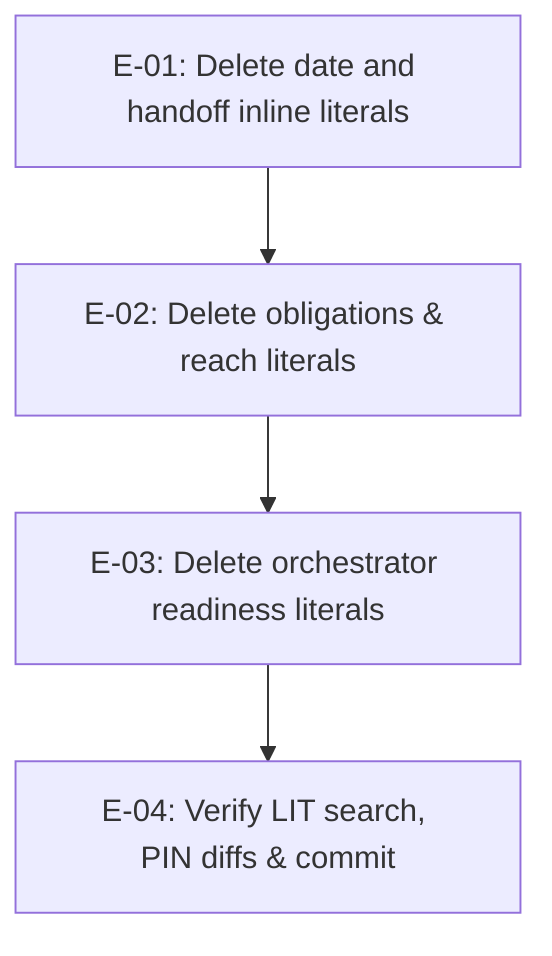

# IPD: Delete the inline check_engine metadata regex literals

- Date: 2026-11-09
- Kind: child
- Concern: Spec `4sd62s` C5 and 4.3 require deleting every `^-` metadata regex literal outside `artifact_meta`. Besides its named patterns, `agent_workflows/check_engine.py` has eight inline `^-` literals inside six rule functions. This is part 3 of the round-3 split of `e8420v` (Order 45), carrying the inline subset of `e8420v` E-12.
- Scope: delete the eight inline literals, each use reading the value through `artifact_meta.read`, `read_text` or `read_at`; confirm the two `body prose` rows stay; update comments in `check_engine` that cite a deleted literal. EXCLUDES the parsers (Order 239) and named patterns (Order 240).
- Scope-Paths: agent_workflows/check_engine.py, .aw/records/plans/pending/20261109-metastore-241-bcrko1-delete-the-inline-check-engine-metadata-regex-literals.ipd.md
- Item-Dependencies: executed:1ajqaa, executed:59aiyh, executed:786w7r, executed:dcerjg, executed:ffceq0, executed:g5hpbb, executed:js35bz, executed:k6jd6l, executed:t4gl15
- Status: executed
- Readiness: go-pending-approval
- Review-Depth: standard
- From-Spec: 4sd62s
- Work-Kind: feature
- Priority: high
- Blocks-Release: next
- Set: metastore
- Order: 241
- Highest E allocated: 04
- Author: opencode its_direct/pt3-claude-opus-5.5-1m-us
- Id: bcrko1

> Written to .aw/system/workflows/technical-writing/technical-writing.md. Every obligation, exact identifier, quotation, evidence record, and lifecycle status is preserved.

## Workflow history
- 2026-11-24 executed (aw oc run model=uri/its_direct/pt3-claude-opus-5.5-1m-us variant=high profile=opus): aw oc run self-finalize: bcrko1 verified (set metastore, attempt 1). [Scope reconciliation - in-scope-unmodified agent_workflows/check_engine.py: declared-but-unmodified (auto-acknowledged by aw oc run)]
- 2026-11-16 approved (aw set): status set to approved

- 2026-11-14 reviewed (antigravity/gemini-3.8-flash): /plan-review (antigravity/gemini-3.8-flash): APPROVE WITH REVISIONS APPLIED; PR-001..PR-006; review record .aw/records/reviews/20261109-metastore-241-bcrko1-delete-the-inline-check-engine-metadata-regex-literals.review.md
- 2026-11-09 to-review (opencode its_direct/pt3-claude-opus-5.5-1m-us): split from e8420v (round 3, research nj8zdp guidance).

## Goal

After this plan, the `^-` literal search over `agent_workflows/check_engine.py` prints only the two `body prose` rows, and both `aw check all` rule multisets equal the `786w7r` F-30 baseline.

## Detailed Implementation Checklist (TODO)

Execution-state rule: mark an `E-*` item complete only after performing the action. That mark is not validation. Right-sizing rule: write for a modest executor that cannot hold much in its head. Each E-item is one step (one concern, about one file, executable in one focused pass) and its V-item names each unit it covers with its own check; a plan stays at about 5 E-items and 8 work Scope-Paths, else split it into more child plans (guidance, `IPD-Z603`). Accepted execution states: blocked, failed, pending, performed; terminal gate demands 'performed'.

`e8420v` E-12's list is split across Orders 239, 240 and 241; this plan takes "the inline literals in `_artifact_compact_date`, `evaluate_handoff_ready`, `check_spec_review_attestation`, `find_obligations_carried_by`, `check_ipd_lint_reach` and `check_orchestrator_not_review_ready` (three). Classed `body prose` (kept, N3) unless E-01 shows otherwise: `_TARGET_BULLET_RE` (Concern/Scope/Scope-Paths prose targets), the `parse_spec_acceptance_criteria` table-rule literal (`^-+$`, a Markdown table divider)." The search is `LIT` from `786w7r`.

PIN RULE (carried from `9o83cr`): before E-01, ensure `.aw/state/bcrko1/` exists (`mkdir -p .aw/state/bcrko1/`) and save the per-test outcome list of every `tests/test_check_engine*.py` module to `.aw/state/bcrko1/before.txt` (`python3 -m pytest -o addopts="" -m "" -p no:randomly -n 0 -rA tests/test_check_engine*.py | grep -E "^(PASSED|FAILED|ERROR|SKIPPED|XFAIL|XPASS) " | sed -E 's/ - .*//' | sort > .aw/state/bcrko1/before.txt`); after E-03, the same into `after.txt`.

### Task group 1: inline literals, then verify

- [x] E-01 Before the first edit, ensure `.aw/state/bcrko1/` exists (`mkdir -p .aw/state/bcrko1/`) and save the baseline test PIN list to `.aw/state/bcrko1/before.txt`. Delete the inline literals in the three date and handoff rules: `check_engine._artifact_compact_date`, `check_engine.evaluate_handoff_ready`, and `check_engine.check_spec_review_attestation`.
  - Depends on: none
  - Expected outcome: the `LIT` search over those three functions prints nothing.
  - Execution note: performed at HEAD `e3333adce` as a confirmed no-op deletion (decision 27-bcrko1-D1). `.aw/state/bcrko1/before.txt` was saved first (196 PASSED). The three literals were already deleted by `5d8e15158` (w1cs3p, `_artifact_compact_date`), `951b53fae` (dbq57g, `evaluate_handoff_ready`) and `5cf7ada96` (na188y, `check_spec_review_attestation`); an AST scan prints 0 `^-` string constants in each body. No code edit was needed.
  - Execution state: performed

- [x] E-02 Delete the inline literals in `check_engine.find_obligations_carried_by` and `check_engine.check_ipd_lint_reach`.
  - Depends on: E-01
  - Expected outcome: the `LIT` search over those two functions prints nothing.
  - Execution note: confirmed no-op deletion; both literals were already deleted by `5cf7ada96` (na188y), which moved the `Id` and `Date` reads onto `artifact_meta.read_text`. AST scan prints 0 per function.
  - Execution state: performed

- [x] E-03 Delete the three inline literals in `check_engine.check_orchestrator_not_review_ready`.
  - Depends on: E-02
  - Expected outcome: the `LIT` search over that function prints nothing.
  - Execution note: confirmed no-op deletion; the three literals (`Kind`, `Status`, `Set`) were already deleted by `5cf7ada96` (na188y), which moved the reads onto the cached `artifact_meta` state map. AST scan prints 0.
  - Execution state: performed

- [x] E-04 Re-run the `LIT` search over `agent_workflows/check_engine.py` (only `_TARGET_BULLET_RE` and the `parse_spec_acceptance_criteria` table-rule literal may remain), save `after.txt`, run every `tests/test_check_engine*.py` module, compare both `aw check all` multisets with `786w7r` F-30, and commit through `aw commit bcrko1 -- <paths>` with only Scope-Paths files; never `git add -A`, a bare `git add` or `git commit -a`; never push.
  - Depends on: E-03
  - Expected outcome: only the two `body prose` rows remain; tests pass; multisets equal F-30.
  - Execution note: `LIT` search prints only lines 9779 (`_TARGET_BULLET_RE`) and 9991 (`parse_spec_acceptance_criteria` `^-+$`); PIN before/after are equal; 196 passed; both rule-id multisets equal `786w7r` F-30; committed through `aw commit bcrko1` with only this plan file.
  - Execution state: performed

## Project conventions discovered (Step 0)

- N3 keeps Markdown body bullets and prose targets out of `artifact_meta`.
- Cite code by SYMBOL (`module.function`) or by a quoted content string, with a line number only appended to one of those and never alone (advisory `IPD-C801`).

## Findings

Measured at `ac76110f4` (`e8420v` F-26): 8 inline literals in 6 functions, 2 `body prose` rows. `786w7r` F-26 re-derives them.

## Proposed changes (ordered, validatable)



1. Delete the inline literals in `_artifact_compact_date`, `evaluate_handoff_ready`, and `check_spec_review_attestation` (E-01).
2. Delete the inline literals in `find_obligations_carried_by` and `check_ipd_lint_reach` (E-02).
3. Delete the three inline literals in `check_orchestrator_not_review_ready` (E-03).
4. Verify LIT search, PIN test diffs, multisets against baseline, and commit (E-04).

## Deferred / out of scope (with reason)

- The `runner_shared`, `status_set` and `releases` literals: Orders 242 and 243.
  - Carrier: e8420v

## Scope check

- Over-scope: none.
- Under-scope: none known. Size: 4 E-items, 1 work Scope-Path.

## Required tests / validation

Every `tests/test_check_engine*.py` module (PIN lists), the two `aw check all` multisets, then the bare core gate `python3 -m pytest`.

## Spec / documentation sync

No spec change; implements part of `4sd62s` 4.3.

## Open questions

### OQ-01: May `_TARGET_BULLET_RE` be deleted too?

- Blocking: no
- Status: resolved
- Owner: plan author
- Resolution or deferral rationale: No. It matches Concern/Scope/Scope-Paths prose targets inside the body, which N3 keeps outside `artifact_meta`; `9o83cr` E-14 lists it in the exclusion file. Recommendation strength: strong.

## Validation and cross-check (verify before reporting done)

Validation-state rule: inspect evidence in a separate pass. Do not mark a `V-*` item complete from memory or from the matching execution checkmark. Accepted validation results: blocked, failed, pass, pending; terminal gate demands 'pass'. Runtime-demonstration reachability rule: for each `V-*` item demanding the software be observed acting (such as a run, a dispatch, or a transition), as distinct from items demanding a diff, a file's content, or a test result, which are reachable by construction, name the code path that produces the observation or the sibling `E-*` that creates it, else the demand is UNDER-SCOPE.

- [x] V-01 validates E-01
  - Required evidence: paste the `git diff` hunks of `check_engine._artifact_compact_date`, `check_engine.evaluate_handoff_ready` and `check_engine.check_spec_review_attestation`, each removing a `^-` literal.
  - Observed evidence:
    No hunk in this run's diff: the literals were deleted before this plan ran (decision 27-bcrko1-D1). The removing hunks, from `git show <commit> -- agent_workflows/check_engine.py`:

    ```text
    5d8e15158  @@ -2456,9 +2533,7 @@ def _artifact_compact_date(path: Path, text: str = "") -> Optional[str]:
    -        dm = _re.search(r"(?m)^-[ \t]*Date:[ \t]*(\d{4})-(\d{2})-(\d{2})[ \t]*$", text)
    -        if dm is not None:
    -            return "{0}{1}{2}".format(*dm.groups())
    +        return _plan_date_compact(text)
    951b53fae  @@ -6630,174 +6701,194 @@ def evaluate_handoff_ready(
    -        m_kind = _re.search(r"^- Kind:\s*(\S+)", text, _re.MULTILINE)
    5cf7ada96  @@ -8479,11 +8594,15 @@ def check_spec_review_attestation(repo_root: Path) -> List[_core.Drift]:
    -        ms = _re.search(r"(?m)^-[ \t]*Status:[ \t]*(\S+)[ \t]*$", text)
    +    for path, st in spec_rows:
    +        if (st.status or "").lower() != "reviewed":
    ```

    AST scan of each function body at HEAD `e3333adce` (string constants containing `^-`): `_artifact_compact_date 0`, `evaluate_handoff_ready 0`, `check_spec_review_attestation 0`; the same scan at `ac76110f4` (the `e8420v` F-26 HEAD) prints 1, 1, 1.
  - Result: pass

- [x] V-02 validates E-02
  - Required evidence: paste the `git diff` hunks of `check_engine.find_obligations_carried_by` and `check_engine.check_ipd_lint_reach`.
  - Observed evidence:
    Removing hunks from `5cf7ada96` (na188y):

    ```text
    @@ -10230,11 +10351,12 @@ def find_obligations_carried_by(
    -                m = _re.search(r"(?m)^- Id:\s*([a-z0-9]{6})\b", text)
    +                plan_id6 = (
    +                    _meta_declared_id6(_meta.read_text(text, record_type="ipd"))
    +                    or p.name[:6]
    +                )
    @@ -11011,8 +11133,11 @@ def check_ipd_lint_reach(
    -        m = _re.search(r"^- Date:\s*(\S+)", text, _re.MULTILINE)
    -        raw_date = m.group(1) if m else None
    +        st_date = _meta.read_text(text, record_type="ipd")
    +        raw_date_val = str((st_date.fields or {}).get("date") or "").strip()
    ```

    AST scan at HEAD: `find_obligations_carried_by 0`, `check_ipd_lint_reach 0` (1 and 1 at `ac76110f4`).
  - Result: pass

- [x] V-03 validates E-03
  - Required evidence: paste the `git diff` hunk of `check_engine.check_orchestrator_not_review_ready` removing three literals.
  - Observed evidence:
    Removing hunk from `5cf7ada96` (na188y), three literals:

    ```text
    @@ -11077,29 +11202,30 @@ def check_orchestrator_not_review_ready(
    -        m_kind = _re.search(r"^- Kind:\s*(\S+)", text, _re.MULTILINE)
    +        raw_kind = _meta_single_token(
    +            (getattr(st_obj, "fields", None) or {}).get("plan_role")
    +        )
    -        m_stat = _re.search(r"^- Status:\s*(\S+)", text, _re.MULTILINE)
    +        raw_stat = st_obj.legacy_raw_status or st_obj.status
    -        m_set = _re.search(r"^- Set:\s*([^\n]+)", text, _re.MULTILINE)
    +        setid = st_obj.legacy_raw_set or st_obj.set_id or ""
    ```

    AST scan at HEAD: `check_orchestrator_not_review_ready 0` (3 at `ac76110f4`).
  - Result: pass

- [x] V-04 validates E-04
  - Required evidence: paste the `LIT` search over `agent_workflows/check_engine.py` showing only the two `body prose` rows, `diff .aw/state/bcrko1/before.txt .aw/state/bcrko1/after.txt` (empty, or each change mapped), the two rule-id multiset diffs against `786w7r` F-30 (empty), and `git show --stat` of the `aw commit bcrko1` commit.
  - Observed evidence:
    ```text
    $ rg -n "$LIT" agent_workflows/check_engine.py
    9779:_TARGET_BULLET_RE = _re.compile(r"^-\s*(?:Concern|Scope|Scope-Paths):[ \t]*(.*)$")
    9991:                if not _re.match(r"^-+$", c) and c.lower() not in (
    $ diff .aw/state/bcrko1/before.txt .aw/state/bcrko1/after.txt && echo PIN-EQUAL
    PIN-EQUAL
    $ wc -l .aw/state/bcrko1/before.txt   # all PASSED
    196 .aw/state/bcrko1/before.txt
    $ python3 -m pytest -o addopts="" -m "" -n 0 tests/test_check_engine*.py
    ============================= 196 passed in 18.91s =============================
    $ aw check all --agent; echo $?          -> exit 1, findings_by_severity {"error":11,"warning":2,"info":80}
    $ aw check all --all --agent; echo $?    -> exit 1, findings_by_severity {"error":16,"warning":15,"info":509}
    $ diff <F-30 multiset, aw check all --agent> .aw/state/bcrko1/check.rules && echo A-EQUAL
    A-EQUAL
    $ diff <F-30 multiset, aw check all --all --agent> .aw/state/bcrko1/check-all.rules && echo B-EQUAL
    B-EQUAL
    $ python3 -m pytest   # bare core gate
    2894 passed, 1 skipped, 11 warnings in 138.75s (0:02:18)
    ```

    Exit codes and `findings_by_severity` equal F-30. Since the run changed no code, the commit through `aw commit bcrko1` holds only this plan file; its `git show --stat` is pasted in the run's execution report (`.aw/state/lane-submissions/run-20261124T050731Z-1001505/27-bcrko1/attempt-1/execution-report.md`).
  - Result: pass

## Approval and execution gate

- Size assessment: standard
- Cohesion rationale: not required

Execute only after human approval (`Status: approved`) and after every plan in `- Item-Dependencies:` is executed. Pin-first. Stop safely if prerequisite metastore symbols from `59aiyh`, `786w7r`, `ffceq0`, `js35bz`, `k6jd6l`, or `t4gl15` are absent, or if table F-26 in `786w7r` has not been populated.

Safety rule: uncommitted changes and untracked files you did not create are not yours; never revert, stage, commit, discard, reformat, or "clean up" another party's work.

Scope fence: the paths in `- Scope-Paths:` are a declaration; a needed file outside the fence is edited and then justified at finalize (`--scope-reason`), and a declared path left unmodified is acknowledged (`--scope-ack`).

Honesty rule: paste the ACTUAL summary lines; never claim a result you did not run.

Commits: only through `aw commit bcrko1 -- <paths>` with only Scope-Paths files; never `git add -A`, a bare `git add` or `git commit -a`; never push.

Lifecycle transition: the plan moves to `.aw/records/plans/executed/` only through `aw ipd finalize bcrko1` (never a hand git mv), after `aw ipd lint --phase pre-transition` conforms and every `V-*` reads `pass` with pasted evidence. When aw oc run or aw agy run executes the plan, the runner performs the finalize; a hand executor runs aw ipd finalize bcrko1 itself.
