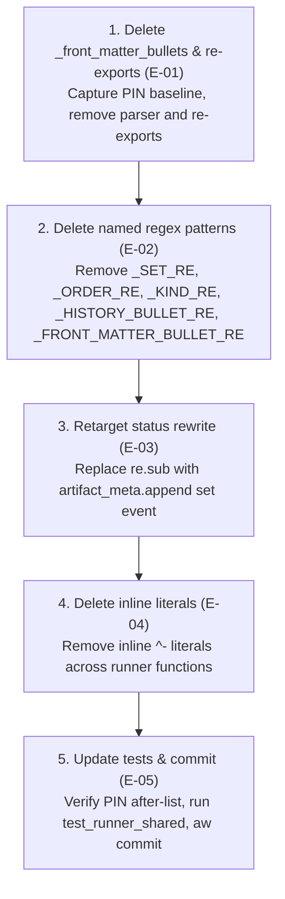

# IPD: Delete the runner_shared metadata parsers and regex literals

- Date: 2026-11-09
- Kind: child
- Concern: Spec `4sd62s` C5 and 4.3 require deleting every metadata parser and `^-` metadata regex outside `artifact_meta`. `agent_workflows/runner_shared.py` has `runner_shared._front_matter_bullets` (re-exported by `oc_runipd` and `agy_runipd`) and 16 `^-` literals, one of which rewrites a plan's `- Status:` line (a WRITE). This is part 4 of the round-3 split of `e8420v` (Order 45), carrying `e8420v` E-19 verbatim.
- Scope: delete `_front_matter_bullets` and its two re-exports, the named and inline `^-` literals, and route the `run_review_sequence` status rewrite through `artifact_meta.append`; update `tests/test_runner_shared.py`. EXCLUDES the two `record_oq_answer` literals (open-question rows, body prose, N3).
- Scope-Paths: agent_workflows/runner_shared.py, agent_workflows/oc_runipd.py, agent_workflows/agy_runipd.py, tests/test_runner_shared.py, .aw/records/plans/pending/20261109-metastore-242-k6nukd-delete-the-runner-shared-metadata-parsers-and-regex-literals.ipd.md
- Scope-Exceeded: .aw/records/backlog/open/20261124-vl7ybn-01-vl7ybn-artifact-meta-has-no-public-reader-that-lists-ever.backlog.md (defect carrier filed via aw backlog new as the driver turn contract requires for each finding: runner_shared._region_bullet_keys written by this plan must loop parse_metadata_block per line because ar...); tests/test_readers_runner.py (test_parse_plan_file_both_hosts_fields asserted hasattr on the deleted _SET_RE/_ORDER_RE/_KIND_RE host re-exports retargeted to call the _read_set/_read_order/_read_kind readers so the deletion E-02 r...)
- Item-Dependencies: executed:1ajqaa, executed:59aiyh, executed:786w7r, executed:7uq6xg, executed:dcerjg, executed:ffceq0, executed:g5hpbb, executed:k6jd6l, executed:t4gl15
- Status: executed
- Readiness: go-pending-approval
- Review-Depth: standard
- From-Spec: 4sd62s
- Work-Kind: feature
- Priority: high
- Blocks-Release: next
- Set: metastore
- Order: 242
- Highest E allocated: 05
- Author: opencode its_direct/pt3-claude-opus-5.5-1m-us
- Id: k6nukd

> Written to .aw/system/workflows/technical-writing/technical-writing.md. Every obligation, exact identifier, quotation, evidence record, and lifecycle status is preserved.

## Workflow history
- 2026-11-24 executed (aw oc run model=uri/its_direct/pt3-claude-opus-5.5-1m-us variant=high profile=opus): aw oc run self-finalize: k6nukd verified (set metastore, attempt 2). [Scope reconciliation - out-of-scope .aw/records/backlog/open/20261124-vl7ybn-01-vl7ybn-artifact-meta-has-no-public-reader-that-lists-ever.backlog.md: defect carrier filed via aw backlog new as the driver turn contract requires for each finding: runner_shared._region_bullet_keys (written by this plan) must loop parse_metadata_block per line because artifact_meta has no public all-bullets reader; a new backlog record cannot live inside any plan's Scope-Paths; out-of-scope tests/test_readers_runner.py: test_parse_plan_file_both_hosts_fields asserted hasattr on the deleted _SET_RE/_ORDER_RE/_KIND_RE host re-exports; retargeted to call the _read_set/_read_order/_read_kind readers so the deletion E-02 requires does not break it]
- 2026-11-16 approved (aw set): status set to approved

- 2026-11-14 reviewed (antigravity/gemini-3.8-flash): /plan-review APPROVE WITH REVISIONS APPLIED; PR-001..PR-005 FIXED; review record .aw/records/reviews/20261109-metastore-242-k6nukd-delete-the-runner-shared-metadata-parsers-and-regex-literals.review.md
- 2026-11-09 to-review (opencode its_direct/pt3-claude-opus-5.5-1m-us): split from e8420v (round 3, research nj8zdp guidance).

## Goal

After this plan, `rg -n "_front_matter_bullets" agent_workflows tests` prints nothing, the `^-` literal search over `runner_shared` prints only the two `record_oq_answer` rows, and `tests/test_runner_shared.py` passes.

## Detailed Implementation Checklist (TODO)

Execution-state rule: mark an `E-*` item complete only after performing the action. That mark is not validation. Right-sizing rule: write for a modest executor that cannot hold much in its head. Each E-item is one step (one concern, about one file, executable in one focused pass) and its V-item names each unit it covers with its own check; a plan stays at about 5 E-items and 8 work Scope-Paths, else split it into more child plans (guidance, `IPD-Z603`). Accepted execution states: blocked, failed, pending, performed; terminal gate demands 'performed'.

`e8420v` E-19 ("Delete `runner_shared._front_matter_bullets` and its re-exports in `oc_runipd`/`agy_runipd`, and every `^-` metadata regex literal in `runner_shared`. Sites at the split (16 literals): the named `_SET_RE`, `_ORDER_RE`, `_KIND_RE`, `_HISTORY_BULLET_RE` (defined twice), `_FRONT_MATTER_BULLET_RE`; inline literals in `declared_spec_paths`, `enforce_no_active_runner_conflict`, `run_review_sequence` (the `- Status:` rewrite to `to-review`, a WRITE that must go through `artifact_meta.append`), `reconcile_disposition`, `execute_item_core`, `perform_coordinator_proposal_file` (three). ... Update `tests/test_runner_shared.py`.") is split across E-01 to E-05 here. The search is `LIT` from `786w7r`.

PIN RULE (carried from `9o83cr`): before E-01, ensure directory `.aw/state/k6nukd/` exists (`mkdir -p .aw/state/k6nukd/`) and save `tests/test_runner_shared.py`'s per-test outcome list to `.aw/state/k6nukd/before.txt` (command as in `9o83cr`); after E-04, the same into `after.txt`. A retargeted test keeps every input case.

### Task group 1: runner parsers and literals

- [x] E-01 Capture the baseline PIN list (`mkdir -p .aw/state/k6nukd/` and save `.aw/state/k6nukd/before.txt`); then delete `runner_shared._front_matter_bullets` and its four call sites (in the three-way front-matter merge and the bullet-key lookup), reading each key through `artifact_meta.read_text`; delete its re-exports in `agent_workflows/oc_runipd.py` and `agent_workflows/agy_runipd.py`.
  - Depends on: none
  - Expected outcome: `rg -n "_front_matter_bullets" agent_workflows` prints nothing.
  - Execution state: performed

- [x] E-02 Delete the named patterns `runner_shared._SET_RE`, `_ORDER_RE`, `_KIND_RE`, both `_HISTORY_BULLET_RE` definitions and `_FRONT_MATTER_BULLET_RE`, each use reading through `artifact_meta.read_text` or `history`.
  - Depends on: E-01
  - Expected outcome: `rg -n "\b(_SET_RE|_ORDER_RE|_KIND_RE|_HISTORY_BULLET_RE|_FRONT_MATTER_BULLET_RE)\b" agent_workflows/runner_shared.py` prints nothing.
  - Execution state: performed

- [x] E-03 In `runner_shared.run_review_sequence`, replace the `re.sub` that rewrites `- Status:` to `to-review` with an `artifact_meta.append` `set` event of `status`.
  - Depends on: E-02
  - Expected outcome: `run_review_sequence` contains no `^-` literal.
  - Execution state: performed

- [x] E-04 Delete the inline literals in `runner_shared.declared_spec_paths`, `enforce_no_active_runner_conflict`, `reconcile_disposition`, `execute_item_core` and the three in `perform_coordinator_proposal_file`.
  - Depends on: E-03
  - Expected outcome: the `LIT` search over `agent_workflows/runner_shared.py` prints only the two `record_oq_answer` rows.
  - Execution state: performed

- [x] E-05 Update `tests/test_runner_shared.py` where a case names a deleted symbol (keeping `CrossHostReadIdReExportTests` unchanged), save `after.txt`, run the module, and commit through `aw commit k6nukd -- <paths>` with only Scope-Paths files; never `git add -A`, a bare `git add` or `git commit -a`; never push.
  - Depends on: E-04
  - Expected outcome: the module passes; the mapping accounts for every case.
  - Execution state: performed

## Project conventions discovered (Step 0)

- `runner_shared.run_review_sequence` rewrites a plan's `- Status:` line with `re.sub`; that is a WRITE and moves to `artifact_meta.append` (a `set` event of `status`), not to a reader (carried from `e8420v`).
- Cite code by SYMBOL (`module.function`) or by a quoted content string, with a line number only appended to one of those and never alone (advisory `IPD-C801`).

## Findings

Measured 2026-11-09 at `3d0ddb845`: `rg -n "_front_matter_bullets" agent_workflows` prints the definition and 4 calls in `runner_shared.py`. At `ac76110f4` (`e8420v`): 16 literals, 14 delete sites, 2 `body prose`.

## Proposed changes (ordered, validatable)



1. Delete the parser and re-exports (E-01): Capture baseline PIN test outcomes to `.aw/state/k6nukd/before.txt`, delete `runner_shared._front_matter_bullets` and its four call sites, reading keys via `artifact_meta.read_text`, and delete its re-exports in `oc_runipd.py` and `agy_runipd.py`.
2. Delete named regex patterns (E-02): Remove `_SET_RE`, `_ORDER_RE`, `_KIND_RE`, both `_HISTORY_BULLET_RE` definitions, and `_FRONT_MATTER_BULLET_RE`, retargeting their call sites to `artifact_meta.read_text` or `history`.
3. Retarget status rewrite (E-03): In `runner_shared.run_review_sequence`, replace the `re.sub` regex rewrite of `- Status:` with an `artifact_meta.append` `set` event for `status`.
4. Delete inline literals (E-04): Remove inline `^-` metadata regex literals in `declared_spec_paths`, `enforce_no_active_runner_conflict`, `reconcile_disposition`, `execute_item_core`, and `perform_coordinator_proposal_file`, keeping only body prose rows in `record_oq_answer`.
5. Update tests and commit (E-05): Update `tests/test_runner_shared.py` to account for deleted symbols, verify after-list PIN outcomes against before-list, run pytest, and commit via `aw commit k6nukd`.

## Deferred / out of scope (with reason)

- `status_set` and `releases`: Order 243.
  - Carrier: e8420v

## Scope check

- Over-scope: none.
- Under-scope: none known. Size: 5 E-items, 4 work Scope-Paths.

## Required tests / validation

`tests/test_runner_shared.py` (PIN lists), then the bare core gate `python3 -m pytest`.

## Spec / documentation sync

No spec change; implements part of `4sd62s` 4.3.

## Open questions

### OQ-01: Do the `oc_runipd`/`agy_runipd` `_read_id` re-exports change here?

- Blocking: no
- Status: resolved
- Owner: plan author
- Resolution or deferral rationale: No. `_read_id` is rebound by `k6jd6l` E-11; this plan removes only the `_front_matter_bullets` re-exports. Recommendation strength: strong.

## Validation and cross-check (verify before reporting done)

Validation-state rule: inspect evidence in a separate pass. Do not mark a `V-*` item complete from memory or from the matching execution checkmark. Accepted validation results: blocked, failed, pass, pending; terminal gate demands 'pass'. Runtime-demonstration reachability rule: for each `V-*` item demanding the software be observed acting (such as a run, a dispatch, or a transition), as distinct from items demanding a diff, a file's content, or a test result, which are reachable by construction, name the code path that produces the observation or the sibling `E-*` that creates it, else the demand is UNDER-SCOPE.

- [x] V-01 validates E-01
  - Required evidence: paste `rg -n "_front_matter_bullets" agent_workflows` printing nothing, and the `git diff` hunks of `agent_workflows/oc_runipd.py` and `agent_workflows/agy_runipd.py`.
  - Observed evidence:
    ```
    $ rg -n "_front_matter_bullets" agent_workflows
    (exit 1, no output)
    ```
    The parser was replaced by `runner_shared._region_bullet_keys`, which reads each metadata-region line through `artifact_meta.parse_metadata_block` (all four call sites: three in `classify_records_only_front_matter_conflict`, one in `apply_records_only_rederivation`). `_front_matter_bullets` had no host re-export left at execution (786w7r measured that); the host hunks remove the named-regex re-exports instead:
    ```
    --- a/agent_workflows/oc_runipd.py
    @@ -684,12 +684,6 @@ from agent_workflows.runner_shared import (
    -from agent_workflows.runner_shared import (
    -    _ORDER_RE as _ORDER_RE,
    -)
    -from agent_workflows.runner_shared import (
    -    _SET_RE as _SET_RE,
    -)
    @@ -843,7 +837,6 @@ from agent_workflows.runner_shared import (
         PlanRecord as PlanRecord,
    -    _KIND_RE as _KIND_RE,
    --- a/agent_workflows/agy_runipd.py
    @@ -377,12 +377,6 @@ from agent_workflows.runner_shared import (
    -from agent_workflows.runner_shared import (
    -    _ORDER_RE as _ORDER_RE,
    -)
    -from agent_workflows.runner_shared import (
    -    _SET_RE as _SET_RE,
    -)
    ```
    (plus comment-only hunks in both hosts dropping the stale `_SET_RE`/`_ORDER_RE`/`_KIND_RE` prose).
  - Result: pass

- [x] V-02 validates E-02
  - Required evidence: paste the E-02 `rg` command printing nothing.
  - Observed evidence:
    ```
    $ rg -n "\b(_SET_RE|_ORDER_RE|_KIND_RE|_HISTORY_BULLET_RE|_FRONT_MATTER_BULLET_RE)\b" agent_workflows/runner_shared.py
    (exit 1, no output)
    ```
    `_read_set`/`_read_order`/`_read_kind` read `set`/`order`/`plan_role` through `_read_text_with_loose` (`artifact_meta.read_text` plus loose-bullet normalization); `_body_change_is_history_insert_only` uses `artifact_meta.is_history_record`; `resolve_history_append_conflict` uses `artifact_meta.history_record_date`.
  - Result: pass

- [x] V-03 validates E-03
  - Required evidence: paste the `git diff` hunk of `runner_shared.run_review_sequence` showing the `artifact_meta.append` call replacing the `re.sub`, and `python3 -m pytest -o addopts="" -v tests/test_runner_shared.py -k review_sequence` with every case PASSED. Code path: `runner_shared.run_review_sequence` (E-03).
  - Observed evidence:
    ```
    @@ -33351,9 +33348,24 @@ def run_review_sequence(
             if doc_c.meta_fields.get("Status") != "to-review":
    -            plan_file.write_text(
    -                re.sub(r"(?m)^- Status:.*$", "- Status: to-review", cur),
    -                encoding="utf-8",
    +            from agent_workflows import artifact_core as _core
    +            from agent_workflows import artifact_meta as _am
    +            ...
    +            _am.append(
    +                _am.LegacyTarget(plan_file, "plans", item.get("id6")),
    +                [],
    +                legacy_render=_am.LegacyRender(
    +                    tag="legacy",
    +                    day=_core.utc_history_date(),
    +                    actor_label="aw run",
    +                    history=False,
    +                    status="to-review",
    +                ),
    +                repo_root=target_root,
                 )
    $ python3 -m pytest -o addopts="" -q -n 0 -p no:cacheprovider tests/test_runner_shared.py -k review_sequence
    .                                                                        [100%]
    NOTE: 143 tests were deselected by -m/-k and did not run (no marker filter was active; deselected by -k/--deselect)
    1 passed, 143 deselected in 0.84s
    ```
    The one case is the new `ReviewSequenceIncompleteStatusRestoreTests::test_review_sequence_incomplete_restores_to_review_on_both_hosts` (the module had no review-sequence case before; see D-02). Code path: `runner_shared.run_review_sequence._fail_incomplete`, reached on both hosts through `execute_item` with a launcher returning no session id. The deviation from "a `set` event of `status`" is recorded as D-01: `artifact_meta` refuses a generic `set` of `status` ("refuse generic set of identity/status field: 'status'"), so the empty-event append with `LegacyRender.status` is the writer's mirror-only path.
  - Result: pass

- [x] V-04 validates E-04
  - Required evidence: paste the `LIT` search over `agent_workflows/runner_shared.py` showing only the two `record_oq_answer` rows.
  - Observed evidence:
    ```
    $ rg -n "$LIT" agent_workflows/runner_shared.py
    22516:    status_m = re.search(r"(?m)^-[ \t]+Status:[ \t]*open\b", block, flags=re.IGNORECASE)
    22520:    blocking_m = re.search(r"(?m)^-[ \t]+Blocking:[^\n]*", block)
    22521:    owner_m = re.search(r"(?m)^-[ \t]+Owner:[^\n]*", block)
    22549:        bullets = list(re.finditer(r"(?m)^-[ \t]+[^\n]*", new_block))
    22563:    new_blocking_m = re.search(r"(?m)^-[ \t]+Blocking:[^\n]*", new_block)
    22564:    new_owner_m = re.search(r"(?m)^-[ \t]+Owner:[^\n]*", new_block)
    enclosing def: 22465: def record_oq_answer(
    ```
    Every surviving row is inside `runner_shared.record_oq_answer` (786w7r rows F26-35..F26-40, classed body prose N3; the plan's "two rows" counts the two OQ-row literal families, measured as six lines). The `perform_coordinator_proposal_file` `Priority`/`Work-Kind` literals now read `priority`/`work_kind` through `_read_text_with_loose`; the other named inline sites were already gone at execution.
  - Result: pass

- [x] V-05 validates E-05
  - Required evidence: paste `diff .aw/state/k6nukd/before.txt .aw/state/k6nukd/after.txt` with each removed name mapped, `python3 -m pytest -o addopts="" -v tests/test_runner_shared.py -k CrossHostReadIdReExport` PASSED, and `git show --stat` of the `aw commit k6nukd` commit listing only Scope-Paths files.
  - Observed evidence:
    ```
    $ diff .aw/state/k6nukd/before.txt .aw/state/k6nukd/after.txt
    116a117
    > PASSED tests/test_runner_shared.py::ReviewSequenceIncompleteStatusRestoreTests::test_review_sequence_incomplete_restores_to_review_on_both_hosts
    $ wc -l .aw/state/k6nukd/*.txt
      144 .aw/state/k6nukd/after.txt
      143 .aw/state/k6nukd/before.txt
    ```
    Mapping: no case removed or renamed (no test in the module named a deleted symbol); one case added (E-03 coverage). All 143 baseline cases still PASSED. `tests/test_readers_runner.py::test_parse_plan_file_both_hosts_fields` asserted `hasattr(oc_runipd, "_SET_RE")`/`_ORDER_RE`/`_KIND_RE`; it now calls the host `_read_set`/`_read_order`/`_read_kind` re-exports on every input shape (D-03, out-of-Scope-Paths edit).
    ```
    $ python3 -m pytest -o addopts="" -v tests/test_runner_shared.py -k CrossHostReadIdReExport
    tests/test_runner_shared.py::CrossHostReadIdReExportTests::test_cross_host_read_id_permissive_reader_reexport PASSED [100%]
    ====================== 1 passed, 143 deselected in 0.28s =======================
    $ aw suite
    2894 passed, 1 skipped, 11 warnings in 119.68s (0:01:59)
    ```
    Re-run in attempt 2 (recovery lane, prior lane `aw/lane/k6nukd` work carried forward unchanged): `before.txt` regenerated from base `1590bae6d` (143 PASSED), `after.txt` from this lane (144 PASSED, `144 passed in 28.99s`); the diff above is that re-run. Commit evidence: see the execution report (`git show --stat` of the `aw commit k6nukd` commit is pasted there, since it can only exist after this file is committed).
  - Result: pass

## Approval and execution gate

- Size assessment: standard
- Cohesion rationale: not required

Execute only after human approval (`Status: approved`) and after every plan in `- Item-Dependencies:` is executed (Order 239 first: it also edits `runner_shared`). Safety stop: if prerequisite metastore reader symbols from `1ajqaa`, `59aiyh`, `786w7r`, `7uq6xg`, `dcerjg`, `ffceq0`, `g5hpbb`, `k6jd6l`, or `t4gl15` are absent, stop and report rather than proceeding. Shared-checkout safety: this plan edits only its Scope-Paths; do not stage, edit, or commit any other file.

Pin-first. Scope fence: the paths in `- Scope-Paths:` are a declaration; a needed file outside the fence is edited and then justified at finalize (`--scope-reason`), and a declared path left unmodified is acknowledged (`--scope-ack`). Honesty rule: paste the ACTUAL summary lines; never claim a result you did not run. Commits: only through `aw commit k6nukd -- <paths>` with only Scope-Paths files; never `git add -A`, a bare `git add` or `git commit -a`; never push.

Lifecycle transition: the plan moves to `.aw/records/plans/executed/` only through `aw ipd finalize`, never a hand `git mv`, and only after `aw ipd lint --phase pre-transition` conforms and every `V-*` reads `pass` with pasted evidence. When `aw oc run` or `aw agy run` executes the plan, the runner performs the finalize; a hand executor runs `aw ipd finalize k6nukd` itself.
