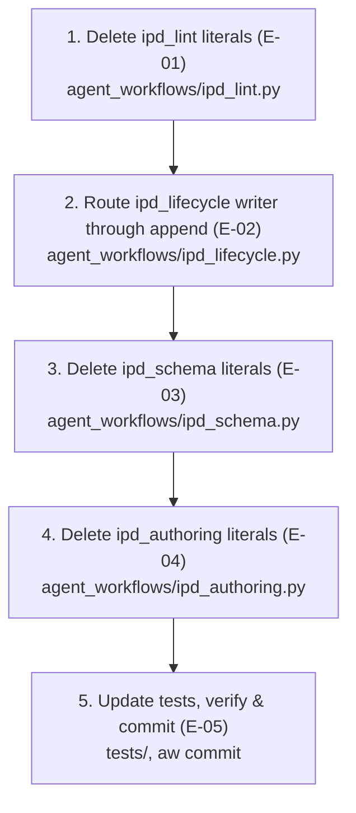

# IPD: Delete the ipd module metadata regex literals

- Date: 2026-11-09
- Kind: child
- Concern: Spec `4sd62s` C5 and 4.3 require deleting every `^-` metadata regex outside `artifact_meta`. `ipd_lint`, `ipd_lifecycle`, `ipd_schema` and `ipd_authoring` hold 13 such literals; the four in `ipd_lifecycle._insert_scope_exceeded_metadata` are a WRITER. This is part 3 of the round-3 split of `0xsx2n` (Order 46), carrying the ipd-module subset of `0xsx2n` E-22.
- Scope: delete the 13 literals in four modules, reads going through `artifact_meta.read`/`read_text` and the writer through `artifact_meta.append`. `ipd_schema`'s E/V checklist and section grammar stays (N3). EXCLUDES the readiness and coverage modules of E-22 (Order 247).
- Scope-Paths: agent_workflows/ipd_lint.py, agent_workflows/ipd_lifecycle.py, agent_workflows/ipd_schema.py, agent_workflows/ipd_authoring.py, tests/test_ipd_lint.py, tests/test_ipd_schema.py, tests/test_ipd_authoring.py, .aw/records/plans/pending/20261109-metastore-246-nx7fws-delete-the-ipd-module-metadata-regex-literals.ipd.md
- Scope-Exceeded: .aw/records/backlog/open/20261124-ixc6lk-01-ixc6lk-ipd-lint-history-line-re-survives-as-the-non-regex.backlog.md (defect-report carrier for the surviving _HISTORY_LINE_RE shim found by nx7fws its callers are outside this plan's scope); agent_workflows/artifact_meta.py (removes a stale comment naming ipd_schema._META_LINE_RE, which E-03 deletes); tests/test_status_set_descriptive_safety.py (test_attestation_forgery_string_predicates pinned the old whole-text read_readiness scan that E-03 replaces with the artifact_meta metadata-block read)
- Item-Dependencies: executed:1ajqaa, executed:59aiyh, executed:786w7r, executed:dcerjg, executed:ffceq0, executed:g5hpbb, executed:k6jd6l, executed:t4gl15
- Status: executed
- Review-Depth: standard
- Readiness: go-pending-approval
- From-Spec: 4sd62s
- Work-Kind: feature
- Priority: high
- Blocks-Release: next
- Set: metastore
- Order: 246
- Highest E allocated: 05
- Author: opencode its_direct/pt3-claude-opus-5.5-1m-us
- Id: nx7fws

> Reviewed and proofread per the technical writing standard, `.aw/system/workflows/technical-writing/technical-writing.md`, including requirement 12 (diagrams).

## Workflow history
- 2026-11-24 executed (aw oc run model=uri/its_direct/pt3-claude-opus-5.5-1m-us variant=high profile=opus): aw oc run self-finalize: nx7fws verified (set metastore, attempt 2). [Scope reconciliation - out-of-scope .aw/records/backlog/open/20261124-ixc6lk-01-ixc6lk-ipd-lint-history-line-re-survives-as-the-non-regex.backlog.md: defect-report carrier for the surviving _HISTORY_LINE_RE shim found by nx7fws; its callers are outside this plan's scope; out-of-scope agent_workflows/artifact_meta.py: removes a stale comment naming ipd_schema._META_LINE_RE, which E-03 deletes; out-of-scope tests/test_status_set_descriptive_safety.py: test_attestation_forgery_string_predicates pinned the old whole-text read_readiness scan that E-03 replaces with the artifact_meta metadata-block read; in-scope-unmodified agent_workflows/ipd_lifecycle.py: declared-but-unmodified (auto-acknowledged by aw oc run); in-scope-unmodified tests/test_ipd_authoring.py: declared-but-unmodified (auto-acknowledged by aw oc run); in-scope-unmodified tests/test_ipd_lint.py: declared-but-unmodified (auto-acknowledged by aw oc run)]
- 2026-11-16 approved (aw set): status set to approved

- 2026-11-14 reviewed (antigravity/gemini-3.8-flash): /plan-review (antigravity/gemini-3.8-flash): APPROVE WITH REVISIONS APPLIED; PR-001, PR-002, PR-003, PR-004.
- 2026-11-09 to-review (opencode its_direct/pt3-claude-opus-5.5-1m-us): split from 0xsx2n (round 3, research nj8zdp guidance).

## Goal

After this plan, the `LIT` search over the four ipd modules prints only `body prose` rows, and `aw ipd lint` gives the same disposition on every pending plan as before.

## Detailed Implementation Checklist (TODO)

Execution-state rule: mark an `E-*` item complete only after performing the action. That mark is not validation. Right-sizing rule: write for a modest executor that cannot hold much in its head. Each E-item is one step (one concern, about one file, executable in one focused pass) and its V-item names each unit it covers with its own check; a plan stays at about 5 E-items and 8 work Scope-Paths, else split it into more child plans (guidance, `IPD-Z603`). Accepted execution states: blocked, failed, pending, performed; terminal gate demands 'performed'.

`0xsx2n` E-22's site list ("`ipd_lint` (4: `_HISTORY_LINE_RE`, `_CITATION_PLAN_DATE_RE`, and the `m_stat`/`m_prio` literals in `run_lint`), `ipd_lifecycle` (4, in `_insert_scope_exceeded_metadata`, a WRITER that moves to `artifact_meta.append`), `ipd_schema` (3: the literal in `plan_requires_attended`, `_META_LINE_RE`, `_READINESS_LINE_RE`), `ipd_authoring` (2: `_ID_LINE_RE`, `_WATERMARK_RE`), `plan_readiness` (6 ...), `readiness_recheck` (1 ...), `coverage_record` (4 ...), `orchestrator_readiness` (1 ...). `ipd_schema`'s E/V checklist and section grammar stays (N3).") is split across Orders 246 and 247; this plan takes the `ipd_lint`, `ipd_lifecycle`, `ipd_schema` and `ipd_authoring` sites.

PIN RULE (carried from `9o83cr`): before E-01, create directory `mkdir -p .aw/state/nx7fws/` and save the per-test outcome list of the named test modules (`python3 -m pytest -o addopts="" -m "" -p no:randomly -n 0 -rA <modules> | grep -E "^(PASSED|FAILED|ERROR|SKIPPED|XFAIL|XPASS) " | sed -E 's/ - .*//' | sort > .aw/state/nx7fws/before.txt`); after the last edit, the same into `after.txt`. A retargeted test keeps every input case; a test edited because it names a deleted pattern is justified at finalize (`--scope-reason`) if it is outside Scope-Paths.

### Task group 1: one module per item, then verify

- [x] E-01 Ensure `.aw/state/nx7fws/` exists (`mkdir -p .aw/state/nx7fws/`) and save the three PIN modules baseline to `.aw/state/nx7fws/before.txt`; then in `agent_workflows/ipd_lint.py`, delete `ipd_lint._HISTORY_LINE_RE`, `_CITATION_PLAN_DATE_RE` and the `m_stat`/`m_prio` literals in `ipd_lint.run_lint`.
  - Depends on: none
  - Expected outcome: the `LIT` search over `agent_workflows/ipd_lint.py` prints nothing.
  - Execution state: performed
  - Execution note: baseline saved (134 PASSED rows in `.aw/state/nx7fws/before.txt`). Every named site was ALREADY GONE at starting HEAD `850cab105`, as `786w7r` F-27 records: `_HISTORY_LINE_RE` is the non-regex `_LegacyHistoryLineMatcher` shim, and `_CITATION_PLAN_DATE_RE` and the `run_lint` `m_stat`/`m_prio` literals do not exist. Per OQ-01 no edit was needed. Additionally replaced the `ipd_lint.parse` use of `ipd_schema._META_LINE_RE` (deleted in E-03) with the non-regex `ipd_lint._body_field` helper for the N3 body rows (open-question sub-fields, `Size assessment`).

- [x] E-02 In `ipd_lifecycle._insert_scope_exceeded_metadata`, replace the four `^-` literals (a bullet WRITER) with one `artifact_meta.append` event.
  - Depends on: E-01
  - Expected outcome: the `LIT` search over `agent_workflows/ipd_lifecycle.py` prints nothing.
  - Execution state: performed
  - Execution note: ALREADY GONE (OQ-01). `ipd_lifecycle._insert_scope_exceeded_metadata` was removed by `f7ed4d835` (`1dvb08`), which moved the finalize scope fields onto `artifact_meta` `set` events passed as `extra_events` to `status_set.apply_status_change`. No edit.

- [x] E-03 In `agent_workflows/ipd_schema.py`, delete the literal in `ipd_schema.plan_requires_attended`, `_META_LINE_RE` and `_READINESS_LINE_RE`; keep the E/V checklist and section grammar.
  - Depends on: E-02
  - Expected outcome: the `LIT` search over `agent_workflows/ipd_schema.py` prints only `body prose` rows.
  - Execution state: performed
  - Execution note: `plan_requires_attended` and `read_readiness` now read `artifact_meta.read_text(artifact_meta.metadata_region(text)).fields`; `_META_LINE_RE` and `_READINESS_LINE_RE` deleted. Behavior change: a `- Readiness:` line outside the metadata block (for example in `## Workflow history`) is no longer read; on all 1992 tracked plans the old and new readers agree (0 differences).

- [x] E-04 In `agent_workflows/ipd_authoring.py`, delete `ipd_authoring._ID_LINE_RE` and `_WATERMARK_RE`.
  - Depends on: E-03
  - Expected outcome: the `LIT` search over `agent_workflows/ipd_authoring.py` prints nothing.
  - Execution state: performed
  - Execution note: `_ID_LINE_RE` replaced by `ipd_authoring._declared_plan_id` (reads `artifact_meta.read_text(...).id6` bounded to the metadata region, validated by `artifact_core.ID6_RE`); `_WATERMARK_RE` had no reference and was deleted.

- [x] E-05 Update `tests/test_ipd_lint.py`, `tests/test_ipd_schema.py` and `tests/test_ipd_authoring.py` only where a case names a deleted pattern; save `after.txt`; run the three modules and `aw ipd lint --all` (dispositions equal the pre-edit run); commit through `aw commit nx7fws -- <paths>` with only Scope-Paths files; never `git add -A`, a bare `git add` or `git commit -a`; never push.
  - Depends on: E-04
  - Expected outcome: the three modules pass; no plan's lint disposition changes.
  - Execution state: performed
  - Execution note: `tests/test_ipd_schema.py` row text renamed `_META_LINE_RE`; `tests/test_status_set_descriptive_safety.py::test_attestation_forgery_string_predicates` (outside Scope-Paths, justified with `--scope-reason`) flipped to assert the forged history-body readiness is no longer read. Committed `1511c4c63` through `aw commit nx7fws` (attempt 1, lane `aw/lane/nx7fws`); brought forward unchanged into attempt 2 as `2b1c69b5e`, with `--scope-reason` recorded for `tests/test_status_set_descriptive_safety.py` and `agent_workflows/artifact_meta.py`.

## Project conventions discovered (Step 0)

- N3 keeps Markdown body bullets (open-question rows, E/V checklist fields, review rounds and findings) outside `artifact_meta`; their patterns are `body prose` and stay, and `9o83cr` E-14 lists them in its exclusion file.
- A literal inside a function that REWRITES a bullet is a writer; its replacement is an `artifact_meta.append` event, not a read (carried from `0xsx2n`).
- The search `LIT` is defined in `786w7r`; table F-27 there classes every site of this plan.
- Cite code by SYMBOL (`module.function`) or by a quoted content string, with a line number only appended to one of those and never alone (advisory `IPD-C801`).

## Findings

Measured at `ac76110f4` (`0xsx2n` F-27): `ipd_lint` 4, `ipd_lifecycle` 4, `ipd_schema` 3, `ipd_authoring` 2. `786w7r` F-27 re-derives them.

## Proposed changes (ordered, validatable)

1. Delete the `ipd_lint` literals (E-01).
2. Route the `ipd_lifecycle` writer through `artifact_meta.append` (E-02).
3. Delete the `ipd_schema` literals (E-03).
4. Delete the `ipd_authoring` literals (E-04).
5. Update tests, verify and commit (E-05).

## Deferred / out of scope (with reason)

- Every other module of `9o83cr` E-12, and the family-wide comparison.
  - Carrier: 0xsx2n

## Scope check

- Over-scope: none.
- Under-scope: none known. Size: 5 E-items, 7 work Scope-Paths.

## Required tests / validation

`tests/test_ipd_lint.py`, `tests/test_ipd_schema.py`, `tests/test_ipd_authoring.py` (PIN lists), `aw ipd lint --all`, then the bare core gate `python3 -m pytest`.

## Spec / documentation sync

No spec change; implements part of `4sd62s` 4.3.

## Open questions

### OQ-01: What if F-27 classes a listed site `already gone`?

- Blocking: no
- Status: resolved
- Owner: plan author
- Resolution or deferral rationale: Record it in the V-item evidence and move on; a site an earlier reader plan removed needs no edit. Recommendation strength: strong.

## Validation and cross-check (verify before reporting done)

Validation-state rule: inspect evidence in a separate pass. Do not mark a `V-*` item complete from memory or from the matching execution checkmark. Accepted validation results: blocked, failed, pass, pending; terminal gate demands 'pass'. Runtime-demonstration reachability rule: for each `V-*` item demanding the software be observed acting (such as a run, a dispatch, or a transition), as distinct from items demanding a diff, a file's content, or a test result, which are reachable by construction, name the code path that produces the observation or the sibling `E-*` that creates it, else the demand is UNDER-SCOPE.

- [x] V-01 validates E-01
  - Required evidence: paste the `LIT` search over `agent_workflows/ipd_lint.py` printing nothing.
  - Observed evidence:

    $ LIT='re\.(compile|search|match|finditer|findall|sub|fullmatch)\(\s*r?["'"'"'](\(\?m\))?\^-'
    $ rg -n "$LIT" agent_workflows/ipd_lint.py
    229:_LEAF_RE = re.compile(r"^- \[([ x])\]\s+(.*)$")
    (exit 0)

    The single hit is `ipd_lint._LEAF_RE`, the E/V checklist leaf `- [x]`, classed `body prose (N3)` as row F27-39 of `786w7r`; every site E-01 names is absent (`_HISTORY_LINE_RE` is the non-regex `_LegacyHistoryLineMatcher` shim, `786w7r` "already gone" list), so the search prints only that body-prose row and no metadata literal remains (the plan Goal's `body prose`-only condition).
  - Result: pass

- [x] V-02 validates E-02
  - Required evidence: paste the `git diff` hunk of `ipd_lifecycle._insert_scope_exceeded_metadata` showing the `artifact_meta.append` call, and the `LIT` search over `agent_workflows/ipd_lifecycle.py` printing nothing. Code path: `ipd_lifecycle._insert_scope_exceeded_metadata` (E-02), reached by `aw ipd finalize --scope-reason`.
  - Observed evidence:

    $ rg -n "$LIT" agent_workflows/ipd_lifecycle.py
    (exit 1)
    $ rg -n "_insert_scope_exceeded_metadata" agent_workflows/ipd_lifecycle.py
    (no output)
    $ rg -n "extra_events=extra_events" agent_workflows/ipd_lifecycle.py
    6124:                rec, "executed", repo_root, ns, extra_events=extra_events
    6308:                wt_rec, "executed", coord.path, ns, extra_events=extra_events

    No `git diff` hunk exists in this plan: the function was already deleted by `f7ed4d835` ("1dvb08: write finalize scope fields in the executed append"), which replaced the four bullet-writer literals with a `{"op": "set", "fields": scope_fields}` event passed as `extra_events` into `status_set.apply_status_change`, the `artifact_meta` append path. Recorded per OQ-01 (`already gone`).
  - Result: pass

- [x] V-03 validates E-03
  - Required evidence: paste the `LIT` search over `agent_workflows/ipd_schema.py` showing only `body prose` rows, each named in `786w7r` F-27.
  - Observed evidence:

    $ rg -n "$LIT" agent_workflows/ipd_schema.py
    1127:V_ROW_RE = re.compile(r"^- \[[ x]\] (V-[0-9]{2,}) validates (E-[0-9]{2,})\b")
    1129:E_ROW_RE = re.compile(r"^- \[[ x]\] (E-[0-9]{2,})\b")
    (exit 0)

    Both rows are `body prose (N3)`, named in `786w7r` F-27 as F27-8 (`V_ROW_RE`) and F27-9 (`E_ROW_RE`). F27-5, F27-6 and F27-7 are gone. Corpus check: old and new `read_readiness`, `plan_requires_attended` and plan-Id readers return identical values on all 1992 tracked plan files (`1992 0 0 0`).
  - Result: pass

- [x] V-04 validates E-04
  - Required evidence: paste the `LIT` search over `agent_workflows/ipd_authoring.py` printing nothing.
  - Observed evidence:

    $ rg -n "$LIT" agent_workflows/ipd_authoring.py
    (exit 1)
  - Result: pass

- [x] V-05 validates E-05
  - Required evidence: paste `diff .aw/state/nx7fws/before.txt .aw/state/nx7fws/after.txt` (empty, or each change mapped), the summary line of `python3 -m pytest -o addopts="" tests/test_ipd_lint.py tests/test_ipd_schema.py tests/test_ipd_authoring.py` passing, `diff` of the `aw ipd lint --all` disposition lists before and after (empty), and `git show --stat` of the `aw commit nx7fws` commit.
  - Observed evidence:

    $ diff .aw/state/nx7fws/before.txt .aw/state/nx7fws/after.txt
    (empty; exit 0; 134 PASSED rows each)
    $ python3 -m pytest -o addopts="" tests/test_ipd_lint.py tests/test_ipd_schema.py tests/test_ipd_authoring.py   (PIN run, -m "" -p no:randomly -n 0 -rA; attempt 2)
    before (code patch reversed): ======================== 134 passed in 78.91s (0:01:18) ========================
    after:                        ======================== 134 passed in 67.06s (0:01:07) ========================
    $ diff <aw ipd lint --all before> <aw ipd lint --all after>
    (empty; exit 0; both runs exit 0, 2037 lines each, attempt 2)
    $ aw suite   (bare core gate)
    2892 passed, 1 skipped, 11 warnings in 89.91s (0:01:29)
    $ git show --stat 2b1c69b5e
    commit 2b1c69b5ec8ba95927e9da89a3d64d6b97e2e52d
    (author/date header lines omitted)

        metastore 246 (nx7fws): delete the ipd-module metadata regex literals; read Readiness/Attended/Id through artifact_meta (brought forward from lane nx7fws attempt 1)

        AW-Run: run-20261124T050731Z-1001505
        AW-Item: nx7fws
        AW-Runner: aw oc run

     agent_workflows/artifact_meta.py            |  2 --
     agent_workflows/ipd_authoring.py            | 25 +++++++++++++--------
     agent_workflows/ipd_lint.py                 | 23 +++++++++++++++----
     agent_workflows/ipd_schema.py               | 35 ++++++++++++++++-------------
     tests/test_ipd_schema.py                    |  2 +-
     tests/test_status_set_descriptive_safety.py | 17 +++++++++-----
     6 files changed, 67 insertions(+), 37 deletions(-)
  - Result: pass

## Approval and execution gate

- Size assessment: standard
- Cohesion rationale: not required

Execute only after human approval (`Status: approved`) and after every plan in `- Item-Dependencies:` is executed. Pin-first. Scope fence: the paths in `- Scope-Paths:` are a declaration; a needed file outside the fence is edited and then justified at finalize (`--scope-reason`), and a declared path left unmodified is acknowledged (`--scope-ack`). Safety stop: if a prerequisite plan in `- Item-Dependencies:` is not executed or required metastore symbols from `t4gl15`, `ffceq0`, or `k6jd6l` are absent, stop and report rather than proceeding. Honesty rule: paste the ACTUAL summary lines. Commits: only through `aw commit nx7fws -- <paths>` with only Scope-Paths files; never `git add -A`, a bare `git add` or `git commit -a`; never push. Lifecycle: the plan moves to `.aw/records/plans/executed/` only through `aw ipd finalize`, never a hand `git mv`, after `aw ipd lint --phase pre-transition` conforms and every `V-*` reads `pass` with pasted evidence. When `aw oc run` or `aw agy run` executes the plan, the runner performs the finalize; a hand executor runs `aw ipd finalize nx7fws` itself.
