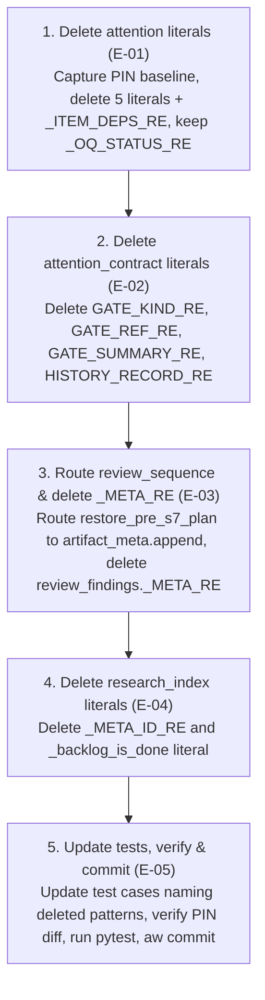

# IPD: Delete the attention review and research metadata regex literals

- Date: 2026-11-09
- Kind: child
- Concern: Spec `4sd62s` C5 and 4.3 require deleting every `^-` metadata regex outside `artifact_meta`. `attention`, `attention_contract`, `review_sequence`, `review_findings` and `research_index` hold 17 such literals, including `review_findings._META_RE`, which `9o83cr` E-12 names; the two in `review_sequence.restore_pre_s7_plan` are a WRITER. This is part 5 of the round-3 split of `0xsx2n` (Order 46), carrying `0xsx2n` E-23 verbatim.
- Scope: delete the 17 literals in five modules; `attention._OQ_STATUS_RE` and the `review_findings` round and finding grammar stay (N3). EXCLUDES every other module.
- Scope-Paths: agent_workflows/attention.py, agent_workflows/attention_contract.py, agent_workflows/review_sequence.py, agent_workflows/review_findings.py, agent_workflows/research_index.py, tests/test_review_findings_gate.py, tests/test_attention.py, tests/test_review_sequence.py, .aw/records/plans/pending/20261109-metastore-248-tdhav3-delete-the-attention-review-and-research-metadata-regex-lite.ipd.md
- Scope-Exceeded: .aw/records/backlog/open/20261124-p1gshz-01-p1gshz-metastore-deletion-plans-compare-aw-attention-form.backlog.md (defect-report carrier required by the driver prompt found by tdhav3 V-05 comparing aw attention against 786w7r F-30); agent_workflows/artifact_meta.py (adds artifact_meta.is_history_record/history_record_date so the history record grammar deleted from attention_contract by tdhav3 E-02 has one owner in artifact_meta spec 4sd62s C5); agent_workflows/backlog.py (retargets a caller of the attention_contract HISTORY_RECORD_RE/GATE_SUMMARY_RE pattern that tdhav3 E-02 deletes 786w7r F-27 note, backlog yb6z41); agent_workflows/ipd_lifecycle.py (retargets a caller of the attention_contract HISTORY_RECORD_RE/GATE_SUMMARY_RE pattern that tdhav3 E-02 deletes 786w7r F-27 note, backlog yb6z41); agent_workflows/plan_readiness.py (retargets a caller of the attention_contract HISTORY_RECORD_RE/GATE_SUMMARY_RE pattern that tdhav3 E-02 deletes 786w7r F-27 note, backlog yb6z41); agent_workflows/record_history.py (retargets a caller of the attention_contract HISTORY_RECORD_RE/GATE_SUMMARY_RE pattern that tdhav3 E-02 deletes 786w7r F-27 note, backlog yb6z41); agent_workflows/specs.py (retargets a caller of the attention_contract HISTORY_RECORD_RE/GATE_SUMMARY_RE pattern that tdhav3 E-02 deletes 786w7r F-27 note, backlog yb6z41); tests/test_attention_contract.py (test names the attention_contract pattern tdhav3 E-02 deletes retargeted onto artifact_meta with every input case kept 786w7r F-27 note, backlog yb6z41); tests/test_backlog.py (test names the attention_contract pattern tdhav3 E-02 deletes retargeted onto artifact_meta with every input case kept 786w7r F-27 note, backlog yb6z41); tests/test_backlog_history_dedup_parity.py (test names the attention_contract pattern tdhav3 E-02 deletes retargeted onto artifact_meta with every input case kept 786w7r F-27 note, backlog yb6z41); tests/test_history_label_parity.py (test names the attention_contract pattern tdhav3 E-02 deletes retargeted onto artifact_meta with every input case kept 786w7r F-27 note, backlog yb6z41); tests/test_history_provenance.py (test names the attention_contract pattern tdhav3 E-02 deletes retargeted onto artifact_meta with every input case kept 786w7r F-27 note, backlog yb6z41); tests/test_set_dispatch_parity.py (test names the attention_contract pattern tdhav3 E-02 deletes retargeted onto artifact_meta with every input case kept 786w7r F-27 note, backlog yb6z41); tests/test_status_set.py (test names the attention_contract pattern tdhav3 E-02 deletes retargeted onto artifact_meta with every input case kept 786w7r F-27 note, backlog yb6z41)
- Item-Dependencies: executed:1ajqaa, executed:59aiyh, executed:786w7r, executed:dcerjg, executed:ffceq0, executed:g5hpbb, executed:k6jd6l, executed:t4gl15
- Status: executed
- Readiness: go-pending-approval
- Review-Depth: standard
- From-Spec: 4sd62s
- Work-Kind: feature
- Priority: high
- Blocks-Release: next
- Set: metastore
- Order: 248
- Highest E allocated: 05
- Author: opencode its_direct/pt3-claude-opus-5.5-1m-us
- Id: tdhav3

> Written to .aw/system/workflows/technical-writing/technical-writing.md. Every obligation, exact identifier, quotation, evidence record, and lifecycle status is preserved.

## Workflow history
- 2026-11-24 executed (aw oc run model=uri/its_direct/pt3-claude-opus-5.5-1m-us variant=high profile=opus): aw oc run self-finalize: tdhav3 verified (set metastore, attempt 1). [Scope reconciliation - out-of-scope .aw/records/backlog/open/20261124-p1gshz-01-p1gshz-metastore-deletion-plans-compare-aw-attention-form.backlog.md: defect-report carrier required by the driver prompt; found by tdhav3 V-05 comparing aw attention against 786w7r F-30; out-of-scope agent_workflows/artifact_meta.py: adds artifact_meta.is_history_record/history_record_date so the history record grammar deleted from attention_contract by tdhav3 E-02 has one owner in artifact_meta (spec 4sd62s C5); out-of-scope agent_workflows/backlog.py: retargets a caller of the attention_contract HISTORY_RECORD_RE/GATE_SUMMARY_RE pattern that tdhav3 E-02 deletes (786w7r F-27 note, backlog yb6z41); out-of-scope agent_workflows/ipd_lifecycle.py: retargets a caller of the attention_contract HISTORY_RECORD_RE/GATE_SUMMARY_RE pattern that tdhav3 E-02 deletes (786w7r F-27 note, backlog yb6z41); out-of-scope agent_workflows/plan_readiness.py: retargets a caller of the attention_contract HISTORY_RECORD_RE/GATE_SUMMARY_RE pattern that tdhav3 E-02 deletes (786w7r F-27 note, backlog yb6z41); out-of-scope agent_workflows/record_history.py: retargets a caller of the attention_contract HISTORY_RECORD_RE/GATE_SUMMARY_RE pattern that tdhav3 E-02 deletes (786w7r F-27 note, backlog yb6z41); out-of-scope agent_workflows/specs.py: retargets a caller of the attention_contract HISTORY_RECORD_RE/GATE_SUMMARY_RE pattern that tdhav3 E-02 deletes (786w7r F-27 note, backlog yb6z41); out-of-scope tests/test_attention_contract.py: test names the attention_contract pattern tdhav3 E-02 deletes; retargeted onto artifact_meta with every input case kept (786w7r F-27 note, backlog yb6z41); out-of-scope tests/test_backlog.py: test names the attention_contract pattern tdhav3 E-02 deletes; retargeted onto artifact_meta with every input case kept (786w7r F-27 note, backlog yb6z41); out-of-scope tests/test_backlog_history_dedup_parity.py: test names the attention_contract pattern tdhav3 E-02 deletes; retargeted onto artifact_meta with every input case kept (786w7r F-27 note, backlog yb6z41); out-of-scope tests/test_history_label_parity.py: test names the attention_contract pattern tdhav3 E-02 deletes; retargeted onto artifact_meta with every input case kept (786w7r F-27 note, backlog yb6z41); out-of-scope tests/test_history_provenance.py: test names the attention_contract pattern tdhav3 E-02 deletes; retargeted onto artifact_meta with every input case kept (786w7r F-27 note, backlog yb6z41); out-of-scope tests/test_set_dispatch_parity.py: test names the attention_contract pattern tdhav3 E-02 deletes; retargeted onto artifact_meta with every input case kept (786w7r F-27 note, backlog yb6z41); out-of-scope tests/test_status_set.py: test names the attention_contract pattern tdhav3 E-02 deletes; retargeted onto artifact_meta with every input case kept (786w7r F-27 note, backlog yb6z41); in-scope-unmodified agent_workflows/attention.py: declared-but-unmodified (auto-acknowledged by aw oc run); in-scope-unmodified agent_workflows/research_index.py: declared-but-unmodified (auto-acknowledged by aw oc run); in-scope-unmodified agent_workflows/review_findings.py: declared-but-unmodified (auto-acknowledged by aw oc run); in-scope-unmodified tests/test_attention.py: declared-but-unmodified (auto-acknowledged by aw oc run); in-scope-unmodified tests/test_review_findings_gate.py: declared-but-unmodified (auto-acknowledged by aw oc run); in-scope-unmodified tests/test_review_sequence.py: declared-but-unmodified (auto-acknowledged by aw oc run)]
- 2026-11-16 approved (aw set): status set to approved

- 2026-11-14 reviewed (antigravity/gemini-3.8-flash): /plan-review APPROVE WITH REVISIONS APPLIED; PR-001..PR-005 FIXED; review record .aw/records/reviews/20261109-metastore-248-tdhav3-delete-the-attention-review-and-research-metadata-regex-lite.review.md
- 2026-11-09 to-review (opencode its_direct/pt3-claude-opus-5.5-1m-us): split from 0xsx2n (round 3, research nj8zdp guidance).

## Goal

After this plan, the `LIT` search over the five modules prints only `body prose` rows, and `aw attention --format json` matches the `786w7r` F-30 baseline.

## Detailed Implementation Checklist (TODO)

Execution-state rule: mark an `E-*` item complete only after performing the action. That mark is not validation. Right-sizing rule: write for a modest executor that cannot hold much in its head. Each E-item is one step (one concern, about one file, executable in one focused pass) and its V-item names each unit it covers with its own check; a plan stays at about 5 E-items and 8 work Scope-Paths, else split it into more child plans (guidance, `IPD-Z603`). Accepted execution states: blocked, failed, pending, performed; terminal gate demands 'performed'.

`0xsx2n` E-23 ("Sites at the split (17 literals): `attention` (8: `_ITEM_DEPS_RE` and the literals in `_plans_id`, `_release_record` (2), `_spec_record`, `_plans_record` (2); `_OQ_STATUS_RE` is an open-question row, body prose, N3, and stays), `attention_contract` (4: `GATE_KIND_RE`, `GATE_REF_RE`, `GATE_SUMMARY_RE`, `HISTORY_RECORD_RE`), `review_sequence` (2, in `restore_pre_s7_plan`, a WRITER that moves to `artifact_meta.append`), `review_findings` (1, `_META_RE`; the round and finding grammar stays, N3), `research_index` (2: `_META_ID_RE` and the literal in `_backlog_is_done`). Update `tests/test_review_findings_gate.py` where a test names a deleted pattern.") is split across E-01 to E-05 here.

PIN RULE (carried from `9o83cr`): before E-01, ensure directory `.aw/state/tdhav3/` exists (`mkdir -p .aw/state/tdhav3/`) and save the per-test outcome list of the named test modules (`python3 -m pytest -o addopts="" -m "" -p no:randomly -n 0 -rA <modules> | grep -E "^(PASSED|FAILED|ERROR|SKIPPED|XFAIL|XPASS) " | sed -E 's/ - .*//' | sort > .aw/state/tdhav3/before.txt`); after the last edit, the same into `after.txt`. A retargeted test keeps every input case; a test edited because it names a deleted pattern is justified at finalize (`--scope-reason`) if it is outside Scope-Paths.

### Task group 1: one module per item, then verify

- [x] E-01 Capture the baseline PIN list (`mkdir -p .aw/state/tdhav3/` and save `.aw/state/tdhav3/before.txt`); then in `agent_workflows/attention.py`, delete `attention._ITEM_DEPS_RE` and the literals in `attention._plans_id`, `_release_record` (2), `_spec_record` and `_plans_record` (2); keep `_OQ_STATUS_RE`.
  - Depends on: none
  - Expected outcome: the `LIT` search over `agent_workflows/attention.py` prints only `_OQ_STATUS_RE`.
  - Execution state: performed

- [x] E-02 In `agent_workflows/attention_contract.py`, delete `attention_contract.GATE_KIND_RE`, `GATE_REF_RE`, `GATE_SUMMARY_RE` and `HISTORY_RECORD_RE`.
  - Depends on: E-01
  - Expected outcome: the `LIT` search over `agent_workflows/attention_contract.py` prints nothing.
  - Execution state: performed

- [x] E-03 In `review_sequence.restore_pre_s7_plan`, replace the two `^-` literals (a WRITER) with an `artifact_meta.append` event; in `agent_workflows/review_findings.py`, delete `review_findings._META_RE` and keep the round and finding grammar.
  - Depends on: E-02
  - Expected outcome: the `LIT` search over both files prints only `body prose` rows.
  - Execution state: performed

- [x] E-04 In `agent_workflows/research_index.py`, delete `research_index._META_ID_RE` and the literal in `research_index._backlog_is_done`.
  - Depends on: E-03
  - Expected outcome: the `LIT` search over `agent_workflows/research_index.py` prints nothing.
  - Execution state: performed

- [x] E-05 Update `tests/test_review_findings_gate.py`, `tests/test_attention.py` and `tests/test_review_sequence.py` only where a case names a deleted pattern; save `after.txt`; run the three modules; compare `aw attention --format json` with `786w7r` F-30; commit through `aw commit tdhav3 -- <paths>` with only Scope-Paths files; never `git add -A`, a bare `git add` or `git commit -a`; never push.
  - Depends on: E-04
  - Expected outcome: the three modules pass; the attention hash equals F-30.
  - Execution state: performed

## Project conventions discovered (Step 0)

- N3 keeps Markdown body bullets (open-question rows, E/V checklist fields, review rounds and findings) outside `artifact_meta`; their patterns are `body prose` and stay, and `9o83cr` E-14 lists them in its exclusion file.
- A literal inside a function that REWRITES a bullet is a writer; its replacement is an `artifact_meta.append` event, not a read (carried from `0xsx2n`).
- The search `LIT` is defined in `786w7r`; table F-27 there classes every site of this plan.
- Cite code by SYMBOL (`module.function`) or by a quoted content string, with a line number only appended to one of those and never alone (advisory `IPD-C801`).

## Findings

Measured at `ac76110f4` (`0xsx2n` F-27): `attention` 8 plus 1 body prose, `attention_contract` 4, `review_sequence` 2, `review_findings` 1, `research_index` 2. `786w7r` F-27 re-derives them.

## Proposed changes (ordered, validatable)



1. Delete `attention` literals (E-01): Capture the baseline PIN list (`mkdir -p .aw/state/tdhav3/` and save `.aw/state/tdhav3/before.txt`), then delete `attention._ITEM_DEPS_RE` and the literals in `attention._plans_id`, `_release_record` (2), `_spec_record`, and `_plans_record` (2) while keeping `_OQ_STATUS_RE`.
2. Delete `attention_contract` literals (E-02): In `agent_workflows/attention_contract.py`, delete `GATE_KIND_RE`, `GATE_REF_RE`, `GATE_SUMMARY_RE`, and `HISTORY_RECORD_RE`.
3. Route `review_sequence` writer and delete `review_findings._META_RE` (E-03): In `agent_workflows/review_sequence.py`, route `restore_pre_s7_plan` to `artifact_meta.append`; in `agent_workflows/review_findings.py`, delete `_META_RE` while preserving round and finding grammar.
4. Delete `research_index` literals (E-04): In `agent_workflows/research_index.py`, delete `_META_ID_RE` and the literal in `_backlog_is_done`.
5. Update tests, verify, and commit (E-05): Update `tests/test_review_findings_gate.py`, `tests/test_attention.py`, and `tests/test_review_sequence.py` where a case names a deleted pattern, save `after.txt`, run all three test modules, compare `aw attention --format json` against `786w7r` F-30, and commit via `aw commit tdhav3 -- <paths>`.

## Deferred / out of scope (with reason)

- Every other module of `9o83cr` E-12, and the family-wide comparison.
  - Carrier: 0xsx2n

## Scope check

- Over-scope: none.
- Under-scope: none known. Size: 5 E-items, 8 work Scope-Paths.

## Required tests / validation

`tests/test_review_findings_gate.py`, `tests/test_attention.py`, `tests/test_review_sequence.py` (PIN lists), `aw attention --format json`, then the bare core gate `python3 -m pytest`.

## Spec / documentation sync

No spec change; implements part of `4sd62s` 4.3.

## Open questions

### OQ-01: What if F-27 classes a listed site `already gone`?

- Blocking: no
- Status: resolved
- Owner: plan author
- Resolution or deferral rationale: Record it in the V-item evidence and move on; a site an earlier reader plan removed needs no edit. Recommendation strength: strong.

## Validation and cross-check (verify before reporting done)

Validation-state rule: inspect evidence in a separate pass. Do not mark a `V-*` item complete from memory or from the matching execution checkmark. Accepted validation results: blocked, failed, pass, pending; terminal gate demands 'pass'. Runtime-demonstration reachability rule: for each `V-*` item demanding the software be observed acting (such as a run, a dispatch, or a transition), as distinct from items demanding a diff, a file's content, or a test result, which are reachable by construction, name the code path that produces the observation or the sibling `E-*` that creates it, else the demand is UNDER-SCOPE.

- [x] V-01 validates E-01
  - Required evidence: paste the `LIT` search over `agent_workflows/attention.py` showing only `_OQ_STATUS_RE`.
  - Observed evidence:
    Lane `tdhav3`, starting HEAD `a9410c21a`. PIN baseline saved before any edit: `.aw/state/tdhav3/before.txt`, 95 rows, all `PASSED`.
    Every `attention` site E-01 names was already gone at the starting HEAD (OQ-01): `786w7r` F-27 notes class `attention._ITEM_DEPS_RE` and the literals in `_plans_id`, `_release_record`, `_spec_record`, `_plans_record` as `already gone` (removed by `0d8cfb228`, dqutt8 E-02), so `agent_workflows/attention.py` needed no edit.
    ```text
    $ LIT='re\.(compile|search|match|finditer|findall|sub|fullmatch)\(\s*r?["'"'"'](\(\?m\))?\^-'
    $ rg -n "$LIT" agent_workflows/attention.py
    156:_OQ_STATUS_RE = re.compile(r"^-[ \t]*Status:[ \t]*(\S+)", re.IGNORECASE)
    231:                if re.search(r"^-[ \t]*Blocking:.*\(resolved\)", line, re.IGNORECASE):
    374:_EV_LEAF_RE = re.compile(r"^-\s*\[([ xX])\]\s*([EV])-[0-9]{2,}\b", re.MULTILINE)
    $ rg -n "_ITEM_DEPS_RE" agent_workflows/attention.py ; echo "(exit $?)"
    (exit 1)
    ```
    Line 156 is `_OQ_STATUS_RE` (kept). Lines 231 and 374 are the other two `body prose (N3)` rows of F-27 (F27-22, the open-question `Blocking` field read in `count_question_stats`, and F27-23, `_EV_LEAF_RE`, the E/V checklist leaf). Neither is a metadata site, and neither is listed for deletion.
  - Result: pass

- [x] V-02 validates E-02
  - Required evidence: paste the `LIT` search over `agent_workflows/attention_contract.py` printing nothing.
  - Observed evidence:
    Deleted in commit `05aac536d`. The callers outside Scope-Paths (backlog `yb6z41` item 2) were retargeted onto `artifact_meta`, which gained `is_history_record`/`history_record_date` as the single owner of the record grammar: `plan_readiness` (2 redundant re-checks of `history_records().records` dropped), `review_sequence.count_verdict_bearing_entries` (same), `ipd_lifecycle._plan_status_event_groups`, `record_history`, `specs.validate_spec`, `backlog.validate_item` (Gate-Summary now read through `artifact_meta.read_text`), and 7 test modules.
    ```text
    $ rg -n "$LIT" agent_workflows/attention_contract.py ; echo "(exit $?)"
    (exit 1)
    $ rg -n "GATE_KIND_RE|GATE_REF_RE|GATE_SUMMARY_RE|\bHISTORY_RECORD_RE" --glob '!.aw/**' . ; echo "(exit $?)"
    (exit 1)
    ```
  - Result: pass

- [x] V-03 validates E-03
  - Required evidence: paste the `git diff` hunk of `review_sequence.restore_pre_s7_plan` showing the `artifact_meta.append` call, and the `LIT` search over `agent_workflows/review_sequence.py` and `agent_workflows/review_findings.py` showing only `body prose` rows. Code path: `review_sequence.restore_pre_s7_plan` (E-03).
  - Observed evidence:
    Both E-03 sites were already gone at the starting HEAD (OQ-01; `786w7r` F-27 notes). `review_sequence.restore_pre_s7_plan` already delegates the WRITE to `artifact_meta.restore_legacy_snapshot` (moved by `4e0b74231`, 7yr827), and `review_findings._META_RE` was removed by `d1a69a84d` (y4spqy). No `git diff` hunk of `restore_pre_s7_plan` exists because this plan did not change it. The current code path:
    ```text
    $ sed -n 593,610p agent_workflows/review_sequence.py
    def restore_pre_s7_plan(
        pre_pass_text: str,
        current_text: str,
    ) -> str:
        """Restore Readiness, Status, and remove added review history entries before S7 (MD-15 guard)."""
        from agent_workflows import artifact_meta as _am

        return _am.restore_legacy_snapshot(
            current_text,
            pre_pass_text,
            record_type="ipd",
            drop_history_predicate=lambda stripped: (
                plan_readiness.is_review_history_entry(stripped)
                or "reviewed" in stripped.lower()
                or "(aw set): status set to reviewed" in stripped
            ),
        )
    $ rg -n "$LIT" agent_workflows/review_sequence.py ; echo "(exit $?)"
    (exit 1)
    $ rg -n "$LIT" agent_workflows/review_findings.py ; echo "(exit $?)"
    (exit 1)
    $ rg -n "_META_RE\b" agent_workflows/review_findings.py ; echo "(exit $?)"
    (exit 1)
    ```
    The only `review_sequence.py` edit in commit `05aac536d` removes a `plan_readiness.HISTORY_RECORD_RE` re-check in `count_verdict_bearing_entries` (E-02 caller). The `review_findings` round and finding grammar (`_ROUND_RE`, `_H3_RE`, `_H2_RE`, `_SEPARATOR_CELL_RE`) is unchanged.
  - Result: pass

- [x] V-04 validates E-04
  - Required evidence: paste the `LIT` search over `agent_workflows/research_index.py` printing nothing.
  - Observed evidence:
    Both sites were already gone at the starting HEAD (OQ-01; `786w7r` F-27 notes, removed by `11aaee8ee`, cb5eda). `research_index._backlog_is_done` reads `artifact_meta.read_text(text, record_type="backlog").status`. No edit was needed.
    ```text
    $ rg -n "$LIT" agent_workflows/research_index.py ; echo "(exit $?)"
    (exit 1)
    $ rg -n "_META_ID_RE" agent_workflows/research_index.py ; echo "(exit $?)"
    (exit 1)
    ```
  - Result: pass

- [x] V-05 validates E-05
  - Required evidence: paste `diff .aw/state/tdhav3/before.txt .aw/state/tdhav3/after.txt` (empty, or each change mapped), the summary line of `python3 -m pytest -o addopts="" tests/test_review_findings_gate.py tests/test_attention.py tests/test_review_sequence.py` passing, `aw attention --format json | sha256sum` beside the `786w7r` F-30 hash, and `git show --stat` of the `aw commit tdhav3` commit.
  - Observed evidence:
    None of the three named test modules referenced a deleted pattern, so none was edited. The pattern was named in 7 other test modules, and those were retargeted with every input case kept (scope reasons recorded at commit).
    ```text
    $ diff .aw/state/tdhav3/before.txt .aw/state/tdhav3/after.txt && echo EMPTY-DIFF
    EMPTY-DIFF
    $ wc -l < .aw/state/tdhav3/after.txt
    95
    $ python3 -m pytest -o addopts="" tests/test_review_findings_gate.py tests/test_attention.py tests/test_review_sequence.py | tail -1
    ============================= 95 passed in 29.92s ==============================
    $ python3 -m pytest -o addopts="" -n 6 -p no:randomly <attention_contract, backlog*, history_*, set_dispatch_parity, status_set, plan_readiness*, review_sequence*, specs*, ipd_lifecycle*, review_findings_gate, attention> | tail -1
    ======================= 863 passed, 2 skipped in 47.98s ========================
    $ aw suite | tail -1   (exit 0)
    2892 passed, 1 skipped, 11 warnings in 65.39s (0:01:05)
    $ aw attention --format json | sha256sum          # pre-edit, HEAD a9410c21a
    e942002a1f8ee3b0f5f6f06967957bae2f1c2dc520dedc3d204fb3e7a8fc4852  -   (59899 lines)
    $ aw attention --format json | sha256sum          # post-commit, HEAD 05aac536d
    e942002a1f8ee3b0f5f6f06967957bae2f1c2dc520dedc3d204fb3e7a8fc4852  -   (59899 lines)
    786w7r F-30: 9f31b69492959f1b474c62d06f2cbbffc75de109610186560edde793903476a3 (59797 lines, at HEAD 56e9d649f)
    ```
    The F-30 hash was taken at `56e9d649f`. Between that HEAD and this lane's starting HEAD, plans were executed and backlog items were filed, so the attention item set legitimately differs (59797 lines then, 59899 lines now). This is the drift that backlog `rlugex` records for `aw find`, and backlog `p1gshz` records the same drift for `aw attention` (decision 20-tdhav3-D2). The behavioral comparison was therefore made on one tree: the pre-edit and post-commit outputs are byte-identical.
    ```text
    $ git show --stat 05aac536d
    commit 05aac536d49332cc4d0b49899084e07b0ae6ccde
        metastore 248 (tdhav3): delete attention_contract GATE_KIND_RE/GATE_REF_RE/GATE_SUMMARY_RE/HISTORY_RECORD_RE; retarget callers onto artifact_meta (other listed sites already gone)
     agent_workflows/artifact_meta.py           | 19 +++++++++++++++++++
     agent_workflows/attention_contract.py      | 17 +++++++----------
     agent_workflows/backlog.py                 | 11 ++++++-----
     agent_workflows/ipd_lifecycle.py           |  4 ++--
     agent_workflows/plan_readiness.py          | 11 +++--------
     agent_workflows/record_history.py          | 11 +++++------
     agent_workflows/review_sequence.py         |  2 --
     agent_workflows/specs.py                   |  2 +-
     tests/test_attention_contract.py           |  8 +++-----
     tests/test_backlog.py                      | 10 +++-------
     tests/test_backlog_history_dedup_parity.py | 16 +++++++---------
     tests/test_history_label_parity.py         | 22 ++++++++--------------
     tests/test_history_provenance.py           | 12 +++++-------
     tests/test_set_dispatch_parity.py          | 10 +++++-----
     tests/test_status_set.py                   |  3 +--
     15 files changed, 75 insertions(+), 83 deletions(-)
    ```
  - Result: pass

## Approval and execution gate

- Size assessment: standard
- Cohesion rationale: not required

Execute only after human approval (`Status: approved`) and after every plan in `- Item-Dependencies:` is executed. Safety stop: if prerequisite metastore reader or writer symbols from dependencies are missing or if regression tests fail, stop and report rather than proceeding. Shared-checkout safety: this plan edits only its Scope-Paths; do not stage, edit, or commit any other file.

Pin-first. Scope fence: the paths in `- Scope-Paths:` are a declaration; a needed file outside `- Scope-Paths:` is edited and then justified at finalize (`--scope-reason`), and a declared path left unmodified is acknowledged (`--scope-ack`). Honesty rule: paste the ACTUAL summary lines and command output; never claim success you did not run. Commits: only through `aw commit tdhav3 -- <paths>` with only Scope-Paths files; never `git add -A`, a bare `git add` or `git commit -a`; never push.

Lifecycle transition: the plan moves to `.aw/records/plans/executed/` only through `aw ipd finalize`, never a hand `git mv`, and only after `aw ipd lint --phase pre-transition` conforms and every `V-*` reads `pass` with pasted evidence. When `aw oc run` or `aw agy run` executes the plan, the runner performs the finalize; a hand executor runs `aw ipd finalize tdhav3` itself.
