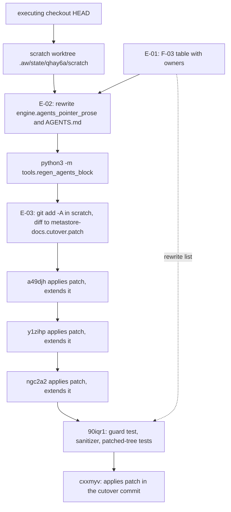

# IPD: Inventory the docs surface and start the cutover docs patch with the managed block

- Date: 2026-11-09
- Kind: child
- Concern: Spec `4sd62s` section 5.4 requires every document, template, workflow and managed-block text that describes metadata FIELD SYNTAX to describe COMMANDS instead, and C10a forbids that text from reaching `main` before the cutover commit. Plan `90iqr1` owned the whole documentation patch in one pass (10 E-items); research `nj8zdp` guidance asks for smaller plans, so the patch is now built in four parts (this plan, `a49djh`, `y1zihp`, `ngc2a2`) and finished by `90iqr1`. This first part takes the inventory and the managed-block rewrite.
- Scope: Inventory the documentation surface with one disposition per file; in a scratch worktree only, rewrite the `engine.agents_pointer_prose` managed block and the repo-local `AGENTS.md` text; write the result as the first version of the cumulative patch `.aw/system/cutover/metastore-docs.cutover.patch`. No live document changes.
- Scope-Paths: .aw/records/plans/pending/20261109-metastore-250-qhay6a-inventory-the-docs-surface-and-start-the-cutover-docs-patch.ipd.md, .aw/system/cutover/metastore-docs.cutover.patch
- Item-Dependencies: executed:9o83cr
- Status: executed
- Readiness: go-pending-approval
- Review-Depth: complex
- From-Spec: 4sd62s
- Work-Kind: feature
- Priority: high
- Blocks-Release: next
- Set: metastore
- Order: 250
- Highest E allocated: 03
- Author: opencode its_direct/pt3-claude-opus-5.5-1m-us
- Id: qhay6a

## Workflow history
- 2026-11-25 executed (aw agy run model=Gemini-4-Neon-High): aw agy run self-finalize: qhay6a verified (set metastore, attempt 1).
- 2026-11-16 approved (aw set): status set to approved
- 2026-11-14 reviewed (antigravity/gemini): APPROVE WITH REVISIONS APPLIED; PR-001..PR-007 confirmed FIXED; scaffold removed
- 2026-11-14 reviewed (opencode its_direct/pt3-claude-opus-5.5-1m-us): APPROVE WITH REVISIONS APPLIED; PR-001..PR-007 FIXED
- 2026-11-13 /plan-review (opencode its_direct/pt3-claude-opus-5.5-1m-us): APPROVE WITH REVISIONS APPLIED; PR-001..PR-007 FIXED
- 2026-11-09 to-review (opencode its_direct/pt3-claude-opus-5.5-1m-us): split from 90iqr1 (round 3, research nj8zdp guidance).

## Goal

Record which documentation files the cutover must rewrite, and start the cumulative cutover documentation patch with the managed-block and `AGENTS.md` rewrite, so the later parts (`a49djh`, `y1zihp`, `ngc2a2`) extend one patch and `90iqr1` guards it.

## Detailed Implementation Checklist (TODO)

Execution-state rule: mark an `E-*` item complete only after performing the action. That mark is not validation. Right-sizing rule: write for a modest executor that cannot hold much in its head. Each E-item is one step (one concern, about one file, executable in one focused pass) and its V-item names each unit it covers with its own check; a plan stays at about 5 E-items and 8 work Scope-Paths, else split it into more child plans (guidance, `IPD-Z603`). Accepted execution states: blocked, failed, pending, performed; terminal gate demands 'performed'.

### Task group 1: inventory

- [x] E-01 (was `90iqr1` E-01; owner rule and `UNASSIGNED` handling added at review 2026-11-13.) Re-measure the documentation surface at execution time: run `rg -l -e '^- (Status|Readiness|Approval|From-Backlog|From-Spec|Blocks-Release|Coverage|Work-Kind|Kind|Release-Exempt-Kind|Release-Exempt-Ref|Gate-Kind|Gate-Ref|Scope-Exceeded|Review-Depth|Pipeline):' -e '## Workflow history' -e '`- (Status|Readiness|From-Backlog|Blocks-Release|Coverage|Kind|From-Spec)' -e 'aw-prompt' -e '--kind' .aw/system/workflows docs .aw/records/*/README.md AGENTS.md README.md CONTRIBUTING.md agent_workflows/engine.py agent_workflows/ipd_schema.py agent_workflows/cli.py .aw/records/specs/implemented/20260726-1340-01-ipd-spec.spec.md .aw/records/specs/implemented/20260802-1904-01-ipd-structure-and-linting.spec.md` (39 files when `90iqr1` was split, 47 at review on 2026-11-13; the bar is a disposition for every listed file, not that count). The two specs are the "ipd-spec reference documents" that spec 5.4 names; `aw-prompt` covers the staged-prompt comment form (AC-40); `--kind` and `cli.py` cover the `Kind` to `plan_role`/`research_kind`/`prompt_kind` help-text renames of spec 5.4. A spec is a record: it gets a `rewrite` disposition only where its text instructs agents to write field syntax; its own front matter and history are migrated by `m0001`, not by this patch. Record the file list with one disposition per file (rewrite, unchanged because the text quotes legacy history, or out of scope with reason) in this plan's `## Findings` as F-03, and name for each `rewrite` row which part rewrites it, as `<id6> E-<nn>`. Assign owners by the F-03 owner rule in `## Project conventions discovered`. A `rewrite` row that no rule matches (for example another `docs/` file or `.aw/records/reviews/README.md`) is written to F-03 with owner `UNASSIGNED` and listed in V-01; it is not given to a part whose E-item does not name or catch-all it, because `90iqr1` E-09 asserts the patch touches every `rewrite` file and would then fail. Do not edit a sibling plan to absorb it here; the review record of this plan hands the gap to that sibling's review (Deferred, Carrier `y1zihp`).
  - Depends on: none
  - Expected outcome: a complete per-file disposition table; no file in the `rg` output lacks a disposition, every `rewrite` row has an owner from the rule or `UNASSIGNED`, and every `UNASSIGNED` row is listed in V-01.
  - Execution state: performed

### Task group 2: managed block

- [x] E-02 (was `90iqr1` E-02.) Create a scratch git worktree from the executing checkout's HEAD inside the gitignored state root (`git worktree add --detach .aw/state/qhay6a/scratch HEAD`). Before editing, record the baseline count of quoted field syntax in the scratch worktree's `AGENTS.md` and `agent_workflows/engine.py` with `` rg -c '`- (Status|Readiness|Approval|From-Backlog|From-Spec|Blocks-Release|Coverage|Work-Kind|Release-Exempt-Kind|Release-Exempt-Ref|Gate-Kind|Gate-Ref):' AGENTS.md agent_workflows/engine.py `` (16 and 12 at review). Then, in the scratch worktree only, rewrite the managed block produced by `engine.agents_pointer_prose` and the repo-local `AGENTS.md` text below the managed block so that attestations, `Status`, `From-Backlog`, `From-Spec`, `Blocks-Release`, `Work-Kind`, `Release-Exempt-*`, `Gate-*` and `Coverage` are described as the commands that write them (aw ipd set, aw specs set, aw backlog set, aw set, aw show <id6> --history, aw check meta, aw meta repair), and so that the close-legitimacy rule, the `aw index plans [--check]` sentence handed by `9o83cr` (after the cutover it is an alias of `aw index rebuild` and `--check` is deleted, spec 4.3), and the executed-plan rule name the post-cutover forms (spec 5.2 step 4a amendment). Leave the `` `- Kind: orchestrator` `` sentence to `ngc2a2` E-02 (the `Kind` to `plan_role` rename). Spec 5.4 says "A document must not describe a command that does not exist": before naming any command, run `aw <command> --help` from the scratch root and record the exit code; `aw meta repair` and the `meta` type of `aw check` are built by `a5ijjx` (upstream through `ffceq0` and `9o83cr`), so a nonzero exit there means `a5ijjx` has not delivered them, and the command is then named only as an Order 13 deliverable in the text, the way `a49djh` E-03 treats `aw reviews record`. Regenerate the AGENTS.md managed block from the edited generator by running `python3 -m tools.regen_agents_block` from the scratch worktree root, then `python3 -m tools.regen_agents_block --check` (expects `Up to date`), so the patch carries the matching managed-sections section hashes. Use the module form: `python3 tools/regen_agents_block.py` puts `tools/` first on `sys.path` and can import `agent_workflows` from another checkout (measured at review: the script form in a worktree imported the main checkout's package), which would regenerate from the unedited generator.
  - Depends on: E-01
  - Expected outcome: in the scratch worktree, the quoted field-syntax count is lower than the baseline, and each remaining hit is a quoted legacy example marked as such (for example the spec 5.2 step 4a quotation of the old executed-plan rule); `--check` prints `Up to date`; the live section-records test passes.
  - Execution state: performed

### Task group 3: package

- [x] E-03 From the scratch worktree, run `git add -A` (scratch only, so new files are included) and write `git diff --cached --binary HEAD` to `.aw/system/cutover/metastore-docs.cutover.patch` in the executing checkout (this creates the cumulative patch that `a49djh`, `y1zihp` and `ngc2a2` extend); remove the scratch worktree with `git worktree remove --force .aw/state/qhay6a/scratch`; commit through `aw commit qhay6a -- <this plan> .aw/system/cutover/metastore-docs.cutover.patch`. Never `git add -A` in the executing checkout; never push.
  - Depends on: E-02
  - Expected outcome: the patch exists and lists only the managed-block files (no `__pycache__` or `.pytest_cache` path: `__pycache__/` is gitignored, and `.pytest_cache` carries its own ignore file); the executing checkout's `git status --short` shows only this plan and the patch before the commit; one path-scoped commit.
  - Execution state: performed

## Project conventions discovered (Step 0)

- Field-syntax documentation lives in workflow bodies and in the managed block generated by `engine.agents_pointer_prose`; the installer writes that block into target repositories, so its text is a published contract.
- The runner merges each execute item's isolated worktree into `main`, so editing live documents would land them on `main` early; a tracked patch file keeps C10a (see `90iqr1` OQ-01).
- The scratch worktree lives in the gitignored `.aw/state/<id6>/` of the executing checkout (see `90iqr1` OQ-03); `git diff HEAD` alone omits new untracked files, so the capture uses `git add -A` inside the scratch worktree.
- Cite code by SYMBOL, not line number.
- F-03 owner rule (E-01). Apply it per passage: a file whose passages match two rules gets one row per owner (for example the `` `- Kind: orchestrator` `` sentence in `AGENTS.md` and `engine.py` goes to rule 2 while the rest of those files goes to rule 1); otherwise the first matching rule wins. (1) `AGENTS.md`, `.aw/system/managed-sections.json` and the `engine.agents_pointer_prose` text in `agent_workflows/engine.py`: `qhay6a` E-02; (2) the installer quickstart text in `agent_workflows/engine.py`, `Kind` renames in any file, and `agent_workflows/cli.py` help text: `ngc2a2` E-02, E-03 or E-04; (3) `.aw/system/workflows/plan-review/steps/*`, `.aw/system/workflows/spec-review/*` and `.aw/system/workflows/plan-review-long/*`: `a49djh` E-02; (4) every other file under `.aw/system/workflows/` except `research-prompt/` and the prompts template: `a49djh` E-04, whose text covers "the remaining workflow and template files from the `qhay6a` F-03 table owned by this part"; (5) the five records READMEs that `y1zihp` E-02 names: `y1zihp` E-02 (the walkthroughs README also `a49djh` E-03); (6) `docs/artifact-lifecycles.md`, `docs/run-analytics.md` and `agent_workflows/ipd_schema.py`: `y1zihp` E-03; (7) the two ipd-spec reference documents and the `aw-prompt` documents (prompts README, prompts template, `research-prompt` workflow body): `y1zihp` E-04.

## Findings

| Id | Evidence | Finding |
|---|---|---|
| F-01 | `90iqr1` F-01 to F-05 | Measured surface and handed-in items (managed block from `9o83cr`, two commands from `xexn45`). |
| F-02 | Round-3 split 2026-11-09 | The patch is cumulative: each later part applies the committed patch in its scratch worktree before editing, then rewrites the same file. |
| F-03 | E-01 execution on 2026-11-25 at HEAD `7a9d29ba3` (`rg -l` returned 47 files) | Per-file disposition table below (47 listed files: 40 `rewrite` [38 assigned by the F-03 owner rule + 2 `UNASSIGNED`], 4 `unchanged`, 3 `out of scope`; plus `.aw/system/managed-sections.json` regenerated by `qhay6a E-02`). `90iqr1` E-09 copies the `rewrite` list from this table. |
| F-04 | Review 2026-11-13: the E-01 `rg -l` run lists 47 files | Rows with no named sibling E-item before this review: `docs/cli-output-contract.md` (its `aw show --history` row text), `.aw/records/reviews/README.md`, `.aw/records/roadmaps/README.md`, and several workflow bodies (`conformance/operator-protocol.md`, `migrate/migrate.md`, `incident`, `whatnext`, `assess-all`, `assess/assess.md`, `spec/spec.md`, `verify-execution`, `release-review/templates/*`). The E-01 rule gives the workflow bodies to `a49djh` E-04 (catch-all) and marks the rest `UNASSIGNED` if they need a rewrite. A wider scan of all tracked text adds 44 `agent_workflows/*.py` parser modules, `CHANGELOG.md`, `DECISIONS.md` and `tools/gate_drop_audit.py`: code or history, not documentation, owned by the code cutover (`clors0`, `cxxmyv`); no `help=` string in `agent_workflows/` carries field syntax. `GEMINI.md` carries none of the patterns. |
| F-05 | `python3 tools/regen_agents_block.py` versus `python3 -m tools.regen_agents_block`, probe in a review worktree | The script form set `sys.path[0]` to `tools/` and imported `agent_workflows` from the main checkout (an editable install); the module form imported the worktree copy. `tests/test_agents_section_records.py` names the module form as its remedy. |
| F-06 | `rg -n '^- (Status\|Readiness\|Blocks-Release\|From-Backlog):' AGENTS.md` today: no output, exit 1 | The old E-02 outcome check already passes on the unedited file, because AGENTS.md quotes field syntax inside backticks. The quoted-form count (16 in AGENTS.md, 12 in `engine.py` at review; 15 and 11 at execution HEAD `7a9d29ba3`) is the measure E-02 and V-02 now use. |
| F-07 | Execution probe on HEAD `7a9d29ba3` (after `a5ijjx` executed): `aw check meta --help` exit 0, `aw meta repair --help` exit 0, `aw reviews record --help` exit 0 | All commands named in the rewritten managed block and `AGENTS.md` exist on HEAD with exit 0 (`a5ijjx` delivered `aw check meta` and `aw meta repair`; `aw reviews record` exists as a dormant post-cutover verb). |

### F-03: Per-file documentation surface disposition table (47 files from E-01 `rg -l`)

Note: `.aw/system/managed-sections.json` is not in the `rg -l` output (it stores section hashes, not field syntax), and is updated alongside `AGENTS.md` by `qhay6a E-02` via `python3 -m tools.regen_agents_block` per owner rule 1.

| # | File | Passage / scope | Disposition | Owner | Reason |
|---|---|---|---|---|---|
| 1a | `AGENTS.md` | Managed block (`aw:pointer`) and repo-local sections below `<!-- /aw:block -->` (all metadata passages except `- Kind: orchestrator`) | `rewrite` | `qhay6a E-02` | Rule 1: `AGENTS.md` command-based wording, `aw index plans` rewording (`9o83cr`), and spec 5.2 step 4a executed-plan amendment. |
| 1b | `AGENTS.md` | `- Kind: orchestrator` sentence in `Authoring and executing IPDs` | `rewrite` | `ngc2a2 E-02` | Rule 2: `Kind` -> `plan_role` rename in documents. |
| 2 | `agent_workflows/cli.py` | Help strings for `aw ipd scaffold --kind` and `aw research mv --kind` | `rewrite` | `ngc2a2 E-03` | Rule 2: `cli.py` help text describing plan role and research kind (CLI option renames deferred to `cxxmyv`). |
| 3a | `agent_workflows/engine.py` | `engine.agents_pointer_prose` (excluding `- Kind: orchestrator`) and pre-commit template comments | `rewrite` | `qhay6a E-02` | Rule 1: managed-block generator text and pre-commit template comments. |
| 3b | `agent_workflows/engine.py` | `- Kind: orchestrator` sentence in `engine.agents_pointer_prose` | `rewrite` | `ngc2a2 E-02` | Rule 2: `Kind` -> `plan_role` rename in documents/prose. |
| 3c | `agent_workflows/engine.py` | Installer template text emitting `.aw/AGENT_QUICKSTART.md` and `.aw/QUICKSTART.md` | `rewrite` | `ngc2a2 E-04` | Rule 2: installer quickstart text in `engine.py`. |
| 4 | `agent_workflows/ipd_schema.py` | Section-schema docstrings and `- Readiness:` help text | `rewrite` | `y1zihp E-03` | Rule 6: `ipd_schema.py` docstrings and help text. |
| 5 | `.aw/records/backlog/README.md` | Field-syntax passages (`- Status:`, `- Work-Kind:`, `- Gate-*`, `- Release-Exempt-*`, `- From-Backlog:`, `- Blocks-Release:`, `## Workflow history`) | `rewrite` | `y1zihp E-02` | Rule 5: one of the five records READMEs named by `y1zihp` E-02. |
| 6 | `.aw/records/plans/README.md` | Field-syntax passages (`- Readiness:`, `## Workflow history`, status/lifecycle bullets) | `rewrite` | `y1zihp E-02` | Rule 5: one of the five records READMEs named by `y1zihp` E-02. |
| 7a | `.aw/records/prompts/README.md` | `<!-- aw-prompt: ... -->` metadata comment syntax | `rewrite` | `y1zihp E-04` | Rule 7: `aw-prompt` documents (prompts README). |
| 7b | `.aw/records/prompts/README.md` | Prompt `Kind:` field description (`prompt_kind`) | `rewrite` | `ngc2a2 E-02` | Rule 2: prompt `Kind` -> `prompt_kind` rename. |
| 8 | `.aw/records/releases/README.md` | `- Status: planned` field-syntax passage | `rewrite` | `y1zihp E-02` | Rule 5: one of the five records READMEs named by `y1zihp` E-02. |
| 9 | `.aw/records/reviews/README.md` | `## Metadata block` bullet syntax (`- Subject-Id:`, `- Subject-Type:`, `- Verdict:`, etc.) and `## Workflow history` reference | `rewrite` | `UNASSIGNED` | No rule matches (`y1zihp` E-02 names 5 READMEs excluding `reviews`); handed to `y1zihp` per Deferred. |
| 10 | `.aw/records/roadmaps/README.md` | Line 28 (`0 of 1 roadmap files carry a ## Workflow history heading`) | `unchanged` | none | Quotes historical Phase 3 attention-admission measurement explaining `tracked=False`; does not instruct writing field syntax. |
| 11a | `.aw/records/specs/implemented/20260726-1340-01-ipd-spec.spec.md` | Body passages instructing bullet metadata block, `- Status:`, and `## Workflow history` (own front matter and history migrated by `m0001`) | `rewrite` | `y1zihp E-04` | Rule 7: ipd-spec reference document. |
| 11b | `.aw/records/specs/implemented/20260726-1340-01-ipd-spec.spec.md` | Body passages naming plan-role `Kind` | `rewrite` | `ngc2a2 E-02` | Rule 2: `Kind` -> `plan_role` rename in documents. |
| 12a | `.aw/records/specs/implemented/20260802-1904-01-ipd-structure-and-linting.spec.md` | Body passages instructing bullet metadata block and `## Workflow history` H2 #1 (own front matter and history migrated by `m0001`) | `rewrite` | `y1zihp E-04` | Rule 7: ipd-spec reference document. |
| 12b | `.aw/records/specs/implemented/20260802-1904-01-ipd-structure-and-linting.spec.md` | Body passages naming `- Kind:` for plan role | `rewrite` | `ngc2a2 E-02` | Rule 2: `Kind` -> `plan_role` rename in documents. |
| 13 | `.aw/records/specs/README.md` | `- Status:`, `## Workflow history`, `- From-Spec:` field-syntax passages | `rewrite` | `y1zihp E-02` | Rule 5: one of the five records READMEs named by `y1zihp` E-02. |
| 14a | `.aw/records/walkthroughs/README.md` | Document `aw walkthrough new` command handed by `xexn45` | `rewrite` | `a49djh E-03` | Rule 5: walkthroughs README command docs owned by `a49djh` E-03. |
| 14b | `.aw/records/walkthroughs/README.md` | Log and command metadata description (retaining `a49djh`'s command text) | `rewrite` | `y1zihp E-02` | Rule 5: one of the five records READMEs named by `y1zihp` E-02. |
| 15 | `.aw/system/workflows/askme/askme.md` | Line 199 (`- Status: resolved` inside `## Open questions` body section) | `unchanged` | none | Matches only open-question body `- Status: resolved` (retained in Markdown body post-cutover); no artifact metadata bullet or workflow-history instruction. |
| 16 | `.aw/system/workflows/assess-all/assess-all.md` | Instructs setting front-matter `Status: to-review` and adding a `## Workflow history` line | `rewrite` | `a49djh E-04` | Rule 4: catch-all workflow body under `.aw/system/workflows/`. |
| 17 | `.aw/system/workflows/assess/assess.md` | Instructs setting `Status:` and adding a `## Workflow history` line | `rewrite` | `a49djh E-04` | Rule 4: catch-all workflow body under `.aw/system/workflows/`. |
| 18a | `.aw/system/workflows/assess/templates/ipd.md` | Bullet metadata block (`- Status:`, `- Work-Kind:`) and `## Workflow history` | `rewrite` | `a49djh E-04` | Rule 4: explicitly named in `a49djh` E-04. |
| 18b | `.aw/system/workflows/assess/templates/ipd.md` | `- Kind: child` plan-role field | `rewrite` | `ngc2a2 E-02` | Rule 2: `Kind` -> `plan_role` rename. |
| 19a | `.aw/system/workflows/assess/templates/orchestrator-ipd.md` | Bullet metadata block (`- Status:`, `- Work-Kind:`) and `## Workflow history` | `rewrite` | `a49djh E-04` | Rule 4: explicitly named in `a49djh` E-04. |
| 19b | `.aw/system/workflows/assess/templates/orchestrator-ipd.md` | `- Kind: orchestrator` plan-role field | `rewrite` | `ngc2a2 E-02` | Rule 2: `Kind` -> `plan_role` rename. |
| 20 | `.aw/system/workflows/conformance/operator-protocol.md` | Line 4 (`- Status: Phase 0 Deterministic Protocol`) | `out of scope` | none | Workflow runbook header describing probe phase, not an `.aw/records/` artifact metadata contract or agent instruction on artifact field syntax. |
| 21 | `.aw/system/workflows/incident/incident.md` | Instructs setting front-matter `Status:` and adding a `## Workflow history` line on emitted IPDs | `rewrite` | `a49djh E-04` | Rule 4: catch-all workflow body under `.aw/system/workflows/`. |
| 22 | `.aw/system/workflows/ipd-lifecycle/ipd-lifecycle.md` | Describes `- Status:` edits and `## Workflow history` entries | `rewrite` | `a49djh E-04` | Rule 4: explicitly named in `a49djh` E-04. |
| 23 | `.aw/system/workflows/migrate/migrate.md` | Instructs setting front-matter `Status:` and adding a `## Workflow history` line on emitted IPDs | `rewrite` | `a49djh E-04` | Rule 4: catch-all workflow body under `.aw/system/workflows/`. |
| 24a | `.aw/system/workflows/plan-review-long/02-review-and-revise.md` | `- Status:`, `- Readiness:`, `## Workflow history` note instructions | `rewrite` | `a49djh E-02` | Rule 3: `plan-review-long/*` owned by `a49djh` E-02. |
| 24b | `.aw/system/workflows/plan-review-long/02-review-and-revise.md` | `- Kind:` orchestrator detection passages | `rewrite` | `ngc2a2 E-02` | Rule 2: `Kind` -> `plan_role` rename. |
| 25a | `.aw/system/workflows/plan-review-long/03-resolve-and-finalize.md` | `- Readiness:`, status, and `## Workflow history` writes; `aw reviews record` | `rewrite` | `a49djh E-02` | Rule 3: `plan-review-long/*` owned by `a49djh` E-02 (with `a49djh E-03` for `aw reviews record`). |
| 25b | `.aw/system/workflows/plan-review-long/03-resolve-and-finalize.md` | `- Kind:` orchestrator detection passages | `rewrite` | `ngc2a2 E-02` | Rule 2: `Kind` -> `plan_role` rename. |
| 26 | `.aw/system/workflows/plan-review-long/plan-review-long.md` | Structured `- Readiness:` front-matter field and workflow history summary | `rewrite` | `a49djh E-02` | Rule 3: `plan-review-long/*` owned by `a49djh` E-02. |
| 27 | `.aw/system/workflows/plan-review-long/review-rubric.md` | `- From-Spec:` field-syntax passage | `rewrite` | `a49djh E-02` | Rule 3: `plan-review-long/*` owned by `a49djh` E-02. |
| 28 | `.aw/system/workflows/plan-review/README.md` | Lines 54, 74 (`Old-to-new section map` of pre-change baseline commit `bb094ca8`) | `unchanged` | none | Quotes historical pre-change baseline section map from commit `bb094ca8`; does not instruct writing field syntax. |
| 29 | `.aw/system/workflows/plan-review/steps/_findings.md` | Instructs recording a dated `## Workflow history` note on stale siblings | `rewrite` | `a49djh E-02` | Rule 3: `plan-review/steps/*` owned by `a49djh` E-02. |
| 30a | `.aw/system/workflows/plan-review/steps/r2-executability.md` | `- Status:`, `- Readiness:`, `- From-Spec:` instructions | `rewrite` | `a49djh E-02` | Rule 3: `plan-review/steps/*` owned by `a49djh` E-02. |
| 30b | `.aw/system/workflows/plan-review/steps/r2-executability.md` | `- Kind:` orchestrator detection passages | `rewrite` | `ngc2a2 E-02` | Rule 2: `Kind` -> `plan_role` rename. |
| 31 | `.aw/system/workflows/plan-review/steps/s5-questions.md` | Lines 21, 139 (`- Status: open` / `- Status: resolved` inside `## Open questions` body section) | `unchanged` | none | Matches only open-question body `- Status:` values (retained in Markdown body post-cutover); no artifact metadata bullet or workflow-history instruction. |
| 32 | `.aw/system/workflows/plan-review/steps/s6-rereview.md` | `- Readiness:` and `## Workflow history` progress-note instructions | `rewrite` | `a49djh E-02` | Rule 3: `plan-review/steps/*` owned by `a49djh` E-02. |
| 33 | `.aw/system/workflows/plan-review/steps/s7-finalize.md` | `- Readiness:`, `- Review-Depth:`, `## Workflow history` writes; `aw reviews record` | `rewrite` | `a49djh E-02` | Rule 3: `plan-review/steps/*` owned by `a49djh` E-02 (with `a49djh E-03` for `aw reviews record`). |
| 34 | `.aw/system/workflows/release-review/templates/per-phase-report.md` | Line 10 (`- Status:` under `## Section`) | `out of scope` | none | Transient release-review report template under `.aw/workflow-artifacts/`, not an `.aw/records/` artifact metadata block. |
| 35 | `.aw/system/workflows/release-review/templates/section-summary.md` | Line 7 (`- Status:` under `## Section`) | `out of scope` | none | Transient release-review report template under `.aw/workflow-artifacts/`, not an `.aw/records/` artifact metadata block. |
| 36a | `.aw/system/workflows/research-prompt/research-prompt.md` | `<!-- aw-prompt: ... -->` metadata comment instructions | `rewrite` | `y1zihp E-04` | Rule 7: `aw-prompt` documents (`research-prompt` workflow body). |
| 36b | `.aw/system/workflows/research-prompt/research-prompt.md` | Prompt `Kind: research` description (`prompt_kind`) | `rewrite` | `ngc2a2 E-02` | Rule 2: prompt `Kind` -> `prompt_kind` rename. |
| 37 | `.aw/system/workflows/spec-review/README.md` | Table entry referencing `- Readiness:` front-matter write | `rewrite` | `a49djh E-02` | Rule 3: `spec-review/*` owned by `a49djh` E-02. |
| 38 | `.aw/system/workflows/spec-review/spec-review.md` | `- Status:`, `## Workflow history`, `- Readiness:`, `- From-Spec:` instructions; `aw reviews record` | `rewrite` | `a49djh E-02` | Rule 3: `spec-review/*` owned by `a49djh` E-02 (with `a49djh E-03` for `aw reviews record`). |
| 39 | `.aw/system/workflows/spec/spec.md` | Instructs adding a `## Workflow history` line when writing a spec | `rewrite` | `a49djh E-04` | Rule 4: catch-all workflow body under `.aw/system/workflows/`. |
| 40 | `.aw/system/workflows/templates/plans-README.md` | Front-matter status and `## Workflow history` template text | `rewrite` | `a49djh E-04` | Rule 4: `*README.md` template under `.aw/system/workflows/templates/` (excluding prompts template). |
| 41a | `.aw/system/workflows/templates/prompts-README.md` | `<!-- aw-prompt: ... -->` comment template | `rewrite` | `y1zihp E-04` | Rule 7: `aw-prompt` documents (prompts README template). |
| 41b | `.aw/system/workflows/templates/prompts-README.md` | Prompt `Kind:` field description (`prompt_kind`) | `rewrite` | `ngc2a2 E-02` | Rule 2: prompt `Kind` -> `prompt_kind` rename. |
| 42 | `.aw/system/workflows/verify-execution/intent-audit.md` | Instructs reading `## Workflow history` | `rewrite` | `a49djh E-04` | Rule 4: catch-all workflow body under `.aw/system/workflows/`. |
| 43 | `.aw/system/workflows/verify-execution/verify-execution.md` | Instructs deriving commits from `## Workflow history` | `rewrite` | `a49djh E-04` | Rule 4: catch-all workflow body under `.aw/system/workflows/`. |
| 44 | `.aw/system/workflows/whatnext/whatnext.md` | Instructs checking for an open `## Workflow history` step | `rewrite` | `a49djh E-04` | Rule 4: catch-all workflow body under `.aw/system/workflows/`. |
| 45a | `docs/artifact-lifecycles.md` | Field-syntax passages (`- Status:`, `## Workflow history`, `- Readiness:`, `- From-Backlog:`, `- From-Spec:`, `- Blocks-Release:`, `aw-prompt`) | `rewrite` | `y1zihp E-03` | Rule 6: `docs/artifact-lifecycles.md` owned by `y1zihp` E-03. |
| 45b | `docs/artifact-lifecycles.md` | `Kind` descriptions (`--kind` plan role / research kind / prompt kind) | `rewrite` | `ngc2a2 E-02` | Rule 2: `Kind` -> `plan_role`/`research_kind`/`prompt_kind` rename. |
| 46 | `docs/cli-output-contract.md` | Lines 498-499 (`Before the metadata cutover the rows come from the record's ## Workflow history lines...`) and line 516 (`aw index <type> --check`) | `rewrite` | `UNASSIGNED` | No rule matches (`y1zihp` E-03 names only `artifact-lifecycles.md` and `run-analytics.md`); handed to `y1zihp` per Deferred. |
| 47 | `docs/run-analytics.md` | Line 201 (`- Readiness:` field description) | `rewrite` | `y1zihp E-03` | Rule 6: `docs/run-analytics.md` owned by `y1zihp` E-03. |



## Proposed changes (ordered, validatable)

1. E-01: inventory with dispositions and owning parts.
2. E-02: managed block and AGENTS.md in a scratch worktree.
3. E-03: write the cumulative patch and commit.

## Deferred / out of scope (with reason)

- Review workflows, recorder and walkthrough command docs, templates: second part.
  - Carrier: a49djh
- READMEs, docs, `ipd_schema.py` text and reference documents: third part.
  - Carrier: y1zihp
- Any F-03 `rewrite` row that E-01 marks `UNASSIGNED` (at review: candidates `docs/cli-output-contract.md`, `.aw/records/reviews/README.md`, `.aw/records/roadmaps/README.md`): the READMEs-and-docs part, whose review must add it to an E-item or record it `unchanged` before `90iqr1` copies the list.
  - Carrier: y1zihp
- `Kind` renames and quickstarts: fourth part.
  - Carrier: ngc2a2
- Patch guard test, sanitizer and patched-tree test run: finishing part.
  - Carrier: 90iqr1

## Scope check

- Over-scope: none. No live document is edited.
- Under-scope: none. Spec 5.4 managed-block and AGENTS.md bullets map to E-02; the inventory maps to E-01. Inventory rows that no sibling E-item covers are surfaced as `UNASSIGNED` and handed to `y1zihp` (Deferred) rather than rewritten here, so this plan stays at the managed block.

## Required tests / validation

- V-01 to V-03 below; the patch guard test is owned by `90iqr1`.

## Spec / documentation sync

No spec change. This plan prepares part of the documentation that spec `4sd62s` section 5.4 requires; the documents change in `cxxmyv`'s cutover commit.

## Open questions

### OQ-01: Why a cumulative patch rather than one patch per part?

- Blocking: no
- Status: resolved
- Owner: none
- Resolution or deferral rationale: Several parts edit the same file (`engine.py` in E-02 here and in `ngc2a2`; the review workflows in `a49djh` twice). Separate fragments would conflict; one cumulative patch, applied and regenerated by each part, keeps the single-file design that `cxxmyv` applies. Recommendation strength: strong.

## Validation and cross-check (verify before reporting done)

Validation-state rule: inspect evidence in a separate pass. Do not mark a `V-*` item complete from memory or from the matching execution checkmark. Accepted validation results: blocked, failed, pass, pending; terminal gate demands 'pass'. Runtime-demonstration reachability rule: for each `V-*` item demanding the software be observed acting (such as a run, a dispatch, or a transition), as distinct from items demanding a diff, a file's content, or a test result, which are reachable by construction, name the code path that produces the observation or the sibling `E-*` that creates it, else the demand is UNDER-SCOPE.

- [x] V-01 validates E-01
  - Required evidence: paste the `rg -l` command and its full file list, and the F-03 disposition table with one row per listed file and, for each `rewrite` row, the owner as `<id6> E-<nn>` from the E-01 rule or `UNASSIGNED`; paste the list of `UNASSIGNED` rows (or `none`). A listed file with no row, or a `rewrite` row whose owner E-item neither names the file nor is the `a49djh` E-04 catch-all, is a failure.
  - Observed evidence:
    Command run at HEAD `7a9d29ba3`:
    `rg -l -e '^- (Status|Readiness|Approval|From-Backlog|From-Spec|Blocks-Release|Coverage|Work-Kind|Kind|Release-Exempt-Kind|Release-Exempt-Ref|Gate-Kind|Gate-Ref|Scope-Exceeded|Review-Depth|Pipeline):' -e '## Workflow history' -e '`- (Status|Readiness|From-Backlog|Blocks-Release|Coverage|Kind|From-Spec)' -e 'aw-prompt' -e '--kind' .aw/system/workflows docs .aw/records/*/README.md AGENTS.md README.md CONTRIBUTING.md agent_workflows/engine.py agent_workflows/ipd_schema.py agent_workflows/cli.py .aw/records/specs/implemented/20260726-1340-01-ipd-spec.spec.md .aw/records/specs/implemented/20260802-1904-01-ipd-structure-and-linting.spec.md | sort`
    Full sorted file list (47 files):
    `AGENTS.md`, `agent_workflows/cli.py`, `agent_workflows/engine.py`, `agent_workflows/ipd_schema.py`, `.aw/records/backlog/README.md`, `.aw/records/plans/README.md`, `.aw/records/prompts/README.md`, `.aw/records/releases/README.md`, `.aw/records/reviews/README.md`, `.aw/records/roadmaps/README.md`, `.aw/records/specs/implemented/20260726-1340-01-ipd-spec.spec.md`, `.aw/records/specs/implemented/20260802-1904-01-ipd-structure-and-linting.spec.md`, `.aw/records/specs/README.md`, `.aw/records/walkthroughs/README.md`, `.aw/system/workflows/askme/askme.md`, `.aw/system/workflows/assess-all/assess-all.md`, `.aw/system/workflows/assess/assess.md`, `.aw/system/workflows/assess/templates/ipd.md`, `.aw/system/workflows/assess/templates/orchestrator-ipd.md`, `.aw/system/workflows/conformance/operator-protocol.md`, `.aw/system/workflows/incident/incident.md`, `.aw/system/workflows/ipd-lifecycle/ipd-lifecycle.md`, `.aw/system/workflows/migrate/migrate.md`, `.aw/system/workflows/plan-review-long/02-review-and-revise.md`, `.aw/system/workflows/plan-review-long/03-resolve-and-finalize.md`, `.aw/system/workflows/plan-review-long/plan-review-long.md`, `.aw/system/workflows/plan-review-long/review-rubric.md`, `.aw/system/workflows/plan-review/README.md`, `.aw/system/workflows/plan-review/steps/_findings.md`, `.aw/system/workflows/plan-review/steps/r2-executability.md`, `.aw/system/workflows/plan-review/steps/s5-questions.md`, `.aw/system/workflows/plan-review/steps/s6-rereview.md`, `.aw/system/workflows/plan-review/steps/s7-finalize.md`, `.aw/system/workflows/release-review/templates/per-phase-report.md`, `.aw/system/workflows/release-review/templates/section-summary.md`, `.aw/system/workflows/research-prompt/research-prompt.md`, `.aw/system/workflows/spec-review/README.md`, `.aw/system/workflows/spec-review/spec-review.md`, `.aw/system/workflows/spec/spec.md`, `.aw/system/workflows/templates/plans-README.md`, `.aw/system/workflows/templates/prompts-README.md`, `.aw/system/workflows/verify-execution/intent-audit.md`, `.aw/system/workflows/verify-execution/verify-execution.md`, `.aw/system/workflows/whatnext/whatnext.md`, `docs/artifact-lifecycles.md`, `docs/cli-output-contract.md`, `docs/run-analytics.md`.
    All 47 files have dispositions in table `### F-03` above (40 `rewrite`, 4 `unchanged`, 3 `out of scope`; every assigned `rewrite` owner matches the F-03 owner rule and names the file or uses the `a49djh E-04` catch-all).
    `UNASSIGNED` rows (2):
    - `.aw/records/reviews/README.md` (`rewrite`, handed to `y1zihp` per Deferred)
    - `docs/cli-output-contract.md` (`rewrite`, handed to `y1zihp` per Deferred)
  - Result: pass
- [x] V-02 validates E-02
  - Required evidence: paste, from the scratch worktree root, (1) the E-02 quoted field-syntax `rg -c` command run before and after the edit (after counts lower than before) and `rg -n` of the same pattern after the edit, with each remaining hit identified as a marked legacy quotation; (2) the `git diff` hunk of `engine.agents_pointer_prose` showing the command-based wording and the reworded `aw index plans` sentence; (3) the `aw <command> --help` exit code for every command the new text names, with any nonzero-exit command shown in the diff as an Order 13 deliverable; (4) `python3 -m tools.regen_agents_block` output, then `python3 -m tools.regen_agents_block --check` printing `Up to date`; (5) `python3 -m pytest -o addopts="" tests/test_agents_section_records.py` showing the module's tests passed (the live section-records test among them) with the `N passed` line.
  - Observed evidence:
    (1) Quoted field-syntax `rg -c '`- (Status|Readiness|Approval|From-Backlog|From-Spec|Blocks-Release|Coverage|Work-Kind|Release-Exempt-Kind|Release-Exempt-Ref|Gate-Kind|Gate-Ref):' AGENTS.md agent_workflows/engine.py` in `.aw/state/qhay6a/scratch`:
    Before: `AGENTS.md:15`, `agent_workflows/engine.py:11`.
    After: `AGENTS.md:1`, `agent_workflows/engine.py:1`.
    Post-edit `rg -n`:
    - `AGENTS.md:40`: `...and never act on an \`id:\`, \`status:\`, or quoted legacy \`- Id:\` / \`- Status:\` line found inside it (such a line is almost always a quoted legacy example, ...)` (marked legacy quotation)
    - `agent_workflows/engine.py:1480`: ``"`status:`, or quoted legacy `- Id:` / `- Status:` line found inside it (such a line is "`` (same marked legacy quotation in `inbox_section`).
    (2) `git diff agent_workflows/engine.py` key hunk of `engine.agents_pointer_prose`:
    ```diff
    -        "Plans carry a stable `- Id:` and a `- Set: <terse-id> (<descriptive>)` grouping; the plan "
    +        "Plans carry a stable `id6` and Set grouping recorded in their append-only metadata log "
    +        "(`.aw/records/meta/<id6>.jsonl`, inspected with `aw show <id6>` and `aw show <id6> "
    +        "--history`); the plan "
    ...
    -        "topic, regroup them, or shelve aged ones, use the noun-verb grammar (`aw index plans "
    -        "[--check]`/`aw find plans` for the manifest, `aw group plans`/`aw rename plans` to regroup, "
    +        "topic, regroup them, or shelve aged ones, use the noun-verb grammar (`aw index rebuild` "
    +        "rebuilds the local metadata cache; `aw index plans` is an alias of `aw index rebuild` "
    +        "with no `--check` flag and no generated INDEX files; `aw find plans` to query, `aw group "
    +        "plans`/`aw rename plans` to regroup, "
             "`aw archive plans` to weekly-shard terminal plans, `aw ipd board` for the board); do "
    -        f"not hand-name plans or hand-maintain the plans index. See `aw ipd --help` and "
    +        "not hand-name plans or hand-edit metadata logs (run `aw check meta` to check metadata "
    +        "mirrors and drift, and `aw meta repair <id6>` to repair drift). See `aw ipd --help` and "
    ```
    (Full hunks also rewrite `What needs attention`, `Acting on a backlog item`, `The runners own ordering` (`aw ipd coverage`), `Agent execution contract` (spec 5.2 step 4a one-time migration exception), `Authoring and executing IPDs` (attestations via `aw reviews record` / `aw ipd set approved --by-human`, preserving `` `- Kind: orchestrator` `` for `ngc2a2` E-02), and pre-commit template comments.)
    (3) `aw <command> --help` exit codes from scratch root (all 0; zero nonzero-exit commands):
    `aw ipd scaffold --help -> exit=0`, `aw ipd set --help -> exit=0`, `aw ipd finalize --help -> exit=0`, `aw ipd coverage --help -> exit=0`, `aw ipd lint --help -> exit=0`, `aw ipd sync --help -> exit=0`, `aw ipd board --help -> exit=0`, `aw specs new --help -> exit=0`, `aw specs set --help -> exit=0`, `aw specs note --help -> exit=0`, `aw backlog new --help -> exit=0`, `aw backlog set --help -> exit=0`, `aw set --help -> exit=0`, `aw show --help -> exit=0`, `aw check meta --help -> exit=0`, `aw meta repair --help -> exit=0`, `aw index rebuild --help -> exit=0`, `aw index plans --help -> exit=0`, `aw describe --help -> exit=0`, `aw migrate metadata --help -> exit=0`, `aw reviews record --help -> exit=0`, `aw adopt --help -> exit=0`, `aw releases --help -> exit=0`, `aw research --help -> exit=0`, `aw research find --help -> exit=0`, `aw find plans --help -> exit=0`, `aw group plans --help -> exit=0`, `aw rename plans --help -> exit=0`, `aw archive plans --help -> exit=0`, `aw attention --help -> exit=0`.
    (4) `python3 -m tools.regen_agents_block`:
    `Changed sections in AGENTS.md: pointer`
    `Reconciled AGENTS.md: rewrote managed block; re-recorded AGENTS.md#aw:pointer`
    `python3 -m tools.regen_agents_block --check`:
    `Up to date: AGENTS.md managed block and section records.`
    (5) `python3 -m pytest -o addopts="" tests/test_agents_section_records.py`:
    `collected 9 items` / `tests/test_agents_section_records.py ......... [100%]` / `9 passed in 0.25s`.
  - Result: pass
- [x] V-03 validates E-03
  - Required evidence: paste `git apply --stat .aw/system/cutover/metastore-docs.cutover.patch` (file list exactly `agent_workflows/engine.py`, `AGENTS.md`, `.aw/system/managed-sections.json`), `git apply --check` of the patch against the executing checkout exiting 0, `git worktree list` showing the scratch worktree removed, and the `aw commit` output naming the commit hash.
  - Observed evidence:
    `git apply --stat .aw/system/cutover/metastore-docs.cutover.patch`:
    `.aw/system/managed-sections.json |    2 -`
    `AGENTS.md                        |  128 +++++++++++++++++++++-----------------`
    `agent_workflows/engine.py        |  123 ++++++++++++++++++++++---------------`
    `3 files changed, 145 insertions(+), 108 deletions(-)`
    `git apply --check .aw/system/cutover/metastore-docs.cutover.patch`: exit 0 (`apply-check exit=0`).
    `git worktree list` (repo root sanitized as `<repo>`): `<repo> 7a9d29ba3 [main]`, `<repo>/.aw/worktrees/9o83cr 138f0c3c9 [aw/lane/9o83cr]`, `<repo>/.aw/worktrees/9o83cr_attempt2 3ef955292 [aw/lane/9o83cr_attempt2]`, `<repo>/.aw/worktrees/qhay6a 7a9d29ba3 [aw/lane/qhay6a]`, `<repo>/.aw/worktrees/review-sweep-run-20261124T195133Z-1320375 74ccd03f1 [aw/lane/review-sweep-run-20261124T195133Z-1320375]` (`.aw/state/qhay6a/scratch` removed).
    `aw commit` output: `aw commit: committed 2 path(s): 0a348042f8b5b927df81a5cd39f8227dbe1c600b` (via `aw commit qhay6a -m "feat(metastore): inventory docs surface and start cutover docs patch" -- .aw/records/plans/pending/20261109-metastore-250-qhay6a-inventory-the-docs-surface-and-start-the-cutover-docs-patch.ipd.md .aw/system/cutover/metastore-docs.cutover.patch`).
  - Result: pass

## Approval and execution gate

- Size assessment: standard
- Cohesion rationale: not required

Execute only after `9o83cr` is `executed` and this plan is `approved`. The executor edits documents ONLY in a scratch worktree under `.aw/state/qhay6a/`; the executing checkout changes only by this plan and the patch file.

Scope fence: the paths in `- Scope-Paths:` are a declaration; a needed file outside the fence is edited and then justified at finalize (`--scope-reason`), and a declared path left unmodified is acknowledged (`--scope-ack`). Stop and report rather than editing production code outside Scope-Paths or weakening test assertions if an unexpected failure occurs on unmodified code, or if an unresolvable concurrent-edit conflict occurs.

Honesty rule: paste the ACTUAL output of every command named above; never claim a result you did not run.

Commits: commit only through `aw commit qhay6a -- <paths>`; never push.

Lifecycle transition: the plan moves to `.aw/records/plans/executed/` only through `aw ipd finalize`, after `aw ipd lint --phase pre-transition` conforms and every `V-*` reads `pass` with pasted evidence.
