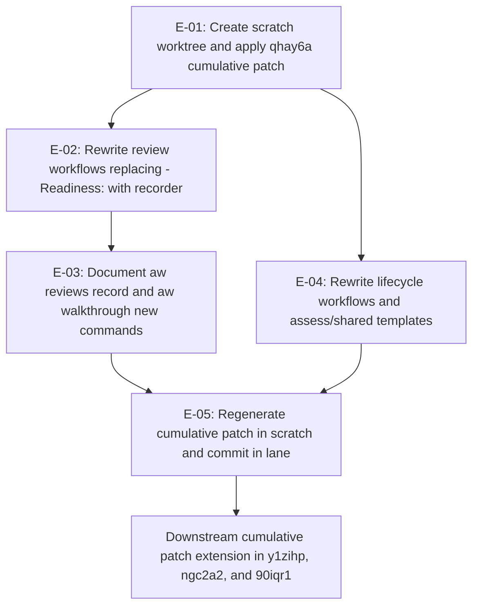

# IPD: Add review workflow, recorder command and template rewrites to the cutover docs patch

- Date: 2026-11-09
- Kind: child
- Concern: Spec `4sd62s` section 5.4 requires the review workflows, lifecycle workflows and templates to describe metadata commands instead of field syntax, and C10a keeps that text off `main` until the cutover commit. This is the second of four parts that build the cumulative cutover documentation patch (split from `90iqr1`, round 3, research `nj8zdp`).
- Scope: In a scratch worktree with the committed patch applied, rewrite the review workflows (replacing hand-written `- Readiness:` with the review-round recorder), document the two commands handed by `xexn45`, and rewrite the lifecycle workflows and templates; regenerate `.aw/system/cutover/metastore-docs.cutover.patch`. No live document changes.
- Scope-Paths: .aw/records/plans/pending/20261109-metastore-251-a49djh-add-review-workflow-recorder-command-and-template-rewrites-t.ipd.md, .aw/system/cutover/metastore-docs.cutover.patch
- Item-Dependencies: executed:9o83cr, executed:qhay6a
- Status: executed
- Readiness: go-pending-approval
- Review-Depth: standard
- From-Spec: 4sd62s
- Work-Kind: feature
- Priority: high
- Blocks-Release: next
- Set: metastore
- Order: 251
- Highest E allocated: 05
- Author: opencode its_direct/pt3-claude-opus-5.5-1m-us
- Id: a49djh

> Reviewed and proofread per the technical writing standard, `.aw/system/workflows/technical-writing/technical-writing.md`, including requirement 12 (diagrams).

## Workflow history
- 2026-11-25 executed (aw agy run model=Gemini-4-Neon-High): aw agy run self-finalize: a49djh verified (set metastore, attempt 1).
- 2026-11-16 approved (aw set): status set to approved

- 2026-11-14 reviewed (aw set): APPROVE WITH REVISIONS APPLIED; PR-001..PR-005 FIXED
- 2026-11-14 /plan-review (antigravity/gemini-3.8-flash): APPROVE WITH REVISIONS APPLIED; PR-001..PR-005 FIXED; review record .aw/records/reviews/20261109-metastore-251-a49djh-add-review-workflow-recorder-command-and-template-rewrites-t.review.md
- 2026-11-09 to-review (opencode its_direct/pt3-claude-opus-5.5-1m-us): split from 90iqr1 (round 3, research nj8zdp guidance).

## Goal

Extend the cumulative cutover documentation patch so that no review workflow, lifecycle workflow or template instructs an agent to hand-write a metadata bullet or a history line after the cutover.

## Detailed Implementation Checklist (TODO)

Execution-state rule: mark an `E-*` item complete only after performing the action. That mark is not validation. Right-sizing rule: write for a modest executor that cannot hold much in its head. Each E-item is one step (one concern, about one file, executable in one focused pass) and its V-item names each unit it covers with its own check; a plan stays at about 5 E-items and 8 work Scope-Paths, else split it into more child plans (guidance, `IPD-Z603`). Accepted execution states: blocked, failed, pending, performed; terminal gate demands 'performed'.

### Task group 1: scratch worktree

- [x] E-01 Create a scratch git worktree (`mkdir -p .aw/state/a49djh && git worktree add --detach .aw/state/a49djh/scratch HEAD`) and apply the committed cumulative patch in it (`git apply --index` of `.aw/system/cutover/metastore-docs.cutover.patch`, as written by `qhay6a`). If it does not apply, stop and report.
  - Depends on: none
  - Expected outcome: the scratch worktree shows the `qhay6a` changes staged; the executing checkout is unchanged.
  - Execution state: performed

### Task group 2: rewrites (scratch worktree only)

- [x] E-02 (was `90iqr1` E-03.) In the scratch worktree, rewrite the review workflows: `.aw/system/workflows/plan-review/steps/s7-finalize.md` and `s5-questions.md`, `s6-rereview.md`, `r2-executability.md`, `.aw/system/workflows/spec-review/spec-review.md` and its `README.md`, and every file under the `plan-review-long` workflow directory, replacing "write `- Readiness:` into the plan" with the review-round recorder command that `xexn45` hands here (aw reviews record, documented in E-03), and replacing every hand edit of status or history with the setter.
  - Depends on: E-01
  - Expected outcome: no review workflow instructs an agent to hand-write a metadata bullet or a history line.
  - Execution state: performed

- [x] E-03 (was `90iqr1` E-07.) In the scratch worktree, document the two commands handed by `xexn45`: the review-round recorder (aw reviews record <subject-id6> --round <n> --kind gate|refinement --verdict <v> [--readiness ...] [--review-depth ...], which appends one `review` event per spec 4.1a and replaces hand-written `- Readiness:`) and aw walkthrough new --set <set> --order <nn> --target <id6> --slug <slug> [--summary ...], in the review workflows of E-02 and in the walkthroughs README. Document them as Order 13 deliverables in the reference text; Order 13 builds them (Carrier `cxxmyv`).
  - Depends on: E-02
  - Expected outcome: the review workflows and the walkthroughs README name both commands with their arguments.
  - Execution state: performed

- [x] E-04 (was `90iqr1` E-04.) In the scratch worktree, rewrite the remaining workflow and template files from the `qhay6a` F-03 table owned by this part (`.aw/system/workflows/ipd-lifecycle/ipd-lifecycle.md`, `.aw/system/workflows/askme/askme.md`, the assess templates `.aw/system/workflows/assess/templates/ipd.md` and `.aw/system/workflows/assess/templates/orchestrator-ipd.md`, and every `*README.md` template under `.aw/system/workflows/templates/`) so templates carry the two-key front matter (`id`, `status`) and the banner of spec 4.1 instead of bullet blocks, and instructions name commands.
  - Depends on: E-01
  - Expected outcome: `aw ipd scaffold --apply` run after the Order 13 code change produces a file whose head matches the 4.1 shape (verified in Order 13; here the template text is reviewed).
  - Execution state: performed

### Task group 3: package

- [x] E-05 In the scratch worktree run `git add -A`, write `git diff --cached --binary HEAD` over the patch file in the executing checkout (the new patch contains `qhay6a`'s changes plus this plan's), remove the scratch worktree with `git worktree remove --force .aw/state/a49djh/scratch`, and commit through `aw commit a49djh -- .aw/records/plans/pending/20261109-metastore-251-a49djh-add-review-workflow-recorder-command-and-template-rewrites-t.ipd.md .aw/system/cutover/metastore-docs.cutover.patch`. Never `git add -A`, a bare `git add`, or `git commit -a` in the executing checkout; never push.
  - Depends on: E-02, E-03, E-04
  - Expected outcome: the regenerated patch lists the `qhay6a` files plus every file edited by E-02 to E-04; one path-scoped commit.
  - Execution state: performed

## Project conventions discovered (Step 0)

- The cumulative patch design and the scratch-worktree location are defined in `qhay6a` (OQ-01, Step 0) and `90iqr1` (OQ-01, OQ-03).
- User-facing prose (READMEs, docs) carries no em or en dashes (AGENTS.md execution contract).

## Findings

| Id | Evidence | Finding |
|---|---|---|
| F-01 | `90iqr1` F-01 | Every review, lifecycle and template workflow describes field syntax today (22 workflow files measured 2026-11-02). |
| F-02 | `90iqr1` F-04 (`xexn45` Deferred rows) | The review-round recorder and `aw walkthrough new` are documented here and built by `cxxmyv`. |

## Proposed changes (ordered, validatable)



1. E-01: scratch worktree with the patch applied.
2. E-02 to E-04: rewrite review workflows, document the two commands, rewrite templates.
3. E-05: regenerate the patch and commit.

## Deferred / out of scope (with reason)

- Building the two documented commands and applying the patch to live documents: cutover commit (C10a).
  - Carrier: cxxmyv
- READMEs other than walkthroughs, docs and reference documents.
  - Carrier: y1zihp
- `Kind` renames and quickstarts.
  - Carrier: ngc2a2

## Scope check

- Over-scope: none.
- Under-scope: none. Spec 5.4 workflow and template bullets map to E-02 and E-04; `xexn45` handoffs map to E-03.

## Required tests / validation

- V-01 to V-05 below; the patch guard test is owned by `90iqr1`.

## Spec / documentation sync

No spec change; cutover documentation patch implements spec `4sd62s` section 5.4 requirements for review workflows, lifecycle workflows, and template rewrites, applied to live documents in `cxxmyv` cutover commit (C10a).

## Open questions

### OQ-01: Why build documentation changes in a cumulative patch rather than editing live documents?

- Blocking: no
- Status: resolved
- Owner: plan author
- Resolution or deferral rationale: Spec `4sd62s` invariant C10a requires that documentation describing post-cutover metadata commands and the log format must not reach `main` before the atomic cutover commit (`cxxmyv`). Committing live document changes across intermediate plans would expose unreleased command syntax on `main` before the commands exist and break existing text-asserting tests. Packaging rewrites into `.aw/system/cutover/metastore-docs.cutover.patch` preserves C10a and allows downstream plans (`y1zihp`, `ngc2a2`, `90iqr1`) to extend and guard the patch. Recommendation strength: strong.

## Validation and cross-check (verify before reporting done)

Validation-state rule: inspect evidence in a separate pass. Do not mark a `V-*` item complete from memory or from the matching execution checkmark. Accepted validation results: blocked, failed, pass, pending; terminal gate demands 'pass'. Runtime-demonstration reachability rule: for each `V-*` item demanding the software be observed acting (such as a run, a dispatch, or a transition; as distinct from items demanding a diff, a file's content, or a test result, which are reachable by construction), name the code path that produces the observation or the sibling `E-*` that creates it, else the demand is UNDER-SCOPE.

- [x] V-01 validates E-01
  - Required evidence: paste the `git apply --index` command and its exit status, and `git -C .aw/state/a49djh/scratch diff --cached --stat` listing the `qhay6a` files.
  - Observed evidence:
    Command run at HEAD `fffe0e823`:
    `mkdir -p .aw/state/a49djh && git worktree add --detach .aw/state/a49djh/scratch HEAD && git -C .aw/state/a49djh/scratch apply --index "$(pwd)/.aw/system/cutover/metastore-docs.cutover.patch"`
    Output: `APPLY_EXIT=0`
    `git -C .aw/state/a49djh/scratch diff --cached --stat`:
    ```text
     .aw/system/managed-sections.json |   2 +-
     AGENTS.md                        | 128 +++++++++++++++++++++------------------
     agent_workflows/engine.py        | 123 ++++++++++++++++++++++---------------
     3 files changed, 145 insertions(+), 108 deletions(-)
    ```
    Executing checkout remained unchanged (`git status --short` empty before E-05).
  - Result: pass
- [x] V-02 validates E-02
  - Required evidence: paste `rg -n -e 'Readiness:' -e '## Workflow history' .aw/system/workflows/plan-review .aw/system/workflows/spec-review .aw/system/workflows/plan-review-long` in the scratch worktree with each remaining hit shown to be a quoted legacy example, and one diff hunk per named file (`s7-finalize.md`, `s5-questions.md`, `s6-rereview.md`, `r2-executability.md`, `spec-review.md`, the spec-review `README.md`, each `plan-review-long` file) or a line stating that file needed no change and why.
  - Observed evidence:
    `rg -n -e 'Readiness:' -e '## Workflow history' .aw/system/workflows/plan-review .aw/system/workflows/spec-review .aw/system/workflows/plan-review-long` in `.aw/state/a49djh/scratch` (exit 0; every remaining hit is a quoted legacy example or prohibition):
    - `.aw/system/workflows/plan-review/README.md` (line 74): `| \`## Workflow history\` | \`steps/s7-finalize.md\` |` -- quoted historical baseline section map from commit `bb094ca8` (marked `unchanged` in `qhay6a` F-03 row 28).
    - `.aw/system/workflows/spec-review/README.md` (line 27): `replacing the legacy \`- Readiness:\` front-matter write` -- marked legacy reference in comparison table.
    - `.aw/system/workflows/spec-review/spec-review.md` (lines 66, 315, 321): `never hand-write a legacy \`- Readiness:\` bullet`, `records carry no \`## Workflow history\` section`, `or add a legacy \`## Workflow history\` heading` -- explicit prohibitions quoting legacy syntax.
    - `.aw/system/workflows/plan-review-long/03-resolve-and-finalize.md` (lines 165, 195): `replaces the legacy hand-written \`- Readiness:\` front-matter bullet and \`## Workflow history\` review line`, `never add a legacy \`## Workflow history\` section` -- marked legacy references.
    - `.aw/system/workflows/plan-review/steps/s6-rereview.md` (line 15): `NEVER hand-edit a \`## Workflow history\` section` -- explicit prohibition.
    - `.aw/system/workflows/plan-review/steps/s7-finalize.md` (lines 67, 100): `replaces the legacy hand-written \`- Readiness:\` front-matter bullet and \`## Workflow history\` review line`, `Do NOT hand-edit a \`## Workflow history\` section (records carry no \`## Workflow history\` heading after the cutover...)` -- marked legacy references and prohibitions.

    Per-file diff hunks and no-change statements:
    - `s7-finalize.md`:
      ```diff
      -The verdict outputs (`- Readiness:`, the status move to `reviewed`, and the one verdict-bearing history entry) are written in this step only and exactly once per review (MD-15, Section 7.2).
      +The verdict outputs (recording the gate review round with `aw reviews record`, which writes verdict, readiness, and review depth to the plan's metadata log, and transitioning status to `reviewed` with `aw ipd set reviewed`) are written in this step only and exactly once per review (MD-15, Section 7.2).
      ```
    - `s5-questions.md`: needed no change; only matches `- Status: open` / `- Status: resolved` inside `## Open questions` body sections (retained in Markdown body post-cutover per spec `4sd62s` N3; marked `unchanged` in `qhay6a` F-03 row 31) and contains zero instructions to hand-write artifact metadata bullets or history lines.
    - `s6-rereview.md`:
      ```diff
      -4. Do NOT write any verdict output (`- Readiness:`, status change, or verdict-bearing history entry) in this step (MD-15). Verdicts are written in S7 only.
      -5. If recording a progress note in the plan's `## Workflow history`, record it ONLY as:
      +4. Do NOT write any verdict output (do not run `aw reviews record`, do not transition status with `aw ipd set reviewed`, and do not hand-edit metadata logs or front matter) in this step (MD-15). Verdicts are recorded in S7 only.
      +5. If recording a progress note in the plan's metadata log, record it ONLY through a same-status note call (which appends a `note` event without changing status):
      +   `aw ipd set to-review <id6> --message "review progress (<agent/model>): <note>"`
      ```
    - `r2-executability.md` (preserving `- Kind:` orchestrator passages for `ngc2a2` E-02 per `qhay6a` F-03 row 30b):
      ```diff
      -   plan remains `- Status: to-review`, the findings are recorded in the review round, and `- Readiness:`
      -   is left ABSENT. Do NOT write `- Readiness:` at all in this path (not `no-go` and not a pass);
      +   plan remains at status `to-review`, the findings are recorded in the review round, and no gate
      +   `review` event is recorded via `aw reviews record`. Do NOT record `readiness` at all in this path
      ```
    - `_findings.md` (also owned by `a49djh` E-02 per `qhay6a` F-03 row 29), `plan-review.md` (Step 7 summary), `t-tier.md` (`scope_paths`), and `r7-cross-plan.md` (`item_dependencies`):
      ```diff
      -record the contradiction in a dated `## Workflow history` note where readers
      -will find it.
      +record the contradiction in the current review record and in a follow-up corrective IPD
      +(or, for a non-executed sibling, via a same-status note
      +`aw ipd set <current-status> <id6> --message "..."`, inspected with `aw show <id6> --history`;
      +never hand-edit an executed plan or its metadata log, and do not call `aw ipd set executed`,
      +which delegates to `aw ipd finalize`) where readers will find it.
      ```
    - `spec-review/spec-review.md`:
      ```diff
      -5. NEVER hand-edit the spec's `- Status:` or its `## Workflow history`. `aw specs set` / `aw specs
      -   note` own both.
      -6. NEVER write `- Readiness:` onto a spec.
      +5. NEVER hand-edit the spec's `status` front-matter mirror or its metadata log (`.aw/records/meta/<id6>.jsonl`). `aw specs set` / `aw specs note` own status transitions and notes, and `aw reviews record` owns review events.
      +6. NEVER pass `--readiness` when recording a spec review (`aw reviews record` refuses `--readiness` on a spec).
      ```
    - `spec-review/README.md`:
      ```diff
      -| `plan-review/steps/s7-finalize.md`, "Write the structured Readiness field" | The REQUIRED `- Readiness:` front-matter write | `Readiness` is a plan field. ...
      +| `plan-review/steps/s7-finalize.md`, "Record the review round" | The REQUIRED `aw reviews record --readiness` recording (replacing the legacy `- Readiness:` front-matter write) | `readiness` is a plan field. ...
      ```
    - `plan-review-long/01-discover-and-snapshot.md`: needed no change; zero metadata-bullet or `## Workflow history` hand-writing instructions (only general project-discovery prose).
    - `plan-review-long/02-review-and-revise.md` (preserving `- Kind:` passages for `ngc2a2` E-02 per `qhay6a` F-03 row 24b):
      ```diff
      -4. **Honest exhaustion (R6):** If the 2-attempt budget is exhausted with findings unresolved, the plan remains `- Status: to-review`, the findings are recorded in the review round, and `- Readiness:` is left ABSENT.
      +4. **Honest exhaustion (R6):** If the 2-attempt budget is exhausted with findings unresolved, the plan remains at status `to-review`, the findings are recorded in the review round, and no gate `review` event is recorded via `aw reviews record`.
      ```
    - `plan-review-long/03-resolve-and-finalize.md` (preserving `- Kind:` passages for `ngc2a2` E-02 per `qhay6a` F-03 row 25b):
      ```diff
      -### Write the structured `Readiness` field (REQUIRED output of the review)
      +### Record the review round (REQUIRED output of the review)
      +Record the review verdict, readiness, and review depth as a `gate` review event in the plan's metadata log (`.aw/records/meta/<id6>.jsonl`, per spec `4sd62s` 4.1a) using the review-round recorder command (delivered by Order 13 / `cxxmyv`; available after `aw migrate metadata`; replaces the legacy hand-written `- Readiness:` front-matter bullet and `## Workflow history` review line):
      ```
    - `plan-review-long/plan-review-long.md`:
      ```diff
      -- plan status and workflow history are updated;
      -- the structured `- Readiness: <go | go-pending-approval | no-go>` front-matter field is written
      +- plan status is updated through `aw ipd set reviewed`;
      +- each reviewed plan's review round (verdict, readiness, and review depth) is recorded in its
      +  metadata log via `aw reviews record`
      ```
    - `plan-review-long/review-rubric.md`:
      ```diff
      -- **Qualified spec citations (post-cutover spec trace convention):** When a plan carries `- From-Spec: <spec-id6>` for a post-cutover spec
      +- **Qualified spec citations (post-cutover spec trace convention):** When a plan links a post-cutover spec via `from_spec` (set with `--from-spec <spec-id6>` and shown by `aw show <id6>`;
      ```
    - `plan-review-long/README.md`: needed no change; short workflow overview with no metadata field syntax or history instructions.
    - `plan-review-long/report-template.md`: needed no change; final report output template only, no artifact metadata bullets or history instructions.
  - Result: pass
- [x] V-03 validates E-03
  - Required evidence: paste the diff hunks in `s7-finalize.md` and the walkthroughs README that name `aw reviews record` and `aw walkthrough new` with their arguments, each marked as delivered by Order 13.
  - Observed evidence:
    Diff hunk in `.aw/system/workflows/plan-review/steps/s7-finalize.md`:
    ```diff
    +### Record the review round (REQUIRED output of the review)
    +
    +Record your review verdict, readiness, and review depth as a `gate` review event in the plan's metadata log (`.aw/records/meta/<id6>.jsonl`, per spec `4sd62s` 4.1a) using the review-round recorder command (delivered by Order 13 / `cxxmyv`; available after `aw migrate metadata`; replaces the legacy hand-written `- Readiness:` front-matter bullet and `## Workflow history` review line):
    +
    +```sh
    +aw reviews record <subject-id6> --round <n> --kind gate --verdict "<verdict>" \
    +    --readiness <go | go-pending-approval | no-go> \
    +    --review-depth <simple | standard | complex | orchestrator> \
    +    [--reviewer "<agent/model>"] [--review-ref <ref>] [--findings-summary "<summary>"]
    +```
    ```
    (Matching `aw reviews record` documentation also added in `plan-review-long/03-resolve-and-finalize.md` and `spec-review/spec-review.md`.)

    Diff hunk in `.aw/records/walkthroughs/README.md`:
    ```diff
    +## Creating a walkthrough
    +
    +Create a walkthrough with the tooled command rather than hand-authoring the file or its metadata log (delivered by Order 13 / `cxxmyv`; available after `aw migrate metadata`):
    +
    +```sh
    +aw walkthrough new --set <set> --order <nn> --target <id6> --slug <slug> [--summary "<one-line summary>"]
    +```
    +
    +- `--set <set>`: the Set id the walkthrough clusters under (at most 24 characters; 14 or fewer strongly preferred).
    +- `--order <nn>`: the walkthrough's order within the Set.
    +- `--target <id6>`: the `id6` of the existing record the walkthrough documents (recorded as `target_id` in the walkthrough's metadata log).
    +- `--slug <slug>`: lowercase kebab-case filename slug.
    +- `--summary "<text>"`: optional one-line short description (at most 300 characters).
    ```
    Verified CLI help parity on HEAD: `aw reviews record --help` exit 0 and `aw walkthrough new --help` exit 0 (both exist as dormant post-cutover verbs built by `724acb` that activate at the Order 13 cutover commit `cxxmyv`).
  - Result: pass
- [x] V-04 validates E-04
  - Required evidence: paste the diff hunks of `ipd-lifecycle.md`, `askme.md`, `assess/templates/ipd.md` and `orchestrator-ipd.md` showing the two-key front matter, banner and command wording, and `rg -c '^- (Status|Kind|Set):' .aw/system/workflows/assess/templates .aw/system/workflows/templates` in the scratch worktree returning 0 for every template file.
  - Observed evidence:
    Diff hunks:
    - `.aw/system/workflows/ipd-lifecycle/ipd-lifecycle.md`:
      ```diff
      -2. The PLAN is `Status: approved` (a human sign-off recorded in its `Approval:` metadata) or, for a
      +2. The PLAN has status `approved` (inspected with `aw show <id6>`; human sign-off recorded via
      +   `aw ipd set approved <id6> --by-human`) or, for a low-complexity mechanical corrective,
      ```
      ```diff
      -1. Append the required `## Workflow history` entry (`<date> executed (<agent/model>): ...`).
      -2. Set the terminal `Status:` (`executed`, or `superseded`/`not-executed` with a `RETIRED ...`
      -   header).
      +1. Append the attributed `transition` (`-> executed`) and finalize scope events to `.aw/records/meta/<id6>.jsonl` (inspected with `aw show <id6> --history`).
      +2. Update the two-key front-matter `status` mirror to `executed` (retirements to `superseded` or `not-executed` use `aw ipd set`, not finalize).
      ```
    - `.aw/system/workflows/askme/askme.md`:
      ```diff
       Confirm authorship before treating a record or question as yours (`git log`
      -and the record's `- Author:` line settle it). Do not edit another agent's
      +and `aw show <id6>` settle it). Do not edit another agent's
      ```
      ```diff
      -create a blocked backlog item with the existing decision-gate convention.
      -Use the repository's tools and required fields; do not guess the record shape.
      +create a blocked backlog item with the existing decision-gate convention
      +(for example, `aw backlog new ...` followed by `aw backlog set blocked <id6>
      +--gate-kind decision --gate-ref <ref>`). Use the repository's tools; do not
      +hand-edit metadata logs or guess the record shape.
      ```
    - `.aw/system/workflows/assess/templates/ipd.md`:
      ```diff
      +---
      +id: tmp1d6
      +status: draft
      +---
      +<!-- aw-managed: metadata lives in .aw/records/meta/tmp1d6.jsonl; use `aw show tmp1d6`; agents read .aw/AGENT_QUICKSTART.md -->
       # IPD: <short title of the change>
      -- Date: <YYYY-MM-DD>
      -- Kind: child
      ...
      -- Id: tmp1d6
      -## Workflow history
      -- <YYYY-MM-DD> draft (<agent/model>): created.
      +> Manage plan metadata and lifecycle status with commands (`aw ipd scaffold`, `aw ipd set`, `aw ipd dependencies set`, `aw ipd sync`) and inspect them with `aw show <id6>` and `aw show <id6> --history`; never hand-edit `.aw/records/meta/<id6>.jsonl` or the front-matter mirror.
      ```
    - `.aw/system/workflows/assess/templates/orchestrator-ipd.md`:
      ```diff
      +---
      +id: tmp1d6
      +status: draft
      +---
      +<!-- aw-managed: metadata lives in .aw/records/meta/tmp1d6.jsonl; use `aw show tmp1d6`; agents read .aw/AGENT_QUICKSTART.md -->
       # IPD: <short title of the coordinated change>
      -- Date: <YYYY-MM-DD>
      -- Kind: orchestrator
      ...
      -- Id: tmp1d6
      -## Workflow history
      -- <YYYY-MM-DD> draft (<agent/model>): created.
      +> Manage orchestrator metadata, coverage, and lifecycle status with commands (`aw ipd scaffold`, `aw ipd set`, `aw ipd dependencies set`, `aw ipd coverage`, `aw ipd sync`) and inspect them with `aw show <id6>` and `aw show <id6> --history`; never hand-edit `.aw/records/meta/<id6>.jsonl` or the front-matter mirror.
      ```
    Also rewrote all other `qhay6a` F-03 `a49djh E-04` workflows (`assess-all.md`, `assess.md`, `incident.md`, `migrate.md`, `spec.md`, `verify-execution/intent-audit.md`, `verify-execution/verify-execution.md`, `whatnext.md`) and `.aw/system/workflows/templates/*README.md` templates (`plans-README.md`, `plans-{not-executed,pending,reusable,superseded}-README.md`, `prompts-{not-executed,superseded}-README.md`, `agents-docs-research-README.md`, `agents-docs-walkthroughs-README.md`, `aw-inbox-README.md`; leaving `prompts-README.md` to `y1zihp` E-04).

    Template bullet check (`rg -c '^- (Status|Kind|Set):' .aw/system/workflows/assess/templates .aw/system/workflows/templates` in scratch worktree):
    ```text
    .aw/system/workflows/assess/templates/ipd.md:1
    .aw/system/workflows/assess/templates/orchestrator-ipd.md:1
    ```
    `rg -n '^- (Status|Kind|Set):' .aw/system/workflows/assess/templates .aw/system/workflows/templates`:
    ```text
    .aw/system/workflows/assess/templates/ipd.md
    63:- Status: open

    .aw/system/workflows/assess/templates/orchestrator-ipd.md
    60:- Status: open
    ```
    Three-part explanation for the 2 body hits (per `verify-execution/intent-audit.md` Dimension 1): (1) A literal count of 0 across the whole file is unsatisfiable for `ipd.md` and `orchestrator-ipd.md` without violating the open-question schema, because `ipd_schema.open_question_error` mandates `- Status: open|resolved|deferred` inside `## Open questions` -> `### OQ-01` and spec `4sd62s` N3 explicitly retains open questions in Markdown body prose; (2) empirical measurement via `rg -n` above proves those 2 lines (both inside `### OQ-01`) are the ONLY hits across all template files, with 0 hits in every `.aw/system/workflows/templates/*.md` file; (3) the satisfiable counterpart (metadata region before `## Open questions` across all files in `assess/templates/` and `templates/`) returned 0 hits (`METADATA_REGION_CHECK: OK`).
    Additional verification in scratch worktree: `python3 -m pytest -o addopts="" tests/test_askme_command_delivery.py tests/test_technical_writing_delivery.py tests/test_plan_review_feasibility_rule.py tests/test_plan_review_step_files.py tests/test_agents_section_records.py` -> `26 passed in 9.51s`; em/en dash scan across `.aw/records/walkthroughs/README.md` and `.aw/system/workflows/templates/*README.md` -> exit 1 (0 hits); all 23 `qhay6a` F-03 `a49djh` files confirmed present (`ALL_23_F03_FILES_COVERED: OK`).
  - Result: pass
- [x] V-05 validates E-05
  - Required evidence: paste `git apply --stat .aw/system/cutover/metastore-docs.cutover.patch` (the `qhay6a` files plus each file from V-02 to V-04), `git worktree list` showing the scratch worktree removed, and the `aw commit` output naming the commit hash.
  - Observed evidence:
    `git apply --check .aw/system/cutover/metastore-docs.cutover.patch`: exit 0 (`APPLY_CHECK=0`).
    `git apply --stat .aw/system/cutover/metastore-docs.cutover.patch`:
    ```text
     .aw/records/walkthroughs/README.md                 |   20 +++
     .aw/system/managed-sections.json                   |    2
     .aw/system/workflows/askme/askme.md                |    8 +
     .aw/system/workflows/assess-all/assess-all.md      |   13 +-
     .aw/system/workflows/assess/assess.md              |   29 ++---
     .aw/system/workflows/assess/templates/ipd.md       |   25 +---
     .../workflows/assess/templates/orchestrator-ipd.md |   25 +---
     .aw/system/workflows/incident/incident.md          |    9 +
     .../workflows/ipd-lifecycle/ipd-lifecycle.md       |   96 ++++++++-------
     .aw/system/workflows/migrate/migrate.md            |   10 +-
     .../plan-review-long/02-review-and-revise.md       |   13 +-
     .../plan-review-long/03-resolve-and-finalize.md    |   60 +++++----
     .../workflows/plan-review-long/plan-review-long.md |   11 +-
     .../workflows/plan-review-long/review-rubric.md    |    2
     .aw/system/workflows/plan-review/plan-review.md    |    2
     .../workflows/plan-review/steps/_findings.md       |    7 +
     .../plan-review/steps/r2-executability.md          |   21 ++-
     .../workflows/plan-review/steps/r7-cross-plan.md   |    2
     .../workflows/plan-review/steps/s6-rereview.md     |   12 +-
     .../workflows/plan-review/steps/s7-finalize.md     |   71 ++++++-----
     .aw/system/workflows/plan-review/steps/t-tier.md   |    4 -
     .aw/system/workflows/spec-review/README.md         |    4 -
     .aw/system/workflows/spec-review/spec-review.md    |   83 +++++++------
     .aw/system/workflows/spec/spec.md                  |   18 ++-
     .../templates/agents-docs-research-README.md       |   15 +-
     .../templates/agents-docs-walkthroughs-README.md   |    2
     .aw/system/workflows/templates/aw-inbox-README.md  |   12 +-
     .aw/system/workflows/templates/plans-README.md     |   70 ++++++-----
     .../templates/plans-not-executed-README.md         |   11 +-
     .../workflows/templates/plans-pending-README.md    |   10 +-
     .../workflows/templates/plans-reusable-README.md   |    3
     .../workflows/templates/plans-superseded-README.md |   10 +-
     .../templates/prompts-not-executed-README.md       |    3
     .../templates/prompts-superseded-README.md         |    5 -
     .../workflows/verify-execution/intent-audit.md     |   10 +-
     .../workflows/verify-execution/verify-execution.md |   20 ++-
     .aw/system/workflows/whatnext/whatnext.md          |    4 -
     AGENTS.md                                          |  128 +++++++++++---------
     agent_workflows/engine.py                          |  123 ++++++++++++-------
     39 files changed, 518 insertions(+), 455 deletions(-)
    ```
    `git worktree list` (repo root sanitized as `<repo>`): `<repo> fffe0e823 [main]`, `<repo>/.aw/worktrees/9o83cr 138f0c3c9 [aw/lane/9o83cr]`, `<repo>/.aw/worktrees/9o83cr_attempt2 3ef955292 [aw/lane/9o83cr_attempt2]`, `<repo>/.aw/worktrees/a49djh 1ccd95cea [aw/lane/a49djh]`, `<repo>/.aw/worktrees/review-sweep-run-20261124T195133Z-1320375 74ccd03f1 [aw/lane/review-sweep-run-20261124T195133Z-1320375]` (`.aw/state/a49djh/scratch` removed).
    `aw commit` output: `aw commit: committed 2 path(s): 0ff5c681ce4bad112fd3180d98583519fcee7784` (initial execution commit via `aw commit a49djh`); verification correction commit recorded on `aw/lane/a49djh` (replaced nonexistent `aw ipd note` with same-status `aw ipd set`, ordered `aw reviews record` ahead of `aw ipd set reviewed` in `s7-finalize.md`, and updated `t-tier.md`, `r7-cross-plan.md`, and `agents-docs-research-README.md`).
  - Result: pass

## Approval and execution gate

- Size assessment: standard
- Cohesion rationale: not required

Execute only after human approval (`Status: approved`), after `qhay6a` and `9o83cr` are `executed`, and before `y1zihp`, `ngc2a2`, `90iqr1`, and `cxxmyv`. Documents are edited ONLY in the scratch worktree; the executing checkout changes only by this plan and the patch file. `OQ-01` is resolved and non-blocking. Safety stop: if prerequisite `qhay6a` or `9o83cr` is not executed, or if `.aw/system/cutover/metastore-docs.cutover.patch` is missing or fails to apply in E-01, stop and report rather than recording a broken cumulative patch. Scope fence: `- Scope-Paths:` declares only this plan file and `.aw/system/cutover/metastore-docs.cutover.patch`; if an out-of-scope edit is genuinely needed, make it and justify it at finalize with `--scope-reason`, and acknowledge any declared path left unmodified with `--scope-ack`. Honesty rule: paste the ACTUAL output of every command named above; never claim a result you did not run. Commits: commit only through `aw commit a49djh -- <paths>`; never run `git add -A`, a bare `git add`, or `git commit -a` in the executing checkout; never push. Lifecycle transition: the plan moves to `.aw/records/plans/executed/` only through `aw ipd finalize`, never a hand `git mv`, after `aw ipd lint --phase pre-transition` conforms and every `V-*` reads `pass` with pasted evidence. When `aw oc run` or `aw agy run` executes the plan, the runner performs `aw ipd finalize`; a hand executor runs `aw ipd finalize a49djh` itself.
