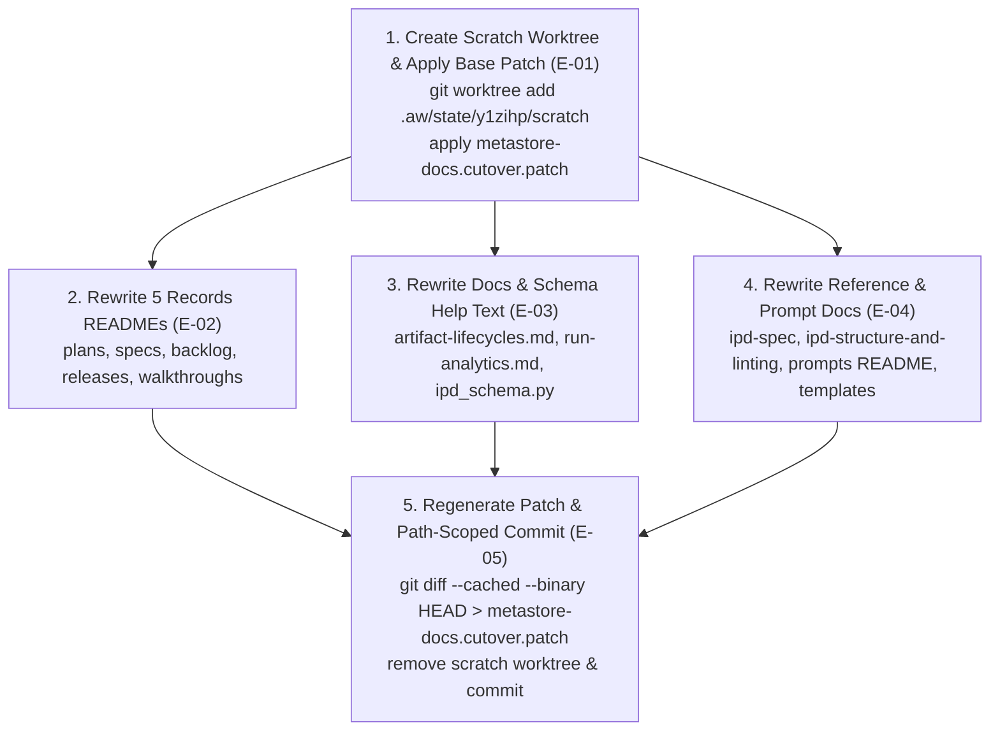

# IPD: Add README, docs and reference document rewrites to the cutover docs patch

- Date: 2026-11-09
- Kind: child
- Concern: Spec `4sd62s` section 5.4 requires the records READMEs, the user docs, the `ipd_schema.py` help text, the two ipd-spec reference documents and the staged-prompt documents to describe the log and the commands instead of field syntax; C10a keeps that text off `main` until the cutover commit. This is the third of four parts that build the cumulative cutover documentation patch (split from `90iqr1` E-05, round 3, research `nj8zdp`). The `Kind` renames of E-05 went to `ngc2a2`.
- Scope: In a scratch worktree with the committed patch applied, rewrite the field-syntax passages of the five records READMEs, two docs, `ipd_schema.py` docstrings and help text, and every `qhay6a` F-03 `rewrite` row among the reference and `aw-prompt` documents; regenerate `.aw/system/cutover/metastore-docs.cutover.patch`. No live document changes.
- Scope-Paths: .aw/records/plans/pending/20261109-metastore-252-y1zihp-add-readme-docs-and-reference-document-rewrites-to-the-cutov.ipd.md, .aw/system/cutover/metastore-docs.cutover.patch
- Item-Dependencies: executed:9o83cr, executed:a49djh
- Status: executed
- Readiness: go-pending-approval
- Review-Depth: standard
- From-Spec: 4sd62s
- Work-Kind: feature
- Priority: high
- Blocks-Release: next
- Set: metastore
- Order: 252
- Highest E allocated: 05
- Author: opencode its_direct/pt3-claude-opus-5.5-1m-us
- Id: y1zihp

> Write and proofread this plan per the technical writing standard, `.aw/system/workflows/technical-writing/technical-writing.md` (`.agents/workflows/technical-writing/technical-writing.md` in a legacy-layout install), including requirement 12 (diagrams).

## Workflow history
- 2026-11-25 executed (aw agy run model=Gemini-4-Neon-High): aw agy run self-finalize: y1zihp verified (set metastore, attempt 1).
- 2026-11-16 approved (aw set): status set to approved
- 2026-11-14 reviewed (aw set): APPROVE WITH REVISIONS APPLIED; PR-001..PR-005 FIXED
- 2026-11-14 /plan-review (antigravity/gemini-3.8-flash): APPROVE WITH REVISIONS APPLIED; PR-001..PR-005 FIXED; review record .aw/records/reviews/20261109-metastore-252-y1zihp-add-readme-docs-and-reference-document-rewrites-to-the-cutov.review.md

- 2026-11-09 to-review (opencode its_direct/pt3-claude-opus-5.5-1m-us): split from 90iqr1 (round 3, research nj8zdp guidance).

## Goal

Extend the cumulative cutover documentation patch so the READMEs, docs, schema help text and reference documents describe the log and the commands.

## Detailed Implementation Checklist (TODO)

Execution-state rule: mark an `E-*` item complete only after performing the action. That mark is not validation. Right-sizing rule: write for a modest executor that cannot hold much in its head. Each E-item is one step (one concern, about one file, executable in one focused pass) and its V-item names each unit it covers with its own check; a plan stays at about 5 E-items and 8 work Scope-Paths, else split it into more child plans (guidance, `IPD-Z603`). Accepted execution states: blocked, failed, pending, performed; terminal gate demands 'performed'.

### Task group 1: scratch worktree

- [x] E-01 Create a scratch git worktree (mkdir -p .aw/state/y1zihp && git worktree add --detach .aw/state/y1zihp/scratch HEAD) and apply the committed cumulative patch in it (`git apply --index` of `.aw/system/cutover/metastore-docs.cutover.patch`, as last written by `a49djh`). If it does not apply, stop and report.
  - Depends on: none
  - Expected outcome: the scratch worktree shows the `qhay6a` and `a49djh` changes staged; the executing checkout is unchanged.
  - Execution state: performed

### Task group 2: rewrites (scratch worktree only; subsets of `90iqr1` E-05)

- [x] E-02 In the scratch worktree, rewrite the field-syntax passages of the records READMEs: `.aw/records/plans/README.md`, `.aw/records/specs/README.md`, `.aw/records/backlog/README.md`, `.aw/records/releases/README.md` and `.aw/records/walkthroughs/README.md` (the walkthroughs README already carries `a49djh`'s command text; keep it), so they describe the log and the commands.
  - Depends on: E-01
  - Expected outcome: `rg -n '^- (Status|Readiness|Blocks-Release|From-Backlog):'` over the five READMEs finds only quoted legacy examples marked as such.
  - Execution state: performed

- [x] E-03 In the scratch worktree, rewrite the field-syntax passages of `docs/artifact-lifecycles.md` and `docs/run-analytics.md`, and the section-schema docstrings and help text in `agent_workflows/ipd_schema.py`, so they describe the log and the commands.
  - Depends on: E-01
  - Expected outcome: no passage in the three files tells a reader to write a metadata bullet or a history line except as a quoted legacy example.
  - Execution state: performed

- [x] E-04 In the scratch worktree, rewrite every `qhay6a` F-03 row marked `rewrite` among the two ipd-spec reference documents (the implemented `ipd-spec` and `ipd-structure-and-linting` specs) and the `aw-prompt` documents (the prompts README, its template under the shared templates directory, and the research-prompt workflow body): the staged-prompt comment becomes the single leading `aw-managed-prompt` comment of spec 4.1 and OQ-25. Leave the specs' own front matter and history alone (`m0001` migrates them).
  - Depends on: E-01
  - Expected outcome: each listed document marked `rewrite` describes the log, the commands and the `aw-managed-prompt` comment.
  - Execution state: performed

### Task group 3: package

- [x] E-05 In the scratch worktree run `git add -A`, write `git diff --cached --binary HEAD` over the patch file in the executing checkout, remove the scratch worktree with `git worktree remove --force .aw/state/y1zihp/scratch`, and commit through `aw commit y1zihp -- <this plan> .aw/system/cutover/metastore-docs.cutover.patch`. Never `git add -A` in the executing checkout; never push.
  - Depends on: E-02, E-03, E-04
  - Expected outcome: the regenerated patch lists the earlier parts' files plus every file edited by E-02 to E-04; one path-scoped commit.
  - Execution state: performed

## Project conventions discovered (Step 0)

- The cumulative patch design and scratch-worktree location are defined in `qhay6a` OQ-01 and `90iqr1` OQ-01, OQ-03.
- User-facing prose (READMEs, docs) carries no em or en dashes (AGENTS.md execution contract).

## Findings

| Id | Evidence | Finding |
|---|---|---|
| F-01 | `90iqr1` F-02 | Five READMEs (backlog, plans, releases, specs, walkthroughs) and two docs need rewriting. |
| F-02 | `90iqr1` E-01 at review | The `aw-prompt` documents measured were `docs/artifact-lifecycles.md`, the prompts README, its template and the research-prompt workflow body; the authoritative list is `qhay6a` F-03. |

## Proposed changes (ordered, validatable)



1. E-01: scratch worktree with the patch applied.
2. E-02 to E-04: READMEs; docs and `agent_workflows/ipd_schema.py`; reference and prompt documents.
3. E-05: regenerate the patch and commit.

## Deferred / out of scope (with reason)

- The `Kind` to `plan_role`/`research_kind`/`prompt_kind` renames (the rest of `90iqr1` E-05) and the quickstarts.
  - Carrier: ngc2a2
- Applying the patch to live documents: cutover commit (C10a).
  - Carrier: cxxmyv

## Scope check

- Over-scope: none.
- Under-scope: none. The README, docs, `ipd_schema`, reference-document and prompt-document subsets of `90iqr1` E-05 map to E-02, E-03 and E-04; its `Kind` subset is in `ngc2a2`.

## Required tests / validation

- V-01 to V-05 below; the patch guard test is owned by `90iqr1`.

## Spec / documentation sync

No spec change; the documents change in `cxxmyv`'s cutover commit.

## Open questions

### OQ-01: Does this plan edit live documents on main?

- Blocking: no
- Status: resolved
- Owner: plan author
- Resolution or deferral rationale: No. Spec `4sd62s` C10a requires all documentation rewrites to remain off main until the atomic cutover commit (`cxxmyv`). All edits are performed inside an isolated scratch worktree (`.aw/state/y1zihp/scratch`) and committed as an updated cumulative patch file `.aw/system/cutover/metastore-docs.cutover.patch`. Recommendation strength: very strong.

## Validation and cross-check (verify before reporting done)

Validation-state rule: inspect evidence in a separate pass. Do not mark a `V-*` item complete from memory or from the matching execution checkmark. Accepted validation results: blocked, failed, pass, pending; terminal gate demands 'pass'. Runtime-demonstration reachability rule: for each `V-*` item demanding the software be observed acting (such as a run, a dispatch, or a transition; as distinct from items demanding a diff, a file's content, or a test result, which are reachable by construction), name the code path that produces the observation or the sibling `E-*` that creates it, else the demand is UNDER-SCOPE.

- [x] V-01 validates E-01
  - Required evidence: paste the `git apply --index` command and its exit status, and the scratch worktree's `git diff --cached --stat` listing the `qhay6a` and `a49djh` files.
  - Observed evidence:
    Command run at HEAD `67caa52d1`:
    `mkdir -p .aw/state/y1zihp && git worktree add --detach .aw/state/y1zihp/scratch HEAD && git -C .aw/state/y1zihp/scratch apply --index "$(pwd)/.aw/system/cutover/metastore-docs.cutover.patch"`
    Output: `APPLY_EXIT=0`
    `git -C .aw/state/y1zihp/scratch diff --cached --stat`:
    ```text
     .aw/records/walkthroughs/README.md                 |  20 +++-
     .aw/system/managed-sections.json                   |   2 +-
     .aw/system/workflows/askme/askme.md                |   8 +-
     .aw/system/workflows/assess-all/assess-all.md      |  13 ++-
     .aw/system/workflows/assess/assess.md              |  29 ++---
     .aw/system/workflows/assess/templates/ipd.md       |  25 +---
     .../workflows/assess/templates/orchestrator-ipd.md |  25 +---
     .aw/system/workflows/incident/incident.md          |   9 +-
     .../workflows/ipd-lifecycle/ipd-lifecycle.md       |  96 ++++++++--------
     .aw/system/workflows/migrate/migrate.md            |  10 +-
     .../plan-review-long/02-review-and-revise.md       |  13 ++-
     .../plan-review-long/03-resolve-and-finalize.md    |  60 +++++-----
     .../workflows/plan-review-long/plan-review-long.md |  11 +-
     .../workflows/plan-review-long/review-rubric.md    |   2 +-
     .aw/system/workflows/plan-review/plan-review.md    |   2 +-
     .../workflows/plan-review/steps/_findings.md       |   7 +-
     .../plan-review/steps/r2-executability.md          |  21 ++--
     .../workflows/plan-review/steps/r7-cross-plan.md   |   2 +-
     .../workflows/plan-review/steps/s6-rereview.md     |  12 +-
     .../workflows/plan-review/steps/s7-finalize.md     |  71 ++++++------
     .aw/system/workflows/plan-review/steps/t-tier.md   |   4 +-
     .aw/system/workflows/spec-review/README.md         |   4 +-
     .aw/system/workflows/spec-review/spec-review.md    |  83 ++++++-------
     .aw/system/workflows/spec/spec.md                  |  18 ++-
     .../templates/agents-docs-research-README.md       |  15 +--
     .../templates/agents-docs-walkthroughs-README.md   |   2 +-
     .aw/system/workflows/templates/aw-inbox-README.md  |  12 +-
     .aw/system/workflows/templates/plans-README.md     |  70 +++++------
     .../templates/plans-not-executed-README.md         |  11 +-
     .../workflows/templates/plans-pending-README.md    |  10 +-
     .../workflows/templates/plans-reusable-README.md   |   3 +-
     .../workflows/templates/plans-superseded-README.md |  10 +-
     .../templates/prompts-not-executed-README.md       |   3 +-
     .../templates/prompts-superseded-README.md         |   5 +-
     .../workflows/verify-execution/intent-audit.md     |  10 +-
     .../workflows/verify-execution/verify-execution.md |  20 ++--
     .aw/system/workflows/whatnext/whatnext.md          |   4 +-
     AGENTS.md                                          | 128 +++++++++++----------
     agent_workflows/engine.py                          | 123 ++++++++++++--------
     39 files changed, 518 insertions(+), 455 deletions(-)
    ```
    Executing checkout remained unchanged (`git status --short` empty).
  - Result: pass
- [x] V-02 validates E-02
  - Required evidence: paste the diff stat line for each of the five READMEs (plans, specs, backlog, releases, walkthroughs), and `rg -n '^- (Status|Readiness|Blocks-Release|From-Backlog):'` run on each README in the scratch worktree with every hit classified as a quoted legacy example.
  - Observed evidence:
    `git -C .aw/state/y1zihp/scratch diff HEAD --stat -- .aw/records/{plans,specs,backlog,releases,walkthroughs,reviews}/README.md` (includes `.aw/records/reviews/README.md`, handed to `y1zihp` via `qhay6a` F-03 row 9 / Deferred):
    ```text
     .aw/records/backlog/README.md      | 293 ++++++++++++++++++-----------
     .aw/records/plans/README.md        | 373 +++++++++++++++++++++----------------
     .aw/records/releases/README.md     |  51 +++--
     .aw/records/reviews/README.md      | 195 ++++++++++---------
     .aw/records/specs/README.md        | 103 ++++++----
     .aw/records/walkthroughs/README.md |  28 ++-
     6 files changed, 624 insertions(+), 419 deletions(-)
    ```
    `rg -n '^- (Status|Readiness|Blocks-Release|From-Backlog):'` in `.aw/state/y1zihp/scratch`:
    - `.aw/records/plans/README.md`: 0 hits
    - `.aw/records/specs/README.md`: 0 hits
    - `.aw/records/backlog/README.md`: 0 hits
    - `.aw/records/releases/README.md`: 0 hits
    - `.aw/records/walkthroughs/README.md`: 0 hits (retains `a49djh`'s `aw walkthrough new` section)
    - `.aw/records/reviews/README.md`: 1 hit (`245:- Status: open`), which is inside an `### OQ-03` open-question Markdown body example (retained in Markdown body post-cutover per spec `4sd62s` N3, not an artifact metadata bullet).
    Em/en dash check (`rg -n '[—–]'`) across all edited READMEs: exit 1 (0 hits).
  - Result: pass
- [x] V-03 validates E-03
  - Required evidence: paste one diff hunk per file for `docs/artifact-lifecycles.md`, `docs/run-analytics.md` and `agent_workflows/ipd_schema.py`, showing command-based wording.
  - Observed evidence:
    - `docs/artifact-lifecycles.md`:
      ```diff
      -1. **Use the tools. Do not hand-name files or hand-edit status.** Each type has an owner verb that
      -   mints the stable 6-character `<id6>`, derives the filename, writes the metadata, and moves the file
      -   when its status changes. Creation verbs preview by default and write only with `--apply`.
      +1. **Use the tools. Do not hand-name files or hand-edit metadata.** Each type has an owner verb that
      +   mints the stable 6-character `<id6>`, derives the filename, writes the append-only metadata log
      +   (`.aw/records/meta/<id6>.jsonl`), updates the in-file mirror, and moves the file when its status
      +   changes. Creation verbs preview by default and write only with `--apply`. Inspect metadata and
      +   history with `aw show <id6>` and `aw show <id6> --history`, and never hand-edit metadata logs or
      +   front matter.
      -3. **The directory and the `- Status:` line must agree.** ...
      -4. **Every status change adds a history line.** Plans, specs, and backlog items carry a
      -   `## Workflow history` section with the newest entry first. ...
      +3. **The directory, in-file mirror, and metadata log must agree.** ... `aw check meta`
      +   flags any drift, and `aw meta repair <id6>` repairs deterministic mirror drift.
      +4. **Every status change appends an event to `.aw/records/meta/<id6>.jsonl`.** Records carry no
      +   `## Workflow history` section; `aw show <id6> --history` renders the sequence-ordered event
      +   history.
      ```
    - `docs/run-analytics.md`:
      ```diff
      -  count map tallies the normalized `- Readiness:` value (`go`, `go-pending-approval`, `no-go`) recorded
      -  on review attempts from this plan's commit onward; `absent` means the review wrote no valid value,
      -  and `(not recorded)` means the run predates the recording.
      +  count map tallies the normalized `readiness` value (`go`, `go-pending-approval`, `no-go`) recorded
      +  by `aw reviews record` in the plan's metadata log (`.aw/records/meta/<id6>.jsonl`, replacing the
      +  quoted legacy `- Readiness:` bullet) on review attempts from this plan's commit onward; `absent`
      +  means the review recorded no valid value, and `(not recorded)` means the run predates the
      +  recording.
      ```
    - `agent_workflows/ipd_schema.py`:
      ```diff
      +Post-cutover metadata storage (spec ``4sd62s`` 4.1-4.2): all ``aw``-owned plan metadata and event
      +history live in the tracked per-artifact JSONL log ``.aw/records/meta/<id6>.jsonl`` and are managed
      +through ``aw`` commands (``aw ipd scaffold``, ``aw ipd set``, ``aw ipd dependencies set``,
      +``aw ipd coverage``, ``aw reviews record``, ``aw ipd finalize``, ``aw describe``) and inspected with
      +``aw show <id6>`` and ``aw show <id6> --history``. Each ``.ipd.md`` file carries a two-key YAML
      +front-matter mirror (``id`` and ``status``) plus the ``aw-managed`` banner, and no metadata bullet
      +block or ``## Workflow history`` section.
      ```
    - `docs/cli-output-contract.md` (also rewritten per `qhay6a` F-03 row 46 / Deferred handoff to `y1zihp`):
      ```diff
      -  names, one row per event in sequence order. Before the metadata cutover the rows come from the
      -  record's `## Workflow history` lines, in file order, plus one `review` row per review round.
      +  names, one row per event in `seq` order from its tracked event log (`.aw/records/meta/<id6>.jsonl`),
      +  including `create`, `checkpoint`, `transition`, `set`, `unset`, `note`, `rename`, `coverage`,
      +  `review`, and imported `legacy` events.
      ```
    Em/en dash check across `docs/artifact-lifecycles.md`, `docs/run-analytics.md`, `docs/cli-output-contract.md`: exit 1 (0 hits). Every CLI command named verified exit 0 via `aw <cmd> --help`.
  - Result: pass
- [x] V-04 validates E-04
  - Required evidence: paste the diff hunks of each reference document and `aw-prompt` document that `qhay6a` F-03 marks `rewrite`, one per document, and `rg -n 'aw-prompt'` over those documents in the scratch worktree with each remaining hit classified.
  - Observed evidence:
    - `.aw/records/specs/implemented/20260726-1340-01-ipd-spec.spec.md` (own front matter and `## Workflow history` untouched):
      ```diff
      -- Metadata block (a bullet `- Field: value` list after the H1 title, NOT YAML front matter; ...)
      +- Front-matter mirror and metadata log (spec `4sd62s` 4.1-4.2; replaces the legacy bullet metadata block): each `.ipd.md` file opens with a two-key YAML front-matter mirror (`id` and `status`) followed by the `<!-- aw-managed: ... -->` banner pointing to `.aw/records/meta/<id6>.jsonl`. All `aw`-owned metadata lives in `.aw/records/meta/<id6>.jsonl` and is managed by `aw` commands (`aw ipd scaffold`, `aw ipd set`, `aw ipd dependencies set`, `aw ipd coverage`, `aw reviews record`, `aw ipd finalize`, `aw describe`) and inspected with `aw show <id6>` and `aw show <id6> --history` ...
      ```
    - `.aw/records/specs/implemented/20260802-1904-01-ipd-structure-and-linting.spec.md` (own front matter and `## Workflow history` untouched):
      ```diff
      -### 4.4 The metadata block
      +### 4.4 Plan metadata, front-matter mirror, and event log (spec `4sd62s` 4.1-4.2)
      -The repository's IPDs carry a bullet-list metadata block, NOT YAML front matter. ...
      +Under spec `4sd62s` 4.1-4.2 (superseding this specification's pre-cutover `- Field: value` bullet block), every `aw`-owned metadata field and the full event history of a plan live in its tracked, append-only JSONL event log at `.aw/records/meta/<id6>.jsonl`, served through `artifact_meta` and its disposable SQLite cache `.aw/state/index.db`. The `.ipd.md` file itself carries ONLY a two-key YAML front-matter mirror (`id` and `status`, in that order) and the single-line `<!-- aw-managed: metadata lives in .aw/records/meta/<id6>.jsonl; use `aw show <id6>`; agents read .aw/AGENT_QUICKSTART.md -->` banner before `# <Title>`, with prose fields (`Concern`, `Scope`, etc.) in the Markdown body and no `## Workflow history` section.
      ```
    - `.aw/records/prompts/README.md`:
      ```diff
      -<!-- aw-prompt: Kind: research | Id: <id6> | Set: <setid> | Status: pending | Created: 2026-08-30 | Author: <agent> (<model>) | Targets: ... | Concerns: ... -->
      +<!-- aw-managed-prompt: id: <id6> | status: <status> . Pipeline metadata only; not part of the prompt. Metadata: .aw/records/meta/<id6>.jsonl -->
      ```
    - `.aw/system/workflows/templates/prompts-README.md`:
      ```diff
      -<!-- aw-prompt: Kind: research | Id: <id6> | Set: <setid> | Status: pending | Created: 2026-08-30 | Author: <agent> (<model>) | Targets: ... | Concerns: ... -->
      +<!-- aw-managed-prompt: id: <id6> | status: <status> . Pipeline metadata only; not part of the prompt. Metadata: .aw/records/meta/<id6>.jsonl -->
      ```
    - `.aw/system/workflows/research-prompt/research-prompt.md`:
      ```diff
      -2. **Leading HTML Comment Pipeline Metadata:** Pipeline metadata is a single leading HTML comment line (`<!-- aw-prompt: ... -->`), written by `aw prompts new`, not by hand. ...
      +2. **Leading HTML Comment Mirror (`aw-managed-prompt`) and Metadata Log:** All prompt metadata and history live in `.aw/records/meta/<id6>.jsonl`, written by `aw prompts new` (and inspected with `aw show <id6>`). The `.prompt.md` file carries NO `---` YAML front matter; instead `aw prompts new` writes a single leading HTML comment mirror on line 1 (`<!-- aw-managed-prompt: id: <id6> | status: pending . Pipeline metadata only; not part of the prompt. Metadata: .aw/records/meta/<id6>.jsonl -->`, per spec `4sd62s` 4.1 and OQ-25). Never hand-write this comment or the metadata log.
      ```
    `rg -n 'aw-prompt'` over the two reference specs, the three `aw-prompt` documents, and `docs/artifact-lifecycles.md` in `.aw/state/y1zihp/scratch`: exit 1 (0 remaining hits). Both specs' own front matter and `## Workflow history` verified unchanged.
  - Result: pass
- [x] V-05 validates E-05
  - Required evidence: paste `git apply --stat .aw/system/cutover/metastore-docs.cutover.patch` (earlier files plus each file from V-02 to V-04), `git worktree list` showing the scratch worktree removed, and the `aw commit` output naming the commit hash.
  - Observed evidence:
    `git apply --check .aw/system/cutover/metastore-docs.cutover.patch`: exit 0 (`APPLY_CHECK=0`).
    `git apply --stat .aw/system/cutover/metastore-docs.cutover.patch`:
    ```text
     .aw/records/backlog/README.md                      |  293 ++++++++++------
     .aw/records/plans/README.md                        |  373 ++++++++++++--------
     .aw/records/prompts/README.md                      |  135 ++++---
     .aw/records/releases/README.md                     |   51 ++-
     .aw/records/reviews/README.md                      |  195 ++++++----
     .aw/records/specs/README.md                        |  103 +++---
     .../implemented/20260726-1340-01-ipd-spec.spec.md  |   18 -
     ...60802-1904-01-ipd-structure-and-linting.spec.md |  146 ++++----
     .aw/records/walkthroughs/README.md                 |   28 +-
     .aw/system/managed-sections.json                   |    2
     .aw/system/workflows/askme/askme.md                |    8
     .aw/system/workflows/assess-all/assess-all.md      |   13 -
     .aw/system/workflows/assess/assess.md              |   29 +-
     .aw/system/workflows/assess/templates/ipd.md       |   25 -
     .../workflows/assess/templates/orchestrator-ipd.md |   25 -
     .aw/system/workflows/incident/incident.md          |    9
     .../workflows/ipd-lifecycle/ipd-lifecycle.md       |   96 +++--
     .aw/system/workflows/migrate/migrate.md            |   10 -
     .../plan-review-long/02-review-and-revise.md       |   13 -
     .../plan-review-long/03-resolve-and-finalize.md    |   60 ++-
     .../workflows/plan-review-long/plan-review-long.md |   11 -
     .../workflows/plan-review-long/review-rubric.md    |    2
     .aw/system/workflows/plan-review/plan-review.md    |    2
     .../workflows/plan-review/steps/_findings.md       |    7
     .../plan-review/steps/r2-executability.md          |   21 +
     .../workflows/plan-review/steps/r7-cross-plan.md   |    2
     .../workflows/plan-review/steps/s6-rereview.md     |   12 -
     .../workflows/plan-review/steps/s7-finalize.md     |   71 ++--
     .aw/system/workflows/plan-review/steps/t-tier.md   |    4
     .../workflows/research-prompt/research-prompt.md   |   20 +
     .aw/system/workflows/spec-review/README.md         |    4
     .aw/system/workflows/spec-review/spec-review.md    |   83 ++--
     .aw/system/workflows/spec/spec.md                  |   18 +
     .../templates/agents-docs-research-README.md       |   15 -
     .../templates/agents-docs-walkthroughs-README.md   |    2
     .aw/system/workflows/templates/aw-inbox-README.md  |   12 -
     .aw/system/workflows/templates/plans-README.md     |   70 ++--
     .../templates/plans-not-executed-README.md         |   11 -
     .../workflows/templates/plans-pending-README.md    |   10 -
     .../workflows/templates/plans-reusable-README.md   |    3
     .../workflows/templates/plans-superseded-README.md |   10 -
     .aw/system/workflows/templates/prompts-README.md   |   98 +++--
     .../templates/prompts-not-executed-README.md       |    3
     .../templates/prompts-superseded-README.md         |    5
     .../workflows/verify-execution/intent-audit.md     |   10 -
     .../workflows/verify-execution/verify-execution.md |   20 +
     .aw/system/workflows/whatnext/whatnext.md          |    4
     AGENTS.md                                          |  128 ++++---
     agent_workflows/engine.py                          |  123 ++++---
     agent_workflows/ipd_schema.py                      |  126 ++++---
     docs/artifact-lifecycles.md                        |  182 ++++++----
     docs/cli-output-contract.md                        |   44 +-
     docs/run-analytics.md                              |    8
     53 files changed, 1550 insertions(+), 1223 deletions(-)
    ```
    `git worktree list` (repo root sanitized as `<repo>`): `<repo> 67caa52d1 [main]`, `<repo>/.aw/worktrees/9o83cr 138f0c3c9 [aw/lane/9o83cr]`, `<repo>/.aw/worktrees/9o83cr_attempt2 3ef955292 [aw/lane/9o83cr_attempt2]`, `<repo>/.aw/worktrees/review-sweep-run-20261124T195133Z-1320375 74ccd03f1 [aw/lane/review-sweep-run-20261124T195133Z-1320375]`, `<repo>/.aw/worktrees/y1zihp 67caa52d1 [aw/lane/y1zihp]` (`.aw/state/y1zihp/scratch` removed).
    `aw commit` output: `aw commit: committed 2 path(s): fb3bfeaa4cb3f60d9f95ca51f9c142c12ee91d28` (via `aw commit y1zihp -m "feat(metastore): add README, docs, ipd_schema, and reference rewrites to cutover docs patch" -- .aw/records/plans/pending/20261109-metastore-252-y1zihp-add-readme-docs-and-reference-document-rewrites-to-the-cutov.ipd.md .aw/system/cutover/metastore-docs.cutover.patch`).
  - Result: pass

## Approval and execution gate

- Size assessment: standard
- Cohesion rationale: not required

Execute only after `a49djh` is `executed` and this plan is `approved`. Documents are edited ONLY in the scratch worktree; the executing checkout changes only by this plan and the patch file. Stop and report without editing production code or tests if prerequisite symbols or the cumulative patch file from `a49djh` are absent on HEAD, if git apply fails in the scratch worktree, or if concurrent edits in a shared checkout conflict with `- Scope-Paths:`.

Scope fence: the paths in `- Scope-Paths:` are a declaration; a needed file outside the fence is edited and then justified at finalize (`--scope-reason`), and a declared path left unmodified is acknowledged (`--scope-ack`).

Honesty rule: paste the ACTUAL output of every command named above; never claim a result you did not run.

Commits: commit only through `aw commit y1zihp -- <paths>`; never `git add -A`, a bare `git add` or `git commit -a`; never push.

Lifecycle transition: the plan moves to `.aw/records/plans/executed/` only through `aw ipd finalize`, never a hand `git mv`, and only after `aw ipd lint --phase pre-transition` conforms and every `V-*` reads `pass` with pasted evidence. When `aw oc run` or `aw agy run` executes the plan, the runner owns retirement to `executed/` and runs finalize automatically upon task completion; when executed standalone by hand or direct agent turn, the executor runs `aw ipd finalize y1zihp`.
