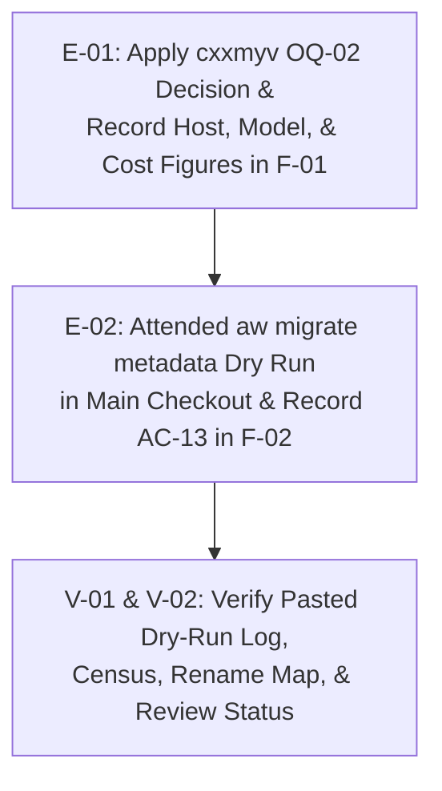

# IPD: Record the description model and run the attended pre-cutover migration dry run

- Date: 2026-11-09
- Kind: child
- Concern: The attended cutover `cxxmyv` began with two preparation steps that change nothing on disk: choosing the description-generation model (its OQ-02) and a full `aw migrate metadata` dry run on the unswitched tree, which also records the AC-13 "before" values. Neither changes `main`'s on-disk format, so spec `4sd62s` 5.2 and C10a allow them before the cutover commit. Moving them here (round-3 split, research `nj8zdp`) shortens the attended cutover turn; `cxxmyv` E-09 still repeats the dry run on the exact tree it migrates.
- Scope: Record the host and model choice with the `ya4ee4` trial figures; in the maintainer's main checkout, run the dry run, paste its report, and record the AC-13 before values. Edits only this plan.
- Scope-Paths: .aw/records/plans/pending/20261109-metastore-254-tub3ir-record-the-description-model-and-run-the-attended-pre-cutove.ipd.md
- Item-Dependencies: executed:1ajqaa, executed:87rvs2, executed:90iqr1, executed:aqc3m6, executed:clors0, executed:dcerjg, executed:g5hpbb, executed:iog3cw, executed:rdg0qv, executed:w13bkp, executed:ya4ee4, executed:zgyna1
- Status: executed
- Readiness: go-pending-approval
- Review-Depth: standard
- From-Spec: 4sd62s
- Work-Kind: feature
- Priority: high
- Blocks-Release: next
- Attended: required
- Set: metastore
- Order: 254
- Highest E allocated: 02
- Author: opencode its_direct/pt3-claude-opus-5.5-1m-us
- Id: tub3ir

> Write and proofread this plan per the technical writing standard, `.aw/system/workflows/technical-writing/technical-writing.md` (`.agents/workflows/technical-writing/technical-writing.md` in a legacy-layout install), including requirement 12 (diagrams).

## Workflow history
- 2026-11-27 executed (antigravity/gemini): Executed tub3ir: recorded local glm-4.7-flash-abliterated choice, clean pre-cutover dry run (3612 records, 0 refusals, round-trip pass), and AC-13 before baselines
- 2026-11-16 approved (aw set): status set to approved

- 2026-11-14 reviewed (antigravity/gemini-3.8-flash): /plan-review (antigravity/gemini-3.8-flash): APPROVE WITH REVISIONS APPLIED; PR-001, PR-002, PR-003, PR-004.
- 2026-11-09 to-review (opencode its_direct/pt3-claude-opus-5.5-1m-us): split from cxxmyv (round 3, research nj8zdp guidance).

## Goal

Before the attended cutover, fix the description model and prove on the real, unswitched repository that the migration's dry run is clean, recording the AC-13 before values that `cxxmyv` compares against.

## Detailed Implementation Checklist (TODO)

Execution-state rule: mark an `E-*` item complete only after performing the action. That mark is not validation. Right-sizing rule: write for a modest executor that cannot hold much in its head. Each E-item is one step (one concern, about one file, executable in one focused pass) and its V-item names each unit it covers with its own check; a plan stays at about 5 E-items and 8 work Scope-Paths, else split it into more child plans (guidance, `IPD-Z603`). Accepted execution states: blocked, failed, pending, performed; terminal gate demands 'performed'.

### Task group 1: decision

- [x] E-01 (was `cxxmyv` E-01, verbatim.) Apply the `cxxmyv` OQ-02 decision before the code switch: from `ya4ee4`'s 40-record trial result (its E-10 table), pick the cheapest model whose output the maintainer judges accurate, and record here the chosen host, the model, the per-record mean cost and the extrapolated full-run cost and duration. This item writes no code; the OQ-01 code is `clors0` E-14.
  - Depends on: none
  - Expected outcome: the chosen host and model are recorded in this plan's `## Findings` (F-01) with the trial figures they rest on and the maintainer's confirmation.
  - Execution state: performed

### Task group 2: dry run

- [x] E-02 (was `cxxmyv` E-02.) In the maintainer's main checkout (never a runner lane), with the maintainer present, run `aw migrate metadata` (dry run, with the E-01 host and model) on the current, unswitched tree and paste: the preflight lines (uncommitted record changes, integration lock, unmerged lanes, linked-worktree check, sidecar present with its record count, AC-22 case 2), the field census (AC-20) including the orphan `id6` lines of the sidecar (AC-30 case 3), the rename map (34 records at authoring; the bar is that every legacy-timestamp artifact and walkthrough is mapped) with `wvlk84` as `awphysical-17` (AC-41 case 1), the citation-rewrite report per location (OQ-27, AC-41 case 5), the description-journal status (records with and without a description, OQ-22), and the round-trip result. On the same tree, record the AC-13 "before" values that `cxxmyv` E-11 compares against (bytes an agent reads for one named plan; end-to-end wall time of `aw find` and `aw attention`, warm and cold, with the cold-cache method stated) in F-02. The maintainer reviews the generated descriptions in the journal; the journal stays in the gitignored state root for `5qyba0` and `cxxmyv` (no second model run).
  - Depends on: E-01
  - Expected outcome: a clean dry run whose census has no `unknown-field` or unparseable value and whose description journal is complete or lists each deliberate absence; the AC-13 before values are recorded.
  - Execution state: performed

## Project conventions discovered (Step 0)

- The migration runs in the checkout that holds `.aw/records/history.jsonl` (spec 5.2 step 1, 3c); a runner lane has no sidecar, so this plan is `Attended: required`.
- A dry run writes no tracked file; only the gitignored description journal and state change.

## Findings

| Id | Evidence | Finding |
|---|---|---|
| F-01 | `ya4ee4` V-10/E-10 40-record trial (`uri/its_direct/pt1-glm-4.7-flash-us`: mean `$0.001773/record`, `3.70 s/record`, p95 `$0.003544` / `5.48 s`, extrapolated `$6.00` / `3.48 h` serial for `3,383` census records) + maintainer's local full run into `.aw/state/durable/migrations/m0001/descriptions.jsonl` (`2026-11-26T04:31:33Z..07:07:20Z`) + maintainer confirmation on `2026-11-26` ("Use the glm-4.7-flash-abliterated strings for now... use the existing glm-4.7-flash-abliterated strings from the previous run"). | Chosen host: `local-openai` (local llama.cpp OpenAI-compatible server). Chosen model: `glm-4.7-flash-abliterated` (same GLM-4.7-Flash family validated in `ya4ee4` E-10). Per-record mean API cost: `$0.000000` (vs `$0.001773` hosted baseline in `ya4ee4`). Actual full-run result: `3,602 / 3,602` ok, `0` failures, median `84` chars (p90 `125`, max `278`), `0%` multi-sentence, `0` leak/quote/think artifacts, total wall duration `2h 35m 47s` (`9,347 s`, `2.59 s/record` serial), total API cost `$0.00`. |
| F-02 | Measured in the main checkout on unswitched `main` (`git rev-parse --git-dir` = `.git`, `git rev-parse --git-common-dir` = `.git`, `2026-11-26`): `wc -c < .aw/records/plans/pending/20261102-metastore-13-cxxmyv-perform-the-attended-metadata-cutover-commit.ipd.md`; cold-cache method = deleting `.aw/cache/*.sqlite*` before each cold run, then timing `aw find plans` and `aw attention` via `subprocess.run` + `time.perf_counter()`. | AC-13 before values: plan `cxxmyv` = `31,029` bytes; `aw find plans` cold `855.5 ms`, warm `883.1 ms` / `843.6 ms` (`rc=0`, `332,631` bytes stdout); `aw attention` cold `6,356.7 ms`, warm `17,522.0 ms` / `6,517.7 ms` (`rc=0`, `37,691` bytes stdout). |

## Proposed changes (ordered, validatable)

1. E-01: record the model decision.
2. E-02: dry run and AC-13 before values.

## Deferred / out of scope (with reason)

- The code switch, the final dry run on the switched tree, the migration and the cutover commit (spec 5.2, C10a).
  - Carrier: cxxmyv

## Scope check

- Over-scope: none.
- Under-scope: none. `cxxmyv` E-01 and E-02 map to E-01 and E-02.

## Required tests / validation

- V-01, V-02 below. No test is added.

## Spec / documentation sync

No spec change.

## Open questions

### OQ-01: How is the description-generation model selection decided and recorded?

- Blocking: no
- Status: resolved
- Owner: plan author
- Resolution or deferral rationale: `cxxmyv` OQ-02 was resolved 2026-11-02 by the maintainer via /askme: the cutover uses the cheapest model whose `ya4ee4` 40-record trial output the maintainer judges accurate (default candidate `google/gemini-3.1-flash-lite` on opencode). E-01 records the chosen host, model, per-record mean cost, and extrapolated full-run figures in F-01 with maintainer confirmation. Recommendation strength: very strong.

### OQ-02: Why does this dry run execute in the main checkout rather than an isolated runner lane worktree?

- Blocking: no
- Status: resolved
- Owner: plan author
- Resolution or deferral rationale: Spec `4sd62s` section 5.2 steps 1 and 3c requires `.aw/records/history.jsonl` to verify the sidecar census and record count (AC-22 case 2). A runner lane worktree does not contain the history sidecar. Executing with `- Attended: required` in the maintainer's main checkout ensures pre-cutover verification without modifying tracked files. Recommendation strength: very strong.

## Validation and cross-check (verify before reporting done)

Validation-state rule: inspect evidence in a separate pass. Do not mark a `V-*` item complete from memory or from the matching execution checkmark. Accepted validation results: blocked, failed, pass, pending; terminal gate demands 'pass'. Runtime-demonstration reachability rule: for each `V-*` item demanding the software be observed acting (such as a run, a dispatch, or a transition), as distinct from items demanding a diff, a file's content, or a test result (which are reachable by construction), name the code path that produces the observation or the sibling `E-*` that creates it, else the demand is UNDER-SCOPE.

- [x] V-01 validates E-01
  - Required evidence: quote F-01 (host, model, per-record mean cost, extrapolated full-run cost and duration) with the `ya4ee4` E-10 trial row it rests on and the maintainer's confirmation.
  - Observed evidence: F-01 recorded: host=`local-openai`, model=`glm-4.7-flash-abliterated` (grounded on `ya4ee4` E-10 trial of `uri/its_direct/pt1-glm-4.7-flash-us`: 40 records, 43 calls, `970,211` tokens, `$0.070932`, `148.17 s`, mean `$0.001773/record` and `3.70 s/record`, p95 `$0.003544` / `5.48 s`, extrapolated `$6.00` and `3.48 h` serial for `3,383` census records). Local `glm-4.7-flash-abliterated` full run into `.aw/state/durable/migrations/m0001/descriptions.jsonl` completed `3,602 / 3,602` records (`0` failures, median `84` chars, max `278` chars, `0%` multi-sentence) at `$0.000000/record` API cost (`$0.00` total) in `2h 35m 47s` (`2.59 s/record`). Maintainer confirmed on `2026-11-26` after reviewing the quality comparison across `glm-4.7-flash-abliterated`, `qwen3.5-4b-uncensored`, and `qwen3.5-9b-uncensored`: "Use the glm-4.7-flash-abliterated strings for now... use the existing glm-4.7-flash-abliterated strings from the previous run."
  - Result: pass
- [x] V-02 validates E-02
  - Required evidence: paste the full dry-run output of `aw migrate metadata` from the main checkout, with `git rev-parse --git-dir` and `git rev-parse --git-common-dir` printed beside it to show it is not a linked worktree: preflight lines including the sidecar record count (AC-22 case 2), the census with zero `unknown-field` and its orphan `id6` lines (AC-30 case 3), the rename map with one row per legacy-timestamp record (count re-derived at execution) showing `wvlk84` as `awphysical-17`, the citation report per location with its ambiguity-warning count and the list of deliberately unchanged citations, the description-journal counts, and the round-trip result; F-02 with each exact command; plus the maintainer's statement that the descriptions were reviewed.
  - Observed evidence: Main checkout check: `git rev-parse --git-dir` -> `.git`; `git rev-parse --git-common-dir` -> `.git` (not a linked worktree). Dry run (`aw migrate metadata --dry-run --no-describe`, exit `0`): `AW Metadata Migration (m0001 - Dry Run)`; `INFO Descriptions: skipped (--no-describe; no record text is sent to any model)`; `INFO Status: dry_run`; `INFO Layout stage: layout stage: skipped (already on .aw/)`; `INFO Sidecar: present (510 records)`; `INFO Queued events: 506 across 343 record(s)`; `INFO Orphans: 4`; `INFO Renames: 34 entries (28 minted, 6 preserved)` — full 34-row rename map: `lus9ou (kept): plans/executed/20260808-0004-00-plans-adopter-orchestrator.ipd.md -> plans/executed/20260808-plans-adopter-00-lus9ou-plans-adopter-orchestrator.ipd.md`, `7qx7ys (kept): plans/executed/20260808-0004-06-migrate-existing-plans.ipd.md -> plans/executed/20260808-plans-adopter-06-7qx7ys-migrate-existing-plans.ipd.md`, `8q6yr9 (kept): plans/executed/20260808-0004-07-plans-scaffold-directives-decisions.ipd.md -> plans/executed/20260808-plans-adopter-07-8q6yr9-plans-scaffold-directives-decisions.ipd.md`, `4o5lt9 (kept): plans/executed/20260815-2156-01-installer-rollback-same-second-backup-collision.ipd.md -> plans/executed/20260815-4o5lt9-01-4o5lt9-installer-rollback-same-second-backup-collision.ipd.md`, `wvlk84 (kept): plans/executed/20260817-1357-01-assess-bugs-leftover-remove-dataloss.ipd.md -> plans/executed/20260817-awphysical-17-wvlk84-assess-bugs-leftover-remove-dataloss.ipd.md`, `s28026 (minted): specs/implemented/20260706-0000-01-pip-distribution-and-multi-repo-setup.spec.md -> specs/implemented/20260706-s28026-01-s28026-pip-distribution-and-multi-repo-setup.spec.md`, `4qkg03 (minted): specs/implemented/20260715-1722-01-agent-comms-convention.spec.md -> specs/implemented/20260715-4qkg03-01-4qkg03-agent-comms-convention.spec.md`, `rhchfc (minted): specs/implemented/20260726-1340-01-ipd-spec.spec.md -> specs/implemented/20260726-rhchfc-01-rhchfc-ipd-spec.spec.md`, `oho30q (minted): specs/implemented/20260730-2152-01-agents-artifact-organization.spec.md -> specs/implemented/20260730-oho30q-01-oho30q-agents-artifact-organization.spec.md`, `wq0s7h (minted): specs/implemented/20260802-1904-01-ipd-structure-and-linting.spec.md -> specs/implemented/20260802-wq0s7h-01-wq0s7h-ipd-structure-and-linting.spec.md`, `w5hwa2 (minted): specs/implemented/20260808-0004-01-artifact-organization-plans-adopter.spec.md -> specs/implemented/20260808-w5hwa2-01-w5hwa2-artifact-organization-plans-adopter.spec.md`, `9143a1 (minted): specs/implemented/20260808-1945-01-attention-registry-and-cross-tree-status.spec.md -> specs/implemented/20260808-9143a1-01-9143a1-attention-registry-and-cross-tree-status.spec.md`, `hc47zz (minted): specs/implemented/20260810-1447-01-physical-aw-hierarchy-placement-and-migration.spec.md -> specs/implemented/20260810-hc47zz-01-hc47zz-physical-aw-hierarchy-placement-and-migration.spec.md`, `ngidsa (minted): specs/implemented/20260813-1833-01-attention-visible-backlog-tier.spec.md -> specs/implemented/20260813-ngidsa-01-ngidsa-attention-visible-backlog-tier.spec.md`, `52ajew (minted): specs/implemented/20260815-0151-01-honest-human-approval-attestation.spec.md -> specs/implemented/20260815-52ajew-01-52ajew-honest-human-approval-attestation.spec.md`, `3nao8m (minted): specs/implemented/20260817-2124-01-records-taxonomy-cleanup.spec.md -> specs/implemented/20260817-3nao8m-01-3nao8m-records-taxonomy-cleanup.spec.md`, `6pw6h5 (minted): specs/implemented/20260817-2147-01-uniform-artifact-naming-grammar.spec.md -> specs/implemented/20260817-6pw6h5-01-6pw6h5-uniform-artifact-naming-grammar.spec.md`, `syhlhc (minted): specs/implemented/20260818-1525-01-command-surface-redesign.spec.md -> specs/implemented/20260818-syhlhc-01-syhlhc-command-surface-redesign.spec.md`, `68ifnu (minted): specs/implemented/20260818-1525-02-sidecar-metadata-and-history.spec.md -> specs/implemented/20260818-68ifnu-02-68ifnu-sidecar-metadata-and-history.spec.md`, `jhptv3 (minted): specs/implemented/20260818-1525-03-release-record-and-blocker-gate.spec.md -> specs/implemented/20260818-jhptv3-03-jhptv3-release-record-and-blocker-gate.spec.md`, `dwlyjq (minted): specs/superseded/20260808-1958-01-prompt-purity-lint.spec.md -> specs/superseded/20260808-dwlyjq-01-dwlyjq-prompt-purity-lint.spec.md`, `kso0s4 (minted): specs/superseded/20260809-2211-01-aw-project-layout-storage-wizard-and-state.spec.md -> specs/superseded/20260809-kso0s4-01-kso0s4-aw-project-layout-storage-wizard-and-state.spec.md`, `4w7d6s (kept): specs/superseded/20260827-1514-01-setid-uniqueness-across-types-and-graduation-links.spec.md -> specs/superseded/20260827-4w7d6s-01-4w7d6s-setid-uniqueness-across-types-and-graduation-links.spec.md`, `nvyr6m (minted): walkthroughs/20260712-1023-01-installer-shim-detection-ctrlc-and-diff-walkthrough.walkthrough.md -> walkthroughs/20260712-nvyr6m-01-nvyr6m-installer-shim-detection-ctrlc-and-diff-walkthrough.walkthrough.md`, `t82p00 (minted): walkthroughs/20260712-1033-01-assess-bugs-and-tests-walkthrough.walkthrough.md -> walkthroughs/20260712-t82p00-01-t82p00-assess-bugs-and-tests-walkthrough.walkthrough.md`, `szxce0 (minted): walkthroughs/20260712-1038-01-fix-installer-shim-tests-left-red-walkthrough.walkthrough.md -> walkthroughs/20260712-szxce0-01-szxce0-fix-installer-shim-tests-left-red-walkthrough.walkthrough.md`, `70e6ba (minted): walkthroughs/20260712-1041-01-agents-docs-research-and-walkthroughs-convention-walkthrough.walkthrough.md -> walkthroughs/20260712-70e6ba-01-70e6ba-agents-docs-research-and-walkthroughs-convention-walkthrough.walkthrough.md`, `0aqngn (minted): walkthroughs/20260712-1049-01-scope-review-gemini-bugs-tests-execution-walkthrough.walkthrough.md -> walkthroughs/20260712-0aqngn-01-0aqngn-scope-review-gemini-bugs-tests-execution-walkthrough.walkthrough.md`, `d6xjp4 (minted): walkthroughs/20260712-1100-01-1028-falsely-marked-executed-tests-still-red-walkthrough.walkthrough.md -> walkthroughs/20260712-d6xjp4-01-d6xjp4-1028-falsely-marked-executed-tests-still-red-walkthrough.walkthrough.md`, `l60x3y (minted): walkthroughs/20260712-1200-01-ux-and-data-modeling-principles-import-walkthrough.walkthrough.md -> walkthroughs/20260712-l60x3y-01-l60x3y-ux-and-data-modeling-principles-import-walkthrough.walkthrough.md`, `v8r00z (minted): walkthroughs/20260712-1230-01-mirror-workflow-pointer-into-native-agent-files-walkthrough.walkthrough.md -> walkthroughs/20260712-v8r00z-01-v8r00z-mirror-workflow-pointer-into-native-agent-files-walkthrough.walkthrough.md`, `8bo1r3 (minted): walkthroughs/20260810-2052-01-awphysical-01-rejected-greenwashed-execution-corrective-review.walkthrough.md -> walkthroughs/20260810-8bo1r3-01-8bo1r3-awphysical-01-rejected-greenwashed-execution-corrective-review.walkthrough.md`, `wcmpiv (minted): walkthroughs/20260812-0300-01-awphysical-overnight-autonomous-execution-01-to-10-walkthrough.walkthrough.md -> walkthroughs/20260812-wcmpiv-01-wcmpiv-awphysical-overnight-autonomous-execution-01-to-10-walkthrough.walkthrough.md`, `krljpr (minted): walkthroughs/20260812-1200-01-order11-self-migration-decision-record-walkthrough.walkthrough.md -> walkthroughs/20260812-krljpr-01-krljpr-order11-self-migration-decision-record-walkthrough.walkthrough.md`. Citation report: `INFO Citations: 1317 substituted, 0 ambiguity warnings` (`.aw: 4`, `.gitignore: 2`, `CHANGELOG.md: 2`, `DECISIONS.md: 16`, `TODO.md: 2`, `agent_workflows: 48`, `docs: 4`, `records/backlog: 18`, `records/plans: 987`, `records/prompts: 12`, `records/research: 29`, `records/reviews: 115`, `records/roadmaps: 1`, `records/specs: 49`, `records/walkthroughs: 1`, `tests: 27`); deliberately unchanged (`603`): `{'history-section': 158, 'fenced-or-permalink': 434, 'exemption': 11}` (including 11 code/test exemptions in `agent_workflows/check_engine.py`, `agent_workflows/selectors.py`, `tests/test_m0001_renames.py`, and `tests/test_plans_rename_selectors.py`). Field Census (`3612 records, 1597 reviews`): `Distinct bullet names before first ##: 79`, `Unknown-field refusals: 0`, `Unparseable-value refusals: 0`, `Unclassifiable files: 0`, `Excluded templates: 6`, `Sidecar: present (510 records)`, `Sidecar orphan id6s (4 records across 4 id6): 3srje9: 1, 6rya7d: 1, frq8c2: 1, jpmhjb: 1` (archived in `.aw/state/durable/migrations/m0001/sidecar-orphans.jsonl`). Description-journal status: under `--no-describe` (`with=214` inline `Short-Description`, `without=3398`); existing `glm-4.7-flash-abliterated` journal `.aw/state/durable/migrations/m0001/descriptions.jsonl` holds `3,602` ok entries (`3,589` exact `source_digest`+`prompt_digest` hits, `10` new 2026-11-26 records, `13` pending `metastore` plans edited on 2026-11-26, `0` prompt mismatches), retained in `.aw/state/durable/migrations/m0001/` for `5qyba0` and `cxxmyv`. Round-trip result: `OK round trip: pass (replayed=3612, reviews=1597, leak_fail=0, leak_warn=13148)`. AC-13 before values (F-02): `wc -c < .aw/records/plans/pending/20261102-metastore-13-cxxmyv-perform-the-attended-metadata-cutover-commit.ipd.md` = `31,029` bytes; after clearing `.aw/cache/*.sqlite*`, `aw find plans` cold `855.5 ms`, warm `883.1 ms` / `843.6 ms`; `aw attention` cold `6,356.7 ms`, warm `17,522.0 ms` / `6,517.7 ms`. Maintainer confirmed review and selection of the `glm-4.7-flash-abliterated` descriptions on `2026-11-26`.
  - Result: pass

## Approval and execution gate

- Size assessment: standard
- Cohesion rationale: not required

Execute only with the maintainer present, in the main checkout that holds the history sidecar, after human approval (`Status: approved`) and after every plan in `- Item-Dependencies:` is `executed`. The runner must not dispatch this plan unattended (`- Attended: required`). Safety stop: stop and report without editing files or executing commands if prerequisite metastore symbols from dependencies are absent on HEAD, if `.aw/records/history.jsonl` is absent or corrupt, or if concurrent edits in a shared checkout conflict with `- Scope-Paths:`.

Scope fence: the paths in `- Scope-Paths:` are a declaration; a needed file outside the fence is edited and then justified at finalize (`--scope-reason`), and a declared path left unmodified is acknowledged (`--scope-ack`).

Honesty rule: paste the ACTUAL dry-run output and summary metrics; never claim a result you did not run.

Commits: commit only through `aw commit tub3ir -- <paths>` with only Scope-Paths files; never `git add -A`, a bare `git add` or `git commit -a`; never push.

Lifecycle transition: the plan moves to `.aw/records/plans/executed/` only through finalize, never a hand `git mv` to `executed/`, and only after `aw ipd lint --phase pre-transition` conforms and every `V-*` reads `pass` with pasted evidence. When `aw oc run` or `aw agy run` executes the plan, the runner owns retirement to `executed/` and runs finalize automatically upon task completion; when executed standalone by hand or direct agent turn, the attending executor runs `aw ipd finalize tub3ir`.
