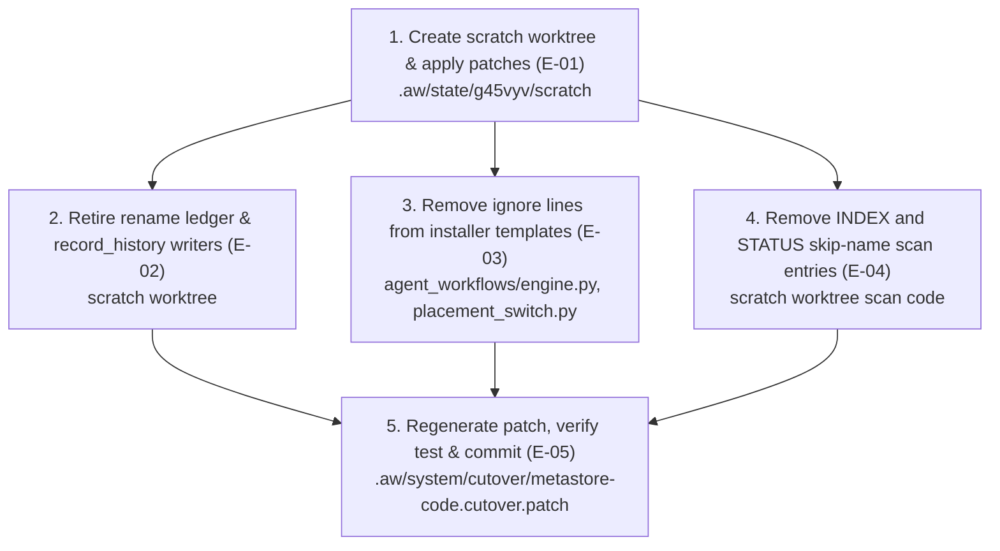

# IPD: Add the log-only writers and ledger retirement to the cutover code patch

- Date: 2026-11-09
- Kind: child
- Concern: `cxxmyv` E-04 turned on the log-only writers inside the attended cutover turn: retiring the rename ledger and the history-sidecar writers, and removing the INDEX and sidecar ignore lines and scan skip-names from the installer. Like the rest of the code switch, it cannot land on `main` before the one cutover commit (spec `4sd62s` 5.2, C10a), but it can be prepared as part of the inert cumulative code patch that `2k5t16` started (round-3 split, research `nj8zdp`).
- Scope: In a scratch worktree with both cutover patches applied, retire the rename ledger and `record_history` writers, remove the INDEX and sidecar ignore lines from the installer template paths, and remove the INDEX and STATUS skip-name entries; regenerate `.aw/system/cutover/metastore-code.cutover.patch`. No live code changes; this repository's own `.aw/.gitignore`, INDEX files, `STATUS.md` and sidecar are never touched (migration steps 2 and 5 do that).
- Scope-Paths: .aw/records/plans/pending/20261109-metastore-256-g45vyv-add-the-log-only-writers-and-ledger-retirement-to-the-cutove.ipd.md, .aw/system/cutover/metastore-code.cutover.patch
- Scope-Exceeded: .aw/records/backlog/open/20261125-91eazx-01-91eazx-after-the-metastore-cutover-artifact-meta-read-loo.backlog.md (durable defect carrier the driver requires for a defect this execution found read_loose_id returns None on log-format records filed with aw backlog new, not plan work); .aw/records/backlog/open/20261125-eqjdre-01-eqjdre-research-mv-no-rename-event.backlog.md (durable defect carrier the driver requires for a defect this execution found research mv/set-assign write no rename event once g45vyv retires the ledger filed with aw backlog new, not plan work)
- Item-Dependencies: executed:1ajqaa, executed:87rvs2, executed:90iqr1, executed:aqc3m6, executed:clors0, executed:dcerjg, executed:g5hpbb, executed:iog3cw, executed:rdg0qv, executed:w13bkp, executed:ya4ee4, executed:zgyna1, executed:2k5t16
- Status: executed
- Review-Depth: standard
- Readiness: go-pending-approval
- From-Spec: 4sd62s
- Work-Kind: feature
- Priority: high
- Blocks-Release: next
- Set: metastore
- Order: 256
- Highest E allocated: 05
- Author: opencode its_direct/pt3-claude-opus-5.5-1m-us
- Id: g45vyv

> Reviewed and proofread per the technical writing standard, `.aw/system/workflows/technical-writing/technical-writing.md`, including requirement 12 (diagrams).

## Workflow history
- 2026-11-25 executed (aw oc run model=uri/its_direct/pt3-claude-opus-5.5-1m-us variant=high profile=opus): aw oc run self-finalize: g45vyv verified (set metastore, attempt 2). [Scope reconciliation - out-of-scope .aw/records/backlog/open/20261125-91eazx-01-91eazx-after-the-metastore-cutover-artifact-meta-read-loo.backlog.md: durable defect carrier the driver requires for a defect this execution found (read_loose_id returns None on log-format records); filed with aw backlog new, not plan work; out-of-scope .aw/records/backlog/open/20261125-eqjdre-01-eqjdre-research-mv-no-rename-event.backlog.md: durable defect carrier the driver requires for a defect this execution found (research mv/set-assign write no rename event once g45vyv retires the ledger); filed with aw backlog new, not plan work]
- 2026-11-16 approved (aw set): status set to approved

- 2026-11-14 reviewed (antigravity/gemini-3.8-flash): /plan-review (antigravity/gemini-3.8-flash): APPROVE WITH REVISIONS APPLIED; PR-001, PR-002, PR-003, PR-004, PR-005.
- 2026-11-09 to-review (opencode its_direct/pt3-claude-opus-5.5-1m-us): split from cxxmyv (round 3, research nj8zdp guidance).

## Goal

Extend the cutover code patch so that after the cutover the event logs are the only rename and history record, and a fresh install writes no sidecar or INDEX ignore lines.

## Detailed Implementation Checklist (TODO)

Execution-state rule: mark an `E-*` item complete only after performing the action. That mark is not validation. Right-sizing rule: write for a modest executor that cannot hold much in its head. Each E-item is one step (one concern, about one file, executable in one focused pass) and its V-item names each unit it covers with its own check; a plan stays at about 5 E-items and 8 work Scope-Paths, else split it into more child plans (guidance, `IPD-Z603`). Accepted execution states: blocked, failed, pending, performed; terminal gate demands 'performed'.

### Task group 1: scratch worktree

- [x] E-01 Create the scratch worktree with the SCRATCH PROCEDURE of `2k5t16` (Step 0): `git worktree add --detach .aw/state/g45vyv/scratch HEAD`, apply the docs patch, record `BASE=$(git write-tree)` in F-01, then `git apply --index .aw/system/cutover/metastore-code.cutover.patch`. If either patch does not apply, stop and report.
  - Depends on: none
  - Expected outcome: the scratch worktree holds HEAD plus both patches, staged.
  - Execution state: performed

### Task group 2: log-only writers (scratch worktree only; was `cxxmyv` E-04, in three steps)

- [x] E-02 Retire the rename ledger (`xexn45`, AC-31, AC-34), now that `clors0` E-18 already writes path-bearing `rename` events for `aw rename`, `aw group` and `aw archive plans` on log-format records (after the switch every record is log-format, so those events become the only rename record), and retire `record_history.append`, `record_history.append_advisory` and `record_history.append_rename` with their callers.
  - Depends on: E-01
  - Expected outcome: in fixtures, a spec setter, a backlog setter, a rename and a group create no `history.jsonl` and no rename-ledger line, and append the expected events.
  - Execution state: performed

- [x] E-03 Remove `records/history.jsonl` and the INDEX lines from the `.aw/.gitignore` template in `agent_workflows/engine.py`, from the `engine._ensure_aw_gitignore` adder, and from `agent_workflows/placement_switch.py`. Do NOT edit this repository's own `.aw/.gitignore`.
  - Depends on: E-01
  - Expected outcome: a fresh `aw install` into a temporary repository writes no `records/history.jsonl` or INDEX ignore line.
  - Execution state: performed

- [x] E-04 Remove the skip-name entries that protected scans from INDEX and STATUS files (`9o83cr` Deferred row). Do NOT delete this repository's on-disk `INDEX.*` files or `plans/STATUS.md`, or move the sidecar: migration steps 2 and 5 do that (`dcerjg` E-06 and E-11); doing it here would un-ignore the sidecar and dirty `.aw/records/`, which the step-1 preflight refuses.
  - Depends on: E-01
  - Expected outcome: `rg` finds no INDEX or STATUS skip-name entry in the scan code of the scratch worktree.
  - Execution state: performed

### Task group 3: package

- [x] E-05 In the scratch worktree run `git add -A`, write `git diff --cached --binary $BASE` over `.aw/system/cutover/metastore-code.cutover.patch` in the executing checkout, remove the scratch worktree (`git worktree remove --force .aw/state/g45vyv/scratch`), run `python3 -m pytest -o addopts="" tests/test_metastore_cutover_code_patch.py` in the executing checkout, and commit through `aw commit g45vyv -- <this plan> .aw/system/cutover/metastore-code.cutover.patch`; never push.
  - Depends on: E-02, E-03, E-04
  - Expected outcome: the regenerated code patch holds the `2k5t16` changes plus this plan's; the guard test passes; one path-scoped commit.
  - Execution state: performed

## Project conventions discovered (Step 0)

- The scratch procedure and the cumulative code patch are defined in `2k5t16` (Step 0, OQ-01).
- The step-1 preflight refuses any uncommitted change under `.aw/records/` (`dcerjg` E-04 condition (2)), so this plan never touches records.

## Findings

| Id | Evidence | Finding |
|---|---|---|
| F-01 | E-01 `git write-tree` in `.aw/state/g45vyv/scratch` after `git apply --index` of the docs patch on HEAD `37be2b0f9c76f8246347f670cc9f10cb823c816b` (attempt 2; attempt 1 used base `4fe284f8d`, tree `f37644d20785532ff2e068a31ec471ca62dcbbad`) | Base tree id (HEAD plus docs patch): `b27db8cdb51858bc0b3289b8086ec25c3342c881`. |
| F-02 | `rg -n "def append\b\|def append_advisory\|def append_rename" agent_workflows/record_history.py` (2026-11-09) | The three sidecar writers live in `record_history.py`. |
| F-03 | `aw research mv rs34ef --slug moved --apply` on a log-format research fixture in the scratch worktree (2026-11-25): exit 0, no event appended, replayed path still the old file | `research_refs._apply_renames` (`aw research mv` / `set-assign`) appends no path-bearing `rename` event, so once the ledger is retired a research move leaves no path history (AC-34). Outside this plan's E-02 list (`aw rename`, `aw group`, `aw archive plans`); filed as backlog `eqjdre` (bug, Blocks-Release next). |
| F-04 | Attempt 2 (2026-11-25): attempt 1's patch (lane `aw/lane/g45vyv`, commit `220519d2`) applied with `git apply --index --3way` on HEAD `37be2b0f9` plus the docs patch: every file clean except `agent_workflows/runner_shared.py` (3 conflict hunks) | Main commits `9c26b49be` and `37be2b0f9` rewrote `perform_coordinator_proposal_file` after attempt 1's base: a new companion/external-records branch with its own `mark_plan_attended(target_text, ...)`, `LegacyTarget`/`LegacyRender` `_am.append`, and commit path list, and the in-repo branch moved down. Attempt 2 converted BOTH branches the way attempt 1 converted the in-repo one (log-keyed `mark_plan_attended`, `blocks_release` read from the log and set by id6, the record's `meta/<id6>.jsonl` added to the commit, relative to the companion git root on the external branch). |
| F-05 | Fixture `test_in_repo_small_proposal_records_gate_on_the_new_plan` and the companion `different-approach` case, first run on the converted tree | `perform_coordinator_proposal_file` read the new scaffolded plan's id6 with `read_loose_id`, which returns None for a post-cutover YAML in-file mirror, and fell back to the PROPOSING plan's id6, so the commit omitted the new plan's log. Fixed in both branches by trying `artifact_meta.read_mirror_id6` first. Other `read_loose_id` callers were not checked behaviorally: backlog `91eazx` (bug, Blocks-Release next). |

## Proposed changes (ordered, validatable)



1. E-01: scratch worktree with both patches.
2. E-02 to E-04: ledger and writers; ignore lines; skip names.
3. E-05: regenerate the code patch and commit.

## Deferred / out of scope (with reason)

- On-disk deletions of this repository's sidecar, INDEX and STATUS files and its `.aw/.gitignore` lines: migration steps 2 and 5, run by the cutover.
  - Carrier: cxxmyv

## Scope check

- Over-scope: none.
- Under-scope: none. `cxxmyv` E-04 maps to E-02 (ledger, `record_history` writers), E-03 (ignore lines) and E-04 (skip names).

## Required tests / validation

- Fixture runs in the scratch worktree (V-02, V-03); the `2k5t16` guard test (V-05).

## Spec / documentation sync

No spec change.

## Open questions

None open.

## Validation and cross-check (verify before reporting done)

Validation-state rule: inspect evidence in a separate pass. Do not mark a `V-*` item complete from memory or from the matching execution checkmark. Accepted validation results: blocked, failed, pass, pending; terminal gate demands 'pass'. Runtime-demonstration reachability rule: for each `V-*` item demanding the software be observed acting (such as a run, a dispatch, or a transition) - as distinct from items demanding a diff, a file's content, or a test result, which are reachable by construction - name the code path that produces the observation or the sibling `E-*` that creates it, else the demand is UNDER-SCOPE.

- [x] V-01 validates E-01
  - Required evidence: paste the worktree and both `git apply --index` commands with exit status 0, and F-01.
  - Observed evidence:
    Attempt 2 (recovery; base moved to main `37be2b0f9`):
    ```
    $ git worktree add --detach .aw/state/g45vyv/scratch HEAD
    Preparing worktree (detached HEAD 37be2b0f9)
    HEAD is now at 37be2b0f9 fix(runner): launch opencode attended turns with mini, stop retrying failed attended exits, and auto-reconcile cited defect-report backlog carriers at finalize
    $ git apply --index ../../../system/cutover/metastore-docs.cutover.patch; echo docs exit=$?
    docs exit=0
    $ git write-tree
    b27db8cdb51858bc0b3289b8086ec25c3342c881
    $ git apply --index --3way <attempt-1 code patch from aw/lane/g45vyv>
    ...
    Applied patch to 'agent_workflows/research_refs.py' cleanly.
    Applied patch to 'agent_workflows/runner_shared.py' with conflicts.
    Applied patch to 'agent_workflows/set_records.py' cleanly.
    ...
    U agent_workflows/runner_shared.py
    code exit=1
    ```
    F-01 = `b27db8cdb51858bc0b3289b8086ec25c3342c881`. The HEAD code patch itself no longer applies to main (`patch failed: agent_workflows/runner_shared.py:55706`, the guard test failed 1 of 3 on the lane base), so the code patch was applied as attempt 1's cumulative patch: `runner_shared.py` was reset to HEAD, attempt 1's `runner_shared.py` hunks applied with `git apply --reject` (12 of 15 clean), and the 3 rejected hunks plus main's new companion-records branch were converted by hand (F-04). Every other file applied cleanly.
  - Result: pass
- [x] V-02 validates E-02
  - Required evidence: paste a fixture test run in the scratch worktree in which a spec setter, a backlog setter, `aw rename` and `aw group` each append the expected event and the fixture has no `records/history.jsonl` afterwards; and `rg -n 'def append\b|def append_advisory|def append_rename' agent_workflows/record_history.py` in the scratch worktree returning nothing.
  - Observed evidence:
    Attempt 2, run in the scratch tree (HEAD `37be2b0f9` + docs patch + converted code patch). Fixture `.aw/state/g45vyv/fixture/test_g45vyv_fixture.py` creates log-format records through `artifact_meta.create`, drives the real CLI verbs through `cli.main`, and asserts no `records/history.jsonl` afterwards:
    ```
    $ env -u AW_CONFIG_DIR PYTHONPATH=$PWD python3 -m pytest --noconftest -o addopts="" -v -s -p no:randomly -p no:cacheprovider ../fixture/test_g45vyv_fixture.py
    SPEC EVENTS ADDED: [('transition', 'to-review', 'specs/to-review/20261109-sp34ef-01-sp34ef-sample.spec.md')]
    PASSED
    BACKLOG EVENTS ADDED: [('transition', 'parked', 'backlog/parked/20261109-demo-01-bk34ef-sample.backlog.md')]
    PASSED
    RENAME EVENTS ADDED: [('rename', 'rename', 'specs/draft/20261109-sp34ef-01-sp34ef-renamed.spec.md')]
    PASSED
    GROUP EVENTS ADDED: [('rename', 'group', 'specs/draft/20261109-newset-01-sp34ef-sample.spec.md'), ('set', None, None)]
    PASSED
    ../fixture/test_g45vyv_fixture.py::test_record_history_writers_are_gone PASSED
    ../fixture/test_g45vyv_fixture.py::test_fresh_install_writes_no_sidecar_or_index_ignore_line ... PASSED
    ============================== 6 passed in 3.30s ===============================
    $ rg -n "def append\b|def append_advisory|def append_rename" agent_workflows/record_history.py; echo rg=$?
    rg=1
    $ rg -n 'LegacyRender|LegacyTarget|render_legacy_text|record_history\.append|record_rename|append_advisory' agent_workflows/
    agent_workflows/lane_containment.py:4009:            # `.aw/records/history.jsonl` (`backlog.run_set` -> `record_history.append`), so every lane
    agent_workflows/record_history.py:6:step 2, plan `g45vyv`) retired every writer: `append`, `append_advisory`, `append_rename` and
    agent_workflows/record_history.py:7:`record_rename`. Status and history now live in each record's own `meta/<id6>.jsonl` log, and a
    $ ruff check --select F,E9 agent_workflows/runner_shared.py
    All checks passed!
    ```
    The three remaining hits are comments, not calls. Main's rewritten proposal filing (F-04) was driven on the same tree by `.aw/state/g45vyv/fixture/test_g45vyv_proposal_fixture.py` (log-format records; in-repo and companion-records repos):
    ```
    $ env -u AW_CONFIG_DIR PYTHONPATH=$PWD python3 -m pytest --noconftest -o addopts="" -v -s -p no:randomly -p no:cacheprovider ../fixture/test_g45vyv_proposal_fixture.py
    ..::test_in_repo_needs_attended_appends_attended_event_and_commits_log IN-REPO RESULT: True was3ig .aw/records/plans/pending/20261125-cmpset-01-was3ig-sample.ipd.md c17bd05a... None
    IN-REPO COMMIT PATHS: ['.aw/records/meta/was3ig.jsonl']
    PASSED
    ..::test_in_repo_small_proposal_records_gate_on_the_new_plan IN-REPO SMALL RESULT: True yun846 .aw/records/plans/pending/20261125-prop-was3ig-01-yun846-....ipd.md c158ee2a... None
    IN-REPO SMALL COMMIT PATHS: ['.aw/records/meta/yun846.jsonl', '.aw/records/plans/pending/20261125-prop-was3ig-01-yun846-....ipd.md']
    PASSED
    ..::test_companion_proposal_filing_appends_events_and_commits_log[needs-attended-small] COMPANION needs-attended RESULT: True was3ig records/plans/pending/20261125-cmpset-01-was3ig-sample.ipd.md 4b769a37... None
    COMPANION needs-attended COMMIT PATHS: ['records/meta/was3ig.jsonl']
    PASSED
    ..::test_companion_proposal_filing_appends_events_and_commits_log[different-approach-small] COMPANION different-approach RESULT: True oa9b6l records/plans/pending/20261125-prop-was3ig-01-oa9b6l-....ipd.md 687839f9... None
    COMPANION different-approach COMMIT PATHS: ['records/meta/oa9b6l.jsonl', 'records/plans/pending/20261125-prop-was3ig-01-oa9b6l-....ipd.md']
    PASSED
    ..::test_in_repo_material_proposal_files_backlog_and_commits_its_log IN-REPO MATERIAL RESULT: True mjzmp8 .aw/records/backlog/open/20261125-mjzmp8-01-mjzmp8-....backlog.md 70431461... None
    IN-REPO MATERIAL COMMIT PATHS: ['.aw/records/backlog/open/20261125-mjzmp8-01-mjzmp8-....backlog.md', '.aw/records/meta/mjzmp8.jsonl']
    PASSED
    ============================== 5 passed in 3.49s ===============================
    ```
    Each case also asserts no `records/history.jsonl` in either repository. `tests/test_log_rename_events.py` on the same tree: `2 failed, 6 passed`; the two failures are the legacy-format cases, which fail with `MetadataSchemaError: Repository metadata schema is 1 (current is 2)`, the pre-existing legacy-reader refusal attempt 1 also recorded on both trees. `--noconftest` is used because the repo conftest imports `tests/record_builder.py`, which needs symbols the switched tree removes (sibling `x1mmdp`). Attempt 1's evidence for the same E-02 work on base `4fe284f8d` is in commit `e31685149` on `aw/lane/g45vyv`.
  - Result: pass
- [x] V-03 validates E-03
  - Required evidence: paste a test run showing a fresh `aw install` into a temporary repository writes no `records/history.jsonl` or INDEX ignore line, and `rg -n 'history.jsonl|INDEX' agent_workflows/engine.py agent_workflows/placement_switch.py` in the scratch worktree with each remaining hit classified.
  - Observed evidence:
    Attempt 2, scratch tree as in V-02:
    ```
    ../fixture/test_g45vyv_fixture.py::test_fresh_install_writes_no_sidecar_or_index_ignore_line FRESH INSTALL .aw/.gitignore PATTERNS: ['records/*/untracked/', 'setup-repo-needed.md', 'records/runs/', '/inbox/*', '!/inbox/README.md', 'system/layout.json', 'system/layout.schema.json', '/state/', '/config/local.json', '/workflow-artifacts/', '/worktrees/']
    BACK-FILLED .aw/.gitignore: ['records/*/untracked/', 'setup-repo-needed.md', 'records/runs/', '/inbox/*', '!/inbox/README.md', 'system/layout.json', 'system/layout.schema.json', '/state/', '/config/local.json', '/workflow-artifacts/', '/worktrees/']
    PASSED
    $ rg -n 'history.jsonl|INDEX' agent_workflows/engine.py agent_workflows/placement_switch.py
    agent_workflows/engine.py:96:INDEX_FILE = f"{WORKFLOWS_DIR}/index.md"
    agent_workflows/engine.py:362:_INDEX_COMMENT_STAMP_RE = re.compile(r"<!--\s*WORKFLOWS-VERSION:\s*[^\s>]+\s*-->")
    agent_workflows/engine.py:363:_INDEX_VERSION_LINE_RE = re.compile(r"(?m)^Version:\s*`[^`]+`")
    agent_workflows/engine.py:379:    new = _INDEX_COMMENT_STAMP_RE.sub(
    agent_workflows/engine.py:382:    new = _INDEX_VERSION_LINE_RE.sub(lambda _m: f"Version: `{resolved}`", new, count=1)
    agent_workflows/engine.py:1570:        "with no `--check` flag and no generated INDEX files; `aw find plans` to query, `aw group "
    agent_workflows/engine.py:3637:        succeeds but leaves the path in the INDEX, where ignore rules do not apply, so
    agent_workflows/engine.py:4597:        # 416f4e2d (2026-10-13): companion directories; still described generated INDEX files (kkftwj)
    agent_workflows/engine.py:4603:        # 0bc46618 (2026-09-09): stated generated INDEX manifests are gitignored local views
    agent_workflows/placement_switch.py:385:            if fname in ("INDEX.json", "INDEX.md"):
    agent_workflows/placement_switch.py:705:        # 3. records -> move regular files and symlinks, discard INDEX.json/INDEX.md
    agent_workflows/placement_switch.py:906:                            if fname in ("INDEX.json", "INDEX.md"):
    ```
    The fresh install (`python3 -m agent_workflows install --preset private-target -y --no-interactive` into a temporary git repo) writes no `records/history.jsonl` or INDEX pattern and creates no `records/history.jsonl` file; the `engine._ensure_aw_gitignore` back-fill adds neither. No remaining hit is an ignore line. Classification:
    - `placement_switch.py:385/705/906`: the placement-switch records move DISCARDS leftover `INDEX.json`/`INDEX.md` files; a cleanup, not an ignore rule; kept (attempt-1 register D5).
    - `engine.py:96`, `362/363/379/382`: the workflows catalog `.aw/system/workflows/index.md` and its version-stamp regexes, not a records INDEX.
    - `engine.py:1570`: rendered doc text stating there are no generated INDEX files.
    - `engine.py:3637`: "the INDEX" is the git index (staging area).
    - `engine.py:4597/4603`: historical README-hash comments.
  - Result: pass
- [x] V-04 validates E-04
  - Required evidence: paste the diff hunk removing the skip-name entries, and `git status --porcelain --ignored -- .aw/.gitignore .aw/records/history.jsonl .aw/records/plans/STATUS.md` in the executing checkout showing them unchanged.
  - Observed evidence:
    Skip-name hunks in the regenerated patch (attempt 2; unchanged from attempt 1 because those files applied cleanly on the new base), excerpt from `.aw/system/cutover/metastore-code.cutover.patch`:
    ```
    diff --git a/agent_workflows/layout.py b/agent_workflows/layout.py
    -RECORD_SCAN_SKIP_NAMES = (
    -    "README.md",
    -    "INDEX.md",
    -    "STATUS.md",
    -)
    +RECORD_SCAN_SKIP_NAMES = ("README.md",)
    diff --git a/agent_workflows/attention_contract.py b/agent_workflows/attention_contract.py
    -    if name in ("README.md", "INDEX.md", "INDEX.json", "STATUS.md"):
    +    if name == "README.md":
    diff --git a/agent_workflows/plans_index.py b/agent_workflows/plans_index.py
    -_EXCLUDE_NAMES = {"INDEX.json", "INDEX.md", "STATUS.md", "README.md"}
    +_EXCLUDE_NAMES = {"README.md"}
    diff --git a/agent_workflows/artifact_meta.py b/agent_workflows/artifact_meta.py
    -                    or fname.startswith("INDEX.")
    -                    or fname == "STATUS.md"
    diff --git a/agent_workflows/artifact_refs.py b/agent_workflows/artifact_refs.py
    -_GENERATED_MANIFEST_NAMES = {"INDEX.md", "STATUS.md"}
    diff --git a/agent_workflows/runner_shared.py b/agent_workflows/runner_shared.py
    -            if resolved.name in {"README.md", "INDEX.md", "STATUS.md"}:
    +            if resolved.name == "README.md":
    ```
    In the executing checkout (lane `aw/lane/g45vyv_attempt2`):
    ```
    $ git status --porcelain --ignored -- .aw/.gitignore .aw/records/history.jsonl .aw/records/plans/STATUS.md
    !! .aw/records/history.jsonl
    $ git check-ignore -v .aw/records/history.jsonl
    .aw/.gitignore:11:records/history.jsonl	.aw/records/history.jsonl
    $ git diff HEAD --stat -- .aw/.gitignore .aw/records/plans/STATUS.md
    (no output)
    ```
    `.aw/.gitignore` and `plans/STATUS.md` are unchanged; the sidecar is still ignored by the live `.aw/.gitignore:11`. The `!!` sidecar exists because the live (pre-cutover) `aw backlog new` writes it, as it must until the cutover. The deliberately kept migration-owned constants are listed in attempt 1's register (D5-D9, D12).
  - Result: pass
- [x] V-05 validates E-05
  - Required evidence: paste `git apply --stat .aw/system/cutover/metastore-code.cutover.patch`, the `tests/test_metastore_cutover_code_patch.py` run with each test PASSED, `git worktree list` showing the scratch worktree removed, and the `aw commit` output naming the commit hash.
  - Observed evidence:
    Attempt 2, in the executing checkout:
    ```
    $ git apply --stat .aw/system/cutover/metastore-code.cutover.patch
     ...
     tests/test_rename_ledger.py                        |  311 --
     tests/test_resolve_plan_path_typed.py              |    2
     tests/test_specs_recursive_read.py                 |    8
     56 files changed, 1343 insertions(+), 4970 deletions(-)
    $ python3 -m pytest -o addopts="" -v -p no:randomly tests/test_metastore_cutover_code_patch.py
    tests/test_metastore_cutover_code_patch.py::MetastoreCutoverCodePatchGuardTests::test_check_refuses_a_patch_that_no_longer_applies PASSED [ 33%]
    tests/test_metastore_cutover_code_patch.py::MetastoreCutoverCodePatchGuardTests::test_code_patch_applies_after_docs_patch PASSED [ 66%]
    tests/test_metastore_cutover_code_patch.py::MetastoreCutoverCodePatchGuardTests::test_code_patch_touches_files PASSED [100%]
    ============================== 3 passed in 0.41s ===============================
    $ git worktree remove --force .aw/state/g45vyv/scratch; echo exit=$?
    exit=0
    $ git worktree list
    <repo>                                            37be2b0f9 [main]
    <repo>/.aw/state/suite-baselines/g45vyv-attempt2  37be2b0f9 (detached HEAD)
    <repo>/.aw/worktrees/2k5t16                       285d57782 [aw/lane/2k5t16]
    <repo>/.aw/worktrees/9o83cr                       138f0c3c9 [aw/lane/9o83cr]
    <repo>/.aw/worktrees/9o83cr_attempt2              3ef955292 [aw/lane/9o83cr_attempt2]
    <repo>/.aw/worktrees/g45vyv                       e31685149 [aw/lane/g45vyv]
    <repo>/.aw/worktrees/g45vyv_attempt2              37be2b0f9 [aw/lane/g45vyv_attempt2]
    <repo>/.aw/worktrees/iog3cw                       aee662ab9 [aw/lane/iog3cw]
    <repo>/.aw/worktrees/iog3cw_attempt2              9a3aef0af [aw/lane/iog3cw_attempt2]
    <repo>/.aw/worktrees/tub3ir                       4fe284f8d [aw/lane/tub3ir]
    $ aw commit g45vyv -m "work(g45vyv): rebase the log-only writers patch onto main's rewritten proposal filing (attempt 2)" -- .aw/system/cutover/metastore-code.cutover.patch
    aw commit: committed 1 path(s): 16cab55b51b44e3bd8f4495c0e68dc1c3978bd96
    ```
    No `.aw/state/g45vyv/scratch` remains in the list; `suite-baselines/g45vyv-attempt2` is the runner's own baseline tree. Before the rebase, the lane base failed the guard test (`1 failed, 2 passed`, `test_code_patch_applies_after_docs_patch`), which is the failure the attempt-1 integration suite reported. The patch commit is `16cab55b51b44e3bd8f4495c0e68dc1c3978bd96` (attempt 1's equivalent commit `220519d2` is on `aw/lane/g45vyv`, superseded by this rebase); this plan's record is committed separately. Full lane suite `aw suite` (attempt 2, lane at `61c4b3fdf` plus this record): `2955 passed, 1 skipped, 11 warnings in 118.29s (0:01:58)`.
  - Result: pass

## Approval and execution gate

- Size assessment: standard
- Cohesion rationale: not required

Execute only after `2k5t16` is `executed` and this plan is `approved`. Code is edited ONLY in the scratch worktree.

Scope fence: the paths in `- Scope-Paths:` are a declaration; a needed file outside the fence is edited and then justified at finalize (`--scope-reason`), and a declared path left unmodified is acknowledged (`--scope-ack`).

Safety stop: if a prerequisite plan in `- Item-Dependencies:` is not executed, prerequisite cutover patches fail to apply, or required metastore symbols are absent, stop and report rather than proceeding.

Honesty rule: paste the ACTUAL output of every command named above; never claim a result you did not run.

Commits: commit only through `aw commit g45vyv -- <paths>` with only Scope-Paths files; never `git add -A`, a bare `git add` or `git commit -a`; never push.

Lifecycle transition: the plan moves to `.aw/records/plans/executed/` only through `aw ipd finalize`, never a hand `git mv`, after `aw ipd lint --phase pre-transition` conforms and every `V-*` reads `pass` with pasted evidence. When `aw oc run` or `aw agy run` executes the plan, the runner performs the finalize; a hand executor runs `aw ipd finalize g45vyv` itself.
