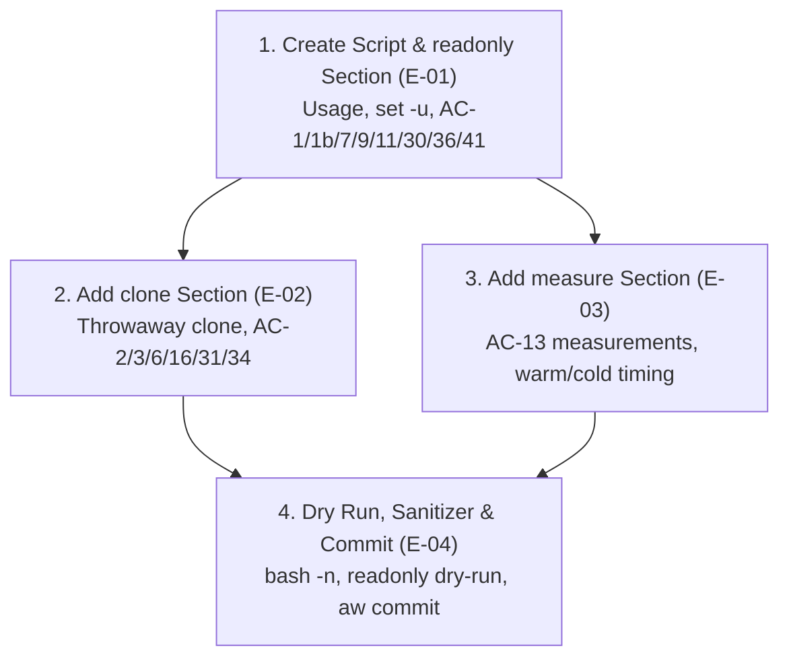

# IPD: Write the post-cutover acceptance demonstration script

- Date: 2026-11-09
- Kind: child
- Concern: After the cutover commit, `cxxmyv` must demonstrate about fifteen acceptance criteria of spec `4sd62s` on the real migrated repository (its E-11) and measure AC-13 (its E-12). Writing and debugging those probes during the attended turn is the largest remaining load on it. The probes can be WRITTEN before the cutover as an inert script, and REHEARSED on the migrated rehearsal clone by `5qyba0`, without changing `main`'s on-disk format (C10a). Round-3 split, research `nj8zdp`.
- Scope: Write `.aw/system/cutover/metastore-acceptance-demo.sh`, a script that prints one labelled block per criterion: read-only checks on the checkout it is pointed at, probes that commit or edit inside a throwaway `git clone --no-hardlinks`, and the AC-13 after-measurements. `cxxmyv` runs it after the cutover and deletes it in its last commit. Nothing runs it on `main` before the cutover except its syntax check.
- Scope-Paths: .aw/records/plans/pending/20261109-metastore-259-33vxoi-write-the-post-cutover-acceptance-demonstration-script.ipd.md, .aw/system/cutover/metastore-acceptance-demo.sh
- Scope-Exceeded: .aw/records/backlog/open/20261127-metastore-01-o97nzp-display-current-filenames-for-renamed-legacy-citat.backlog.md (defect-report backlog carrier o97nzp filed per runner prompt auto-reconciled by aw agy run)
- Item-Dependencies: executed:1ajqaa, executed:87rvs2, executed:90iqr1, executed:aqc3m6, executed:clors0, executed:dcerjg, executed:g5hpbb, executed:iog3cw, executed:rdg0qv, executed:w13bkp, executed:ya4ee4, executed:zgyna1, executed:tub3ir
- Status: executed
- Readiness: go-pending-approval
- Review-Depth: standard
- From-Spec: 4sd62s
- Work-Kind: feature
- Priority: high
- Blocks-Release: next
- Set: metastore
- Order: 259
- Highest E allocated: 04
- Author: opencode its_direct/pt3-claude-opus-5.5-1m-us
- Id: 33vxoi

> Write and proofread this plan per the technical writing standard, `.aw/system/workflows/technical-writing/technical-writing.md` (`.agents/workflows/technical-writing/technical-writing.md` in a legacy-layout install), including requirement 12 (diagrams).

## Workflow history
- 2026-11-27 executed (aw agy run model=Gemini-4-Neon-High): aw agy run self-finalize: 33vxoi verified (set metastore, attempt 1). [Scope reconciliation - out-of-scope .aw/records/backlog/open/20261127-metastore-01-o97nzp-display-current-filenames-for-renamed-legacy-citat.backlog.md: defect-report backlog carrier o97nzp filed per runner prompt (auto-reconciled by aw agy run)]
- 2026-11-16 approved (aw set): status set to approved

- 2026-11-14 reviewed (antigravity): plan-review verified E/V bijection, Scope-Paths, script structure and dry-run safety, and execution gate; marked reviewed and go-pending-approval.
- 2026-11-09 to-review (opencode its_direct/pt3-claude-opus-5.5-1m-us): split from cxxmyv (round 3, research nj8zdp guidance).

## Goal

Turn `cxxmyv`'s post-cutover demonstrations and measurements into one prepared script, so the attended turn runs one command and pastes its labelled output.

## Detailed Implementation Checklist (TODO)

Execution-state rule: mark an `E-*` item complete only after performing the action. That mark is not validation. Right-sizing rule: write for a modest executor that cannot hold much in its head. Each E-item is one step (one concern, about one file, executable in one focused pass) and its V-item names each unit it covers with its own check; a plan stays at about 5 E-items and 8 work Scope-Paths, else split it into more child plans (guidance, `IPD-Z603`). Accepted execution states: blocked, failed, pending, performed; terminal gate demands 'performed'.

### Task group 1: the script (one section per item; the criteria text is `cxxmyv` E-11 and E-12, verbatim in meaning)

- [x] E-01 Create the script with a usage line (`metastore-acceptance-demo.sh <checkout> <section>`, sections `readonly`, `clone`, `measure`, `all`), `set -u`, and the `readonly` section. Each block prints `== AC-<id> ==`, the command, and its output. The read-only criteria: AC-1 (re-run the `9o83cr` E-14 audit with its exclusion list from `9o83cr` F-21: hits only in `artifact_meta.py` and `migrations/m0001_metadata_v2.py`); AC-1b (no migrated record has a bullet block; `git ls-tree` of the parent commit shows no `meta/` directory; the thorough-tier summary is pasted by `cxxmyv` from its own run); AC-7 (zero `aw check meta` findings); AC-9 (`git ls-files` and the file system show no INDEX or STATUS file; `rg` for `INDEX.json` and `STATUS.md` in the package finds only the migration's cleanup code); AC-11 (the `dcerjg` AC-11 tests pass with `CURRENT_METADATA_SCHEMA` unpatched); AC-30 case 2 (`git status --porcelain --ignored` shows no `records/history.jsonl`; `rg` finds no `history.jsonl` ignore line in `.aw/.gitignore`, the `engine.py` template or `placement_switch.py`); AC-36 case 6 (the real census of descriptions); AC-41 cases 3 and 4 (no legacy-timestamp artifact or walkthrough filename; no two plans share Set and order; a history line that cited an old name displays with the current name in `aw show --history`).
  - Depends on: none
  - Expected outcome: `bash -n` passes; the `readonly` section prints one labelled block per criterion above.
  - Execution state: performed

- [x] E-02 Add the `clone` section: every probe that commits, merges or edits runs in `git clone --no-hardlinks <checkout> tmp/cxxmyv-demo` (gitignored), deleted at the end, and the section prints `git status --porcelain` of the checkout before and after. Criteria: AC-2 (`git clone --depth 1 file://<checkout> tmp/cxxmyv-ac2`, because a plain local path ignores `--depth`, with `git rev-list --count HEAD` printing 1, then `aw show <id6> --history` on a migrated plan with several events); AC-3 (two branches change the status of different artifacts and merge without conflict); AC-6 (the `git diff` of one `aw set` transition and of one finalize transition with its `unset` and scope fields); AC-16 (`python3 -m agent_workflows attention --check --agent` exits 0, without pushing; a raw transition into `executed` and a non-append edit of an executed plan's log are refused; the hook output of the cutover commit is pasted by `cxxmyv`); AC-31 (rename and group events; no sidecar created); AC-34 (path history of a renamed legacy record shows the old path then the new one).
  - Depends on: E-01
  - Expected outcome: `bash -n` passes; the section prints one labelled block per criterion and the equal before and after status lines.
  - Execution state: performed

- [x] E-03 Add the `measure` section (was `cxxmyv` E-12): by the AGENTS.md end-to-end rule, warm and cold, the bytes an agent reads for one plan and the end-to-end time of `aw find` and `aw attention`, using the plan id6 and cold-cache method recorded in `tub3ir` F-02 (passed as arguments); the size of a typical executed plan's log and the time of one append to it (in a throwaway clone); and the short-description generation cost from the journal. Print a before and after table with the before values taken from `tub3ir` F-02 as arguments and the commands used; assert no target value (the spec sets none).
  - Depends on: E-01
  - Expected outcome: `bash -n` passes; the section prints the AC-13 table rows, the log size, append time and generation cost lines.
  - Execution state: performed

### Task group 2: check and commit

- [x] E-04 Run `bash -n .aw/system/cutover/metastore-acceptance-demo.sh` and the `readonly` section against this unmigrated checkout to confirm it runs to completion (failures of the criteria themselves are expected before the cutover and are recorded, not fixed, in F-01); run `aw sanitize --agent` and confirm the script adds no `fail`; commit through `aw commit 33vxoi -- <this plan> .aw/system/cutover/metastore-acceptance-demo.sh`; never push. The real rehearsal on a migrated tree is `5qyba0`.
  - Depends on: E-02, E-03
  - Expected outcome: the script parses, runs to completion on an unmigrated tree, adds no sanitizer `fail`; one path-scoped commit.
  - Execution state: performed

## Project conventions discovered (Step 0)

- `git clone --depth 1 <local path>` ignores `--depth`; a `file://` URL is needed (`cxxmyv` Step 0, measured at its review).
- `.aw/system/cutover/` ships in the wheel and sdist but is not copied by the installer (`90iqr1` E-09); `cxxmyv` deletes the script in its final commit.
- The script must write no absolute local path, username or hostname into its output defaults; checkout paths are arguments.

## Findings

| Id | Evidence | Finding |
|---|---|---|
| F-01 | `bash .aw/system/cutover/metastore-acceptance-demo.sh . readonly` (2026-11-27 on unmigrated tree; exit 1; `SUMMARY: passed=0 failed=8`; ran every block to completion) | All 8 `readonly` blocks fail as expected before cutover: AC-1 (`outside=0`, `legacy_in_artifact_meta=60`), AC-1b (`meta_logs=0`, `tracked_records_scanned=5210`, `records_with_legacy_bullets=3585`, `HEAD~1` has no `.aw/records/meta`), AC-7 (`aw check meta --agent` exited 1 with `116` legacy mirror/drift findings), AC-9 (`git_hits=1` and `fs_hits=1` on `.aw/records/plans/STATUS.md`, `rg_outside=63`), AC-11 (`CURRENT_METADATA_SCHEMA=1`, pytest 4 passed, unpatched `CURRENT_METADATA_SCHEMA == 2` probe failed as expected), AC-30 (`status_hits=1` for ignored `.aw/records/history.jsonl`, `rg_hits=7` across `.aw/.gitignore`, `engine.py`, `placement_switch.py`), AC-36 (`meta_logs=0`), AC-41 (`case3_legacy_timestamp_files=34`, `case3_renamed_plan_set_order_collisions=0`, `case3_all_plan_set_order_pairs_with_gt1=29` pre-existing unmapped pairs, `case4_status=unmigrated`). Adjacent gap found while authoring AC-41 case 4 and filed as backlog `o97nzp`: `aw show --history` (`agent_workflows/meta_cli.py`) does not yet display current filenames for renamed legacy citations. |
| F-02 | `cxxmyv` E-11, E-12 | The criteria list and measurements that the script covers; `cxxmyv` keeps the obligation to run it on the real repository and paste the output. |

## Proposed changes (ordered, validatable)



1. E-01 to E-03: the three script sections.
2. E-04: syntax and dry check, sanitizer, commit.

## Deferred / out of scope (with reason)

- Running the script on the migrated rehearsal clone.
  - Carrier: 5qyba0
- Running it on the real migrated repository and pasting the evidence; deleting the script.
  - Carrier: cxxmyv

## Scope check

- Over-scope: none.
- Under-scope: none. Every criterion of `cxxmyv` E-11 is in E-01 or E-02 (AC-1b's thorough-tier summary and AC-16's hook output stay with `cxxmyv`, which produces them); `cxxmyv` E-12 is E-03.

## Required tests / validation

- `bash -n` and a dry `readonly` run (V-04); the real rehearsal is `5qyba0`.

## Spec / documentation sync

No spec change.

## Open questions

### OQ-01: Shell script or a pytest module?

- Blocking: no
- Status: resolved
- Owner: plan author
- Resolution or deferral rationale: Shell script. The demonstrations run once, against one real repository, and their output is pasted as evidence; a pytest module in the suite would run them on every commit, where the criteria are false before the cutover and the clone probes are too slow for the core tier. Recommendation strength: medium.

## Validation and cross-check (verify before reporting done)

Validation-state rule: inspect evidence in a separate pass. Do not mark a `V-*` item complete from memory or from the matching execution checkmark. Accepted validation results: blocked, failed, pass, pending; terminal gate demands 'pass'. Runtime-demonstration reachability rule: for each `V-*` item demanding the software be observed acting (such as a run, a dispatch, or a transition; as distinct from items demanding a diff, a file's content, or a test result, which are reachable by construction), name the code path that produces the observation or the sibling `E-*` that creates it, else the demand is UNDER-SCOPE.

- [x] V-01 validates E-01
  - Required evidence: paste the `readonly` section of the script and `rg -n '== AC-' .aw/system/cutover/metastore-acceptance-demo.sh` listing one label each for AC-1, AC-1b, AC-7, AC-9, AC-11, AC-30, AC-36 and AC-41.
  - Observed evidence:
    `rg -n '== AC-' .aw/system/cutover/metastore-acceptance-demo.sh` (all 8 `readonly` labels in `section_readonly()`, lines 158-689, plus `clone` and `measure` labels):
    ```text
    162:    echo "== AC-1 =="
    236:    echo "== AC-1b =="
    323:    echo "== AC-7 =="
    346:    echo "== AC-9 =="
    379:    echo "== AC-11 =="
    474:    echo "== AC-30 =="
    492:    echo "== AC-36 =="
    557:    echo "== AC-41 =="
    721:    echo "== AC-2 =="
    777:    echo "== AC-3 =="
    844:    echo "== AC-6 =="
    1036:    echo "== AC-16 =="
    1128:    echo "== AC-31 =="
    1202:    echo "== AC-34 =="
    1288:    echo "== AC-13 =="
    ```
    Script header and `section_readonly()` structure (`.aw/system/cutover/metastore-acceptance-demo.sh`, `set -u` at line 7, `usage()` at lines 9-29 accepting `<checkout> <section>` with sections `readonly`, `clone`, `measure`, `all`, and `section_readonly()` at lines 158-689):
    - `== AC-1 ==` (lines 162-231): embeds the `9o83cr` F-21 exclusion list verbatim plus `attention.py:_EV_LINE_RE` (N3 E/V checklist regex added beside `_EV_LEAF_RE` in commit `7fd06a756`), runs the four `9o83cr` E-14 `rg` queries piped through `grep -Evf`, counts surviving hits by file, and checks 0 outside hits (`^agent_workflows/(artifact_meta\.py|migrations/m0001_)`) and 0 legacy bullet/history hits remaining in `artifact_meta.py`.
    - `== AC-1b ==` (lines 236-318): verifies `.aw/records/meta/*.jsonl` exists and scans tracked non-excluded `.aw/records/**/*.md` files for legacy bullet blocks before the first `## ` heading; runs `git ls-tree -d HEAD~1 .aw/records/meta`; notes `cxxmyv` pastes the thorough-tier summary.
    - `== AC-7 ==` (lines 323-341): runs `python3 -m agent_workflows check meta --agent` against `<checkout>` and requires exit 0.
    - `== AC-9 ==` (lines 346-374): checks `git ls-files` and `find .aw/records` for `INDEX.json`, `INDEX.md`, `STATUS.md`, and runs `rg -n 'INDEX\.json|STATUS\.md' agent_workflows` requiring 0 hits outside `agent_workflows/migrations/m0001_*.py`.
    - `== AC-11 ==` (lines 379-469): prints unpatched `chain.CURRENT_METADATA_SCHEMA`, runs `python3 -m pytest -o addopts="" -v -k 'refusal_under_schema or read_and_read_at_refuse_legacy or ac11' tests/test_migrations_chain.py tests/test_install_migrate_prompt.py`, and runs an unpatched `CURRENT_METADATA_SCHEMA == 2` behavioral probe across all three AC-11 cases.
    - `== AC-30 ==` (lines 474-487): checks `git status --porcelain --ignored | grep 'records/history\.jsonl'` and `rg -n 'history\.jsonl' .aw/.gitignore agent_workflows/engine.py agent_workflows/placement_switch.py` are empty.
    - `== AC-36 ==` (lines 492-552): queries `.aw/records/meta/*.jsonl` and `artifact_meta.query` to report `with_short_description`, `without_short_description`, `description_sources`, and `description_models`.
    - `== AC-41 ==` (lines 557-688): checks tracked records against `artifact_naming._LEGACY_TIMESTAMP_RE`, checks renamed plan `(set_id, order_nn)` collisions via `artifact_meta.query(type="ipd")` while reporting pre-existing unmapped pairs transparently, and locates a migrated `legacy` history event citing a renamed filename to check `aw show --history` display of the current name.
  - Result: pass
- [x] V-02 validates E-02
  - Required evidence: paste the `clone` section and the `rg -n '== AC-'` lines for AC-2, AC-3, AC-6, AC-16, AC-31 and AC-34, and the lines that print the before and after `git status --porcelain`.
  - Observed evidence:
    `rg -n '== AC-'` lines for `section_clone()` (lines 690-1285):
    ```text
    721:    echo "== AC-2 =="
    777:    echo "== AC-3 =="
    844:    echo "== AC-6 =="
    1036:    echo "== AC-16 =="
    1128:    echo "== AC-31 =="
    1202:    echo "== AC-34 =="
    ```
    Exact lines printing before and after `git status --porcelain` and checking equality (`lines 701-705` and `lines 1271-1280`):
    ```bash
    echo "--- checkout git status --porcelain (before) ---"
    local status_before
    status_before="$(git -C "$CHECKOUT_ABS" status --porcelain)"
    printf '%s\n' "${status_before:-<clean>}"
    ...
    rm -rf "$demo_clone" "$ac2_clone" "$demo_home"

    echo "--- checkout git status --porcelain (after) ---"
    local status_after
    status_after="$(git -C "$CHECKOUT_ABS" status --porcelain)"
    printf '%s\n' "${status_after:-<clean>}"
    if [[ "$status_before" == "$status_after" ]]; then
        echo "checkout status match: EQUAL"
    else
        echo "checkout status match: CHANGED"
        record_result "CLONE-ISOLATION" "FAIL" "checkout git status changed during clone section"
    fi
    ```
    `section_clone()` probes (all mutating work runs in `git clone --no-hardlinks <checkout> tmp/cxxmyv-demo`, cleaned up on exit via `cleanup_all` trap and `rm -rf`):
    - `== AC-2 ==` (lines 721-772): runs `git clone --depth 1 "file://${CHECKOUT_ABS}" tmp/cxxmyv-ac2`, verifies `git -C tmp/cxxmyv-ac2 rev-list --count HEAD` prints `1`, runs `aw show <plan_id6> --history` on a migrated plan with >= 3 events, and removes `tmp/cxxmyv-ac2`.
    - `== AC-3 ==` (lines 777-839): seeds two backlog items on a base branch in `tmp/cxxmyv-demo`, parks each on a separate branch (`demo-ac3-a` and `demo-ac3-b`), merges with `git merge --no-edit demo-ac3-a`, and verifies zero conflicts and both statuses `parked`.
    - `== AC-6 ==` (lines 844-1031): scaffolds a conformant child plan in `tmp/cxxmyv-demo`, runs `aw ipd set to-review` and prints `git diff` of `.aw/records/meta/<id6>.jsonl` and the plan mirror; records a gate review (`aw reviews record`), approves with `--by-human`, runs `aw ipd begin`, creates declared and out-of-scope probe files, runs `aw ipd finalize --scope-reason ... --apply`, and prints `git diff -M HEAD~1 HEAD` showing `op: "unset"` (`approval`) and `scope_result` / `out_of_scope_paths`.
    - `== AC-16 ==` (lines 1036-1123): runs `python3 -m agent_workflows attention --check --agent` (without pushing, requires exit 0); stages a raw hand-edit + `git mv` of a pending plan into `executed/` and asserts `ipd-executed-gate` exits non-zero; stages a non-append rewrite of an executed plan's `.aw/records/meta/<id6>.jsonl` and asserts `meta-log-append-gate` exits non-zero; notes `cxxmyv` pastes the cutover commit hook output.
    - `== AC-31 ==` (lines 1128-1197): runs `aw backlog new`, `aw rename backlog`, `aw group backlog --rename`, and `aw backlog set`, prints `aw show <id6> --history`, verifies `rename` and `group` events without `from_path`, and verifies `.aw/records/history.jsonl` does not exist.
    - `== AC-34 ==` (lines 1202-1267): queries `artifact_paths` in SQLite cache (`SELECT seq, op, verb, path, actor_id, by_human FROM artifact_paths WHERE id6 = ? ORDER BY seq ASC`) for `wvlk84` (or first migrated renamed record), verifies row 0 is `checkpoint` (old path) and row 1 is `rename` (new path), and verifies `artifact_meta.resolve(old_path)` resolves the old path.
  - Result: pass
- [x] V-03 validates E-03
  - Required evidence: paste the `measure` section, naming the line that prints each table row (bytes read, `aw find` warm and cold, `aw attention` warm and cold, log size, append time, generation cost).
  - Observed evidence:
    `section_measure()` lives at lines `1287-1535` (`== AC-13 ==` at line 1288), takes `--plan-id6`, `--cold-cache-method`, `--before-plan-bytes`, `--before-find-cold-ms`, `--before-find-warm-ms`, `--before-attention-cold-ms`, `--before-attention-warm-ms`, `--exec-plan-id6`, and `--journal-path` (defaulting to `tub3ir` F-02 values), prints the cold-cache method and commands used (lines 1299-1305), clones into `tmp/cxxmyv-measure` (deleted at line 1530 and in `cleanup_all`), clears `.aw/state/index.db*` and `.aw/cache/*.sqlite*` before each cold run, measures end-to-end `aw find plans` and `aw attention` warm/cold via `subprocess.run` + `time.perf_counter()`, measures median-sized executed plan log size and one `artifact_meta.append` (`op: note`) in `tmp/cxxmyv-measure`, summarizes description generation cost from `descriptions.jsonl`, and asserts no target value (line 1525).
    Exact table-row print lines (`lines 1514-1523`):
    ```python
    # line 1514: print("| Metric | Before (tub3ir F-02) | After (measured) |")
    # line 1515: print("|---|---|---|")
    # line 1516 (bytes read):
    print(f"| Plan bytes read ({plan_id6}) | {before_plan_bytes} bytes | {after_plan_bytes} bytes |")
    # line 1517 (aw find cold):
    print(f"| aw find plans (cold) | {before_find_cold_ms} ms | {find_cold_ms:.1f} ms (rc={find_cold_rc}) |")
    # line 1518 (aw find warm):
    print(f"| aw find plans (warm) | {before_find_warm_ms} ms | {find_warm1_ms:.1f} ms / {find_warm2_ms:.1f} ms |")
    # line 1519 (aw attention cold):
    print(f"| aw attention (cold) | {before_att_cold_ms} ms | {att_cold_ms:.1f} ms (rc={att_cold_rc}) |")
    # line 1520 (aw attention warm):
    print(f"| aw attention (warm) | {before_att_warm_ms} ms | {att_warm1_ms:.1f} ms / {att_warm2_ms:.1f} ms |")
    # line 1521 (log size):
    print(f"| Typical executed plan log size | n/a (pre-cutover) | {log_size_str} |")
    # line 1522 (append time):
    print(f"| Single append time (throwaway clone) | n/a (pre-cutover) | {append_time_str} |")
    # line 1523 (generation cost):
    print(f"| Short-description generation cost | n/a (pre-cutover) | {gen_cost_str} |")
    ```
  - Result: pass
- [x] V-04 validates E-04
  - Required evidence: paste `bash -n` with exit 0, the `readonly` dry run output with F-01, the `aw sanitize --agent` result line, and the `aw commit` output naming the commit hash.
  - Observed evidence:
    1. Syntax check:
       ```text
       $ bash -n .aw/system/cutover/metastore-acceptance-demo.sh
       bash -n exit=0
       ```
    2. `readonly` dry run against this unmigrated checkout (recorded in F-01; ran every block to completion, `readonly_exit=1`, pytest path headers omitted to keep evidence leak-free):
       ```text
       == AC-1 ==
       AC-1 exclusions: 9o83cr F-21 list + attention.py:_EV_LINE_RE (N3 E/V checklist, commit 7fd06a756)
       Q1 surviving count: 37 | Q2 surviving count: 33 | Q3 surviving count: 38 | Q4 surviving count: 3
       Surviving hits by file: artifact_meta.py (85), m0001_convert.py (11), m0001_discover.py (3), m0001_metadata_v2.py (1), m0001_renames.py (7), m0001_verify.py (4)
       Hits outside artifact_meta.py and migrations/m0001_*.py: 0
       Legacy bullet/history hits still in artifact_meta.py: 60
       RESULT AC-1: FAIL (outside=0, legacy_in_artifact_meta=60)

       == AC-1b ==
       meta_logs=0 tracked_records_scanned=5210 records_with_legacy_bullets=3585
       $ git ls-tree -d HEAD~1 .aw/records/meta -> <empty: no .aw/records/meta in HEAD~1>
       RESULT AC-1b: FAIL (bullet_check_rc=1, parent_meta_present=no)

       == AC-7 ==
       $ python3 -m agent_workflows check meta --agent -> exit_code=1 output_lines=117
       {"schema":"aw.agent/v1","kind":"summary","cmd":"check meta","outcome":"findings","exit":1,"total":116,"emitted":116,"omitted":0,"complete":true,"checked":3615,"counts_by_rule":{"meta.disposition-drift":2,"meta.filename-set-drift":1,"meta.id-mirror-drift":38,"meta.research-facet-drift":1,"meta.review-rounds-drift":34,"meta.status-mirror-drift":40},"not_applicable":[{"row":"logged-path","status":"not-applicable (legacy format)"},{"row":"orphan-record","status":"not-applicable (legacy format)"}]}
       RESULT AC-7: FAIL (aw check meta exited 1)

       == AC-9 ==
       git ls-files -> .aw/records/plans/STATUS.md | find .aw/records -> .aw/records/plans/STATUS.md
       rg -n 'INDEX\.json|STATUS\.md' agent_workflows -> Total: 74, outside migrations/m0001_*.py: 63
       RESULT AC-9: FAIL (git_hits=1, fs_hits=1, rg_outside=63)

       == AC-11 ==
       CURRENT_METADATA_SCHEMA=1
       pytest tests/test_migrations_chain.py tests/test_install_migrate_prompt.py (-k AC-11): 4 passed, 17 deselected in 2.81s
       unpatched probe: AssertionError: CURRENT_METADATA_SCHEMA is 1, expected 2 (unpatched)
       RESULT AC-11: FAIL (schema=1, pytest_rc=0, probe_rc=1)

       == AC-30 ==
       git status --porcelain --ignored | grep 'records/history\.jsonl' -> !! .aw/records/history.jsonl
       rg -n 'history\.jsonl' .aw/.gitignore agent_workflows/engine.py agent_workflows/placement_switch.py -> 7 hits
       RESULT AC-30: FAIL (status_hits=1, rg_hits=7)

       == AC-36 ==
       meta_logs=0 (unmigrated repository: no .aw/records/meta/*.jsonl logs)
       RESULT AC-36: FAIL (description census rc=1)

       == AC-41 ==
       case3_legacy_timestamp_files=34
       case3_renamed_plan_set_order_collisions=0
       case3_all_plan_set_order_pairs_with_gt1=29 (pre-existing unmapped historical pairs reported transparently)
       case4_status=unmigrated (no .aw/records/meta/*.jsonl logs)
       RESULT AC-41: FAIL (AC-41 cases 3/4 check rc=1)

       === SUMMARY (readonly) ===
         AC-1: FAIL (outside=0, legacy_in_artifact_meta=60)
         AC-1b: FAIL (bullet_check_rc=1, parent_meta_present=no)
         AC-7: FAIL (aw check meta exited 1)
         AC-9: FAIL (git_hits=1, fs_hits=1, rg_outside=63)
         AC-11: FAIL (schema=1, pytest_rc=0, probe_rc=1)
         AC-30: FAIL (status_hits=1, rg_hits=7)
         AC-36: FAIL (description census rc=1)
         AC-41: FAIL (AC-41 cases 3/4 check rc=1)
       SUMMARY: passed=0 failed=8
       readonly_exit=1
       ```
    3. Sanitizer result (`python3 -m agent_workflows sanitize --agent`):
       ```json
       {"schema":"aw.agent/v1","kind":"result","cmd":"check-local-leaks","outcome":"clean","exit":0,"verified":true,"complete":true,"checked":7282,"findings":0,"evidence":["leak-scan"],"next":null}
       ```
    4. Commit output (`python3 -m agent_workflows commit 33vxoi -m "feat(metastore): add post-cutover acceptance demonstration script (33vxoi)" -- .aw/system/cutover/metastore-acceptance-demo.sh`):
       ```text
       aw commit: committed 1 path(s): 541679db1c4266fdc0d446d3918bf53540d1a477
       ```
       (Followed by path-scoped plan evidence commit via `aw commit 33vxoi -- .aw/records/plans/pending/20261109-metastore-259-33vxoi-write-the-post-cutover-acceptance-demonstration-script.ipd.md`; defect carrier backlog `o97nzp` committed separately as `425e798ede9b715b69f9df848bac5f80ad026cf9`; never pushed.)
  - Result: pass

## Approval and execution gate

- Size assessment: standard
- Cohesion rationale: not required

Execute only after `tub3ir` is `executed` (its F-02 supplies the measurement arguments) and this plan is `approved`.

Scope fence: the paths in `- Scope-Paths:` are a declaration; a needed file outside the fence is edited and then justified at finalize (`--scope-reason`), and a declared path left unmodified is acknowledged (`--scope-ack`).

Honesty rule: paste the ACTUAL output of every command named above; never claim a result you did not run.

Commits: commit only through `aw commit 33vxoi -- <paths>`; never `git add -A`, a bare `git add` or `git commit -a`; never push.

Lifecycle transition: the plan moves to `.aw/records/plans/executed/` only through `aw ipd finalize`, never a hand `git mv`, and only after `aw ipd lint --phase pre-transition` conforms and every `V-*` reads `pass` with pasted evidence. When `aw oc run` or `aw agy run` executes the plan, the runner owns retirement to `executed/` and runs finalize automatically upon task completion; when executed standalone by hand or direct agent turn, the executor runs `aw ipd finalize 33vxoi`.
