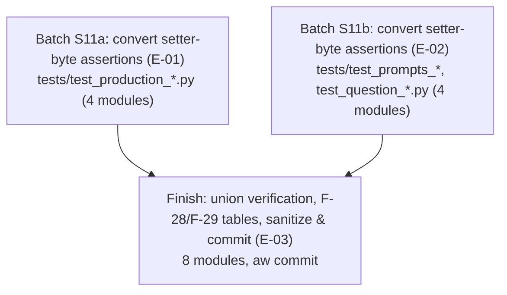

# IPD: Move setter-byte assertions of batch S11 except question visibility onto the helper

- Date: 2026-11-09
- Kind: child
- Concern: Spec `4sd62s` C10a requires `main` to read and write exactly one metadata format at every commit, so the cutover commit (Order 13, `cxxmyv`) must switch the format and every test that asserts on it at once. `cxxmyv` E-07 carried, as one item, "convert the setter-byte assertions to `artifact_meta.read` plus the in-file mirror" (`59aiyh` Deferred row). Measured 2026-11-07 at `ac76110f4`: `rg -n "assert.*['\"]- (Status|Priority|Blocks-Release|Work-Kind|From-Backlog|From-Spec|Readiness|Approval|Set|Order|Kind|Id|Gate-Kind|Gate-Ref|Item-Dependencies|Graduated-To|Close-Evidence|Release-Exempt-(Kind|Ref)):" tests`, minus lines over command output and minus the legacy-grammar test modules, prints 518 candidate lines in 81 test modules; the 7 modules that `k6jd6l` E-08 already retargets hold 51 of them, leaving 467 in 74 modules. Converting them inside the attended cutover would hide several hundred steps in one item of a plan that cannot be retried cheaply. This work CAN move earlier without changing `main`'s on-disk format: the helper asserts through the ACTIVE format, which is the legacy format until the cutover, so every converted test still checks the same bytes today and needs no edit when the cutover flips the builder. Round-3 split of `w13bkp` (research `nj8zdp`): this part converts S11a and S11b; the helper is `j5fqax` E-01 (formerly `iog3cw` E-01).
- Scope: Batches S11a and S11b: 8 modules (`tests/test_production_baseline_same_commit.py`, `tests/test_production_correction_turn.py`, `tests/test_production_resume_handoff.py`, `tests/test_production_set_check.py`, `tests/test_prompts_set_surface.py`, `tests/test_question_drain.py`, `tests/test_question_parking.py`, `tests/test_question_preflight.py`). EXCLUDES the `w13bkp` exclusions: switching `RECORD_FORMAT` to `log`, the log branch of the helper, displayed-output assertions, legacy-format subject tests, the `review-pilot` corpus, production code.
- Scope-Paths: tests/test_production_baseline_same_commit.py, tests/test_production_correction_turn.py, tests/test_production_resume_handoff.py, tests/test_production_set_check.py, tests/test_prompts_set_surface.py, tests/test_question_drain.py, tests/test_question_parking.py, tests/test_question_preflight.py, .aw/records/plans/pending/20261109-metastore-263-qtvk2q-move-setter-byte-assertions-of-batch-s11-except-question-vis.ipd.md
- Item-Dependencies: executed:1ajqaa, executed:59aiyh, executed:90iqr1, executed:dcerjg, executed:g5hpbb, executed:iog3cw, executed:ya4ee4
- Status: executed
- Review-Depth: standard
- Readiness: go-pending-approval
- From-Spec: 4sd62s
- Work-Kind: feature
- Priority: high
- Blocks-Release: next
- Set: metastore
- Order: 263
- Highest E allocated: 03
- Author: opencode its_direct/pt3-claude-opus-5.5-1m-us
- Id: qtvk2q

> Reviewed and proofread per the technical writing standard, `.aw/system/workflows/technical-writing/technical-writing.md`, including requirement 12 (diagrams).

## Workflow history
- 2026-11-25 executed (human-assisted finalize): Finalize qtvk2q from preserved lane aw/lane/qtvk2q (run-20261125T103744Z-2547641). [Scope reconciliation - in-scope-unmodified tests/test_prompts_set_surface.py: not-needed: legacy-format subject (prompt grammar); in-scope-unmodified tests/test_question_drain.py: not-needed: legacy-format subject (OQ block status); in-scope-unmodified tests/test_question_preflight.py: not-needed: legacy-format subject (OQ block status)]
- 2026-11-16 approved (aw set): status set to approved

- 2026-11-14 reviewed (antigravity/gemini-3.8-flash): /plan-review (antigravity/gemini-3.8-flash): APPROVE WITH REVISIONS APPLIED; PR-001, PR-002, PR-003, PR-004.
- 2026-11-09 to-review (opencode its_direct/pt3-claude-opus-5.5-1m-us): split from w13bkp (round 3, research nj8zdp guidance).

## Goal

Every setter-byte assertion in this part's 8 test modules goes through the format-aware field helper, with identical per-test outcomes before and after.

## Detailed Implementation Checklist (TODO)

Execution-state rule: mark an `E-*` item complete only after performing the action. That mark is not validation. Right-sizing rule: write for a modest executor that cannot hold much in its head. Each E-item is one step (one concern, about one file, executable in one focused pass) and its V-item names each unit it covers with its own check; a plan stays at about 5 E-items and 8 work Scope-Paths, else split it into more child plans (guidance, `IPD-Z603`). Accepted execution states: blocked, failed, pending, performed; terminal gate demands 'performed'.

Batch rule, applied to every batch E-item of this plan:
1. Record the unmodified per-test outcome list of the batch's modules: `mkdir -p .aw/state/qtvk2q/ && python3 -m pytest -o addopts="" -m "" -p no:randomly -n 0 -rA <modules> | grep -E "^(PASSED|FAILED|ERROR|SKIPPED|XFAIL|XPASS) " | sed -E 's/ - .*//' | sort > .aw/state/qtvk2q/<batch>-before.txt`. For a batch restricted to named test classes, pass the `<module>::<Class>` node ids.
2. In each named module (or class), replace every SETTER-BYTE assertion with a call to the helper of `tests/record_builder.py` added by `j5fqax` E-01, formerly `iog3cw` E-01 (`assert_field(path, field, value)` and `assert_no_field(path, field)`). A setter-byte assertion is an `assertIn`/`assertNotIn`/`assert ... in` over the text of a RECORD FILE that names a front-matter bullet (`- Status:`, `- Priority:`, `- Blocks-Release:` and the other F-28 fields). An assertion over command OUTPUT (stdout, stderr, a rendered message) is a `displayed-output assertion` and is NOT converted; an assertion whose subject is the legacy grammar itself (a legacy-loader, migration or quoted-example test) is `legacy-format subject` and is NOT converted.
3. Re-run the same command into `<batch>-after.txt` and require `diff` to print nothing. A conversion that would change what a test checks (for example a test that asserts the exact bullet spelling, such as whitespace after the colon) stops and is reported with its node id; it is listed as `setter-byte, exact spelling` in F-28 for `cxxmyv`, not weakened.
4. Count the remaining matches of the F-28 pattern in the batch's modules and give each remaining line one class: `converted` (none should remain), `displayed-output assertion`, `legacy-format subject` or `setter-byte, exact spelling`.
5. The helper never reads production source, and no test gains a source-reading assertion.

### Task group 1: work

- [x] E-01 (first half of `w13bkp` E-01 (S11)) Batch S11a: convert the setter-byte assertions of `tests/test_production_baseline_same_commit.py`, `tests/test_production_correction_turn.py`, `tests/test_production_resume_handoff.py`, `tests/test_production_set_check.py` (F-28). Apply the batch rule with `<batch>` = `S11a`.
  - Depends on: none
  - Expected outcome: an empty before/after `diff` for the S11a outcome lists; the remaining F-28 matches in these modules pasted with a class on each and no `setter-byte` row left unconverted except `setter-byte, exact spelling` rows with their node ids.
  - Execution state: performed

- [x] E-02 (second half of `w13bkp` E-01 (S11), less `tests/test_question_visibility.py`, which is in `810kpy`) Batch S11b: convert the setter-byte assertions of `tests/test_prompts_set_surface.py`, `tests/test_question_drain.py`, `tests/test_question_parking.py`, `tests/test_question_preflight.py` (F-28). Apply the batch rule with `<batch>` = `S11b`.
  - Depends on: none
  - Expected outcome: an empty before/after `diff` for the S11b outcome lists; the remaining F-28 matches in these modules pasted with a class on each and no `setter-byte` row left unconverted except `setter-byte, exact spelling` rows with their node ids.
  - Execution state: performed

- [x] E-03 Finish this part: run the batch rule's command over the 8 modules of this plan once more and confirm the outcome multiset equals the union of the `-before.txt` lists of S11a, S11b; write this plan's F-28 rows (one row per remaining match with its class) and F-29 (per-module PASSED, FAILED, SKIPPED and XFAIL counts of the after run) so `w13bkp` E-11 can assemble the part table; run `aw sanitize --agent`; commit through `aw commit qtvk2q -- <each changed path>`, never `git add -A`, a bare `git add` or `git commit -a`. Never push.
  - Depends on: E-01, E-02
  - Expected outcome: the union comparison is empty; F-28 and F-29 for this part are written; every commit is path-scoped to Scope-Paths.
  - Execution state: performed

## Project conventions discovered (Step 0)

- Test data comes from ONE builder, `tests/record_builder.py` (`9rgn2w`/`59aiyh`), which writes through `artifact_meta`; `cxxmyv` E-07 switches it to `RECORD_FORMAT = "log"` in the cutover commit.
- Tests are behavioral (AGENTS.md "TEST OUTCOMES, NOT CODE STRUCTURE"); core modules set `pytestmark = pytest.mark.core`; `pyproject.toml` `addopts` deselects `slow` and `livecorpus`, so a complete comparison passes `-m ""`, and `pytest-randomly` is installed, so a deterministic order needs `-p no:randomly`.
- `artifact_meta.read_text(text, *, record_type=None) -> State` parses a record's text in either format (phase-B legacy loader), so the helper's legacy branch needs no new parser.
- Cite code by SYMBOL (`module.function`) or by a quoted content string, with a line number only appended to one of those and never alone (advisory `IPD-C801`).

## Findings

| Id | Evidence | Finding |
|---|---|---|
| F-28 | `w13bkp` F-28 (measurement at `ac76110f4`); post-conversion scan with the F-28 pattern at `6a41c4b46` (`rg -c` before -> after: `tests/test_production_baseline_same_commit.py` 2 -> 0, `tests/test_production_correction_turn.py` 2 -> 0, `tests/test_production_resume_handoff.py` 3 -> 0, `tests/test_production_set_check.py` 5 -> 0, `tests/test_prompts_set_surface.py` 2 -> 2, `tests/test_question_drain.py` 3 -> 3, `tests/test_question_parking.py` 1 -> 0, `tests/test_question_preflight.py` 7 -> 7) | This part: S11a and S11b, 8 modules, 25 candidate lines; 13 converted, 12 remaining, 0 `setter-byte, exact spelling`, 0 `displayed-output assertion`, 12 `legacy-format subject`. None of the 12 is a front-matter setter-byte assertion, so none is a cutover row (decision `06-qtvk2q-D1`). (1) `tests/test_prompts_set_surface.py::TestPromptsSetSurface::test_comment_write_with_body_byte_identity` (`self.assertNotIn("- Status:", dest_text)`) and (2) `::test_commentless_prompt_fallback_relocates_without_comment` (`self.assertNotIn("- Status:", dest_text)`) - `legacy-format subject`: the subject is the staged-prompt grammar itself, a whole-file check that `aw prompts set` never writes a legacy `- Status:` bullet anywhere into a prompt (module docstring: "without prepending a `- Status:` bullet"); `assert_no_field` checks only the metadata region and would weaken it. (3) to (12) `tests/test_question_drain.py::test_e08_a17_preflight_grouping_and_single_commit` (`assert "- Status: resolved" in text`), `::test_e08_a17_preflight_stale_artifact_routes_unanswered` (2 lines: `- Status: resolved`, `- Status: open`), `tests/test_question_preflight.py::test_a40_durable_artifact_write_back`, `::test_stale_artifact_refusal` (`- Status: open`), `::test_record_oq_answer_appends_to_existing_rationale`, `::test_record_oq_answer_appends_with_indented_continuation_rationale`, `::test_record_oq_answer_preserves_backslash_answer_rationale`, `::test_record_oq_answer_empty_field_rationale`, `::test_a47_unattended_routing_and_checkpoint_consumption` (`- Status: resolved`) - `legacy-format subject`: each asserts the `- Status:` bullet of an `### OQ-NN` block under `## Open questions` in the plan BODY (fixtures `_create_plan_file` / `_create_plan_with_oqs`; the front-matter status is `approved`), which spec `4sd62s` N3 keeps in Markdown, so `assert_field(path, "status", ...)` would test the wrong field and fail. Converted: the front-matter `status` assertions of the 4 S11a modules (11 lines, including `graduated_to` in `tests/test_production_resume_handoff.py`), `- Readiness:` absence in `tests/test_production_correction_turn.py` and `tests/test_question_parking.py` via `assert_no_field`. |
| F-29 | `.aw/state/qtvk2q/union-after.txt` (batch-rule command over all 8 modules, after conversion) | Per-module after-run counts (PASSED / FAILED / SKIPPED / XFAIL): `tests/test_production_baseline_same_commit.py` 4/0/0/0; `tests/test_production_correction_turn.py` 9/0/0/0; `tests/test_production_resume_handoff.py` 9/0/0/0; `tests/test_production_set_check.py` 16/0/0/0; `tests/test_prompts_set_surface.py` 12/0/0/0; `tests/test_question_drain.py` 19/0/0/0; `tests/test_question_parking.py` 9/0/0/0; `tests/test_question_preflight.py` 17/0/0/0. Total 95 PASSED. `tests/test_prompts_set_surface.py`, `tests/test_question_drain.py` and `tests/test_question_preflight.py` were not modified (only `legacy-format subject` matches). |

## Proposed changes (ordered, validatable)

1. E-01, E-02: the two batches (independent).
2. E-03: union check, F-28 rows, commit.

## Deferred / out of scope (with reason)

- Batch S14 and the assembly of the S11 to S14 F-28 table.
  - Carrier: w13bkp
- Switching the builder to `RECORD_FORMAT = "log"`, the helper's log-format branch, and the `setter-byte, exact spelling` rows: cutover commit (C10a).
  - Carrier: x1mmdp

## Scope check

- Over-scope: none. No production module changes.
- Under-scope: none. Each module named here is from `w13bkp` E-01, E-02 or E-03 as labelled in the item; together with the other round-3 parts the subsets equal those items' lists. This part's share of `w13bkp` E-11 maps to E-03.

## Required tests / validation

Each batch is validated by an identical per-test result list before and after (the batch rule), which is behavioral by construction. Commands: the batch rule's command per batch, the per-module F-28 `rg -c` counts, the bare core gate `python3 -m pytest` beside them, `aw sanitize --agent`. CONTRIBUTES to AC-1b (owned by `cxxmyv`).

## Spec / documentation sync

No spec change; prepares part of `4sd62s` section 6 and section 7 step 9 (the test-data half of the cutover) without changing the on-disk format.

## Open questions

### OQ-01: Can this run before the cutover without breaking C10a?

- Blocking: no
- Status: resolved
- Owner: plan author
- Resolution or deferral rationale: Yes. The helper reads through the ACTIVE format and, in the legacy format, also asserts the exact bullet line, so each converted test checks at least what it checked before on the same legacy bytes; `main` keeps one on-disk format. Only the format switch, the log branch of the helper and the exact-spelling rows wait for the cutover commit. Recommendation strength: strong.

## Validation and cross-check (verify before reporting done)

Validation-state rule: inspect evidence in a separate pass. Do not mark a `V-*` item complete from memory or from the matching execution checkmark. Accepted validation results: blocked, failed, pass, pending; terminal gate demands 'pass'. Runtime-demonstration reachability rule: for each `V-*` item demanding the software be observed acting (such as a run, a dispatch, or a transition), as distinct from items demanding a diff, a file's content, or a test result, which are reachable by construction, name the code path that produces the observation or the sibling `E-*` that creates it, else the demand is UNDER-SCOPE.

- [x] V-01 validates E-01
  - Required evidence: paste the empty `diff .aw/state/qtvk2q/S11a-before.txt .aw/state/qtvk2q/S11a-after.txt`, the before and after F-28 `rg -c` count for each of `tests/test_production_baseline_same_commit.py`, `tests/test_production_correction_turn.py`, `tests/test_production_resume_handoff.py`, `tests/test_production_set_check.py`, and the class of every remaining match.
  - Observed evidence:
    - `diff .aw/state/qtvk2q/S11a-before.txt .aw/state/qtvk2q/S11a-after.txt`: empty (exit 0; 38 lines in both files, all `PASSED`).
    - F-28 `rg -c` counts (before -> after): `tests/test_production_baseline_same_commit.py` 2 -> 0; `tests/test_production_correction_turn.py` 2 -> 0; `tests/test_production_resume_handoff.py` 3 -> 0; `tests/test_production_set_check.py` 5 -> 0.
    - Remaining matches: none, so no class to assign. Liveness spot check: changing the converted `assert_field(plan_p, "status", "to-review")` in `tests/test_production_correction_turn.py` to `"draft"` failed with `AssertionError: ...20261004-setex-00-orce01-test-orch.ipd.md: field 'status' mismatch: expected 'draft' (exact line '- Status: draft'), observed 'to-review' (lines: ['- Status: to-review'])` (`1 failed, 8 passed`); reverted.
  - Result: pass

- [x] V-02 validates E-02
  - Required evidence: paste the empty `diff .aw/state/qtvk2q/S11b-before.txt .aw/state/qtvk2q/S11b-after.txt`, the before and after F-28 `rg -c` count for each of `tests/test_prompts_set_surface.py`, `tests/test_question_drain.py`, `tests/test_question_parking.py`, `tests/test_question_preflight.py`, and the class of every remaining match.
  - Observed evidence:
    - `diff .aw/state/qtvk2q/S11b-before.txt .aw/state/qtvk2q/S11b-after.txt`: empty (exit 0; 57 lines in both files, all `PASSED`).
    - F-28 `rg -c` counts (before -> after): `tests/test_prompts_set_surface.py` 2 -> 2; `tests/test_question_drain.py` 3 -> 3; `tests/test_question_parking.py` 1 -> 0; `tests/test_question_preflight.py` 7 -> 7.
    - Remaining matches (12), all `legacy-format subject` (decision `06-qtvk2q-D1`): `tests/test_prompts_set_surface.py` L201 and L250 (whole-file check that no legacy `- Status:` bullet is written into a staged prompt); `tests/test_question_drain.py` L1410, L1491, L1495 and `tests/test_question_preflight.py` L359, L392, L432, L487, L524, L575, L800 (the `- Status:` bullet of an `### OQ-NN` open-question block in the plan body, kept in Markdown by spec `4sd62s` N3, not the front-matter status). Node ids are listed in F-28.
  - Result: pass

- [x] V-03 validates E-03
  - Required evidence: paste the empty union `diff`, this plan's F-28 rows, the F-29 table with one row per module of this plan, the `aw sanitize --agent` result with zero `fail`, and every `aw commit qtvk2q` output listing only Scope-Paths.
  - Observed evidence:
    - `diff .aw/state/qtvk2q/union-before.txt .aw/state/qtvk2q/union-after.txt` (union-before is `sort S11a-before.txt S11b-before.txt`; union-after is one batch-rule run over all 8 modules): empty (exit 0; 95 lines each).
    - F-28 rows and F-29 table for this part written in `## Findings` (12 remaining rows, all `legacy-format subject`, 0 `setter-byte, exact spelling`; F-29 95 PASSED, 0 FAILED/SKIPPED/XFAIL).
    - Bare core gate `python3 -m pytest`: `2952 passed, 1 skipped, 11 warnings in 104.64s (0:01:44)`.
    - `aw sanitize --agent`: `{"schema":"aw.agent/v1","kind":"result","cmd":"check-local-leaks","outcome":"clean","exit":0,"verified":true,"complete":true,"checked":7230,"findings":0,"evidence":["leak-scan"],"next":null}`.
    - `aw commit qtvk2q -m "test(qtvk2q): move S11a setter-byte assertions onto assert_field/assert_no_field" -- tests/test_production_baseline_same_commit.py tests/test_production_correction_turn.py tests/test_production_resume_handoff.py tests/test_production_set_check.py`: `aw commit: committed 4 path(s): de5ff0bcaad1dd973ce01a9829b8c4a9edbd6da9`.
    - `aw commit qtvk2q -m "test(qtvk2q): move S11b setter-byte assertion onto assert_no_field" -- tests/test_question_parking.py`: `aw commit: committed 1 path(s): 6a41c4b468c3f010fc7e6a505ca6225f582cb3a0`.
    - This plan update is committed in a follow-up `aw commit qtvk2q` naming only this IPD path. Declared but unmodified: `tests/test_prompts_set_surface.py`, `tests/test_question_drain.py`, `tests/test_question_preflight.py` (only `legacy-format subject` matches; acknowledge at finalize).
  - Result: pass

## Approval and execution gate

- Size assessment: standard
- Cohesion rationale: not required

Execute only after human approval (`Status: approved`) and after every plan in `- Item-Dependencies:` is executed. Scope fence: the paths in `- Scope-Paths:` are a declaration; a needed file outside the fence is edited and then justified at finalize (`--scope-reason`), and a declared path left unmodified is acknowledged (`--scope-ack`). Safety stop: if a prerequisite plan in `- Item-Dependencies:` is not executed or required metastore symbols from `1ajqaa`, `59aiyh`, `90iqr1`, `dcerjg`, `g5hpbb`, `iog3cw`, or `ya4ee4` are absent, stop and report rather than proceeding. Honesty rule: paste the ACTUAL output; never claim a result you did not run. Commits: only through `aw commit qtvk2q -- <paths>` with only Scope-Paths files; never `git add -A`, a bare `git add` or `git commit -a`; never push. Lifecycle: the plan moves to `.aw/records/plans/executed/` only through `aw ipd finalize`, never a hand `git mv`, after `aw ipd lint --phase pre-transition` conforms and every `V-*` reads `pass` with pasted evidence. When `aw oc run` or `aw agy run` executes the plan, the runner performs the finalize; a hand executor runs `aw ipd finalize qtvk2q` itself.
