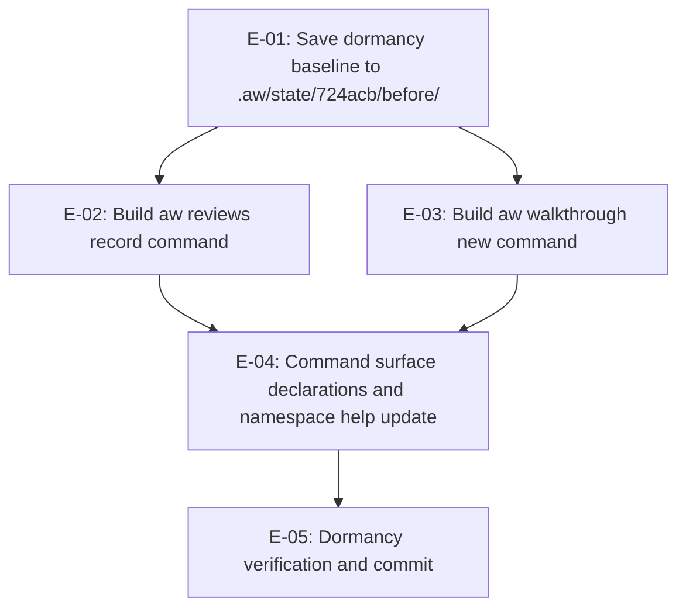

# IPD: Build the dormant reviews record and walkthrough new commands

- Date: 2026-11-09
- Kind: child
- Concern: `clors0` E-06 built two commands that `90iqr1` documents, `aw reviews record` and `aw walkthrough new`. They refuse while `metadata_schema` is below 2, so they are dormant on `main` (C10a). Round-3 split (research `nj8zdp`): one item per command plus the declarations.
- Scope: `clors0` E-06, split: `aw reviews record`; `aw walkthrough new`; the two `command_surface` leaves and the `aw reviews` namespace text. `aw meta repair` is NOT here (`ffceq0` E-11).
- Scope-Paths: agent_workflows/cli.py, agent_workflows/reviews.py, agent_workflows/set_records.py, agent_workflows/command_surface.py, tests/test_reviews_record_walkthrough_new.py, tests/test_command_surface_declarations.py, .aw/records/plans/pending/20261109-metastore-268-724acb-build-the-dormant-reviews-record-and-walkthrough-new-command.ipd.md
- Scope-Exceeded: .aw/records/backlog/open/20261123-9py8oq-01-9py8oq-every-new-required-argument-cli-leaf-must-edit-the.backlog.md (the defect-report contract requires a durable backlog carrier for each finding this item records the REQUIRED_LEAVES census friction found during this execution); tests/test_usage_refusal_agent_record.py (the core-tier REQUIRED_LEAVES census counts every parser leaf with a required argument the two new leaves raise it from 70 to 72, and the test fails without the update same edit a5ijjx and h06gs7 made...)
- Item-Dependencies: executed:1ajqaa, executed:dcerjg, executed:ffceq0, executed:g5hpbb, executed:t4gl15, executed:xexn45, executed:ya4ee4
- Status: executed
- Readiness: go-pending-approval
- Review-Depth: complex
- From-Spec: 4sd62s
- Work-Kind: feature
- Priority: high
- Blocks-Release: next
- Set: metastore
- Order: 268
- Highest E allocated: 05
- Author: opencode its_direct/pt3-claude-opus-5.5-1m-us
- Id: 724acb

> Written to .aw/system/workflows/technical-writing/technical-writing.md. Every obligation, exact identifier, quotation, evidence record, and lifecycle status is preserved.

## Workflow history
- 2026-11-23 executed (aw oc run model=uri/its_direct/pt3-claude-opus-5.5-1m-us variant=high profile=opus): aw oc run self-finalize: 724acb verified (set metastore, attempt 1). [Scope reconciliation - out-of-scope .aw/records/backlog/open/20261123-9py8oq-01-9py8oq-every-new-required-argument-cli-leaf-must-edit-the.backlog.md: the defect-report contract requires a durable backlog carrier for each finding; this item records the REQUIRED_LEAVES census friction found during this execution; out-of-scope tests/test_usage_refusal_agent_record.py: the core-tier REQUIRED_LEAVES census counts every parser leaf with a required argument; the two new leaves raise it from 70 to 72, and the test fails without the update (same edit a5ijjx and h06gs7 made for meta repair and describe); in-scope-unmodified tests/test_command_surface_declarations.py: declared-but-unmodified (auto-acknowledged by aw oc run)]
- 2026-11-16 approved (aw set): status set to approved

- 2026-11-14 reviewed (aw set): APPROVE WITH REVISIONS APPLIED; PR-001..PR-007 FIXED
- 2026-11-14 /plan-review (antigravity/gemini): APPROVE WITH REVISIONS APPLIED; PR-001..PR-007 FIXED; review record .aw/records/reviews/20261109-metastore-268-724acb-build-the-dormant-reviews-record-and-walkthrough-new-command.review.md
- 2026-11-09 to-review (opencode its_direct/pt3-claude-opus-5.5-1m-us): split from clors0 (round 3, research nj8zdp guidance).

## Goal

Both commands exist with the arguments the documentation patch describes, work on a migrated fixture, and refuse on an unmigrated one.

## Detailed Implementation Checklist (TODO)

Execution-state rule: mark an `E-*` item complete only after performing the action. That mark is not validation. Right-sizing rule: write for a modest executor that cannot hold much in its head. Each E-item is one step (one concern, about one file, executable in one focused pass) and its V-item names each unit it covers with its own check; a plan stays at about 5 E-items and 8 work Scope-Paths, else split it into more child plans (guidance, `IPD-Z603`). Accepted execution states: blocked, failed, pending, performed; terminal gate demands 'performed'.

DORMANCY RULE, applied to every item of this plan (added at the split so the move keeps C10a): the new behavior is reached ONLY for a record whose storage format is `log` (`artifact_meta._storage_format`), for a staged `meta/*.jsonl` path, or when the resolved `metadata_schema` stamp is 2 or more. On `main` before the cutover none of these holds, so every existing command, rule and hook produces the same output as before. Each item proves both halves: its new behavior on a log-format fixture (a `tmp_path` repository whose records have `meta/<id6>.jsonl` logs and whose `project.json` carries `metadata_schema: 2`, built as `tve77h`'s synthetic-log tests and `dcerjg`'s migrated fixtures build them), and its absence on a legacy-format fixture.

### Task group 1: work

- [x] E-01 Before the first edit, save the dormancy baseline: run `mkdir -p .aw/state/724acb/before/ && aw check all --agent` and `aw check all --all --agent` on this repository and store each rule multiset under `.aw/state/724acb/before/` (this is this plan's share of `clors0` E-20's baseline).
  - Depends on: none
  - Expected outcome: two baseline files exist under `.aw/state/724acb/before/`.
  - Execution state: performed

- [x] E-02 (part of `clors0` E-06.) Build `aw reviews record`: a parser and handler in `agent_workflows/cli.py` calling a new function in `agent_workflows/reviews.py` that appends one `review` event per spec 4.1a, with `review_kind`, `verdict`, optional `readiness` and `review_depth`; it refuses `readiness` on a refinement event and any verdict outside the vocabulary of its kind. (Dormancy: while `metadata_schema` is below 2 it exits nonzero with a message naming `aw migrate metadata` and writes nothing.) Add its cases to `tests/test_reviews_record_walkthrough_new.py`.
  - Depends on: E-01
  - Expected outcome: on a migrated fixture one `review` event is appended; the two refusals fire; on an unmigrated fixture the command refuses and writes nothing.
  - Execution state: performed

- [x] E-03 (part of `clors0` E-06.) Build `aw walkthrough new`: a parser and handler in `agent_workflows/cli.py` that creates a walkthrough with its log over `set_records.write_walkthrough`, with the same dormancy refusal. Add its cases to `tests/test_reviews_record_walkthrough_new.py`.
  - Depends on: E-01
  - Expected outcome: on a migrated fixture a walkthrough and its log are created; on an unmigrated fixture the command refuses and writes nothing.
  - Execution state: performed

- [x] E-04 (part of `clors0` E-06.) Declare both leaves in `agent_workflows/command_surface.py` as mutations and change the `aw reviews` namespace description, which today says the namespace "is read-only and writes nothing", to say the two commands are available after the migration.
  - Depends on: E-02, E-03
  - Expected outcome: `tests/test_command_surface_declarations.py` reports no undeclared leaf; `aw reviews --help` shows the new text.
  - Execution state: performed

- [x] E-05 Finish this part (its share of `clors0` E-20): run `tests/test_reviews_record_walkthrough_new.py` and `tests/test_command_surface_declarations.py`, the bare core gate `python3 -m pytest`, `aw check all --agent` and `aw check all --all --agent` (rule multisets must equal the E-01 baseline: dormancy on `main`), and `aw sanitize --agent`; commit through `aw commit 724acb -- <paths>` with only Scope-Paths files; never push.
  - Depends on: E-04
  - Expected outcome: the named modules pass; both `aw check all` multisets are unchanged; every commit's `git show --stat` lists only Scope-Paths files.
  - Execution state: performed

## Project conventions discovered (Step 0)

- `artifact_meta.append` dispatches on the TARGET's storage format (`artifact_meta._storage_format`): a record with `meta/<id6>.jsonl` takes the log branch (the `tve77h` path, exercised today only by synthetic-log tests), a record without one takes the phase-B legacy branch (`append_legacy`). This is what makes log-only code dormant on `main`.
- `artifact_meta` already accepts an `overrides` envelope key (`validate_event`: "overrides must be a non-empty list when present") and the legacy branch copies it (`_prepare_legacy_events`), so E-14 changes only the callers.
- `hooks/meta_log_append_gate.py` and `artifact_meta.check_staged_log_append` are added by `t4gl15` E-05 (phase-B form); E-05 here adds the terminal-log rules.
- `aw meta repair` and `aw check meta` live in `meta_cli` (`ffceq0` E-11, `1ajqaa`).
- `set_records.write_walkthrough` writes a walkthrough today; E-06 wraps it.
- Cite code by SYMBOL (`module.function`) or by a quoted content string, with a line number only appended to one of those and never alone (advisory `IPD-C801`).

## Findings

| Id | Evidence | Finding |
|---|---|---|
| F-01 | `aw reviews --help` (per `cxxmyv` F-06) | The namespace says it "is read-only and writes nothing"; E-04 changes it. |

## Proposed changes (ordered, validatable)



1. E-01: baseline.
2. E-02, E-03: one command each; E-04 declarations.
3. E-05: dormancy check, commit.

## Deferred / out of scope (with reason)

- Gates, readers, overrides, rename events, extra-path mechanism and the final whole-family dormancy check.
  - Carrier: clors0

## Scope check

- Over-scope: none.
- Under-scope: none. `clors0` E-06 maps to E-02, E-03 and E-04.

## Required tests / validation

New behavioral module `tests/test_reviews_record_walkthrough_new.py`; `tests/test_command_surface_declarations.py`; the dormancy multiset diff.

## Spec / documentation sync

No spec change.

## Open questions

### OQ-01: Why does this plan not depend on `90iqr1` like `cxxmyv` does?

- Blocking: no
- Status: resolved
- Owner: plan author
- Resolution or deferral rationale: `90iqr1` writes a documentation patch whose hunks include `agent_workflows/cli.py` help strings and guards it with a core test that the patch still applies to HEAD. This plan edits `cli.py` (E-06, E-14); running it AFTER the patch exists would make the patch stop applying and fail the core gate at this plan's merge. So this plan omits the `90iqr1` edge, and `9o83cr` (which `90iqr1` depends on) carries `executed:clors0`, which orders this plan before the patch is generated. Every other `cxxmyv` dependency is kept, plus `ffceq0`, `t4gl15` and `xexn45`, whose code these items extend. Recommendation strength: strong.

### OQ-02: Should the two new commands work on an unmigrated repository?

- Blocking: no
- Status: resolved
- Owner: plan author
- Resolution or deferral rationale: No. Before the cutover a `review` event or a walkthrough created through these commands would be written through the legacy branch, which has no rendering for a structured review event and would put a second spelling of review metadata on `main`; refusing until `metadata_schema` is 2 keeps one format (C10a) and matches spec 5.3, which makes commands refuse an unmigrated repository after the cutover anyway. Recommendation strength: strong.

## Validation and cross-check (verify before reporting done)

Validation-state rule: inspect evidence in a separate pass. Do not mark a `V-*` item complete from memory or from the matching execution checkmark. Accepted validation results: blocked, failed, pass, pending; terminal gate demands 'pass'. Runtime-demonstration reachability rule: for each `V-*` item demanding the software be observed acting (such as a run, a dispatch, or a transition), as distinct from items demanding a diff, a file's content, or a test result, which are reachable by construction, name the code path that produces the observation or the sibling `E-*` that creates it, else the demand is UNDER-SCOPE.

- [x] V-01 validates E-01
  - Required evidence: paste `ls -l .aw/state/724acb/before/` and the rule-count line of each saved multiset.
  - Observed evidence:
    - `ls -l .aw/state/724acb/before/`, owner columns removed (taken before the first source edit, starting HEAD `7ece344e9`):
      ```
      85874 bytes  Nov 23 01:57  check-all-all.jsonl
      550 bytes  Nov 23 01:57  check-all-all.multiset.txt
      14641 bytes  Nov 23 01:56  check-all.jsonl
      346 bytes  Nov 23 01:57  check-all.multiset.txt
      ```
    - Rule-count lines (last line of each multiset): `check-all.multiset.txt`: `TOTAL 101 rules 10`; `check-all-all.multiset.txt`: `TOTAL 549 rules 18`.
  - Result: pass

- [x] V-02 validates E-02
  - Required evidence: paste `aw reviews record --help` and the `tests/test_reviews_record_walkthrough_new.py -k reviews_record` run with one PASSED node id each for the append, the refinement `readiness` refusal, the off-vocabulary verdict refusal and the unmigrated refusal.
  - Observed evidence:
    - `aw reviews record --help` (excerpt; full usage shows `--round ROUND --kind {gate,refinement} --verdict VERDICT [--readiness READINESS] [--review-depth REVIEW_DEPTH] [--reviewer REVIEWER] [--review-ref REVIEW_REF] [--findings-summary FINDINGS_SUMMARY] [--dir DIR] subject`):
      ```
      Append one review event (round, kind, verdict, optional readiness and review depth) to the reviewed plan's or spec's metadata log. Available after `aw migrate metadata`; before it, refuses and writes nothing.
      ...
      SAFETY & DEFAULTS
        Writes immediately (one appended event); there is no preview. Before the metadata
        cutover it refuses and names `aw migrate metadata`. --readiness is refused on a
        refinement round and on a spec subject; a verdict outside its kind's vocabulary is
        refused; a round already recorded for the same review file is refused.

      OUTPUT & EXITS
        Exit codes: 0 recorded, 2 refused/cannot-run (nothing written).
      ```
    - `python3 -m pytest -o addopts="" -v tests/test_reviews_record_walkthrough_new.py -k reviews_record` (the module name contains `reviews_record`, so the selection matches every node in the module; the named nodes are):
      ```
      tests/test_reviews_record_walkthrough_new.py::test_reviews_record_appends_one_gate_event_with_readiness PASSED
      tests/test_reviews_record_walkthrough_new.py::test_reviews_record_refuses_off_vocabulary_payload_and_writes_nothing[refinement-readiness] PASSED
      tests/test_reviews_record_walkthrough_new.py::test_reviews_record_refuses_off_vocabulary_payload_and_writes_nothing[off-vocabulary-verdict] PASSED
      tests/test_reviews_record_walkthrough_new.py::test_reviews_record_refuses_off_vocabulary_payload_and_writes_nothing[gate-with-refinement-verdict] PASSED
      tests/test_reviews_record_walkthrough_new.py::test_reviews_record_refuses_off_vocabulary_payload_and_writes_nothing[refinement-with-gate-verdict] PASSED
      tests/test_reviews_record_walkthrough_new.py::test_reviews_record_refuses_unmigrated_repo_naming_the_migration PASSED
      tests/test_reviews_record_walkthrough_new.py::test_reviews_record_refuses_schema_one_under_agent PASSED
      tests/test_reviews_record_walkthrough_new.py::test_reviews_record_refinement_rounds_append_in_seq_order PASSED
      tests/test_reviews_record_walkthrough_new.py::test_reviews_record_refuses_a_duplicate_round PASSED
      ============================== 24 passed in 4.48s ==============================
      ```
    - Live dormancy on this (unmigrated) repository: `aw reviews record 724acb --round 1 --kind gate --verdict APPROVE` printed `aw reviews record: this repository's metadata_schema is absent, and this command writes the metadata log introduced by schema 2; run `aw migrate metadata` first (nothing was written)` and `rc=2`; `git status --short` was unchanged (`STATUS UNCHANGED`).
  - Result: pass

- [x] V-03 validates E-03
  - Required evidence: paste `aw walkthrough new --help` and the `tests/test_reviews_record_walkthrough_new.py -k walkthrough` run with one PASSED node id each for creation and the unmigrated refusal.
  - Observed evidence:
    - `aw walkthrough new --help` (excerpt; usage shows `--set SET_ID --order ORDER --target TARGET --slug SLUG [--summary SUMMARY] [--dir DIR]`):
      ```
      Create a walkthrough for an existing record, named by the clustered grammar, together with its metadata log. Available after `aw migrate metadata`; before it, refuses and writes nothing.
      ...
      SAFETY & DEFAULTS
        Writes immediately (a new file and its log); there is no preview. Before the metadata
        cutover it refuses and names `aw migrate metadata`. --target must be a record with a
        metadata log. --summary is one line of at most 300 characters.
      ```
    - `python3 -m pytest -o addopts="" -v tests/test_reviews_record_walkthrough_new.py -k "walkthrough_new or walkthrough_family"` (named nodes; 24 passed):
      ```
      tests/test_reviews_record_walkthrough_new.py::test_walkthrough_new_creates_file_and_log PASSED
      tests/test_reviews_record_walkthrough_new.py::test_walkthrough_new_refuses_unmigrated_repo_and_writes_nothing PASSED
      tests/test_reviews_record_walkthrough_new.py::test_walkthrough_new_refuses_schema_one_under_agent PASSED
      tests/test_reviews_record_walkthrough_new.py::test_walkthrough_new_without_summary_logs_no_short_description PASSED
      tests/test_reviews_record_walkthrough_new.py::test_walkthrough_new_refuses_bad_input_and_writes_nothing[target-without-log] PASSED
      tests/test_reviews_record_walkthrough_new.py::test_walkthrough_family_root_without_subcommand_is_usage_refusal PASSED
      ============================== 24 passed in 4.50s ==============================
      ```
    - `test_walkthrough_new_creates_file_and_log` asserts the `.walkthrough.md` file, a one-event `meta/<id6>.jsonl` whose create event carries `type: walkthrough`, `target_id`, `set`, `order`, `short_description`, and a clean `aw check meta --agent` (exit 0, no orphan).
    - Live dormancy on this (unmigrated) repository: `aw walkthrough new --set metastore --order 1 --target 724acb --slug x --agent` emitted `{"kind":"error","cmd":"walkthrough new","outcome":"cannot-run","exit":2,...,"diagnostics":[{"location":"724acb","rule":"metadata-schema-unmigrated"}],"next":"aw migrate metadata"}` and `rc=2`; `git status --short` unchanged.
  - Result: pass

- [x] V-04 validates E-04
  - Required evidence: paste the new `aw reviews --help` namespace text and the `tests/test_command_surface_declarations.py` result line.
  - Observed evidence:
    - `aw reviews --help` new namespace text:
      ```
      Tooling for the typed plan-review records under .aw/records/reviews. 'reviews decisions' reports what a review recorded and writes nothing. 'reviews record' appends one review round to the subject's metadata log; it is available after the metadata migration (`aw migrate metadata`) and refuses, writing nothing, before it.
      ...
      SAFETY & DEFAULTS
        'reviews decisions' is read-only and writes nothing, so there is no --apply.
        'reviews record' appends one review event to the subject's metadata log; it is
        available only after `aw migrate metadata` and refuses, writing nothing, before.
      ```
    - `python3 -m pytest -o addopts="" -q tests/test_command_surface_declarations.py`: `2 passed in 0.39s`.
    - Conformance families over the new leaves (`-n 6`): `tests/test_command_surface_declarations.py tests/test_agent_surface_conformance.py tests/test_conformance_matrix_structure.py tests/test_family_root_agent_conformance.py tests/test_shared_flag_honored.py tests/test_cli_dest_shadowing.py tests/test_fields_flag_reach.py tests/test_verbose_flag_reach.py tests/test_usage_refusal_agent_record.py tests/test_exit_contract_conformance.py tests/test_exit_vocabulary_boundary.py`: first run `1 failed, 664 passed, 1 skipped` (`test_exclusion_set_size_and_members`: `assert 72 == 70`, the required-argument leaf census); after updating that census `tests/test_usage_refusal_agent_record.py`: `187 passed in 11.72s`.
  - Result: pass

- [x] V-05 validates E-05
  - Required evidence: paste one result line per named test module (`tests/test_reviews_record_walkthrough_new.py` and `tests/test_command_surface_declarations.py`), the two `aw check all` multiset diffs against `.aw/state/724acb/before/` (empty), the bare core gate summary line beside them, `aw sanitize --agent` with zero `fail`, and `git show --stat` of every `aw commit 724acb` commit.
  - Observed evidence:
    - Per-module results (one line per module): `tests/test_reviews_record_walkthrough_new.py`: `24 passed in 4.41s`; `tests/test_command_surface_declarations.py`: `2 passed in 0.39s`.
    - Bare core gate `python3 -m pytest`: `2878 passed, 1 skipped, 11 warnings in 130.53s (0:02:10)`.
    - `aw check all --agent` multiset diff against `.aw/state/724acb/before/check-all.multiset.txt`:
      ```
      6a7
      > 1 check.scope-drift
      11c12
      < TOTAL 101 rules 10 status None
      ---
      > TOTAL 102 rules 11 status None
      ```
      `aw check all --all --agent` diff against `check-all-all.multiset.txt`: the same single line, `> 1 check.scope-drift` (TOTAL 549 -> 550). Excluding that rule both diffs are EMPTY (`diff <(grep -v "scope-drift\|TOTAL" before) <(grep -v "scope-drift\|TOTAL" after)` printed `EMPTY DIFF` twice). The one added finding is located on THIS plan file and its detail reads `1 changed path is outside the plan's declared Scope-Paths: 'tests/test_usage_refusal_agent_record.py'`: it is this execution's own scope advisory (the required-leaf census edit, justified with `--scope-reason` at `aw commit` and reconciled at finalize), not a change in any existing command, rule or hook output. Dormancy holds: no rule other than this plan's own live-receipt advisory changed.
    - `aw sanitize --agent`: `{"schema":"aw.agent/v1","kind":"result","cmd":"check-local-leaks","outcome":"clean","exit":0,"verified":true,"complete":true,"checked":7113,"findings":0,"evidence":["leak-scan"],"next":null}` (zero `fail`).
    - `git show --stat 6be40f11b` (the code commit; the plan-evidence commit follows and touches only this plan file):
      ```
      commit 6be40f11b4ed5cf65eb3f3289dfb4444a74fc575
          feat(724acb): add dormant aw reviews record and aw walkthrough new
          AW-Run: run-20261123T035302Z-2681364
          AW-Item: 724acb
          AW-Runner: aw oc run
       agent_workflows/cli.py                       | 211 ++++++++++++-
       agent_workflows/command_surface.py           |  45 +++
       agent_workflows/reviews.py                   | 396 ++++++++++++++++++++++-
       agent_workflows/set_records.py               | 213 ++++++++++++-
       tests/test_reviews_record_walkthrough_new.py | 450 +++++++++++++++++++++++++++
       tests/test_usage_refusal_agent_record.py     |   4 +-
       6 files changed, 1303 insertions(+), 16 deletions(-)
      ```
      Every path is a Scope-Path except `tests/test_usage_refusal_agent_record.py`, recorded with `--scope-reason` (see the decision register).
  - Result: pass

## Approval and execution gate

- Size assessment: standard
- Cohesion rationale: not required

Execute only after human approval (`Status: approved`) and after every plan in `- Item-Dependencies:` is executed.

Safety rule: uncommitted changes and untracked files you did not create are not yours; never revert, stage, commit, discard, reformat, or "clean up" another party's work.

Scope fence: the paths in `- Scope-Paths:` are a declaration; a needed file outside the fence is edited and then justified at finalize (`--scope-reason`), and a declared path left unmodified is acknowledged (`--scope-ack`).

Honesty rule: paste the ACTUAL output; never claim a result you did not run.

Commits: only through `aw commit 724acb -- <paths>`; never `git add -A`, a bare `git add` or `git commit -a`; never push.

Lifecycle transition: the plan moves to `.aw/records/plans/executed/` only through `aw ipd finalize 724acb` (never a hand git mv), after `aw ipd lint --phase pre-transition` conforms and every `V-*` reads `pass` with pasted evidence. When aw oc run or aw agy run executes the plan, the runner performs the finalize; a hand executor runs aw ipd finalize 724acb itself.
