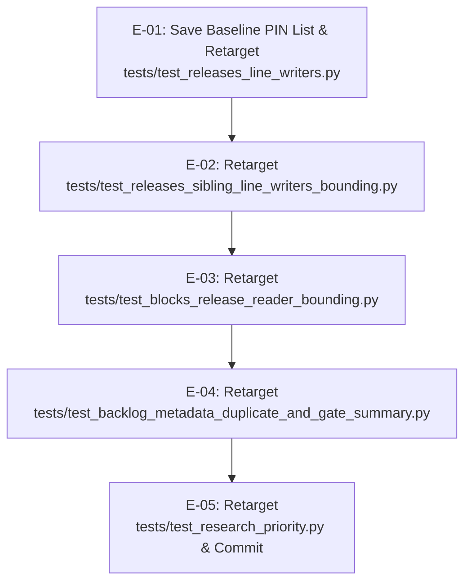

# IPD: Retarget the value writer tests part 1 to artifact_meta

- Date: 2026-11-09
- Kind: child
- Concern: Spec `4sd62s` C5 allows exactly one metadata writer (`artifact_meta`). Part 3 of the round-3 split of `k6jd6l` (Order 43, research `nj8zdp` guidance). Before Order 284 deletes the original value writers, every test that calls one must drive `artifact_meta` instead. `k6jd6l` E-08 names ten such test modules; this part takes the first five. Measured call counts at `f83159217`: `tests/test_releases_line_writers.py` 26, `tests/test_releases_sibling_line_writers_bounding.py` 18, `tests/test_blocks_release_reader_bounding.py` 8, `tests/test_backlog_metadata_duplicate_and_gate_summary.py` 1, `tests/test_research_priority.py` 4.
- Scope: The first five of the ten test modules of `k6jd6l` E-08, retargeted to `artifact_meta.append(..., dry_run=True)` or the setter CLI, asserting on the rendered text and keeping every input case. EXCLUDES the other five (Order 283).
- Scope-Paths: tests/test_releases_line_writers.py, tests/test_releases_sibling_line_writers_bounding.py, tests/test_blocks_release_reader_bounding.py, tests/test_backlog_metadata_duplicate_and_gate_summary.py, tests/test_research_priority.py, .aw/records/plans/pending/20261109-metastore-282-tfvby1-retarget-the-value-writer-tests-part-1-to-artifact-meta.ipd.md
- Item-Dependencies: executed:1ajqaa, executed:59aiyh, executed:dcerjg, executed:ffceq0, executed:g5hpbb, executed:h1kfyp, executed:t4gl15
- Status: executed
- Readiness: go-pending-approval
- Review-Depth: standard
- From-Spec: 4sd62s
- Work-Kind: feature
- Priority: high
- Blocks-Release: next
- Set: metastore
- Order: 282
- Highest E allocated: 05
- Author: opencode its_direct/pt3-claude-opus-5.5-1m-us
- Id: tfvby1

> Write and proofread this plan per the technical writing standard, `.aw/system/workflows/technical-writing/technical-writing.md` (`.agents/workflows/technical-writing/technical-writing.md` in a legacy-layout install), including requirement 12 (diagrams).

## Workflow history
- 2026-11-23 executed (aw oc run model=uri/its_direct/pt3-claude-opus-5.5-1m-us variant=high profile=opus): aw oc run self-finalize: tfvby1 verified (set metastore, attempt 1).
- 2026-11-16 approved (aw set): status set to approved

- 2026-11-14 reviewed (antigravity/gemini-3.8-flash): /plan-review (antigravity/gemini-3.8-flash): APPROVE WITH REVISIONS APPLIED; PR-001, PR-002, PR-003, PR-004.
- 2026-11-09 to-review (opencode its_direct/pt3-claude-opus-5.5-1m-us): split from k6jd6l (round 3, research nj8zdp guidance).

## Goal

None of these five test modules calls a `releases`, `backlog` or `research_cmd` value writer, and each keeps every input case.

## Detailed Implementation Checklist (TODO)

Execution-state rule: mark an `E-*` item complete only after performing the action. That mark is not validation. Right-sizing rule: write for a modest executor that cannot hold much in its head. Each E-item is one step (one concern, about one file, executable in one focused pass) and its V-item names each unit it covers with its own check; a plan stays at about 5 E-items and 8 work Scope-Paths, else split it into more child plans (guidance, `IPD-Z603`). Accepted execution states: blocked, failed, pending, performed; terminal gate demands 'performed'.

Carried from `k6jd6l` E-08: "Retarget the tests that call the originals (...) to drive `artifact_meta.append(..., dry_run=True)` or the setter CLI and assert on the rendered text, keeping every input case." The module list is split across Orders 282 and 283; together they equal the original ten. Save the before-list of all five modules to `.aw/state/9o83cr/E-08-tests1-before.txt` before E-01 (ensure `.aw/state/9o83cr/` exists via `mkdir -p .aw/state/9o83cr/`).

PIN RULE (carried from `9o83cr`): before an edit that deletes or retargets, save the named test modules' per-test outcome list (`python3 -m pytest -o addopts="" -m "" -p no:randomly -n 0 -rA <modules> | grep -E "^(PASSED|FAILED|ERROR|SKIPPED|XFAIL|XPASS) " | sed -E 's/ - .*//' | sort > <before-file>`); after it, run the same command into the matching after-file. A retargeted test keeps every input case, so the after-list may rename a test but not drop a case; the evidence pastes both lists and maps each removed name to its successor.

### Task group 1: one test module per item

- [x] E-01 Before the first edit, ensure `.aw/state/9o83cr/` exists (`mkdir -p .aw/state/9o83cr/`) and save the baseline test PIN list to `.aw/state/9o83cr/E-08-tests1-before.txt`. Retarget `tests/test_releases_line_writers.py` to `artifact_meta.append(..., dry_run=True)` (or the setter CLI), asserting on the rendered text; keep every input case.
  - Depends on: none
  - Expected outcome: `tests/test_releases_line_writers.py` calls no original value writer and passes.
  - Execution state: performed

- [x] E-02 Retarget `tests/test_releases_sibling_line_writers_bounding.py` to `artifact_meta.append(..., dry_run=True)` (or the setter CLI), asserting on the rendered text; keep every input case.
  - Depends on: E-01
  - Expected outcome: `tests/test_releases_sibling_line_writers_bounding.py` calls no original value writer and passes.
  - Execution state: performed

- [x] E-03 Retarget `tests/test_blocks_release_reader_bounding.py` to `artifact_meta.append(..., dry_run=True)` (or the setter CLI), asserting on the rendered text; keep every input case.
  - Depends on: E-02
  - Expected outcome: `tests/test_blocks_release_reader_bounding.py` calls no original value writer and passes.
  - Execution state: performed

- [x] E-04 Retarget `tests/test_backlog_metadata_duplicate_and_gate_summary.py` to `artifact_meta.append(..., dry_run=True)` (or the setter CLI), asserting on the rendered text; keep every input case.
  - Depends on: E-03
  - Expected outcome: `tests/test_backlog_metadata_duplicate_and_gate_summary.py` calls no original value writer and passes.
  - Execution state: performed

- [x] E-05 Retarget `tests/test_research_priority.py` to `artifact_meta.append(..., dry_run=True)` (or the setter CLI), asserting on the rendered text; keep every input case. Then commit through `aw commit tfvby1 -- <paths>`.
  - Depends on: E-04
  - Expected outcome: `tests/test_research_priority.py` calls no original value writer and passes.
  - Execution state: performed

## Project conventions discovered (Step 0)

- `tests/test_releases_sibling_line_writers_bounding.py` and `tests/test_blocks_release_reader_bounding.py` also had their test DATA moved to `tests/record_builder.py` by Orders 177 and 178 (dependencies of `59aiyh`); keep those builder calls and change only the writer calls.
- The `artifact_meta` interface (names from `tve77h`, `ffceq0`, `xexn45`): `read(id6) -> State`, `history(id6)`, `read_at(id6, rev)`, `read_text(text, *, record_type=None) -> State`, `append(id6, events, *, expect_seq)` with `dry_run`, the phase-B legacy writer (`append_legacy`, `render_legacy`), and the legacy loader (`load_legacy_artifact`).
- Cite code by SYMBOL (`module.function`) or by a quoted content string, with a line number only appended to one of those and never alone (advisory `IPD-C801`).

## Findings

Measured 2026-11-09 at `f83159217` with `rg -o "set_[a-z_]+_line|_in_metadata_region|_set_priority_line" <module> | sort | uniq -c`: see the Concern for per-module counts.

## Proposed changes (ordered, validatable)

1. Retarget `test_releases_line_writers` (E-01).
2. Retarget `test_releases_sibling_line_writers_bounding` (E-02).
3. Retarget `test_blocks_release_reader_bounding` (E-03).
4. Retarget `test_backlog_metadata_duplicate_and_gate_summary` (E-04).
5. Retarget `test_research_priority` and commit (E-05).

## Deferred / out of scope (with reason)

- The other five test modules of `k6jd6l` E-08.
  - Carrier: 6v4uao

## Scope check

- Over-scope: none.
- Under-scope: none known. Size: 5 E-items, 5 work Scope-Paths.

## Required tests / validation

The five modules (PIN lists); commit the last item through `aw commit tfvby1 -- <paths>`.

## Spec / documentation sync

No spec change; implements part of `4sd62s` 4.3 and section 7 step 7. CONTRIBUTES to AC-1 (owned by `9o83cr`).

## Open questions

### OQ-01: May a test keep asserting on `selectors.metadata_region` of the result?

- Blocking: no
- Status: resolved
- Owner: plan author
- Resolution or deferral rationale: Yes for now; Order 293 retargets the region helper and owns those references. Recommendation strength: strong.

## Validation and cross-check (verify before reporting done)

Validation-state rule: inspect evidence in a separate pass. Do not mark a `V-*` item complete from memory or from the matching execution checkmark. Accepted validation results: blocked, failed, pass, pending; terminal gate demands 'pass'. Runtime-demonstration reachability rule: for each `V-*` item demanding the software be observed acting (such as a run, a dispatch, or a transition), as distinct from items demanding a diff, a file's content, or a test result, which are reachable by construction, name the code path that produces the observation or the sibling `E-*` that creates it, else the demand is UNDER-SCOPE.

- [x] V-01 validates E-01
  - Required evidence: paste `rg -n "set_[a-z_]+_line|_set_priority_line|_in_metadata_region" tests/test_releases_line_writers.py` printing no call, and the before/after per-test lines of `tests/test_releases_line_writers.py` from the PIN lists with each renamed test mapped and no FAILED or ERROR line.
  - Observed evidence:
      `rg -n "set_[a-z_]+_line|_set_priority_line|_in_metadata_region" tests/test_releases_line_writers.py` printed nothing (exit 1, no match).
      PIN lists (`.aw/state/9o83cr/E-08-tests1-before.txt` / `-after.txt`) for this module: 23 before, 23 after, all PASSED, no FAILED or ERROR line. Renamed: none (no test renamed).
      Before:
        PASSED tests/test_releases_line_writers.py::TestCliEmptyBacklogFailSafe::test_cli_empty_backlog_corpus_failsafe_allows_write
        PASSED tests/test_releases_line_writers.py::TestCliIpdSetFromBacklog::test_cli_ipd_set_clear_from_backlog_with_dash
        PASSED tests/test_releases_line_writers.py::TestCliIpdSetFromBacklog::test_cli_ipd_set_refuse_unresolvable_backlog_id
        PASSED tests/test_releases_line_writers.py::TestCliIpdSetFromBacklog::test_cli_ipd_set_resolvable_backlog_id_writes_and_inherits_gate
        PASSED tests/test_releases_line_writers.py::TestCliSpecsSetFromBacklog::test_cli_specs_set_clear_from_backlog_with_dash
        PASSED tests/test_releases_line_writers.py::TestCliSpecsSetFromBacklog::test_cli_specs_set_refuse_unresolvable_backlog_id
        PASSED tests/test_releases_line_writers.py::TestCliSpecsSetFromBacklog::test_cli_specs_set_resolvable_backlog_id_writes_and_inherits_gate
        PASSED tests/test_releases_line_writers.py::TestSetBlocksReleaseLine::test_blocks_release_absent_inserted_after_status
        PASSED tests/test_releases_line_writers.py::TestSetBlocksReleaseLine::test_blocks_release_clear_dash_and_none
        PASSED tests/test_releases_line_writers.py::TestSetBlocksReleaseLine::test_blocks_release_empty_value_replaced
        PASSED tests/test_releases_line_writers.py::TestSetBlocksReleaseLine::test_blocks_release_fallback_after_id
        PASSED tests/test_releases_line_writers.py::TestSetBlocksReleaseLine::test_blocks_release_idempotent
        PASSED tests/test_releases_line_writers.py::TestSetBlocksReleaseLine::test_blocks_release_normally_valued_replaced
        PASSED tests/test_releases_line_writers.py::TestSetBlocksReleaseLine::test_blocks_release_repair_duplicate
        PASSED tests/test_releases_line_writers.py::TestSetBlocksReleaseLine::test_blocks_release_whitespace_value_replaced
        PASSED tests/test_releases_line_writers.py::TestSetFromBacklogLine::test_from_backlog_absent_inserted_after_status
        PASSED tests/test_releases_line_writers.py::TestSetFromBacklogLine::test_from_backlog_clear_dash_and_none
        PASSED tests/test_releases_line_writers.py::TestSetFromBacklogLine::test_from_backlog_empty_value_replaced
        PASSED tests/test_releases_line_writers.py::TestSetFromBacklogLine::test_from_backlog_fallback_after_id
        PASSED tests/test_releases_line_writers.py::TestSetFromBacklogLine::test_from_backlog_idempotent
        PASSED tests/test_releases_line_writers.py::TestSetFromBacklogLine::test_from_backlog_normally_valued_replaced
        PASSED tests/test_releases_line_writers.py::TestSetFromBacklogLine::test_from_backlog_repair_duplicate
        PASSED tests/test_releases_line_writers.py::TestSetFromBacklogLine::test_from_backlog_whitespace_value_replaced
      After:
        PASSED tests/test_releases_line_writers.py::TestCliEmptyBacklogFailSafe::test_cli_empty_backlog_corpus_failsafe_allows_write
        PASSED tests/test_releases_line_writers.py::TestCliIpdSetFromBacklog::test_cli_ipd_set_clear_from_backlog_with_dash
        PASSED tests/test_releases_line_writers.py::TestCliIpdSetFromBacklog::test_cli_ipd_set_refuse_unresolvable_backlog_id
        PASSED tests/test_releases_line_writers.py::TestCliIpdSetFromBacklog::test_cli_ipd_set_resolvable_backlog_id_writes_and_inherits_gate
        PASSED tests/test_releases_line_writers.py::TestCliSpecsSetFromBacklog::test_cli_specs_set_clear_from_backlog_with_dash
        PASSED tests/test_releases_line_writers.py::TestCliSpecsSetFromBacklog::test_cli_specs_set_refuse_unresolvable_backlog_id
        PASSED tests/test_releases_line_writers.py::TestCliSpecsSetFromBacklog::test_cli_specs_set_resolvable_backlog_id_writes_and_inherits_gate
        PASSED tests/test_releases_line_writers.py::TestSetBlocksReleaseLine::test_blocks_release_absent_inserted_after_status
        PASSED tests/test_releases_line_writers.py::TestSetBlocksReleaseLine::test_blocks_release_clear_dash_and_none
        PASSED tests/test_releases_line_writers.py::TestSetBlocksReleaseLine::test_blocks_release_empty_value_replaced
        PASSED tests/test_releases_line_writers.py::TestSetBlocksReleaseLine::test_blocks_release_fallback_after_id
        PASSED tests/test_releases_line_writers.py::TestSetBlocksReleaseLine::test_blocks_release_idempotent
        PASSED tests/test_releases_line_writers.py::TestSetBlocksReleaseLine::test_blocks_release_normally_valued_replaced
        PASSED tests/test_releases_line_writers.py::TestSetBlocksReleaseLine::test_blocks_release_repair_duplicate
        PASSED tests/test_releases_line_writers.py::TestSetBlocksReleaseLine::test_blocks_release_whitespace_value_replaced
        PASSED tests/test_releases_line_writers.py::TestSetFromBacklogLine::test_from_backlog_absent_inserted_after_status
        PASSED tests/test_releases_line_writers.py::TestSetFromBacklogLine::test_from_backlog_clear_dash_and_none
        PASSED tests/test_releases_line_writers.py::TestSetFromBacklogLine::test_from_backlog_empty_value_replaced
        PASSED tests/test_releases_line_writers.py::TestSetFromBacklogLine::test_from_backlog_fallback_after_id
        PASSED tests/test_releases_line_writers.py::TestSetFromBacklogLine::test_from_backlog_idempotent
        PASSED tests/test_releases_line_writers.py::TestSetFromBacklogLine::test_from_backlog_normally_valued_replaced
        PASSED tests/test_releases_line_writers.py::TestSetFromBacklogLine::test_from_backlog_repair_duplicate
        PASSED tests/test_releases_line_writers.py::TestSetFromBacklogLine::test_from_backlog_whitespace_value_replaced
  - Result: pass

- [x] V-02 validates E-02
  - Required evidence: paste `rg -n "set_[a-z_]+_line|_set_priority_line|_in_metadata_region" tests/test_releases_sibling_line_writers_bounding.py` printing no call, and the before/after per-test lines of `tests/test_releases_sibling_line_writers_bounding.py` from the PIN lists with each renamed test mapped and no FAILED or ERROR line.
  - Observed evidence:
      `rg -n "set_[a-z_]+_line|_set_priority_line|_in_metadata_region" tests/test_releases_sibling_line_writers_bounding.py` printed nothing (exit 1, no match).
      PIN lists (`.aw/state/9o83cr/E-08-tests1-before.txt` / `-after.txt`) for this module: 9 before, 9 after, all PASSED, no FAILED or ERROR line. Renamed: none (no test renamed).
      Before:
        PASSED tests/test_releases_sibling_line_writers_bounding.py::TestReleasesSiblingLineWritersBounding::test_anchor_in_body_does_not_divert_insertion
        PASSED tests/test_releases_sibling_line_writers_bounding.py::TestReleasesSiblingLineWritersBounding::test_clear_dash_and_none_preserves_body
        PASSED tests/test_releases_sibling_line_writers_bounding.py::TestReleasesSiblingLineWritersBounding::test_cli_backlog_set_work_kind_preserves_body
        PASSED tests/test_releases_sibling_line_writers_bounding.py::TestReleasesSiblingLineWritersBounding::test_control_front_matter_line_is_replaced
        PASSED tests/test_releases_sibling_line_writers_bounding.py::TestReleasesSiblingLineWritersBounding::test_graduated_to_multi_value_replacement_and_body_preservation
        PASSED tests/test_releases_sibling_line_writers_bounding.py::TestReleasesSiblingLineWritersBounding::test_no_front_matter_line_adds_one_and_preserves_body
        PASSED tests/test_releases_sibling_line_writers_bounding.py::TestReleasesSiblingLineWritersBounding::test_setting_value_preserves_body
        PASSED tests/test_releases_sibling_line_writers_bounding.py::TestReleasesSiblingLineWritersBounding::test_writer_idempotence
        PASSED tests/test_releases_sibling_line_writers_bounding.py::TestReleasesSiblingLineWritersBounding::test_yaml_fenced_fixture_body_bullet_survives
      After:
        PASSED tests/test_releases_sibling_line_writers_bounding.py::TestReleasesSiblingLineWritersBounding::test_anchor_in_body_does_not_divert_insertion
        PASSED tests/test_releases_sibling_line_writers_bounding.py::TestReleasesSiblingLineWritersBounding::test_clear_dash_and_none_preserves_body
        PASSED tests/test_releases_sibling_line_writers_bounding.py::TestReleasesSiblingLineWritersBounding::test_cli_backlog_set_work_kind_preserves_body
        PASSED tests/test_releases_sibling_line_writers_bounding.py::TestReleasesSiblingLineWritersBounding::test_control_front_matter_line_is_replaced
        PASSED tests/test_releases_sibling_line_writers_bounding.py::TestReleasesSiblingLineWritersBounding::test_graduated_to_multi_value_replacement_and_body_preservation
        PASSED tests/test_releases_sibling_line_writers_bounding.py::TestReleasesSiblingLineWritersBounding::test_no_front_matter_line_adds_one_and_preserves_body
        PASSED tests/test_releases_sibling_line_writers_bounding.py::TestReleasesSiblingLineWritersBounding::test_setting_value_preserves_body
        PASSED tests/test_releases_sibling_line_writers_bounding.py::TestReleasesSiblingLineWritersBounding::test_writer_idempotence
        PASSED tests/test_releases_sibling_line_writers_bounding.py::TestReleasesSiblingLineWritersBounding::test_yaml_fenced_fixture_body_bullet_survives
  - Result: pass

- [x] V-03 validates E-03
  - Required evidence: paste `rg -n "set_[a-z_]+_line|_set_priority_line|_in_metadata_region" tests/test_blocks_release_reader_bounding.py` printing no call, and the before/after per-test lines of `tests/test_blocks_release_reader_bounding.py` from the PIN lists with each renamed test mapped and no FAILED or ERROR line.
  - Observed evidence:
      `rg -n "set_[a-z_]+_line|_set_priority_line|_in_metadata_region" tests/test_blocks_release_reader_bounding.py` printed nothing (exit 1, no match).
      PIN lists (`.aw/state/9o83cr/E-08-tests1-before.txt` / `-after.txt`) for this module: 9 before, 9 after, all PASSED, no FAILED or ERROR line. Renamed: `test_set_blocks_release_line_preserves_body` -> `test_set_blocks_release_write_preserves_body`; `test_set_blocks_release_line_remove_front_matter_only` -> `test_set_blocks_release_write_remove_front_matter_only`.
      Before:
        PASSED tests/test_blocks_release_reader_bounding.py::TestBlocksReleaseReaderBounding::test_bidirectional_display_divergence
        PASSED tests/test_blocks_release_reader_bounding.py::TestBlocksReleaseReaderBounding::test_check_release_gates_at_rest_bounding
        PASSED tests/test_blocks_release_reader_bounding.py::TestBlocksReleaseReaderBounding::test_ipd_lint_board_bounding
        PASSED tests/test_blocks_release_reader_bounding.py::TestBlocksReleaseReaderBounding::test_plan_with_body_only_bullet_absent_from_release_blockers
        PASSED tests/test_blocks_release_reader_bounding.py::TestBlocksReleaseReaderBounding::test_read_front_matter_blocks_release_cases
        PASSED tests/test_blocks_release_reader_bounding.py::TestBlocksReleaseReaderBounding::test_regression_guard_fixture_tree
        PASSED tests/test_blocks_release_reader_bounding.py::TestBlocksReleaseReaderBounding::test_set_blocks_release_line_preserves_body
        PASSED tests/test_blocks_release_reader_bounding.py::TestBlocksReleaseReaderBounding::test_set_blocks_release_line_remove_front_matter_only
        PASSED tests/test_blocks_release_reader_bounding.py::TestBlocksReleaseReaderBounding::test_setter_spellings_byte_identical_with_body_quote
      After:
        PASSED tests/test_blocks_release_reader_bounding.py::TestBlocksReleaseReaderBounding::test_bidirectional_display_divergence
        PASSED tests/test_blocks_release_reader_bounding.py::TestBlocksReleaseReaderBounding::test_check_release_gates_at_rest_bounding
        PASSED tests/test_blocks_release_reader_bounding.py::TestBlocksReleaseReaderBounding::test_ipd_lint_board_bounding
        PASSED tests/test_blocks_release_reader_bounding.py::TestBlocksReleaseReaderBounding::test_plan_with_body_only_bullet_absent_from_release_blockers
        PASSED tests/test_blocks_release_reader_bounding.py::TestBlocksReleaseReaderBounding::test_read_front_matter_blocks_release_cases
        PASSED tests/test_blocks_release_reader_bounding.py::TestBlocksReleaseReaderBounding::test_regression_guard_fixture_tree
        PASSED tests/test_blocks_release_reader_bounding.py::TestBlocksReleaseReaderBounding::test_set_blocks_release_write_preserves_body
        PASSED tests/test_blocks_release_reader_bounding.py::TestBlocksReleaseReaderBounding::test_set_blocks_release_write_remove_front_matter_only
        PASSED tests/test_blocks_release_reader_bounding.py::TestBlocksReleaseReaderBounding::test_setter_spellings_byte_identical_with_body_quote
  - Result: pass

- [x] V-04 validates E-04
  - Required evidence: paste `rg -n "set_[a-z_]+_line|_set_priority_line|_in_metadata_region" tests/test_backlog_metadata_duplicate_and_gate_summary.py` printing no call, and the before/after per-test lines of `tests/test_backlog_metadata_duplicate_and_gate_summary.py` from the PIN lists with each renamed test mapped and no FAILED or ERROR line.
  - Observed evidence:
      `rg -n "set_[a-z_]+_line|_set_priority_line|_in_metadata_region" tests/test_backlog_metadata_duplicate_and_gate_summary.py` printed nothing (exit 1, no match).
      PIN lists (`.aw/state/9o83cr/E-08-tests1-before.txt` / `-after.txt`) for this module: 8 before, 8 after, all PASSED, no FAILED or ERROR line. Renamed: none (no test renamed).
      Before:
        PASSED tests/test_backlog_metadata_duplicate_and_gate_summary.py::BacklogMetadataDuplicateAndGateSummaryTests::test_duplicate_bullets_six_shapes
        PASSED tests/test_backlog_metadata_duplicate_and_gate_summary.py::BacklogMetadataDuplicateAndGateSummaryTests::test_e2e_producer_blocks_release_duplicate
        PASSED tests/test_backlog_metadata_duplicate_and_gate_summary.py::BacklogMetadataDuplicateAndGateSummaryTests::test_gate_summary_rules
        PASSED tests/test_backlog_metadata_duplicate_and_gate_summary.py::BacklogMetadataDuplicateAndGateSummaryTests::test_legacy_kind_canonicalization_both_orders
        PASSED tests/test_backlog_metadata_duplicate_and_gate_summary.py::BacklogMetadataDuplicateAndGateSummaryTests::test_live_tree_regression_floor
        PASSED tests/test_backlog_metadata_duplicate_and_gate_summary.py::BacklogMetadataDuplicateAndGateSummaryTests::test_remediation_routing
        PASSED tests/test_backlog_metadata_duplicate_and_gate_summary.py::BacklogMetadataDuplicateAndGateSummaryTests::test_rule_registry_membership
        PASSED tests/test_backlog_metadata_duplicate_and_gate_summary.py::BacklogMetadataDuplicateAndGateSummaryTests::test_sub_bullet_boundary_deliberate_non_finding
      After:
        PASSED tests/test_backlog_metadata_duplicate_and_gate_summary.py::BacklogMetadataDuplicateAndGateSummaryTests::test_duplicate_bullets_six_shapes
        PASSED tests/test_backlog_metadata_duplicate_and_gate_summary.py::BacklogMetadataDuplicateAndGateSummaryTests::test_e2e_producer_blocks_release_duplicate
        PASSED tests/test_backlog_metadata_duplicate_and_gate_summary.py::BacklogMetadataDuplicateAndGateSummaryTests::test_gate_summary_rules
        PASSED tests/test_backlog_metadata_duplicate_and_gate_summary.py::BacklogMetadataDuplicateAndGateSummaryTests::test_legacy_kind_canonicalization_both_orders
        PASSED tests/test_backlog_metadata_duplicate_and_gate_summary.py::BacklogMetadataDuplicateAndGateSummaryTests::test_live_tree_regression_floor
        PASSED tests/test_backlog_metadata_duplicate_and_gate_summary.py::BacklogMetadataDuplicateAndGateSummaryTests::test_remediation_routing
        PASSED tests/test_backlog_metadata_duplicate_and_gate_summary.py::BacklogMetadataDuplicateAndGateSummaryTests::test_rule_registry_membership
        PASSED tests/test_backlog_metadata_duplicate_and_gate_summary.py::BacklogMetadataDuplicateAndGateSummaryTests::test_sub_bullet_boundary_deliberate_non_finding
  - Result: pass

- [x] V-05 validates E-05
  - Required evidence: paste `rg -n "set_[a-z_]+_line|_set_priority_line|_in_metadata_region" tests/test_research_priority.py` printing no call, and the before/after per-test lines of `tests/test_research_priority.py` from the PIN lists with each renamed test mapped and no FAILED or ERROR line. Also paste `git show --stat` of the `aw commit tfvby1` commit listing only Scope-Paths files.
  - Observed evidence:
      `rg -n "set_[a-z_]+_line|_set_priority_line|_in_metadata_region" tests/test_research_priority.py` printed nothing (exit 1, no match).
      PIN lists (`.aw/state/9o83cr/E-08-tests1-before.txt` / `-after.txt`) for this module: 11 before, 11 after, all PASSED, no FAILED or ERROR line. Renamed: none (no test renamed).
      Before:
        PASSED tests/test_research_priority.py::ResearchPriorityAttentionTests::test_research_record_populates_priority
        PASSED tests/test_research_priority.py::ResearchPriorityContractTests::test_absent_priority_conforms
        PASSED tests/test_research_priority.py::ResearchPriorityContractTests::test_out_of_vocab_priority_flagged
        PASSED tests/test_research_priority.py::ResearchPriorityContractTests::test_priority_not_in_required_fields
        PASSED tests/test_research_priority.py::ResearchPriorityContractTests::test_valid_priority_conforms
        PASSED tests/test_research_priority.py::ResearchPriorityIndexTests::test_index_carries_priority
        PASSED tests/test_research_priority.py::ResearchPriorityIndexTests::test_index_priority_empty_when_absent
        PASSED tests/test_research_priority.py::ResearchPriorityNewAndSetTests::test_new_emits_priority_line_only_when_given
        PASSED tests/test_research_priority.py::ResearchPriorityNewAndSetTests::test_new_rejects_out_of_vocab_priority
        PASSED tests/test_research_priority.py::ResearchPriorityNewAndSetTests::test_plan_set_priority_rejects_out_of_vocab
        PASSED tests/test_research_priority.py::ResearchPriorityNewAndSetTests::test_set_priority_writes_inserts_and_clears
      After:
        PASSED tests/test_research_priority.py::ResearchPriorityAttentionTests::test_research_record_populates_priority
        PASSED tests/test_research_priority.py::ResearchPriorityContractTests::test_absent_priority_conforms
        PASSED tests/test_research_priority.py::ResearchPriorityContractTests::test_out_of_vocab_priority_flagged
        PASSED tests/test_research_priority.py::ResearchPriorityContractTests::test_priority_not_in_required_fields
        PASSED tests/test_research_priority.py::ResearchPriorityContractTests::test_valid_priority_conforms
        PASSED tests/test_research_priority.py::ResearchPriorityIndexTests::test_index_carries_priority
        PASSED tests/test_research_priority.py::ResearchPriorityIndexTests::test_index_priority_empty_when_absent
        PASSED tests/test_research_priority.py::ResearchPriorityNewAndSetTests::test_new_emits_priority_line_only_when_given
        PASSED tests/test_research_priority.py::ResearchPriorityNewAndSetTests::test_new_rejects_out_of_vocab_priority
        PASSED tests/test_research_priority.py::ResearchPriorityNewAndSetTests::test_plan_set_priority_rejects_out_of_vocab
        PASSED tests/test_research_priority.py::ResearchPriorityNewAndSetTests::test_set_priority_writes_inserts_and_clears
      `git show --stat` of the `aw commit tfvby1` commit (only Scope-Paths files):
      commit a73075037a2817205940150f4e9fa6cd78bdded8
          tfvby1: retarget five value-writer test modules to artifact_meta
       ..._backlog_metadata_duplicate_and_gate_summary.py |   2 +-
       tests/test_blocks_release_reader_bounding.py       |  33 ++++--
       tests/test_releases_line_writers.py                |  73 ++++++++-----
       .../test_releases_sibling_line_writers_bounding.py | 115 ++++++++++++---------
       tests/test_research_priority.py                    |  24 ++++-
       5 files changed, 158 insertions(+), 89 deletions(-)
  - Result: pass

## Approval and execution gate

- Size assessment: standard
- Cohesion rationale: not required

Execute only after human approval (`Status: approved`) and after every plan in `- Item-Dependencies:` is executed. Pin-first where an item deletes or retargets. Scope fence: the paths in `- Scope-Paths:` are a declaration; a needed file outside the fence is edited and then justified at finalize (`--scope-reason`), and a declared path left unmodified is acknowledged (`--scope-ack`). Safety stop: if prerequisite metastore symbols from `59aiyh`, `ffceq0`, `h1kfyp`, or `t4gl15` are absent upon starting, stop and report rather than creating conflicting implementations. Honesty rule: paste the ACTUAL output; never claim a result you did not run. Commits: only through `aw commit tfvby1 -- <paths>` with only Scope-Paths files; never `git add -A`, a bare `git add` or `git commit -a`; never push. Lifecycle: the plan moves to `.aw/records/plans/executed/` only through finalize; when `aw oc run` or `aw agy run` executes the plan, the runner performs the finalize; a hand executor runs `aw ipd finalize tfvby1` itself; never a hand `git mv` to `executed/`.
