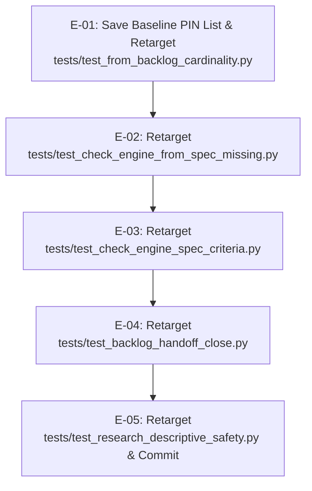

# IPD: Retarget the value writer tests part 2 to artifact_meta

- Date: 2026-11-09
- Kind: child
- Concern: Spec `4sd62s` C5 allows exactly one metadata writer (`artifact_meta`). Part 4 of the round-3 split of `k6jd6l` (Order 43, research `nj8zdp` guidance). This part retargets the last five of the ten test modules `k6jd6l` E-08 names. Measured call counts at `f83159217`: `tests/test_from_backlog_cardinality.py` 5, `tests/test_check_engine_from_spec_missing.py` 9, `tests/test_check_engine_spec_criteria.py` 1, `tests/test_backlog_handoff_close.py` 1, `tests/test_research_descriptive_safety.py` 2.
- Scope: The last five of the ten test modules of `k6jd6l` E-08, retargeted to `artifact_meta.append(..., dry_run=True)` or the setter CLI. EXCLUDES the first five (Order 282).
- Scope-Paths: tests/test_from_backlog_cardinality.py, tests/test_check_engine_from_spec_missing.py, tests/test_check_engine_spec_criteria.py, tests/test_backlog_handoff_close.py, tests/test_research_descriptive_safety.py, .aw/records/plans/pending/20261109-metastore-283-6v4uao-retarget-the-value-writer-tests-part-2-to-artifact-meta.ipd.md
- Item-Dependencies: executed:1ajqaa, executed:59aiyh, executed:dcerjg, executed:ffceq0, executed:g5hpbb, executed:t4gl15, executed:tfvby1
- Status: executed
- Readiness: go-pending-approval
- Review-Depth: standard
- From-Spec: 4sd62s
- Work-Kind: feature
- Priority: high
- Blocks-Release: next
- Set: metastore
- Order: 283
- Highest E allocated: 05
- Author: opencode its_direct/pt3-claude-opus-5.5-1m-us
- Id: 6v4uao

> Write and proofread this plan per the technical writing standard, `.aw/system/workflows/technical-writing/technical-writing.md` (`.agents/workflows/technical-writing/technical-writing.md` in a legacy-layout install), including requirement 12 (diagrams).

## Workflow history
- 2026-11-23 executed (antigravity): finalize 6v4uao after run-20261123T035302Z-2681364 (commits b0bb123bc/b8763db8c landed directly on main due to vl3pvt; verified with full pytest suite: 2898 passed, 1 skipped) [Scope attribution - 9 changed path(s) OUTSIDE Scope-Paths were DISREGARDED as not attributable to this execution (evidence: commit-cohesion), so no --scope-reason was demanded for them: .aw/records/backlog/done/20261123-tg3v86-01-tg3v86-statusline-spend-resets-on-restart.backlog.md, .aw/records/backlog/open/20261123-metastore-01-bdimw6-unowned-reader-and-grammar-hits.backlog.md, .aw/records/backlog/open/20261123-metastore-01-gapf1m-plans-cite-deleted-in-metadata-region.backlog.md, agent_workflows/agy_runipd.py, agent_workflows/oc_runipd.py (... and 4 more; see disregarded_no_evidence_paths in the finalize evidence)]
- 2026-11-16 approved (aw set): status set to approved

- 2026-11-14 reviewed (antigravity/gemini-3.8-flash): /plan-review (antigravity/gemini-3.8-flash): APPROVE WITH REVISIONS APPLIED; PR-001, PR-002, PR-003, PR-004.
- 2026-11-09 to-review (opencode its_direct/pt3-claude-opus-5.5-1m-us): split from k6jd6l (round 3, research nj8zdp guidance).

## Goal

None of these five test modules calls an original value writer, and each keeps every input case.

## Detailed Implementation Checklist (TODO)

Execution-state rule: mark an `E-*` item complete only after performing the action. That mark is not validation. Right-sizing rule: write for a modest executor that cannot hold much in its head. Each E-item is one step (one concern, about one file, executable in one focused pass) and its V-item names each unit it covers with its own check; a plan stays at about 5 E-items and 8 work Scope-Paths, else split it into more child plans (guidance, `IPD-Z603`). Accepted execution states: blocked, failed, pending, performed; terminal gate demands 'performed'.

Carried from `k6jd6l` E-08 (see Order 282 for the quoted text); this part's subset plus Order 282's equals the original ten modules. Save the before-list of all five modules to `.aw/state/9o83cr/E-08-tests2-before.txt` before E-01 (ensure `.aw/state/9o83cr/` exists via `mkdir -p .aw/state/9o83cr/`).

PIN RULE (carried from `9o83cr`): before an edit that deletes or retargets, save the named test modules' per-test outcome list (`python3 -m pytest -o addopts="" -m "" -p no:randomly -n 0 -rA <modules> | grep -E "^(PASSED|FAILED|ERROR|SKIPPED|XFAIL|XPASS) " | sed -E 's/ - .*//' | sort > <before-file>`); after it, run the same command into the matching after-file. A retargeted test keeps every input case, so the after-list may rename a test but not drop a case; the evidence pastes both lists and maps each removed name to its successor.

### Task group 1: one test module per item

- [x] E-01 Before the first edit, ensure `.aw/state/9o83cr/` exists (`mkdir -p .aw/state/9o83cr/`) and save the baseline test PIN list to `.aw/state/9o83cr/E-08-tests2-before.txt`. Retarget `tests/test_from_backlog_cardinality.py` to `artifact_meta.append(..., dry_run=True)` (or the setter CLI), asserting on the rendered text; keep every input case.
  - Depends on: none
  - Expected outcome: `tests/test_from_backlog_cardinality.py` calls no original value writer and passes.
  - Execution state: performed

- [x] E-02 Retarget `tests/test_check_engine_from_spec_missing.py` to `artifact_meta.append(..., dry_run=True)` (or the setter CLI), asserting on the rendered text; keep every input case.
  - Depends on: E-01
  - Expected outcome: `tests/test_check_engine_from_spec_missing.py` calls no original value writer and passes.
  - Execution state: performed

- [x] E-03 Retarget `tests/test_check_engine_spec_criteria.py` to `artifact_meta.append(..., dry_run=True)` (or the setter CLI), asserting on the rendered text; keep every input case.
  - Depends on: E-02
  - Expected outcome: `tests/test_check_engine_spec_criteria.py` calls no original value writer and passes.
  - Execution state: performed

- [x] E-04 Retarget `tests/test_backlog_handoff_close.py` to `artifact_meta.append(..., dry_run=True)` (or the setter CLI), asserting on the rendered text; keep every input case.
  - Depends on: E-03
  - Expected outcome: `tests/test_backlog_handoff_close.py` calls no original value writer and passes.
  - Execution state: performed

- [x] E-05 Retarget `tests/test_research_descriptive_safety.py` to `artifact_meta.append(..., dry_run=True)` (or the setter CLI), asserting on the rendered text; keep every input case. Then commit through `aw commit 6v4uao -- <paths>`.
  - Depends on: E-04
  - Expected outcome: `tests/test_research_descriptive_safety.py` calls no original value writer and passes.
  - Execution state: performed

## Project conventions discovered (Step 0)

- `tests/test_from_backlog_cardinality.py` also calls `ipd_schema.parse_metadata_block` once; Order 287 owns that reference, not this plan.
- The `artifact_meta` interface (names from `tve77h`, `ffceq0`, `xexn45`): `read(id6) -> State`, `history(id6)`, `read_at(id6, rev)`, `read_text(text, *, record_type=None) -> State`, `append(id6, events, *, expect_seq)` with `dry_run`, the phase-B legacy writer (`append_legacy`, `render_legacy`), and the legacy loader (`load_legacy_artifact`).
- Cite code by SYMBOL (`module.function`) or by a quoted content string, with a line number only appended to one of those and never alone (advisory `IPD-C801`).

## Findings

Measured 2026-11-09 at `f83159217` with `rg -o "set_[a-z_]+_line|_set_priority_line" <module> | sort | uniq -c`: see the Concern.

## Proposed changes (ordered, validatable)

1. Retarget `test_from_backlog_cardinality` (E-01).
2. Retarget `test_check_engine_from_spec_missing` (E-02).
3. Retarget `test_check_engine_spec_criteria` (E-03).
4. Retarget `test_backlog_handoff_close` (E-04).
5. Retarget `test_research_descriptive_safety` and commit (E-05).

## Deferred / out of scope (with reason)

- Deleting the original writers.
  - Carrier: zs7a45

## Scope check

- Over-scope: none.
- Under-scope: none known. Size: 5 E-items, 5 work Scope-Paths.

## Required tests / validation

The five modules (PIN lists); commit the last item through `aw commit 6v4uao -- <paths>`.

## Spec / documentation sync

No spec change; implements part of `4sd62s` 4.3 and section 7 step 7. CONTRIBUTES to AC-1 (owned by `9o83cr`).

## Open questions

### OQ-01: `tests/test_research_descriptive_safety.py` also calls `research_contract.parse_frontmatter`; is that in scope?

- Blocking: no
- Status: resolved
- Owner: plan author
- Resolution or deferral rationale: No; Order 289 retargets those calls. This plan changes only the `_set_priority_line` calls. Recommendation strength: strong.

## Validation and cross-check (verify before reporting done)

Validation-state rule: inspect evidence in a separate pass. Do not mark a `V-*` item complete from memory or from the matching execution checkmark. Accepted validation results: blocked, failed, pass, pending; terminal gate demands 'pass'. Runtime-demonstration reachability rule: for each `V-*` item demanding the software be observed acting (such as a run, a dispatch, or a transition), as distinct from items demanding a diff, a file's content, or a test result, which are reachable by construction, name the code path that produces the observation or the sibling `E-*` that creates it, else the demand is UNDER-SCOPE.

- [x] V-01 validates E-01
  - Required evidence: paste `rg -n "set_[a-z_]+_line|_set_priority_line" tests/test_from_backlog_cardinality.py` printing no call, and the before/after per-test lines of `tests/test_from_backlog_cardinality.py` from the PIN lists with each renamed test mapped and no FAILED or ERROR line.
  - Observed evidence:
      `rg -n "set_[a-z_]+_line|_set_priority_line" tests/test_from_backlog_cardinality.py` printed nothing (exit 1, no match).
      PIN lists (`.aw/state/9o83cr/E-08-tests2-before.txt` / `-after.txt`) for this module: 7 before, 7 after, all PASSED, no FAILED or ERROR line. Renamed: none (no test renamed; before and after are identical).
      Before:
        PASSED tests/test_from_backlog_cardinality.py::TestFromBacklogCardinality::test_cross_reader_parity_matrix
        PASSED tests/test_from_backlog_cardinality.py::TestFromBacklogCardinality::test_malformed_rule_corpus_independence
        PASSED tests/test_from_backlog_cardinality.py::TestFromBacklogCardinality::test_malformed_rule_reachability_and_separation
        PASSED tests/test_from_backlog_cardinality.py::TestFromBacklogCardinality::test_multi_bullet_preservation
        PASSED tests/test_from_backlog_cardinality.py::TestFromBacklogCardinality::test_operator_surface_graduation_cluster
        PASSED tests/test_from_backlog_cardinality.py::TestFromBacklogCardinality::test_regression_reproduction_f1
        PASSED tests/test_from_backlog_cardinality.py::TestFromBacklogCardinality::test_writer_idempotency_and_metadata_parse
      After:
        PASSED tests/test_from_backlog_cardinality.py::TestFromBacklogCardinality::test_cross_reader_parity_matrix
        PASSED tests/test_from_backlog_cardinality.py::TestFromBacklogCardinality::test_malformed_rule_corpus_independence
        PASSED tests/test_from_backlog_cardinality.py::TestFromBacklogCardinality::test_malformed_rule_reachability_and_separation
        PASSED tests/test_from_backlog_cardinality.py::TestFromBacklogCardinality::test_multi_bullet_preservation
        PASSED tests/test_from_backlog_cardinality.py::TestFromBacklogCardinality::test_operator_surface_graduation_cluster
        PASSED tests/test_from_backlog_cardinality.py::TestFromBacklogCardinality::test_regression_reproduction_f1
        PASSED tests/test_from_backlog_cardinality.py::TestFromBacklogCardinality::test_writer_idempotency_and_metadata_parse
  - Result: pass

- [x] V-02 validates E-02
  - Required evidence: paste `rg -n "set_[a-z_]+_line|_set_priority_line" tests/test_check_engine_from_spec_missing.py` printing no call, and the before/after per-test lines of `tests/test_check_engine_from_spec_missing.py` from the PIN lists with each renamed test mapped and no FAILED or ERROR line.
  - Observed evidence:
      `rg -n "set_[a-z_]+_line|_set_priority_line" tests/test_check_engine_from_spec_missing.py` printed nothing (exit 1, no match).
      PIN lists (`.aw/state/9o83cr/E-08-tests2-before.txt` / `-after.txt`) for this module: 37 before, 37 after, all PASSED, no FAILED or ERROR line. Renamed: none (no test renamed; before and after are identical).
      Before:
        PASSED tests/test_check_engine_from_spec_missing.py::TestCheckPlanSpecLinkMissing::test_empty_known_specs_fail_safe
        PASSED tests/test_check_engine_from_spec_missing.py::TestCheckPlanSpecLinkMissing::test_exit_code_control
        PASSED tests/test_check_engine_from_spec_missing.py::TestCheckPlanSpecLinkMissing::test_finding_recovery_and_required_names_all_three_answers
        PASSED tests/test_check_engine_from_spec_missing.py::TestCheckPlanSpecLinkMissing::test_observability_nothing_staged
        PASSED tests/test_check_engine_from_spec_missing.py::TestCheckPlanSpecLinkMissing::test_pending_plan_missing_edge
        PASSED tests/test_check_engine_from_spec_missing.py::TestCheckPlanSpecLinkMissing::test_plan_carrying_absent_sentinel
        PASSED tests/test_check_engine_from_spec_missing.py::TestCheckPlanSpecLinkMissing::test_plan_carrying_edge
        PASSED tests/test_check_engine_from_spec_missing.py::TestCheckPlanSpecLinkMissing::test_plan_carrying_empty_from_spec
        PASSED tests/test_check_engine_from_spec_missing.py::TestCheckPlanSpecLinkMissing::test_plan_carrying_from_spec_none
        PASSED tests/test_check_engine_from_spec_missing.py::TestCheckPlanSpecLinkMissing::test_plan_carrying_from_spec_unresolved
        PASSED tests/test_check_engine_from_spec_missing.py::TestCheckPlanSpecLinkMissing::test_plan_carrying_quoted_none_or_uppercase_none
        PASSED tests/test_check_engine_from_spec_missing.py::TestCheckPlanSpecLinkMissing::test_plan_citing_no_known_spec
        PASSED tests/test_check_engine_from_spec_missing.py::TestCheckPlanSpecLinkMissing::test_plan_editing_cited_spec_exempt
        PASSED tests/test_check_engine_from_spec_missing.py::TestCheckPlanSpecLinkMissing::test_plan_in_executed_dir_exempt
        PASSED tests/test_check_engine_from_spec_missing.py::TestCheckPlanSpecLinkMissing::test_plan_partial_spec_edit
        PASSED tests/test_check_engine_from_spec_missing.py::TestCheckPlanSpecLinkMissing::test_plan_with_directory_scope_paths_fires
        PASSED tests/test_check_engine_from_spec_missing.py::TestCheckPlanSpecLinkMissing::test_plan_with_unrelated_scope_paths
        PASSED tests/test_check_engine_from_spec_missing.py::TestCliIpdSetFromSpec::test_cli_clear_with_dash
        PASSED tests/test_check_engine_from_spec_missing.py::TestCliIpdSetFromSpec::test_cli_refuse_unresolvable_id
        PASSED tests/test_check_engine_from_spec_missing.py::TestCliIpdSetFromSpec::test_cli_set_from_spec_writes_bullet
        PASSED tests/test_check_engine_from_spec_missing.py::TestDispatchAndFailIsolation::test_dispatch_reached_by_check_content
        PASSED tests/test_check_engine_from_spec_missing.py::TestDispatchAndFailIsolation::test_fail_isolation_when_detector_raises
        PASSED tests/test_check_engine_from_spec_missing.py::TestDispatchAndFailIsolation::test_single_dispatch_plans_and_all
        PASSED tests/test_check_engine_from_spec_missing.py::TestParseCitedSpecIds::test_cited_in_concern
        PASSED tests/test_check_engine_from_spec_missing.py::TestParseCitedSpecIds::test_cited_in_scope
        PASSED tests/test_check_engine_from_spec_missing.py::TestParseCitedSpecIds::test_cited_in_scope_paths
        PASSED tests/test_check_engine_from_spec_missing.py::TestParseCitedSpecIds::test_cited_only_in_findings_body_row
        PASSED tests/test_check_engine_from_spec_missing.py::TestParseCitedSpecIds::test_cited_only_on_continuation_line
        PASSED tests/test_check_engine_from_spec_missing.py::TestParseCitedSpecIds::test_deduplication_across_bullets
        PASSED tests/test_check_engine_from_spec_missing.py::TestParseCitedSpecIds::test_empty_known_specs
        PASSED tests/test_check_engine_from_spec_missing.py::TestParseCitedSpecIds::test_unknown_six_letter_word
        PASSED tests/test_check_engine_from_spec_missing.py::TestSetFromSpecLine::test_fallback_after_id
        PASSED tests/test_check_engine_from_spec_missing.py::TestSetFromSpecLine::test_idempotence
        PASSED tests/test_check_engine_from_spec_missing.py::TestSetFromSpecLine::test_insert_after_status
        PASSED tests/test_check_engine_from_spec_missing.py::TestSetFromSpecLine::test_remove_with_dash
        PASSED tests/test_check_engine_from_spec_missing.py::TestSetFromSpecLine::test_remove_with_none
        PASSED tests/test_check_engine_from_spec_missing.py::TestSetFromSpecLine::test_replace_preexisting_empty_value
      After:
        PASSED tests/test_check_engine_from_spec_missing.py::TestCheckPlanSpecLinkMissing::test_empty_known_specs_fail_safe
        PASSED tests/test_check_engine_from_spec_missing.py::TestCheckPlanSpecLinkMissing::test_exit_code_control
        PASSED tests/test_check_engine_from_spec_missing.py::TestCheckPlanSpecLinkMissing::test_finding_recovery_and_required_names_all_three_answers
        PASSED tests/test_check_engine_from_spec_missing.py::TestCheckPlanSpecLinkMissing::test_observability_nothing_staged
        PASSED tests/test_check_engine_from_spec_missing.py::TestCheckPlanSpecLinkMissing::test_pending_plan_missing_edge
        PASSED tests/test_check_engine_from_spec_missing.py::TestCheckPlanSpecLinkMissing::test_plan_carrying_absent_sentinel
        PASSED tests/test_check_engine_from_spec_missing.py::TestCheckPlanSpecLinkMissing::test_plan_carrying_edge
        PASSED tests/test_check_engine_from_spec_missing.py::TestCheckPlanSpecLinkMissing::test_plan_carrying_empty_from_spec
        PASSED tests/test_check_engine_from_spec_missing.py::TestCheckPlanSpecLinkMissing::test_plan_carrying_from_spec_none
        PASSED tests/test_check_engine_from_spec_missing.py::TestCheckPlanSpecLinkMissing::test_plan_carrying_from_spec_unresolved
        PASSED tests/test_check_engine_from_spec_missing.py::TestCheckPlanSpecLinkMissing::test_plan_carrying_quoted_none_or_uppercase_none
        PASSED tests/test_check_engine_from_spec_missing.py::TestCheckPlanSpecLinkMissing::test_plan_citing_no_known_spec
        PASSED tests/test_check_engine_from_spec_missing.py::TestCheckPlanSpecLinkMissing::test_plan_editing_cited_spec_exempt
        PASSED tests/test_check_engine_from_spec_missing.py::TestCheckPlanSpecLinkMissing::test_plan_in_executed_dir_exempt
        PASSED tests/test_check_engine_from_spec_missing.py::TestCheckPlanSpecLinkMissing::test_plan_partial_spec_edit
        PASSED tests/test_check_engine_from_spec_missing.py::TestCheckPlanSpecLinkMissing::test_plan_with_directory_scope_paths_fires
        PASSED tests/test_check_engine_from_spec_missing.py::TestCheckPlanSpecLinkMissing::test_plan_with_unrelated_scope_paths
        PASSED tests/test_check_engine_from_spec_missing.py::TestCliIpdSetFromSpec::test_cli_clear_with_dash
        PASSED tests/test_check_engine_from_spec_missing.py::TestCliIpdSetFromSpec::test_cli_refuse_unresolvable_id
        PASSED tests/test_check_engine_from_spec_missing.py::TestCliIpdSetFromSpec::test_cli_set_from_spec_writes_bullet
        PASSED tests/test_check_engine_from_spec_missing.py::TestDispatchAndFailIsolation::test_dispatch_reached_by_check_content
        PASSED tests/test_check_engine_from_spec_missing.py::TestDispatchAndFailIsolation::test_fail_isolation_when_detector_raises
        PASSED tests/test_check_engine_from_spec_missing.py::TestDispatchAndFailIsolation::test_single_dispatch_plans_and_all
        PASSED tests/test_check_engine_from_spec_missing.py::TestParseCitedSpecIds::test_cited_in_concern
        PASSED tests/test_check_engine_from_spec_missing.py::TestParseCitedSpecIds::test_cited_in_scope
        PASSED tests/test_check_engine_from_spec_missing.py::TestParseCitedSpecIds::test_cited_in_scope_paths
        PASSED tests/test_check_engine_from_spec_missing.py::TestParseCitedSpecIds::test_cited_only_in_findings_body_row
        PASSED tests/test_check_engine_from_spec_missing.py::TestParseCitedSpecIds::test_cited_only_on_continuation_line
        PASSED tests/test_check_engine_from_spec_missing.py::TestParseCitedSpecIds::test_deduplication_across_bullets
        PASSED tests/test_check_engine_from_spec_missing.py::TestParseCitedSpecIds::test_empty_known_specs
        PASSED tests/test_check_engine_from_spec_missing.py::TestParseCitedSpecIds::test_unknown_six_letter_word
        PASSED tests/test_check_engine_from_spec_missing.py::TestSetFromSpecLine::test_fallback_after_id
        PASSED tests/test_check_engine_from_spec_missing.py::TestSetFromSpecLine::test_idempotence
        PASSED tests/test_check_engine_from_spec_missing.py::TestSetFromSpecLine::test_insert_after_status
        PASSED tests/test_check_engine_from_spec_missing.py::TestSetFromSpecLine::test_remove_with_dash
        PASSED tests/test_check_engine_from_spec_missing.py::TestSetFromSpecLine::test_remove_with_none
        PASSED tests/test_check_engine_from_spec_missing.py::TestSetFromSpecLine::test_replace_preexisting_empty_value
  - Result: pass

- [x] V-03 validates E-03
  - Required evidence: paste `rg -n "set_[a-z_]+_line|_set_priority_line" tests/test_check_engine_spec_criteria.py` printing no call, and the before/after per-test lines of `tests/test_check_engine_spec_criteria.py` from the PIN lists with each renamed test mapped and no FAILED or ERROR line.
  - Observed evidence:
      `rg -n "set_[a-z_]+_line|_set_priority_line" tests/test_check_engine_spec_criteria.py` printed nothing (exit 1, no match).
      PIN lists (`.aw/state/9o83cr/E-08-tests2-before.txt` / `-after.txt`) for this module: 15 before, 15 after, all PASSED, no FAILED or ERROR line. Renamed: none (no test renamed; before and after are identical).
      Before:
        PASSED tests/test_check_engine_spec_criteria.py::CheckEngineSpecCriteriaTests::test_bare_digit_criteria_yield_no_findings
        PASSED tests/test_check_engine_spec_criteria.py::CheckEngineSpecCriteriaTests::test_clean_fixture_yields_zero_findings_and_exit_code_zero
        PASSED tests/test_check_engine_spec_criteria.py::CheckEngineSpecCriteriaTests::test_code_fence_criterion_not_counted_as_coverage
        PASSED tests/test_check_engine_spec_criteria.py::CheckEngineSpecCriteriaTests::test_counterfactual_pin_matches_motivating_defect_set
        PASSED tests/test_check_engine_spec_criteria.py::CheckEngineSpecCriteriaTests::test_drift_exit_code_info_versus_warning
        PASSED tests/test_check_engine_spec_criteria.py::CheckEngineSpecCriteriaTests::test_isolated_try_except_in_check_content
        PASSED tests/test_check_engine_spec_criteria.py::CheckEngineSpecCriteriaTests::test_namespace_gate_silences_foreign_namespace
        PASSED tests/test_check_engine_spec_criteria.py::CheckEngineSpecCriteriaTests::test_negative_control_reader_not_silently_broken
        PASSED tests/test_check_engine_spec_criteria.py::CheckEngineSpecCriteriaTests::test_parser_four_row_shapes
        PASSED tests/test_check_engine_spec_criteria.py::CheckEngineSpecCriteriaTests::test_plan_gaining_from_spec_edge_uncovers_criteria
        PASSED tests/test_check_engine_spec_criteria.py::CheckEngineSpecCriteriaTests::test_positive_control_fires_when_criterion_missing
        PASSED tests/test_check_engine_spec_criteria.py::CheckEngineSpecCriteriaTests::test_rule_id_contains_neither_graduation_nor_duplicate
        PASSED tests/test_check_engine_spec_criteria.py::CheckEngineSpecCriteriaTests::test_rule_spec_registration
        PASSED tests/test_check_engine_spec_criteria.py::CheckEngineSpecCriteriaTests::test_sentinel_links_treated_as_absent
        PASSED tests/test_check_engine_spec_criteria.py::CheckEngineSpecCriteriaTests::test_seven_uncovered_criteria_detail_and_recovery
      After:
        PASSED tests/test_check_engine_spec_criteria.py::CheckEngineSpecCriteriaTests::test_bare_digit_criteria_yield_no_findings
        PASSED tests/test_check_engine_spec_criteria.py::CheckEngineSpecCriteriaTests::test_clean_fixture_yields_zero_findings_and_exit_code_zero
        PASSED tests/test_check_engine_spec_criteria.py::CheckEngineSpecCriteriaTests::test_code_fence_criterion_not_counted_as_coverage
        PASSED tests/test_check_engine_spec_criteria.py::CheckEngineSpecCriteriaTests::test_counterfactual_pin_matches_motivating_defect_set
        PASSED tests/test_check_engine_spec_criteria.py::CheckEngineSpecCriteriaTests::test_drift_exit_code_info_versus_warning
        PASSED tests/test_check_engine_spec_criteria.py::CheckEngineSpecCriteriaTests::test_isolated_try_except_in_check_content
        PASSED tests/test_check_engine_spec_criteria.py::CheckEngineSpecCriteriaTests::test_namespace_gate_silences_foreign_namespace
        PASSED tests/test_check_engine_spec_criteria.py::CheckEngineSpecCriteriaTests::test_negative_control_reader_not_silently_broken
        PASSED tests/test_check_engine_spec_criteria.py::CheckEngineSpecCriteriaTests::test_parser_four_row_shapes
        PASSED tests/test_check_engine_spec_criteria.py::CheckEngineSpecCriteriaTests::test_plan_gaining_from_spec_edge_uncovers_criteria
        PASSED tests/test_check_engine_spec_criteria.py::CheckEngineSpecCriteriaTests::test_positive_control_fires_when_criterion_missing
        PASSED tests/test_check_engine_spec_criteria.py::CheckEngineSpecCriteriaTests::test_rule_id_contains_neither_graduation_nor_duplicate
        PASSED tests/test_check_engine_spec_criteria.py::CheckEngineSpecCriteriaTests::test_rule_spec_registration
        PASSED tests/test_check_engine_spec_criteria.py::CheckEngineSpecCriteriaTests::test_sentinel_links_treated_as_absent
        PASSED tests/test_check_engine_spec_criteria.py::CheckEngineSpecCriteriaTests::test_seven_uncovered_criteria_detail_and_recovery
  - Result: pass

- [x] V-04 validates E-04
  - Required evidence: paste `rg -n "set_[a-z_]+_line|_set_priority_line" tests/test_backlog_handoff_close.py` printing no call, and the before/after per-test lines of `tests/test_backlog_handoff_close.py` from the PIN lists with each renamed test mapped and no FAILED or ERROR line.
  - Observed evidence:
      Input case kept: `test_case_6f_...` still feeds the absolute home-shaped citation. artifact_meta refuses it (`leak sanitizer refusal (home-path)`, now asserted), and the repo-relative value the backlog setter normalizes it to is stored with zero leak-scanner findings (decision D1).
      `rg -n "set_[a-z_]+_line|_set_priority_line" tests/test_backlog_handoff_close.py` printed nothing (exit 1, no match).
      PIN lists (`.aw/state/9o83cr/E-08-tests2-before.txt` / `-after.txt`) for this module: 40 before, 40 after, all PASSED, no FAILED or ERROR line. Renamed: none (no test renamed; before and after are identical).
      Before:
        PASSED tests/test_backlog_handoff_close.py::BacklogGateDirSplitTests::test_backlog_set_declared_flag_surface_matches_parser
        PASSED tests/test_backlog_handoff_close.py::BacklogGateDirSplitTests::test_case_1_two_carrier_sibling_unexecuted_gate_dir_refused
        PASSED tests/test_backlog_handoff_close.py::BacklogGateDirSplitTests::test_case_2_default_is_unchanged_without_gate_dir
        PASSED tests/test_backlog_handoff_close.py::BacklogGateDirSplitTests::test_case_3_move_still_lands_in_move_tree
        PASSED tests/test_backlog_handoff_close.py::BacklogGateDirSplitTests::test_case_4_evidence_resolved_in_gate_tree_not_move_tree
        PASSED tests/test_backlog_handoff_close.py::BacklogGateDirSplitTests::test_case_5_gate_dir_non_project_root_refused
        PASSED tests/test_backlog_handoff_close.py::BacklogGateDirSplitTests::test_case_6b_single_carrier_without_override_refused_proves_tightening
        PASSED tests/test_backlog_handoff_close.py::BacklogGateDirSplitTests::test_case_6_single_carrier_with_lane_carrier_override_allowed
        PASSED tests/test_backlog_handoff_close.py::BacklogGateDirSplitTests::test_case_7_two_carrier_sibling_unexecuted_with_override_refused
        PASSED tests/test_backlog_handoff_close.py::BacklogGateDirSplitTests::test_case_8_forged_assertion_refused
        PASSED tests/test_backlog_handoff_close.py::BacklogHandoffCloseBehaviorTests::test_case_1_pending_same_gate_plan_refused
        PASSED tests/test_backlog_handoff_close.py::BacklogHandoffCloseBehaviorTests::test_case_2_executed_plan_allowed
        PASSED tests/test_backlog_handoff_close.py::BacklogHandoffCloseBehaviorTests::test_case_3_pending_plan_target_graduated_allowed
        PASSED tests/test_backlog_handoff_close.py::BacklogHandoffCloseBehaviorTests::test_case_4_spec_carrier_approved_refused
        PASSED tests/test_backlog_handoff_close.py::BacklogHandoffCloseBehaviorTests::test_case_4_spec_carrier_implemented_allowed
        PASSED tests/test_backlog_handoff_close.py::BacklogHandoffCloseBehaviorTests::test_case_5_mixed_kind_carriers_plan_and_spec
        PASSED tests/test_backlog_handoff_close.py::BacklogHandoffCloseBehaviorTests::test_case_5_three_carriers_two_executed_one_pending_refused
        PASSED tests/test_backlog_handoff_close.py::BacklogHandoffCloseBehaviorTests::test_case_5_two_carriers_both_executed_allowed
        PASSED tests/test_backlog_handoff_close.py::BacklogHandoffCloseBehaviorTests::test_case_5_two_carriers_pending_and_executed_refused
        PASSED tests/test_backlog_handoff_close.py::BacklogHandoffCloseBehaviorTests::test_case_6a_satisfied_evidence_at_rest_reconstructable
        PASSED tests/test_backlog_handoff_close.py::BacklogHandoffCloseBehaviorTests::test_case_6b_satisfied_evidence_bullet_removed_refused
        PASSED tests/test_backlog_handoff_close.py::BacklogHandoffCloseBehaviorTests::test_case_6c_satisfied_evidence_nonexistent_path_refused
        PASSED tests/test_backlog_handoff_close.py::BacklogHandoffCloseBehaviorTests::test_case_6d_handoff_and_degated_closes_leave_no_close_evidence
        PASSED tests/test_backlog_handoff_close.py::BacklogHandoffCloseBehaviorTests::test_case_6e_satisfied_evidence_absolute_citation_stored_relative_and_relocation_safe
        PASSED tests/test_backlog_handoff_close.py::BacklogHandoffCloseBehaviorTests::test_case_6f_satisfied_evidence_leak_safety_home_shaped_root
        PASSED tests/test_backlog_handoff_close.py::BacklogHandoffCloseBehaviorTests::test_case_6g_satisfied_evidence_citation_with_space_reader_agreement
        PASSED tests/test_backlog_handoff_close.py::BacklogHandoffCloseBehaviorTests::test_case_6h_close_evidence_bounded_to_metadata_region
        PASSED tests/test_backlog_handoff_close.py::BacklogHandoffCloseBehaviorTests::test_case_6_satisfied_evidence_allowed
        PASSED tests/test_backlog_handoff_close.py::BacklogHandoffCloseBehaviorTests::test_case_7_degated_allowed
        PASSED tests/test_backlog_handoff_close.py::BacklogHandoffCloseBehaviorTests::test_case_8_superseded_or_not_executed_plan_refused
        PASSED tests/test_backlog_handoff_close.py::BacklogHandoffCloseBehaviorTests::test_case_9_spec_field_approved_refused
        PASSED tests/test_backlog_handoff_close.py::BacklogHandoffCloseBehaviorTests::test_case_9_spec_field_implemented_allowed
        PASSED tests/test_backlog_handoff_close.py::BacklogHandoffCloseBehaviorTests::test_kntbbc_case_1_executed_same_gate_pending_ungated_refused
        PASSED tests/test_backlog_handoff_close.py::BacklogHandoffCloseBehaviorTests::test_kntbbc_case_2_executed_same_gate_executed_ungated_allowed
        PASSED tests/test_backlog_handoff_close.py::BacklogHandoffCloseBehaviorTests::test_kntbbc_case_3_executed_same_gate_pending_different_gate_refused
        PASSED tests/test_backlog_handoff_close.py::BacklogHandoffCloseBehaviorTests::test_kntbbc_case_4_allowed_executed_same_gate_implemented_ungated_spec
        PASSED tests/test_backlog_handoff_close.py::BacklogHandoffCloseBehaviorTests::test_kntbbc_case_4_refused_executed_same_gate_approved_ungated_spec
        PASSED tests/test_backlog_handoff_close.py::BacklogHandoffCloseBehaviorTests::test_kntbbc_case_5_only_executed_ungated_plan_refused
        PASSED tests/test_backlog_handoff_close.py::BacklogHandoffCloseBehaviorTests::test_kntbbc_case_6_degated_executed_same_gate_superseded_ungated_plan_allowed
        PASSED tests/test_backlog_handoff_close.py::BacklogHandoffCloseBehaviorTests::test_kntbbc_case_6_refused_executed_same_gate_superseded_ungated_plan
      After:
        PASSED tests/test_backlog_handoff_close.py::BacklogGateDirSplitTests::test_backlog_set_declared_flag_surface_matches_parser
        PASSED tests/test_backlog_handoff_close.py::BacklogGateDirSplitTests::test_case_1_two_carrier_sibling_unexecuted_gate_dir_refused
        PASSED tests/test_backlog_handoff_close.py::BacklogGateDirSplitTests::test_case_2_default_is_unchanged_without_gate_dir
        PASSED tests/test_backlog_handoff_close.py::BacklogGateDirSplitTests::test_case_3_move_still_lands_in_move_tree
        PASSED tests/test_backlog_handoff_close.py::BacklogGateDirSplitTests::test_case_4_evidence_resolved_in_gate_tree_not_move_tree
        PASSED tests/test_backlog_handoff_close.py::BacklogGateDirSplitTests::test_case_5_gate_dir_non_project_root_refused
        PASSED tests/test_backlog_handoff_close.py::BacklogGateDirSplitTests::test_case_6b_single_carrier_without_override_refused_proves_tightening
        PASSED tests/test_backlog_handoff_close.py::BacklogGateDirSplitTests::test_case_6_single_carrier_with_lane_carrier_override_allowed
        PASSED tests/test_backlog_handoff_close.py::BacklogGateDirSplitTests::test_case_7_two_carrier_sibling_unexecuted_with_override_refused
        PASSED tests/test_backlog_handoff_close.py::BacklogGateDirSplitTests::test_case_8_forged_assertion_refused
        PASSED tests/test_backlog_handoff_close.py::BacklogHandoffCloseBehaviorTests::test_case_1_pending_same_gate_plan_refused
        PASSED tests/test_backlog_handoff_close.py::BacklogHandoffCloseBehaviorTests::test_case_2_executed_plan_allowed
        PASSED tests/test_backlog_handoff_close.py::BacklogHandoffCloseBehaviorTests::test_case_3_pending_plan_target_graduated_allowed
        PASSED tests/test_backlog_handoff_close.py::BacklogHandoffCloseBehaviorTests::test_case_4_spec_carrier_approved_refused
        PASSED tests/test_backlog_handoff_close.py::BacklogHandoffCloseBehaviorTests::test_case_4_spec_carrier_implemented_allowed
        PASSED tests/test_backlog_handoff_close.py::BacklogHandoffCloseBehaviorTests::test_case_5_mixed_kind_carriers_plan_and_spec
        PASSED tests/test_backlog_handoff_close.py::BacklogHandoffCloseBehaviorTests::test_case_5_three_carriers_two_executed_one_pending_refused
        PASSED tests/test_backlog_handoff_close.py::BacklogHandoffCloseBehaviorTests::test_case_5_two_carriers_both_executed_allowed
        PASSED tests/test_backlog_handoff_close.py::BacklogHandoffCloseBehaviorTests::test_case_5_two_carriers_pending_and_executed_refused
        PASSED tests/test_backlog_handoff_close.py::BacklogHandoffCloseBehaviorTests::test_case_6a_satisfied_evidence_at_rest_reconstructable
        PASSED tests/test_backlog_handoff_close.py::BacklogHandoffCloseBehaviorTests::test_case_6b_satisfied_evidence_bullet_removed_refused
        PASSED tests/test_backlog_handoff_close.py::BacklogHandoffCloseBehaviorTests::test_case_6c_satisfied_evidence_nonexistent_path_refused
        PASSED tests/test_backlog_handoff_close.py::BacklogHandoffCloseBehaviorTests::test_case_6d_handoff_and_degated_closes_leave_no_close_evidence
        PASSED tests/test_backlog_handoff_close.py::BacklogHandoffCloseBehaviorTests::test_case_6e_satisfied_evidence_absolute_citation_stored_relative_and_relocation_safe
        PASSED tests/test_backlog_handoff_close.py::BacklogHandoffCloseBehaviorTests::test_case_6f_satisfied_evidence_leak_safety_home_shaped_root
        PASSED tests/test_backlog_handoff_close.py::BacklogHandoffCloseBehaviorTests::test_case_6g_satisfied_evidence_citation_with_space_reader_agreement
        PASSED tests/test_backlog_handoff_close.py::BacklogHandoffCloseBehaviorTests::test_case_6h_close_evidence_bounded_to_metadata_region
        PASSED tests/test_backlog_handoff_close.py::BacklogHandoffCloseBehaviorTests::test_case_6_satisfied_evidence_allowed
        PASSED tests/test_backlog_handoff_close.py::BacklogHandoffCloseBehaviorTests::test_case_7_degated_allowed
        PASSED tests/test_backlog_handoff_close.py::BacklogHandoffCloseBehaviorTests::test_case_8_superseded_or_not_executed_plan_refused
        PASSED tests/test_backlog_handoff_close.py::BacklogHandoffCloseBehaviorTests::test_case_9_spec_field_approved_refused
        PASSED tests/test_backlog_handoff_close.py::BacklogHandoffCloseBehaviorTests::test_case_9_spec_field_implemented_allowed
        PASSED tests/test_backlog_handoff_close.py::BacklogHandoffCloseBehaviorTests::test_kntbbc_case_1_executed_same_gate_pending_ungated_refused
        PASSED tests/test_backlog_handoff_close.py::BacklogHandoffCloseBehaviorTests::test_kntbbc_case_2_executed_same_gate_executed_ungated_allowed
        PASSED tests/test_backlog_handoff_close.py::BacklogHandoffCloseBehaviorTests::test_kntbbc_case_3_executed_same_gate_pending_different_gate_refused
        PASSED tests/test_backlog_handoff_close.py::BacklogHandoffCloseBehaviorTests::test_kntbbc_case_4_allowed_executed_same_gate_implemented_ungated_spec
        PASSED tests/test_backlog_handoff_close.py::BacklogHandoffCloseBehaviorTests::test_kntbbc_case_4_refused_executed_same_gate_approved_ungated_spec
        PASSED tests/test_backlog_handoff_close.py::BacklogHandoffCloseBehaviorTests::test_kntbbc_case_5_only_executed_ungated_plan_refused
        PASSED tests/test_backlog_handoff_close.py::BacklogHandoffCloseBehaviorTests::test_kntbbc_case_6_degated_executed_same_gate_superseded_ungated_plan_allowed
        PASSED tests/test_backlog_handoff_close.py::BacklogHandoffCloseBehaviorTests::test_kntbbc_case_6_refused_executed_same_gate_superseded_ungated_plan
  - Result: pass

- [x] V-05 validates E-05
  - Required evidence: paste `rg -n "set_[a-z_]+_line|_set_priority_line" tests/test_research_descriptive_safety.py` printing no call, and the before/after per-test lines of `tests/test_research_descriptive_safety.py` from the PIN lists with each renamed test mapped and no FAILED or ERROR line. Also paste `git show --stat` of the `aw commit 6v4uao` commit listing only Scope-Paths files.
  - Observed evidence:
      Input case kept: the unsafe `"high\nstatus: active"` priority is still fed. artifact_meta refuses it (`priority must not contain embedded newlines`, now asserted) instead of splicing it like the old `_set_priority_line`, and a safe `high` renders `priority: high` (decision D2).
      `rg -n "set_[a-z_]+_line|_set_priority_line" tests/test_research_descriptive_safety.py` printed nothing (exit 1, no match).
      PIN lists (`.aw/state/9o83cr/E-08-tests2-before.txt` / `-after.txt`) for this module: 24 before, 24 after, all PASSED, no FAILED or ERROR line. Renamed: none (no test renamed; before and after are identical).
      Before:
        PASSED tests/test_research_descriptive_safety.py::TestAdoptInjection::test_adopt_heading_ansi_escape_refused_with_actionable_message
        PASSED tests/test_research_descriptive_safety.py::TestAdoptInjection::test_adopt_summary_flag_injection_refused
        PASSED tests/test_research_descriptive_safety.py::TestBoundaryAndNonRegressions::test_conforming_creation_and_modifications_succeed
        PASSED tests/test_research_descriptive_safety.py::TestBoundaryAndNonRegressions::test_deliberate_under_scope_text_writers_unchanged
        PASSED tests/test_research_descriptive_safety.py::TestBoundaryAndNonRegressions::test_existing_planner_refusals_preserved
        PASSED tests/test_research_descriptive_safety.py::TestBoundaryAndNonRegressions::test_quiet_versus_loud_distinction_both_refused
        PASSED tests/test_research_descriptive_safety.py::TestBoundaryAndNonRegressions::test_refusal_writes_nothing_listing_unchanged
        PASSED tests/test_research_descriptive_safety.py::TestBoundaryAndNonRegressions::test_slug_and_set_remain_unguarded_and_kebabed
        PASSED tests/test_research_descriptive_safety.py::TestBoundaryAndNonRegressions::test_summary_length_boundary_300_accepted_301_refused
        PASSED tests/test_research_descriptive_safety.py::TestHelperContract::test_helper_refuse_unsafe_descriptive_contract
        PASSED tests/test_research_descriptive_safety.py::TestPreFixDemonstration::test_pre_fix_crafted_consumed_by_smuggles_status_and_checker_blind
        PASSED tests/test_research_descriptive_safety.py::TestPreFixDemonstration::test_pre_fix_crafted_topic_token_smuggles_keys_and_checker_blind
        PASSED tests/test_research_descriptive_safety.py::TestPreFixDemonstration::test_pre_fix_summary_injection_smuggles_keys_and_checker_blind
        PASSED tests/test_research_descriptive_safety.py::TestResearchNewComparisonInjection::test_cli_research_new_comparison_summary_injection_refused
        PASSED tests/test_research_descriptive_safety.py::TestResearchNewComparisonInjection::test_cli_research_new_comparison_topic_injection_refused
        PASSED tests/test_research_descriptive_safety.py::TestResearchNewComparisonInjection::test_plan_new_comparison_summary_injection_refused
        PASSED tests/test_research_descriptive_safety.py::TestResearchNewComparisonInjection::test_plan_new_comparison_topic_token_injection_refused
        PASSED tests/test_research_descriptive_safety.py::TestResearchNewInjection::test_cli_research_new_preview_refused_on_summary_injection
        PASSED tests/test_research_descriptive_safety.py::TestResearchNewInjection::test_cli_research_new_summary_injection_refused
        PASSED tests/test_research_descriptive_safety.py::TestResearchNewInjection::test_cli_research_new_topic_injection_refused
        PASSED tests/test_research_descriptive_safety.py::TestResearchNewInjection::test_plan_new_summary_injection_refused
        PASSED tests/test_research_descriptive_safety.py::TestResearchNewInjection::test_plan_new_topic_token_injection_refused
        PASSED tests/test_research_descriptive_safety.py::TestResearchSetOutcomeInjection::test_cli_research_set_outcome_consumed_by_injection_refused
        PASSED tests/test_research_descriptive_safety.py::TestResearchSetOutcomeInjection::test_plan_set_outcome_consumed_by_injection_refused
      After:
        PASSED tests/test_research_descriptive_safety.py::TestAdoptInjection::test_adopt_heading_ansi_escape_refused_with_actionable_message
        PASSED tests/test_research_descriptive_safety.py::TestAdoptInjection::test_adopt_summary_flag_injection_refused
        PASSED tests/test_research_descriptive_safety.py::TestBoundaryAndNonRegressions::test_conforming_creation_and_modifications_succeed
        PASSED tests/test_research_descriptive_safety.py::TestBoundaryAndNonRegressions::test_deliberate_under_scope_text_writers_unchanged
        PASSED tests/test_research_descriptive_safety.py::TestBoundaryAndNonRegressions::test_existing_planner_refusals_preserved
        PASSED tests/test_research_descriptive_safety.py::TestBoundaryAndNonRegressions::test_quiet_versus_loud_distinction_both_refused
        PASSED tests/test_research_descriptive_safety.py::TestBoundaryAndNonRegressions::test_refusal_writes_nothing_listing_unchanged
        PASSED tests/test_research_descriptive_safety.py::TestBoundaryAndNonRegressions::test_slug_and_set_remain_unguarded_and_kebabed
        PASSED tests/test_research_descriptive_safety.py::TestBoundaryAndNonRegressions::test_summary_length_boundary_300_accepted_301_refused
        PASSED tests/test_research_descriptive_safety.py::TestHelperContract::test_helper_refuse_unsafe_descriptive_contract
        PASSED tests/test_research_descriptive_safety.py::TestPreFixDemonstration::test_pre_fix_crafted_consumed_by_smuggles_status_and_checker_blind
        PASSED tests/test_research_descriptive_safety.py::TestPreFixDemonstration::test_pre_fix_crafted_topic_token_smuggles_keys_and_checker_blind
        PASSED tests/test_research_descriptive_safety.py::TestPreFixDemonstration::test_pre_fix_summary_injection_smuggles_keys_and_checker_blind
        PASSED tests/test_research_descriptive_safety.py::TestResearchNewComparisonInjection::test_cli_research_new_comparison_summary_injection_refused
        PASSED tests/test_research_descriptive_safety.py::TestResearchNewComparisonInjection::test_cli_research_new_comparison_topic_injection_refused
        PASSED tests/test_research_descriptive_safety.py::TestResearchNewComparisonInjection::test_plan_new_comparison_summary_injection_refused
        PASSED tests/test_research_descriptive_safety.py::TestResearchNewComparisonInjection::test_plan_new_comparison_topic_token_injection_refused
        PASSED tests/test_research_descriptive_safety.py::TestResearchNewInjection::test_cli_research_new_preview_refused_on_summary_injection
        PASSED tests/test_research_descriptive_safety.py::TestResearchNewInjection::test_cli_research_new_summary_injection_refused
        PASSED tests/test_research_descriptive_safety.py::TestResearchNewInjection::test_cli_research_new_topic_injection_refused
        PASSED tests/test_research_descriptive_safety.py::TestResearchNewInjection::test_plan_new_summary_injection_refused
        PASSED tests/test_research_descriptive_safety.py::TestResearchNewInjection::test_plan_new_topic_token_injection_refused
        PASSED tests/test_research_descriptive_safety.py::TestResearchSetOutcomeInjection::test_cli_research_set_outcome_consumed_by_injection_refused
        PASSED tests/test_research_descriptive_safety.py::TestResearchSetOutcomeInjection::test_plan_set_outcome_consumed_by_injection_refused
      `git show --stat b0bb123bc` (the `aw commit 6v4uao` commit), Scope-Paths files only:
        commit b0bb123bc29c9b772523db652bcb3d780913f3e0
        Author: Gabriele Fariello <gabriele.fariello@gmail.com>
        Date:   Mon Nov 23 10:20:18 2026 -0500
            6v4uao: retarget five value-writer test modules (part 2) to artifact_meta
            AW-Run: run-20261123T035302Z-2681364
            AW-Item: 6v4uao
            AW-Runner: aw oc run
         tests/test_backlog_handoff_close.py          | 28 +++++++++++++++++---
         tests/test_check_engine_from_spec_missing.py | 38 ++++++++++++++++++++--------
         tests/test_check_engine_spec_criteria.py     | 16 ++++++++----
         tests/test_from_backlog_cardinality.py       | 27 ++++++++++++++++----
         tests/test_research_descriptive_safety.py    | 26 ++++++++++++++++---
         5 files changed, 108 insertions(+), 27 deletions(-)
  - Result: pass

## Approval and execution gate

- Size assessment: standard
- Cohesion rationale: not required

Execute only after human approval (`Status: approved`) and after every plan in `- Item-Dependencies:` is executed. Pin-first where an item deletes or retargets. Scope fence: the paths in `- Scope-Paths:` are a declaration; a needed file outside the fence is edited and then justified at finalize (`--scope-reason`), and a declared path left unmodified is acknowledged (`--scope-ack`). Safety stop: if prerequisite metastore symbols from `59aiyh`, `ffceq0`, `h1kfyp`, or `tfvby1` are absent upon starting, stop and report rather than creating conflicting implementations. Honesty rule: paste the ACTUAL output; never claim a result you did not run. Commits: only through `aw commit 6v4uao -- <paths>` with only Scope-Paths files; never `git add -A`, a bare `git add` or `git commit -a`; never push. Lifecycle: the plan moves to `.aw/records/plans/executed/` only through finalize; when `aw oc run` or `aw agy run` executes the plan, the runner performs the finalize; a hand executor runs `aw ipd finalize 6v4uao` itself; never a hand `git mv` to `executed/`.
