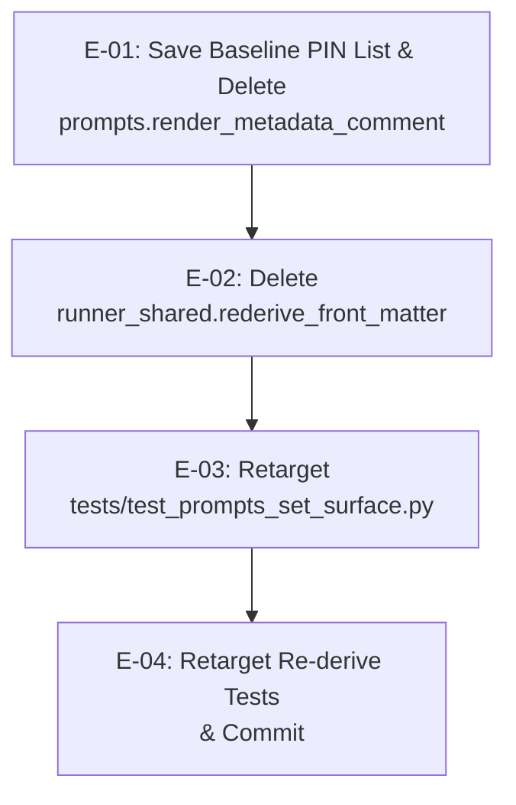

# IPD: Delete the prompts and runner_shared metadata adapters

- Date: 2026-11-09
- Kind: child
- Concern: Spec `4sd62s` C5 allows exactly one metadata writer (`artifact_meta`). Part 7 of the round-3 split of `k6jd6l` (Order 43, research `nj8zdp` guidance): delete the other two `xexn45` F-08 adapters, `prompts.render_metadata_comment` (caller `prompts.run_new`) and `runner_shared.rederive_front_matter` (caller `runner_shared.apply_records_only_rederivation`). Measured at `f83159217`: `prompts` 3 references, `runner_shared` 6, `tests/test_prompts_set_surface.py` 1, `tests/test_records_only_lane_rederive.py` 5.
- Scope: The `prompts` and `runner_shared` half of `k6jd6l` E-09 and its test modules, including `tests/test_backlog.py` if it references an adapter. EXCLUDES the rename adapters (Order 285).
- Scope-Paths: agent_workflows/prompts.py, agent_workflows/runner_shared.py, tests/test_prompts_set_surface.py, tests/test_records_only_lane_rederive.py, tests/test_backlog.py, .aw/records/plans/pending/20261109-metastore-286-8fxic1-delete-the-prompts-and-runner-shared-metadata-adapters.ipd.md
- Scope-Exceeded: tests/test_writers_create_summary.py (it called the deleted prompts.render_metadata_comment adapter not listed in the plan's measured census retargeted to aw prompts new + artifact_meta.read_text so the plan's Goal grep over tests/ prints...)
- Item-Dependencies: executed:1ajqaa, executed:59aiyh, executed:dcerjg, executed:ffceq0, executed:g5hpbb, executed:t4gl15, executed:v0ucnz
- Status: executed
- Readiness: go-pending-approval
- Review-Depth: standard
- From-Spec: 4sd62s
- Work-Kind: feature
- Priority: high
- Blocks-Release: next
- Set: metastore
- Order: 286
- Highest E allocated: 04
- Author: opencode its_direct/pt3-claude-opus-5.5-1m-us
- Id: 8fxic1

> Write and proofread this plan per the technical writing standard, `.aw/system/workflows/technical-writing/technical-writing.md` (`.agents/workflows/technical-writing/technical-writing.md` in a legacy-layout install), including requirement 12 (diagrams).

## Workflow history
- 2026-11-24 executed (aw oc run model=uri/its_direct/pt3-claude-opus-5.5-1m-us variant=high profile=opus): aw oc run self-finalize: 8fxic1 verified (set metastore, attempt 1). [Scope reconciliation - out-of-scope tests/test_writers_create_summary.py: it called the deleted prompts.render_metadata_comment adapter (not listed in the plan's measured census); retargeted to aw prompts new + artifact_meta.read_text so the plan's Goal grep over tests/ prints nothing; in-scope-unmodified tests/test_backlog.py: declared-but-unmodified (auto-acknowledged by aw oc run)]
- 2026-11-16 approved (aw set): status set to approved

- 2026-11-14 reviewed (antigravity/gemini-3.8-flash): /plan-review (antigravity/gemini-3.8-flash): APPROVE WITH REVISIONS APPLIED; PR-001, PR-002, PR-003, PR-004.
- 2026-11-09 to-review (opencode its_direct/pt3-claude-opus-5.5-1m-us): split from k6jd6l (round 3, research nj8zdp guidance).

## Goal

`rg -n "_set_metadata\b|_update_frontmatter_metadata|render_metadata_comment|rederive_front_matter" agent_workflows tests` prints nothing, which is `k6jd6l` E-09's expected outcome.

## Detailed Implementation Checklist (TODO)

Execution-state rule: mark an `E-*` item complete only after performing the action. That mark is not validation. Right-sizing rule: write for a modest executor that cannot hold much in its head. Each E-item is one step (one concern, about one file, executable in one focused pass) and its V-item names each unit it covers with its own check; a plan stays at about 5 E-items and 8 work Scope-Paths, else split it into more child plans (guidance, `IPD-Z603`). Accepted execution states: blocked, failed, pending, performed; terminal gate demands 'performed'.

Carried from `k6jd6l` E-09 (quoted in Order 285). Save the before-list of `tests/test_prompts_set_surface.py`, `tests/test_records_only_lane_rederive.py` and `tests/test_backlog.py` to `.aw/state/9o83cr/E-09b-before.txt` before E-01 (ensure `.aw/state/9o83cr/` exists via `mkdir -p .aw/state/9o83cr/`).

PIN RULE (carried from `9o83cr`): before an edit that deletes or retargets, save the named test modules' per-test outcome list (`python3 -m pytest -o addopts="" -m "" -p no:randomly -n 0 -rA <modules> | grep -E "^(PASSED|FAILED|ERROR|SKIPPED|XFAIL|XPASS) " | sed -E 's/ - .*//' | sort > <before-file>`); after it, run the same command into the matching after-file. A retargeted test keeps every input case, so the after-list may rename a test but not drop a case; the evidence pastes both lists and maps each removed name to its successor.

### Task group 1: one adapter per item, then its tests

- [x] E-01 Before the first edit, ensure `.aw/state/9o83cr/` exists (`mkdir -p .aw/state/9o83cr/`) and save the baseline test PIN list to `.aw/state/9o83cr/E-09b-before.txt`. Delete `prompts.render_metadata_comment`; `prompts.run_new` writes the `aw-prompt` comment through `artifact_meta.create`/`append`.
  - Depends on: none
  - Expected outcome: the adapter is gone.
  - Execution state: performed

- [x] E-02 Delete `runner_shared.rederive_front_matter`; `runner_shared.apply_records_only_rederivation` calls `artifact_meta` directly.
  - Depends on: E-01
  - Expected outcome: the adapter is gone.
  - Execution state: performed

- [x] E-03 Retarget `tests/test_prompts_set_surface.py` to the behavior through `aw prompts new`, asserting on `artifact_meta.read` state and file bytes.
  - Depends on: E-02
  - Expected outcome: the module calls no adapter and passes.
  - Execution state: performed

- [x] E-04 Retarget `tests/test_records_only_lane_rederive.py` (and `tests/test_backlog.py` if Order 280's F-24 lists a reference in it) to `runner_shared.apply_records_only_rederivation`, asserting on `artifact_meta.read` state and file bytes; save the after-list; commit through `aw commit 8fxic1 -- <paths>`.
  - Depends on: E-03
  - Expected outcome: no test references an adapter; the modules pass.
  - Execution state: performed

## Project conventions discovered (Step 0)

- The `artifact_meta` interface (names from `tve77h`, `ffceq0`, `xexn45`): `read(id6) -> State`, `history(id6)`, `read_at(id6, rev)`, `read_text(text, *, record_type=None) -> State`, `append(id6, events, *, expect_seq)` with `dry_run`, the phase-B legacy writer (`append_legacy`, `render_legacy`), and the legacy loader (`load_legacy_artifact`).
- Cite code by SYMBOL (`module.function`) or by a quoted content string, with a line number only appended to one of those and never alone (advisory `IPD-C801`).

## Findings

Measured 2026-11-09 at `f83159217`: see the Concern. `tests/test_backlog.py` had no adapter reference at that commit; `k6jd6l` E-09 named it, so it stays declared and is acknowledged with `--scope-ack` if untouched.

## Proposed changes (ordered, validatable)



1. Delete `render_metadata_comment` (E-01).
2. Delete `rederive_front_matter` (E-02).
3. Retarget `test_prompts_set_surface` (E-03).
4. Retarget the rederive tests and commit (E-04).

## Deferred / out of scope (with reason)

- The rename adapters.
  - Carrier: v0ucnz
  - Carrier-Evidence: .aw/records/plans/executed/20261109-metastore-285-v0ucnz-delete-the-plans-refs-and-artifact-rename-metadata-adapters.ipd.md

## Scope check

- Over-scope: none.
- Under-scope: none known. Size: 4 E-items, 5 work Scope-Paths.

## Required tests / validation

`tests/test_prompts_set_surface.py`, `tests/test_records_only_lane_rederive.py`, `tests/test_backlog.py` (PIN lists).

## Spec / documentation sync

No spec change; implements part of `4sd62s` 4.3 and section 7 step 7. CONTRIBUTES to AC-1 (owned by `9o83cr`).

## Open questions

### OQ-01: `runner_shared._split_metadata_region` also wraps `selectors.metadata_region`; is it an adapter?

- Blocking: no
- Status: resolved
- Owner: plan author
- Resolution or deferral rationale: No: it is a reader helper, owned by Order 293 with the other `metadata_region` callers. Recommendation strength: strong.

## Validation and cross-check (verify before reporting done)

Validation-state rule: inspect evidence in a separate pass. Do not mark a `V-*` item complete from memory or from the matching execution checkmark. Accepted validation results: blocked, failed, pass, pending; terminal gate demands 'pass'. Runtime-demonstration reachability rule: for each `V-*` item demanding the software be observed acting (such as a run, a dispatch, or a transition), as distinct from items demanding a diff, a file's content, or a test result, which are reachable by construction, name the code path that produces the observation or the sibling `E-*` that creates it, else the demand is UNDER-SCOPE.

- [x] V-01 validates E-01
  - Required evidence: paste `rg -n "render_metadata_comment" agent_workflows` printing nothing.
  - Observed evidence:
    ```
    $ rg -n "render_metadata_comment" agent_workflows; echo "rc=$?"
    rc=1
    ```
    `prompts.run_new` already wrote the comment through `artifact_meta.create`; the dead adapter was deleted (commit 0724b0ee4).
  - Result: pass

- [x] V-02 validates E-02
  - Required evidence: paste `rg -n "rederive_front_matter" agent_workflows` printing nothing.
  - Observed evidence:
    ```
    $ rg -n "rederive_front_matter" agent_workflows; echo "rc=$?"
    rc=1
    ```
    `runner_shared.apply_records_only_rederivation` now builds the `set`/`legacy` events itself, enforces the shipped `REDERIVABLE_FRONT_MATTER_KEYS` allow-list before reading any stage, and calls `artifact_meta.render_legacy_text` directly; refusals are returned as `(False, "refusing to re-derive: ...")`.
  - Result: pass

- [x] V-03 validates E-03
  - Required evidence: paste `rg -n "render_metadata_comment" tests/test_prompts_set_surface.py` printing nothing and its before/after per-test lines.
  - Observed evidence:
    ```
    $ rg -n "render_metadata_comment" tests/test_prompts_set_surface.py; echo "rc=$?"
    rc=1
    ```
    `create_conforming_prompt` now drives `aw prompts new --apply` and asserts `artifact_meta.read_text` state (id6, status, set) and the one-line file bytes. Before/after per-test lines (identical):
    ```
    PASSED tests/test_prompts_set_surface.py::TestPromptsSetSurface::test_commentless_prompt_fallback_relocates_without_comment
    PASSED tests/test_prompts_set_surface.py::TestPromptsSetSurface::test_comment_write_with_body_byte_identity
    PASSED tests/test_prompts_set_surface.py::TestPromptsSetSurface::test_dry_run_byte_identity
    PASSED tests/test_prompts_set_surface.py::TestPromptsSetSurface::test_registration_cli_help
    PASSED tests/test_prompts_set_surface.py::TestPromptsSetSurface::test_registration_unknown_flag_exits_2
    PASSED tests/test_prompts_set_surface.py::TestPromptsSetSurface::test_vocabulary_refusal_with_enumerated_message
    ```
  - Result: pass

- [x] V-04 validates E-04
  - Required evidence: paste the empty output of `rg -n "_set_metadata\b|_update_frontmatter_metadata|render_metadata_comment|rederive_front_matter" agent_workflows tests`, `python3 -m pytest -o addopts="" -v tests/test_prompts_set_surface.py tests/test_records_only_lane_rederive.py tests/test_backlog.py` with every test PASSED, `diff .aw/state/9o83cr/E-09b-before.txt .aw/state/9o83cr/E-09b-after.txt`, and `git show --stat` of the `aw commit 8fxic1` commit.
  - Observed evidence:
    ```
    $ rg -n "_set_metadata\b|_update_frontmatter_metadata|render_metadata_comment|rederive_front_matter" agent_workflows tests; echo "rc=$?"
    rc=1
    $ python3 -m pytest -o addopts="" -v tests/test_prompts_set_surface.py tests/test_records_only_lane_rederive.py tests/test_backlog.py | tail -2
    0 unlisted slow tests (all tests > 2s are documented in tests/slow_allowlist.txt).
    ============================== 87 passed in 9.02s ==============================
    $ diff .aw/state/9o83cr/E-09b-before.txt .aw/state/9o83cr/E-09b-after.txt; echo diff_rc=$?
    diff_rc=0
    $ git show --stat 0724b0ee4
    commit 0724b0ee4936b6a5485800b03f184b0e0f444b97
        8fxic1: delete prompts.render_metadata_comment and runner_shared.rederive_front_matter metadata adapters; retarget tests
     agent_workflows/prompts.py               |  51 +---------
     agent_workflows/runner_shared.py         | 158 +++++++++++++------------------
     tests/test_prompts_set_surface.py        |  74 ++++++++++-----
     tests/test_records_only_lane_rederive.py |  64 ++++++++-----
     tests/test_writers_create_summary.py     |  53 +++++++----
     5 files changed, 192 insertions(+), 208 deletions(-)
    ```
    All 87 before-list cases (both lists 87 lines) are kept under the same names. `tests/test_backlog.py` held no adapter reference and is unmodified. Out of declared scope: `tests/test_writers_create_summary.py` also called `prompts.render_metadata_comment`; its test `test_prompts_render_metadata_comment_optional_short_description` was retargeted to the successor `test_prompts_new_short_description_is_the_last_field_before_the_trailer` (same two cases, with and without `--summary`, driven through `aw prompts new` and checked with `artifact_meta.read_text`); its other 81 outcomes are unchanged (82 before, 82 after). `aw suite` core tier: `2898 passed, 1 skipped, 11 warnings in 148.63s`.
  - Result: pass

## Approval and execution gate

- Size assessment: standard
- Cohesion rationale: not required

Execute only after human approval (`Status: approved`) and after every plan in `- Item-Dependencies:` is executed. Pin-first where an item deletes or retargets. Scope fence: the paths in `- Scope-Paths:` are a declaration; a needed file outside the fence is edited and then justified at finalize (`--scope-reason`), and a declared path left unmodified is acknowledged (`--scope-ack`). Safety stop: if prerequisite metastore symbols from `59aiyh`, `ffceq0`, `t4gl15`, or `v0ucnz` are absent upon starting, stop and report rather than creating conflicting implementations. Honesty rule: paste the ACTUAL output; never claim a result you did not run. Commits: only through `aw commit 8fxic1 -- <paths>` with only Scope-Paths files; never `git add -A`, a bare `git add` or `git commit -a`; never push. Lifecycle: the plan moves to `.aw/records/plans/executed/` only through finalize; when `aw oc run` or `aw agy run` executes the plan, the runner performs the finalize; a hand executor runs `aw ipd finalize 8fxic1` itself; never a hand `git mv` to `executed/`.
