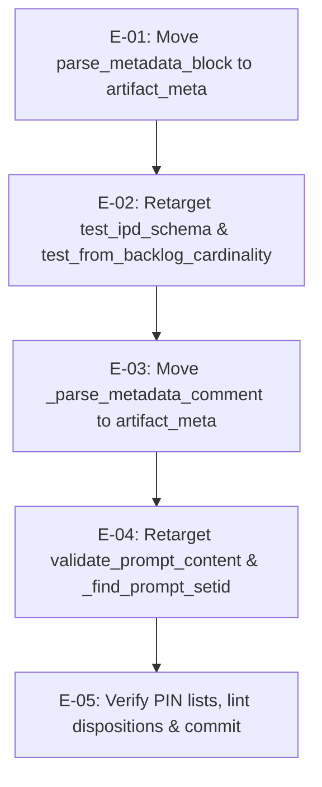

# IPD: Move parse_metadata_block and _parse_metadata_comment into artifact_meta

- Date: 2026-11-09
- Kind: child
- Concern: Spec `4sd62s` C5 allows exactly one metadata reader (`artifact_meta`), and `artifact_meta`'s legacy loader still borrows seven grammars from other modules. Part 8 of the round-3 split of `k6jd6l` (Order 43, research `nj8zdp` guidance): this part moves the two block parsers, `ipd_schema.parse_metadata_block` and `prompts_index._parse_metadata_comment`. Measured callers at `f83159217`: `ipd_lint.parse` (1); `prompts_index.scan_prompts` and `prompts_index.check_drift` (2); `check_engine.validate_prompt_content` (1); `cli._find_prompt_setid` (1); tests `tests/test_ipd_schema.py` (4) and `tests/test_from_backlog_cardinality.py` (1).
- Scope: The `parse_metadata_block` and `_parse_metadata_comment` part of `k6jd6l` E-10. Keep `ipd_schema.parse_item_dependencies` (it parses a VALUE, not a block) and the E/V checklist and section grammar of `ipd_schema` (N3). EXCLUDES `ipd_schema._META_LINE_RE` and `_READINESS_LINE_RE`, which Order 246 (`nx7fws`) deletes after `k6jd6l`: `artifact_meta` gets its own private line grammar and `ipd_schema._META_LINE_RE` stays for `ipd_lint.parse`'s other use until Order 246.
- Scope-Paths: agent_workflows/artifact_meta.py, agent_workflows/ipd_schema.py, agent_workflows/ipd_lint.py, agent_workflows/prompts_index.py, agent_workflows/check_engine.py, agent_workflows/cli.py, tests/test_ipd_schema.py, tests/test_from_backlog_cardinality.py, .aw/records/plans/pending/20261109-metastore-287-ad86ym-move-parse-metadata-block-and-parse-metadata-comment-into-ar.ipd.md
- Scope-Exceeded: .aw/records/backlog/open/20261124-imstpg-01-imstpg-stale-comment-in-ipd-authoring-py-near-line-940-na.backlog.md (Defect-report carrier required by the driver contract each finding filed via aw backlog new: records the stale comment in ipd_authoring.py that names the moved ipd_schema.parse_metadata_block ipd_auth...)
- Item-Dependencies: executed:1ajqaa, executed:59aiyh, executed:8fxic1, executed:dcerjg, executed:ffceq0, executed:g5hpbb, executed:t4gl15
- Status: executed
- Readiness: go-pending-approval
- Review-Depth: standard
- From-Spec: 4sd62s
- Work-Kind: feature
- Priority: high
- Blocks-Release: next
- Set: metastore
- Order: 287
- Highest E allocated: 05
- Author: opencode its_direct/pt3-claude-opus-5.5-1m-us
- Id: ad86ym

> Written to .aw/system/workflows/technical-writing/technical-writing.md. Every obligation, exact identifier, quotation, evidence record, and lifecycle status is preserved.

## Workflow history
- 2026-11-24 executed (aw oc run model=uri/its_direct/pt3-claude-opus-5.5-1m-us variant=high profile=opus): aw oc run self-finalize: ad86ym verified (set metastore, attempt 2). [Scope reconciliation - out-of-scope .aw/records/backlog/open/20261124-imstpg-01-imstpg-stale-comment-in-ipd-authoring-py-near-line-940-na.backlog.md: Defect-report carrier required by the driver contract (each finding filed via aw backlog new): records the stale comment in ipd_authoring.py that names the moved ipd_schema.parse_metadata_block; ipd_authoring.py is outside this plan's Scope-Paths so the fix is deferred to that item; in-scope-unmodified agent_workflows/check_engine.py: declared-but-unmodified (auto-acknowledged by aw oc run); in-scope-unmodified agent_workflows/cli.py: declared-but-unmodified (auto-acknowledged by aw oc run)]
- 2026-11-16 approved (aw set): status set to approved

- 2026-11-14 reviewed (antigravity/gemini-3.8-flash): /plan-review (antigravity/gemini-3.8-flash): APPROVE WITH REVISIONS APPLIED; PR-001..PR-007; review record .aw/records/reviews/20261109-metastore-287-ad86ym-move-parse-metadata-block-and-parse-metadata-comment-into-ar.review.md
- 2026-11-09 to-review (opencode its_direct/pt3-claude-opus-5.5-1m-us): split from k6jd6l (round 3, research nj8zdp guidance).

## Goal

`rg -n "def (parse_metadata_block|_parse_metadata_comment)\b" agent_workflows` lists only `artifact_meta.py`, and `aw ipd lint --all` gives the same dispositions as before.

## Detailed Implementation Checklist (TODO)

Execution-state rule: mark an `E-*` item complete only after performing the action. That mark is not validation. Right-sizing rule: write for a modest executor that cannot hold much in its head. Each E-item is one step (one concern, about one file, executable in one focused pass) and its V-item names each unit it covers with its own check; a plan stays at about 5 E-items and 8 work Scope-Paths, else split it into more child plans (guidance, `IPD-Z603`). Accepted execution states: blocked, failed, pending, performed; terminal gate demands 'performed'.

Carried from `k6jd6l` E-10: "Move into `artifact_meta` (private, unchanged behavior) every grammar its legacy loader or legacy writer still borrows, and delete the originals: `ipd_schema.parse_metadata_block` (...), `prompts_index._parse_metadata_comment` ... Non-loader callers (`ipd_lint.parse`, ...) read through `artifact_meta.read`, `history`, `read_text` or `read_at`." A non-loader caller that needs the parser's error list (duplicate and unknown fields) may call a public `artifact_meta` wrapper, as E-10 allows for the migration. Ensure `.aw/state/9o83cr/` and `.aw/state/k6jd6l/` exist (`mkdir -p .aw/state/9o83cr/ .aw/state/k6jd6l/`). Save the before-list of `tests/test_ipd_schema.py`, `tests/test_from_backlog_cardinality.py`, `tests/test_ipd_lint.py` and `tests/test_prompts_index.py` to `.aw/state/9o83cr/E-10a-before.txt`, and `aw ipd lint --all` dispositions to `.aw/state/k6jd6l/lint-all-before.txt`.

PIN RULE (carried from `9o83cr`): before an edit that deletes or retargets, save the named test modules' per-test outcome list (`python3 -m pytest -o addopts="" -m "" -p no:randomly -n 0 -rA <modules> | grep -E "^(PASSED|FAILED|ERROR|SKIPPED|XFAIL|XPASS) " | sed -E 's/ - .*//' | sort > <before-file>`); after it, run the same command into the matching after-file. A retargeted test keeps every input case, so the after-list may rename a test but not drop a case; the evidence pastes both lists and maps each removed name to its successor.

### Task group 1: one parser per pair of items, then verify

- [x] E-01 Before the first edit, ensure `.aw/state/9o83cr/` and `.aw/state/k6jd6l/` exist (`mkdir -p .aw/state/9o83cr/ .aw/state/k6jd6l/`) and capture baseline test PIN list to `.aw/state/9o83cr/E-10a-before.txt` and lint baseline to `.aw/state/k6jd6l/lint-all-before.txt`. Move `ipd_schema.parse_metadata_block` into `artifact_meta` (private, with a public wrapper only if `ipd_lint.parse` needs the error list) and change `ipd_lint.parse` to call it; delete the original.
  - Depends on: none
  - Expected outcome: `ipd_schema` no longer defines `parse_metadata_block`; `ipd_lint.parse` calls `artifact_meta`.
  - Execution state: performed

- [x] E-02 Retarget `tests/test_ipd_schema.py` (4 references) and `tests/test_from_backlog_cardinality.py` (1 reference) to the `artifact_meta` parser or to `artifact_meta.read_text`, keeping every case.
  - Depends on: E-01
  - Expected outcome: neither module references `ipd_schema.parse_metadata_block`.
  - Execution state: performed

- [x] E-03 Move `prompts_index._parse_metadata_comment` into `artifact_meta` (private); `prompts_index.scan_prompts` and `prompts_index.check_drift` read through `artifact_meta.read_text(text, record_type="prompts")`; delete the original.
  - Depends on: E-02
  - Expected outcome: `prompts_index` no longer defines or calls `_parse_metadata_comment`.
  - Execution state: performed

- [x] E-04 Change `check_engine.validate_prompt_content` and `cli._find_prompt_setid` to read the prompt comment through `artifact_meta.read_text`.
  - Depends on: E-03
  - Expected outcome: no module outside `artifact_meta` references `_parse_metadata_comment`.
  - Execution state: performed

- [x] E-05 Run `tests/test_ipd_lint.py`, `tests/test_prompts_index.py`, `tests/test_ipd_schema.py` and `tests/test_from_backlog_cardinality.py` into the after-list, run `aw ipd lint --all` and compare with `.aw/state/k6jd6l/lint-all-before.txt`; commit through `aw commit ad86ym -- <paths>`.
  - Depends on: E-04
  - Expected outcome: the after-list drops no case; lint dispositions are unchanged.
  - Execution state: performed

## Project conventions discovered (Step 0)

- Order 246 (`nx7fws`) runs after `k6jd6l` and deletes `ipd_schema._META_LINE_RE` and `ipd_lint`'s own history literals; this plan does not touch those.
- The `artifact_meta` interface (names from `tve77h`, `ffceq0`, `xexn45`): `read(id6) -> State`, `history(id6)`, `read_at(id6, rev)`, `read_text(text, *, record_type=None) -> State`, `append(id6, events, *, expect_seq)` with `dry_run`, the phase-B legacy writer (`append_legacy`, `render_legacy`), and the legacy loader (`load_legacy_artifact`).
- Cite code by SYMBOL (`module.function`) or by a quoted content string, with a line number only appended to one of those and never alone (advisory `IPD-C801`).

## Findings

Measured 2026-11-09 at `f83159217` with `rg -n "\b(parse_metadata_block|_parse_metadata_comment)\b" agent_workflows tests`: see the Concern.

## Proposed changes (ordered, validatable)



1. Move `parse_metadata_block` (E-01).
2. Retarget its tests (E-02).
3. Move `_parse_metadata_comment` (E-03).
4. Retarget its other callers (E-04).
5. Verify and commit (E-05).

## Deferred / out of scope (with reason)

- `ipd_schema._META_LINE_RE` and `_READINESS_LINE_RE`.
  - Carrier: nx7fws
- The other five borrowed grammars.
  - Carrier: sq6v7i

## Scope check

- Over-scope: none.
- Under-scope: none known. Size: 5 E-items, 8 work Scope-Paths.

## Required tests / validation

`tests/test_ipd_lint.py`, `tests/test_prompts_index.py`, `tests/test_ipd_schema.py`, `tests/test_from_backlog_cardinality.py` (PIN lists) and `aw ipd lint --all`.

## Spec / documentation sync

No spec change; implements part of `4sd62s` 4.3 and section 7 step 7. CONTRIBUTES to AC-1 (owned by `9o83cr`).

## Open questions

### OQ-01: Does moving `parse_metadata_block` change lint diagnostics?

- Blocking: no
- Status: resolved
- Owner: plan author
- Resolution or deferral rationale: It must not: the move is behavior-preserving, and E-05 compares every plan's disposition. Recommendation strength: strong.

## Validation and cross-check (verify before reporting done)

Validation-state rule: inspect evidence in a separate pass. Do not mark a `V-*` item complete from memory or from the matching execution checkmark. Accepted validation results: blocked, failed, pass, pending; terminal gate demands 'pass'. Runtime-demonstration reachability rule: for each `V-*` item demanding the software be observed acting (such as a run, a dispatch, or a transition), as distinct from items demanding a diff, a file's content, or a test result, which are reachable by construction, name the code path that produces the observation or the sibling `E-*` that creates it, else the demand is UNDER-SCOPE.

- [x] V-01 validates E-01
  - Required evidence: paste `rg -n "def parse_metadata_block" agent_workflows` listing only `artifact_meta.py`, `rg -n "parse_metadata_block" agent_workflows` listing `artifact_meta.py`, `ipd_lint.parse`, and the comment in `ipd_authoring.py`, and `rg -n "def parse_item_dependencies" agent_workflows/ipd_schema.py` still one hit.
  - Observed evidence:
    ```text
    $ rg -n "def parse_metadata_block" agent_workflows
    agent_workflows/artifact_meta.py:2632:def parse_metadata_block(
    $ rg -n "parse_metadata_block" agent_workflows
    agent_workflows/ipd_authoring.py:940:        # form every reader (`plans_index._meta`, `ipd_schema.parse_metadata_block`) parses.
    agent_workflows/ipd_lint.py:505:    """Single Phase-B call site for ``artifact_meta.parse_metadata_block``.
    agent_workflows/ipd_lint.py:513:    return _meta.parse_metadata_block(meta_slice)
    agent_workflows/artifact_meta.py:2595:#: The IPD metadata-block LINE grammar, owned here (moved with `parse_metadata_block` by ad86ym).
    agent_workflows/artifact_meta.py:2601:def _parse_metadata_block(
    agent_workflows/artifact_meta.py:2632:def parse_metadata_block(
    agent_workflows/artifact_meta.py:2640:    return _parse_metadata_block(lines)
    $ rg -n "def parse_item_dependencies" agent_workflows/ipd_schema.py
    975:def parse_item_dependencies(
    ```
    `artifact_meta._parse_metadata_block` is the private parser with its own `_IPD_META_LINE_RE`; `artifact_meta.parse_metadata_block` is the public wrapper `ipd_lint._parse_metadata_slice` (called by `ipd_lint.parse`) needs for the IPD-M102/M103 error list. `ipd_schema._META_LINE_RE` and `MetaError` stay (Order 246 `nx7fws`).
  - Result: pass

- [x] V-02 validates E-02
  - Required evidence: paste `rg -n "parse_metadata_block" tests/test_ipd_schema.py tests/test_from_backlog_cardinality.py` showing only `artifact_meta` uses, and both modules' before/after per-test lines.
  - Observed evidence:
    ```text
    $ rg -n "parse_metadata_block" tests/test_ipd_schema.py tests/test_from_backlog_cardinality.py
    tests/test_ipd_schema.py:241:    spellings are parsed verbatim out of plan text by `artifact_meta.parse_metadata_block`'s `_IPD_META_LINE_RE`, so
    tests/test_ipd_schema.py:932:    """`artifact_meta.parse_metadata_block`: the LINE-level parse, which is a different subject from validation.
    tests/test_ipd_schema.py:1014:            fields, errors = AM.parse_metadata_block(lines)
    tests/test_ipd_schema.py:1034:            f"artifact_meta.parse_metadata_block mishandled {len(wrong)} of {len(self.BLOCKS)} raw metadata "
    tests/test_from_backlog_cardinality.py:259:        # Verify artifact_meta.parse_metadata_block on metadata lines
    tests/test_from_backlog_cardinality.py:265:        fields, errors = artifact_meta.parse_metadata_block(meta_lines)
    ```
    Per-module counts from `.aw/state/9o83cr/E-10a-{before,after}.txt`: `test_ipd_schema` before=26 after=26 (0 non-PASSED after); `test_from_backlog_cardinality` before=7 after=7 (0 non-PASSED). Key lines, identical before and after:
    ```text
    PASSED tests/test_ipd_schema.py::MetadataBlockParseTests::test_each_metadata_block_parses_to_its_exact_fields_and_errors
    PASSED tests/test_from_backlog_cardinality.py::TestFromBacklogCardinality::test_writer_idempotency_and_metadata_parse
    ```
    No test renamed and no case removed (the `BLOCKS` table is unchanged).
  - Result: pass

- [x] V-03 validates E-03
  - Required evidence: paste `rg -n "_parse_metadata_comment" agent_workflows/prompts_index.py` printing nothing and the before/after per-test lines of `tests/test_prompts_index.py`.
  - Observed evidence:
    ```text
    $ rg -n "_parse_metadata_comment" agent_workflows/prompts_index.py; echo "rc=$?"
    rc=1
    ```
    Per-test lines of `tests/test_prompts_index.py`: before=15 after=15, identical (all PASSED), e.g. `PASSED tests/test_prompts_index.py::PromptsIndexTests::test_check_drift_name_metadata_mismatch` and `PASSED tests/test_prompts_index.py::PromptsIndexTests::test_scan_and_build_index_json`. At execution time `prompts_index.scan_prompts`/`check_drift` already read through `artifact_meta` (`_am.query`/`_am.read_text(..., record_type="prompt")`, migrated by `cb5eda`), so the deleted `prompts_index._parse_metadata_comment` had no callers; the comment grammar now lives once as `artifact_meta._parse_metadata_comment`, replacing two identical inline copies in `artifact_meta.load_legacy_artifact` and `artifact_meta.read_text`.
  - Result: pass

- [x] V-04 validates E-04
  - Required evidence: paste `rg -n "_parse_metadata_comment" agent_workflows` listing only `artifact_meta.py`.
  - Observed evidence:
    ```text
    $ rg -n "_parse_metadata_comment" agent_workflows
    agent_workflows/artifact_meta.py:2643:def _parse_metadata_comment(first_line: str) -> Dict[str, str]:
    agent_workflows/artifact_meta.py:3116:        comment_bullets: Dict[str, str] = _parse_metadata_comment(first_line)
    agent_workflows/artifact_meta.py:4789:        comment_bullets = _parse_metadata_comment(first_line)
    ```
    `check_engine.validate_prompt_content` (`_meta_state_for_path` / `_meta.load_legacy_artifact` / `_meta.read_text(text, record_type="prompt")`) and `cli._find_prompt_setid` (`_meta.read_text(text, record_type="prompt")`) already read through `artifact_meta` before this plan ran, so neither file needed an edit (declared Scope-Paths left unmodified).
  - Result: pass

- [x] V-05 validates E-05
  - Required evidence: paste `diff .aw/state/9o83cr/E-10a-before.txt .aw/state/9o83cr/E-10a-after.txt` (no FAILED or ERROR line, each rename mapped), the `diff` of the two `aw ipd lint --all` disposition files (empty), and `git show --stat` of the `aw commit ad86ym` commit.
  - Observed evidence:
    ```text
    $ diff .aw/state/9o83cr/E-10a-before.txt .aw/state/9o83cr/E-10a-after.txt; echo diff-exit=$?
    diff-exit=0
    $ grep -cE "^(FAILED|ERROR)" .aw/state/9o83cr/E-10a-after.txt
    0
    (run tail: ======================= 125 passed in 147.84s (0:02:27) ========================)
    $ diff .aw/state/k6jd6l/lint-all-before.txt .aw/state/k6jd6l/lint-all-after.txt; echo diff-exit=$?
    diff-exit=0
    (both files end: counts: conforming=104, quarantined=0, legacy/not evaluated=1881, error=0)
    $ git show --stat 98f43d3cc
    commit 98f43d3cc4884dcada2b4fdda16376166cf434e7
        ad86ym: move parse_metadata_block and the prompt-comment parser into artifact_meta
     agent_workflows/artifact_meta.py       | 146 ++++++++++++++++++++-------------
     agent_workflows/ipd_lint.py            |  10 ++-
     agent_workflows/ipd_schema.py          |  31 -------
     agent_workflows/prompts_index.py       |  22 -----
     tests/test_from_backlog_cardinality.py |   5 +-
     tests/test_ipd_schema.py               |  11 +--
     6 files changed, 103 insertions(+), 122 deletions(-)
    ```
    No rename to map (lists identical). Core tier `aw suite`: `2898 passed, 1 skipped, 11 warnings in 196.31s`.
    Re-measured 2026-11-24 in attempt 2 (lane `aw/lane/ad86ym_attempt2`, attempt-1 commits carried forward by cherry-pick onto base `32fba8f53`). The before-list and the before lint file were regenerated from a `git archive 32fba8f53` export (the attempt-1 `.aw/state` files are gitignored and stayed in the attempt-1 lane): before=125 lines, after=125 lines, both diffs empty as pasted above. `aw suite`: `2898 passed, 1 skipped, 11 warnings in 173.46s (0:02:53)`.
  - Result: pass

## Approval and execution gate

- Size assessment: standard
- Cohesion rationale: not required

Execute only after human approval (`Status: approved`) and after every plan in `- Item-Dependencies:` is executed. Pin-first where an item deletes or retargets. Stop safely if prerequisite metastore symbols from `59aiyh`, `ffceq0`, `t4gl15`, or `8fxic1` are absent.

Safety rule: uncommitted changes and untracked files you did not create are not yours; never revert, stage, commit, discard, reformat, or "clean up" another party's work.

Scope fence: the paths in `- Scope-Paths:` are a declaration; a needed file outside the fence is edited and then justified at finalize (`--scope-reason`), and a declared path left unmodified is acknowledged (`--scope-ack`).

Honesty rule: paste the ACTUAL output; never claim a result you did not run.

Commits: only through `aw commit ad86ym -- <paths>` with only Scope-Paths files; never `git add -A`, a bare `git add` or `git commit -a`; never push.

Lifecycle transition: the plan moves to `.aw/records/plans/executed/` only through `aw ipd finalize ad86ym` (never a hand git mv), after `aw ipd lint --phase pre-transition` conforms and every `V-*` reads `pass` with pasted evidence. When aw oc run or aw agy run executes the plan, the runner performs the finalize; a hand executor runs aw ipd finalize ad86ym itself.
