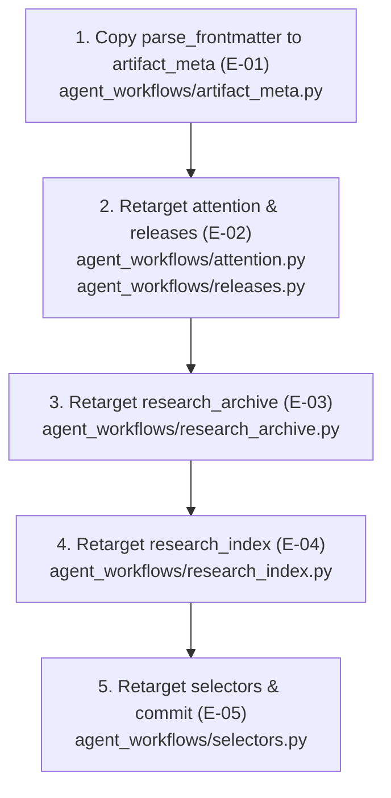

# IPD: Move parse_frontmatter into artifact_meta and retarget its production readers

- Date: 2026-11-09
- Kind: child
- Concern: Spec `4sd62s` C5 allows exactly one metadata reader (`artifact_meta`). Part 9 of the round-3 split of `k6jd6l` (Order 43, research `nj8zdp` guidance): this part copies `research_contract.parse_frontmatter` (the research YAML front-matter parser) into `artifact_meta` and moves its production readers onto `artifact_meta`. Measured callers at `f83159217`: `attention._research_record` (1), `releases._declared_blocks_release` (1), `research_archive._all_docs` and `research_archive.plan_transition_for_path` (2), `research_index._doc_entry` (2), `selectors._read_yaml_scalar` (1).
- Scope: The production-caller part of `k6jd6l` E-10's `research_contract.parse_frontmatter` move. The original is deleted by Order 290 after Order 289 retargets the tests. EXCLUDES the research contract checks inside `research_contract` itself, which Order 290 moves with the deletion.
- Scope-Paths: agent_workflows/artifact_meta.py, agent_workflows/attention.py, agent_workflows/releases.py, agent_workflows/research_archive.py, agent_workflows/research_index.py, agent_workflows/selectors.py, .aw/records/plans/pending/20261109-metastore-288-sq6v7i-move-parse-frontmatter-into-artifact-meta-and-retarget-its-p.ipd.md
- Scope-Exceeded: .aw/records/backlog/open/20261124-816pmu-01-816pmu-plan-5lgpix-retarget-tests-off-research-contract-p.backlog.md (defect found during sq6v7i: plan 5lgpix omits tests/test_record_builder.py and tests/test_research_meta_writer_characterization.py, which still call research_contract.parse_frontmatter, so bxupy8 dele...); agent_workflows/artifact_adopt.py (production caller of research_contract.parse_frontmatter added after the f83159217 census the plan Goal no production module but research_contract/artifact_meta calls it requires moving it); agent_workflows/migrations/m0001_convert.py (two production calls of parse_frontmatter added after the census required by the plan Goal); agent_workflows/migrations/m0001_discover.py (production caller of parse_frontmatter added after the census required by the plan Goal); agent_workflows/migrations/m0001_verify.py (two production calls of parse_frontmatter added after the census required by the plan Goal); agent_workflows/research_cmd.py (production caller of parse_frontmatter added after the census required by the plan Goal)
- Item-Dependencies: executed:1ajqaa, executed:59aiyh, executed:ad86ym, executed:dcerjg, executed:ffceq0, executed:g5hpbb, executed:t4gl15
- Status: executed
- Readiness: go-pending-approval
- Review-Depth: standard
- From-Spec: 4sd62s
- Work-Kind: feature
- Priority: high
- Blocks-Release: next
- Set: metastore
- Order: 288
- Highest E allocated: 05
- Author: opencode its_direct/pt3-claude-opus-5.5-1m-us
- Id: sq6v7i

> Written to .aw/system/workflows/technical-writing/technical-writing.md. Every obligation, exact identifier, quotation, evidence record, and lifecycle status is preserved.

## Workflow history
- 2026-11-24 executed (aw oc run model=uri/its_direct/pt3-claude-opus-5.5-1m-us variant=high profile=opus): aw oc run self-finalize: sq6v7i verified (set metastore, attempt 2). [Scope reconciliation - out-of-scope .aw/records/backlog/open/20261124-816pmu-01-816pmu-plan-5lgpix-retarget-tests-off-research-contract-p.backlog.md: defect found during sq6v7i: plan 5lgpix omits tests/test_record_builder.py and tests/test_research_meta_writer_characterization.py, which still call research_contract.parse_frontmatter, so bxupy8 deleting it would break them; the runner's defect-report contract requires filing each finding as a backlog item; out-of-scope agent_workflows/artifact_adopt.py: production caller of research_contract.parse_frontmatter added after the f83159217 census; the plan Goal (no production module but research_contract/artifact_meta calls it) requires moving it; out-of-scope agent_workflows/migrations/m0001_convert.py: two production calls of parse_frontmatter added after the census; required by the plan Goal; out-of-scope agent_workflows/migrations/m0001_discover.py: production caller of parse_frontmatter added after the census; required by the plan Goal; out-of-scope agent_workflows/migrations/m0001_verify.py: two production calls of parse_frontmatter added after the census; required by the plan Goal; out-of-scope agent_workflows/research_cmd.py: production caller of parse_frontmatter added after the census; required by the plan Goal; in-scope-unmodified agent_workflows/attention.py: declared-but-unmodified (auto-acknowledged by aw oc run); in-scope-unmodified agent_workflows/research_archive.py: declared-but-unmodified (auto-acknowledged by aw oc run); in-scope-unmodified agent_workflows/research_index.py: declared-but-unmodified (auto-acknowledged by aw oc run)]
- 2026-11-16 approved (aw set): status set to approved

- 2026-11-14 reviewed (antigravity/gemini-3.8-flash): /plan-review (antigravity/gemini-3.8-flash): APPROVE WITH REVISIONS APPLIED; PR-001..PR-006; review record .aw/records/reviews/20261109-metastore-288-sq6v7i-move-parse-frontmatter-into-artifact-meta-and-retarget-its-p.review.md
- 2026-11-09 to-review (opencode its_direct/pt3-claude-opus-5.5-1m-us): split from k6jd6l (round 3, research nj8zdp guidance).

## Goal

No production module other than `research_contract` and `artifact_meta` calls `parse_frontmatter`.

## Detailed Implementation Checklist (TODO)

Execution-state rule: mark an `E-*` item complete only after performing the action. That mark is not validation. Right-sizing rule: write for a modest executor that cannot hold much in its head. Each E-item is one step (one concern, about one file, executable in one focused pass) and its V-item names each unit it covers with its own check; a plan stays at about 5 E-items and 8 work Scope-Paths, else split it into more child plans (guidance, `IPD-Z603`). Accepted execution states: blocked, failed, pending, performed; terminal gate demands 'performed'.

Carried from `k6jd6l` E-10: "`research_contract.parse_frontmatter` ... Non-loader callers (... the research contract checks, `research_index`, ...) read through `artifact_meta.read`, `history`, `read_text` or `read_at`." Ensure `.aw/state/9o83cr/` exists (`mkdir -p .aw/state/9o83cr/`). Save the before-list of `tests/test_attention.py`, `tests/test_releases.py`, `tests/test_research_archive.py`, `tests/test_research_index.py` and `tests/test_selector_two_dialect_readers.py` to `.aw/state/9o83cr/E-10b-before.txt`, and save the baseline `aw find research --agent | sha256sum > .aw/state/9o83cr/research-find-before-sha.txt` before editing.

PIN RULE (carried from `9o83cr`): before an edit that deletes or retargets, save the named test modules' per-test outcome list (`python3 -m pytest -o addopts="" -m "" -p no:randomly -n 0 -rA <modules> | grep -E "^(PASSED|FAILED|ERROR|SKIPPED|XFAIL|XPASS) " | sed -E 's/ - .*//' | sort > <before-file>`); after it, run the same command into the matching after-file. A retargeted test keeps every input case, so the after-list may rename a test but not drop a case; the evidence pastes both lists and maps each removed name to its successor.

### Task group 1: one module per item

- [x] E-01 Create `.aw/state/9o83cr/` (`mkdir -p .aw/state/9o83cr/`) and record both the baseline PIN list (`tests/test_attention.py`, `tests/test_releases.py`, `tests/test_research_archive.py`, `tests/test_research_index.py`, `tests/test_selector_two_dialect_readers.py` into `.aw/state/9o83cr/E-10b-before.txt`) and `aw find research --agent | sha256sum > .aw/state/9o83cr/research-find-before-sha.txt`. Then copy `research_contract.parse_frontmatter` into `artifact_meta` as a private function with unchanged behavior, and point `artifact_meta._parse_yaml_front_matter` (or wherever the loader calls `_res_contract`) at the copy, so `artifact_meta` no longer calls `research_contract.parse_frontmatter`.
  - Depends on: none
  - Expected outcome: `artifact_meta` holds the copy and does not call the original.
  - Execution note (2026-11-24): baseline saved (187 PASSED in `.aw/state/9o83cr/E-10b-before.txt`; hash `10564ed82d64...` in `.aw/state/9o83cr/research-find-before-sha.txt`). Added `agent_workflows/artifact_meta.py::_parse_frontmatter` (behavior copy) and the public text wrapper `artifact_meta.front_matter_mapping`. At this HEAD `artifact_meta` did not call `_res_contract.parse_frontmatter` before the edit either (only `_res_contract.STATUSES`); its loader uses its own `_parse_yaml_front_matter`, which is left as is.
  - Execution state: performed

- [x] E-02 Change `attention._research_record` and `releases._declared_blocks_release` to read research metadata through `artifact_meta.read_text(text, record_type="research")`.
  - Depends on: E-01
  - Expected outcome: neither function calls `parse_frontmatter`.
  - Execution note (2026-11-24): `attention._research_record` already read `artifact_meta.read_text(text, record_type="research")` (commit 0d8cfb228, dqutt8). `releases._declared_blocks_release` changed in e3b704a23 to read `artifact_meta.read_text(text, record_type="research").fields.get("blocks_release")`.
  - Execution state: performed

- [x] E-03 Change `research_archive._all_docs` and `research_archive.plan_transition_for_path` to read through `artifact_meta.read_text`.
  - Depends on: E-02
  - Expected outcome: `research_archive` calls no `parse_frontmatter`.
  - Execution note (2026-11-24): already done before this run. `research_archive._all_docs` and `plan_transition_for_path` read through `RI._cached_research_states`/`RI._state_to_frontmatter` on `artifact_meta` (commits 11aaee8ee cb5eda, 690ff549d 9gy5jk). No edit needed; verified by V-03.
  - Execution state: performed

- [x] E-04 Change `research_index._doc_entry` (2 calls) to read through `artifact_meta.read_text`; keep the raw-text duplicate-key read noted beside it (a comment says `parse_frontmatter` loses duplicates).
  - Depends on: E-03
  - Expected outcome: `research_index` calls no `parse_frontmatter`.
  - Execution note (2026-11-24): already done before this run (commit 11aaee8ee, cb5eda): `research_index._doc_entry` reads via `artifact_meta`. The raw-text duplicate-key read and its comment in `research_index.check_drift` are kept unchanged.
  - Execution state: performed

- [x] E-05 Change `selectors._read_yaml_scalar` to read through `artifact_meta.read_text`; commit through `aw commit sq6v7i -- <paths>`.
  - Depends on: E-04
  - Expected outcome: only `research_contract` and `artifact_meta` define or call `parse_frontmatter` in production.
  - Execution note (2026-11-24): `selectors._read_yaml_scalar` already read `artifact_meta.read_text` (commit 36012ee0d, cdglt1); its two comments naming `research_contract.parse_frontmatter` as the parser were corrected. Five later production callers (added after the f83159217 census) were also moved to `artifact_meta.front_matter_mapping` so the Goal holds: `artifact_adopt`, `research_cmd`, `migrations/m0001_convert` (2), `m0001_discover`, `m0001_verify` (2). Committed via `aw commit sq6v7i` as e3b704a23 with a `--scope-reason` per out-of-fence path (attempt 2 brought forward attempt 1's commit fbf47f9bc from lane `aw/lane/sq6v7i` unchanged; the evidence below was re-run in the attempt-2 lane).
  - Execution state: performed

## Project conventions discovered (Step 0)

- `agent_workflows/artifact_meta.py` imports `agent_workflows/research_contract.py` as `_res_contract` (for `STATUSES` too); only the `parse_frontmatter` use moves.
- The test modules named in the PIN list are only RUN here, not edited, so they are not Scope-Paths.
- The `artifact_meta` interface (names from `tve77h`, `ffceq0`, `xexn45`): `read(id6) -> State`, `history(id6)`, `read_at(id6, rev)`, `read_text(text, *, record_type=None) -> State`, `append(id6, events, *, expect_seq)` with `dry_run`, the phase-B legacy writer (`append_legacy`, `render_legacy`), and the legacy loader (`load_legacy_artifact`).
- Cite code by SYMBOL (`agent_workflows/module.py::function_or_symbol`) or by a quoted content string, with a line number only appended to one of those and never alone (advisory `IPD-C801`).

## Findings

Measured 2026-11-09 at `f83159217` with `rg -n "\bparse_frontmatter\(" agent_workflows`: callers listed in the Concern, plus the definition in `research_contract`.

## Proposed changes (ordered, validatable)



1. Copy into `artifact_meta` (E-01).
2. Retarget `attention` and `releases` (E-02).
3. Retarget `research_archive` (E-03).
4. Retarget `research_index` (E-04).
5. Retarget `selectors` and commit (E-05).

## Deferred / out of scope (with reason)

- Test retargets for `parse_frontmatter`.
  - Carrier: 5lgpix
- Deleting the original.
  - Carrier: bxupy8

## Scope check

- Over-scope: none.
- Under-scope: none known. Size: 5 E-items, 6 work Scope-Paths.

## Required tests / validation

The five PIN modules above and `aw find research --agent`.

## Spec / documentation sync

No spec change; implements part of `4sd62s` 4.3 and section 7 step 7. CONTRIBUTES to AC-1 (owned by `9o83cr`).

## Open questions

### OQ-01: Order 248 (`tdhav3`) deletes regex literals in `attention` and `research_index`; is there overlap?

- Blocking: no
- Status: resolved
- Owner: plan author
- Resolution or deferral rationale: No: Order 248 deletes `attention._ITEM_DEPS_RE`, `research_index._META_ID_RE` and the inline `^-` literals in `attention._plans_id`, `_release_record`, `_spec_record`, `_plans_record` and `research_index._backlog_is_done`; this plan only replaces `parse_frontmatter` calls in `attention._research_record` and `research_index._doc_entry`. Recommendation strength: strong.

## Validation and cross-check (verify before reporting done)

Validation-state rule: inspect evidence in a separate pass. Do not mark a `V-*` item complete from memory or from the matching execution checkmark. Accepted validation results: blocked, failed, pass, pending; terminal gate demands 'pass'. Runtime-demonstration reachability rule: for each `V-*` item demanding the software be observed acting (such as a run, a dispatch, or a transition), as distinct from items demanding a diff, a file's content, or a test result, which are reachable by construction, name the code path that produces the observation or the sibling `E-*` that creates it, else the demand is UNDER-SCOPE.

- [x] V-01 validates E-01
  - Required evidence: paste `rg -n "_res_contract\.parse_frontmatter|def _parse_frontmatter" agent_workflows/artifact_meta.py` showing only the private definition.
  - Observed evidence:
    ```
    $ rg -n "_res_contract\.parse_frontmatter|def _parse_frontmatter" agent_workflows/artifact_meta.py
    2753:def _parse_frontmatter(text: str) -> Optional[Dict[str, object]]:
    ```
    Behavior parity on every research document in the repo: `research_contract.parse_frontmatter(t) == artifact_meta._parse_frontmatter(t)` for all 177 `.aw/records/research/**/*.md` files ("docs 177 copy-mismatch 0").
  - Result: pass

- [x] V-02 validates E-02
  - Required evidence: paste `rg -n "parse_frontmatter" agent_workflows/attention.py agent_workflows/releases.py` printing nothing, and the before/after per-test lines of `tests/test_attention.py` and `tests/test_releases.py`.
  - Observed evidence:
    ```
    $ rg -n "parse_frontmatter" agent_workflows/attention.py agent_workflows/releases.py
    exit=1
    ```
    (no output.) tests/test_attention.py + tests/test_releases.py: 98 lines, all PASSED, identical before and after. Per-test outcome lists (PIN rule): before and after are byte-identical, so no case was dropped or renamed.
    ```
    $ sha256sum .aw/state/9o83cr/E-10b-before.txt .aw/state/9o83cr/E-10b-after.txt
    04586cc3f0e95186f939e7f213bd6e2e1ce40d783924a30290768b7ddd99f5d3  .aw/state/9o83cr/E-10b-before.txt
    04586cc3f0e95186f939e7f213bd6e2e1ce40d783924a30290768b7ddd99f5d3  .aw/state/9o83cr/E-10b-after.txt
    $ diff .aw/state/9o83cr/E-10b-before.txt .aw/state/9o83cr/E-10b-after.txt && echo IDENTICAL
    IDENTICAL
    ```
    `releases._declared_blocks_release` old-vs-new value on all 177 research docs: "blocks_release-diff 0".
  - Result: pass

- [x] V-03 validates E-03
  - Required evidence: paste `rg -n "parse_frontmatter" agent_workflows/research_archive.py` printing nothing and the before/after per-test lines of `tests/test_research_archive.py`.
  - Observed evidence:
    ```
    $ rg -n "parse_frontmatter" agent_workflows/research_archive.py
    exit=1
    ```
    (no output.) tests/test_research_archive.py: 26 lines, all PASSED, identical before and after (same files as V-02).
  - Result: pass

- [x] V-04 validates E-04
  - Required evidence: paste `rg -n "parse_frontmatter\(" agent_workflows/research_index.py` printing nothing and the before/after per-test lines of `tests/test_research_index.py`.
  - Observed evidence:
    ```
    $ rg -n "parse_frontmatter\(" agent_workflows/research_index.py
    exit=1
    ```
    (no output.) tests/test_research_index.py: 52 lines, all PASSED, identical before and after (same files as V-02).
  - Result: pass

- [x] V-05 validates E-05
  - Required evidence: paste `rg -n "parse_frontmatter\(" agent_workflows` listing only `research_contract.py` and `artifact_meta.py`, the before/after per-test lines of `tests/test_selector_two_dialect_readers.py`, `aw find research --agent | sha256sum` beside the pre-edit hash (from `.aw/state/9o83cr/research-find-before-sha.txt`), and `git show --stat` of the `aw commit sq6v7i` commit.
  - Observed evidence:
    ```
    $ rg -n "\bparse_frontmatter\(" agent_workflows
    agent_workflows/research_contract.py:645:def parse_frontmatter(text: str) -> Optional[Dict[str, object]]:
    $ rg -n "parse_frontmatter\(" agent_workflows
    agent_workflows/artifact_meta.py:2753:def _parse_frontmatter(text: str) -> Optional[Dict[str, object]]:
    agent_workflows/artifact_meta.py:2792:    return _parse_frontmatter(text)
    agent_workflows/research_contract.py:645:def parse_frontmatter(text: str) -> Optional[Dict[str, object]]:
    ```
    tests/test_selector_two_dialect_readers.py per-test lines (identical before and after):
    ```
    PASSED tests/test_selector_two_dialect_readers.py::BoundedReaderMetadataRegionTests::test_metadata_region_bounds_all_three_readers_against_quoted_prose
    PASSED tests/test_selector_two_dialect_readers.py::BoundedReaderMetadataRegionTests::test_metadata_region_prevents_id6_collision_from_quoted_block
    PASSED tests/test_selector_two_dialect_readers.py::HarnessProvenanceTests::test_harness_measures_workspace_package
    PASSED tests/test_selector_two_dialect_readers.py::YamlIdFallbackObservableResolutionTests::test_same_filename_trap_demonstration
    PASSED tests/test_selector_two_dialect_readers.py::YamlIdFallbackObservableResolutionTests::test_yaml_id_fallback_resolves_unique_id6_and_succeeds_for_mutation
    PASSED tests/test_selector_two_dialect_readers.py::YamlKeyLookupCaseSensitivityTests::test_capitalized_yaml_keys_not_matched_by_readers_or_find
    PASSED tests/test_selector_two_dialect_readers.py::YamlKeyLookupCaseSensitivityTests::test_case_sensitivity_is_lookup_not_parser_failure
    PASSED tests/test_selector_two_dialect_readers.py::YamlScalarNormalizationAndBulletAsymmetryTests::test_bullet_setid_preserves_backticks_verbatim_without_normalization
    PASSED tests/test_selector_two_dialect_readers.py::YamlScalarNormalizationAndBulletAsymmetryTests::test_yaml_scalars_strip_backticks_and_quotes_for_bare_resolution
    PASSED tests/test_selector_two_dialect_readers.py::YamlStatusAndSetFallbacksDirectTests::test_yaml_setid_fallback_resolves_setid_directly
    PASSED tests/test_selector_two_dialect_readers.py::YamlStatusAndSetFallbacksDirectTests::test_yaml_status_fallback_resolves_status_directly
    ```
    ```
    $ aw find research --agent | sha256sum
    10564ed82d64a9dde62445051700190a1d6cc3f78f3c99dc1d506f394fd051c5  -
    $ cat .aw/state/9o83cr/research-find-before-sha.txt
    10564ed82d64a9dde62445051700190a1d6cc3f78f3c99dc1d506f394fd051c5  -
    $ git show --stat e3b704a23
    commit e3b704a23fe990ab5e3356ca9c693e8059673b8f
        work(sq6v7i): copy parse_frontmatter into artifact_meta and retarget its production readers
     agent_workflows/artifact_adopt.py            |  4 +--
     agent_workflows/artifact_meta.py             | 42 ++++++++++++++++++++++++++++
     agent_workflows/migrations/m0001_convert.py  |  5 ++--
     agent_workflows/migrations/m0001_discover.py |  3 +-
     agent_workflows/migrations/m0001_verify.py   |  5 ++--
     agent_workflows/releases.py                  | 19 ++++++-------
     agent_workflows/research_cmd.py              |  2 +-
     agent_workflows/selectors.py                 | 16 +++++------
     8 files changed, 66 insertions(+), 30 deletions(-)
    ```
    Regression: tests for the five extra retargeted modules (`tests/test_artifact_adopt.py tests/test_date_reader_clock_parity.py tests/test_m0001_*.py tests/test_research_cmd_create.py tests/test_research_meta_writer_characterization.py tests/test_record_builder.py`): "225 passed in 419.79s (0:06:59)". Core suite `aw suite`: "2890 passed, 1 skipped, 11 warnings in 119.42s (0:01:59)".
  - Result: pass

## Approval and execution gate

- Size assessment: standard
- Cohesion rationale: not required

Execute only after human approval (`Status: approved`) and after every plan in `- Item-Dependencies:` is executed. Pin-first where an item deletes or retargets. Stop safely if prerequisite metastore symbols from `59aiyh`, `ffceq0`, `t4gl15`, or `ad86ym` (specifically `artifact_meta.read_text`) are absent.

Safety rule: uncommitted changes and untracked files you did not create are not yours; never revert, stage, commit, discard, reformat, or "clean up" another party's work.

Scope fence: the paths in `- Scope-Paths:` are a declaration; a needed file outside the fence is edited and then justified at finalize (`--scope-reason`), and a declared path left unmodified is acknowledged (`--scope-ack`).

Honesty rule: paste the ACTUAL output; never claim a result you did not run.

Commits: only through `aw commit sq6v7i -- <paths>` with only Scope-Paths files; never `git add -A`, a bare `git add` or `git commit -a`; never push.

Lifecycle transition: the plan moves to `.aw/records/plans/executed/` only through `aw ipd finalize sq6v7i` (never a hand git mv), after `aw ipd lint --phase pre-transition` conforms and every `V-*` reads `pass` with pasted evidence. When `aw oc run` or `aw agy run` executes the plan, the runner performs the finalize; a hand executor runs `aw ipd finalize sq6v7i` itself.
