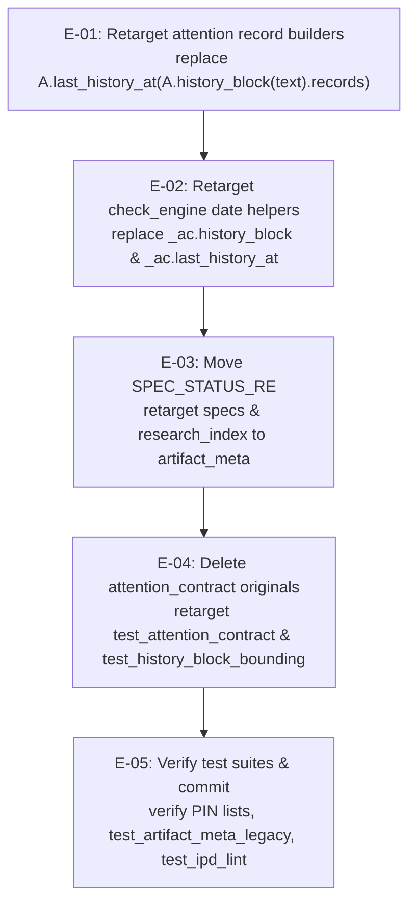

# IPD: Move the attention history readers and SPEC_STATUS_RE and delete the borrowed grammars

- Date: 2026-11-09
- Kind: child
- Concern: Spec `4sd62s` C5 allows exactly one metadata reader (`artifact_meta`). Part 13 of the round-3 split of `k6jd6l` (Order 43, research `nj8zdp` guidance): move the last readers of the history grammar and of `attention_contract.SPEC_STATUS_RE`, then delete the four `attention_contract` originals. Measured at `f83159217`: `attention` (6 `A.last_history_at(A.history_block(text).records)` sites, in `_prompts_record`, `_release_record`, `_spec_record`, `_plans_record`, `_research_record`, `_backlog_record`); `check_engine._item_close_date`, `_item_graduated_date`, `_spec_implementing_date` (3); `SPEC_STATUS_RE` in `specs._find_status_index`, `specs._read_status` and `research_index._spec_is_implemented`; tests `tests/test_attention_contract.py` and `tests/test_history_block_bounding.py`.
- Scope: The rest of `k6jd6l` E-10: these readers, `SPEC_STATUS_RE`, and deleting `attention_contract.history_block`, `newest_history_record`, `last_history_at` and `SPEC_STATUS_RE`. EXCLUDES `attention_contract.GATE_KIND_RE`, `GATE_REF_RE`, `GATE_SUMMARY_RE` and `HISTORY_RECORD_RE` (Order 248, `tdhav3`), and the `specs._read_*` readers (Order 297).
- Scope-Paths: agent_workflows/attention.py, agent_workflows/check_engine.py, agent_workflows/specs.py, agent_workflows/research_index.py, agent_workflows/attention_contract.py, tests/test_attention_contract.py, tests/test_history_block_bounding.py, .aw/records/plans/pending/20261109-metastore-292-csobg7-move-the-attention-history-readers-and-spec-status-re-and-de.ipd.md
- Scope-Exceeded: agent_workflows/artifact_meta.py (E-03 moves SPEC_STATUS_RE into artifact_meta private with a public spec_status_bullet helper, as E-03 directs plus comment rewording naming the deleted originals); agent_workflows/migrations/m0001_discover.py (last caller of attention_contract.history_block missed by the plan's measurement retargeted to artifact_meta.history_records so E-04's deletion does not break it); tests/test_artifact_meta_legacy.py (parity tests compared artifact_meta against the deleted attention_contract originals now assert the originals' captured answers every case kept); tests/test_m0001_conversion.py (called attention_contract.history_block/newest_history_record, deleted by E-04 retargeted to artifact_meta); tests/test_readers_attention.py (docstrings named the deleted attention_contract functions reworded so V-04's grep is clean)
- Item-Dependencies: executed:1ajqaa, executed:59aiyh, executed:ay6sxp, executed:dcerjg, executed:ffceq0, executed:g5hpbb, executed:t4gl15
- Status: executed
- Readiness: go-pending-approval
- Review-Depth: standard
- From-Spec: 4sd62s
- Work-Kind: feature
- Priority: high
- Blocks-Release: next
- Set: metastore
- Order: 292
- Highest E allocated: 05
- Author: opencode its_direct/pt3-claude-opus-5.5-1m-us
- Id: csobg7

> Write and proofread this plan per the technical writing standard, `.aw/system/workflows/technical-writing/technical-writing.md` (`.agents/workflows/technical-writing/technical-writing.md` in a legacy-layout install), including requirement 12 (diagrams).

## Workflow history
- 2026-11-24 executed (aw oc run model=uri/its_direct/pt3-claude-opus-5.5-1m-us variant=high profile=opus): aw oc run self-finalize: csobg7 verified (set metastore, attempt 1). [Scope reconciliation - out-of-scope agent_workflows/artifact_meta.py: E-03 moves SPEC_STATUS_RE into artifact_meta (private) with a public spec_status_bullet helper, as E-03 directs; plus comment rewording naming the deleted originals; out-of-scope agent_workflows/migrations/m0001_discover.py: last caller of attention_contract.history_block missed by the plan's measurement; retargeted to artifact_meta.history_records so E-04's deletion does not break it; out-of-scope tests/test_artifact_meta_legacy.py: parity tests compared artifact_meta against the deleted attention_contract originals; now assert the originals' captured answers (every case kept); out-of-scope tests/test_m0001_conversion.py: called attention_contract.history_block/newest_history_record, deleted by E-04; retargeted to artifact_meta; out-of-scope tests/test_readers_attention.py: docstrings named the deleted attention_contract functions; reworded so V-04's grep is clean; in-scope-unmodified agent_workflows/research_index.py: declared-but-unmodified (auto-acknowledged by aw oc run)]
- 2026-11-16 approved (aw set): status set to approved

- 2026-11-14 reviewed (antigravity/gemini-3.8-flash): plan-review verified E/V bijection, Scope-Paths, deletion targets, execution gate, and state directory initialization; findings PR-001..PR-005 fixed; marked reviewed and go-pending-approval.
- 2026-11-09 to-review (opencode its_direct/pt3-claude-opus-5.5-1m-us): split from k6jd6l (round 3, research nj8zdp guidance).

## Goal

`rg -n "def (history_block|last_history_at|newest_history_record)\b|SPEC_STATUS_RE\s*=" agent_workflows` lists only `artifact_meta.py`, together with Order 287's and 290's results giving `k6jd6l` E-10's expected outcome.

## Detailed Implementation Checklist (TODO)

Execution-state rule: mark an `E-*` item complete only after performing the action. That mark is not validation. Right-sizing rule: write for a modest executor that cannot hold much in its head. Each E-item is one step (one concern, about one file, executable in one focused pass) and its V-item names each unit it covers with its own check; a plan stays at about 5 E-items and 8 work Scope-Paths, else split it into more child plans (guidance, `IPD-Z603`). Accepted execution states: blocked, failed, pending, performed; terminal gate demands 'performed'.

Carried from `k6jd6l` E-10 (quoted in Order 291). Save the before-list of `tests/test_attention.py`, `tests/test_check_engine.py`, `tests/test_specs_status_dirs.py`, `tests/test_attention_contract.py` and `tests/test_history_block_bounding.py` to `.aw/state/9o83cr/E-10f-before.txt`, and `aw attention --format json` to `.aw/state/k6jd6l/attention-292-before.json` (ensure `.aw/state/9o83cr/` and `.aw/state/k6jd6l/` exist via `mkdir -p .aw/state/9o83cr/ .aw/state/k6jd6l/`).

PIN RULE (carried from `9o83cr`): before an edit that deletes or retargets, save the named test modules' per-test outcome list (`python3 -m pytest -o addopts="" -m "" -p no:randomly -n 0 -rA <modules> | grep -E "^(PASSED|FAILED|ERROR|SKIPPED|XFAIL|XPASS) " | sed -E 's/ - .*//' | sort > <before-file>`); after it, run the same command into the matching after-file. A retargeted test keeps every input case, so the after-list may rename a test but not drop a case; the evidence pastes both lists and maps each removed name to its successor.

### Task group 1: one module per item

- [x] E-01 Before the first edit, ensure `.aw/state/9o83cr/` and `.aw/state/k6jd6l/` exist (`mkdir -p .aw/state/9o83cr/ .aw/state/k6jd6l/`), save the baseline test PIN list to `.aw/state/9o83cr/E-10f-before.txt`, and save baseline attention json to `.aw/state/k6jd6l/attention-292-before.json`. In the six `attention` record builders (`attention._prompts_record`, `_release_record`, `_spec_record`, `_plans_record`, `_research_record`, `_backlog_record`), replace `A.last_history_at(A.history_block(text).records)` with the `artifact_meta` history functions.
  - Depends on: none
  - Expected outcome: `attention` calls no `A.history_block` or `A.last_history_at`.
  - Execution state: performed

- [x] E-02 In `check_engine._item_close_date`, `_item_graduated_date` and `_spec_implementing_date`, replace `_ac.history_block`/`_ac.last_history_at` with the `artifact_meta` history functions.
  - Depends on: E-01
  - Expected outcome: `check_engine` calls no `_ac` history function.
  - Execution state: performed

- [x] E-03 Copy `SPEC_STATUS_RE` into `artifact_meta` (private) if the loader needs it, and change `specs._find_status_index`, `specs._read_status` and `research_index._spec_is_implemented` to read the spec status through `artifact_meta.read_text` (or the private grammar through a public `artifact_meta` helper if a line index is needed, as `specs._find_status_index` returns one).
  - Depends on: E-02
  - Expected outcome: neither module references `SPEC_STATUS_RE`.
  - Execution state: performed

- [x] E-04 Delete `attention_contract.history_block` (and `HistoryBlock` if nothing else uses it), `newest_history_record`, `last_history_at` and `SPEC_STATUS_RE`; retarget `tests/test_attention_contract.py` and `tests/test_history_block_bounding.py` to the `artifact_meta` functions, keeping every case.
  - Depends on: E-03
  - Expected outcome: `attention_contract` defines none of the four.
  - Execution state: performed

- [x] E-05 Save the after-list and run `tests/test_artifact_meta_legacy.py` and `tests/test_ipd_lint.py`; commit through `aw commit csobg7 -- <paths>`.
  - Depends on: E-04
  - Expected outcome: no pinned case is dropped; both extra modules pass.
  - Execution state: performed

## Project conventions discovered (Step 0)

- Order 248 (`tdhav3`) deletes the inline `^-` literals in `attention._release_record`, `_spec_record` and `_plans_record` after `k6jd6l`; this plan touches only the history-grammar call in those functions. Order 297 deletes `specs._read_status`; this plan only changes the grammar it uses.
- The `artifact_meta` interface (names from `tve77h`, `ffceq0`, `xexn45`): `read(id6) -> State`, `history(id6)`, `read_at(id6, rev)`, `read_text(text, *, record_type=None) -> State`, `append(id6, events, *, expect_seq)` with `dry_run`, the phase-B legacy writer (`append_legacy`, `render_legacy`), and the legacy loader (`load_legacy_artifact`).
- Cite code by SYMBOL (`module.function`) or by a quoted content string, with a line number only appended to one of those and never alone (advisory `IPD-C801`).

## Findings

Measured 2026-11-09 at `f83159217` with `rg -n "history_block|last_history_at|newest_history_record|SPEC_STATUS_RE" agent_workflows tests`: see the Concern.

## Proposed changes (ordered, validatable)



1. Retarget `attention` (E-01).
2. Retarget `check_engine` (E-02).
3. Move `SPEC_STATUS_RE` (E-03).
4. Delete the originals and retarget their tests (E-04).
5. Verify and commit (E-05).

## Deferred / out of scope (with reason)

- `attention_contract.GATE_KIND_RE`, `GATE_REF_RE`, `GATE_SUMMARY_RE`, `HISTORY_RECORD_RE`.
  - Carrier: tdhav3

## Scope check

- Over-scope: none.
- Under-scope: none known; Order 280's F-24 lists any caller this measurement missed. Size: 5 E-items, 7 work Scope-Paths.

## Required tests / validation

The five PIN modules, `tests/test_artifact_meta_legacy.py`, `tests/test_ipd_lint.py`, `aw attention --format json`.

## Spec / documentation sync

No spec change; implements part of `4sd62s` 4.3 and section 7 step 7. CONTRIBUTES to AC-1 (owned by `9o83cr`).

## Open questions

### OQ-01: Order 297 deletes `specs._read_status`, which E-03 edits; why not leave it?

- Blocking: no
- Status: resolved
- Owner: plan author
- Resolution or deferral rationale: E-03 must remove the `SPEC_STATUS_RE` use before E-04 deletes the pattern; Order 297 then deletes the reader function. The edits are serial (Order 297 depends on this plan). Recommendation strength: strong.

## Validation and cross-check (verify before reporting done)

Validation-state rule: inspect evidence in a separate pass. Do not mark a `V-*` item complete from memory or from the matching execution checkmark. Accepted validation results: blocked, failed, pass, pending; terminal gate demands 'pass'. Runtime-demonstration reachability rule: for each `V-*` item demanding the software be observed acting (such as a run, a dispatch, or a transition), as distinct from items demanding a diff, a file's content, or a test result, which are reachable by construction, name the code path that produces the observation or the sibling `E-*` that creates it, else the demand is UNDER-SCOPE.

- [x] V-01 validates E-01
  - Required evidence: paste `rg -n "A\.(history_block|last_history_at)" agent_workflows/attention.py` printing nothing and the `diff` of `aw attention --format json` against `.aw/state/k6jd6l/attention-292-before.json` (empty).
  - Observed evidence:
    ```
    $ rg -n "A\.(history_block|last_history_at)" agent_workflows/attention.py
    (no output, rc=1)
    $ aw attention --format json > /tmp/opencode/attention-292-after.json
    $ diff .aw/state/k6jd6l/attention-292-before.json /tmp/opencode/attention-292-after.json
    (no output) attn_diff_rc=0   # both files 3397684 bytes
    ```
    At the starting HEAD `f6be86564` the six record builders already read history through `_last_history_at_for_state` (moved by an earlier metastore plan); the residual `A.last_history_at` calls were in `attention._last_history_at_for_state`, now `_meta._last_history_at`, and the `attention._history_section_lines` docstring now names `artifact_meta.history_records` (decision 06-csobg7-D1).
  - Result: pass

- [x] V-02 validates E-02
  - Required evidence: paste `rg -n "_ac\.(history_block|last_history_at)" agent_workflows/check_engine.py` printing nothing and the before/after per-test lines of `tests/test_check_engine.py`.
  - Observed evidence:
    ```
    $ rg -n "_ac\.(history_block|last_history_at)" agent_workflows/check_engine.py
    (no output, rc=1)
    $ diff <(grep test_check_engine .aw/state/9o83cr/E-10f-before.txt) <(grep test_check_engine .aw/state/9o83cr/E-10f-after.txt)
    (no output: the same 57 PASSED lines before and after)
    ```
    `_item_close_date`, `_item_graduated_date` and `_spec_implementing_date` now call `artifact_meta.history_records(...)` and `artifact_meta._last_history_at`.
  - Result: pass

- [x] V-03 validates E-03
  - Required evidence: paste `rg -n "SPEC_STATUS_RE" agent_workflows/specs.py agent_workflows/research_index.py` printing nothing and the before/after per-test lines of `tests/test_specs_status_dirs.py`.
  - Observed evidence:
    ```
    $ rg -n "SPEC_STATUS_RE" agent_workflows/specs.py agent_workflows/research_index.py
    (no output, rc=1)
    $ grep test_specs_status_dirs .aw/state/9o83cr/E-10f-after.txt   # identical to the before-list
    PASSED tests/test_specs_status_dirs.py::LiveSpecsTreeInvariantTests::test_every_spec_directory_agrees_with_its_status
    PASSED tests/test_specs_status_dirs.py::LiveSpecsTreeInvariantTests::test_specs_readme_documents_layout_and_has_no_en_or_em_dashes
    PASSED tests/test_specs_status_dirs.py::SpecStatusDirectoriesTests::test_specs_run_new_places_file_in_draft_dir
    PASSED tests/test_specs_status_dirs.py::SpecStatusDirectoriesTests::test_specs_run_set_relocates_file_on_transition
    PASSED tests/test_specs_status_dirs.py::SpecStatusDirectoriesTests::test_specs_set_positional_dry_run_leaves_tree_unchanged
    PASSED tests/test_specs_status_dirs.py::SpecStatusDirectoriesTests::test_specs_set_status_approved_dry_run_refuses_without_human_attestation
    PASSED tests/test_specs_status_dirs.py::SpecStatusDirectoriesTests::test_specs_set_status_dry_run_leaves_file_and_tree_clean
    PASSED tests/test_specs_status_dirs.py::SpecStatusDirectoriesTests::test_status_set_run_set_command_relocates_spec
    ```
    `SPEC_STATUS_RE` is now `artifact_meta._SPEC_STATUS_RE`, reached through the public `artifact_meta.spec_status_bullet(line)`, which `specs._find_status_index`/`_read_status` use because they need a line index. `research_index._spec_is_implemented` already read `artifact_meta.read_text(...).status` at the starting HEAD (decision 06-csobg7-D2).
  - Result: pass

- [x] V-04 validates E-04
  - Required evidence: paste `rg -n "def (history_block|last_history_at|newest_history_record)\b|SPEC_STATUS_RE\s*=" agent_workflows` listing only `artifact_meta.py`, and `rg -n "attention_contract\.(history_block|last_history_at|newest_history_record|SPEC_STATUS_RE)|A\.(history_block|last_history_at|newest_history_record|SPEC_STATUS_RE)" agent_workflows tools tests` printing nothing.
  - Observed evidence:
    ```
    $ rg -n "def (history_block|last_history_at|newest_history_record)\b|SPEC_STATUS_RE\s*=" agent_workflows
    agent_workflows/artifact_meta.py:2894:_SPEC_STATUS_RE = re.compile(r"^- Status:[ \t]*(?P<value>\S+)[ \t]*$")
    $ rg -n "attention_contract\.(history_block|last_history_at|newest_history_record|SPEC_STATUS_RE)|A\.(history_block|last_history_at|newest_history_record|SPEC_STATUS_RE)" agent_workflows tools tests
    (no output, rc=1)
    ```
    `HistoryBlock` was deleted too (no remaining user; `artifact_meta.HistoryBlock` is the live copy). The two callers this plan's measurement missed, `migrations/m0001_discover._has_sidecar_setter_history` and `tests/test_m0001_conversion.py`, were retargeted to `artifact_meta.history_records`; `tests/test_artifact_meta_legacy.py` parity tests now assert the originals' captured answers for every former case (decision 06-csobg7-D3).
  - Result: pass

- [x] V-05 validates E-05
  - Required evidence: paste `diff .aw/state/9o83cr/E-10f-before.txt .aw/state/9o83cr/E-10f-after.txt` with each rename mapped and no FAILED or ERROR line, the per-module pass counts of `python3 -m pytest -o addopts="" -rA tests/test_artifact_meta_legacy.py tests/test_ipd_lint.py`, and `git show --stat` of the `aw commit csobg7` commit.
  - Observed evidence:
    ```
    $ diff .aw/state/9o83cr/E-10f-before.txt .aw/state/9o83cr/E-10f-after.txt
    (no output) diff_rc=0   # 177 lines each, 0 FAILED/ERROR lines; no test renamed, so no mapping is needed
    $ python3 -m pytest -o addopts="" -rA tests/test_artifact_meta_legacy.py tests/test_ipd_lint.py -n 6
         26 PASSED tests/test_artifact_meta_legacy.py
         77 PASSED tests/test_ipd_lint.py
    ============================= 103 passed in 39.27s =============================
    $ aw suite
    2889 passed, 1 skipped, 11 warnings in 111.08s (0:01:51)
    $ python3 -m pytest -n 6 <357 test modules mentioning the edited modules>
    6100 passed in 442.13s (0:07:22)
    $ git show --stat 613adeab6
    commit 613adeab618f10b869d1fd6b2f999336716786f6
        csobg7: move the attention/check_engine history readers and SPEC_STATUS_RE onto artifact_meta and delete the attention_contract originals (...)
     agent_workflows/artifact_meta.py             |  26 +++-
     agent_workflows/attention.py                 |  13 +-
     agent_workflows/attention_contract.py        | 216 +--------------------------
     agent_workflows/check_engine.py              |  20 +--
     agent_workflows/migrations/m0001_discover.py |   3 +-
     agent_workflows/specs.py                     |   9 +-
     tests/test_artifact_meta_legacy.py           | 117 ++++++++++++---
     tests/test_attention_contract.py             |  19 +--
     tests/test_history_block_bounding.py         |  26 ++--
     tests/test_m0001_conversion.py               |   6 +-
     tests/test_readers_attention.py              |   4 +-
     11 files changed, 175 insertions(+), 284 deletions(-)
    ```
  - Result: pass

## Approval and execution gate

- Size assessment: standard
- Cohesion rationale: not required

Execute only after human approval (`Status: approved`) and after every plan in `- Item-Dependencies:` is executed. Pin-first where an item deletes or retargets. Scope fence: the paths in `- Scope-Paths:` are a declaration; a needed file outside the fence is edited and then justified at finalize (`--scope-reason`), and a declared path left unmodified is acknowledged (`--scope-ack`). Safety stop: if prerequisite metastore symbols from `1ajqaa`, `59aiyh`, `ay6sxp`, `dcerjg`, `ffceq0`, `g5hpbb`, or `t4gl15` are absent upon starting, stop and report rather than creating conflicting implementations. Honesty rule: paste the ACTUAL output; never claim a result you did not run. Commits: only through `aw commit csobg7 -- <paths>` with only Scope-Paths files; never `git add -A`, a bare `git add` or `git commit -a`; never push. Lifecycle: the plan moves to `.aw/records/plans/executed/` only through finalize; when `aw oc run` or `aw agy run` executes the plan, the runner performs the finalize; a hand executor runs `aw ipd finalize csobg7` itself; never a hand `git mv` to `executed/`.
