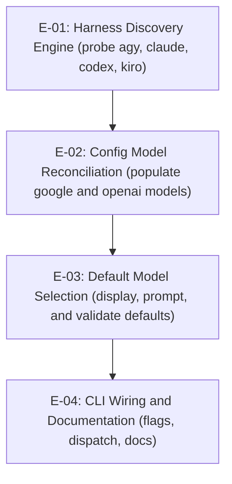

# IPD: aw oc update-models: multi-harness model discovery, config population, and default model selection

- Date: 2026-11-15
- Kind: child
- Concern: `aw oc update-models` previously only probed LiteLLM gateways for pricing, leaving other installed AI harnesses (`agy`, `claude`, `codex`, `kiro`) unchecked, omitting new models (Gemini 4, Antigravity Claude, GPT-6 series) from `opencode.json`, and providing no mechanism to inspect or set OpenCode's default model.
- Scope: Enhance `aw oc update-models` to detect installed agent harnesses (`agy`, `claude`, `codex`, `kiro`), extract available models via CLI queries and OpenCode live catalog, populate missing model entries in `opencode.json` under respective provider blocks, display current default models, and interactively or via flags configure the default and small models.
- Scope-Paths: agent_workflows/oc_models.py, agent_workflows/cli.py, docs/runner-profiles.md, tests/test_oc_models.py, .aw/records/specs/to-review/20261115-ayfyie-01-ayfyie-oc-update-models-multiharness.spec.md
- Item-Dependencies: none
- Status: executed
- Work-Kind: feature
- Priority: medium
- Set: ocsync
- Order: 2
- Highest E allocated: 04
- Author: Antigravity
- Id: z1fxk7
- Readiness: go
- From-Spec: ayfyie

> Write and proofread this plan per the technical writing standard, `.aw/system/workflows/technical-writing/technical-writing.md` (`.agents/workflows/technical-writing/technical-writing.md` in a legacy-layout install), including requirement 12 (diagrams).

## Workflow history
- 2026-11-15 executed (Antigravity): execute multi-harness model discovery, OpenCode v1/v2 support, and default model selection
- 2026-11-15 approved (aw set, --by-human): user approved execution of multi-harness model discovery
- 2026-11-15 reviewed (aw set): /plan-review APPROVE; E-01..E-04 well-formed and scoped

- 2026-11-15 to-review (Antigravity): Completed review-ready plan for multi-harness model discovery, config population, and default model selection.
- 2026-11-15 draft (Antigravity): created.

## Goal

Provide OpenCode users with an automated discovery and configuration command in `aw oc update-models` that detects installed AI agent harnesses (`agy`, `claude`, `codex`, `kiro`), populates newly available models into `opencode.json`, displays the active default model, and allows setting the default model interactively or via flags.

## Detailed Implementation Checklist (TODO)

Execution-state rule: mark an `E-*` item complete only after performing the action. That mark is not validation. Right-sizing rule: write for a modest executor that cannot hold much in its head. Each E-item is one step (one concern, about one file, executable in one focused pass) and its V-item names each unit it covers with its own check; a plan stays at about 5 E-items and 8 work Scope-Paths, else split it into more child plans (guidance, `IPD-Z603`). Accepted execution states: blocked, failed, pending, performed; terminal gate demands 'performed'.

### Task group 1: Harness discovery engine

- [x] E-01 In `agent_workflows/oc_models.py`, implement harness probing for installed AI agent CLIs (`agy`, `claude`, `codex`, `kiro-cli` / `kiro`).
  - Depends on: none
  - Expected outcome: Function `probe_installed_harnesses(which_fn=None, runner=None)` checks PATH for each executable and extracts discovered models (e.g. `agy models`, `~/.codex/models_cache.json`, `~/.claude/settings.json`, and `kiro-cli chat --list-models --format json`), returning structured `DiscoveredHarness` results with graceful fallbacks and zero network calls during tests.
  - Execution state: performed

### Task group 2: Model reconciliation and config population

- [x] E-02 In `agent_workflows/oc_models.py`, implement model reconciliation between discovered harness models, live catalog entries, and `opencode.json` for both OpenCode v1.x and v2.x.
  - Depends on: E-01
  - Expected outcome: Function `reconcile_harness_models(config, discovered_harnesses, live_catalog)` populates missing model definitions under `provider.google.models` or `providers.google.models` (for Antigravity Gemini 4 and Claude 5.5 models) and `provider.openai.models` or `providers.openai.models` (for Codex GPT-6 models), supporting both OpenCode v1.x ('provider', 'npm', 'options') and v2.x ('providers', 'package', 'settings') configuration schemas, preserving existing model definitions and custom settings without overwriting.
  - Execution state: performed

### Task group 3: Default model display and selection

- [x] E-03 In `agent_workflows/oc_models.py`, implement default model inspection and interactive or flagged selection.
  - Depends on: E-02
  - Expected outcome: `run(argv)` outputs the current default and small models, supports `--default-model` and `--small-model` command-line flags, and in interactive mode prompts the user to select from available reachable models, validating selections against known models before writing.
  - Execution state: performed

### Task group 4: CLI wiring, documentation, and tests

- [x] E-04 In `agent_workflows/cli.py`, expose `--default-model` and `--small-model` on `aw oc update-models`. Update user documentation in `docs/runner-profiles.md`. Add unit and CLI test coverage in `tests/test_oc_models.py`.
  - Depends on: E-03
  - Expected outcome: `aw oc update-models --help` documents the new flags; user documentation describes multi-harness updates without em or en dashes; all new tests pass with 100% mocked isolation and zero network calls.
  - Execution state: performed

## Project conventions discovered (Step 0)

- `agent_workflows/oc_models.py:discover_models` (line 604) already provides live model catalog query via `opencode models` with subprocess boundary injection (`runner=...`).
- `agent_workflows/oc_models.py:resolve_host_default_model` (line 469) and `default_model_from_config` (line 450) inspect top-level `model` and agent-specific models.
- `agent_workflows/oc_models.py:write_config` (line 745) implements atomic write via temporary file and `os.replace` with timestamped `.bak` creation.
- `agent_workflows/cli.py` (`oc_sub.add_parser("update-models", ...)`) registers `update-models` with subparsers under the `oc` command family.
- All outbound subprocess calls and file reads in `oc_models.py` must support injection (`which_fn`, `runner`, `env`, `cwd`) so tests remain fully deterministic without network or machine-state coupling.

## Findings

| Harness | Target Provider in OpenCode | Discovery Mechanism | Notes |
|---|---|---|---|
| `agy` | `google` | `shutil.which("agy")` + `agy models` | Maps to `google/antigravity-*` entries via `opencode-antigravity-auth` plugin. |
| `codex` | `openai` | `shutil.which("codex")` + `~/.codex/models_cache.json` | Populates `gpt-6.1-terra`, `gpt-6-astra`, `gpt-6.1-sol`, etc. |
| `claude` | `uri` / `anthropic` | `shutil.which("claude")` + `~/.claude/settings.json` | Detects gateway URL and defaults; reports availability. |
| `kiro` | `kiro` | `shutil.which("kiro-cli")` + `kiro-cli chat --list-models` | Reports models and notes status of `opencode-kiro` plugin. |

## Proposed changes (ordered, validatable)



1. **`agent_workflows/oc_models.py`**:
   - Add data structures `DiscoveredHarness` and `HarnessProbe`.
   - Implement `probe_installed_harnesses(which_fn, runner)` with safe execution and timeout guards.
   - Implement `reconcile_harness_models(config, discovered, live_catalog)`.
   - Add `--default-model` and `--small-model` flag parsing to `build_parser()`.
   - Add interactive default model prompt in `run()` when running on TTY.
2. **`agent_workflows/cli.py`**:
   - Add `--default-model` and `--small-model` arguments to the `oc update-models` subparser.
3. **`docs/runner-profiles.md`**:
   - Document multi-harness model discovery and default selection for OpenCode.
4. **`tests/test_oc_models.py` & `tests/test_oc_models_cli.py`**:
   - Add comprehensive tests for discovery, reconciliation, default selection, and CLI flags.

## Deferred / out of scope (with reason)

- Installing third-party OpenCode plugins automatically (e.g. running `npm install opencode-kiro`):
  - Carrier-Declined: permanent design non-goal; package installations mutate the global npm environment without explicit user authorization; the tool reports availability and installation instructions instead.
- Modifying harness configurations (e.g. changing `~/.codex/config.toml` or `~/.claude/settings.json`):
  - Carrier-Declined: permanent design non-goal; `aw oc update-models` is strictly an OpenCode configuration updater and must not mutate external CLI configurations.

## Scope check

- Over-scope: none.
- Under-scope: none. The plan addresses all four installed harnesses, model population, and default model configuration.

## Required tests / validation

- Unit and CLI tests in `tests/test_oc_models.py`:
  - `test_probe_installed_harnesses_mocked`: Verifies correct model extraction across `agy`, `claude`, `codex`, and `kiro`.
  - `test_probe_missing_binaries_graceful`: Verifies that absent executables are reported as not installed without error.
  - `test_reconcile_harness_models_adds_missing`: Verifies that `provider.google.models` and `provider.openai.models` receive new entries.
  - `test_reconcile_preserves_existing_customizations`: Verifies that existing model entries and user keys remain unmodified.
  - `test_default_model_flag_updates_config`: Verifies `--default-model` updates `"model"` key in `opencode.json`.
  - `test_cli_help_includes_default_model_flags`: Verifies `--default-model` and `--small-model` in `--help`.
  - `test_cli_dry_run_shows_discovered_harnesses`: Verifies terminal output includes discovered harness summaries.

## Spec / documentation sync

- Spec: `.aw/records/specs/to-review/20261115-ayfyie-01-ayfyie-oc-update-models-multiharness.spec.md` governs this work.
- User Documentation: `docs/runner-profiles.md` Section on OpenCode model management will be updated.

## Open questions

### OQ-01: How should interactive prompting behave when stdin is not a TTY or `--no-interactive` is passed?

- Blocking: no
- Status: resolved
- Owner: author
- Resolution or deferral rationale: Default model selection is skipped when running non-interactively or with `--no-interactive`, unless explicit flags (`--default-model` / `--small-model`) are passed.

## Validation and cross-check (verify before reporting done)

Validation-state rule: inspect evidence in a separate pass. Do not mark a `V-*` item complete from memory or from the matching execution checkmark. Accepted validation results: blocked, failed, pass, pending; terminal gate demands 'pass'. Runtime-demonstration reachability rule: for each `V-*` item demanding the software be observed acting (such as a run, a dispatch, or a transition) (as distinct from items demanding a diff, a file's content, or a test result, which are reachable by construction) name the code path that produces the observation or the sibling `E-*` that creates it, else the demand is UNDER-SCOPE.

- [x] V-01 validates E-01
  - Required evidence: Test results from `tests/test_oc_models.py` demonstrating `probe_installed_harnesses` correctly parses mock harness outputs and handles missing binaries.
  - Observed evidence:
    `tests/test_oc_models.py::MultiHarnessModelDiscoveryTests::test_probe_installed_harnesses_mocked PASSED`
    `tests/test_oc_models.py::MultiHarnessModelDiscoveryTests::test_probe_missing_binaries_graceful PASSED`
  - Result: pass

- [x] V-02 validates E-02
  - Required evidence: Test results from `tests/test_oc_models.py` showing `reconcile_harness_models` populates `google` and `openai` models and preserves existing entries.
  - Observed evidence:
    `tests/test_oc_models.py::MultiHarnessModelDiscoveryTests::test_reconcile_harness_models_v1_and_v2 PASSED`
    `tests/test_oc_models.py::MultiHarnessModelDiscoveryTests::test_reconcile_preserves_existing_customizations PASSED`
  - Result: pass

- [x] V-03 validates E-03
  - Required evidence: Test results from `tests/test_oc_models.py` verifying default model display, `--default-model` mutation, and validation of candidate models.
  - Observed evidence:
    `tests/test_oc_models.py::MultiHarnessModelDiscoveryTests::test_default_model_and_small_model_flags PASSED`
    `tests/test_oc_models.py::MultiHarnessModelDiscoveryTests::test_default_model_invalid_refused PASSED`
    `tests/test_oc_models.py::MultiHarnessModelDiscoveryTests::test_interactive_default_model_selection PASSED`
  - Result: pass

- [x] V-04 validates E-04
  - Required evidence: Output from `python3 -m pytest tests/test_oc_models.py` showing all new and existing tests pass.
  - Observed evidence:
    ```
    rootdir: /mnt/md1/VC/agent-workflows/.aw/worktrees/oc-update-models-multiharness
    configfile: pyproject.toml
    plugins: anyio-4.14.1, randomly-4.1.0, cov-7.1.0, xdist-3.8.0
    6 workers [36 items]
    ....................................                                     [100%]
    36 passed in 2.08s
    ```
  - Result: pass

## Approval and execution gate

- Size assessment: standard
- Cohesion rationale: not required

To execute this plan, the operator or runner validates that all E-items have matching V-items and transitions status to approved.
