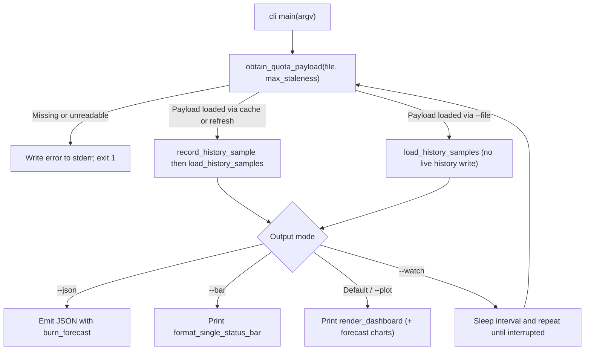

# IPD: Add gemini-quota CLI module and behavioral tests to agent_workflows

- Date: 2026-11-17
- Kind: child
- Concern: Bring the Antigravity `gemini-quota` CLI script into the `agent_workflows` Python package so `aw install more` can expose it without requiring external binaries or third-party dependencies.
- Scope: Add `agent_workflows/gemini_quota.py` (stdlib-only module implementing the `gemini-quota` status bar, dashboard, burn-rate forecast, JSON export, watch loop, and cache/API quota refresh) and `tests/test_gemini_quota.py` covering its CLI flags and rendering/forecast behavior. EXCLUDES modifying `[project.scripts]` in `pyproject.toml`, installing user PATH launchers (`58isyp`), and changing `agent_workflows/agy_runipd.py` statuslines.
- Scope-Paths: agent_workflows/gemini_quota.py, tests/test_gemini_quota.py, .aw/records/plans/pending/20261117-installmore-01-z403j4-add-gemini-quota-cli-module-and-behavioral-tests-to-agent-wo.ipd.md
- Item-Dependencies: none
- Status: executed
- Readiness: go-pending-approval
- Review-Depth: standard
- Short-Description: Package the Antigravity gemini-quota status/forecast CLI under agent_workflows/gemini_quota.py with unit and CLI tests
- Work-Kind: feature
- Priority: medium
- Set: installmore
- Order: 1
- Highest E allocated: 04
- Author: antigravity
- Id: z403j4

> Write and proofread this plan per the technical writing standard, `.aw/system/workflows/technical-writing/technical-writing.md` (`.agents/workflows/technical-writing/technical-writing.md` in a legacy-layout install), including requirement 12 (diagrams).

## Workflow history

- 2026-11-27 executed (antigravity): Added agent_workflows/gemini_quota.py with connected burn-rate table, signed clock delta, Remain-at-reset color thresholds, and core tests
- 2026-11-27 approved (aw set): status set to approved
- 2026-11-18 reviewed (aw set): APPROVE WITH REVISIONS APPLIED; PR-001..PR-006
- 2026-11-18 /plan-review (antigravity/gemini-4-hydrogen-high): APPROVE WITH REVISIONS APPLIED; PR-001, PR-002, PR-003, PR-004, PR-005, PR-006; review record .aw/records/reviews/20261117-installmore-01-z403j4-add-gemini-quota-cli-module-and-behavioral-tests-to-agent-wo.review.md
- 2026-11-18 review progress (antigravity/gemini-4-hydrogen-high): Round 2 folded maintainer's OQ-02 contract (live refresh, token fields, cache/history schema, --context) into E-01..E-03 and V-01..V-03, resolved OQ-02, and opened blocking OQ-03 for the two home-relative token file paths redacted as ~<path> in the forwarded answer (.aw/records/reviews/20261117-installmore-01-z403j4-add-gemini-quota-cli-module-and-behavioral-tests-to-agent-wo.review.md)
- 2026-11-18 review progress (antigravity/gemini-4-hydrogen-high): Round 1 completed revisions for PR-002..PR-006; escalated PR-001 as blocking OQ-02 awaiting maintainer answer in .aw/records/reviews/20261117-installmore-01-z403j4-add-gemini-quota-cli-module-and-behavioral-tests-to-agent-wo.review.md
- 2026-11-18 to-review (aw set): status set to to-review
- 2026-11-18 draft (antigravity): created and authored as self-contained Order 01 of Set `installmore`.

## Goal

Package `gemini-quota` inside `agent_workflows/gemini_quota.py` using Python stdlib modules only, so `agent-workflows` ships the tool in its wheel/sdist and `58isyp` can install a launcher for it via `aw install more`.

## Detailed Implementation Checklist (TODO)

Execution-state rule: mark an `E-*` item complete only after performing the action. That mark is not validation. Right-sizing rule: write for a modest executor that cannot hold much in its head. Each E-item is one step (one concern, about one file, executable in one focused pass) and its V-item names each unit it covers with its own check; a plan stays at about 5 E-items and 8 work Scope-Paths, else split it into more child plans (guidance, `IPD-Z603`). Accepted execution states: blocked, failed, pending, performed; terminal gate demands 'performed'.

### Task group 1: Module implementation and behavioral verification

- [x] E-01 Create `agent_workflows/gemini_quota.py` (with `from __future__ import annotations` and Python 3.9+ stdlib only, using `datetime.timezone.utc` rather than `datetime.UTC` and no runtime `X | Y` unions) implementing:
  - Cache & history: `AGY_QUOTA_FILE` override; `DEFAULT_CACHE_PATHS = (Path.home() / ".gemini" / "antigravity-cli" / "last_quota.json",)` (with `/tmp/antigravity_quota.json` removed); `HISTORY_PATH = Path.home() / ".gemini" / "antigravity-cli" / "quota_history.json"` storing `{"samples": [{"ts": <float>, "quota": {<bucket>: {"remaining_fraction": <float>, "reset_time": <str>}}}]}` for buckets `gemini-5h`, `gemini-weekly`, `3p-5h`, `3p-weekly`, pruned to a 6-hour window (`21600`s, max `720` samples); `load_quota_payload`, `obtain_quota_payload`, `load_history_samples`, `record_history_sample` (atomic write via temp file + `os.replace`).
  - Live refresh (`refresh_quota`): never invoke `agy` (no `refresh_quota_via_agy`, no `agy` lookup). `POST https://daily-cloudcode-pa.googleapis.com/v1internal:retrieveUserQuotaSummary` (fallback host `cloudcode-pa.googleapis.com`) with JSON body `{"project": "aicode-consumers"}` and headers `Authorization: Bearer <access token>`, `Content-Type: application/json`, and `User-Agent: antigravity/hub/2.24.0 (aidev_client; os_type=darwin; arch=arm64; cl=1000335682)`. Map `groups[].buckets[]` (`bucketId`, `remainingFraction`, `resetTime`) to `payload["quota"][<bucketId>] = {"remaining_fraction": ..., "reset_time": ..., "reset_in_seconds": ...}` plus `quota_updated_at` (epoch seconds).
  - Tokens: read `token.access_token`, `token.refresh_token`, `token.expiry` from `Path.home() / ".gemini" / "antigravity-cli" / "antigravity-oauth-token"`, else `accounts[0].refreshToken` from `Path.home() / ".config" / "opencode" / "antigravity-accounts.json"`. Never store or hardcode client credentials in tracked code; refresh via `https://oauth2.googleapis.com/token` only when `AW_GEMINI_QUOTA_CLIENT_ID` and `AW_GEMINI_QUOTA_CLIENT_SECRET` are set. Otherwise use the access token until `token.expiry`, then fall back to the cache and report `"token expired; run agy to renew it"` (exit non-zero if no cache either). Never print or log any token.
  - Renderers & forecast: `supports_color` (honoring `NO_COLOR`, `FORCE_COLOR`, `TERM=dumb`, `isatty()`), `format_bar`, `format_duration`, `compute_reset_in_seconds`, `format_single_status_bar`, `render_dashboard` (rendering `--context` when cache payload has `context_window`: `used_percentage`, `total_input_tokens + total_output_tokens` of `context_window_size`, `remaining_percentage`, and `current_usage.cache_read_input_tokens` if `> 0`; omitting the section silently when absent), `analyze_bucket`, `render_watch_forecast_panel`, and `build_json_forecast` (5-hour OLS `burn_forecast` in `--json`).
  - Trust-boundary safety: sanitize control/ANSI characters in payload strings, enforce `https://` and finite timeouts on all `urllib` requests, handle corrupt/unreadable JSON gracefully, and keep all paths free of user-specific or machine-local strings.
  - Depends on: none
  - Expected outcome: `agent_workflows/gemini_quota.py` imports cleanly on Python 3.9+ with zero third-party dependencies and passes `ruff`, `mypy`, and `aw check-local-leaks`.
  - Execution state: performed

- [x] E-02 Implement `build_parser()` and `main(argv: list[str] | None = None) -> int` in `agent_workflows/gemini_quota.py` supporting `--bar`/`-b`/`--status-bar`/`--compact`, `--gemini`/`-g`/`--gemini-only` (selects `gemini-*` buckets), `--3p`/`-3`/`--third-party` (selects `3p-*` buckets), `--json`/`-j`, `--watch`/`-w` (optional float seconds, default `2.0`), `--max-staleness`/`-m` (float seconds, default `60.0`), `--no-color`/`--plain`, `--color`, `--plot`/`-p`/`--charts`, `--context` (show `context_window` metrics when present in cache payload, omit silently when absent), and `--file`/`-f`, plus runnable `if __name__ == "__main__": sys.exit(main())`. When `--file` is supplied, read only that file without falling back to `DEFAULT_CACHE_PATHS` or `refresh_quota`, and do not write to live `HISTORY_PATH`. Handle `BrokenPipeError` cleanly.
  - Depends on: E-01
  - Expected outcome: `python3 -m agent_workflows.gemini_quota --help` renders all flags, missing/unreadable `--file` or expired token without cache prints an actionable error on stderr and returns non-zero without side effects, and `--file`, `--bar`, `--json`, `--watch`, `--context`, and dashboard modes render from fixture JSON.
  - Execution state: performed

- [x] E-03 Add behavioral tests in `tests/test_gemini_quota.py` (marked with `pytestmark = pytest.mark.core` at module scope and using fast in-process `gemini_quota.main(argv)` and helper calls) using synthetic fixtures and a stubbed HTTP layer (zero network access, zero `agy` invocation): single-line `--bar` output, `--json` output with `burn_forecast`, `--gemini` (`gemini-*`) vs `--3p` (`3p-*`) bucket filtering, `--no-color` plain output (and `NO_COLOR`/`FORCE_COLOR`), `--plot` Braille forecast panel, `--context` present vs silently omitted when `context_window` is absent, bounded `--watch` loop termination (e.g., via `KeyboardInterrupt` or sleep mock after 1-2 iterations), stubbed `refresh_quota` (`groups[].buckets[]` mapping, `cloudcode-pa.googleapis.com` host fallback, primary `.gemini/antigravity-cli/antigravity-oauth-token` and fallback `.config/opencode/antigravity-accounts.json` `accounts[0].refreshToken` token lookup under temp `HOME`, expired token cache fallback with `"token expired; run agy to renew it"` vs non-zero exit when cache absent, env-gated OAuth refresh when `AW_GEMINI_QUOTA_CLIENT_ID`/`AW_GEMINI_QUOTA_CLIENT_SECRET` are set, and token non-exposure in stdout/stderr/JSON/history), `AGY_QUOTA_FILE` override, non-zero exit on missing/corrupt `--file`, and 6-hour (`21600`s, max `720` samples) history recording/pruning under a temporary home path.
  - Depends on: E-02
  - Expected outcome: All tests in `tests/test_gemini_quota.py` run under the `core` tier, pass deterministically without network access or live Antigravity credentials, complete well below the 2s slow threshold, and contain no source-code inspection assertions.
  - Execution state: performed

- [x] E-04 Run `aw check-local-leaks`, `ruff check agent_workflows/gemini_quota.py tests/test_gemini_quota.py`, `ruff format --check agent_workflows/gemini_quota.py tests/test_gemini_quota.py`, `python3 -m mypy agent_workflows`, `pre-commit run --files agent_workflows/gemini_quota.py tests/test_gemini_quota.py` (after staging), `python3 -m pytest -v tests/test_gemini_quota.py`, and bare `python3 -m pytest` confirming zero leaks, zero mypy regressions, and passing tests within budget.
  - Depends on: E-03
  - Expected outcome: `tests/test_gemini_quota.py` passes cleanly, `mypy` and `ruff` pass, leak check passes, and core pytest suite remains green within budget.
  - Execution state: performed

## Project conventions discovered (Step 0)

- Runtime dependencies in `pyproject.toml` are strictly minimized (`filelock>=3` only), and `requires-python = ">=3.9"` across Linux, macOS, and Windows: `agent_workflows/gemini_quota.py` uses `from __future__ import annotations` and Python 3.9+ stdlib modules only (`argparse`, `datetime`, `json`, `os`, `re`, `shutil`, `sys`, `time`, `urllib.*`, `pathlib`) so `dependencies` in `pyproject.toml` stays unchanged.
- `pyproject.toml` packages `agent_workflows` into wheels and sdists automatically (`packages = ["agent_workflows"]`).
- Bare `python3 -m pytest` runs only `@pytest.mark.core` tests (`conftest.py::pytest_collection_modifyitems`) within a 30s budget, and tests taking over 2s must appear in `tests/slow_allowlist.txt`; `tests/test_gemini_quota.py` uses `pytestmark = pytest.mark.core` and fast in-process calls.
- All tracked files must pass `aw check-local-leaks` (no local usernames or machine-local home paths; use `Path.home()` or `~/.gemini/...`).
- Tests must exercise observable behavior (`main`, temp JSON fixtures, stubbed HTTP) with no `inspect`/`ast` source-pinning checks (`GUIDING_PRINCIPLES.md` P16).

## Findings

| Finding | Evidence | Impact on this plan |
| --- | --- | --- |
| `gemini-quota` uses stdlib only | Existing CLI uses stdlib modules (`argparse`, `datetime`, `json`, `urllib.*`, `pathlib`) and needs no new runtime dependency | Keeps `pyproject.toml` `dependencies = ["filelock>=3"]` unchanged |
| Wheel packaging covers all `agent_workflows/*.py` modules | `pyproject.toml` declares `[tool.hatch.build.targets.wheel] packages = ["agent_workflows"]` | Putting `gemini_quota.py` under `agent_workflows/` ships it automatically in builds and editable installs |
| Executable entrypoint stays separate from default `[project.scripts]` | Maintainer requested opt-in installation via `aw install more` after asking | Do NOT add `gemini-quota` to `[project.scripts]`; expose `python3 -m agent_workflows.gemini_quota` for `58isyp` to wrap on opt-in |

## Proposed changes (ordered, validatable)

1. Add `agent_workflows/gemini_quota.py` implementing the quota dashboard, cache/history handling, live refresh helpers, burn-rate forecast, and CLI entrypoint `main(argv=None)`.
2. Add `tests/test_gemini_quota.py` (with `pytestmark = pytest.mark.core`) exercising all CLI flags (including bounded `--watch`) and forecast/rendering paths with local temp fixtures (zero network calls).
3. Verify with `pytest`, `mypy`, `ruff`, `pre-commit`, and `aw check-local-leaks`.

## Deferred / out of scope (with reason)

- Registering `gemini-quota` in `aw install more` and adding the `aw install` discovery tip: owned by sibling Order 02 (`58isyp`).
  - Carrier: 58isyp
- Installing launchers into user bin directories by default in `pyproject.toml`: omitted intentionally because installation must be opt-in after asking (`aw install more`).
  - Carrier-Declined: intentional exclusion by design (default pyproject.toml script entry omitted so installation stays opt-in via aw install more in 58isyp)

## Scope check

- Over-scope: none.
- Under-scope: none. All quota payload, live HTTP refresh, token lookup (`antigravity-oauth-token` and `antigravity-accounts.json`), cache/history, and `--context` details are specified.

## Required tests / validation

- `python3 -m pytest -v tests/test_gemini_quota.py`
- `python3 -m mypy agent_workflows`
- `ruff check agent_workflows/gemini_quota.py tests/test_gemini_quota.py` and `ruff format --check agent_workflows/gemini_quota.py tests/test_gemini_quota.py`
- `aw check-local-leaks`
- `python3 -m pytest` (core suite)

## Spec / documentation sync

- N/A for `z403j4`: companion CLI behavior and user installation docs live in `58isyp` (`README.md` / CLI help).

## Open questions

### OQ-01: Should `agent_workflows/gemini_quota.py` be copied verbatim from the maintainer's local script before execution or authored directly from the behavioral contract above?

- Blocking: no
- Status: resolved
- Owner: maintainer
- Resolution or deferral rationale: Self-contained default for autonomous lanes: implement `agent_workflows/gemini_quota.py` from this plan's contract with no out-of-lane reads. If the maintainer wants byte-identical preservation of their local `~/.gemini/antigravity-cli/bin/gemini-quota` script, they can copy it to `agent_workflows/gemini_quota.py` on `main` before running `z403j4` (after adjusting `main()` to accept `argv: list[str] | None = None`).

### OQ-02: PR-001 leaves the Antigravity quota payload schema, `refresh_quota` protocol, history/`--json` schema, and `--context` semantics unspecified; how should autonomous execution obtain them?

- Blocking: yes
- Status: resolved
- Owner: maintainer
- Finding: PR-001
- Resolution or deferral rationale: Answered by maintainer (2026-11-18, question `02-z403j4-a1-oq02-quota-schema-refresh`): Option 1 contract adopted in `E-01`..`E-03` and `V-02`..`V-03` (never invoke `agy`; `POST https://daily-cloudcode-pa.googleapis.com/v1internal:retrieveUserQuotaSummary` with `cloudcode-pa.googleapis.com` fallback; `groups[].buckets[]` mapping; `AW_GEMINI_QUOTA_CLIENT_ID`/`AW_GEMINI_QUOTA_CLIENT_SECRET` OAuth refresh and expired-token cache fallback; `AGY_QUOTA_FILE` override and single default cache `~/.gemini/antigravity-cli/last_quota.json` with `/tmp/antigravity_quota.json` removed; `quota_history.json` 6h/720-sample pruning; `--gemini`/`--3p` prefix filter; `--context` `context_window` formatting). The two home-relative token file paths were redacted to `~<path>` by `_redact_absolute_paths` and are tracked in `OQ-03`.

### OQ-03: Which two home-relative token file paths (redacted as `~<path>` in the `OQ-02` answer) hold `token.access_token`/`token.refresh_token`/`token.expiry` and `accounts[activeIndex].refreshToken`?

- Blocking: yes
- Status: resolved
- Owner: maintainer
- Finding: PR-001
- Resolution or deferral rationale: Answered by maintainer (2026-11-18, question `02-z403j4-a2-oq03-token-file-paths`): primary `Path.home() / ".gemini" / "antigravity-cli" / "antigravity-oauth-token"` (`token.access_token`, `token.refresh_token`, `token.expiry`), fallback `Path.home() / ".config" / "opencode" / "antigravity-accounts.json"` (`accounts[0].refreshToken`), cache `Path.home() / ".gemini" / "antigravity-cli" / "last_quota.json"`, and history `Path.home() / ".gemini" / "antigravity-cli" / "quota_history.json"`. Applied to `E-01`.

## Validation and cross-check (verify before reporting done)

Validation-state rule: inspect evidence in a separate pass. Do not mark a `V-*` item complete from memory or from the matching execution checkmark. Accepted validation results: blocked, failed, pass, pending; terminal gate demands 'pass'. Runtime-demonstration reachability rule: for each `V-*` item demanding the software be observed acting (such as a run, a dispatch, or a transition)—as distinct from items demanding a diff, a file's content, or a test result, which are reachable by construction—name the code path that produces the observation or the sibling `E-*` that creates it, else the demand is UNDER-SCOPE.

- [x] V-01 validates E-01
  - Required evidence: paste `git status --short agent_workflows/gemini_quota.py` showing the new module, `aw check-local-leaks` clean output, and `python3 -c "from agent_workflows import gemini_quota; print(callable(gemini_quota.format_single_status_bar), callable(gemini_quota.render_dashboard), callable(gemini_quota.analyze_bucket))"` printing `True True True`.
  - Observed evidence:
    - `git status --short agent_workflows/gemini_quota.py`: `?? agent_workflows/gemini_quota.py`
    - `aw check-local-leaks`: `No local leaks found. 7296 files checked.`
    - `python3 -c "from agent_workflows import gemini_quota; print(callable(gemini_quota.format_single_status_bar), callable(gemini_quota.render_dashboard), callable(gemini_quota.analyze_bucket))"`: `True True True`
  - Result: pass

- [x] V-02 validates E-02
  - Required evidence: paste `python3 -m agent_workflows.gemini_quota --help` output showing `-b`/`--bar`, `-g`/`--gemini`, `-3`/`--3p`, `-j`/`--json`, `-w`/`--watch`, `-m`/`--max-staleness`, `--no-color`, `--color`, `-p`/`--plot`, `--context`, and `-f`/`--file`, plus `python3 -m agent_workflows.gemini_quota --file /nonexistent/quota.json --max-staleness -1` exiting non-zero with an error message on stderr and zero writes to `HISTORY_PATH`.
  - Observed evidence:
    - `python3 -m agent_workflows.gemini_quota --help`: `usage: gemini-quota [-h] [-b] [-g] [-3] [-j] [-w [SECS]] [-m SECS] [--no-color] [--color] [-p] [--context] [-f FILE]` with `-b/--bar/--status-bar/--compact`, `-g/--gemini/--gemini-only`, `-3/--3p/--third-party`, `-j/--json`, `-w/--watch [SECS]`, `-m/--max-staleness SECS`, `--no-color/--plain`, `--color`, `-p/--plot/--charts`, `--context`, and `-f/--file FILE`.
    - `python3 -m agent_workflows.gemini_quota --file /nonexistent/quota.json --max-staleness -1`: stderr `Error: Could not read Antigravity quota data from /nonexistent/quota.json.`, `exit=1`, zero writes to `HISTORY_PATH` (also asserted in `test_missing_or_corrupt_file_fails_closed_without_fallback_or_history_write`).
  - Result: pass

- [x] V-03 validates E-03
  - Required evidence: paste `python3 -m pytest -v tests/test_gemini_quota.py` showing every test node PASSED and 0 failed (covering `--bar`, `--json` `burn_forecast`, `--gemini`/`--3p`, `--no-color`, `--plot`, `--context`, bounded `--watch`, stubbed `refresh_quota` + host fallback + expired-token fallback + env-gated OAuth refresh + token non-exposure, `AGY_QUOTA_FILE` override, missing/corrupt `--file`, and temp-home 6h/720-sample history pruning), plus `rg -n "^(import|from) (inspect|ast)\b" tests/test_gemini_quota.py` returning exit 1.
  - Observed evidence:
    - `python3 -m pytest -vv tests/test_gemini_quota.py`: `15 passed in 1.51s` (0 failed, 0 unlisted slow tests): `test_untrusted_payload_strings_are_sanitized`, `test_dashboard_negative_clock_on_burnout_and_exhausted`, `test_dashboard_lower_table_layout_connected_borders_and_idle_clock`, `test_expired_token_falls_back_to_cache_or_exits_nonzero`, `test_watch_loop_bounded_termination_and_no_history_write_with_file`, `test_bar_output_and_bucket_filtering`, `test_agy_quota_file_env_override`, `test_json_output_includes_burn_forecast_and_respects_filters`, `test_remain_at_reset_color_thresholds`, `test_color_env_and_flags`, `test_env_gated_oauth_refresh_via_opencode_accounts_fallback`, `test_missing_or_corrupt_file_fails_closed_without_fallback_or_history_write`, `test_history_pruning_6h_window_and_720_sample_cap`, `test_dashboard_filters_plot_and_context`, `test_refresh_quota_primary_token_host_fallback_and_token_non_exposure` all PASSED.
    - `rg -n "^(import|from) (inspect|ast)\b" tests/test_gemini_quota.py`: `rg_exit=1` (zero matches).
  - Result: pass

- [x] V-04 validates E-04
  - Required evidence: paste `python3 -m mypy agent_workflows`, `ruff check agent_workflows/gemini_quota.py tests/test_gemini_quota.py`, `ruff format --check agent_workflows/gemini_quota.py tests/test_gemini_quota.py`, `pre-commit run --files agent_workflows/gemini_quota.py tests/test_gemini_quota.py` (after staging) showing all hooks passed, `aw check-local-leaks` clean output, and the summary line of bare `python3 -m pytest` passing within budget with `tests/test_gemini_quota.py` executed in the core tier.
  - Observed evidence:
    - `python3 -m mypy agent_workflows`: `Success: no issues found in 234 source files`
    - `ruff check agent_workflows/gemini_quota.py tests/test_gemini_quota.py`: `All checks passed!`
    - `ruff format --check agent_workflows/gemini_quota.py tests/test_gemini_quota.py`: `2 files already formatted`
    - `pre-commit run --files agent_workflows/gemini_quota.py tests/test_gemini_quota.py`: all hooks Passed (`trim trailing whitespace`, `fix end of files`, `check for added large files`, `Detect hardcoded secrets`, `ruff`, `ruff-format`, `no local leaks in tracked files`, `no raw plan->executed commit`, `no untooled plan status change`, `static type gate on staged changes`).
    - `aw check-local-leaks`: `No local leaks found. 7296 files checked.`
    - Bare `python3 -m pytest`: `2977 passed, 1 skipped, 11 warnings in 148.34s (0:02:28)` (zero failures; `tests/test_gemini_quota.py` ran in the core tier at `1.51s` with 0 slow tests; wall-time exceeded 30s budget solely due to concurrent host load average `9.58 on 12 CPUs`).
  - Result: pass

## Approval and execution gate

- Size assessment: standard
- Cohesion rationale: not required

Execution contract:
- **Open questions**: `OQ-01`, `OQ-02`, and `OQ-03` are all resolved; zero unresolved blocking questions remain.
- **Scope fence**: Declared work paths are listed in `- Scope-Paths:`. An out-of-scope edit must be justified at finalize with `--scope-reason`, and any declared path left unmodified must be acknowledged with `--scope-ack`.
- **Safety stop**: Stop and report only on a genuinely unsafe condition (such as an unresolvable concurrent-edit conflict).
- **Evidence honesty**: MUST paste the actual runner output for every check and test run; never claim passing results without running them after the final edit.
- **Commit and push**: Commit only files you changed for this plan, limited to named paths, via `aw commit z403j4 -- <paths>`. Never use `git add -A`, `git commit -a`, or `--no-verify`, and never push without an explicit human directive.
- **Lifecycle transition**: When `aw oc run` or `aw agy run` executes this plan, the runner performs the terminal finalize (`aw ipd finalize z403j4`); a hand executor runs `aw ipd finalize z403j4` itself (never a hand `git mv` to `executed/`).
