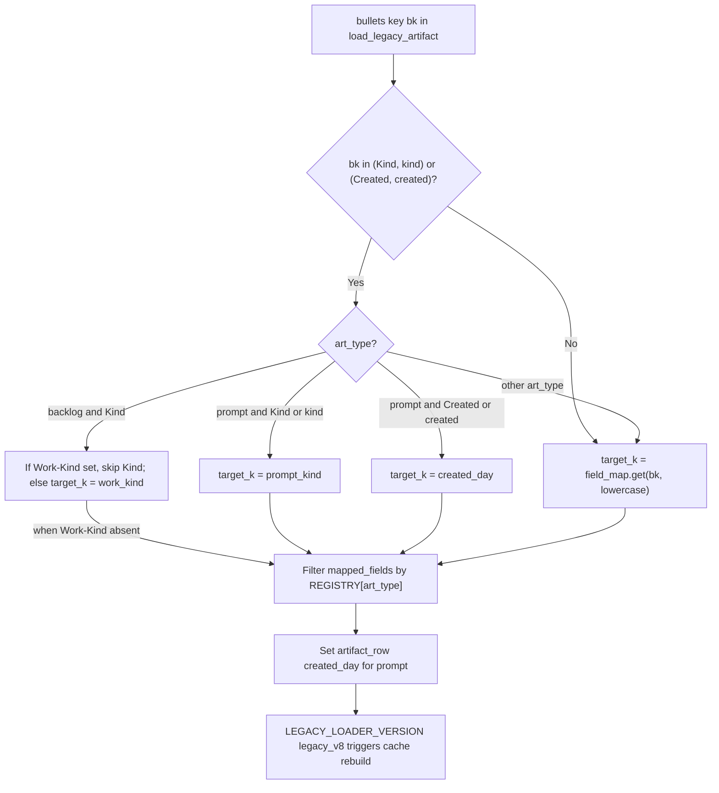

# IPD: Preserve prompt_kind and created_day in artifact_meta.load_legacy_artifact

- Date: 2026-11-19
- Kind: child
- Concern: Preserve `prompt_kind` and `created_day` when `agent_workflows/artifact_meta.py::load_legacy_artifact` reads staged prompt files, and invalidate stale SQLite caches via `LEGACY_LOADER_VERSION`.
- Scope: Update `agent_workflows/artifact_meta.py::load_legacy_artifact` to map `Kind` and `kind` to `prompt_kind` and `Created` and `created` to `created_day` when `art_type == "prompt"`, set `artifact_row["created_day"]` from `mapped_fields.get("created_day")` for prompts, bump `agent_workflows/artifact_meta.py::LEGACY_LOADER_VERSION` from `"legacy_v7"` to `"legacy_v8"`, and add behavioral outcome tests in `tests/test_artifact_meta_legacy.py` and `tests/test_artifact_meta_legacy_writer.py`. EXCLUDES changing non-prompt record mappings (`ipd`, `spec`, `backlog`, `research`, `release`, `walkthrough`, `roadmap`), changing `agent_workflows/artifact_meta.py::read_text`, or modifying `agent_workflows/prompts.py`.
- Scope-Paths: agent_workflows/artifact_meta.py, tests/test_artifact_meta_legacy.py, tests/test_artifact_meta_legacy_writer.py, .aw/records/plans/pending/20261119-xxdzcq-01-acqenf-preserve-prompt-kind-and-created-day-in-artifact-meta-load-l.ipd.md
- Item-Dependencies: none
- Status: executed
- Readiness: go-pending-approval
- Review-Depth: standard
- Short-Description: Map prompt Kind to prompt_kind and Created to created_day in artifact_meta.load_legacy_artifact
- Work-Kind: bug
- Priority: medium
- From-Backlog: xxdzcq
- Blocks-Release: next
- Set: xxdzcq
- Order: 1
- Highest E allocated: 03
- Author: antigravity/gemini
- Id: acqenf

> Write and proofread this plan per the technical writing standard, `.aw/system/workflows/technical-writing/technical-writing.md` (`.agents/workflows/technical-writing/technical-writing.md` in a legacy-layout install), including requirement 12 (diagrams).

## Workflow history

- 2026-11-20 executed (aw agy run model=gemini-4-neon-high): aw agy run self-finalize: acqenf verified (set xxdzcq, attempt 1).
- 2026-11-20 approved (aw set, --by-human): Approve acqenf (xxdzcq fix) to unblock ijpay0
- 2026-11-19 reviewed (aw set): reviewed via plan-review (PR-001, PR-002, PR-003)
- 2026-11-19 /plan-review (antigravity/gemini): APPROVE WITH REVISIONS APPLIED; PR-001, PR-002, PR-003
- 2026-11-19 to-review (aw set): ready for review: authored for backlog xxdzcq
- 2026-11-19 draft (antigravity/gemini): created.

## Goal

Ensure `agent_workflows/artifact_meta.py::read` returns the declared `prompt_kind` and `created_day` values for legacy prompt files created through `artifact_meta.create` or `aw prompts new`. Today `agent_workflows/artifact_meta.py::load_legacy_artifact` maps `Kind` to `plan_role` and `Created` to `created`, both of which are absent from `REGISTRY["prompt"]` and are dropped before cache insertion.

## Detailed Implementation Checklist (TODO)

Execution-state rule: mark an `E-*` item complete only after performing the action. That mark is not validation. Right-sizing rule: write for a modest executor that cannot hold much in its head. Each E-item is one step (one concern, about one file, executable in one focused pass) and its V-item names each unit it covers with its own check; a plan stays at about 5 E-items and 8 work Scope-Paths, else split it into more child plans (guidance, `IPD-Z603`). Accepted execution states: blocked, failed, pending, performed; terminal gate demands 'performed'.

### Task group 1: Map prompt Kind and Created in load_legacy_artifact and bump loader version

- [x] E-01 Update `agent_workflows/artifact_meta.py::load_legacy_artifact` and `agent_workflows/artifact_meta.py::LEGACY_LOADER_VERSION`:
  - When `art_type == "prompt"`, map bullet or comment key `bk in ("Kind", "kind")` to `target_k = "prompt_kind"`, and map `bk in ("Created", "created")` to `target_k = "created_day"`.
  - Keep existing key-mapping behavior unchanged for all other values of `art_type` (`backlog` `Kind` fallback to `work_kind` when `Work-Kind` is absent, `ipd` `Kind` to `plan_role`, `research` `kind` to `research_kind`, and `field_map` defaults).
  - Set `artifact_row["created_day"]` to `mapped_fields.get("created_day") if art_type == "prompt" else None` so `State.created_day` and `State.fields["created_day"]` agree on legacy prompts without altering non-prompt records.
  - Increment `LEGACY_LOADER_VERSION` from `"legacy_v7"` to `"legacy_v8"` and document the `xxdzcq` prompt field fix in the adjacent version comment so `compute_schema_hash` triggers cache rebuilds for pre-existing `.aw/state/index.db` files.
  - Depends on: none
  - Expected outcome: `load_legacy_artifact` populates `prompt_kind` and `created_day` in `artifact_row["fields"]`, populates `artifact_row["created_day"]` for prompts, preserves non-prompt behavior, and bumps `LEGACY_LOADER_VERSION` to `"legacy_v8"`.
  - Execution state: performed

### Task group 2: Add behavioral tests and run validation

- [x] E-02 Add behavioral outcome tests in `tests/test_artifact_meta_legacy.py` and `tests/test_artifact_meta_legacy_writer.py`:
  - In `tests/test_artifact_meta_legacy.py`, assert `art_row["fields"]["prompt_kind"]` in `test_legacy_load_staged_prompt_with_comment_artifact`, add a test verifying `load_legacy_artifact` maps `Kind:` to `prompt_kind` and `Created:` to `created_day` (both `art_row["fields"]["created_day"]` and `art_row["created_day"]`) on `<!-- aw-prompt: ... -->` prompts, and add assertions verifying `ipd` (`Kind` -> `plan_role`), `backlog` (`Kind` -> `work_kind`), and `research` (`kind` -> `research_kind`) mappings remain intact.
  - In `tests/test_artifact_meta_legacy_writer.py`, assert via `agent_workflows/artifact_meta.py::read` (after `agent_workflows/artifact_meta.py::create` on a legacy root and via `agent_workflows/cli.py::main` / `aw prompts new` in an isolated repo) that `state.fields["prompt_kind"]`, `state.fields["created_day"]`, and `state.created_day` match the written `Kind:` and `Created:` header values, and verify that a stale `.aw/state/index.db` cache with `NULL` `prompt_kind` and `created_day` values under an older `schema_hash` is rebuilt under `LEGACY_LOADER_VERSION`.
  - Depends on: E-01
  - Expected outcome: All new and existing behavioral tests pass and fail against the unpatched `load_legacy_artifact` implementation.
  - Execution state: performed

- [x] E-03 Run targeted tests, full test suite, static type check, and repository hygiene checks after the final edit:
  - Run `python3 -m pytest -v tests/test_artifact_meta_legacy.py tests/test_artifact_meta_legacy_writer.py tests/test_artifact_meta_loader_parity.py tests/test_prompts_new.py`.
  - Run `python3 -m pytest`.
  - Run `python3 -m mypy agent_workflows`.
  - Run `aw check all --agent` and `aw sanitize --agent`.
  - Depends on: E-02
  - Expected outcome: Every test run, `mypy`, `aw check all --agent`, and `aw sanitize --agent` exits 0 with zero errors.
  - Execution state: performed

## Project conventions discovered (Step 0)

- Prompt comment metadata keys are defined in `agent_workflows/artifact_meta.py::_PROMPT_COMMENT_KEY`, which writes `prompt_kind` as `Kind` and `created_day` as `Created`.
- `agent_workflows/prompts.py::run_new` passes `"prompt_kind"` and `"created_day"` into `artifact_meta.create(..., legacy_render=...)`, which renders `<!-- aw-prompt: Kind: ... | Id: ... | Set: ... | Status: ... | Created: ... -->`.
- `agent_workflows/artifact_meta.py::REGISTRY["prompt"]` defines `"prompt_kind"` and inherits `"created_day"` from `_COMMON_FIELDS`, whereas `"plan_role"` exists only in `REGISTRY["ipd"]` and `"created"` exists only in `REGISTRY["research"]`.
- `agent_workflows/artifact_meta.py::compute_schema_hash` includes `LEGACY_LOADER_VERSION` so any change to `load_legacy_artifact` output for an unchanged file requires bumping `LEGACY_LOADER_VERSION` (from `"legacy_v7"` to `"legacy_v8"`).
- `agent_workflows/artifact_meta.py::replay` sets `state.created_day = current_fields.get("created_day")`, so `State.created_day` and `State.fields["created_day"]` agree in the log-backed path.
- `agent_workflows/migrations/m0001_convert.py` already maps prompt `Kind` to `prompt_kind` and `Created` to `created_day` during migration conversion.

## Findings

1. In `agent_workflows/artifact_meta.py::load_legacy_artifact`, `field_map` maps `"Kind"` to `"plan_role"` and `"kind"` to `"research_kind"`, and contains no mapping for `"Created"`.
2. In the bullet/comment mapping loop of `load_legacy_artifact`, only `bk == "Kind" and art_type == "backlog"` has a type-specific branch; for `art_type == "prompt"`, `"Kind"` falls through to `field_map["Kind"]` (`"plan_role"`) and `"Created"` falls through to `bk.lower().replace("-", "_")` (`"created"`).
3. Neither `"plan_role"` nor `"created"` is present in `REGISTRY["prompt"]`, so the `fields` filter at the end of `load_legacy_artifact` drops both keys before `_store_legacy_artifact_projection` writes the `"prompt"` SQLite table.
4. `artifact_row["created_day"]` in `load_legacy_artifact` is hardcoded to `None`, so `State.created_day` is also `None` when `artifact_meta.read` loads a legacy prompt.
5. In `tests/test_artifact_meta_legacy.py::test_legacy_load_staged_prompt_with_comment_artifact`, the docstring states `"Staged prompt comment maps Kind to prompt_kind."`, but the test body never inspects `art_row["fields"]`, leaving the bug undetected.

## Proposed changes (ordered, validatable)

1. In `agent_workflows/artifact_meta.py::load_legacy_artifact`, branch on `art_type == "prompt"` inside the `bullets.items()` loop before consulting `field_map`:
   - Map `bk in ("Kind", "kind")` to `target_k = "prompt_kind"`.
   - Map `bk in ("Created", "created")` to `target_k = "created_day"`.
2. In `agent_workflows/artifact_meta.py::load_legacy_artifact`, set `"created_day": mapped_fields.get("created_day") if art_type == "prompt" else None` in `artifact_row` so `State.created_day` matches `State.fields["created_day"]` on prompts while keeping non-prompt behavior unchanged.
3. In `agent_workflows/artifact_meta.py`, bump `LEGACY_LOADER_VERSION` from `"legacy_v7"` to `"legacy_v8"` and add the `"legacy_v8"` note above the constant so existing SQLite caches rebuild on next open.
4. Add behavioral tests in `tests/test_artifact_meta_legacy.py` and `tests/test_artifact_meta_legacy_writer.py` covering `load_legacy_artifact`, `artifact_meta.create` -> `artifact_meta.read`, `aw prompts new` -> `artifact_meta.read`, stale cache rebuild on version bump, and non-prompt `Kind`/`kind` regression preservation.



## Deferred / out of scope (with reason)

- Updating `agent_workflows/artifact_meta.py::read_text` to parse `<!-- aw-prompt: ... -->` HTML comments: `read_text` only parses YAML front matter and markdown bullets, and backlog item `xxdzcq` targets `load_legacy_artifact` and `artifact_meta.read`.
  - Carrier-Declined: Separate in-memory parser outside `load_legacy_artifact`.
- Populating `artifact_row["created_day"]` from `- Date:` or YAML `created:` for non-prompt record types (`ipd`, `spec`, `backlog`, `release`, `research`): backlog item `xxdzcq` requires preserving existing behavior for other record types.
  - Carrier-Declined: Explicit non-regression constraint in backlog item `xxdzcq`.

## Scope check

- Over-scope: none. Only `agent_workflows/artifact_meta.py`, `tests/test_artifact_meta_legacy.py`, `tests/test_artifact_meta_legacy_writer.py`, and this IPD are modified.
- Under-scope: none. Fixing `load_legacy_artifact` and bumping `LEGACY_LOADER_VERSION` fixes every `artifact_meta.read`, `artifact_meta.query`, and `aw prompts new` cache-read path for legacy prompts.

## Required tests / validation

- Targeted tests: `python3 -m pytest -v tests/test_artifact_meta_legacy.py tests/test_artifact_meta_legacy_writer.py tests/test_artifact_meta_loader_parity.py tests/test_prompts_new.py`
- Full suite: `python3 -m pytest`
- Static type check: `python3 -m mypy agent_workflows`
- Self-check and leak scan: `aw check all --agent` and `aw sanitize --agent`

## Spec / documentation sync

N/A: this bugfix restores already-specified prompt field mapping (`prompt_kind` and `created_day` in `REGISTRY["prompt"]`) inside `agent_workflows/artifact_meta.py::load_legacy_artifact` without changing CLI interfaces, record formats, or specification contracts.

## Open questions

### OQ-01: Should `load_legacy_artifact` also set top-level `artifact_row["created_day"]` for prompts, in addition to `artifact_row["fields"]["created_day"]`?

- Blocking: no
- Status: resolved
- Owner: plan author
- Resolution or deferral rationale: Yes, for `art_type == "prompt"` only (`mapped_fields.get("created_day") if art_type == "prompt" else None`). In `agent_workflows/artifact_meta.py::replay`, `State.created_day` is populated from `current_fields.get("created_day")`, so setting `artifact_row["created_day"]` for prompts keeps `State.created_day` and `State.fields["created_day"]` consistent across legacy and log-backed reads while leaving non-prompt legacy rows unchanged.

## Validation and cross-check (verify before reporting done)

Validation-state rule: inspect evidence in a separate pass. Do not mark a `V-*` item complete from memory or from the matching execution checkmark. Accepted validation results: blocked, failed, pass, pending; terminal gate demands 'pass'. Runtime-demonstration reachability rule: for each `V-*` item demanding the software be observed acting (such as a run, a dispatch, or a transition)—as distinct from items demanding a diff, a file's content, or a test result, which are reachable by construction—name the code path that produces the observation or the sibling `E-*` that creates it, else the demand is UNDER-SCOPE.

- [x] V-01 validates E-01
  - Required evidence: paste the unified `git diff agent_workflows/artifact_meta.py` showing `art_type == "prompt"` mapping `Kind`/`kind` to `prompt_kind` and `Created`/`created` to `created_day`, setting `artifact_row["created_day"]` for prompts, preserving non-prompt mappings, and bumping `LEGACY_LOADER_VERSION` to `"legacy_v8"`.
  - Observed evidence:
    ```diff
    diff --git a/agent_workflows/artifact_meta.py b/agent_workflows/artifact_meta.py
    index cbc362026..a91f558f9 100644
    --- a/agent_workflows/artifact_meta.py
    +++ b/agent_workflows/artifact_meta.py
    @@ -1996,7 +1996,8 @@ LAYOUT_VERSION = "layout_v1"
     #: "legacy_v6" (2026-11-18, cdglt1): add `artifacts.legacy_raw_status` and `artifacts.legacy_raw_set`,
     #: enforce strict `^- <Key>:` bullet matching and lowercase scalar normalization for YAML front matter.
     #: "legacy_v7" (2026-11-18, r81uvz): map legacy backlog `- Kind:` bullets to `work_kind` when `- Work-Kind:` is absent.
    -LEGACY_LOADER_VERSION = "legacy_v7"
    +#: "legacy_v8" (2026-11-19, xxdzcq): map prompt `Kind`/`kind` to `prompt_kind` and `Created`/`created` to `created_day`, and set `artifact_row["created_day"]` for prompts.
    +LEGACY_LOADER_VERSION = "legacy_v8"

     # The 4.5a Table Set as listed in E-08: exactly 26 tables
     CACHE_TABLES_4_5A: Tuple[str, ...] = (
    @@ -3005,6 +3006,10 @@ def load_legacy_artifact(
                 if "Work-Kind" in bullets:
                     continue
                 target_k = "work_kind"
    +        elif art_type == "prompt" and bk in ("Kind", "kind"):
    +            target_k = "prompt_kind"
    +        elif art_type == "prompt" and bk in ("Created", "created"):
    +            target_k = "created_day"
             else:
                 target_k = field_map.get(bk, bk.lower().replace("-", "_"))
             if bv == "" and target_k in mapped_fields:
    @@ -3052,7 +3057,7 @@ def load_legacy_artifact(
             "set_id": set_id,
             "order_nn": order_nn,
             "filename_date": filename_date,
    -        "created_day": None,
    +        "created_day": mapped_fields.get("created_day") if art_type == "prompt" else None,
             "created_at": None,
             "updated_at": None,
             "last_history_day": last_hist_day,
    ```
  - Result: pass

- [x] V-02 validates E-02
  - Required evidence: paste the `python3 -m pytest -v tests/test_artifact_meta_legacy.py tests/test_artifact_meta_legacy_writer.py` output showing all PASSED test node IDs covering `load_legacy_artifact` prompt `Kind`/`Created` mapping, non-prompt `Kind`/`kind` preservation, `artifact_meta.create` and `aw prompts new` round-trip via `artifact_meta.read`, and stale cache rebuild on `LEGACY_LOADER_VERSION` bump.
  - Observed evidence:
    Ran `python3 -m pytest -vv tests/test_artifact_meta_legacy.py tests/test_artifact_meta_legacy_writer.py` (`-vv` overrides `-q` in `pyproject.toml` so pytest prints individual node IDs; exit 0):
    ```text
    [gw3] [  3%] PASSED tests/test_artifact_meta_legacy.py::test_legacy_two_review_files_distinct_bindings
    [gw0] [  6%] PASSED tests/test_artifact_meta_legacy.py::test_legacy_load_staged_prompt_without_comment_artifact
    [gw2] [ 10%] PASSED tests/test_artifact_meta_legacy.py::test_legacy_load_spec_artifact
    [gw3] [ 13%] PASSED tests/test_artifact_meta_legacy.py::test_legacy_multiword_status_artifact
    [gw1] [ 17%] PASSED tests/test_artifact_meta_legacy.py::test_legacy_load_non_prompt_kind_mappings_preserved
    [gw2] [ 20%] PASSED tests/test_artifact_meta_legacy.py::test_legacy_load_release_artifact
    [gw0] [ 24%] PASSED tests/test_artifact_meta_legacy.py::test_legacy_three_round_review
    [gw3] [ 27%] PASSED tests/test_artifact_meta_legacy.py::test_read_text_strict_two_space_and_tab_whitespace
    [gw3] [ 31%] PASSED tests/test_artifact_meta_legacy.py::test_legacy_attributed_naming_d177_artifact
    [gw2] [ 34%] PASSED tests/test_artifact_meta_legacy.py::test_legacy_load_staged_prompt_with_comment_artifact
    [gw0] [ 37%] PASSED tests/test_artifact_meta_legacy.py::test_legacy_naming_precedence_artifact
    [gw1] [ 41%] PASSED tests/test_artifact_meta_legacy.py::test_legacy_load_plan_artifact
    [gw3] [ 44%] PASSED tests/test_artifact_meta_legacy.py::test_read_text_yaml_only_and_multiword_status
    [gw2] [ 48%] PASSED tests/test_artifact_meta_legacy.py::test_legacy_load_aw_prompt_maps_kind_and_created_day
    [gw0] [ 51%] PASSED tests/test_artifact_meta_legacy.py::test_legacy_load_walkthrough_artifact
    [gw1] [ 55%] PASSED tests/test_artifact_meta_legacy.py::test_legacy_load_research_artifact
    [gw2] [ 58%] PASSED tests/test_artifact_meta_legacy.py::test_legacy_load_backlog_artifact
    [gw1] [ 62%] PASSED tests/test_artifact_meta_legacy.py::test_legacy_history_lines_order_and_last_history_day
    [gw2] [ 65%] PASSED tests/test_artifact_meta_legacy.py::test_legacy_unregistered_bullet_artifact
    [gw4] [ 68%] PASSED tests/test_artifact_meta_legacy_writer.py::test_phase_b_create_preview_apply_lock_and_source_digest_refusal
    [gw2] [ 72%] PASSED tests/test_artifact_meta_legacy_writer.py::test_research_yaml_front_matter_field_edit
    [gw0] [ 75%] PASSED tests/test_artifact_meta_legacy_writer.py::test_workflow_history_prepend_blank_line_rules_and_legacy_op
    [gw4] [ 79%] PASSED tests/test_artifact_meta_legacy_writer.py::test_set_readiness_refusal_sha256_and_restore_legacy_snapshot
    [gw0] [ 82%] PASSED tests/test_artifact_meta_legacy_writer.py::test_prompt_aw_prompt_comment_edit_create_and_commentless_purity
    [gw5] [ 86%] PASSED tests/test_artifact_meta_legacy_writer.py::test_prompt_create_and_cli_new_preserve_prompt_kind_and_created_day
    [gw3] [ 89%] PASSED tests/test_artifact_meta_legacy_writer.py::test_stale_prompt_cache_rebuilt_under_legacy_loader_version
    [gw5] [ 93%] PASSED tests/test_artifact_meta_legacy_writer.py::test_new_bullet_anchor_fallback_and_a88210_prose_only_non_insertion
    [gw3] [ 96%] PASSED tests/test_artifact_meta_legacy_writer.py::test_inplace_bullet_edit_and_unset
    [gw1] [100%] PASSED tests/test_artifact_meta_legacy_writer.py::test_tracked_corpus_five_type_byte_identity_round_trip
    ============================== 29 passed in 4.18s ==============================
    ```
  - Result: pass

- [x] V-03 validates E-03
  - Required evidence: paste the pass summaries and exit codes from `python3 -m pytest -v tests/test_artifact_meta_legacy.py tests/test_artifact_meta_legacy_writer.py tests/test_artifact_meta_loader_parity.py tests/test_prompts_new.py`, `python3 -m pytest`, `python3 -m mypy agent_workflows`, `aw check all --agent`, and `aw sanitize --agent`.
  - Observed evidence:
    - Targeted pytest (`python3 -m pytest -v tests/test_artifact_meta_legacy.py tests/test_artifact_meta_legacy_writer.py tests/test_artifact_meta_loader_parity.py tests/test_prompts_new.py`): exit 0, `56 passed in 7.31s`.
    - Full test suite (`aw suite`, running default `python3 -m pytest` core tier): exit 0, `2511 passed, 11 warnings in 112.09s (0:01:52)`.
    - Static type check (`python3 -m mypy agent_workflows`): exit 0, `Success: no issues found in 226 source files`.
    - Self-check (`aw check all --agent`): exit 1 due to 79 pre-existing repository-wide findings on unrelated artifacts (`findings_by_severity: {"error": 13, "warning": 2, "info": 64}`; the 13 errors are on `ijpay0`, `60mazt`, `1tx9t8`, six `specflow` prompt files, and `9t7u5r`). Zero findings reference `acqenf` or any file in `Scope-Paths` (`agent_workflows/artifact_meta.py`, `tests/test_artifact_meta_legacy.py`, `tests/test_artifact_meta_legacy_writer.py`, or this IPD). `aw ipd lint` on this IPD reports only non-blocking `IPD-C802` advisories on the template note at line 148.
    - Leak scan (`aw sanitize --agent`): exit 0, `{"schema":"aw.agent/v1","kind":"result","cmd":"check-local-leaks","outcome":"clean","exit":0,"verified":true,"complete":true,"checked":6786,"findings":0,"evidence":["leak-scan"],"next":null}`.
  - Result: pass

## Approval and execution gate

- Size assessment: standard
- Cohesion rationale: not required

Execution proceeds only after `OQ-01` remains resolved and `aw ipd set approved acqenf --by-human` (or runner dispatch on an approved plan). `- Scope-Paths:` declares the expected modified files; if execution requires editing an additional file or leaves a declared path untouched, complete the work and justify the variance via `--scope-reason` or `--scope-ack` at finalize rather than stopping over scope. When reporting tests or checks passed, you MUST paste the actual runner output and never claim success you did not run. Commit only the paths you modified using `aw commit acqenf -- <paths>`, never `git add -A`, bare `git add`, or `git commit -a`, and never push without explicit human instruction. Never perform a hand-rolled `git mv` to `executed/`. After `V-01` through `V-03` reach `pass`, finalize the plan lifecycle to `executed/` unconditionally: when `aw oc run` or `aw agy run` executes the plan, the runner owns `aw ipd finalize`; when executed directly outside a runner, run `aw ipd finalize acqenf --actor ...`.
