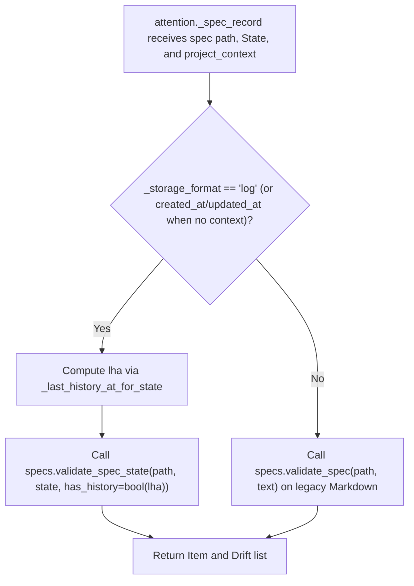

# IPD: Validate v2 log-backed specs against artifact_meta state in attention

- Date: 2026-11-21
- Kind: child
- Concern: `agent_workflows/attention.py::_spec_record` calls legacy `agent_workflows/specs.py::validate_spec(path, text)` unconditionally on every specification file, even when `state` comes from a migrated metadata-v2 event log (`meta/<id6>.jsonl`). After `aw migrate metadata --apply` strips `- Status:`, gate bullets, `- Priority:`, `- Work-Kind:`, and `## Workflow history` into `meta/<id6>.jsonl`, `specs.validate_spec` parses the stripped Markdown body and emits false `attention.missing-status`, `attention.history-missing`, and `attention.gate-missing` violations on every migrated specification. Measured during IPD `60mazt`, this caused 100 false violations across all 50 migrated specifications on a disposable clone of this repository and failed the `no_sidecar`, `mixed_layout`, and `legacy_agents_layout` AC-42 corpus tests, blocking `60mazt`, `5qyba0` rehearsal, and `cxxmyv` cutover.
- Scope: Add a pure state-aware specification validator `agent_workflows/specs.py::validate_spec_state` and route `agent_workflows/attention.py::_spec_record` through it when a specification is backed by a metadata-v2 event log (`agent_workflows/artifact_meta.py::_storage_format` returning `"log"` for `meta/<id6>.jsonl`, falling back to `state.created_at` or `state.updated_at` only when `project_context` is absent). Validate status enum membership, deferred gate rules (`gate_kind`, `gate_ref`, `gate_summary`), optional descriptive safety (`scope` and `summary` defensively when present in `state.fields`), optional `priority` and `work_kind` vocabularies, and workflow history presence (`has_history=bool(lha)` from `agent_workflows/attention.py::_last_history_at_for_state`) while keeping legacy Markdown specification validation via `agent_workflows/specs.py::validate_spec` unchanged. Add behavioral regression tests in `tests/test_readers_attention.py` covering migrated and newly created v2 specifications (valid approved, freshly created `op: "create"`, deferred with valid/missing/malformed gate and unsafe `gate_summary`, non-deferred with gate, checkpoint-only missing history, unknown status, invalid `priority`/`work_kind`) alongside legacy Markdown specifications. EXCLUDES: status-less research conversion (`fnabjy` / `s4utmv`), `aw migrate metadata` conversion code, non-`attention` direct callers of `agent_workflows/specs.py::validate_spec` (`agent_workflows/specs.py::run_check`, `agent_workflows/check_engine.py::_check_type_contracts`, `agent_workflows/status_set.py`, `agent_workflows/runner_shared.py`), and modifying `tests/test_m0001_any_repo.py` (`60mazt`).
- Scope-Paths: agent_workflows/attention.py, agent_workflows/specs.py, tests/test_readers_attention.py, .aw/records/plans/pending/20261121-0dsjzl-01-zgxig2-validate-v2-log-backed-specs-against-artifact-meta-state-in.ipd.md
- Item-Dependencies: none
- Status: executed
- Readiness: go-pending-approval
- Review-Depth: standard
- Short-Description: Validate log-backed specs from artifact_meta state and history in attention._spec_record instead of parsing stripped Markdown bullets.
- Work-Kind: bug
- Priority: high
- From-Backlog: 0dsjzl
- From-Spec: 4sd62s
- Blocks-Release: next
- Set: 0dsjzl
- Order: 1
- Highest E allocated: 03
- Author: antigravity/gemini
- Id: zgxig2

> Write and proofread this plan per the technical writing standard, `.aw/system/workflows/technical-writing/technical-writing.md` (`.agents/workflows/technical-writing/technical-writing.md` in a legacy-layout install), including requirement 12 (diagrams).

## Workflow history

- 2026-11-21 executed (aw agy run model=Gemini-4-Neon-High): aw agy run self-finalize: zgxig2 verified (set 0dsjzl, attempt 2).
- 2026-11-21 reviewed (aw set): APPROVE WITH REVISIONS APPLIED; PR-001..PR-006 FIXED
- 2026-11-21 /plan-review (antigravity/gemini-4-neon-high): APPROVE WITH REVISIONS APPLIED; PR-001..PR-006 FIXED; review record .aw/records/reviews/20261121-0dsjzl-01-zgxig2-validate-v2-log-backed-specs-against-artifact-meta-state-in.review.md
- 2026-11-21 to-review (aw set): Authored review-ready child plan graduated from backlog 0dsjzl
- 2026-11-21 draft (antigravity/gemini): created.

## Goal

Stop `aw attention` from reporting false `attention.missing-status`, `attention.history-missing`, and `attention.gate-missing` violations on migrated metadata-v2 specifications by validating log-backed specifications against `agent_workflows/artifact_meta.py::State` and workflow history while preserving all legacy Markdown specification checks.

## Detailed Implementation Checklist (TODO)

Execution-state rule: mark an `E-*` item complete only after performing the action. That mark is not validation. Right-sizing rule: write for a modest executor that cannot hold much in its head. Each E-item is one step (one concern, about one file, executable in one focused pass) and its V-item names each unit it covers with its own check; a plan stays at about 5 E-items and 8 work Scope-Paths, else split it into more child plans (guidance, `IPD-Z603`). Accepted execution states: blocked, failed, pending, performed; terminal gate demands 'performed'.

### Task group 1: State-aware v2 specification validation

- [x] E-01 Add a pure state-aware specification validator `agent_workflows/specs.py::validate_spec_state(path: Path, state: Any, *, has_history: bool) -> List[core.Drift]` (adding `Any` to the `typing` import in `agent_workflows/specs.py`). It must enforce the same specification contract rules and control flow as `agent_workflows/specs.py::validate_spec` using `agent_workflows/artifact_meta.py::State` fields and `agent_workflows/specs.py::drift_location(path)` rather than raw Markdown bullets:
  1. Status normalization and membership: read `raw_status = getattr(state, "status", None)`. Emit `attention.missing-status` when `raw_status is None` or `not str(raw_status).strip()`. Otherwise normalize `status = str(raw_status).strip()`, and emit `attention.unknown-status` when `len(status.split()) != 1` or `status not in agent_workflows/attention_contract.py::SPEC_STATUSES`.
  2. Deferred gate rules: read `fields = getattr(state, "fields", None) or {}` and extract `gate_kind`, `gate_ref`, and `gate_summary`, treating `None` and `""` as absent without stripping newlines or control characters from non-empty strings before validation. When `status == "deferred"`, emit `attention.gate-missing` if `gate_kind is None or gate_ref is None`, `attention.gate-malformed` if `gate_kind not in agent_workflows/attention_contract.py::GATE_KINDS` or `not agent_workflows/attention_contract.py::validate_gate_ref(gate_kind, gate_ref)`, and `attention.unsafe-field` if `gate_summary is not None and not agent_workflows/attention_contract.py::is_safe_descriptive(gate_summary)`. When `status != "deferred"` (including missing or unknown status, matching `agent_workflows/specs.py::validate_spec`) and any gate field is present, emit `attention.gate-forbidden`.
  3. Descriptive safety: validate `fields.get("scope")` via `agent_workflows/attention_contract.py::is_safe_prose_descriptive` and `fields.get("summary")` via `agent_workflows/attention_contract.py::is_safe_descriptive` defensively when present and non-`None`, emitting `attention.unsafe-field` on failure. Note that `agent_workflows/artifact_meta.py::REGISTRY["spec"]` does not store `scope` or `summary` (since `agent_workflows/migrations/m0001_convert.py` moves `- Scope:` and `- Summary:` bullets into Markdown body sections), whereas `gate_summary` is stored in `REGISTRY["spec"]`.
  4. Workflow history presence: emit `attention.history-missing` when `not has_history`.
  5. Optional vocabulary checks: when `fields.get("priority")` is non-`None` and non-empty, validate its stripped string against `agent_workflows/backlog.py::PRIORITIES` (`spec.priority-invalid`); when `fields.get("work_kind")` is non-`None` and non-empty, validate its stripped string against `agent_workflows/backlog.py::KINDS` (`spec.work-kind-invalid`).
  Keep `agent_workflows/specs.py::validate_spec(path, text)` intact for legacy Markdown specifications and direct callers.
  - Depends on: none
  - Expected outcome: `agent_workflows/specs.py::validate_spec_state` validates v2 specification state with identical rule IDs and locations (`agent_workflows/specs.py::drift_location(path)`) without parsing stripped Markdown bullets, and `make typecheck` passes cleanly.
  - Execution state: performed

- [x] E-02 Update `agent_workflows/attention.py::_spec_record` to detect log-backed specification state using the canonical storage-format check and route log-backed records to `agent_workflows/specs.py::validate_spec_state`:
  1. Detect log-backed state explicitly: when `project_context is not None`, `getattr(state, "id6", None)` is non-empty, and `not getattr(state, "id_derived", False)`, resolve `records_root = Path(project_context.logical_roots["records"])` and check `agent_workflows/artifact_meta.py::_storage_format(records_root, state) == "log"` (equivalently `(records_root / "meta" / f"{state.id6}.jsonl").is_file()`). Only when `project_context is None` (direct unit-test calls without a project context), fall back to `bool(getattr(state, "created_at", None) or getattr(state, "updated_at", None))`. Do not use `state.last_seq > 0` (legacy specs populate `last_seq = len(history_lines)` while checkpoint-only logs have `last_seq == 0`), `state.last_history_day` (present on legacy specs), or `state.legacy_raw_status is None` (SQLite stores `state.status` in `legacy_raw_status` for log-backed rows).
  2. Compute `lha = _last_history_at_for_state(state, project_context=project_context)` once before validation. When the specification is log-backed, call `specs_mod.validate_spec_state(path, state, has_history=bool(lha))` instead of `specs_mod.validate_spec(path, text)`. Do not treat a non-empty `artifact_meta.history(...)` list alone as `has_history=True`, because a checkpoint-only migrated log with zero workflow history still returns `[checkpoint_event]`.
  3. Keep the legacy path calling `specs_mod.validate_spec(path, text)` unchanged when the specification is not log-backed.
  - Depends on: E-01
  - Expected outcome: `agent_workflows/attention.py::_spec_record` validates log-backed v2 specifications (including checkpoint-only migrated logs with `created_at=None` and `updated_at=None`) from `agent_workflows/artifact_meta.py::State` and `_last_history_at_for_state`, returning zero false `attention.missing-status`, `attention.history-missing`, or `attention.gate-missing` violations while preserving exact legacy Markdown validation behavior.
  - Execution state: performed

- [x] E-03 Add behavioral tests in `tests/test_readers_attention.py` that construct v2 log-backed specifications (via real `meta/<id6>.jsonl` event logs and v2 `---` mirror files stripped of `- Status:` and `## Workflow history`, or real `agent_workflows/migrations/m0001_convert.py::convert_records` output) and run `agent_workflows/attention.py::scan` and `aw attention --all --format json` to verify:
  1. A migrated `approved` specification (with `seq: 0` checkpoint `last_history_day` and `op: "legacy"` history events) returns `valid: true`, `native_status: "approved"`, `last_history_at`, and zero violations.
  2. A freshly created v2 specification (`seq: 1`, `op: "create"`, no `last_history_day` checkpoint field) returns `valid: true`, expected `native_status`, `last_history_at` derived from the `create` event timestamp, and zero violations.
  3. A migrated `deferred` specification with valid `gate_kind`/`gate_ref` returns zero violations; a migrated `deferred` specification missing `gate_kind`/`gate_ref` reports `attention.gate-missing`; a migrated `deferred` specification with malformed `gate_kind`/`gate_ref` reports `attention.gate-malformed`; a migrated `deferred` specification with control characters or over-length `gate_summary` reports `attention.unsafe-field`; and a non-deferred log-backed specification carrying gate fields reports `attention.gate-forbidden`.
  4. A migrated checkpoint-only specification (`seq: 0` only, `created_at=None`, `updated_at=None`, no `last_history_day`, no history events) is recognized as log-backed (zero false `attention.missing-status`) and reports `attention.history-missing`.
  5. Log-backed specifications with an unknown status report `attention.unknown-status`, and log-backed specifications with invalid `priority` or `work_kind` report `spec.priority-invalid` or `spec.work-kind-invalid`.
  6. Existing legacy Markdown specification tests continue to pass unchanged, and a legacy Markdown specification with workflow history (`last_seq > 0`) still routes through `agent_workflows/specs.py::validate_spec` (for example still reporting `spec.metadata-bullet-repeated` when a single-valued metadata bullet is duplicated).
  Keep all added tests purely behavioral with zero `inspect`, `ast`, or production source-code regex checks. Run `python3 -m pytest -o addopts="" -v tests/test_readers_attention.py tests/test_attention.py tests/test_specs_verbs.py`, `aw suite`, `make typecheck`, `aw ipd lint --phase pre-transition` on this plan, and `aw sanitize --agent`.
  - Depends on: E-02
  - Expected outcome: All targeted tests, `aw suite`, `make typecheck`, `aw ipd lint --phase pre-transition`, and `aw sanitize --agent` pass with zero regressions and zero source-code inspection tests.
  - Execution state: performed

## Project conventions discovered (Step 0)

- `agent_workflows/attention.py::_spec_record` calls `agent_workflows/specs.py::validate_spec(path, text)` unconditionally even after `dqutt8` moved `_spec_record` field extraction onto `agent_workflows/artifact_meta.py::State`.
- `agent_workflows/artifact_meta.py::_storage_format` defines the canonical log-vs-legacy storage test: `"log"` when `(records_root / "meta" / f"{id6}.jsonl").exists()`, else `"legacy"`. By contrast, `State` attributes alone cannot distinguish every migrated spec from a legacy spec:
  - `agent_workflows/artifact_meta.py::load_legacy_artifact` and `read_text` set `last_seq = len(history_lines)` and populate `last_history_day` for legacy Markdown specs.
  - `agent_workflows/artifact_meta.py::replay` sets `created_at` only on `seq == 1` (`op == "create"`) and `updated_at` only when `seq > 0`, so a checkpoint-only migrated spec (`seq == 0`) has `created_at=None`, `updated_at=None`, and `last_seq == 0`.
  - `agent_workflows/artifact_meta.py::_load_sources` writes `state.status` into the SQLite `legacy_raw_status` column for log-backed rows, and `State` has no `source` attribute.
- `agent_workflows/attention.py::_last_history_at_for_state` returns `state.last_history_day` for checkpoint-only logs (`None` when absent), parses conformant `op: "legacy"` lines via `agent_workflows/attention_contract.py::last_history_at`, and falls back to event timestamps for fresh `op: "create"`/`transition` logs. Meanwhile, `agent_workflows/artifact_meta.py::history` returns `[checkpoint_event]` (non-empty) even when a migrated spec had zero workflow history.
- `agent_workflows/artifact_meta.py::REGISTRY["spec"]` stores `gate_kind`, `gate_ref`, `gate_summary`, `priority`, and `work_kind`, whereas `agent_workflows/migrations/m0001_convert.py::_build_field_destinations` moves `- Scope:` and `- Summary:` bullets into Markdown body sections (`## Scope`, `## Summary`).
- `agent_workflows/specs.py::validate_spec` emits `core.Drift` records using `agent_workflows/specs.py::drift_location(path)` and rule IDs `spec.metadata-bullet-repeated`, `attention.missing-status`, `attention.unknown-status`, `attention.gate-missing`, `attention.gate-malformed`, `attention.gate-forbidden`, `attention.unsafe-field`, `attention.history-missing`, `spec.priority-invalid`, and `spec.work-kind-invalid`.
- `tests/test_readers_attention.py` pins behavioral `aw attention` contracts across all tracked trees and is marked `@pytest.mark.core`.

## Findings

| Id | Finding | Evidence |
|---|---|---|
| F-01 | `agent_workflows/attention.py::_spec_record` unconditionally calls legacy Markdown parser `agent_workflows/specs.py::validate_spec(path, text)`. | `agent_workflows/attention.py::_spec_record`; measured during IPD `60mazt` (`50 attention.missing-status` + `50 attention.history-missing` across all 50 migrated specs on a repo clone, plus `no_sidecar`, `mixed_layout`, and `legacy_agents_layout`). |
| F-02 | Migrated checkpoint-only v2 logs (`seq == 0`, no legacy history events and no post-cutover events) have `created_at = None`, `updated_at = None`, and `last_seq == 0`, while legacy Markdown specs with history have `last_seq > 0`, so `State` fields alone cannot reliably distinguish log-backed specs from legacy specs. | `agent_workflows/artifact_meta.py::replay`, `agent_workflows/artifact_meta.py::load_legacy_artifact`, `agent_workflows/artifact_meta.py::_load_sources`, `agent_workflows/artifact_meta.py::_storage_format`, and spec `4sd62s` Section 4.2b. |
| F-03 | `agent_workflows/artifact_meta.py::history` returns `[checkpoint_event]` for a checkpoint-only migrated spec with zero workflow history, so checking list truthiness would suppress `attention.history-missing`; `agent_workflows/attention.py::_last_history_at_for_state` already distinguishes real/migrated history from an empty checkpoint. | `agent_workflows/artifact_meta.py::history`, `agent_workflows/attention.py::_last_history_at_for_state`. |

## Proposed changes (ordered, validatable)

1. Add `agent_workflows/specs.py::validate_spec_state` enforcing the specification contract over `agent_workflows/artifact_meta.py::State` and `has_history` (`E-01`).
2. Route log-backed specifications in `agent_workflows/attention.py::_spec_record` (detected via `agent_workflows/artifact_meta.py::_storage_format` == `"log"`, with `created_at`/`updated_at` fallback when `project_context` is absent) to `agent_workflows/specs.py::validate_spec_state` with `has_history=bool(lha)` while keeping legacy Markdown specifications on `agent_workflows/specs.py::validate_spec` (`E-02`).
3. Add behavioral v2 specification attention tests to `tests/test_readers_attention.py` and run all verification gates (`E-03`).

## Deferred / out of scope (with reason)

- Fixing fabricated `status: "draft"` on status-less `research` records (`m0001_convert` / `artifact_meta`): owned by sibling plan `s4utmv` (from backlog `fnabjy`).
  - Carrier: s4utmv
- Re-running AC-42 corpus and clone verification in `tests/test_m0001_any_repo.py`: owned by pending plan `60mazt`.
  - Carrier: 60mazt

## Scope check

- Over-scope: none. Only `agent_workflows/specs.py`, `agent_workflows/attention.py`, `tests/test_readers_attention.py`, and this plan are modified. Non-`attention` callers of `agent_workflows/specs.py::validate_spec` remain unchanged.
- Under-scope: none. Covers migrated v2 specifications (with or without post-cutover events, including checkpoint-only specs with `created_at=None` and `updated_at=None`), freshly created `op: "create"` v2 specifications, deferred gate validation (`gate-missing`, `gate-malformed`, `gate-forbidden`, `unsafe-field`), optional defensive descriptive safety, `priority`/`work_kind` vocabularies, history presence, and legacy Markdown regression coverage.

## Required tests / validation

- `python3 -m pytest -o addopts="" -v tests/test_readers_attention.py tests/test_attention.py tests/test_specs_verbs.py` (all tests pass, including new v2 specification cases and unchanged legacy cases)
- `aw suite` (full core suite passes)
- `make typecheck` (0 mypy errors)
- `aw ipd lint --phase pre-transition` on this plan (`outcome: "clean"`)
- `aw sanitize --agent` (`outcome: "clean"`)

## Spec / documentation sync

N/A: spec `4sd62s` already designates `meta/<id6>.jsonl` as the sole metadata and history authority for migrated v2 records; this plan brings `agent_workflows/attention.py::_spec_record` into compliance with spec `4sd62s` without changing CLI flags, output schemas, or file formats.

## Open questions

None.

## Validation and cross-check (verify before reporting done)

Validation-state rule: inspect evidence in a separate pass. Do not mark a `V-*` item complete from memory or from the matching execution checkmark. Accepted validation results: blocked, failed, pass, pending; terminal gate demands 'pass'. Runtime-demonstration reachability rule: for each `V-*` item demanding the software be observed acting (such as a run, a dispatch, or a transition), as distinct from items demanding a diff, a file's content, or a test result (which are reachable by construction), name the code path that produces the observation or the sibling `E-*` that creates it, else the demand is UNDER-SCOPE.

- [x] V-01 validates E-01
  - Required evidence: paste the `git diff agent_workflows/specs.py` summary showing `validate_spec_state` (and the `Any` typing import) covers status normalization/enum, deferred gate rules (`gate-missing`, `gate-malformed`, `gate-forbidden`, `unsafe-field`), defensive descriptive safety (`scope`, `summary`), history presence (`has_history`), and optional `priority`/`work_kind` vocabularies while preserving `validate_spec`.
  - Observed evidence: `git diff --stat agent_workflows/specs.py` reports `agent_workflows/specs.py | 159 ++++++++++++++++++++++++++++++++++++++++++-`. Added `Any` to `from typing import Any, Dict, List, Optional, Tuple` and added `validate_spec_state(path: Path, state: Any, *, has_history: bool) -> List[core.Drift]` using `drift_location(path)`. Enforces `attention.missing-status` and `attention.unknown-status` (`A.SPEC_STATUSES`, single-token check), deferred gate rules (`attention.gate-missing`, `attention.gate-malformed` via `A.GATE_KINDS`/`A.validate_gate_ref`, `attention.unsafe-field` via `A.is_safe_descriptive` without stripping non-empty strings, `attention.gate-forbidden` on non-deferred/missing/unknown status), defensive `scope` (`A.is_safe_prose_descriptive`) and `summary` (`A.is_safe_descriptive`), `attention.history-missing` when `not has_history`, and optional `spec.priority-invalid` (`backlog.PRIORITIES`) / `spec.work-kind-invalid` (`backlog.KINDS`). Existing `validate_spec(path, text)` is untouched.
  - Result: pass

- [x] V-02 validates E-02
  - Required evidence: paste the `git diff agent_workflows/attention.py` summary showing canonical log-backed detection via `artifact_meta._storage_format` (with `created_at`/`updated_at` fallback when `project_context is None`), single `lha = _last_history_at_for_state(...)` computation passed as `has_history=bool(lha)` into `specs_mod.validate_spec_state`, and confirmation that legacy Markdown specs still call `specs_mod.validate_spec`.
  - Observed evidence: `git diff --stat agent_workflows/attention.py` reports `agent_workflows/attention.py | 28 ++++++--`. In `_spec_record`: when `project_context is not None` and `getattr(state, "id6", None)` is non-empty and `not getattr(state, "id_derived", False)`, resolves `records_root = Path(project_context.logical_roots["records"])` and sets `is_log_backed = _meta._storage_format(records_root, state) == "log"`; when `project_context is None`, falls back to `bool(getattr(state, "created_at", None) or getattr(state, "updated_at", None))`. Computes `lha = _last_history_at_for_state(state, project_context=project_context)` once before validation, routes log-backed specs to `specs_mod.validate_spec_state(path, state, has_history=bool(lha))`, keeps legacy Markdown specs on `specs_mod.validate_spec(path, text)`, and reuses `lha` in the returned `Item`.
  - Result: pass

- [x] V-03 validates E-03
  - Required evidence: paste actual output from `python3 -m pytest -o addopts="" -v tests/test_readers_attention.py tests/test_attention.py tests/test_specs_verbs.py` (showing passing tests for migrated approved, fresh `op: "create"`, deferred valid/missing/malformed/unsafe gate, non-deferred gate forbidden, checkpoint-only missing history, unknown status, invalid `priority`/`work_kind`, and legacy Markdown spec parity), `aw suite`, `make typecheck`, `aw ipd lint --phase pre-transition` on this plan, and `aw sanitize --agent`, plus confirmation that no added test uses `inspect`, `ast`, or source-code regex checks.
  - Observed evidence:
    - Targeted pytest (`python3 -m pytest -o addopts="" -v tests/test_readers_attention.py tests/test_attention.py tests/test_specs_verbs.py`): `tests/test_readers_attention.py::test_v2_log_backed_specs_valid_migrated_and_fresh PASSED`, `tests/test_readers_attention.py::test_v2_log_backed_specs_gate_history_status_and_vocab_violations PASSED`, `tests/test_readers_attention.py::test_legacy_spec_with_history_still_uses_validate_spec PASSED`, `tests/test_readers_attention.py::test_validate_spec_state_defensive_fields_and_no_context_fallback PASSED`, `tests/test_readers_attention.py::test_specs_tree_attention_pin PASSED`; summary: `111 passed in 30.49s`.
    - `aw suite`: `2640 passed, 11 warnings in 97.54s (0:01:37)`.
    - `make typecheck`: `python3 -m mypy agent_workflows` -> `Success: no issues found in 228 source files`.
    - `aw sanitize --agent`: `{"schema":"aw.agent/v1","kind":"result","cmd":"check-local-leaks","outcome":"clean","exit":0,"verified":true,"complete":true,"checked":6845,"findings":0,"evidence":["leak-scan"],"next":null}`.
    - Behavioral-only check: `grep -nE "\b(inspect|ast|re\.|read_text)\b" tests/test_readers_attention.py` returned 0 matches (no `inspect`, `ast`, or source-code regex checks).
    - `aw ipd lint --phase pre-transition --agent`: `{"schema":"aw.agent/v1","kind":"result","cmd":"ipd lint","outcome":"clean","exit":0,"verified":true,"complete":true,"findings":0,"evidence":["plans-lint"],"next":null}`.
  - Result: pass

## Approval and execution gate

- Size assessment: standard
- Cohesion rationale: not required

Execute only after human approval (`- Status: approved` or `auto-approved`). Open questions: none open.

Scope fence: the paths in `- Scope-Paths:` are a declaration. If execution must edit a file outside the fence, make the needed edit and justify it at finalize (`--scope-reason`), and acknowledge any declared path left unmodified (`--scope-ack`).

Safety rule: uncommitted changes and untracked files you did not create are not yours; never revert, stage, commit, discard, reformat, or clean up another party's work. Stop and report if a file you must edit has an unresolvable concurrent-edit conflict.

Honesty rule: run all required tests and checks and paste the ACTUAL runner output and summary lines; never claim a result you did not run.

Commits: commit only files modified for this plan through `aw commit zgxig2 -- <paths>`; never `git add -A`, a bare `git add`, `git commit -a`, or `--no-verify`; never push without explicit human instruction.

Lifecycle transition: this plan moves to `.aw/records/plans/executed/` only through `aw ipd finalize`, never a hand `git mv`, and only after `aw ipd lint --phase pre-transition` conforms and every `V-*` reads `pass` with pasted evidence. When `aw oc run` or `aw agy run` executes this plan, the runner owns retirement to `executed/` and runs finalize automatically upon task completion; when executed standalone by hand or direct agent turn, the executor runs `aw ipd finalize zgxig2`.
