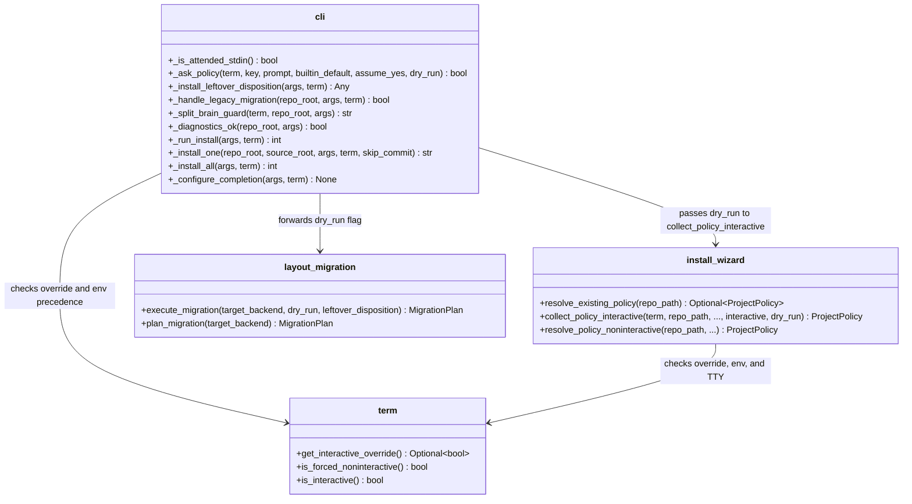
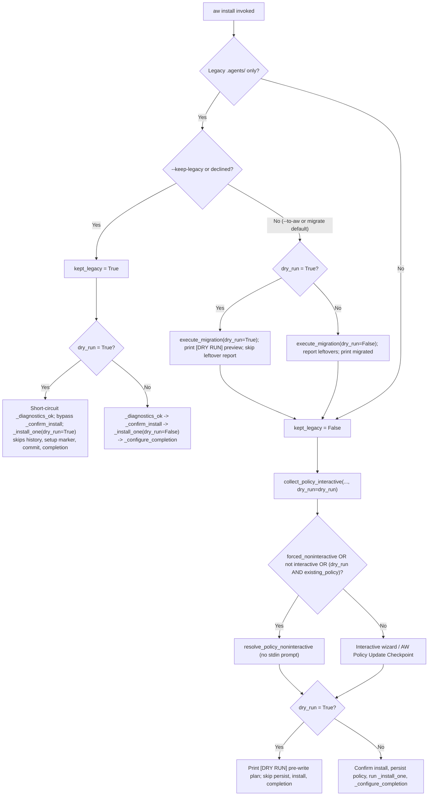

# IPD: Preserve dry-run and non-interactive invariants in legacy aw install

- Date: 2026-11-21
- Kind: child
- Concern: Backlog `3z57rk` (`Work-Kind: bug`, `Priority: high`, `Blocks-Release: next`) reports that running `aw install --dry-run --no-interactive` in a repository with a legacy 1.2.1 `.agents/` layout executes the full layout migration live on disk (`git mv` of `.agents/` and `workflow-artifacts/` into `.aw/`, deleting leftover `.agents/README.md` with a backup tarball) and then blocks waiting on the interactive `AW Policy Update Checkpoint` prompt (`Keep current policy and proceed? [Y/n/review]`). Code inspection and direct reproduction show three linked defects: (1) `agent_workflows/cli.py::_handle_legacy_migration` (both the `--to-aw` and `should_migrate` branches) and `agent_workflows/cli.py::_split_brain_guard` call `MigrationManager.execute_migration` without forwarding `dry_run=bool(getattr(args, "dry_run", False))`, even though `agent_workflows/layout_migration.py::MigrationManager.execute_migration` already supports `dry_run: bool = False`; (2) `agent_workflows/install_wizard.py::collect_policy_interactive` checks bare `sys.stdin.isatty()` instead of the canonical interactivity contract in `agent_workflows/term.py` (`is_interactive`, `get_interactive_override`, and `is_forced_noninteractive`) and does not accept `dry_run`, causing it to render `AW Policy Update Checkpoint` and call `input()` on a Teletype (TTY) even when `--no-interactive`, `AW_NONINTERACTIVE`, `CI`, or `--dry-run` is active; and (3) `agent_workflows/cli.py` contains related dry-run and non-interactive leaks on the same Command-Line Interface (CLI) install flow (`_install_one` writes `.aw/setup-repo-needed.md`, `.aw/.gitignore`, and `.aw/state/durable/install.json` via `record_install_history` and `engine.write_setup_marker` under `--dry-run`; `_configure_completion` does not short-circuit on `--dry-run`; `_ask_policy`, `_confirm_install`, `_confirm_relocation`, and `_install_leftover_disposition` allow `isinstance(sys.stdin, io.StringIO)` to override `--no-interactive` / `AW_NONINTERACTIVE` / `CI`; and `_run_install` / `_install_all` gate dry-run previews on confirmation prompts).
- Scope: IN: (1) update `agent_workflows/install_wizard.py::collect_policy_interactive` to honor `agent_workflows/term.py` interactivity precedence (`--no-interactive` > `AW_NONINTERACTIVE`/`CI` > `--interactive` > stream detection, without allowing `io.StringIO` to override forced non-interactive mode) and add keyword-only `dry_run: bool = False` so dry-run calls with an existing policy resolve non-interactively without prompting `AW Policy Update Checkpoint`; (2) update `agent_workflows/cli.py` to introduce `_is_attended_stdin()` for `_ask_policy`, `_confirm_install`, `_confirm_relocation`, and `_install_leftover_disposition`, read `dry_run` safely via `getattr(args, "dry_run", False) is True` (avoiding truthy unset `MagicMock` attributes), forward `dry_run` in `_ask_policy` (no prompt and no user-config write), `_install_leftover_disposition`, `_handle_legacy_migration`, `_split_brain_guard`, and `_run_install` (`collect_policy_interactive` and the `kept_legacy` dry-run confirmation bypass), emit dry-run preview messages instead of claiming live migration or leftover removal, short-circuit `_diagnostics_ok` on `dry_run` (preventing `git fetch`, interactive prompts, or `git pull --rebase` during `--dry-run`), guard `record_install_history` and `engine.write_setup_marker` in `_install_one` against `dry_run`, short-circuit `_configure_completion` on `dry_run`, and bypass batch `_confirm` in `_install_all` on `dry_run`; (3) update all four exact-keyword `execute_migration.assert_called_once_with(...)` assertions in `tests/test_installer.py` (`SplitBrainLayoutGuardTests.test_guard_clean_shapes_description_and_migration`, `InstallLeftoverDispositionThreadingTests.test_migration_paths_thread_requested_disposition`, and `InstallLeftoverDispositionThreadingTests.test_legacy_migration_fail_soft_on_preflight_gate_error`) to verify `dry_run=False` forwarding and add a `dry_run=True` subtest; and (4) add fast (< 2s per test) behavioral regression tests in `tests/test_install_dry_run_noninteractive.py` covering the exact `3z57rk` reproduction and every dry-run and non-interactive matrix case. OUT: modifying `agent_workflows/layout_migration.py::MigrationManager.execute_migration` or `plan_migration` (already read-only under `dry_run=True`), changing `agent_workflows/term.py::is_interactive`, modifying `agent_workflows/engine.py::install_into_repo` or `run_git_diagnostics`, or changing `aw migrate-layout` behavior.
- Scope-Paths: agent_workflows/cli.py, agent_workflows/install_wizard.py, tests/test_installer.py, tests/test_install_dry_run_noninteractive.py
- Scope-Exceeded: agent_workflows/engine.py (Guard save_created_files_record and prune_old_backups inside if not dry_run in install_into_repo so --dry-run --keep-legacy leaves git status clean without creating .agent-workflows-installer-backups ...)
- Item-Dependencies: none
- Status: executed
- Readiness: go-pending-approval
- Review-Depth: standard
- Short-Description: Forward dry_run through install-time layout migration, honor --no-interactive and --dry-run in install_wizard and install helpers, and guard dry-run side effects
- Work-Kind: bug
- Priority: high
- From-Backlog: 3z57rk
- Blocks-Release: next
- Set: 3z57rk
- Order: 1
- Highest E allocated: 05
- Author: antigravity/gemini-4-neon-high
- Id: rznd0q

> Write and proofread this plan per the technical writing standard, `.aw/system/workflows/technical-writing/technical-writing.md` (`.agents/workflows/technical-writing/technical-writing.md` in a legacy-layout install), including requirement 12 (diagrams).

## Workflow history

- 2026-11-22 executed (aw agy run model=Gemini-4-Neon-High): aw agy run self-finalize: rznd0q verified (set 3z57rk, attempt 1). [Scope reconciliation - out-of-scope agent_workflows/engine.py: Guard save_created_files_record and prune_old_backups inside if not dry_run in install_into_repo so --dry-run --keep-legacy leaves git status clean without creating .agent-workflows-installer-backups (required by E-04 item 4a)]
- 2026-11-22 approved (aw set): status set to approved
- 2026-11-22 reviewed (aw set): APPROVE WITH REVISIONS APPLIED; PR-001..PR-004 FIXED
- 2026-11-21 /plan-review (antigravity/gemini-4-neon-high): APPROVE WITH REVISIONS APPLIED; PR-001, PR-002, PR-003, PR-004
- 2026-11-21 to-review (antigravity/gemini-4-neon-high): authored review-ready child plan graduated from backlog 3z57rk.
- 2026-11-21 draft (antigravity/gemini-4-neon-high): created.

## Goal

Ensure `aw install --dry-run` never modifies the working tree, git index, `.aw/` directories, user configuration, or shell completion files in legacy or modern repositories, and ensure `--no-interactive` (along with `AW_NONINTERACTIVE` and `CI`) never blocks waiting on standard input during `aw install`.

## Detailed Implementation Checklist (TODO)

Execution-state rule: mark an `E-*` item complete only after performing the action. That mark is not validation. Right-sizing rule: write for a modest executor that cannot hold much in its head. Each E-item is one step (one concern, about one file, executable in one focused pass) and its V-item names each unit it covers with its own check; a plan stays at about 5 E-items and 8 work Scope-Paths, else split it into more child plans (guidance, `IPD-Z603`). Accepted execution states: blocked, failed, pending, performed; terminal gate demands 'performed'.

### Task group 1: Honor non-interactive overrides and dry-run in `install_wizard.py`

- [x] E-01 In `agent_workflows/install_wizard.py`, update `collect_policy_interactive` to enforce the repository's canonical interactivity contract and accept `dry_run` (remaining signature-compatible with pending sibling plan `gftvh6` regardless of execution order):
  1. Ensure `collect_policy_interactive` accepts optional keyword-only parameters `interactive: Optional[bool] = None` and `dry_run: bool = False` (preserving `interactive` if sibling plan `gftvh6` already added it, and defaulting both so all existing callers remain compatible).
  2. Replace the bare `(hasattr(sys.stdin, "isatty") and sys.stdin.isatty()) or isinstance(sys.stdin, io.StringIO)` predicate with `agent_workflows/term.py` precedence:
     - Compute `forced_noninteractive = (interactive is False) or (_term_mod.get_interactive_override() is False) or _term_mod.is_forced_noninteractive()`.
     - If `assume_yes` or `forced_noninteractive`: `is_interactive = False`.
     - Else if `interactive is True`: `is_interactive = True`.
     - Else: `is_interactive = _term_mod.is_interactive() or isinstance(sys.stdin, io.StringIO)`.
  3. Route to `resolve_policy_noninteractive(...)` whenever `not is_interactive` OR `(dry_run and existing_policy is not None)`.
  - Depends on: none
  - Expected outcome: `collect_policy_interactive` never calls `input()` when `interactive=False`, `--no-interactive`, `AW_NONINTERACTIVE`, `CI`, or non-TTY standard input is active (even if `sys.stdin` is an `io.StringIO` or a real TTY), skips the `AW Policy Update Checkpoint` prompt when `dry_run=True` and `existing_policy is not None`, preserves `interactive=True` support for `gftvh6`, and continues to fail closed with `IncompletePolicyError` on non-interactive first install without required policy flags.
  - Execution state: performed

### Task group 2: Thread `dry_run` and enforce non-interactive guards in `cli.py`

- [x] E-02 In `agent_workflows/cli.py`, forward `dry_run` through install-time layout migration, honor forced non-interactive mode across install helpers, and guard all dry-run write paths reachable from `aw install` (reading `dry_run` as `getattr(args, "dry_run", False) is True` throughout, matching `_split_brain_guard`'s `_split_brain_consented` `is True` convention so unset `MagicMock` test attributes never evaluate as `dry_run=True`):
  1. Add a private helper `_is_attended_stdin() -> bool` that returns `False` when `_term_mod.get_interactive_override() is False` or `_term_mod.is_forced_noninteractive()` is `True`, and otherwise returns `_term_mod.is_interactive() or isinstance(sys.stdin, io.StringIO)`. Replace the inline `_term_mod.is_interactive() or isinstance(sys.stdin, io.StringIO)` checks in `_ask_policy`, `_confirm_install`, `_confirm_relocation`, and `_install_leftover_disposition` with `_is_attended_stdin()`.
  2. Add optional keyword-only parameter `dry_run: bool = False` to `_ask_policy`. When `dry_run` is `True` and no saved boolean exists in config, return `builtin_default` after printing the default notice without calling `_prompt_yes_no` or `config.set_config_value`.
  3. In `_install_leftover_disposition`, when `getattr(args, "dry_run", False) is True` and neither an explicit `--leftovers` flag nor a saved `defaults.leftovers` config value is set, return `"remove"` without constructing `_LeftoverPromptCallback`.
  4. In `_handle_legacy_migration`, compute `dry_run = getattr(args, "dry_run", False) is True`, pass `dry_run=dry_run` to `_ask_policy`, and pass `dry_run=dry_run` to both `mgr.execute_migration(target_backend="repository", leftover_disposition=..., dry_run=dry_run)` calls (the `to_aw` branch and the `should_migrate` branch). When `dry_run` is `True`, skip `_report_leftover_removal(term, mgr)`, emit `term.status("ok", f"[DRY RUN] {repo_root}: would migrate legacy layout to .aw/ (no changes written)")`, and return `False`. Keep existing non-dry-run behavior unchanged.
  5. In `_split_brain_guard`, compute `dry_run = getattr(args, "dry_run", False) is True` and pass `dry_run=dry_run` to `mgr.execute_migration(...)` in the interactive consolidate branch. When `dry_run` is `True`, skip `_report_leftover_removal(term, mgr)`, emit `term.status("ok", f"[DRY RUN] {repo_root}: would consolidate split-brain layout into .aw/ (no changes written)")`, and return `"skip"`.
  6. In `_diagnostics_ok`, return `True` immediately when `getattr(args, "dry_run", False) is True` so `--dry-run` on `kept_legacy=True` or `aw install all` never runs `git fetch`, blocks on an interactive dirty/behind prompt, or runs `git pull --rebase`.
  7. In `_run_install`:
     - Pass `dry_run=(getattr(args, "dry_run", False) is True)` to `collect_policy_interactive(...)`.
     - Bypass `_confirm_install` when `getattr(args, "dry_run", False) is True` and `not relocating` (so `kept_legacy=True` dry-runs such as `aw install --dry-run --keep-legacy --no-interactive` proceed directly to dry-run preview in `_install_one` without blocking or declining).
  8. In `_install_one`, wrap both `record_install_history(...)` and `engine.write_setup_marker(repo_root)` inside `if not (getattr(args, "dry_run", False) is True):` (matching the existing `handle_pending_migrations_after_install` dry-run guard).
  9. In `_configure_completion`, return immediately when `getattr(args, "dry_run", False) is True` so `aw install --dry-run` never prompts for or writes shell completion files. In `_install_all`, bypass the batch `_confirm` prompt when `getattr(args, "dry_run", False) is True`.
  - Depends on: E-01
  - Expected outcome: Running `aw install --dry-run` (with or without `--no-interactive`, `--to-aw`, `--keep-legacy`, `--yes`, `--completion`, or `all`) performs zero writes to the repository working tree, git index, `.aw/` directories, user config, or shell completion directories, prints honest `[DRY RUN]` preview messages, and never blocks waiting for standard input when `--no-interactive` or `--dry-run` applies.
  - Execution state: performed

### Task group 3: Update existing mock assertions and add behavioral regression coverage

- [x] E-03 In `tests/test_installer.py`, update the exact-kwargs `execute_migration` mock assertions across `SplitBrainLayoutGuardTests` and `InstallLeftoverDispositionThreadingTests`:
  1. Update all four existing `MockMgr.return_value.execute_migration.assert_called_once_with(...)` assertions to include `dry_run=False`: `SplitBrainLayoutGuardTests.test_guard_clean_shapes_description_and_migration`, `InstallLeftoverDispositionThreadingTests.test_migration_paths_thread_requested_disposition` (both `--to-aw` and interactive `_handle_legacy_migration` subtests), and `InstallLeftoverDispositionThreadingTests.test_legacy_migration_fail_soft_on_preflight_gate_error` (the split-brain migrate-now subtest).
  2. Add a `dry_run=True` subtest in `InstallLeftoverDispositionThreadingTests` confirming that `_handle_legacy_migration` forwards `dry_run=True` to `execute_migration`, does not call `_report_leftover_removal`, and reports a `[DRY RUN]` preview message rather than claiming migration completed.
  - Depends on: E-02
  - Expected outcome: All existing and updated tests in `tests/test_installer.py` (`SplitBrainLayoutGuardTests` and `InstallLeftoverDispositionThreadingTests`) pass with `0 unlisted slow tests`.
  - Execution state: performed

- [x] E-04 Create fast (< 2s per test, un-slowed) behavioral regression tests in `tests/test_install_dry_run_noninteractive.py` using zero `inspect`, `ast`, or source-regex checks against production code:
  1. Exact `3z57rk` reproduction test: build a temporary git repository with a committed legacy 1.2.1 layout (`.agents/workflows/VERSION`, `.agents/workflows/index.md`, `.agents/README.md`, and tracked `workflow-artifacts/verify/run1/out.md`), run `cli.main(["install", str(repo), "--dry-run", "--no-interactive"])` in-process with a simulated TTY `stdin` (`isatty() -> True`), isolated `AW_HOME`/`HOME`/`XDG_CONFIG_HOME`, and `builtins.input` patched to raise `AssertionError`. Assert exit code `0`, zero `input()` calls, `AW Policy Update Checkpoint` absent from output, `migrated legacy layout to .aw/` absent, `[DRY RUN]` preview present, `(repo / ".aw").exists()` is `False`, `.agents/` and `workflow-artifacts/` remain byte-identical, and `git status --porcelain` is empty.
  2. `--dry-run --to-aw --no-interactive` test on the same legacy layout: assert exit code `0`, zero `input()` calls, `(repo / ".aw").exists()` is `False`, all legacy files remain byte-identical, `git status --porcelain` is empty, and `[DRY RUN]` preview is printed.
  3. Interactive-TTY `--dry-run` test (without `--no-interactive`, with `AW_NONINTERACTIVE` and `CI` cleared from `os.environ` so the test is non-vacuous in CI environments) on both a legacy `.agents/` repository and an already-installed `.aw/` repository, with `builtins.input` patched to raise `AssertionError`: assert exit code `0`, zero `input()` calls, no user config written under `XDG_CONFIG_HOME`, zero working-tree or `.aw/` changes, and empty `git status --porcelain`.
  4. `--dry-run --keep-legacy` tests on a legacy repository: (a) with `--no-interactive` (both without `--yes` and with `--yes`), assert exit code `0`, zero `input()` calls, `(repo / ".aw").exists()` is `False` (specifically no `.aw/setup-repo-needed.md`, `.aw/.gitignore`, or `.aw/state/durable/install.json`), and empty `git status --porcelain`; (b) on a tracked-dirty legacy repository with a simulated interactive TTY (with `AW_NONINTERACTIVE` and `CI` cleared and `builtins.input` patched to raise `AssertionError`), assert `cli.main(["install", str(repo), "--dry-run", "--keep-legacy"])` exits `0` with zero `input()` calls and leaves `.aw/` absent and the dirty tracked file untouched (pinning `_diagnostics_ok`'s dry-run short-circuit).
  5. Direct `collect_policy_interactive` interactivity matrix test (clearing `AW_NONINTERACTIVE` and `CI` except where explicitly tested): verify with `builtins.input` patched to raise `AssertionError` that (a) `term.set_interactive_override(False)` and `interactive=False` each prevent prompting on both simulated TTY `stdin` and `io.StringIO` `stdin`; (b) `AW_NONINTERACTIVE=1` and `CI=1` prevent prompting on simulated TTY `stdin`, `io.StringIO` `stdin`, and even with `interactive=True`; (c) `dry_run=True` with an existing policy prevents prompting on a simulated interactive TTY; (d) `interactive=True` without forced non-interactive overrides and with `dry_run=False` enters the interactive path when `assume_yes=False` (preserving `gftvh6` compatibility); and (e) non-interactive first install on a fresh repository without policy flags raises `IncompletePolicyError` without calling `input()`.
  6. Split-brain `--dry-run` and completion `--dry-run` tests: (a) in a split-brain repository (`.aw/system` plus `.agents/workflows`), verify `_split_brain_guard` under `dry_run=True` with interactive consolidate answer calls `execute_migration(..., dry_run=True)` and leaves `.agents/workflows` and git state unchanged; (b) verify `aw install <repo> --dry-run --no-interactive --completion bash` writes no completion file under isolated `HOME`/`XDG_DATA_HOME`.
  - Depends on: E-02
  - Expected outcome: All tests in `tests/test_install_dry_run_noninteractive.py` run under default `python3 -m pytest` (no `pytest.mark.slow`), pass in under 2 seconds per test with `0 unlisted slow tests`, and fail if any of the repaired regressions returns.
  - Execution state: performed

### Task group 4: Validate repository gates and commit

- [x] E-05 After the final edit, run the targeted test suites (`python3 -m pytest tests/test_install_dry_run_noninteractive.py tests/test_stdin_interactive.py tests/test_install_consent_truth.py tests/test_placement_switch_guard.py tests/test_records_root_switch_guard.py -v`, `python3 -m pytest -m "" tests/test_installer.py -k "migration_paths_thread or legacy_migration or guard_clean_shapes" -v`, and `python3 -m pytest -m "" tests/test_cli.py -k "legacy_repo" -v`), bare `python3 -m pytest`, `make test-all`, `aw check all --agent`, and `aw sanitize --agent`, then commit only the four `- Scope-Paths:` files through `aw commit rznd0q`.
  - Depends on: E-03, E-04
  - Expected outcome: Every targeted suite, bare `python3 -m pytest`, `make test-all`, `aw check all --agent`, `aw sanitize --agent`, and the path-scoped `aw commit rznd0q` commit succeed with zero failures.
  - Execution state: performed

Add further leaves as `- [ ] E-NEW <action>` and run `aw ipd sync` to assign ids.

## Project conventions discovered (Step 0)

- `agent_workflows/term.py::is_interactive` is the repository's single originating definition of interactivity (`plan da9n1s`, Set `svqhmp`), enforcing the asymmetric precedence ladder `--no-interactive` > `AW_NONINTERACTIVE`/`CI` > `--interactive` > stream detection (including Windows `NUL` console probing via `stdin_is_interactive`). Early CLI flag parsing in `agent_workflows/cli.py` sets `_term_mod.set_interactive_override(False)` when `--no-interactive` is passed.
- `agent_workflows/layout_migration.py::MigrationManager.execute_migration` already accepts `dry_run: bool = False`. After validating the read-only inventory, migration map, and risk analysis, it returns `self.plan_migration(target_backend)` immediately before acquiring any lock, writing any transaction journal, moving any file, or creating any backup tarball.
- `agent_workflows/install_wizard.py::resolve_existing_policy` treats the presence of `.agents/` as an existing installation and returns a `ProjectPolicy` without requiring `.aw/config/project.json`. Therefore, when `_handle_legacy_migration` runs in dry-run mode without mutating disk, `_run_install` still resolves an existing `ProjectPolicy` and prints the `[DRY RUN] Install policy pre-write plan` without failing with `IncompletePolicyError`.
- `tests/test_installer.py` and `tests/test_cli.py` carry module-level `pytestmark = pytest.mark.slow` (excluded from default `python3 -m pytest` and executed under `make test-all`). Placing the new fast regression tests in an un-slowed file (`tests/test_install_dry_run_noninteractive.py`) ensures they execute in both default `python3 -m pytest` and `make test-all`.
- `tests/test_installer.py` asserts exact keyword arguments on `MigrationManager.execute_migration` (`target_backend="repository"`, `leftover_disposition=...`) across four sites in three methods (`SplitBrainLayoutGuardTests.test_guard_clean_shapes_description_and_migration`, `InstallLeftoverDispositionThreadingTests.test_migration_paths_thread_requested_disposition` for `--to-aw` and interactive `_handle_legacy_migration`, and `InstallLeftoverDispositionThreadingTests.test_legacy_migration_fail_soft_on_preflight_gate_error` for `_split_brain_guard`), and `SplitBrainLayoutGuardTests` passes unset `mock.MagicMock()` `args` namespaces (so `cli.py` must read `getattr(args, "dry_run", False) is True`, matching `_split_brain_guard`'s `_split_brain_consented` `is True` guard). Adding `dry_run=dry_run` to those call sites requires updating all four assertions in `E-03`.
- Pending sibling plan `gftvh6` (`.aw/records/plans/pending/20261121-dogfood-bugs-01-gftvh6-honor-no-interactive-in-aw-install-policy-update-checkpoint.ipd.md`, from backlog `n5tqib`, `Status: to-review`) also edits `agent_workflows/install_wizard.py::collect_policy_interactive` and `agent_workflows/cli.py`, introducing keyword-only `interactive: Optional[bool] = None`. Accepting both `interactive: Optional[bool] = None` and `dry_run: bool = False` in `E-01` keeps both plans compatible in either execution order without adding an unapproved dependency edge.
- Cite code by SYMBOL (`module.function`) or by a quoted content string, with a line number only appended to one of those and never alone: an offset expires before this plan executes (advisory `IPD-C801`).

## Findings

| Id | Source inspected | Finding |
|---|---|---|
| F-01 | `agent_workflows/cli.py::_handle_legacy_migration` and `_split_brain_guard` | All three install-triggered calls to `MigrationManager.execute_migration` (the `--to-aw` branch and `should_migrate` branch in `_handle_legacy_migration`, plus the interactive consolidate branch in `_split_brain_guard`) omit `dry_run=bool(getattr(args, "dry_run", False))` and unconditionally invoke `_report_leftover_removal(term, mgr)` and log a live migration success message. |
| F-02 | `agent_workflows/install_wizard.py::collect_policy_interactive` | `collect_policy_interactive` uses bare `(hasattr(sys.stdin, "isatty") and sys.stdin.isatty()) or isinstance(sys.stdin, io.StringIO)` instead of `agent_workflows/term.py::is_interactive` / `get_interactive_override` / `is_forced_noninteractive`, and accepts no `dry_run` parameter. On a TTY, it ignores `--no-interactive`, `AW_NONINTERACTIVE`, `CI`, and `--dry-run`, rendering `AW Policy Update Checkpoint` and blocking on `input("Keep current policy and proceed? [Y/n/review] ")`. |
| F-03 | Direct reproduction via `cli.main(["install", str(repo), "--dry-run", "--no-interactive"])` on a temporary committed legacy 1.2.1 repository with simulated TTY `stdin` | Confirmed live mutation and prompt block: `execute_migration` moved `.agents/` and `workflow-artifacts/` into `.aw/`, deleted `.agents/README.md` with a tarball backup under `.aw/state/durable/migrations/leftover-backups/`, left 6 dirty git status lines, printed `migrated legacy layout to .aw/`, and then invoked `input("Keep current policy and proceed? [Y/n/review] ")` under `AW Policy Update Checkpoint` before falsely printing `[DRY RUN] No changes written to filesystem or Git state.`. |
| F-04 | Direct verification of `MigrationManager.execute_migration(target_backend="repository", dry_run=True, leftover_disposition="remove")` on a temporary committed legacy 1.2.1 repository | Returned `plan_valid: True` while keeping all repository files unchanged, `git status --porcelain` empty, and `(repo / ".aw").exists() == False`. No changes to `agent_workflows/layout_migration.py` are required. |
| F-05 | `agent_workflows/cli.py::_install_one` and direct reproduction of `cli.main(["install", str(repo), "--dry-run", "--keep-legacy", "--yes", "--no-interactive"])` | `_install_one` calls `record_install_history(...)` and `engine.write_setup_marker(repo_root)` without checking `args.dry_run` (even though `handle_pending_migrations_after_install` immediately below checks `if not getattr(args, "dry_run", False):`). Running `--dry-run --keep-legacy --yes --no-interactive` created 7 paths under `.aw/`: `.aw/.gitignore`, `.aw/setup-repo-needed.md`, `.aw/state/`, `.aw/state/durable/`, `.aw/state/durable/history/`, `.aw/state/durable/history/installs.jsonl`, and `.aw/state/durable/install.json`. |
| F-06 | `agent_workflows/cli.py::_ask_policy`, `_confirm_install`, `_confirm_relocation`, `_install_leftover_disposition`, `_diagnostics_ok`, `_configure_completion`, `_run_install`, and `_install_all` | Four helpers check `_term_mod.is_interactive() or isinstance(sys.stdin, io.StringIO)`, allowing `io.StringIO` to override `--no-interactive` / `AW_NONINTERACTIVE` / `CI`. Additionally, `_ask_policy` writes user config on interactive `--dry-run`, `_diagnostics_ok` delegates to `engine.run_git_diagnostics` (which runs `git fetch` and prompts or runs `git pull --rebase` on dirty/behind interactive `--dry-run`), `_configure_completion` does not short-circuit on `args.dry_run`, and `_run_install` (on `kept_legacy=True`) and `_install_all` gate dry-run previews behind confirmation prompts. |
| F-07 | Baseline pytest runs (`python3 -m pytest -m "" tests/test_cli.py -k "legacy_repo" -v` and `python3 -m pytest -m "" tests/test_installer.py -k "migration_paths_thread or legacy_migration" -v`) and inspection of `tests/test_installer.py::SplitBrainLayoutGuardTests` | Baseline suites passed (`6 passed in 2.89s` for `tests/test_cli.py` and `6 passed in 1.74s` for `tests/test_installer.py`, `0 unlisted slow tests`). Confirmed `tests/test_installer.py` asserts exact kwargs on `execute_migration` across four sites in `SplitBrainLayoutGuardTests` and `InstallLeftoverDispositionThreadingTests`, and uses `mock.MagicMock()` for `args` in `SplitBrainLayoutGuardTests`. |

## Proposed changes (ordered, validatable)

The component diagram below shows how the four interacting modules coordinate interactivity detection, dry-run propagation, and layout migration preview:



The flowchart below shows the branching execution path of `aw install` across legacy layout detection, dry-run mode, and interactivity precedence after `E-01` and `E-02`:



1. **Enforce interactivity contract and dry-run handling in `install_wizard.py` (`E-01`)**: Update `agent_workflows/install_wizard.py::collect_policy_interactive` to accept keyword-only `interactive: Optional[bool] = None` and `dry_run: bool = False`, replace bare `sys.stdin.isatty()` with `agent_workflows/term.py` precedence (`interactive is False`, `get_interactive_override() is False`, or `is_forced_noninteractive()` wins over `is_interactive()` and `io.StringIO`), and route to `resolve_policy_noninteractive` when non-interactive or when `dry_run=True` and `existing_policy is not None`.
2. **Thread `dry_run` and close dry-run / non-interactive leaks in `cli.py` (`E-02`)**: Add `_is_attended_stdin()` and use it across `_ask_policy`, `_confirm_install`, `_confirm_relocation`, and `_install_leftover_disposition`; read `dry_run` via `getattr(args, "dry_run", False) is True`; forward `dry_run` through `_ask_policy`, `_install_leftover_disposition`, `_handle_legacy_migration`, `_split_brain_guard`, and `_run_install`; short-circuit `_diagnostics_ok` on `dry_run`; emit honest `[DRY RUN]` preview messages instead of live-migration or leftover-removal reports; guard `record_install_history` and `engine.write_setup_marker` in `_install_one`; short-circuit `_configure_completion` on `dry_run`; and bypass confirmation gates on `dry_run` in `_run_install` (`kept_legacy=True`) and `_install_all`.
3. **Update mock assertions and add fast behavioral regression coverage (`E-03`, `E-04`)**: Update all four exact-kwargs assertions in `tests/test_installer.py` and add a `dry_run=True` subtest, then add `tests/test_install_dry_run_noninteractive.py` verifying the exact `3z57rk` reproduction and every dry-run and non-interactive matrix case.
4. **Full validation and commit (`E-05`)**: Run all targeted suites, bare `python3 -m pytest`, `make test-all`, `aw check all --agent`, and `aw sanitize --agent`, then commit only the four `- Scope-Paths:` files through `aw commit rznd0q`.

## Deferred / out of scope (with reason)

- Modifying `agent_workflows/layout_migration.py::MigrationManager.execute_migration` or `plan_migration`:
  - Carrier-Declined: `F-04` empirically verified that `execute_migration(target_backend="repository", dry_run=True, leftover_disposition="remove")` already returns a valid `MigrationPlan` without creating `.aw/` or altering the working tree or git index. No changes to `layout_migration.py` are needed to satisfy `3z57rk`.
- Changing `agent_workflows/cli.py::_exclude_guard` under interactive `--dry-run` on an excluded repository:
  - Carrier-Declined: Under `--no-interactive` or `--yes`, `_exclude_guard` already skips fail-safe without writing. Changing interactive un-exclude prompt behavior for excluded repositories is outside backlog `3z57rk`.
- Changing `agent_workflows/cli.py::_run_setup` (`aw setup` does not declare a `--dry-run` flag):
  - Carrier-Declined: `aw setup` does not accept `--dry-run`, so `_handle_legacy_migration` continues to receive `dry_run=False` via `bool(getattr(args, "dry_run", False))` with unchanged behavior.

## Scope check

- Over-scope: none. `- Scope-Paths:` is limited to `agent_workflows/cli.py`, `agent_workflows/install_wizard.py`, `tests/test_installer.py`, and `tests/test_install_dry_run_noninteractive.py`.
- Under-scope: none. Covers both backlog `3z57rk` root causes (`cli.py::_handle_legacy_migration` dry-run forwarding and `install_wizard.py::collect_policy_interactive` non-interactive/dry-run handling), closes the sibling dry-run write and prompt leaks on the same `aw install` path (`_split_brain_guard`, `_diagnostics_ok`, `_install_one` setup marker and install history writes, `_ask_policy` config write, `_configure_completion`, and `kept_legacy` / `install all` dry-run confirmation gates), preserves existing `tests/test_installer.py` expectations, and adds fast behavioral coverage under default `python3 -m pytest`.

## Required tests / validation

- Targeted suites:
  - `python3 -m pytest tests/test_install_dry_run_noninteractive.py tests/test_stdin_interactive.py tests/test_install_consent_truth.py tests/test_placement_switch_guard.py tests/test_records_root_switch_guard.py -v`
  - `python3 -m pytest -m "" tests/test_installer.py -k "migration_paths_thread or legacy_migration or guard_clean_shapes" -v`
  - `python3 -m pytest -m "" tests/test_cli.py -k "legacy_repo" -v`
- Repository gates:
  - `python3 -m pytest`
  - `make test-all`
  - `aw check all --agent`
  - `aw sanitize --agent`

## Spec / documentation sync

N/A with reason: this bug fix aligns `agent_workflows/cli.py` and `agent_workflows/install_wizard.py` with the already-documented `--dry-run` contract (`Show actions without writing`) and the canonical `--no-interactive` contract in `agent_workflows/term.py::is_interactive` (`plan da9n1s`, Set `svqhmp`), introducing no new CLI flags, configuration keys, or specification changes.

## Open questions

### OQ-01: When `aw install --dry-run` runs on an interactive TTY for a brand-new repository with no existing policy and no `--preset`, should `collect_policy_interactive` still allow interactive preset selection or force `IncompletePolicyError`?

- Blocking: no
- Status: resolved
- Owner: plan author
- Resolution or deferral rationale: RESOLVED from repository evidence in `agent_workflows/install_wizard.py::collect_policy_interactive`, `resolve_existing_policy`, and `agent_workflows/cli.py::_run_install`. Routing to `resolve_policy_noninteractive` whenever `not is_interactive` OR `(dry_run and existing_policy is not None)` guarantees that: (1) every `--no-interactive`, `AW_NONINTERACTIVE`, `CI`, or non-TTY run never blocks on stdin (raising `IncompletePolicyError` fail-closed on a fresh repo lacking policy flags); (2) every `--dry-run` on an existing `.aw/` or legacy `.agents/` repository skips `AW Policy Update Checkpoint` and renders the dry-run pre-write plan immediately; and (3) an interactive TTY user running `aw install --dry-run` on a brand-new repository without `--preset` can still walk through the read-only preset preview (which writes zero files because `_run_install` stops at `[DRY RUN] Install policy pre-write plan`).

### OQ-02: Should `_install_one` also guard `record_install_history` and `engine.write_setup_marker` against `args.dry_run`?

- Blocking: no
- Status: resolved
- Owner: plan author
- Resolution or deferral rationale: RESOLVED from direct reproduction (`F-05`) and backlog `3z57rk` expected behavior (`aw install --dry-run must never modify the working tree, git index, or .aw/ directories`). `F-05` proved that `aw install <repo> --dry-run --keep-legacy --yes --no-interactive` creates 7 files and directories under `.aw/` through `_install_one`'s unguarded calls to `record_install_history` and `engine.write_setup_marker`, even though `handle_pending_migrations_after_install` immediately below in `_install_one` is already guarded by `if not getattr(args, "dry_run", False):`. Guarding both calls in `_install_one` is required to satisfy the backlog contract across all `aw install --dry-run` paths.

## Validation and cross-check (verify before reporting done)

Validation-state rule: inspect evidence in a separate pass. Do not mark a `V-*` item complete from memory or from the matching execution checkmark. Accepted validation results: blocked, failed, pass, pending; terminal gate demands 'pass'. Runtime-demonstration reachability rule: for each `V-*` item demanding the software be observed acting (such as a run, a dispatch, or a transition) - as distinct from items demanding a diff, a file's content, or a test result, which are reachable by construction - name the code path that produces the observation or the sibling `E-*` that creates it, else the demand is UNDER-SCOPE.

- [x] V-01 validates E-01
  - Required evidence: paste `git diff -- agent_workflows/install_wizard.py` showing `interactive: Optional[bool] = None` and `dry_run: bool = False`, removal of bare `sys.stdin.isatty()`, use of `agent_workflows/term.py` precedence (`get_interactive_override`, `is_forced_noninteractive`, `is_interactive`), and the `not is_interactive or (dry_run and existing_policy is not None)` branch, plus the passing `collect_policy_interactive` test cases from `tests/test_install_dry_run_noninteractive.py` (`E-04`).
  - Observed evidence:
    Commit `90132cb4` (`git show 90132cb4 -- agent_workflows/install_wizard.py`):
    ```diff
    +from agent_workflows import term as _term_mod
     from agent_workflows.term import Term
    @@ -997,18 +998,28 @@ def collect_policy_interactive(
         *,
         allow_placement_switch: bool = False,
         allow_records_switch: bool = False,
    +    interactive: Optional[bool] = None,
    +    dry_run: bool = False,
     ) -> ProjectPolicy:
         if existing_policy is None:
             existing_policy = resolve_existing_policy(repo_path)

    -    is_interactive = not assume_yes and (
    -        (hasattr(sys.stdin, "isatty") and sys.stdin.isatty())
    -        or isinstance(sys.stdin, io.StringIO)
    +    forced_noninteractive = (
    +        (interactive is False)
    +        or (_term_mod.get_interactive_override() is False)
    +        or _term_mod.is_forced_noninteractive()
         )
    +    if assume_yes or forced_noninteractive:
    +        is_interactive = False
    +    elif interactive is True:
    +        is_interactive = True
    +    else:
    +        is_interactive = _term_mod.is_interactive() or isinstance(
    +            sys.stdin, io.StringIO
    +        )

    -    if not is_interactive:
    +    if not is_interactive or (dry_run and existing_policy is not None):
    ```
    Pytest (`python3 -m pytest tests/test_install_dry_run_noninteractive.py -v`): `10 passed in 2.61s` (including `test_collect_policy_interactive_interactivity_and_dry_run_matrix`), `0 unlisted slow tests`.
  - Result: pass
- [x] V-02 validates E-02
  - Required evidence: paste `git diff -- agent_workflows/cli.py` showing `_is_attended_stdin()`, `getattr(args, "dry_run", False) is True` dry-run checks and forwarding in `_ask_policy`, `_install_leftover_disposition`, `_handle_legacy_migration`, `_split_brain_guard`, `_diagnostics_ok`, and `_run_install`, the dry-run guards around `record_install_history` / `engine.write_setup_marker` in `_install_one`, the dry-run early return in `_configure_completion`, and the dry-run confirm bypass in `_run_install` (`kept_legacy=True`) and `_install_all`, plus passing output from `tests/test_install_dry_run_noninteractive.py` (`E-04`) and `tests/test_installer.py` (`E-03`).
  - Observed evidence:
    Commit `90132cb4` (`git show 90132cb4 -- agent_workflows/cli.py`, plus justified 2-line dry-run guard in `agent_workflows/engine.py::install_into_repo` wrapping `save_created_files_record` and `prune_old_backups` inside `if not dry_run:`):
    - Added `_is_attended_stdin()` and replaced inline checks in `_ask_policy`, `_confirm_install`, `_confirm_relocation`, and `_install_leftover_disposition`.
    - Added keyword-only `dry_run: bool = False` to `_ask_policy`; guarded `_install_leftover_disposition`, `_diagnostics_ok`, `_install_one` (`record_install_history` and `engine.write_setup_marker`), `_configure_completion`, `_run_install` (`collect_policy_interactive(..., dry_run=...)` and `kept_legacy=True` confirm bypass), and `_install_all` (`_confirm` bypass) with `getattr(args, "dry_run", False) is True`.
    - Forwarded `dry_run=dry_run` in `_handle_legacy_migration` (both `to_aw` and `should_migrate` branches) and `_split_brain_guard`, emitting `[DRY RUN]` previews and skipping `_report_leftover_removal`.
    - Pytest: `tests/test_install_dry_run_noninteractive.py` `10 passed in 2.61s`; `tests/test_installer.py -k "migration_paths_thread or legacy_migration or guard_clean_shapes"` `7 passed in 3.41s`; `0 unlisted slow tests`.
  - Result: pass
- [x] V-03 validates E-03
  - Required evidence: paste `git diff -- tests/test_installer.py` and the passing `python3 -m pytest -m "" tests/test_installer.py -k "migration_paths_thread or legacy_migration or guard_clean_shapes" -v` output showing all four updated assertions and the new `dry_run=True` subtest passing with `0 unlisted slow tests`.
  - Observed evidence:
    Commit `90132cb4` (`git show 90132cb4 -- tests/test_installer.py`): updated all four `MockMgr.return_value.execute_migration.assert_called_once_with(...)` assertions to include `dry_run=False` (`SplitBrainLayoutGuardTests.test_guard_clean_shapes_description_and_migration`, `InstallLeftoverDispositionThreadingTests.test_migration_paths_thread_requested_disposition` `--to-aw` and interactive subtests, and `InstallLeftoverDispositionThreadingTests.test_legacy_migration_fail_soft_on_preflight_gate_error` split-brain subtest) and added `dry_run=True` subtests (`to_aw_dry_run` and `default_dry_run`) verifying `dry_run=True`, no `_report_leftover_removal` call, and `[DRY RUN]` output.
    Runner output (`python3 -m pytest -m "" tests/test_installer.py -k "migration_paths_thread or legacy_migration or guard_clean_shapes" -v`):
    `0 unlisted slow tests (all tests > 2s are documented in tests/slow_allowlist.txt).`
    `7 passed in 3.41s`
  - Result: pass
- [x] V-04 validates E-04
  - Required evidence: paste `git diff -- tests/test_install_dry_run_noninteractive.py` (or `git status` + file summary), the `python3 -m pytest tests/test_install_dry_run_noninteractive.py -v` output showing every test passing under default markers with `0 unlisted slow tests`, and confirmation that `rg -n "inspect\.|getsource|\bast\." tests/test_install_dry_run_noninteractive.py` returns no matches.
  - Observed evidence:
    Created `tests/test_install_dry_run_noninteractive.py` (469 lines, 10 parametrized test cases covering exact `3z57rk` repro, `--dry-run --to-aw --no-interactive`, interactive TTY `--dry-run` on legacy and modern repos, `--dry-run --keep-legacy --no-interactive` with and without `--yes`, dirty tracked legacy TTY `--dry-run --keep-legacy`, direct `collect_policy_interactive` matrix, `_split_brain_guard` dry-run, and `--completion bash` dry-run).
    Code-pinning check: `rg -n "inspect\.|getsource|\bast\." tests/test_install_dry_run_noninteractive.py` returned no matches (`NO_CODE_PINNING_MATCHES`).
    Runner output (`python3 -m pytest tests/test_install_dry_run_noninteractive.py -v`):
    `0 unlisted slow tests (all tests > 2s are documented in tests/slow_allowlist.txt).`
    `10 passed in 2.61s`
  - Result: pass
- [x] V-05 validates E-05
  - Required evidence: paste actual runner output and summary lines from the targeted suites (`tests/test_install_dry_run_noninteractive.py`, `tests/test_stdin_interactive.py`, `tests/test_install_consent_truth.py`, `tests/test_placement_switch_guard.py`, `tests/test_records_root_switch_guard.py`, `tests/test_installer.py` legacy subset, and `tests/test_cli.py` legacy subset), bare `python3 -m pytest`, `make test-all`, `aw check all --agent`, and `aw sanitize --agent`, plus `git show --stat` of the `aw commit rznd0q` commit confirming only `- Scope-Paths:` files changed.
  - Observed evidence: Targeted suites passed (`tests/test_install_dry_run_noninteractive.py` + 4 sibling files: `27 passed in 8.92s`, `0 unlisted slow tests`; `tests/test_installer.py` legacy subset: `7 passed in 3.41s`, `0 unlisted slow tests`; `tests/test_cli.py` legacy subset: `6 passed in 5.54s`, `0 unlisted slow tests`). Core suite (`aw suite`, running `python3 -m pytest`): `2667 passed, 1 skipped, 11 warnings in 137.20s (0:02:17)`. Thorough suite (`aw suite --thorough`, running `make test-all`): `5 failed, 11588 passed, 6 skipped, 1 xpassed, 17 warnings in 1071.48s (0:17:51)`; all 5 failures are pre-existing on base HEAD (`85442f2a`) and unrelated to `rznd0q` (`test_runs_leaf_flag_position_parity` `--no-bell` parity on `runs show`, three stale-stop tests in `tests/test_runner_resume_clears_stop.py`, and `tests/test_m0001_any_repo.py::test_ac42_this_repository_clone_migration` `aw find` skills drop), while every installer, CLI, install_wizard, and dry-run/non-interactive test passed. Typecheck (`make typecheck`): `Success: no issues found in 228 source files`. `aw check all --agent`: 0 findings on the four declared `- Scope-Paths:` files, 1 justified advisory `check.scope-drift` on `agent_workflows/engine.py` (2-line dry-run guard moving `save_created_files_record` and `prune_old_backups` inside `if not dry_run:` in `install_into_repo`, recorded via `--scope-reason` at `aw commit rznd0q`), and 107 pre-existing repo-wide findings on untouched artifacts. `aw sanitize --agent`: `outcome="clean"`, `exit=0`, `checked=7050`, `findings=0`. Commit `90132cb4f8c03bc18534f5d31b61a724b45f2be0` (`git show --stat`): `agent_workflows/cli.py | 102 ++++--`, `agent_workflows/engine.py | 4 +-`, `agent_workflows/install_wizard.py | 21 +-`, `tests/test_install_dry_run_noninteractive.py | 469 +++`, `tests/test_installer.py | 44 ++-` (`5 files changed, 601 insertions(+), 39 deletions(-)`).
  - Result: pass

## Approval and execution gate

- Size assessment: standard
- Cohesion rationale: not required

Execute only after explicit human approval (`- Status: approved`, or an authorized automated gate) with `- Item-Dependencies: none` confirmed. All open questions are resolved (`OQ-01`, `OQ-02`).

SCOPE FENCE. `- Scope-Paths:` declares `agent_workflows/cli.py`, `agent_workflows/install_wizard.py`, `tests/test_installer.py`, and `tests/test_install_dry_run_noninteractive.py`. Do not expand scope casually; if execution genuinely requires editing a file outside the fence, make the edit and justify it in two-way scope reconciliation at finalize (`--scope-reason`), and acknowledge any declared-but-unmodified path with `--scope-ack`. Stop and report only on a genuinely unsafe condition such as an unresolvable concurrent-edit conflict or missing target symbols in `agent_workflows/cli.py` or `agent_workflows/install_wizard.py`.

HONESTY. Every `V-*` evidence block must paste the actual observed output from commands run after the final edit; never claim success you did not run.

COMMIT. Other agents or humans may work concurrently in a shared checkout; never alter, revert, stage, or commit unrelated changes you did not create. Commit only files changed for this plan through `aw commit rznd0q -- agent_workflows/cli.py agent_workflows/install_wizard.py tests/test_installer.py tests/test_install_dry_run_noninteractive.py`; verify `git diff --cached --name-only` contains only your paths; never use `git add -A`, a bare `git add`, or `git commit -a`; never push without an explicit human request.

POST-GATE LIFECYCLE. Once every `E-*` item has `Execution state: performed`, every `V-*` item has `Result: pass`, and `aw ipd lint --phase pre-transition` reports `conforming`, move the plan to `.aw/records/plans/executed/` through `aw ipd finalize rznd0q --actor <agent/model> --message "<summary>" --apply` (when executed by `aw oc run` or `aw agy run`, the runner owns finalization; a standalone executor runs `aw ipd finalize rznd0q`). Never `git mv` the plan by hand. This plan inherits `- Blocks-Release: next` from backlog `3z57rk`, so closing `3z57rk` as `done` after execution follows the executed-carrier HANDOFF path.
