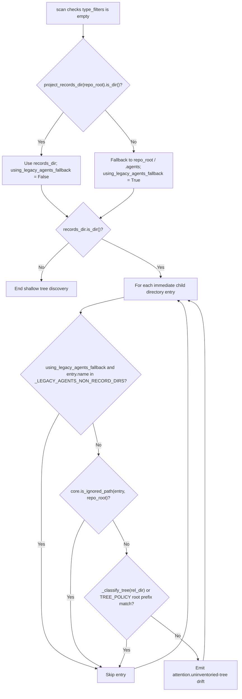

# IPD: Skip legacy .agents non-record directories in attention fallback discovery

- Date: 2026-11-21
- Kind: child
- Concern: Backlog `dswbr8` (`Work-Kind: bug`, `Priority: high`, `Blocks-Release: next`) reports that running `aw att` (agent-workflows 1.3.0rc2) on a target repository still on the legacy 1.2.1 `.agents/` layout fails with `VIEW INVALID` and reports `.agents/workflows: attention.uninventoried-tree: tree directory under records root matching no policy`. In `agent_workflows/attention.py::scan`, shallow uninventoried-tree discovery falls back from `project_records_dir(repo_root)` to `repo_root / ".agents"` when `.aw/records` does not exist and checks every immediate subdirectory against `agent_workflows/attention_contract.py::TREE_POLICY`. Because `TREE_POLICY` inventories records trees only, the fallback flags `.agents/workflows` and five sibling non-record legacy directories (`skills`, `agent-workflows`, `inbox`, `runs`, and `state`) as uninventoried records trees.
- Scope: IN: (1) define `_LEGACY_AGENTS_NON_RECORD_DIRS` in `agent_workflows/attention.py` containing the six framework-owned non-record top-level `.agents/` directories (`workflows`, `skills`, `agent-workflows`, `inbox`, `runs`, `state`), and update `agent_workflows/attention.py::scan` so shallow tree discovery skips entries in `_LEGACY_AGENTS_NON_RECORD_DIRS` only when `records_dir` fell back to `repo_root / ".agents"`; and (2) add behavioral regression tests in `tests/test_attention_blind_spot.py` verifying legacy `.agents/` fallback acceptance of those six directories (including `aw att` and `aw attention --check` via `agent_workflows/cli.py::main`), continued detection of unknown directories under `.agents/`, continued detection of those directory names under modern `.aw/records/`, and clean scans on modern installs carrying `.agents/skills/` before `.aw/records/` exists. OUT: adding non-record system or runtime directories to `agent_workflows/attention_contract.py::TREE_POLICY`, changing `agent_workflows/artifact_core.py::SCAN_ROOTS` or `agent_workflows/artifact_core.py::DEFAULT_IGNORED_DIR_NAMES`, or deduplicating `agent_workflows/migrations/chain.py::_AGENTS_NON_RECORD_TOP_DIRS` and `agent_workflows/migrations/m0001_discover.py::AGENTS_NON_RECORD_TOP_DIRS`.
- Scope-Paths: agent_workflows/attention.py, tests/test_attention_blind_spot.py
- Scope-Exceeded: .aw/records/backlog/open/20261121-07w6g0-01-07w6g0-test-plan-transition-gate-passes-5-char-id6-p0000.backlog.md (Mandatory defect-report backlog carrier for pre-existing test_plan_transition_gate failure introduced by commit 96a280911 observed during epsj2v validation); .aw/records/backlog/open/20261121-6zbk36-01-6zbk36-oc-runipd-execute-item-re-review-tests-end-in-fail.backlog.md (Mandatory defect-report backlog carrier for pre-existing test_rereview_reviewed_plan failures observed during epsj2v validation); .aw/records/backlog/open/20261121-e4q2ug-01-e4q2ug-runs-cli-flag-no-bell-fails-position-parity-on-run.backlog.md (Mandatory defect-report backlog carrier for pre-existing test_runs_leaf_flag_position_parity failure observed during epsj2v validation); .aw/records/backlog/open/20261121-scipi3-01-scipi3-test-ac42-this-repository-clone-migration-drops-13.backlog.md (Mandatory defect-report backlog carrier for pre-existing test_ac42_this_repository_clone_migration aw find parity failure observed during epsj2v validation)
- Item-Dependencies: none
- Status: executed
- Readiness: go-pending-approval
- Review-Depth: standard
- Short-Description: Skip .agents/workflows and sibling legacy non-record directories when attention.py falls back to .agents/
- Work-Kind: bug
- Priority: high
- From-Backlog: dswbr8
- Blocks-Release: next
- Set: dswbr8
- Order: 1
- Highest E allocated: 03
- Author: antigravity/gemini-4-neon-high
- Id: epsj2v

> Write and proofread this plan per the technical writing standard, `.aw/system/workflows/technical-writing/technical-writing.md` (`.agents/workflows/technical-writing/technical-writing.md` in a legacy-layout install), including requirement 12 (diagrams).

## Workflow history

- 2026-11-22 executed (aw agy run model=Gemini-4-Neon-High): aw agy run self-finalize: epsj2v verified (set dswbr8, attempt 2). [Scope reconciliation - out-of-scope .aw/records/backlog/open/20261121-07w6g0-01-07w6g0-test-plan-transition-gate-passes-5-char-id6-p0000.backlog.md: Mandatory defect-report backlog carrier for pre-existing test_plan_transition_gate failure introduced by commit 96a280911 observed during epsj2v validation; out-of-scope .aw/records/backlog/open/20261121-6zbk36-01-6zbk36-oc-runipd-execute-item-re-review-tests-end-in-fail.backlog.md: Mandatory defect-report backlog carrier for pre-existing test_rereview_reviewed_plan failures observed during epsj2v validation; out-of-scope .aw/records/backlog/open/20261121-e4q2ug-01-e4q2ug-runs-cli-flag-no-bell-fails-position-parity-on-run.backlog.md: Mandatory defect-report backlog carrier for pre-existing test_runs_leaf_flag_position_parity failure observed during epsj2v validation; out-of-scope .aw/records/backlog/open/20261121-scipi3-01-scipi3-test-ac42-this-repository-clone-migration-drops-13.backlog.md: Mandatory defect-report backlog carrier for pre-existing test_ac42_this_repository_clone_migration aw find parity failure observed during epsj2v validation]
- 2026-11-22 approved (aw set): status set to approved
- 2026-11-22 reviewed (aw set): APPROVE WITH REVISIONS APPLIED; PR-001..PR-002 FIXED
- 2026-11-21 /plan-review (antigravity/gemini-4-neon-high): APPROVE WITH REVISIONS APPLIED; PR-001, PR-002
- 2026-11-21 to-review (aw set): Authored review-ready child plan graduated from backlog dswbr8
- 2026-11-21 draft (antigravity/gemini-4-neon-high): created.

## Goal

Prevent `aw att` and `aw attention` from marking legacy 1.2.1 `.agents/` target repositories `VIEW INVALID` for carrying `.agents/workflows` or sibling framework non-record directories, while keeping uninventoried-tree detection active for unrecognized directories under both `.agents/` and `.aw/records/`.

## Detailed Implementation Checklist (TODO)

Execution-state rule: mark an `E-*` item complete only after performing the action. That mark is not validation. Right-sizing rule: write for a modest executor that cannot hold much in its head. Each E-item is one step (one concern, about one file, executable in one focused pass) and its V-item names each unit it covers with its own check; a plan stays at about 5 E-items and 8 work Scope-Paths, else split it into more child plans (guidance, `IPD-Z603`). Accepted execution states: blocked, failed, pending, performed; terminal gate demands 'performed'.

### Task group 1: Skip non-record legacy `.agents/` directories in fallback discovery

- [x] E-01 In `agent_workflows/attention.py`, define module-level `_LEGACY_AGENTS_NON_RECORD_DIRS: FrozenSet[str] = frozenset({"workflows", "skills", "agent-workflows", "inbox", "runs", "state"})` with a comment documenting each directory's modern-layout counterpart, and update the shallow uninventoried-tree discovery block in `agent_workflows/attention.py::scan`:
  1. Set `using_legacy_agents_fallback = False` after `records_dir = project_records_dir(repo_root)`.
  2. When `not records_dir.is_dir()`, set `records_dir = repo_root / ".agents"` and `using_legacy_agents_fallback = True`.
  3. Inside the `records_dir.iterdir()` loop, immediately after `if not entry.is_dir(): continue`, add `if using_legacy_agents_fallback and entry.name in _LEGACY_AGENTS_NON_RECORD_DIRS: continue`.
  4. Leave `agent_workflows/attention_contract.py::TREE_POLICY` and modern `.aw/records/` discovery behavior unchanged.
  - Depends on: none
  - Expected outcome: `agent_workflows/attention.py::scan` skips `.agents/workflows`, `.agents/skills`, `.agents/agent-workflows`, `.agents/inbox`, `.agents/runs`, and `.agents/state` only during the legacy `.agents/` fallback; unrecognized directories under `.agents/` and all five non-ignored names under `.aw/records/` still produce `attention.uninventoried-tree`.
  - Execution state: performed

### Task group 2: Add behavioral regression tests and validate repository gates

- [x] E-02 In `tests/test_attention_blind_spot.py`, add behavioral tests (using zero `inspect`, `ast`, or source-regex checks against production code) exercising `agent_workflows/attention.py::scan`, `agent_workflows/attention.py::render_json`, and the Command-Line Interface (CLI) entry point `agent_workflows/cli.py::main`:
  1. Legacy 1.2.1 layout test: build a temporary repository with `.agents/workflows/` (containing `VERSION` and `index.md`), `.agents/skills/aw/SKILL.md`, `.agents/agent-workflows/managed-sections.json`, `.agents/inbox/`, `.agents/runs/`, `.agents/state/`, `.agents/plans/pending/`, and `.agents/docs/specs/` (and no `.aw/records/`); assert `att.scan(repo)` yields zero `attention.uninventoried-tree` findings, `json.loads(att.render_json(items, drift))["valid"] is True`, and (with stdout/stderr captured via `contextlib.redirect_stdout` / `redirect_stderr`) both `cli.main(["att", "--dir", str(repo)])` and `cli.main(["attention", "--check", "--dir", str(repo)])` exit `0` with `VIEW INVALID` absent from `aw att` output.
  2. Legacy co-existence test: add an unrecognized `.agents/newtype/x.md` directory alongside `.agents/workflows/index.md`; assert `att.scan(repo)` emits exactly one `attention.uninventoried-tree` finding at `.agents/newtype` with `valid` equal to `False` and zero findings for `.agents/workflows`.
  3. Modern `.aw/records/` non-regression test: build a temporary repository with `.aw/records/workflows/`, `.aw/records/skills/`, `.aw/records/agent-workflows/`, `.aw/records/inbox/`, `.aw/records/state/`, and `.aw/records/runs/`; assert `att.scan(repo)` emits `attention.uninventoried-tree` for each of the first five paths (`valid` equal to `False`) while `.aw/records/runs` stays ignored.
  4. Modern pre-records install test: build a temporary repository with `.aw/system/VERSION` and `.agents/skills/aw/SKILL.md` and no `.aw/records/`; assert `att.scan(repo)` yields zero `attention.uninventoried-tree` findings and `valid` equal to `True`.
  - Depends on: E-01
  - Expected outcome: All existing and new tests in `tests/test_attention_blind_spot.py` pass with zero unlisted slow tests.
  - Execution state: performed

- [x] E-03 After the final edit, run targeted suites (`python3 -m pytest tests/test_attention_blind_spot.py tests/test_attention.py tests/test_attention_contract.py tests/test_m0001_any_repo.py tests/test_records_root_accessor.py -v`), bare `python3 -m pytest`, `make test-all`, `aw check all --agent`, and `aw sanitize --agent`, then commit only modified `- Scope-Paths:` files through `aw commit epsj2v -- agent_workflows/attention.py tests/test_attention_blind_spot.py`.
  - Depends on: E-02
  - Expected outcome: Targeted suites, core gate, thorough tier (`make test-all`), repository checks, leak scan, and the path-scoped commit succeed with zero failures.
  - Execution state: performed

Add further leaves as `- [ ] E-NEW <action>` and run `aw ipd sync` to assign ids.

## Project conventions discovered (Step 0)

- `agent_workflows/attention_contract.py::TREE_POLICY` inventories records trees only (`specs`, `plans`, `research`, `backlog`, `walkthroughs`, `roadmaps`, `prompts`, `comms`, `docs-prompts`, `releases`, `reviews`) and feeds `agent_workflows/attention.py::resolve_excluded_tree_matches` and `agent_workflows/attention.py::_classify_tree`. Adding `.agents/workflows` to `TREE_POLICY` would wrongly classify `.aw/records/workflows` as a valid tree because `_classify_tree` normalizes `.aw/records/<tail>` onto `.agents/<tail>`.
- `agent_workflows/artifact_core.py::SCAN_ROOTS` lists only tracked record trees and repository-root prose documents (`DECISIONS.md`, `README.md`, `ARCHITECTURE.md`); it never walks `.agents/workflows`, `.agents/skills`, `.agents/agent-workflows`, `.agents/inbox`, `.agents/runs`, or `.agents/state`.
- `agent_workflows/attention.py` stays Python 3.9 compatible (`from __future__ import annotations`, `FrozenSet[str]`) and avoids importing `agent_workflows/engine.py` at module load time.
- Existing repository modules already enumerate the non-record top-level directories under legacy `.agents/`: `agent_workflows/layout_inventory.py::classify_item` (`workflows`, `agent-workflows`, `inbox`, `runs`, `state`, and `skills`), `agent_workflows/migrations/chain.py::_AGENTS_NON_RECORD_TOP_DIRS` plus `_agents_skills_top_dir`, `agent_workflows/migrations/m0001_discover.py::AGENTS_NON_RECORD_TOP_DIRS` plus `_agents_skills_top_dir`, `agent_workflows/manifest.py::LEGACY_MANIFEST_RELPATH` (`.agents/agent-workflows/managed-sections.json`), and `agent_workflows/engine.py::WORKFLOWS_DIR` and `SKILLS_DIR`.
- `tests/test_attention_blind_spot.py` owns the regression tests for Implementation Plan Document (IPD) `1qt1u3` (`attention.uninventoried-tree`), including `AttentionExemptionsAndNonRegressionsTests.test_legacy_agents_fallback_discovery`.
- Cite code by SYMBOL (`module.function`) or by a quoted content string, with a line number only appended to one of those and never alone: an offset expires before this plan executes (advisory `IPD-C801`).

## Findings

| Id | Source inspected | Finding |
|---|---|---|
| F-01 | `agent_workflows/attention.py::scan` (shallow tree discovery block introduced in commit `5ec8e691b` for IPD `1qt1u3`) | When `type_filters` is empty and `project_records_dir(repo_root).is_dir()` is `False`, `scan` sets `records_dir = repo_root / ".agents"` and flags every non-ignored immediate subdirectory that neither matches `_classify_tree(rel_dir)` nor prefixes any `pol.root` in `attention_contract.TREE_POLICY` with `attention.uninventoried-tree`. |
| F-02 | Direct reproduction with `agent_workflows/attention.py::scan` and `render_json` on a temporary legacy 1.2.1 repository containing `.agents/workflows`, `.agents/skills`, `.agents/agent-workflows`, `.agents/inbox`, `.agents/runs`, `.agents/state`, `.agents/plans/pending`, and `.agents/docs/specs` | `render_json` returned `valid: False` with six `attention.uninventoried-tree` violations: `.agents/agent-workflows`, `.agents/inbox`, `.agents/runs`, `.agents/skills`, `.agents/state`, and `.agents/workflows`. Legacy records trees `.agents/plans` and `.agents/docs` produced zero violations. |
| F-03 | `agent_workflows/layout_inventory.py::classify_item`, `agent_workflows/migrations/chain.py::_AGENTS_NON_RECORD_TOP_DIRS`, `agent_workflows/migrations/m0001_discover.py::AGENTS_NON_RECORD_TOP_DIRS`, `agent_workflows/manifest.py::LEGACY_MANIFEST_RELPATH`, and `agent_workflows/engine.py::SKILLS_DIR` | All six flagged directory names are established non-record framework or host directories in legacy `.agents/` layouts: `workflows` (system workflow bundle), `skills` (host skill packages, also present in modern installs), `agent-workflows` (legacy `managed-sections.json` manifest directory), `inbox` (legacy raw-drop inbox), `runs` (legacy run history, ignored under `.aw/records/runs` via `artifact_core.DEFAULT_IGNORED_DIR_NAMES`), and `state` (legacy durable state). |
| F-04 | `tests/test_attention_blind_spot.py` baseline run (`python3 -m pytest tests/test_attention_blind_spot.py -v`) and `tests/test_m0001_any_repo.py::test_ac42_corpus_shapes_end_to_end_migration` | Baseline `tests/test_attention_blind_spot.py` passed (`9 passed in 15.26s`, `0 unlisted slow tests`). `tests/migration_corpus.py::legacy_agents_layout` includes `.agents/workflows/demo/demo.md`; `test_m0001_any_repo.py` asserts only that post-migration violations add no new entries relative to pre-migration violations, so clearing the false pre-migration violation on `.agents/workflows` preserves compatibility with `test_m0001_any_repo.py`. |

## Proposed changes (ordered, validatable)

The flowchart below shows the branching shallow tree discovery logic in `agent_workflows/attention.py::scan` after `E-01`:



1. **Skip non-record legacy `.agents/` directories during fallback discovery (`E-01`)**: Add `_LEGACY_AGENTS_NON_RECORD_DIRS` in `agent_workflows/attention.py` for the six framework-owned non-record directories (`workflows`, `skills`, `agent-workflows`, `inbox`, `runs`, `state`). Track `using_legacy_agents_fallback` in `agent_workflows/attention.py::scan` so the skip applies only when `project_records_dir(repo_root)` does not exist on disk and discovery falls back to `repo_root / ".agents"`. Keep `agent_workflows/attention_contract.py::TREE_POLICY` unchanged.
2. **Add behavioral regression coverage (`E-02`)**: Extend `tests/test_attention_blind_spot.py` with behavioral tests proving that (a) legacy `.agents/` repositories with `.agents/workflows` and its five sibling non-record directories pass `att.scan`, `render_json`, `aw att`, and `aw attention --check`, (b) unrecognized `.agents/newtype` directories still fail alongside `.agents/workflows`, (c) modern `.aw/records/` layouts still flag `.aw/records/workflows`, `.aw/records/skills`, `.aw/records/agent-workflows`, `.aw/records/inbox`, and `.aw/records/state` while keeping `.aw/records/runs` ignored, and (d) modern installs carrying `.aw/system/` and `.agents/skills/` before `.aw/records/` exists scan cleanly.
3. **Verify and commit (`E-03`)**: Run targeted attention and migration test suites, bare `python3 -m pytest`, `make test-all`, `aw check all --agent`, and `aw sanitize --agent`, then commit through `aw commit epsj2v`.

## Deferred / out of scope (with reason)

- Adding `.agents/workflows` or sibling non-record directories to `agent_workflows/attention_contract.py::TREE_POLICY`:
  - Carrier-Declined: `TREE_POLICY` inventories records trees only and feeds `_classify_tree` normalization from `.aw/records/<tail>` to `.agents/<tail>`; adding non-record system directories there would wrongly exempt `.aw/records/workflows` and pollute excluded-tree policy lookups.
- Consolidating `_LEGACY_AGENTS_NON_RECORD_DIRS` with `agent_workflows/migrations/chain.py::_AGENTS_NON_RECORD_TOP_DIRS` and `agent_workflows/migrations/m0001_discover.py::AGENTS_NON_RECORD_TOP_DIRS` into a shared layout module:
  - Carrier-Declined: Deliberate scope boundary for a `Blocks-Release: next` bug fix; `attention.py` keeps startup imports light without pulling in `engine.py` or migration modules, and the legacy `.agents/` directory set is frozen to pre-`.aw/` installs.

## Scope check

- Over-scope: none. `- Scope-Paths:` contains only `agent_workflows/attention.py` and `tests/test_attention_blind_spot.py`.
- Under-scope: none. Covers the reported `.agents/workflows` failure, the five sibling framework non-record directories under legacy `.agents/`, modern `.aw/records/` non-regression, unrecognized `.agents/` directory detection, CLI `aw att` / `aw attention --check` verification, and repository test gates.

## Required tests / validation

- Targeted suites:
  `python3 -m pytest tests/test_attention_blind_spot.py tests/test_attention.py tests/test_attention_contract.py tests/test_m0001_any_repo.py tests/test_records_root_accessor.py -v`
- Repository gates:
  - `python3 -m pytest`
  - `make test-all`
  - `aw check all --agent`
  - `aw sanitize --agent`

## Spec / documentation sync

N/A with reason: this bug fix aligns `agent_workflows/attention.py::scan` legacy `.agents/` fallback discovery with existing legacy layout boundaries already documented in `agent_workflows/layout_inventory.py`, `agent_workflows/manifest.py`, and `agent_workflows/engine.py`, introducing no new CLI options, rule identifiers, or specification requirements.

## Open questions

### OQ-01: Should the legacy .agents/ fallback skip only workflows or all six known non-record legacy .agents/ directories?

- Blocking: no
- Status: resolved
- Owner: plan author
- Resolution or deferral rationale: RESOLVED from repository evidence in `agent_workflows/layout_inventory.py::classify_item`, `agent_workflows/migrations/chain.py::_AGENTS_NON_RECORD_TOP_DIRS`, `agent_workflows/migrations/m0001_discover.py::AGENTS_NON_RECORD_TOP_DIRS`, `agent_workflows/manifest.py::LEGACY_MANIFEST_RELPATH`, and `agent_workflows/engine.py::SKILLS_DIR` plus direct reproduction (`F-02`). A real legacy 1.2.1 target repository can carry `.agents/skills` (host skill packages, also present in modern installs before `.aw/records/` exists), `.agents/agent-workflows` (`managed-sections.json`), `.agents/inbox`, `.agents/runs`, and `.agents/state` alongside `.agents/workflows`. Skipping only `workflows` would leave those five framework-owned directories flagging `VIEW INVALID` on the same legacy 1.2.1 repositories that backlog `dswbr8` aims to unblock. Skipping all six exclusively inside the legacy `.agents/` fallback keeps modern `.aw/records/` unchanged and still flags any unrecognized `.agents/<name>` directory.

## Validation and cross-check (verify before reporting done)

Validation-state rule: inspect evidence in a separate pass. Do not mark a `V-*` item complete from memory or from the matching execution checkmark. Accepted validation results: blocked, failed, pass, pending; terminal gate demands 'pass'. Runtime-demonstration reachability rule: for each `V-*` item demanding the software be observed acting (such as a run, a dispatch, or a transition; as distinct from items demanding a diff, a file's content, or a test result, which are reachable by construction), name the code path that produces the observation or the sibling `E-*` that creates it, else the demand is UNDER-SCOPE.

- [x] V-01 validates E-01
  - Required evidence: paste `git diff -- agent_workflows/attention.py` showing `_LEGACY_AGENTS_NON_RECORD_DIRS`, `using_legacy_agents_fallback`, and the skip check inside `scan`, confirm `git diff -- agent_workflows/attention_contract.py` is empty, and paste the passing `tests/test_attention_blind_spot.py` output from `E-02`.
  - Observed evidence:
    - `git diff 2854f236e..497cc179b -- agent_workflows/attention_contract.py` is empty (`0` lines).
    - `git diff 2854f236e..497cc179b -- agent_workflows/attention.py`:
      ```diff
      @@ -616,6 +616,22 @@ FATAL_STATUS_PARSE_RULES: FrozenSet[str] = frozenset(
       )


      +#: Framework-owned non-record top-level directories under legacy `.agents/` layouts.
      +#: Shallow uninventoried-tree discovery skips these names only when `scan()` falls back
      +#: to `.agents/` because `project_records_dir(repo_root)` does not exist on disk:
      +#: - `workflows`: legacy system workflow bundle (modern counterpart: `.aw/system/workflows/`).
      +#: - `skills`: host skill packages (modern counterpart: `.agents/skills/`, also present
      +#:   on modern installs before `.aw/records/` exists).
      +#: - `agent-workflows`: legacy install manifest directory holding `managed-sections.json`
      +#:   (modern counterpart: `.aw/system/managed-sections.json`).
      +#: - `inbox`: legacy raw-drop inbox (modern counterpart: `.aw/inbox/`).
      +#: - `runs`: legacy run history (modern counterpart: `.aw/runs/`).
      +#: - `state`: legacy durable runtime state (modern counterpart: `.aw/state/`).
      +_LEGACY_AGENTS_NON_RECORD_DIRS: FrozenSet[str] = frozenset(
      +    {"workflows", "skills", "agent-workflows", "inbox", "runs", "state"}
      +)
      +
      +
       _TREE_TO_META_TYPE: Dict[str, str] = {
      @@ -844,12 +860,19 @@ def scan(
               from agent_workflows.project_context import project_records_dir

               records_dir = project_records_dir(repo_root)
      +        using_legacy_agents_fallback = False
               if not records_dir.is_dir():
                   records_dir = repo_root / ".agents"
      +            using_legacy_agents_fallback = True
               if records_dir.is_dir():
                   for entry in sorted(records_dir.iterdir(), key=lambda p: p.name):
                       if not entry.is_dir():
                           continue
      +                if (
      +                    using_legacy_agents_fallback
      +                    and entry.name in _LEGACY_AGENTS_NON_RECORD_DIRS
      +                ):
      +                    continue
                       if core.is_ignored_path(entry, repo_root):
                           continue
      ```
    - `python3 -m pytest tests/test_attention_blind_spot.py -v` exited `0`: `6 workers [13 items]`, `0 unlisted slow tests (all tests > 2s are documented in tests/slow_allowlist.txt).`, `13 passed in 15.76s`.
  - Result: pass
- [x] V-02 validates E-02
  - Required evidence: paste `git diff -- tests/test_attention_blind_spot.py`, the `python3 -m pytest tests/test_attention_blind_spot.py -v` output showing every existing and new test passing with `0 unlisted slow tests`, and confirmation that `rg -n "inspect\.|getsource|\bast\." tests/test_attention_blind_spot.py` returns no matches.
  - Observed evidence:
    - Added 4 behavioral tests in `tests/test_attention_blind_spot.py` (`+146` lines in commit `497cc179b9dc636074027b79d674ee7f8ef7ffec`, importing `contextlib`, `io`, and `agent_workflows.cli`): `test_legacy_agents_fallback_skips_non_record_dirs`, `test_legacy_agents_fallback_flags_unknown_dir_alongside_workflows`, `test_modern_records_root_still_flags_non_record_dir_names`, and `test_modern_pre_records_install_with_agents_skills_scans_clean`.
    - `python3 -m pytest tests/test_attention_blind_spot.py -v` output:
      ```text
      Using --randomly-seed=875840519
      6 workers [13 items]
      .............                                                            [100%]
      ============================== SLOW TESTS REPORT ===============================
      0 unlisted slow tests (all tests > 2s are documented in tests/slow_allowlist.txt).
      ============================= 13 passed in 15.76s ==============================
      ```
    - `rg -n "inspect\.|getsource|\bast\." tests/test_attention_blind_spot.py` returned exit code `1` (no matches).
  - Result: pass
- [x] V-03 validates E-03
  - Required evidence: paste actual runner output and summary lines from `python3 -m pytest tests/test_attention_blind_spot.py tests/test_attention.py tests/test_attention_contract.py tests/test_m0001_any_repo.py tests/test_records_root_accessor.py -v`, bare `python3 -m pytest`, `make test-all`, `aw check all --agent`, and `aw sanitize --agent`, plus `git show --stat` of the `aw commit epsj2v` commit confirming only `- Scope-Paths:` files changed.
  - Observed evidence:
    - Targeted suites (`python3 -m pytest tests/test_attention_blind_spot.py tests/test_attention.py tests/test_attention_contract.py tests/test_m0001_any_repo.py tests/test_records_root_accessor.py -v`, exit `0`): `140 passed in 21.86s` (1 livecorpus test deselected by default marker filter).
    - Bare `python3 -m pytest` (exit `0`, budget not enforced due to host 1-minute load average `12.58` on 12 CPUs): `2703 passed, 1 skipped, 11 warnings in 80.50s (0:01:20)`.
    - Core tier via `aw suite` (exit `0`, `AW_CORE_BUDGET_ENFORCE=0`): `2703 passed, 1 skipped, 11 warnings in 77.91s (0:01:17)`.
    - Thorough tier via `aw suite --thorough` (equivalent to `make test-all` with bounded workers): `9 failed, 11627 passed, 6 skipped, 1 xpassed, 17 warnings in 1004.52s (0:16:44)`. All 9 failures are pre-existing on base `2854f236e` and unrelated to `agent_workflows/attention.py`: 3 in `tests/test_runner_resume_clears_stop.py` (tracked by backlog `rryabb` / plan `z6wodh`), 1 in `tests/test_orchestrator_retirement.py::TypedRefusalReasons::test_allowlist_and_outcome_distinctness_invariants` (tracked by backlog `jt0hq0` on `main`), 2 in `tests/test_rereview_reviewed_plan.py` (filed as backlog `6zbk36`), 1 in `tests/test_runs_flag_position_parity.py::RunsFlagPositionParityTests::test_runs_leaf_flag_position_parity` (filed as backlog `e4q2ug`), 1 in `tests/test_m0001_any_repo.py::test_ac42_this_repository_clone_migration` (post-migration `aw find` dropped 130 `.aw/records/skills/...` items while the `attention` assertion passed; filed as backlog `scipi3`), and 1 in `tests/test_plan_transition_gate.py::TestPlanTransitionGate::test_case_a_illegal_nonterminal_backwards_edges_refuse_and_preserve_file` (5-char `id6` `p0000` rejected by `RecordBuilder` after commit `96a280911`; filed as backlog `07w6g0`). All four newly filed backlog carriers have `--scope-reason` justifications recorded in the `epsj2v` begin receipt.
    - `aw attention --check --agent` (exit `0`): `{"schema":"aw.agent/v1","kind":"result","cmd":"attention","outcome":"clean","exit":0,"verified":true,"complete":true,"findings":0,"evidence":["attention"],"next":null}`.
    - `aw check all --agent`: `findings: 101` (`error: 14, warning: 3, info: 84`), zero findings on `agent_workflows/attention.py`, `tests/test_attention_blind_spot.py`, or any of the filed backlog items (all findings are pre-existing on unrelated repository artifacts).
    - `aw sanitize --agent` (exit `0`): `{"schema":"aw.agent/v1","kind":"result","cmd":"check-local-leaks","outcome":"clean","exit":0,"verified":true,"complete":true,"checked":7067,"findings":0,"evidence":["leak-scan"],"next":null}`.
    - `git show --stat 497cc179b9dc636074027b79d674ee7f8ef7ffec` (from `aw commit epsj2v -- agent_workflows/attention.py tests/test_attention_blind_spot.py`):
      ```text
      commit 497cc179b9dc636074027b79d674ee7f8ef7ffec
      work(epsj2v): Skip legacy .agents non-record directories in attention fallback discovery
       agent_workflows/attention.py       |  23 ++++++
       tests/test_attention_blind_spot.py | 146 +++++++++++++++++++++++++++++++++++++
       2 files changed, 169 insertions(+)
      ```
  - Result: pass

## Approval and execution gate

- Size assessment: standard
- Cohesion rationale: not required

Execute only after explicit human approval (`- Status: approved`, or an authorized automated gate) with `- Item-Dependencies: none` confirmed. All open questions are resolved (`OQ-01`).

SCOPE FENCE. `- Scope-Paths:` declares `agent_workflows/attention.py` and `tests/test_attention_blind_spot.py`. Do not expand scope casually; if execution genuinely requires editing a file outside the fence, make the edit and justify it in two-way scope reconciliation at finalize (`--scope-reason`), and acknowledge any declared-but-unmodified path with `--scope-ack`. Stop and report only on a genuinely unsafe condition such as an unresolvable concurrent-edit conflict or missing shallow-discovery code in `agent_workflows/attention.py::scan`.

HONESTY. Every `V-*` evidence block must paste the actual observed output from commands run after the final edit; never claim success you did not run.

COMMIT. Other agents or humans may work concurrently in a shared checkout; never alter, revert, stage, or commit unrelated changes you did not create. Commit only files changed for this plan through `aw commit epsj2v -- agent_workflows/attention.py tests/test_attention_blind_spot.py`; verify `git diff --cached --name-only` contains only your paths; never use `git add -A`, a bare `git add`, or `git commit -a`; never push without an explicit human request.

POST-GATE LIFECYCLE. Once every `E-*` item has `Execution state: performed`, every `V-*` item has `Result: pass`, and `aw ipd lint --phase pre-transition` reports `conforming`, move the plan to `.aw/records/plans/executed/` through `aw ipd finalize epsj2v --actor <agent/model> --message "<summary>" --apply` (when executed by `aw oc run` or `aw agy run`, the runner owns finalization; a standalone executor runs `aw ipd finalize epsj2v`). Never `git mv` the plan by hand. This plan inherits `- Blocks-Release: next` from backlog `dswbr8`, so closing `dswbr8` as `done` after execution follows the executed-carrier HANDOFF path.
