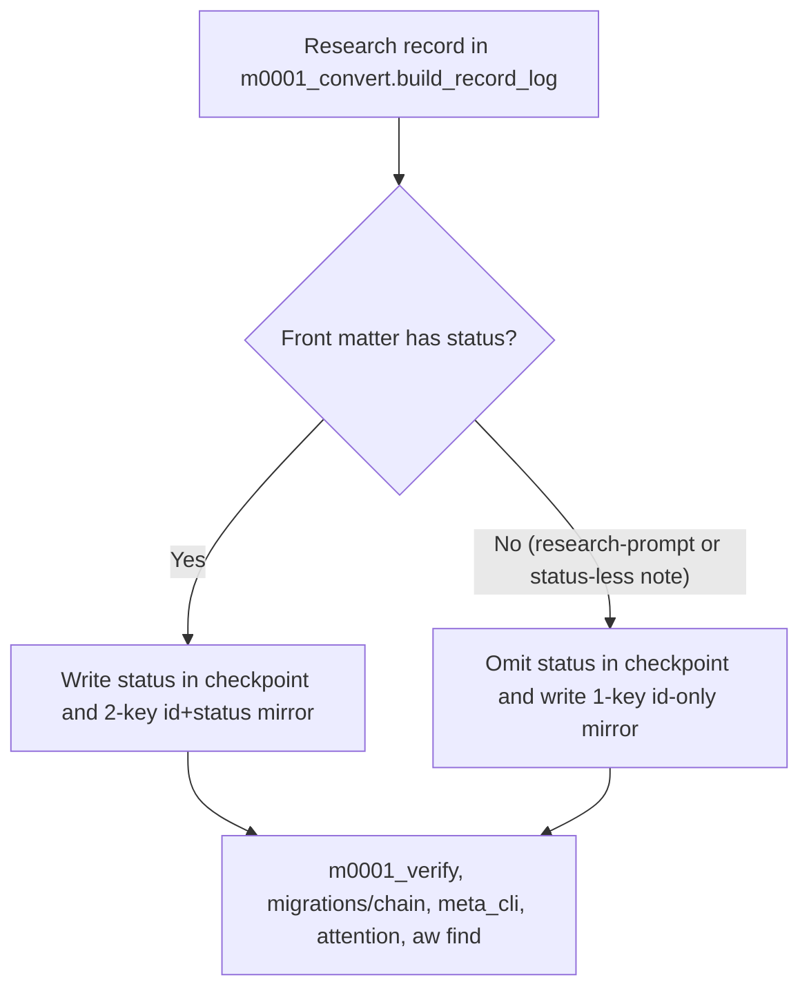

# IPD: Support status-less research records with id-only mirrors in metadata v2

- Date: 2026-11-21
- Kind: child
- Concern: `agent_workflows/migrations/m0001_convert.py::build_record_log` assigns `status = "draft"` whenever a `research` record has no `status` field in its front matter. Two real classes of research records intentionally carry no status: two-axis `research-prompt` records (8 tracked files in this repository) and legacy status-less research notes (such as `20260708-survey-notes.md` in `tests/migration_corpus.py::legacy_agents_layout`). Because `"draft"` is not in `agent_workflows/research_contract.py::STATUSES`, migrated `research-prompt` records fail `aw attention` with `attention.unknown-status` (`research status 'draft'`) and fail spec `4sd62s` AC-42(5) `aw find --agent` parity (`"-"` before migration versus `"draft"` after migration). On 2026-11-21, the maintainer selected Option A: treat status-less `research` records like walkthroughs in metadata v2 by omitting `status` from the log checkpoint and permitting an `id`-only front-matter mirror.
- Scope: Implement Option A across metadata-v2 conversion, mirror rendering/parsing, round-trip verification, drift checking/repair, tests, and spec `4sd62s`: (1) stop `agent_workflows/migrations/m0001_convert.py::build_record_log` and `agent_workflows/migrations/m0001_verify.py::_legacy_field_pairs_for_record` from fabricating `status = "draft"` for status-less `research` records, leaving `status = None` and omitting `"status"` from checkpoint `fields`; (2) update `agent_workflows/artifact_meta.py::render_in_file_mirror`, `agent_workflows/artifact_meta.py::parse_artifact_mirror` (via an opt-in `allow_statusless: bool = False` keyword parameter so non-research types remain strict 2-key), `agent_workflows/migrations/chain.py::_is_v2_mirror_text` and `repo_has_legacy_records`, `agent_workflows/migrations/m0001_verify.py`, and `agent_workflows/meta_cli.py` (`_parse_log_backed_mirror`, `check_meta`, and `meta_repair`) to emit, parse, verify, and repair 1-key `id`-only front-matter mirrors for status-less `research` records while keeping 2-key `id`+`status` mirrors mandatory for status-bearing research and all non-walkthrough/non-roadmap types; (3) update `tests/test_m0001_review_conversion.py` (replacing the pinned `st2.status == "draft"` assertion on `rs5002` in `test_fields_research_yaml_and_nonleading_prompt_preserved` with `st2.status is None` and adding behavioral tests covering `id`-only mirrors, `m0001_verify.verify_round_trip`, `chain.repo_has_legacy_records`, `aw check meta`, `aw meta repair`, `aw attention`, and `aw find --agent` parity on both `research-prompt` and legacy status-less research fixtures alongside status-bearing research); and (4) document the Option A rule in `.aw/records/specs/approved/20260925-metastore-01-4sd62s-artifact-metadata-store.spec.md` Sections 4.1 and 4.6. EXCLUDES: migrated spec validation (`0dsjzl` / `zgxig2`), `aw find` missing-kind-facet fallback (`7mmhlp` / `vvxbbl`), and editing `tests/test_m0001_any_repo.py` (`60mazt`).
- Scope-Paths: agent_workflows/migrations/m0001_convert.py, agent_workflows/artifact_meta.py, agent_workflows/migrations/m0001_verify.py, agent_workflows/migrations/chain.py, agent_workflows/meta_cli.py, tests/test_m0001_review_conversion.py, .aw/records/specs/approved/20260925-metastore-01-4sd62s-artifact-metadata-store.spec.md, .aw/records/plans/pending/20261121-fnabjy-01-s4utmv-support-status-less-research-records-with-id-only-mirrors-in.ipd.md
- Item-Dependencies: none
- Status: executed
- Readiness: go-pending-approval
- Review-Depth: standard
- Short-Description: Omit fabricated draft status for status-less research records across m0001_convert, artifact_meta mirrors, m0001_verify, migrations/chain, meta_cli, and spec 4sd62s.
- Work-Kind: bug
- Priority: high
- From-Backlog: fnabjy
- From-Spec: 4sd62s
- Blocks-Release: next
- Set: fnabjy
- Order: 1
- Highest E allocated: 05
- Author: antigravity/gemini
- Id: s4utmv

> Write and proofread this plan per the technical writing standard, `.aw/system/workflows/technical-writing/technical-writing.md` (`.agents/workflows/technical-writing/technical-writing.md` in a legacy-layout install), including requirement 12 (diagrams).

## Workflow history

- 2026-11-21 executed (aw agy run model=Gemini-4-Neon-High): aw agy run self-finalize: s4utmv verified (set fnabjy, attempt 2).
- 2026-11-21 reviewed (aw set): APPROVE WITH REVISIONS APPLIED; PR-001..PR-006 FIXED
- 2026-11-21 /plan-review (antigravity/gemini-4-neon-high): APPROVE WITH REVISIONS APPLIED; PR-001..PR-006 FIXED; review record .aw/records/reviews/20261121-fnabjy-01-s4utmv-support-status-less-research-records-with-id-only-mirrors-in.review.md
- 2026-11-21 to-review (aw set): Authored review-ready child plan graduated from backlog fnabjy
- 2026-11-21 draft (antigravity/gemini): created.

## Goal

Eliminate the fabricated `"draft"` status on migrated status-less `research` records (`research-prompt` and status-less legacy research notes) by omitting `status` from their event log checkpoints and using `id`-only front-matter mirrors, restoring `aw attention` validity and `aw find --agent` parity before rehearsal and cutover.

## Detailed Implementation Checklist (TODO)

Execution-state rule: mark an `E-*` item complete only after performing the action. That mark is not validation. Right-sizing rule: write for a modest executor that cannot hold much in its head. Each E-item is one step (one concern, about one file, executable in one focused pass) and its V-item names each unit it covers with its own check; a plan stays at about 5 E-items and 8 work Scope-Paths, else split it into more child plans (guidance, `IPD-Z603`). Accepted execution states: blocked, failed, pending, performed; terminal gate demands 'performed'.

### Task group 1: Metadata-v2 status-less research mirror and log contract

- [x] E-01 Update `agent_workflows/artifact_meta.py` to support `id`-only front-matter mirrors for status-less `research` records without relaxing strict 2-key validation for other artifact types:
  1. In `agent_workflows/artifact_meta.py::render_in_file_mirror(id6, artifact_type, status)`, emit `---\nid: {id6}\n---\n{banner}` when `artifact_type in ("walkthrough", "roadmap")` OR `(artifact_type == "research" and not (status or "").strip())`. Keep all other artifact types emitting the 2-key `id` + `status` mirror (and staged prompts emitting the `aw-managed-prompt` HTML comment).
  2. Add `allow_statusless: bool = False` to `agent_workflows/artifact_meta.py::parse_artifact_mirror(text, *, allow_statusless: bool = False)` (keeping the default `False` strict 2-key `id` + `status` behavior unchanged): when `allow_statusless=True`, accept either (a) 1 front-matter line matching `^id:\s*(\S+)$` (validating `id6` via `validate_id6` and returning `{"id": id_val, "status": None}`) or (b) the existing 2-key `id` + `status` lines (returning `{"id": id_val, "status": status_val}`); raise `ValueError` for 0 or 3+ keys or malformed lines.
  3. Verify `agent_workflows/artifact_meta.py::replay`, `_load_sources`, `read_text`, `apply_in_file_mirror`, and `repair` handle `research` checkpoints with `status` omitted (`state.status is None`, `state.legacy_raw_status is None`) cleanly without raising or inventing `"draft"`.
  - Depends on: none
  - Expected outcome: `agent_workflows/artifact_meta.py` renders, parses, replays, repairs, and indexes status-less `research` records with `status=None` and `id`-only mirrors while non-research types remain strictly 2-key.
  - Execution state: performed

- [x] E-02 Update `agent_workflows/migrations/m0001_convert.py::build_record_log` so that when `is_research` is True and no `status` key is present in front matter, `status` stays `None` (instead of assigning `"draft"`), omitting `"status"` from checkpoint `fields`. Verify `agent_workflows/migrations/m0001_convert.py::rewrite_record_file` passes `status=None` through to `agent_workflows/artifact_meta.py::render_in_file_mirror` so status-less `research` files receive the 1-key `id`-only mirror + banner.
  - Depends on: E-01
  - Expected outcome: `agent_workflows/migrations/m0001_convert.py` produces checkpoints with no `status` key and `id`-only mirrors for `research-prompt` and status-less legacy research files, while status-bearing research files still record their status and 2-key mirror.
  - Execution state: performed

- [x] E-03 Update `agent_workflows/migrations/m0001_verify.py`, `agent_workflows/migrations/chain.py`, and `agent_workflows/meta_cli.py` to recognize status-less `research` mirrors and checkpoints consistently:
  1. In `agent_workflows/migrations/m0001_verify.py::_legacy_field_pairs_for_record`, leave `status = None` when `art_type == "research"` and no `status` key is present (matching `agent_workflows/migrations/m0001_convert.py::build_record_log`).
  2. In `agent_workflows/migrations/m0001_verify.py::_collect_converted_records` and `agent_workflows/migrations/m0001_verify.py::verify_round_trip`, call `artifact_meta.parse_artifact_mirror(..., allow_statusless=(art_type == "research"))`, enforce `mirror.get("status") == state.status` (so a status-bearing research record MUST still have a matching 2-key mirror while a status-less research record MUST have a 1-key mirror with `mirror.get("status") is None`), and enforce `state.status == leg_status`.
  3. In `agent_workflows/migrations/chain.py::_is_v2_mirror_text(text, filename, *, rel_path: Optional[str] = None)`, accept an optional `rel_path` keyword argument (preserving compatibility for 2-argument callers) and pass `rel_path=(cur_path / fname).relative_to(root_dir).as_posix()` from `agent_workflows/migrations/chain.py::repo_has_legacy_records`. Allow `parse_artifact_mirror(text, allow_statusless=True)` ONLY when `(rel_path is not None and rel_path.startswith("research/"))` or `filename.endswith(".research-prompt.md")` so `repo_has_legacy_records` recognizes migrated `id`-only research mirrors as v2 without weakening 2-key enforcement for non-research `.md` files.
  4. In `agent_workflows/meta_cli.py::_parse_log_backed_mirror`, call `_meta.parse_artifact_mirror(text, allow_statusless=(art_type == "research"))`. Confirm that `agent_workflows/meta_cli.py::check_meta`'s log-backed branch (`file_status != st.status`), `agent_workflows/meta_cli.py::_describe_mirror_diff`, and `agent_workflows/meta_cli.py::meta_repair` (via `apply_in_file_mirror -> render_in_file_mirror` and `_meta.repair`) report zero `meta.status-mirror-drift` when both are `None`, flag `meta.status-mirror-drift` in both directions when one has a status and the other does not, and rewrite the canonical 1-key `id`-only mirror cleanly on `meta_repair(..., apply=True)`.
  - Depends on: E-02
  - Expected outcome: `agent_workflows/migrations/m0001_verify.py`, `agent_workflows/migrations/chain.py::repo_has_legacy_records`, `aw check meta`, and `aw meta repair` accept and verify status-less `research` records with `id`-only mirrors and catch any mirror/log status mismatch in either direction.
  - Execution state: performed

- [x] E-04 Update `.aw/records/specs/approved/20260925-metastore-01-4sd62s-artifact-metadata-store.spec.md` (`### 4.1 Artifact file shape` and `### 4.6 Mirrors and drift (\`aw check meta\`)` in-file `status` mirror table row) to record the maintainer Option A ruling (2026-11-21): status-less `research` records (`research-prompt` and status-less legacy research notes) omit `status` from their checkpoint and carry an `id`-only front-matter mirror alongside walkthroughs and roadmaps, while status-bearing research records and all other non-walkthrough/non-roadmap artifact types keep the strict 2-key `id` + `status` mirror.
  - Depends on: E-03
  - Expected outcome: Spec `4sd62s` Sections 4.1 and 4.6 match the implemented Option A contract with no contradiction between spec prose and runtime behavior.
  - Execution state: performed

- [x] E-05 Update `tests/test_m0001_review_conversion.py::test_fields_research_yaml_and_nonleading_prompt_preserved` (`rs5002`) from `assert st2.status == "draft"` to `assert st2.status is None`, asserting that `rs5002`'s rewritten file carries an `id`-only front-matter mirror (`---\nid: rs5002\n---`) with no `status:` line, passes `agent_workflows/migrations/m0001_verify.py::verify_round_trip` (snapshotting `pre_conversion_records_root` before in-place conversion), passes `agent_workflows/migrations/chain.py::repo_has_legacy_records` (`False` for the migrated tree), passes `aw check meta` with zero findings, passes `aw attention --all --format json` with zero `attention.unknown-status` violations, and preserves `aw find --agent` status `"-"` before and after migration. Add companion behavioral tests in `tests/test_m0001_review_conversion.py` covering:
  1. A status-less legacy research note (`id`-only mirror, `status=None`, zero `attention.unknown-status`, `m0001_verify.verify_round_trip` clean, `aw check meta` clean).
  2. Bidirectional `meta.status-mirror-drift` and repair: a status-bearing research record that drops its `status:` mirror line triggers `meta.status-mirror-drift`; a status-less research record carrying a spurious `status: draft` line triggers `meta.status-mirror-drift` and `aw meta repair <id6> --apply` restores the canonical 1-key `id`-only mirror.
  3. Non-research strictness: `agent_workflows/migrations/chain.py::repo_has_legacy_records` still returns `True` (and `parse_artifact_mirror` with default `allow_statusless=False` still raises `ValueError`) when a non-research file (such as a plan or spec) has a 1-key `id`-only mirror.
  Keep all tests purely behavioral with zero `inspect`, `ast`, or production source-code regex checks. Run `python3 -m pytest -o addopts="" -v tests/test_m0001_review_conversion.py tests/test_m0001_roundtrip.py tests/test_m0001_conversion.py tests/test_check_meta.py tests/test_meta_repair_cli.py`, `aw suite`, `make typecheck`, `aw ipd lint --phase pre-transition` on this plan, and `aw sanitize --agent`.
  - Depends on: E-04
  - Expected outcome: All targeted migration, mirror, meta-check, repair, and core suite tests pass alongside `make typecheck`, `aw ipd lint --phase pre-transition`, and `aw sanitize --agent`, with zero source-code inspection tests.
  - Execution state: performed

## Project conventions discovered (Step 0)

- `agent_workflows/attention.py::_research_record` already implements two-axis `research-prompt` support: when `raw_status in (None, "")` and `state.fields.get("research_kind") == "research-prompt"`, it sets `status = ""` and `cls = A.READY` with zero violations; when `is_prompt` is False and `raw_status in (None, "")`, it emits `attention.missing-status` (matching pre-migration behavior instead of `attention.unknown-status`).
- `agent_workflows/cli.py::_find_type_records` (research branch) sets `status = raw_st or "-"`, so when `st.status` and `st.legacy_raw_status` are `None`, `aw find --agent` emits `"-"` automatically, preserving exact pre-migration parity for all 8 tracked `research-prompt` records.
- `agent_workflows/migrations/m0001_convert.py::build_record_log` and `agent_workflows/migrations/m0001_verify.py::_legacy_field_pairs_for_record` both currently hardcode `status = "draft" if is_research else ...`.
- `agent_workflows/artifact_meta.py::render_in_file_mirror` and `parse_artifact_mirror`, `agent_workflows/migrations/m0001_verify.py::_collect_converted_records` and `verify_round_trip`, `agent_workflows/migrations/chain.py::_is_v2_mirror_text`, and `agent_workflows/meta_cli.py::_parse_log_backed_mirror` currently treat only `("walkthrough", "roadmap")` as status-less.
- `agent_workflows/migrations/chain.py::_is_v2_mirror_text(text, filename)` currently receives only `(text, filename)` without relative path context, whereas `repo_has_legacy_records` walks `root_dir` and knows the exact relative path (`research/...`).
- `tests/test_m0001_review_conversion.py::test_fields_research_yaml_and_nonleading_prompt_preserved` currently pins `assert st2.status == "draft"` on the `research-prompt` fixture `rs5002`.

## Findings

| Id | Finding | Evidence |
|---|---|---|
| F-01 | `agent_workflows/migrations/m0001_convert.py::build_record_log` fabricates `status = "draft"` for status-less `research` records, which is outside `agent_workflows/research_contract.py::STATUSES`. | `agent_workflows/migrations/m0001_convert.py::build_record_log`; measured during IPD `60mazt` (`8 attention.unknown-status` violations and `8 aw find` status mismatches `"-"` vs `"draft"` on the repo clone, plus 1 on `legacy_agents_layout`). |
| F-02 | `agent_workflows/artifact_meta.py::render_in_file_mirror` and `parse_artifact_mirror`, `agent_workflows/migrations/m0001_verify.py`, `agent_workflows/migrations/chain.py::_is_v2_mirror_text`, and `agent_workflows/meta_cli.py::_parse_log_backed_mirror` assume only `walkthrough` and `roadmap` can have an `id`-only mirror. | `agent_workflows/artifact_meta.py::render_in_file_mirror`, `parse_artifact_mirror`; `agent_workflows/migrations/m0001_verify.py::_collect_converted_records`, `verify_round_trip`; `agent_workflows/migrations/chain.py::_is_v2_mirror_text`; `agent_workflows/meta_cli.py::_parse_log_backed_mirror`. |

## Proposed changes (ordered, validatable)

1. Extend `agent_workflows/artifact_meta.py::render_in_file_mirror` and `parse_artifact_mirror(..., allow_statusless=False)` for status-less `research` records (`E-01`).
2. Stop fabricating `status = "draft"` in `agent_workflows/migrations/m0001_convert.py::build_record_log` (`E-02`).
3. Align `agent_workflows/migrations/m0001_verify.py`, `agent_workflows/migrations/chain.py::_is_v2_mirror_text` / `repo_has_legacy_records`, and `agent_workflows/meta_cli.py` (`_parse_log_backed_mirror`, `check_meta`, `meta_repair`) to accept and verify `id`-only mirrors on status-less `research` records (`E-03`).
4. Sync spec `4sd62s` Sections 4.1 and 4.6 to document the maintainer Option A ruling (`E-04`).
5. Update `tests/test_m0001_review_conversion.py`, add behavioral tests, and run all validation gates (`E-05`).

## Deferred / out of scope (with reason)

- Migrated v2 specification validation in `agent_workflows/attention.py::_spec_record`: owned by sibling plan `zgxig2` (from backlog `0dsjzl`).
  - Carrier: zgxig2
  - Carrier-Evidence: .aw/records/plans/executed/20261121-0dsjzl-01-zgxig2-validate-v2-log-backed-specs-against-artifact-meta-state-in.ipd.md
- Returning migrated legacy research notes lacking a kind facet from `aw find`: owned by sibling plan `vvxbbl` (from backlog `7mmhlp`).
  - Carrier: vvxbbl
- Re-running AC-42 corpus and clone verification in `tests/test_m0001_any_repo.py`: owned by pending plan `60mazt`.
  - Carrier: 60mazt

## Scope check

- Over-scope: none. Only the five production modules touching mirrors/conversion/verification/legacy-detection/meta-drift, `tests/test_m0001_review_conversion.py`, spec `4sd62s`, and this plan are modified.
- Under-scope: none. Covers conversion, mirror emission and parsing, round-trip verification, path-scoped legacy-record detection, `aw check meta`, `aw meta repair`, `aw attention`, `aw find --agent`, and spec `4sd62s` sync.

## Required tests / validation

- `python3 -m pytest -o addopts="" -v tests/test_m0001_review_conversion.py tests/test_m0001_roundtrip.py tests/test_m0001_conversion.py tests/test_check_meta.py tests/test_meta_repair_cli.py`
- `aw suite` (core tier passes)
- `make typecheck` (0 mypy errors)
- `aw ipd lint --phase pre-transition` on this plan (`outcome: "clean"`)
- `aw sanitize --agent` (`outcome: "clean"`)

## Spec / documentation sync

Updates `.aw/records/specs/approved/20260925-metastore-01-4sd62s-artifact-metadata-store.spec.md` Sections 4.1 and 4.6 (`E-04`) to record the maintainer Option A decision (2026-11-21) for status-less `research` records.

## Open questions

None. Maintainer approved Option A on 2026-11-21 (omit `status` in the checkpoint and allow an `id`-only front-matter mirror for status-less `research` records).

## Validation and cross-check (verify before reporting done)

Validation-state rule: inspect evidence in a separate pass. Do not mark a `V-*` item complete from memory or from the matching execution checkmark. Accepted validation results: blocked, failed, pass, pending; terminal gate demands 'pass'. Runtime-demonstration reachability rule: for each `V-*` item demanding the software be observed acting (such as a run, a dispatch, or a transition), as distinct from items demanding a diff, a file's content, or a test result (which are reachable by construction), name the code path that produces the observation or the sibling `E-*` that creates it, else the demand is UNDER-SCOPE.

- [x] V-01 validates E-01
  - Required evidence: paste the `git diff agent_workflows/artifact_meta.py` summary showing `render_in_file_mirror` emits an `id`-only mirror for status-less `research`, `parse_artifact_mirror(..., allow_statusless=False)` remains strict 2-key by default while accepting 1-key or 2-key when `allow_statusless=True`, and `replay`/`read_text`/`repair` preserve `status=None`.
  - Observed evidence: `git diff agent_workflows/artifact_meta.py` (+21/-4 lines): `render_in_file_mirror` emits `---\nid: {id6}\n---\n{banner}` when `artifact_type in ("walkthrough", "roadmap") or (artifact_type == "research" and not (status or "").strip())`; `parse_artifact_mirror(text, *, allow_statusless: bool = False)` keeps strict 2-key validation by default, accepts 1-key (`{"id": id_val, "status": None}`) or 2-key (`{"id": id_val, "status": status_val}`) when `allow_statusless=True`, and raises `ValueError` for 0, 3+, or malformed lines. Verified `replay`, `_load_sources`, `read_text`, `apply_in_file_mirror`, and `repair` preserve `state.status is None` and `state.legacy_raw_status is None` without inventing `"draft"` (covered by `test_fields_research_yaml_and_nonleading_prompt_preserved`, `test_statusless_legacy_research_note_id_only_mirror`, `test_research_status_mirror_drift_bidirectional_and_repair`, and `test_non_research_id_only_mirror_still_rejected`).
  - Result: pass

- [x] V-02 validates E-02
  - Required evidence: paste the `git diff agent_workflows/migrations/m0001_convert.py` summary showing `build_record_log` omits `"status"` for status-less `research` records instead of assigning `"draft"`.
  - Observed evidence: `git diff agent_workflows/migrations/m0001_convert.py` (+2/-2 lines): in `build_record_log`, replaced `if not status: status = "draft" if is_research else record_path.parent.name` with `if not status and not is_research: status = record_path.parent.name`, leaving `status = None` and omitting `"status"` from checkpoint `fields`; `convert_records` passes `parsed_meta["status"]` (`None`) through `rewrite_record_file` -> `artifact_meta.render_in_file_mirror`, producing the 1-key `id`-only mirror and banner.
  - Result: pass

- [x] V-03 validates E-03
  - Required evidence: paste the `git diff` summary across `agent_workflows/migrations/m0001_verify.py`, `agent_workflows/migrations/chain.py`, and `agent_workflows/meta_cli.py` confirming 1-key mirror verification, path-scoped `rel_path` legacy-record detection (`research/` or `.research-prompt.md` only), `aw check meta`, and `aw meta repair` support status-less `research` while still catching mirror/log status drift in both directions.
  - Observed evidence: `git diff agent_workflows/migrations/m0001_verify.py` (+10/-4 lines): `_legacy_field_pairs_for_record` uses `if not status and art_type != "research": status = rec_path.parent.name`; `_collect_converted_records` and `verify_round_trip` call `artifact_meta.parse_artifact_mirror(..., allow_statusless=(art_type == "research"))` and keep `mirror.get("status") == state.status` and `state.status == leg_status`. `git diff agent_workflows/migrations/chain.py` (+12/-3 lines): `_is_v2_mirror_text(text, filename, *, rel_path: Optional[str] = None)` enables `allow_statusless` only when `(rel_path is not None and rel_path.startswith("research/")) or filename.endswith(".research-prompt.md")`, and `repo_has_legacy_records` passes `rel_path=(cur_path / fname).relative_to(root_dir).as_posix()`. `git diff agent_workflows/meta_cli.py` (+3/-1 lines): `_parse_log_backed_mirror` calls `_meta.parse_artifact_mirror(text, allow_statusless=(art_type == "research"))`; `check_meta`, `_describe_mirror_diff`, and `meta_repair` verify clean 1-key research mirrors, flag bidirectional `meta.status-mirror-drift`, and restore canonical 1-key or 2-key mirrors on `aw meta repair <id6> --apply`.
  - Result: pass

- [x] V-04 validates E-04
  - Required evidence: paste the `git diff` hunk for `.aw/records/specs/approved/20260925-metastore-01-4sd62s-artifact-metadata-store.spec.md` showing Sections 4.1 (`### 4.1 Artifact file shape`) and 4.6 (`### 4.6 Mirrors and drift (\`aw check meta\`)`) updated consistently with Option A.
  - Observed evidence: `git diff .aw/records/specs/approved/20260925-metastore-01-4sd62s-artifact-metadata-store.spec.md` (+4/-3 lines): Section 4.1 (`### 4.1 Artifact file shape`) adds "A status-less `research` record (`research-prompt` records and status-less legacy research notes) omits `status` from its event-log checkpoint and carries a one-key `id`-only front-matter mirror, matching walkthroughs and roadmaps; status-bearing `research` records and all other non-walkthrough, non-roadmap artifact types keep the strict two-key `id` and `status` mirror (maintainer decision 2026-11-21, Option A)." Section 4.6 (`### 4.6 Mirrors and drift (\`aw check meta\`)`) updates the `In-file status mirror` row to state that a status-less `research` record has replayed status `None` and must carry a one-key `id`-only mirror with no `status` line, a status-bearing `research` record must carry the matching two-key mirror, and drift in either direction fails `aw check meta` (maintainer decision 2026-11-21, Option A).
  - Result: pass

- [x] V-05 validates E-05
  - Required evidence: paste actual output from `python3 -m pytest -o addopts="" -v tests/test_m0001_review_conversion.py tests/test_m0001_roundtrip.py tests/test_m0001_conversion.py tests/test_check_meta.py tests/test_meta_repair_cli.py` (showing `test_fields_research_yaml_and_nonleading_prompt_preserved` and new companion tests passing for `rs5002`, legacy status-less research, `m0001_verify.verify_round_trip`, `chain.repo_has_legacy_records`, bidirectional `meta.status-mirror-drift`, `meta_repair`, non-research 1-key rejection, `aw attention`, and `aw find --agent`), `aw suite`, `make typecheck`, `aw ipd lint --phase pre-transition` on this plan, and `aw sanitize --agent`, plus confirmation that no added test uses `inspect`, `ast`, or source-code regex checks.
  - Observed evidence: Targeted pytest (`python3 -m pytest -o addopts="" -v tests/test_m0001_review_conversion.py tests/test_m0001_roundtrip.py tests/test_m0001_conversion.py tests/test_check_meta.py tests/test_meta_repair_cli.py`): `58 passed in 8.90s` (including `test_fields_research_yaml_and_nonleading_prompt_preserved`, `test_research_prompt_roundtrip_check_meta_attention_and_find_parity`, `test_statusless_legacy_research_note_id_only_mirror`, `test_research_status_mirror_drift_bidirectional_and_repair`, and `test_non_research_id_only_mirror_still_rejected`). Full core suite (`aw suite`): `2655 passed, 11 warnings in 101.55s (0:01:41)`. Typecheck (`make typecheck`): `Success: no issues found in 228 source files`. Pre-transition lint (`aw ipd lint --phase pre-transition --agent` on this plan): `{"schema":"aw.agent/v1","kind":"result","cmd":"ipd lint","outcome":"clean","exit":0,"verified":true,"complete":true,"findings":0,"evidence":["plans-lint"],"next":null}`. Leak scan (`aw sanitize --agent`): `{"schema":"aw.agent/v1","kind":"result","cmd":"check-local-leaks","outcome":"clean","exit":0,"verified":true,"complete":true,"checked":6848,"findings":0,"evidence":["leak-scan"],"next":null}`. Confirmed zero added tests use `inspect`, `ast`, or production source-code regex checks.
  - Result: pass

## Approval and execution gate

- Size assessment: standard
- Cohesion rationale: not required

Execute only after human approval (`- Status: approved` or `auto-approved`). Open questions: none open (maintainer approved Option A on 2026-11-21). Note: `- Scope-Paths:` includes approved spec `.aw/records/specs/approved/20260925-metastore-01-4sd62s-artifact-metadata-store.spec.md` per maintainer Option A approval (2026-11-21).

Scope fence: the paths in `- Scope-Paths:` are a declaration. If execution must edit a file outside the fence, make the needed edit and justify it at finalize (`--scope-reason`), and acknowledge any declared path left unmodified (`--scope-ack`).

Safety rule: uncommitted changes and untracked files you did not create are not yours; never revert, stage, commit, discard, reformat, or clean up another party's work. Stop and report if a file you must edit has an unresolvable concurrent-edit conflict.

Honesty rule: run all required tests and checks and paste the ACTUAL runner output and summary lines; never claim a result you did not run.

Commits: commit only files modified for this plan through `aw commit s4utmv -- <paths>`; never `git add -A`, a bare `git add`, `git commit -a`, or `--no-verify`; never push without explicit human instruction.

Lifecycle transition: this plan moves to `.aw/records/plans/executed/` only through `aw ipd finalize`, never a hand `git mv`, and only after `aw ipd lint --phase pre-transition` conforms and every `V-*` reads `pass` with pasted evidence. When `aw oc run` or `aw agy run` executes this plan, the runner owns retirement to `executed/` and runs finalize automatically upon task completion; when executed standalone by hand or direct agent turn, the executor runs `aw ipd finalize s4utmv`.
