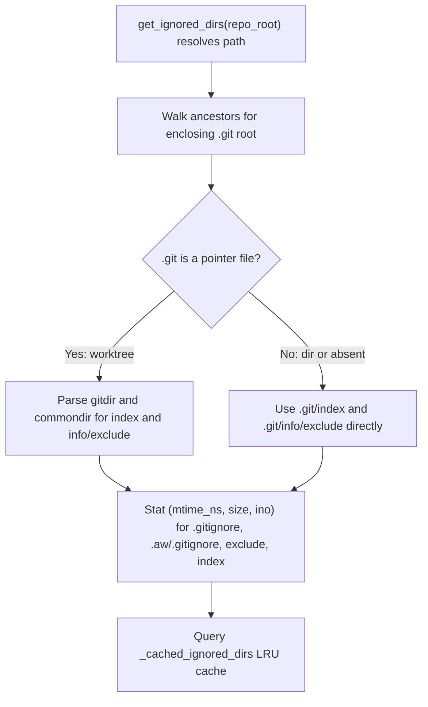

# IPD: Invalidate artifact_core.get_ignored_dirs cache when .aw/.gitignore or .git/index changes

- Date: 2026-11-21
- Kind: child
- Concern: `agent_workflows/artifact_core.py::get_ignored_dirs` caches `git ls-files --others --ignored --exclude-standard --directory` results in `_cached_ignored_dirs` using only `(resolved_root_str, gi_mtime, ex_mtime)`, where `gi_mtime` is root `.gitignore` mtime and `ex_mtime` is `.git/info/exclude` mtime. When a legacy `.agents/` repository runs an in-process dry run that creates `.aw/state/`, `git ls-files` reports `.aw` as an ignored-only directory and caches `.aw` as ignored. When layout migration then creates `.aw/.gitignore` and commits tracked files under `.aw/records/`, neither root `.gitignore` nor `.git/info/exclude` changes mtime, so subsequent in-process `agent_workflows/artifact_core.py::iter_scan_files` calls treat `.aw` as ignored and return `[]`.
- Scope: Extend the cache key of `agent_workflows/artifact_core.py::get_ignored_dirs` and `agent_workflows/artifact_core.py::_cached_ignored_dirs` to include `(st_mtime_ns, st_size, st_ino)` tokens for `.gitignore`, `.aw/.gitignore`, the resolved git `index`, and `info/exclude` (walking up to the enclosing `.git` root for subdirectory callers and resolving both normal `.git/` directories and git worktree `.git` pointer files with `commondir`). Add behavioral regression tests in `tests/test_records_untracked_backend.py` exercising both an in-process `.agents/`-to-tracked-`.aw/records/` transition in a standard repository and cache invalidation in a real `git worktree add` checkout without manually clearing `_cached_ignored_dirs`. EXCLUDES: changing gitignore policy or modifying `tests/test_m0001_any_repo.py` (`60mazt`).
- Scope-Paths: agent_workflows/artifact_core.py, tests/test_records_untracked_backend.py, .aw/records/plans/pending/20261121-xl9xrm-01-dd48b5-invalidate-artifact-core-get-ignored-dirs-cache-when-aw-giti.ipd.md
- Item-Dependencies: none
- Status: executed
- Readiness: go-pending-approval
- Review-Depth: standard
- Short-Description: Include .aw/.gitignore and .git/index stat tokens in artifact_core._cached_ignored_dirs so in-process layout migration does not hide .aw/records/.
- Work-Kind: bug
- Priority: medium
- From-Backlog: xl9xrm
- Blocks-Release: next
- Set: xl9xrm
- Order: 1
- Highest E allocated: 02
- Author: antigravity/gemini
- Id: dd48b5

> Write and proofread this plan per the technical writing standard, `.aw/system/workflows/technical-writing/technical-writing.md` (`.agents/workflows/technical-writing/technical-writing.md` in a legacy-layout install), including requirement 12 (diagrams).

## Workflow history

- 2026-11-21 executed (aw agy run model=Gemini-4-Neon-High): aw agy run self-finalize: dd48b5 verified (set xl9xrm, attempt 2).
- 2026-11-21 reviewed (aw set): APPROVE WITH REVISIONS APPLIED; PR-001..PR-004 FIXED
- 2026-11-21 /plan-review (antigravity/gemini-4-neon-high): APPROVE WITH REVISIONS APPLIED; PR-001..PR-004 FIXED; review record .aw/records/reviews/20261121-xl9xrm-01-dd48b5-invalidate-artifact-core-get-ignored-dirs-cache-when-aw-giti.review.md
- 2026-11-21 to-review (aw set): Authored review-ready child plan graduated from backlog xl9xrm
- 2026-11-21 draft (antigravity/gemini): created.

## Goal

Ensure `agent_workflows/artifact_core.py::get_ignored_dirs` automatically invalidates its cache whenever `.gitignore`, `.aw/.gitignore`, the git `index`, or `info/exclude` changes (in standard repositories, git worktrees, and subdirectory calls), so in-process layout migrations never hide newly tracked `.aw/records/` files.

## Detailed Implementation Checklist (TODO)

Execution-state rule: mark an `E-*` item complete only after performing the action. That mark is not validation. Right-sizing rule: write for a modest executor that cannot hold much in its head. Each E-item is one step (one concern, about one file, executable in one focused pass) and its V-item names each unit it covers with its own check; a plan stays at about 5 E-items and 8 work Scope-Paths, else split it into more child plans (guidance, `IPD-Z603`). Accepted execution states: blocked, failed, pending, performed; terminal gate demands 'performed'.

### Task group 1: Extend ignored-dir cache key and add behavioral regression test

- [x] E-01 Update `agent_workflows/artifact_core.py::get_ignored_dirs` and `agent_workflows/artifact_core.py::_cached_ignored_dirs` to resolve the repository's git metadata paths cleanly and key the LRU cache on `(st_mtime_ns, st_size, st_ino)` stat tuples (using `(-1, -1, -1)` whenever a path is absent or raises `OSError`):
  1. Resolve the git root for `p = Path(resolved_root_str)` by walking `(p, *p.parents)` for the first directory containing `.git` (falling back to `p` when outside any git repository), so subdirectory callers such as `agent_workflows/plans_index.py` and `agent_workflows/research_index.py` also observe root `.gitignore`, `.aw/.gitignore`, and git metadata changes.
  2. Resolve `git_dir` and `common_dir` from `<git_root>/.git`:
     - If `<git_root>/.git` is a directory, `git_dir = common_dir = git_root / ".git"`.
     - If `<git_root>/.git` is a file (a git worktree pointer containing `gitdir: <target>`), parse `<target>`, resolve relative paths against `git_root`, set `git_dir` to that path, and resolve `common_dir` from `git_dir / "commondir"` (resolving relative paths against `git_dir`, falling back to `git_dir` when absent). Guard file reads and path parsing against `OSError` / `ValueError`.
  3. Include four stat tuples in the `_cached_ignored_dirs` cache key:
     - `gi_stat`: `<git_root>/.gitignore`
     - `aw_gi_stat`: `<git_root>/.aw/.gitignore`
     - `ex_stat`: `<common_dir>/info/exclude`
     - `index_stat`: `<git_dir>/index`
     Using `(st.st_mtime_ns, st.st_size, st.st_ino)` ensures atomic write-temp-and-rename updates (such as rapid same-tick `git commit` index replacements or `atomic_write` on `.aw/.gitignore`) always invalidate the cache.
  4. Preserve the existing `agent_workflows/artifact_core.py::_is_repository_untracked_backend` discard of `.aw/records` and the `DEFAULT_IGNORED_DIR_NAMES` fallback when `git` is unavailable.
  - Depends on: none
  - Expected outcome: `agent_workflows/artifact_core.py::get_ignored_dirs` invalidates automatically when `.gitignore`, `.aw/.gitignore`, the git `index`, or `info/exclude` changes, across normal checkouts, git worktrees, and subdirectory callers, without losing cache hits on unchanged trees.
  - Execution state: performed

- [x] E-02 Add behavioral regression tests in `tests/test_records_untracked_backend.py` (following the file's `unittest.TestCase` / `_init_git_repo` conventions, with zero `inspect`, `ast`, or production source-code regex checks):
  1. **Standard repository in-process layout transition:** initialize a git repository with root `.gitignore` ignoring `.aw/state/`, create a file inside `.aw/state/` (for example `.aw/state/index.db`) so `.aw` is initially an ignored-only directory, call `agent_workflows/artifact_core.py::get_ignored_dirs(repo)` (asserting `".aw"` is in the returned set), then write `.aw/.gitignore` plus a tracked `.md` artifact under a scanned `.aw/records/` tree (for example `.aw/records/plans/pending/20261121-test-01-abc123-migrated.ipd.md`) and commit them in-process. Without calling `_cached_ignored_dirs.cache_clear()`, assert that `get_ignored_dirs(repo)` no longer contains `".aw"` and `agent_workflows/artifact_core.py::iter_scan_files(repo)` returns the newly tracked `.md` file.
  2. **Git worktree invalidation:** from an initialized repository with an initial commit, add a real git worktree via `git worktree add` (so `<worktree>/.git` is a `gitdir:` pointer file), warm `get_ignored_dirs(worktree)` with `.aw/state/index.db` ignored, then commit a tracked `.md` artifact under `<worktree>/.aw/records/plans/pending/` and update `<common_git_dir>/info/exclude` in-process. Without clearing `_cached_ignored_dirs`, assert that `get_ignored_dirs(worktree)` and `iter_scan_files(worktree)` reflect both the worktree `index` update and the `commondir` `info/exclude` update.
  Run `python3 -m pytest -o addopts="" -v tests/test_records_untracked_backend.py`, `aw suite`, `make typecheck`, `aw ipd lint --phase pre-transition` on this plan, and `aw sanitize --agent`.
  - Depends on: E-01
  - Expected outcome: Both new behavioral tests pass after `E-01` without manual cache clearing; `aw suite`, `make typecheck`, `aw ipd lint --phase pre-transition`, and `aw sanitize --agent` all pass with zero source-code inspection tests.
  - Execution state: performed

## Project conventions discovered (Step 0)

- `agent_workflows/artifact_core.py::_cached_ignored_dirs` is an `@functools.lru_cache(maxsize=128)` called only by `agent_workflows/artifact_core.py::get_ignored_dirs`.
- `agent_workflows/artifact_core.py::get_ignored_dirs` is called across both repository-root callers (`specs`, `releases`, `check_engine`, `iter_scan_files`) and subdirectory callers (`plans_index`, `plans_refs`, `research_index`, `research_refs`, `prompts_index`, `docs_check`).
- `tests/test_records_untracked_backend.py` uses `unittest.TestCase` (`TestRecordsUntrackedBackend._init_git_repo`) and already imports and tests `agent_workflows/artifact_core.py::get_ignored_dirs` and `is_ignored_path` on isolated `git init` repositories.
- Using `(st_mtime_ns, st_size, st_ino)` prevents coarse filesystem timestamp granularity and equal-size atomic replacements (such as `.git/index.lock` -> `.git/index`) from masking two writes within the same filesystem clock tick.

## Findings

| Id | Finding | Evidence |
|---|---|---|
| F-01 | `agent_workflows/artifact_core.py::get_ignored_dirs` keys `agent_workflows/artifact_core.py::_cached_ignored_dirs` only on `(resolved_root_str, gi_mtime, ex_mtime)`. | `agent_workflows/artifact_core.py::get_ignored_dirs`; observed in IPD `60mazt` on `legacy_agents_layout`, where `agent_workflows/artifact_core.py::iter_scan_files(repo)` returned `[]` after `--apply` until `_cached_ignored_dirs.cache_clear()` was called. |

## Proposed changes (ordered, validatable)

1. Walk up to the enclosing `.git` root, resolve `git_dir` / `common_dir` (normal directory or worktree pointer file), and key `agent_workflows/artifact_core.py::_cached_ignored_dirs` on `(st_mtime_ns, st_size, st_ino)` tuples for `.gitignore`, `.aw/.gitignore`, `<common_dir>/info/exclude`, and `<git_dir>/index` (`E-01`).
2. Add in-process standard-repo and git-worktree cache-invalidation behavioral tests in `tests/test_records_untracked_backend.py` and run all validation gates (`E-02`).

## Deferred / out of scope (with reason)

- Removing the temporary `_cached_ignored_dirs.cache_clear()` workaround from `aw/lane/60mazt`'s unmerged `tests/test_m0001_any_repo.py`: belongs to `60mazt` when re-run.
  - Carrier: 60mazt

## Scope check

- Over-scope: none. Only `agent_workflows/artifact_core.py`, `tests/test_records_untracked_backend.py`, and this plan are modified.
- Under-scope: none. Handles standard `.git/` repositories, worktree `.git` pointer files with `commondir`, subdirectory callers, and same-tick atomic replacements via `(st_mtime_ns, st_size, st_ino)`.

## Required tests / validation

- `python3 -m pytest -o addopts="" -v tests/test_records_untracked_backend.py`
- `aw suite` (core tier passes)
- `make typecheck` (0 mypy errors)
- `aw ipd lint --phase pre-transition` on this plan (`outcome: "clean"`)
- `aw sanitize --agent` (`outcome: "clean"`)

## Spec / documentation sync

N/A: internal cache invalidation bug fix with no public CLI or spec contract change.

## Open questions

None.

## Validation and cross-check (verify before reporting done)

Validation-state rule: inspect evidence in a separate pass. Do not mark a `V-*` item complete from memory or from the matching execution checkmark. Accepted validation results: blocked, failed, pass, pending; terminal gate demands 'pass'. Runtime-demonstration reachability rule: for each `V-*` item demanding the software be observed acting (such as a run, a dispatch, or a transition), as distinct from items demanding a diff, a file's content, or a test result (which are reachable by construction), name the code path that produces the observation or the sibling `E-*` that creates it, else the demand is UNDER-SCOPE.

- [x] V-01 validates E-01
  - Required evidence: paste the `git diff agent_workflows/artifact_core.py` summary showing ancestor `.git` root discovery, normal-repo and worktree `gitdir:`/`commondir` resolution with `OSError` guards, `(st_mtime_ns, st_size, st_ino)` stat tuples for `.gitignore`, `.aw/.gitignore`, `info/exclude`, and `index` in `_cached_ignored_dirs`, and preservation of `_is_repository_untracked_backend` and `DEFAULT_IGNORED_DIR_NAMES`.
  - Observed evidence: `git diff --stat agent_workflows/artifact_core.py` -> `agent_workflows/artifact_core.py | 100 +++++++++++++-` (`+94/-6`). Added `_MISSING_STAT = (-1, -1, -1)`, `_stat_token(path)` returning `(st.st_mtime_ns, st.st_size, st.st_ino)` for regular files or `_MISSING_STAT` on missing/`OSError`, `_find_git_root(path)` walking `(path, *path.parents)` for `.git`, and `_resolve_git_metadata_dirs(git_root)` handling `.git/` directories and worktree `gitdir:`/`commondir` pointer files (resolving relative paths against `git_root`/`git_dir`, guarded against `OSError`/`ValueError`). Extended `_cached_ignored_dirs(resolved_root_str, gi_stat, aw_gi_stat, ex_stat, index_stat)` and updated `get_ignored_dirs` to pass `_stat_token` tuples for `git_root / ".gitignore"`, `git_root / ".aw" / ".gitignore"`, `common_dir / "info" / "exclude"`, and `git_dir / "index"`, preserving `DEFAULT_IGNORED_DIR_NAMES` fallback and `_is_repository_untracked_backend(resolved_root_str)` `.aw/records` discard unchanged.
  - Result: pass

- [x] V-02 validates E-02
  - Required evidence: paste actual output from `python3 -m pytest -o addopts="" -v tests/test_records_untracked_backend.py` (showing both the in-process `.agents/`-to-tracked-`.aw/records/` transition test and the git-worktree invalidation test passing without manual cache clearing), `aw suite`, `make typecheck`, `aw ipd lint --phase pre-transition` on this plan, and `aw sanitize --agent`, plus confirmation that no added test uses `inspect`, `ast`, or source-code regex checks.
  - Observed evidence: `python3 -m pytest -o addopts="" -v tests/test_records_untracked_backend.py` -> `12 passed in 2.17s` (including `TestRecordsUntrackedBackend::test_get_ignored_dirs_invalidates_on_inprocess_layout_transition PASSED` and `TestRecordsUntrackedBackend::test_get_ignored_dirs_invalidates_in_git_worktree PASSED`, neither clearing `_cached_ignored_dirs`). `aw suite` -> `2653 passed, 11 warnings in 90.46s (0:01:30)`. `make typecheck` (`python3 -m mypy agent_workflows`) -> `Success: no issues found in 228 source files`. `aw sanitize --agent` -> `{"schema":"aw.agent/v1","kind":"result","cmd":"check-local-leaks","outcome":"clean","exit":0,"verified":true,"complete":true,"checked":6849,"findings":0,"evidence":["leak-scan"],"next":null}`. Confirmed `grep -nE "\b(inspect|ast)\b|re\.(search|match|findall|compile)" tests/test_records_untracked_backend.py` returned zero matches. `aw ipd lint --phase pre-transition --agent` -> `{"schema":"aw.agent/v1","kind":"result","cmd":"ipd lint","outcome":"clean","exit":0,"verified":true,"complete":true,"findings":0,"evidence":["plans-lint"],"next":null}`.
  - Result: pass

## Approval and execution gate

- Size assessment: standard
- Cohesion rationale: not required

Execute only after human approval (`- Status: approved` or `auto-approved`). Open questions: none open.

Scope fence: the paths in `- Scope-Paths:` are a declaration. If execution must edit a file outside the fence, make the needed edit and justify it at finalize (`--scope-reason`), and acknowledge any declared path left unmodified (`--scope-ack`).

Safety rule: uncommitted changes and untracked files you did not create are not yours; never revert, stage, commit, discard, reformat, or clean up another party's work. Stop and report if a file you must edit has an unresolvable concurrent-edit conflict.

Honesty rule: run all required tests and checks and paste the ACTUAL runner output and summary lines; never claim a result you did not run.

Commits: commit only files modified for this plan through `aw commit dd48b5 -- <paths>`; never `git add -A`, a bare `git add`, `git commit -a`, or `--no-verify`; never push without explicit human instruction.

Lifecycle transition: this plan moves to `.aw/records/plans/executed/` only through `aw ipd finalize`, never a hand `git mv`, and only after `aw ipd lint --phase pre-transition` conforms and every `V-*` reads `pass` with pasted evidence. When `aw oc run` or `aw agy run` executes this plan, the runner owns retirement to `executed/` and runs finalize automatically upon task completion; when executed standalone by hand or direct agent turn, the executor runs `aw ipd finalize dd48b5`.
