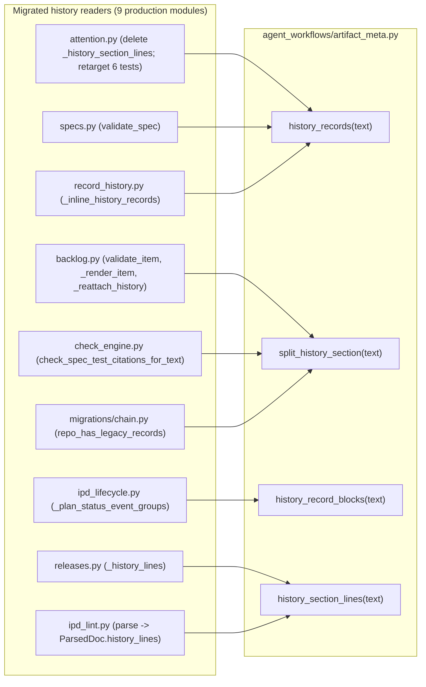

# IPD: Migrate surviving Workflow history section readers onto artifact_meta

- Date: 2026-11-24
- Kind: child
- Concern: Spec `4sd62s` C5 and AC-1 part (1) require a single metadata reader and writer (`agent_workflows/artifact_meta.py`) with no surviving `Workflow history` section parsers or heading regular expressions outside `agent_workflows/artifact_meta.py` and `agent_workflows/migrations/m0001_*.py`. Plan `9o83cr` E-14 audited the codebase after the five split deletion parts (`q6epwc`, `snin8q`, `k6jd6l`, `e8420v`, `0xsx2n`) and found surviving `Workflow history` section readers across `attention.py`, `backlog.py`, `releases.py`, `specs.py`, `record_history.py`, `ipd_lifecycle.py`, `ipd_lint.py`, `check_engine.py`, and `migrations/chain.py` (tracked in backlog items `rzxd1x` and `q4gwp9`). Because `9o83cr` is read-only on production code and must verify zero unexcluded survivors in `V-14`, this focused plan runs ahead of `9o83cr` (replacing E-01 of superseded monolith `rgva3w`).
- Scope: Add the three shared pure history-reading helpers needed in `agent_workflows/artifact_meta.py` (`split_history_section`, `history_record_blocks`, `history_section_lines`), then migrate every surviving `Workflow history` section reader and local heading regex in `attention.py`, `backlog.py`, `releases.py`, `specs.py`, `record_history.py`, `ipd_lifecycle.py`, `ipd_lint.py`, `check_engine.py`, and `migrations/chain.py` onto `artifact_meta`, retargeting the six test files that call `attention._history_section_lines` and adding core behavioral tests. Excludes prompt comment helpers (`t3t7za`), specs/backlog `^-` regexes (`fkvrc7`), `Scope-Paths` writer and widened front-matter readers (`75jciz`), phase-B structural heading constants and conflict/scaffolding writers (`ipd_schema.H_WORKFLOW_HISTORY`, `ipd_authoring.py`, `runner_shared.resolve_history_append_conflict`, carried by `cxxmyv`), and the `9o83cr` final AC-1 audit.
- Scope-Paths: agent_workflows/artifact_meta.py, agent_workflows/attention.py, agent_workflows/backlog.py, agent_workflows/releases.py, agent_workflows/specs.py, agent_workflows/record_history.py, agent_workflows/ipd_lifecycle.py, agent_workflows/ipd_lint.py, agent_workflows/check_engine.py, agent_workflows/migrations/chain.py, tests/test_history_order.py, tests/test_backlog.py, tests/test_set_dispatch_parity.py, tests/test_history_label_parity.py, tests/test_backlog_history_dedup_parity.py, tests/test_status_set.py, tests/test_history_provenance.py, .aw/records/plans/pending/20261124-metastore-301-wgn3bl-migrate-surviving-workflow-history-section-readers-onto-arti.ipd.md
- Item-Dependencies: executed:0xsx2n, executed:e8420v, executed:k6jd6l, executed:q6epwc, executed:snin8q
- Status: executed
- Readiness: go-pending-approval
- Review-Depth: complex
- From-Spec: 4sd62s
- From-Backlog: rzxd1x
- Priority: high
- Work-Kind: bug
- Blocks-Release: next
- Set: metastore
- Order: 301
- Highest E allocated: 5
- Id: wgn3bl
- Author: antigravity

> Write and proofread this plan per the technical writing standard, `.aw/system/workflows/technical-writing/technical-writing.md` (`.agents/workflows/technical-writing/technical-writing.md` in a legacy-layout install), including requirement 12 (diagrams).

## Workflow history

- 2026-11-25 executed (aw agy run model=Gemini-4-Neon-High): aw agy run self-finalize: wgn3bl verified (set metastore, attempt 1).
- 2026-11-25 approved (aw set): status set to approved
- 2026-11-25 reviewed (aw set): APPROVE WITH REVISIONS APPLIED; PR-001..PR-009 FIXED
- 2026-11-25 /plan-review (antigravity/gemini): APPROVE WITH REVISIONS APPLIED; PR-001, PR-002, PR-003, PR-004, PR-005, PR-006, PR-007, PR-008, PR-009; review record .aw/records/reviews/20261124-metastore-301-wgn3bl-migrate-surviving-workflow-history-section-readers-onto-arti.review.md
- 2026-11-24 to-review (antigravity): authored Order 301 child plan (split from superseded `rgva3w` per maintainer decision 2026-11-25, ahead of `9o83cr`) covering `rzxd1x` and `q4gwp9`.

## Goal

Remove every surviving `Workflow history` section parser and local heading regular expression outside `agent_workflows/artifact_meta.py` and `agent_workflows/migrations/m0001_*.py` (enforcing spec `4sd62s` C5 and AC-1 part (1)), routing all nine surviving modules onto `artifact_meta` history helpers ahead of `9o83cr`.

## Detailed Implementation Checklist (TODO)

Execution-state rule: mark an `E-*` item complete only after performing the action. That mark is not validation. Accepted execution states: blocked, failed, pending, performed; terminal gate demands 'performed'.

### Task group 1: Shared history helpers in `artifact_meta.py` (`4sd62s` C5)

- [x] E-01 Add three pure, typed history-section helpers beside `history_records` in `agent_workflows/artifact_meta.py`, and remove stale docstring references to `attention._history_section_lines` (`agent_workflows/artifact_meta.py::_history_block`, `agent_workflows/artifact_meta.py::_newest_history_record`):
  1. `split_history_section(text: str) -> Tuple[str, HistoryBlock, bool]` (or a typed `HistorySection(before_heading, block, has_heading)` `NamedTuple`): locates an unfenced column-zero `## Workflow history` heading (matching `r"(?m)^##[ \t]+Workflow history[ \t]*\r?$"` so single or multiple spaces/tabs after `##` match) and returns `(before_heading, history_records(text), has_heading)`. When no heading is present, returns `(text, HistoryBlock([], [], ""), False)`.
  2. `history_record_blocks(text: str) -> List[List[str]]`: splits the unfenced `## Workflow history` section (through the next `## ` heading) into blank-line-separated contiguous blocks of column-zero `_HISTORY_RECORD_RE` lines, keeping indented continuation lines attached to the current block without splitting it, for `ipd_lifecycle._plan_status_event_groups`.
  3. `history_section_lines(text: str) -> List[Tuple[int, str]]`: returns 1-based `(lineno, raw_line)` tuples for every `- ` bullet line (matching `raw.lstrip().startswith("- ")`) inside the unfenced `## Workflow history` section (stopping at the next `## ` heading), preserving `ipd_lint.ParsedDoc.history_lines` and `releases._history_lines` semantics.
  - Depends on: none
  - Expected outcome: `agent_workflows/artifact_meta.py` exposes `split_history_section`, `history_record_blocks`, and `history_section_lines` with fence-aware scanning, without altering `history_records(text)` behavior, and `tests/test_history_block_bounding.py` and `tests/test_artifact_meta_legacy.py` pass.
  - Execution state: performed

### Task group 2: Core record and board history readers (`rzxd1x`, `4sd62s` C5)

- [x] E-02 Migrate `attention.py`, `backlog.py`, `releases.py`, and `specs.py` onto `artifact_meta` history helpers and retarget the six test modules calling `attention._history_section_lines`:
  1. Delete `agent_workflows/attention.py::_history_section_lines` (which has zero production callers) and replace all 24 test call sites across `tests/test_backlog.py`, `tests/test_set_dispatch_parity.py`, `tests/test_history_label_parity.py`, `tests/test_backlog_history_dedup_parity.py`, `tests/test_status_set.py`, and `tests/test_history_provenance.py` with `artifact_meta.history_records(text).records`.
  2. Remove `agent_workflows/backlog.py::_WORKFLOW_HISTORY_HEADING_RE` and route `backlog.validate_item`, `backlog._render_item`, and `backlog._reattach_history` through `artifact_meta.split_history_section(text)`, preserving both distinct `backlog.history-empty` detail strings (`no ## Workflow history heading` vs. `heading present but no column-zero ... record`).
  3. Replace `agent_workflows/releases.py::_history_lines` with `artifact_meta.history_section_lines(text)`, stripping each bullet's leading `"- "` prefix (`line.lstrip()[2:].strip()`) so `ReleaseRecord.history`, JSON `"history"` output, and `aw releases show` output remain unchanged.
  4. Delete `agent_workflows/specs.py::_history_lines` and update `specs.validate_spec` to check `bool(_meta.history_records(text).records)`.
  - Depends on: E-01
  - Expected outcome: zero local `Workflow history` section parsers or heading regexes remain in `attention.py`, `backlog.py`, `releases.py`, and `specs.py`; all six retargeted test suites plus attention, backlog, releases, and specs tests pass.
  - Execution state: performed

### Task group 3: Lifecycle, lint, citation, and migration-chain readers (`q4gwp9`, `rzxd1x`, `4sd62s` C5)

- [x] E-03 Migrate `record_history.py`, `ipd_lifecycle.py`, `ipd_lint.py`, `check_engine.py`, and `migrations/chain.py` onto `artifact_meta`:
  1. Delete `agent_workflows/record_history.py::_HIST_HEADING` and replace `record_history._inline_history_records(text)`'s manual section scan with `return _meta.history_records(text).records`, preserving `ipd_lifecycle._plan_status_events` and `derive_plan_status`.
  2. Replace the manual `## Workflow history` block-splitting loop in `agent_workflows/ipd_lifecycle.py::_plan_status_event_groups` with `_meta.history_record_blocks(text)`, preserving per-block direction classification (`oldest-first`, `newest-first`, `mixed`, `unknown`) and same-date tie handling.
  3. Replace the `if current_h2 == S.H_WORKFLOW_HISTORY:` history-line accumulation in `agent_workflows/ipd_lint.py::parse` with `artifact_meta.history_section_lines(text)`, preserving `ParsedDoc.history_lines: List[Tuple[int, str]]` (unpacked in `ipd_lint.py`, `check_engine._has_matching_history_line`, `tests/test_readers_read_at_gates.py`, and `tests/test_status_set.py`). Do NOT delete `ipd_schema.H_WORKFLOW_HISTORY`; it stays until cutover `cxxmyv` for `ipd_lint.check_headings` and `ipd_authoring`.
  4. Replace the inline `_re.split(r"(?m)^##[ \t]+Workflow history\b", text, maxsplit=1)` in `agent_workflows/check_engine.py::check_spec_test_citations_for_text` with `artifact_meta.split_history_section(text)[0]`.
  5. Delete `agent_workflows/migrations/chain.py::_WORKFLOW_HISTORY_RE` and replace `_WORKFLOW_HISTORY_RE.search(text)` in `repo_has_legacy_records` with `artifact_meta.split_history_section(text)[2]`.
  - Depends on: E-01
  - Expected outcome: zero local `Workflow history` section parsers or heading regexes remain in `record_history.py`, `ipd_lifecycle.py`, `ipd_lint.py`, `check_engine.py`, and `migrations/chain.py`, and lifecycle, lint, check-engine, and migration-chain tests pass.
  - Execution state: performed

### Task group 4: Behavioral regression tests and final validation (`4sd62s` AC-1, C10a)

- [x] E-04 Add behavioral regression tests in `tests/test_history_order.py` (marking the new fast test class with `@pytest.mark.core` so bare `python3 -m pytest` runs it without pulling the slow whole-tree `DerivationIsUnchangedTests` scan into the core tier) exercising:
  1. `artifact_meta.split_history_section` (missing heading, empty heading, heading with records and trailing body, fenced heading ignored).
  2. `artifact_meta.history_record_blocks` (blank-line-separated blocks, indented continuation lines kept in-block, fenced heading ignored) and `ipd_lifecycle._plan_status_event_groups` / `check_engine.check_lifecycle_transitions`.
  3. `artifact_meta.history_section_lines` (1-based line numbers, fenced code block exclusion) and `ipd_lint.parse` / `check_engine._has_matching_history_line`.
  4. End-to-end history reading through `backlog.validate_item` (distinct missing-heading vs. empty-heading details), `releases.parse_release` (`- ` prefix stripped in `ReleaseRecord.history`), `specs.validate_spec`, `check_engine.check_spec_test_citations_for_text` (normative vs. history exemption), and `migrations.chain.repo_has_legacy_records`.
  Assert observable return values, diagnostics, file bytes, and exit codes only; perform zero source-reading assertions.
  - Depends on: E-02, E-03
  - Expected outcome: all new `@pytest.mark.core` behavioral tests and existing `tests/test_history_order.py` tests pass.
  - Execution state: performed

- [x] E-05 Run targeted pytest suites across all affected modules, the bare core gate `python3 -m pytest` (confirming pass summary), `python3 -m mypy` on all 10 modified production files, `rg -n "Workflow history"` across all 9 non-`artifact_meta` owned production files confirming zero surviving parser/regex/slicer hits (only diagnostic or comment strings), and `aw sanitize --agent`.
  - Depends on: E-04
  - Expected outcome: all targeted tests and the bare core gate pass, `mypy` reports zero errors across all 10 production files, `rg` reports zero surviving parser/regex/slicer hits in the 9 owned non-`artifact_meta` files, and `aw sanitize --agent` reports clean (`pass`).
  - Execution state: performed

## Project conventions discovered (Step 0)

- Spec `4sd62s` C5 and AC-1 part (1) require `agent_workflows/artifact_meta.py` to be the sole metadata and history reader outside `agent_workflows/migrations/m0001_*.py`.
- Spec `4sd62s` C10a requires every commit on `main` before cutover (`cxxmyv`) to remain fully working in the legacy bullet-block format and pass the bare core pytest gate (`python3 -m pytest`).
- `ipd_schema.py::H_WORKFLOW_HISTORY` is element 0 of `CHILD_H2_ORDER` and `ORCHESTRATOR_H2_ORDER`, enforced by `ipd_lint.py::check_headings` and used by `ipd_authoring.py`; it is a phase-B structural heading constant, not a parser, and stays until cutover `cxxmyv`.
- `- From-Backlog:` is single-valued (`ipd_schema.py::META_FROM_BACKLOG`), so this plan carries `- From-Backlog: rzxd1x` while also addressing the surviving `_plan_status_event_groups` / `_inline_history_records` work of `q4gwp9` (its `HISTORY_RECORD_RE` half was already closed by executed plan `tdhav3`).
- Tests must assert observable behavior only (no `inspect`, `ast`, regex, or source-reading assertions, per `GUIDING_PRINCIPLES.md` P16).
- Commits must be path-scoped via `aw commit wgn3bl -- <paths>` in an isolated worktree.

## Findings

Verified statically against the repository (covering open/graduated backlog items `rzxd1x` and `q4gwp9`):

| Module & symbol | Current behavior | Target `artifact_meta` helper |
|---|---|---|
| `agent_workflows/attention.py::_history_section_lines` | Raw regex slicer (`^## Workflow history[ \t]*$`); zero production callers, 24 call sites across 6 test files. | Delete; retarget 6 test files to `artifact_meta.history_records(text).records`. |
| `agent_workflows/backlog.py::_WORKFLOW_HISTORY_HEADING_RE` | Used in `validate_item` (heading presence vs. empty), `_render_item` (`split` before heading), `_reattach_history` (`split` before heading). | `artifact_meta.split_history_section(text)` (`before_heading`, `has_heading`). |
| `agent_workflows/releases.py::_history_lines` | Regex `^##[ \t]+Workflow history[ \t]*$`; returns `- ` bullets with leading `"- "` stripped for `ReleaseRecord.history` / JSON / CLI display. | `artifact_meta.history_section_lines(text)` with `"- "` stripped. |
| `agent_workflows/specs.py::_history_lines` | Scans `== "## Workflow history"` through `## `; only caller is `validate_spec` checking `any(_meta.is_history_record(h) for h in hist)`. | `artifact_meta.history_records(text).records`. |
| `agent_workflows/record_history.py::_HIST_HEADING`, `_inline_history_records` | Scans `== "## Workflow history"` through `## `; called by `ipd_lifecycle._plan_status_events`. (`HISTORY_RECORD_RE` is already gone outside `artifact_meta.py` and `m0001_convert.py`.) | `artifact_meta.history_records(text).records`. |
| `agent_workflows/ipd_lifecycle.py::_plan_status_event_groups` | Splits `## Workflow history` into blank-line-separated blocks of `_HISTORY_RECORD_RE` lines for per-block direction classification (pinned by `tests/test_history_order.py::HistoryOrderFixtureTests.test_fixture_c_mixed_blocks`). | `artifact_meta.history_record_blocks(text)`. |
| `agent_workflows/ipd_lint.py::parse` (`doc.history_lines`) | Accumulates `(lineno, raw)` for `- ` lines when `current_h2 == S.H_WORKFLOW_HISTORY`; unpacked as `(_lineno, line)` in `ipd_lint.py`, `check_engine.py::_has_matching_history_line`, and tests. | `artifact_meta.history_section_lines(text)`. |
| `agent_workflows/check_engine.py::check_spec_test_citations_for_text` | Splits on `r"(?m)^##[ \t]+Workflow history\b"` and checks `parts[0]` as normative body. | `artifact_meta.split_history_section(text)[0]`. |
| `agent_workflows/migrations/chain.py::_WORKFLOW_HISTORY_RE` | Searches `^## Workflow history\s*$` in `repo_has_legacy_records`; outside `m0001_*.py` and not owned by `fkvrc7`. | `artifact_meta.split_history_section(text)[2]` (`has_heading`). |

## Proposed changes (ordered, validatable)

1. Add `split_history_section`, `history_record_blocks`, and `history_section_lines` to `agent_workflows/artifact_meta.py` and clean up stale `attention._history_section_lines` comments (`E-01`).
2. Delete `attention._history_section_lines`, retarget its six test callers, and migrate `backlog.py`, `releases.py`, and `specs.py` onto `artifact_meta` (`E-02`).
3. Migrate `record_history.py`, `ipd_lifecycle.py`, `ipd_lint.py`, `check_engine.py`, and `migrations/chain.py` onto `artifact_meta` (`E-03`).
4. Add `@pytest.mark.core` behavioral regression tests in `tests/test_history_order.py` (`E-04`) and run targeted pytest, bare core pytest, `mypy`, `rg`, and `aw sanitize --agent` (`E-05`).

## Deferred / out of scope (with reason)

- Prompt comment helpers (`aw-prompt` / `aw-managed-prompt`) are owned by Order 302 (`t3t7za`).
  - Carrier: t3t7za
- Specs/backlog `^-` metadata regexes are owned by Order 303 (`fkvrc7`).
  - Carrier: fkvrc7
- `Scope-Paths` bullet writer and widened front-matter readers are owned by Order 304 (`75jciz`).
  - Carrier: 75jciz
- Final AC-1 zero-survivors audit across `agent_workflows/` is owned by `9o83cr`.
  - Carrier: 9o83cr
- Phase-B structural heading constants and legacy writers/conflict-resolvers (`agent_workflows/ipd_schema.py::H_WORKFLOW_HISTORY`, `agent_workflows/ipd_authoring.py`, and `agent_workflows/runner_shared.py::resolve_history_append_conflict`) remain required until the log-format cutover removes inline `## Workflow history` sections.
  - Carrier: cxxmyv

## Scope check

- Over-scope: none; strictly limited to migrating surviving `Workflow history` section readers onto `artifact_meta` helpers and updating their direct test callers. `ipd_schema.py` is explicitly excluded because `H_WORKFLOW_HISTORY` is a phase-B structural heading constant, not a parser.
- Under-scope: none; covers every `rzxd1x` and `q4gwp9` survivor plus the unowned `migrations/chain.py::_WORKFLOW_HISTORY_RE` ahead of `9o83cr`.

## Required tests / validation

- Targeted suites:
  - `python3 -m pytest tests/test_history_block_bounding.py tests/test_artifact_meta_legacy.py`
  - `python3 -m pytest tests/test_readers_attention.py tests/test_backlog.py tests/test_backlog_history_empty_rule.py tests/test_backlog_history_dedup_parity.py tests/test_set_dispatch_parity.py tests/test_history_label_parity.py tests/test_status_set.py tests/test_history_provenance.py tests/test_releases.py tests/test_releases_cli.py tests/test_specs_verbs.py tests/test_specs_status_dirs.py`
  - `python3 -m pytest tests/test_history_order.py tests/test_ipd_lifecycle_cli.py tests/test_ipd_lifecycle_restored_behavior.py tests/test_readers_ipd_lint.py tests/test_ipd_lint.py tests/test_readers_read_at_gates.py tests/test_check_engine_test_citation.py tests/test_check_engine.py tests/test_migrations_chain.py`
- Core gate: `python3 -m pytest`
- Type check: `python3 -m mypy agent_workflows/artifact_meta.py agent_workflows/attention.py agent_workflows/backlog.py agent_workflows/releases.py agent_workflows/specs.py agent_workflows/record_history.py agent_workflows/ipd_lifecycle.py agent_workflows/ipd_lint.py agent_workflows/check_engine.py agent_workflows/migrations/chain.py`
- Survivor search: `rg -n "Workflow history" agent_workflows/attention.py agent_workflows/backlog.py agent_workflows/releases.py agent_workflows/specs.py agent_workflows/record_history.py agent_workflows/ipd_lifecycle.py agent_workflows/ipd_lint.py agent_workflows/check_engine.py agent_workflows/migrations/chain.py`
- Sanitizer: `aw sanitize --agent`

## Spec / documentation sync

N/A: enforces existing approved spec `4sd62s` C5 and AC-1 part (1) in phase B without changing any public CLI syntax, file format, or status contract; post-cutover documentation updates remain owned by `90iqr1` and `cxxmyv`.

## Open questions

None.

## Validation and cross-check (verify before reporting done)

Validation-state rule: inspect evidence in a separate pass. Do not mark a `V-*` item complete from memory or from the matching execution checkmark. Accepted validation results: blocked, failed, pass, pending; terminal gate demands 'pass'.

- [x] V-01 validates E-01
  - Required evidence: paste `python3 -m pytest tests/test_history_block_bounding.py tests/test_artifact_meta_legacy.py` summary showing all tests passing, plus a diff summary or signature check confirming `split_history_section`, `history_record_blocks`, and `history_section_lines` exist in `agent_workflows/artifact_meta.py` and stale `attention._history_section_lines` comments are removed.
  - Observed evidence:
    - `python3 -m pytest tests/test_history_block_bounding.py tests/test_artifact_meta_legacy.py`: `35 passed in 4.10s` (`0 unlisted slow tests`).
    - Signature check: `split_history_section: (text: 'str') -> 'HistorySection'`, `history_record_blocks: (text: 'str') -> 'List[List[str]]'`, `history_section_lines: (text: 'str') -> 'List[Tuple[int, str]]'`.
    - `rg -n "_history_section_lines" agent_workflows/artifact_meta.py`: empty (stale docstring references removed).
  - Result: pass

- [x] V-02 validates E-02
  - Required evidence: paste `rg -n "Workflow history|_history_section_lines|_WORKFLOW_HISTORY_HEADING_RE|_history_lines" agent_workflows/attention.py agent_workflows/backlog.py agent_workflows/releases.py agent_workflows/specs.py` confirming zero surviving section parsers or heading regexes (only user-facing diagnostic strings or docstrings, each verified non-parser), `rg -n "_history_section_lines" tests/` empty (except docstring reference if any in `tests/support.py`), and `python3 -m pytest tests/test_readers_attention.py tests/test_backlog.py tests/test_backlog_history_empty_rule.py tests/test_backlog_history_dedup_parity.py tests/test_set_dispatch_parity.py tests/test_history_label_parity.py tests/test_status_set.py tests/test_history_provenance.py tests/test_releases.py tests/test_releases_cli.py tests/test_specs_verbs.py tests/test_specs_status_dirs.py` passing summary.
  - Observed evidence:
    - `rg -n "Workflow history|_history_section_lines|_WORKFLOW_HISTORY_HEADING_RE|_history_lines" agent_workflows/attention.py agent_workflows/backlog.py agent_workflows/releases.py agent_workflows/specs.py`: only non-parser docstrings/diagnostics remain (`backlog.py:36` module docstring, `backlog.py:600` diagnostic string `"no ## Workflow history heading; ..."`, `backlog.py:1498` docstring, `releases.py:326` `ReleaseRecord` docstring, `specs.py:393` diagnostic string `"no conformant ## Workflow history record"`). Zero hits in `attention.py`; zero surviving parsers or heading regexes.
    - `rg -n "_history_section_lines" tests/`: only `tests/support.py:759` docstring reference.
    - `python3 -m pytest tests/test_readers_attention.py tests/test_backlog.py tests/test_backlog_history_empty_rule.py tests/test_backlog_history_dedup_parity.py tests/test_set_dispatch_parity.py tests/test_history_label_parity.py tests/test_status_set.py tests/test_history_provenance.py tests/test_releases.py tests/test_releases_cli.py tests/test_specs_verbs.py tests/test_specs_status_dirs.py`: `324 passed in 14.43s`.
  - Result: pass

- [x] V-03 validates E-03
  - Required evidence: paste `rg -n "Workflow history|_HIST_HEADING|_WORKFLOW_HISTORY_RE" agent_workflows/record_history.py agent_workflows/ipd_lifecycle.py agent_workflows/ipd_lint.py agent_workflows/check_engine.py agent_workflows/migrations/chain.py` confirming zero surviving section parsers, heading regexes, or slicers (only non-parser diagnostic strings or docstrings), plus `python3 -m pytest tests/test_history_order.py tests/test_ipd_lifecycle_cli.py tests/test_ipd_lifecycle_restored_behavior.py tests/test_readers_ipd_lint.py tests/test_ipd_lint.py tests/test_readers_read_at_gates.py tests/test_check_engine_test_citation.py tests/test_check_engine.py tests/test_migrations_chain.py` passing summary.
  - Observed evidence:
    - `rg -n "Workflow history|_HIST_HEADING|_WORKFLOW_HISTORY_RE" agent_workflows/record_history.py agent_workflows/ipd_lifecycle.py agent_workflows/ipd_lint.py agent_workflows/check_engine.py agent_workflows/migrations/chain.py`: only non-parser docstrings, comments, and diagnostic strings remain (`record_history.py:128,355`, `ipd_lifecycle.py:929,950,1116,1346,1636`, `ipd_lint.py:113,1756,1797,1971,2066`, `check_engine.py:367,3507,3758,3771,3856,10496,10509,12197`, and zero hits in `migrations/chain.py`). Zero surviving parsers, heading regexes, or slicers.
    - `python3 -m pytest tests/test_history_order.py tests/test_ipd_lifecycle_cli.py tests/test_ipd_lifecycle_restored_behavior.py tests/test_readers_ipd_lint.py tests/test_ipd_lint.py tests/test_readers_read_at_gates.py tests/test_check_engine_test_citation.py tests/test_check_engine.py tests/test_migrations_chain.py`: `267 passed in 16.06s` (8 deselected by marker filter).
  - Result: pass

- [x] V-04 validates E-04
  - Required evidence: paste `python3 -m pytest -v tests/test_history_order.py` showing all existing and new `@pytest.mark.core` behavioral tests passing (covering `split_history_section`, `history_record_blocks`, `history_section_lines`, `backlog`, `releases`, `specs`, `ipd_lifecycle`, `ipd_lint`, `check_engine`, and `migrations.chain`), and `rg -n "inspect\.|import ast|getsource|read_text\(.*agent_workflows" tests/test_history_order.py` empty.
  - Observed evidence:
    - `python3 -m pytest -v tests/test_history_order.py`: `15 passed in 3.61s`.
    - `python3 -m pytest -vv tests/test_history_order.py`: `15 passed in 4.74s`, including all 8 new `@pytest.mark.core` tests in `ArtifactMetaHistoryMigrationTests` (`test_split_history_section_cases`, `test_history_record_blocks_and_lifecycle_groups`, `test_history_section_bullets_ipd_lint_and_matching_history`, `test_backlog_validate_item_distinct_history_empty_details`, `test_releases_parse_release_strips_bullet_prefix`, `test_specs_validate_spec_history_presence`, `test_check_spec_test_citations_normative_vs_history_exemption`, `test_migrations_chain_repo_has_legacy_records`) plus all 7 existing tests (`DerivationIsUnchangedTests`, `HistoryOrderFixtureTests`).
    - `rg -n "inspect\.|import ast|getsource|read_text\(.*agent_workflows" tests/test_history_order.py`: empty.
  - Result: pass

- [x] V-05 validates E-05
  - Required evidence: paste the bare `python3 -m pytest` summary line (`N passed`), `python3 -m mypy agent_workflows/artifact_meta.py agent_workflows/attention.py agent_workflows/backlog.py agent_workflows/releases.py agent_workflows/specs.py agent_workflows/record_history.py agent_workflows/ipd_lifecycle.py agent_workflows/ipd_lint.py agent_workflows/check_engine.py agent_workflows/migrations/chain.py` zero-error output, the full `rg -n "Workflow history"` output across the 9 non-`artifact_meta` owned files showing zero parser/regex/slicer hits, and `aw sanitize --agent` clean (`pass`) output.
  - Observed evidence:
    - Bare `python3 -m pytest`: `2905 passed, 1 skipped, 11 warnings in 253.19s (0:04:13)`.
    - `python3 -m mypy agent_workflows/artifact_meta.py agent_workflows/attention.py agent_workflows/backlog.py agent_workflows/releases.py agent_workflows/specs.py agent_workflows/record_history.py agent_workflows/ipd_lifecycle.py agent_workflows/ipd_lint.py agent_workflows/check_engine.py agent_workflows/migrations/chain.py`: `Success: no issues found in 10 source files`.
    - `rg -n "Workflow history" agent_workflows/attention.py agent_workflows/backlog.py agent_workflows/releases.py agent_workflows/specs.py agent_workflows/record_history.py agent_workflows/ipd_lifecycle.py agent_workflows/ipd_lint.py agent_workflows/check_engine.py agent_workflows/migrations/chain.py`: zero parser/regex/slicer hits (only docstrings/comments/diagnostic strings at `backlog.py:36,600,1498`, `releases.py:326`, `specs.py:393`, `record_history.py:128,355`, `ipd_lifecycle.py:929,950,1116,1346,1636`, `ipd_lint.py:113,1756,1797,1971,2066`, `check_engine.py:367,3507,3758,3771,3856,10496,10509,12197`; zero hits in `attention.py` and `migrations/chain.py`).
    - `aw sanitize --agent`: `{"schema":"aw.agent/v1","kind":"result","cmd":"check-local-leaks","outcome":"clean","exit":0,"verified":true,"complete":true,"checked":7220,"findings":0,"evidence":["leak-scan"],"next":null}`.
  - Result: pass

## Approval and execution gate

- Size assessment: exception
- Cohesion rationale: All 10 production files and 7 test files share one narrow concern (migrating every surviving `Workflow history` section reader onto three pure helpers in `agent_workflows/artifact_meta.py` ahead of `9o83cr`, matching the maintainer's 2026-11-25 split of `rgva3w` into Orders 301-304) across 5 focused E-items; splitting further would scatter a single shared `artifact_meta` history-reader migration and break the `63ib9r` / `9o83cr` dependency wiring.

Execute only after human approval (`Status: approved`) and after every plan in `- Item-Dependencies:` is `executed` (`0xsx2n`, `e8420v`, `k6jd6l`, `q6epwc`, `snin8q`). Open questions: none.

Scope fence: `- Scope-Paths:` declares every file this plan intends to modify. Any needed file outside `- Scope-Paths:` is edited and justified at finalize with `--scope-reason`; any declared file left unmodified is acknowledged with `--scope-ack`.

Safety: if any prerequisite symbol in `agent_workflows/artifact_meta.py` (`history_records`, `is_history_record`, `history_record_date`) is absent, or an unresolvable concurrent-edit conflict occurs in a shared file, stop and report immediately rather than overwriting or guessing.

Honesty rule: run every command listed in `## Required tests / validation` and `V-01..V-05`, and paste the actual runner output; never claim a test, type check, search, or sanitizer run passed without running it.

Commits: commit only files you modified for this task via `aw commit wgn3bl -- <paths>` (never `git add -A`, bare `git add`, or `git commit -a`); never push.

Lifecycle transition: move the plan to `.aw/records/plans/executed/` only via `aw ipd finalize` (never a hand `git mv`), and only after `aw ipd lint --phase pre-transition` conforms, every `E-*` is `performed`, and every `V-*` is `pass` with pasted evidence. When `aw oc run` or `aw agy run` executes the plan, the runner performs finalize; a hand executor runs `aw ipd finalize wgn3bl` itself.
