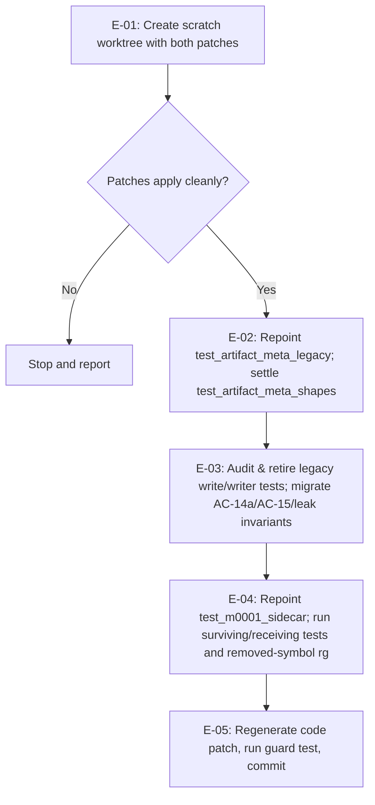

# IPD: Retire or repoint the legacy loader and writer unit tests in the cutover code patch

- Date: 2026-11-25
- Kind: child
- Concern: Backlog `ldfefd`: five test modules fail on the switched log-format tree (`x1mmdp` F-05; historical attempt-1 counts: `tests/test_artifact_meta_legacy.py` 14 failing, `tests/test_artifact_meta_shapes.py` 15 failing, `tests/test_artifact_meta_legacy_write.py` 31 failing, `tests/test_artifact_meta_legacy_writer.py` 11 failing, `tests/test_m0001_sidecar.py` 1 failing) because the cutover code patch moves `load_legacy_artifact` and `derive_id6` out of `agent_workflows/artifact_meta.py` into `agent_workflows/migrations/m0001_metadata_v2.py` and removes the phase-B legacy cache scanner and legacy writer API (`LegacyRender`, `LegacyTarget`, `render_legacy_text`, `write_legacy`, `SidecarRecord`, `restore_legacy_snapshot`, `LEGACY_LOADER_VERSION`) per spec `4sd62s` C10a and Sections 5.2 and 5.3.
- Scope: In an isolated scratch worktree with both cutover patches applied (including `hdwqex` and `89mtbl`), repoint `tests/test_artifact_meta_legacy.py` onto `agent_workflows/migrations/m0001_metadata_v2.py::load_legacy_artifact`, retain `m0001_metadata_v2.derive_id6` determinism/collision coverage from `tests/test_artifact_meta_shapes.py` while retiring its phase-B legacy cache-scan and `LegacyRender`/`SidecarRecord` tests, audit and retire `tests/test_artifact_meta_legacy_write.py` and `tests/test_artifact_meta_legacy_writer.py` (migrating any uncovered AC-14a, AC-15, or writer-leak invariant to `tests/test_artifact_meta_write.py` and citing the removing spec `4sd62s` clause per deleted node id in F-02), repoint `tests/test_m0001_sidecar.py` from `artifact_meta.load_legacy_artifact` to `m0001_metadata_v2.load_legacy_artifact`, verify all surviving modules pass with zero removed-symbol references, and regenerate `.aw/system/cutover/metastore-code.cutover.patch`. No live code changes.
- Scope-Paths: .aw/records/plans/pending/20261125-metastore-307-nv3upa-retire-or-repoint-the-legacy-loader-and-writer-unit-tests-in.ipd.md, .aw/system/cutover/metastore-code.cutover.patch
- Item-Dependencies: executed:89mtbl
- Status: executed
- Review-Depth: standard
- Readiness: go-pending-approval
- From-Spec: 4sd62s
- Work-Kind: followup
- Priority: high
- From-Backlog: ldfefd
- Blocks-Release: next
- Set: metastore
- Order: 307
- Highest E allocated: 05
- Author: opencode its_direct/pt3-claude-opus-5.5-1m-us
- Id: nv3upa

> Write and proofread this plan per the technical writing standard, `.aw/system/workflows/technical-writing/technical-writing.md` (`.agents/workflows/technical-writing/technical-writing.md` in a legacy-layout install), including requirement 12 (diagrams).

## Workflow history

- 2026-11-27 executed (aw agy run model=Gemini-4-Neon-High): aw agy run self-finalize: nv3upa verified (set metastore, attempt 1).
- 2026-11-27 approved (aw set): status set to approved
- 2026-11-26 auto-approved (aw agy run --full-auto): auto-approved by --full-auto: review readiness cleared (not human approval)
- 2026-11-26 /plan-review (antigravity/gemini): APPROVE WITH REVISIONS APPLIED; PR-006, PR-007, PR-008, PR-009; review record .aw/records/reviews/20261125-metastore-307-nv3upa-retire-or-repoint-the-legacy-loader-and-writer-unit-tests-in.review.md
- 2026-11-26 to-review (aw set): demoted reviewed -> to-review: These were flagged as '[stale-review]'
- 2026-11-26 reviewed (aw set): APPROVE WITH REVISIONS APPLIED; PR-001..PR-005 FIXED
- 2026-11-26 /plan-review (antigravity/gemini): APPROVE WITH REVISIONS APPLIED; PR-001, PR-002, PR-003, PR-004, PR-005; review record .aw/records/reviews/20261125-metastore-307-nv3upa-retire-or-repoint-the-legacy-loader-and-writer-unit-tests-in.review.md
- 2026-11-26 to-review (aw set): authored as part of the x1mmdp split per maintainer answer to run-20261125T162650Z-1337442 question 06-x1mmdp-a1-Q-01 (Split into new children; fix jycxw8 first)
- 2026-11-26 draft (opencode its_direct/pt3-claude-opus-5.5-1m-us): created.

## Goal

Remove every reference to deleted legacy `artifact_meta` loader and writer symbols across these five test modules inside `.aw/system/cutover/metastore-code.cutover.patch`, while keeping all surviving `m0001` legacy-loader behavior (`load_legacy_artifact`, `derive_id6`, sidecar migration) and all surviving log-writer invariants (spec `4sd62s` AC-14a, AC-15, writer leak refusals) under test.

## Detailed Implementation Checklist (TODO)

Execution-state rule: mark an `E-*` item complete only after performing the action. That mark is not validation. Right-sizing rule: write for a modest executor that cannot hold much in its head. Each E-item is one step (one concern, about one file, executable in one focused pass) and its V-item names each unit it covers with its own check; a plan stays at about 5 E-items and 8 work Scope-Paths, else split it into more child plans (guidance, `IPD-Z603`). Accepted execution states: blocked, failed, pending, performed; terminal gate demands 'performed'.

### Task group 1: scratch worktree

- [x] E-01 Create the scratch worktree following the SCRATCH PROCEDURE of `2k5t16` (Step 0): run `git worktree add --detach .aw/state/nv3upa/scratch HEAD`; inside `.aw/state/nv3upa/scratch`, run `git apply --index .aw/system/cutover/metastore-docs.cutover.patch`, record `BASE=$(git write-tree)` in F-01, and then run `git apply --index .aw/system/cutover/metastore-code.cutover.patch`. If either patch rejects, stop and report.
  - Depends on: none
  - Expected outcome: `.aw/state/nv3upa/scratch` holds HEAD plus both patches staged, and F-01 records the base tree id.
  - Execution state: performed

### Task group 2: legacy unit tests (scratch worktree only)

- [x] E-02 Repoint `tests/test_artifact_meta_legacy.py` and settle `tests/test_artifact_meta_shapes.py` against `m0001_metadata_v2`:
  1. In `tests/test_artifact_meta_legacy.py`, repoint every `meta.load_legacy_artifact(...)` call to `agent_workflows.migrations.m0001_metadata_v2.load_legacy_artifact(...)`, keeping literal legacy inputs and field assertions intact (`load_legacy_review`, `read_text`, `history_records`, `_newest_history_record`, and `_last_history_at` remain in `artifact_meta.py`).
  2. In `tests/test_artifact_meta_shapes.py`, preserve `derive_id6` determinism and collision coverage by calling `m0001_metadata_v2.derive_id6` directly (either in `tests/test_artifact_meta_shapes.py` or moved into `tests/test_artifact_meta_legacy.py`), and retire the phase-B legacy cache-scanning (`artifact_meta.query`/`read`/`history` over unmigrated `.agents/` and id-less legacy repos) and `LegacyRender`/`SidecarRecord` tests (`test_a_shapes_query_parity`, `test_b_idless_derived_id6_stability`, `test_c_legacy_agents_read_and_history`, `test_d_query_resolved_and_logical_roots_contexts`, `test_f_note_append_on_derived_spec_writes_no_id_or_sidecar`, and the phase-B cache portion of `test_e_declared_id_collision_rederives_idless`) under conversion rule 4, recording each deleted node id in F-02 beside spec `4sd62s` C10a and Sections 5.2 and 5.3 (multi-shape migration coverage lives in `tests/test_m0001_any_repo.py`).
  - Depends on: E-01
  - Expected outcome: `tests/test_artifact_meta_legacy.py` (and `tests/test_artifact_meta_shapes.py` if retained for `derive_id6`) imports no removed symbol and passes; any retired node id is recorded in F-02 with its `4sd62s` clause.
  - Execution state: performed

- [x] E-03 Audit and retire `tests/test_artifact_meta_legacy_write.py` and `tests/test_artifact_meta_legacy_writer.py` under conversion rule 4:
  1. Audit every test in both files against surviving log-writer coverage in `tests/test_artifact_meta_write.py` and `tests/test_artifact_meta_replay.py`, specifically checking spec `4sd62s` AC-14a (`review_kind` gate vs refinement validation and sequential refinement rounds), spec `4sd62s` AC-15 (event-owned `readiness`, `coverage`, `approval`, and backward-transition `unset readiness` refusals), and writer-side leak refusals (`home` path in `message`). For `tests/test_artifact_meta_legacy_writer.py`, cite spec `4sd62s` Section 4.2b alongside C10a and Sections 4.3, 5.2, and 5.3 when retiring `test_prompt_create_and_cli_new_preserve_prompt_kind_and_created_day` (new log-format creations use UTC `created_at` and never write day-only `created_day`; `prompt_kind` is covered by `89mtbl` and `tests/test_prompts_new.py`) and `test_stale_prompt_cache_rebuilt_under_legacy_loader_version` (`LEGACY_LOADER_VERSION` is replaced by `LOADER_VERSION = "log_v1"`, and stale `schema_hash` rebuild is covered by `tests/test_artifact_meta_loader_parity.py::test_a_cache_built_by_an_older_loader_is_rebuilt_not_served`).
  2. Migrate any surviving log-writer invariant that has no existing log-format test into `tests/test_artifact_meta_write.py` (exercising `artifact_meta.create`/`append` on log-format records; note that in log-format `artifact_meta.replay`, the spec `4sd62s` AC-15 case 5 backward-transition `unset readiness` refusal triggers when `readiness` is present in `current_fields`, so the migrated AC-15 case 5 test must first record a gate `op: "review"` event setting `readiness` before testing refusal without `unset readiness` and success with `unset readiness`). Leave `tests/test_artifact_meta_write.py::test_append_dry_run` untouched (that pre-existing switched-tree failure is owned by `cugg3w` E-02 item 4). Record every deleted node id in F-02 beside the removing spec `4sd62s` clause (C10a, Sections 4.2b, 4.3, 5.2, and 5.3) and the receiving test node id where applicable.
  - Depends on: E-02
  - Expected outcome: F-02 lists every deleted node id with its `4sd62s` clause and receiving test; no surviving spec `4sd62s` AC-14a, AC-15, or writer-refusal invariant loses test coverage; `tests/test_artifact_meta_replay.py` and `tests/test_artifact_meta_write.py` (excluding `test_append_dry_run`, owned by `cugg3w`) pass.
  - Execution state: performed

- [x] E-04 Repoint `tests/test_m0001_sidecar.py` from `artifact_meta.load_legacy_artifact` to `m0001_metadata_v2.load_legacy_artifact` (recording the repointed call in F-03), then run all surviving modules of the five (`tests/test_artifact_meta_legacy.py`, `tests/test_m0001_sidecar.py`, and `tests/test_artifact_meta_shapes.py` if retained) and `tests/test_artifact_meta_replay.py` with `python3 -m pytest -o addopts="" -m ''`, run `tests/test_artifact_meta_write.py` with `python3 -m pytest -o addopts="" -m '' -k "not test_append_dry_run"` (leaving `test_append_dry_run` for `cugg3w` E-02 item 4), and run `rg` over those surviving paths (plus `tests/test_artifact_meta_write.py` if modified in E-03) for every removed symbol in the scratch worktree.
  - Depends on: E-03
  - Expected outcome: every surviving module and receiving module (`tests/test_artifact_meta_write.py` excluding `test_append_dry_run`) passes; `rg` over the surviving and receiving paths for removed symbols returns no matches.
  - Execution state: performed

### Task group 3: package

- [x] E-05 In `.aw/state/nv3upa/scratch`, run `git add -A` and write `git diff --cached --binary $BASE` over `.aw/system/cutover/metastore-code.cutover.patch` in the executing checkout; remove the scratch worktree (`git worktree remove --force .aw/state/nv3upa/scratch`); run `python3 -m pytest -o addopts="" tests/test_metastore_cutover_code_patch.py` in the executing checkout; verify `git status --short` shows only `- Scope-Paths:` modified; and commit through `aw commit nv3upa -- .aw/records/plans/pending/20261125-metastore-307-nv3upa-retire-or-repoint-the-legacy-loader-and-writer-unit-tests-in.ipd.md .aw/system/cutover/metastore-code.cutover.patch`; never push.
  - Depends on: E-04
  - Expected outcome: `.aw/system/cutover/metastore-code.cutover.patch` holds all earlier changes plus this plan's; `tests/test_metastore_cutover_code_patch.py` passes; scratch worktree is removed; one path-scoped commit is created.
  - Execution state: performed

## Project conventions discovered (Step 0)

- The scratch procedure and cumulative code patch are defined in executed plan `2k5t16` (Step 0, OQ-01).
- Conversion rules shared by the `ldfefd` batch children (`nv3upa`, `cugg3w`, `psm9ac`, `x8id25`, `e0g2gt`, `qi0kl6`, `x3mig6`), fixed here so no executor invents them: (1) a call to an API the code patch removes (`LegacyRender`, `LegacyTarget`, `render_legacy_text`, `set_legacy_bullet_line`, `_LEGACY_BULLET_LABEL`, `_format_legacy_value`, `_RESEARCH_YAML_KEY`, `_format_yaml_value`, `_PROMPT_COMMENT_KEY`, `write_legacy`, `append_legacy`, `SidecarRecord`, `restore_legacy_snapshot`, `LEGACY_LOADER_VERSION`, `backlog._render_item`'s bullet form) is replaced by its log-format equivalent: `artifact_meta.create` or `artifact_meta.append` keyed by id6, or `tests.record_builder.assert_field`/`assert_no_field`; (2) a fixture written as bullet-format literal text is rebuilt through `tests.record_builder.RecordBuilder` under the `text_only` contract that `89mtbl` F-02 records; (3) a test whose SUBJECT is legacy input (the legacy loader, migration, conversion) keeps its literal input and calls `m0001` (`agent_workflows.migrations.m0001_metadata_v2.load_legacy_artifact`, `m0001_metadata_v2.derive_id6`, or `aw migrate metadata` on the fixture repository first); (4) a test of behavior the cutover removes may be deleted only with the spec `4sd62s` clause that removes the behavior cited in F-02 beside each deleted node id; (5) never weaken an assertion to make a test pass: an unexplained failure on unmodified production code stops the plan and is reported.
- Start from `89mtbl` F-04's refreshed core-gate census rather than any gitignored attempt-1 lane file.
- Tests exercise code and assert on observable outcomes (AGENTS.md "TEST OUTCOMES, NOT CODE STRUCTURE").
- Cite code by symbol (`path::Symbol`) or by a quoted content string, with a line number only appended as a hint and never alone (advisory `IPD-C801`).

## Findings

| Id | Evidence | Finding |
|---|---|---|
| F-01 | `git apply --index .aw/system/cutover/metastore-docs.cutover.patch` (exit 0) in `.aw/state/nv3upa/scratch` from HEAD `e23b26b2fcaa75bc55e9526c421fb30674ff2a73`, followed by `git write-tree`. | Base tree id `BASE=d43408ca68c458476bbdc763be84dfee45a5a8f5`. |
| F-02 | E-02 and E-03 retirement and invariant migration audit across `tests/test_artifact_meta_shapes.py`, `tests/test_artifact_meta_legacy_write.py`, and `tests/test_artifact_meta_legacy_writer.py`, verified by `tests/test_artifact_meta_shapes.py` (`3 passed`), `tests/test_artifact_meta_write.py` with `-k "not test_append_dry_run"` (`20 passed, 1 deselected`), and `tests/test_artifact_meta_replay.py` (`18 passed`). | Complete per-node retirement register (44 deleted/retired test functions across the three modules) and surviving AC-14a, AC-15, and writer-leak invariant migration map are recorded under `### F-02 retired test node register` below. |
| F-03 | `tests/test_m0001_sidecar.py::test_sidecar_classification_queueing_and_orphan_export` diff hunk repointing `_, inline_hist = artifact_meta.load_legacy_artifact(spec_path, rec_root)` to `_, inline_hist = m0001_metadata_v2.load_legacy_artifact(spec_path, rec_root)`, verified by `tests/test_m0001_sidecar.py` (`4 passed`) and `rg` exit 1. | Repointed the single legacy-loader call in `tests/test_m0001_sidecar.py` to `m0001_metadata_v2.load_legacy_artifact`; confirmed `tests/test_m0001_sidecar.py` uses `m0001_metadata_v2.run`/`rollback` and `artifact_meta.OP_PAYLOAD_SCHEMAS["legacy"]` and never imported `SidecarRecord`. |
| F-04 | `x1mmdp` F-05 (historical attempt-1 census provenance from `run-20261125T162650Z-1337442`; lane file is gitignored); verified statically across all five files, `tests/test_artifact_meta_write.py`, `agent_workflows/artifact_meta.py::replay`, and `.aw/system/cutover/metastore-code.cutover.patch`: `tests/test_artifact_meta_legacy.py` calls `meta.load_legacy_artifact` (moved to `m0001_metadata_v2`); `tests/test_artifact_meta_shapes.py` tests phase-B legacy cache scanning plus `artifact_meta.derive_id6` (moved to `m0001_metadata_v2`), `LegacyRender`, and `SidecarRecord`; `tests/test_artifact_meta_legacy_write.py` tests `LegacyRender`/`LegacyTarget`/`SidecarRecord` plus surviving spec `4sd62s` AC-14a, AC-15 (where log-format `artifact_meta.replay` requires `readiness` in `current_fields` to trigger the AC-15 case 5 backward-transition refusal), and writer-leak invariants not yet in `tests/test_artifact_meta_write.py`; `tests/test_artifact_meta_legacy_writer.py` tests `write_legacy`/`render_legacy_text`/`restore_legacy_snapshot` plus legacy `created_day` and `LEGACY_LOADER_VERSION` prompt checks (superseded by spec `4sd62s` Section 4.2b and `LOADER_VERSION = "log_v1"`); `tests/test_m0001_sidecar.py` calls `artifact_meta.load_legacy_artifact` once and never imports `SidecarRecord`; and `tests/test_artifact_meta_write.py::test_append_dry_run` is a pre-existing switched-tree failure (`artifact_meta.append` refuses `op: "create"` without `_from_create=True` on a nonexistent log) owned by `cugg3w` E-02 item 4. | Exact per-module migration/retirement classification across all five target test modules and receiving-module preconditions. |

### F-02 retired test node register

#### `tests/test_artifact_meta_shapes.py` (6 retired phase-B cache-scan / legacy-writer nodes; `derive_id6` coverage retained)

| Deleted / retired node id | Removing spec `4sd62s` clause | Receiving / covering test node id |
|---|---|---|
| `tests/test_artifact_meta_shapes.py::test_a_shapes_query_parity` | C10a, Sections 5.2, 5.3 | Multi-shape migration coverage in `tests/test_m0001_any_repo.py` |
| `tests/test_artifact_meta_shapes.py::test_b_idless_derived_id6_stability` | C10a, Sections 5.2, 5.3 (phase-B cache scan removed) | `tests/test_artifact_meta_shapes.py::test_derive_id6_deterministic_and_valid_across_idless_shapes` |
| `tests/test_artifact_meta_shapes.py::test_c_legacy_agents_read_and_history` | C10a, Sections 5.2, 5.3 | Multi-shape migration coverage in `tests/test_m0001_any_repo.py` |
| `tests/test_artifact_meta_shapes.py::test_d_query_resolved_and_logical_roots_contexts` | C10a, Sections 5.2, 5.3 | Multi-shape migration coverage in `tests/test_m0001_any_repo.py` |
| `tests/test_artifact_meta_shapes.py::test_e_declared_id_collision_rederives_idless` | C10a, Sections 5.2, 5.3 (phase-B cache portion removed) | `tests/test_artifact_meta_shapes.py::test_derive_id6_declared_id_collision_rederives_distinct_id6` |
| `tests/test_artifact_meta_shapes.py::test_f_note_append_on_derived_spec_writes_no_id_or_sidecar` | C10a, Sections 4.3, 5.2, 5.3 (`LegacyRender` and `SidecarRecord` removed) | None (legacy append and sidecar retired) |

#### `tests/test_artifact_meta_legacy_write.py` (file deleted; 27 functions / 32 parametrized cases; 9 surviving invariants migrated to `tests/test_artifact_meta_write.py`)

| Deleted node id | Removing spec `4sd62s` clause | Receiving / covering test node id |
|---|---|---|
| `tests/test_artifact_meta_legacy_write.py::test_render_w01_status_bullet_and_w18_history_line` | C10a, Sections 4.3, 5.2, 5.3 | None (legacy bullet/history render removed) |
| `tests/test_artifact_meta_legacy_write.py::test_render_w02_yaml_status_and_w04_insert_before_closing_fence` | C10a, Sections 4.3, 5.2, 5.3 | None (legacy YAML render removed) |
| `tests/test_artifact_meta_legacy_write.py::test_render_w03_prompt_comment_status_and_commentless_note` | C10a, Sections 4.3, 5.2, 5.3 | None (legacy `aw-prompt` comment render removed) |
| `tests/test_artifact_meta_legacy_write.py::test_render_w04_plan_without_status_inserts_after_title` | C10a, Sections 4.3, 5.2, 5.3 | None (legacy bullet insertion removed) |
| `tests/test_artifact_meta_legacy_write.py::test_render_w05_gate_block_written_after_status_and_stripped_on_leaving` | C10a, Sections 4.3, 5.2, 5.3 | None (legacy gate bullet render removed) |
| `tests/test_artifact_meta_legacy_write.py::test_render_w06_to_w11_value_bullets_set_and_clear` (6 cases: `blocks_release`, `from_backlog`, `from_spec`, `item_dependencies`, `priority`, `work_kind`) | C10a, Sections 4.3, 5.2, 5.3 | None (legacy value bullet render removed) |
| `tests/test_artifact_meta_legacy_write.py::test_render_w07_w12_w15_backlog_value_bullets` | C10a, Sections 4.3, 5.2, 5.3 | None (legacy backlog bullet render removed) |
| `tests/test_artifact_meta_legacy_write.py::test_render_w14_kind_canonicalized_to_work_kind` | C10a, Sections 4.3, 5.2, 5.3 | None (legacy `- Kind:` bullet rewrite removed) |
| `tests/test_artifact_meta_legacy_write.py::test_render_w16_approval_after_id_and_w17_backward_unsets` | C10a, Sections 4.3, 5.2, 5.3 | Log-format approval/readiness lifecycle in `tests/test_artifact_meta_write.py::test_append_ac15_4_approval_owned_by_approved_transition` and `tests/test_artifact_meta_write.py::test_append_ac15_5_backward_transition_requires_unset_readiness` |
| `tests/test_artifact_meta_legacy_write.py::test_render_w18_history_heading_created_and_duplicate_suppressed` | C10a, Sections 4.3, 5.2, 5.3 | None (legacy `## Workflow history` render removed) |
| `tests/test_artifact_meta_legacy_write.py::test_render_storage_format_dispatch_log_vs_legacy` | C10a, Sections 5.2, 5.3 | None (dual-format dispatch removed) |
| `tests/test_artifact_meta_legacy_write.py::test_preview_dry_run_text_equals_written_bytes_and_writes_nothing` | C10a, Sections 4.3, 5.2, 5.3 | None (legacy `WritePreview` removed) |
| `tests/test_artifact_meta_legacy_write.py::test_fresh_out_of_band_edit_refuses_naming_the_file` | C10a, Sections 4.3, 5.2, 5.3 | Log-format concurrency in `tests/test_artifact_meta_write.py::test_append_optimistic_concurrency` |
| `tests/test_artifact_meta_legacy_write.py::test_pathkey_id_less_legacy_spec_is_written_by_path` | C10a, Sections 5.2, 5.3 | None (path-keyed `LegacyTarget` removed) |
| `tests/test_artifact_meta_legacy_write.py::test_move_spec_is_git_mv_staged_with_rendered_bytes` | C10a, Sections 4.3, 5.2, 5.3 | None (legacy `LegacyRender` + `SidecarRecord` move removed) |
| `tests/test_artifact_meta_legacy_write.py::test_sidecar_backlog_writes_one_record_and_plan_writes_none` | C10a, Sections 5.2, 5.3 | None (`SidecarRecord` / `history.jsonl` retired) |
| `tests/test_artifact_meta_legacy_write.py::test_order_read_only_destination_raises_with_source_and_sidecar_unchanged` | C10a, Sections 4.3, 5.2, 5.3 | Log-format failure order in `tests/test_artifact_meta_write.py::test_inject_failure_before_commit_transition` |
| `tests/test_artifact_meta_legacy_write.py::test_order_content_write_failure_leaves_file_and_sidecar_unchanged` | C10a, Sections 4.3, 5.2, 5.3 | Log-format mirror write failure in `tests/test_artifact_meta_write.py::test_inject_failure_after_commit_transition` |
| `tests/test_artifact_meta_legacy_write.py::test_owned_ac15_1_set_readiness_refused_alone_and_beside_a_review` | C10a, Sections 4.3, 5.2, 5.3 (legacy branch retired; AC-15 case 1 migrated) | `tests/test_artifact_meta_write.py::test_append_ac15_1_set_readiness_refused_alone_and_beside_review` (and replay layer in `tests/test_artifact_meta_replay.py::test_owned_fields_readiness_and_review_depth`) |
| `tests/test_artifact_meta_legacy_write.py::test_owned_ac15_2_gate_review_readiness_renders_the_bullet` | C10a, Sections 4.3, 5.2, 5.3 (legacy bullet render retired; AC-15 case 2 migrated) | `tests/test_artifact_meta_write.py::test_append_ac15_2_gate_review_sets_readiness` (and replay layer in `tests/test_artifact_meta_replay.py::test_owned_fields_readiness_and_review_depth`) |
| `tests/test_artifact_meta_legacy_write.py::test_owned_ac15_3_set_coverage_refused_and_coverage_event_renders_three_bullets` | C10a, Sections 4.3, 5.2, 5.3 (legacy bullet render retired; AC-15 case 3 migrated) | `tests/test_artifact_meta_write.py::test_append_ac15_3_set_coverage_refused_and_coverage_event_persists` (and replay layer in `tests/test_artifact_meta_replay.py::test_owned_fields_coverage_and_scope`) |
| `tests/test_artifact_meta_legacy_write.py::test_owned_ac15_4_approval_owned_by_the_approved_transition` | C10a, Sections 4.3, 5.2, 5.3 (legacy bullet render retired; AC-15 case 4 migrated) | `tests/test_artifact_meta_write.py::test_append_ac15_4_approval_owned_by_approved_transition` (and replay layer in `tests/test_artifact_meta_replay.py::test_owned_fields_approval_rules`) |
| `tests/test_artifact_meta_legacy_write.py::test_owned_ac15_5_backward_transition_requires_unset_readiness` | C10a, Sections 4.3, 5.2, 5.3 (legacy bullet render retired; AC-15 case 5 migrated) | `tests/test_artifact_meta_write.py::test_append_ac15_5_backward_transition_requires_unset_readiness` |
| `tests/test_artifact_meta_legacy_write.py::test_review_kind_ac14a_1_gate_review_with_refinement_verdict_refused` | C10a, Sections 4.3, 5.2, 5.3 (legacy branch retired; AC-14a case 1 migrated) | `tests/test_artifact_meta_write.py::test_append_ac14a_1_gate_review_with_refinement_verdict_refused` |
| `tests/test_artifact_meta_legacy_write.py::test_review_kind_ac14a_2_refinement_review_with_readiness_refused` | C10a, Sections 4.3, 5.2, 5.3 (legacy branch retired; AC-14a case 2 migrated) | `tests/test_artifact_meta_write.py::test_append_ac14a_2_refinement_review_with_readiness_refused` (and replay layer in `tests/test_artifact_meta_replay.py::test_owned_fields_refinement_cannot_carry_readiness`) |
| `tests/test_artifact_meta_legacy_write.py::test_refinement_ac14a_3_rounds_appended_in_turn_keep_seq_order` | C10a, Sections 4.3, 5.2, 5.3 (file retired; AC-14a case 3 moved) | `tests/test_artifact_meta_write.py::test_append_ac14a_3_refinement_rounds_keep_seq_order` |
| `tests/test_artifact_meta_legacy_write.py::test_owned_message_with_home_path_is_refused_by_the_writer` | C10a, Sections 4.3, 5.2, 5.3 (legacy branch retired; writer-leak refusal migrated) | `tests/test_artifact_meta_write.py::test_append_message_with_home_path_refused` |

#### `tests/test_artifact_meta_legacy_writer.py` (file deleted; 11 functions)

| Deleted node id | Removing spec `4sd62s` clause | Receiving / covering test node id |
|---|---|---|
| `tests/test_artifact_meta_legacy_writer.py::test_inplace_bullet_edit_and_unset` | C10a, Sections 4.3, 5.2, 5.3 (`write_legacy` removed) | None (legacy bullet writer removed) |
| `tests/test_artifact_meta_legacy_writer.py::test_new_bullet_anchor_fallback_and_a88210_prose_only_non_insertion` | C10a, Sections 4.3, 5.2, 5.3 (`render_legacy_text` removed) | None (legacy bullet insertion removed) |
| `tests/test_artifact_meta_legacy_writer.py::test_prompt_aw_prompt_comment_edit_create_and_commentless_purity` | C10a, Sections 4.3, 5.2, 5.3 (`write_legacy` and phase-B `create` removed) | None (legacy prompt comment writer removed) |
| `tests/test_artifact_meta_legacy_writer.py::test_write_legacy_noop_preserves_crlf_bytes` | C10a, Sections 4.3, 5.2, 5.3 (`write_legacy` removed) | None (legacy writer removed) |
| `tests/test_artifact_meta_legacy_writer.py::test_research_yaml_front_matter_field_edit` | C10a, Sections 4.3, 5.2, 5.3 (`write_legacy` removed) | None (legacy YAML writer removed) |
| `tests/test_artifact_meta_legacy_writer.py::test_workflow_history_prepend_blank_line_rules_and_legacy_op` | C10a, Sections 4.3, 5.2, 5.3 (`render_legacy_text` removed) | None (legacy history section writer removed) |
| `tests/test_artifact_meta_legacy_writer.py::test_phase_b_create_preview_apply_lock_and_source_digest_refusal` | C10a, Sections 4.3, 5.2, 5.3 (phase-B `create` branch removed) | Log-format create in `tests/test_artifact_meta_write.py::test_create_record_and_recovery_journal` |
| `tests/test_artifact_meta_legacy_writer.py::test_set_readiness_refusal_sha256_and_restore_legacy_snapshot` | C10a, Sections 4.3, 5.2, 5.3 (`write_legacy`, `render_legacy_text`, `restore_legacy_snapshot` removed) | AC-15 `set readiness` refusal in `tests/test_artifact_meta_write.py::test_append_ac15_1_set_readiness_refused_alone_and_beside_review` |
| `tests/test_artifact_meta_legacy_writer.py::test_tracked_corpus_five_type_byte_identity_round_trip` | C10a, Sections 4.3, 5.2, 5.3 (`write_legacy` removed) | None (legacy corpus round trip removed) |
| `tests/test_artifact_meta_legacy_writer.py::test_prompt_create_and_cli_new_preserve_prompt_kind_and_created_day` | Section 4.2b, C10a, Sections 4.3, 5.2, 5.3 (new log-format creations use UTC `created_at` and never write day-only `created_day`) | `prompt_kind` covered by `89mtbl` (`tests/test_record_builder.py`) and `tests/test_prompts_new.py` |
| `tests/test_artifact_meta_legacy_writer.py::test_stale_prompt_cache_rebuilt_under_legacy_loader_version` | Section 4.2b, C10a, Sections 4.3, 5.2, 5.3 (`LEGACY_LOADER_VERSION` replaced by `LOADER_VERSION = "log_v1"`) | Stale `schema_hash` rebuild in `tests/test_artifact_meta_loader_parity.py::test_a_cache_built_by_an_older_loader_is_rebuilt_not_served` |

## Proposed changes (ordered, validatable)

1. E-01: Create scratch worktree `.aw/state/nv3upa/scratch` with both cutover patches staged.
2. E-02: Repoint `tests/test_artifact_meta_legacy.py` onto `m0001_metadata_v2.load_legacy_artifact` and settle `tests/test_artifact_meta_shapes.py` (`m0001_metadata_v2.derive_id6` kept; phase-B cache-scan tests retired to F-02).
3. E-03: Audit and retire `tests/test_artifact_meta_legacy_write.py` and `tests/test_artifact_meta_legacy_writer.py` (migrating uncovered spec `4sd62s` AC-14a, AC-15, and writer-leak invariants to `tests/test_artifact_meta_write.py`; recording all deletions in F-02).
4. E-04: Repoint `tests/test_m0001_sidecar.py` onto `m0001_metadata_v2.load_legacy_artifact`, run all surviving modules plus receiving tests (`tests/test_artifact_meta_write.py` with `-k "not test_append_dry_run"`), and verify zero removed-symbol matches via `rg`.
5. E-05: Regenerate `.aw/system/cutover/metastore-code.cutover.patch`, remove the scratch worktree, pass the guard test, and commit path-scoped.



## Deferred / out of scope (with reason)

- Updating `tests/test_artifact_meta_write.py::test_append_dry_run` (pre-existing switched-tree failure on `artifact_meta.append` without `_from_create=True`): owned by batch A (`cugg3w` E-02 item 4).
  - Carrier: cugg3w
- Converting the remaining failing test modules (batches A through F, following prerequisite production-fix Order 314 `fljn9b`): later batch children.
  - Carrier: cugg3w
- Applying the cutover patches on the real tree: attended cutover commit.
  - Carrier: cxxmyv

## Scope check

- Over-scope: none. No live code or test files are modified outside `.aw/system/cutover/metastore-code.cutover.patch`.
- Under-scope: none. All five legacy loader/writer/sidecar modules plus surviving spec `4sd62s` AC-14a/AC-15/writer-leak invariant migration map to E-02 through E-04.

## Required tests / validation

- Surviving modules of the five (`tests/test_artifact_meta_legacy.py`, `tests/test_m0001_sidecar.py`, and `tests/test_artifact_meta_shapes.py` if retained) and `tests/test_artifact_meta_replay.py` run with `python3 -m pytest -o addopts="" -m ''` in `.aw/state/nv3upa/scratch`, plus `tests/test_artifact_meta_write.py` run with `python3 -m pytest -o addopts="" -m '' -k "not test_append_dry_run"` (excluding only the `cugg3w`-owned failure) (V-02 to V-04).
- Removed-symbol `rg` check over the surviving target paths (plus `tests/test_artifact_meta_write.py` if modified in E-03) in `.aw/state/nv3upa/scratch` (V-04).
- Cumulative patch guard test `python3 -m pytest -o addopts="" tests/test_metastore_cutover_code_patch.py` in the executing checkout (V-05).

## Spec / documentation sync

No spec or documentation change is needed in this plan. Spec `4sd62s` C10a and Sections 4.1 through 4.3, 5.2, and 5.3 already define the log format, legacy-writer removal, and cutover, and `.aw/system/cutover/metastore-docs.cutover.patch` already updates the documentation. This plan brings these five legacy test modules inside the cutover code patch into line with them.

## Open questions

None open.

## Validation and cross-check (verify before reporting done)

Validation-state rule: inspect evidence in a separate pass. Do not mark a `V-*` item complete from memory or from the matching execution checkmark. Accepted validation results: blocked, failed, pass, pending; terminal gate demands 'pass'. Runtime-demonstration reachability rule: for each `V-*` item demanding the software be observed acting (such as a run, a dispatch, or a transition) - as distinct from items demanding a diff, a file's content, or a test result, which are reachable by construction - name the code path that produces the observation or the sibling `E-*` that creates it, else the demand is UNDER-SCOPE.

- [x] V-01 validates E-01
  - Required evidence: paste the `git worktree add --detach .aw/state/nv3upa/scratch HEAD` command, both `git apply --index` commands (for `.aw/system/cutover/metastore-docs.cutover.patch` and `.aw/system/cutover/metastore-code.cutover.patch`) with exit status 0, and the base tree id recorded in F-01.
  - Observed evidence:
    - `git worktree add --detach .aw/state/nv3upa/scratch HEAD` -> exit 0 (`HEAD is now at e23b26b2f`).
    - `git apply --index .aw/system/cutover/metastore-docs.cutover.patch` -> exit 0.
    - `BASE=$(git write-tree)` -> `d43408ca68c458476bbdc763be84dfee45a5a8f5` (recorded in F-01).
    - `git apply --index .aw/system/cutover/metastore-code.cutover.patch` -> `CODE_PATCH_EXIT=0`.
  - Result: pass
- [x] V-02 validates E-02
  - Required evidence: paste the pytest summary line for `tests/test_artifact_meta_legacy.py` (and `tests/test_artifact_meta_shapes.py` if kept for `derive_id6`) in the scratch worktree showing all tests PASSED, one diff hunk showing a call to `m0001_metadata_v2.load_legacy_artifact`, one hunk showing `m0001_metadata_v2.derive_id6`, and the `test_artifact_meta_shapes.py` F-02 retirement rows citing spec `4sd62s` C10a / Sections 5.2 and 5.3.
  - Observed evidence:
    - Scratch worktree pytest (`python3 -m pytest -o addopts="" -m '' tests/test_artifact_meta_legacy.py tests/test_artifact_meta_shapes.py`): `29 passed in 1.98s` (`tests/test_artifact_meta_legacy.py`: 26 passed; `tests/test_artifact_meta_shapes.py`: 3 passed).
    - Diff hunk in `tests/test_artifact_meta_legacy.py`:
      ```diff
      @@ -33,7 +34,7 @@ def test_legacy_naming_precedence_artifact(tmp_path: Path):
               "# Assess Workflow\n\n- Id: spc001\n- Status: draft\n", encoding="utf-8"
           )

      -    art_row, _ = meta.load_legacy_artifact(p, records_root)
      +    art_row, _ = m0001_metadata_v2.load_legacy_artifact(p, records_root)
      ```
    - Diff hunk in `tests/test_artifact_meta_shapes.py`:
      ```diff
      +    k0 = m0001_metadata_v2.derive_id6(target_stored, declared_ids)
      +    assert artifact_core.ID6_RE.fullmatch(k0)
      +    artifact_meta.validate_id6(k0)
      +    assert k0 not in declared_ids
      +
      +    k1 = m0001_metadata_v2.derive_id6(target_stored, declared_ids | {k0})
      ```
    - All 6 retired `tests/test_artifact_meta_shapes.py` nodes (`test_a_shapes_query_parity`, `test_b_idless_derived_id6_stability`, `test_c_legacy_agents_read_and_history`, `test_d_query_resolved_and_logical_roots_contexts`, `test_e_declared_id_collision_rederives_idless` cache-scan portion, and `test_f_note_append_on_derived_spec_writes_no_id_or_sidecar`) are recorded in `### F-02 retired test node register` citing spec `4sd62s` C10a and Sections 5.2 and 5.3.
  - Result: pass
- [x] V-03 validates E-03
  - Required evidence: paste F-02 (every deleted node id from `test_artifact_meta_legacy_write.py` and `test_artifact_meta_legacy_writer.py` beside its removing spec `4sd62s` clause, plus the spec `4sd62s` AC-14a, AC-15, and writer-leak invariant audit naming each receiving test), the pytest summary line for `tests/test_artifact_meta_write.py` run with `-k "not test_append_dry_run"` in `.aw/state/nv3upa/scratch` showing every selected test (including every migrated AC-14a, AC-15, and writer-leak test) PASSED with `1 deselected`, and the pytest summary line for `tests/test_artifact_meta_replay.py` in `.aw/state/nv3upa/scratch` showing all tests PASSED.
  - Observed evidence:
    - Complete F-02 register recorded under `### F-02 retired test node register` above: all 27 functions (32 parametrized cases) from deleted `tests/test_artifact_meta_legacy_write.py` and all 11 functions from deleted `tests/test_artifact_meta_legacy_writer.py`, each beside its removing spec `4sd62s` clause (C10a, Sections 4.2b, 4.3, 5.2, and 5.3) and receiving test node id (9 surviving AC-15, AC-14a, and writer-leak invariants migrated into `tests/test_artifact_meta_write.py`: `test_append_ac15_1_set_readiness_refused_alone_and_beside_review`, `test_append_ac15_2_gate_review_sets_readiness`, `test_append_ac15_3_set_coverage_refused_and_coverage_event_persists`, `test_append_ac15_4_approval_owned_by_approved_transition`, `test_append_ac15_5_backward_transition_requires_unset_readiness`, `test_append_ac14a_1_gate_review_with_refinement_verdict_refused`, `test_append_ac14a_2_refinement_review_with_readiness_refused`, `test_append_ac14a_3_refinement_rounds_keep_seq_order`, `test_append_message_with_home_path_refused`).
    - Scratch worktree pytest (`python3 -m pytest -o addopts="" -m '' -k "not test_append_dry_run" tests/test_artifact_meta_write.py`): `20 passed, 1 deselected in 3.31s` (exit 0; `test_append_dry_run` untouched for `cugg3w` E-02 item 4).
    - Scratch worktree pytest (`python3 -m pytest -o addopts="" -m '' tests/test_artifact_meta_replay.py`): `18 passed in 0.55s` (exit 0).
  - Result: pass
- [x] V-04 validates E-04
  - Required evidence: paste F-03 showing the repointed `m0001_metadata_v2.load_legacy_artifact` call in `tests/test_m0001_sidecar.py`, the pytest summary line for every surviving module of the five (`tests/test_artifact_meta_legacy.py`, `tests/test_m0001_sidecar.py`, and `tests/test_artifact_meta_shapes.py` if retained) showing all tests PASSED in the scratch worktree, and `rg -n 'LegacyRender|LegacyTarget|render_legacy_text|set_legacy_bullet_line|_LEGACY_BULLET_LABEL|_format_legacy_value|_RESEARCH_YAML_KEY|_format_yaml_value|_PROMPT_COMMENT_KEY|write_legacy|append_legacy|SidecarRecord|restore_legacy_snapshot|LEGACY_LOADER_VERSION|artifact_meta\.load_legacy_artifact|meta\.load_legacy_artifact|artifact_meta\.derive_id6|meta\.derive_id6'` over those surviving paths (plus `tests/test_artifact_meta_write.py` if modified in E-03) returning exit 1 with no matches.
  - Observed evidence:
    - F-03 diff hunk in `tests/test_m0001_sidecar.py`:
      ```diff
      @@ -308,8 +308,8 @@ def test_sidecar_classification_queueing_and_orphan_export(
               for ev in ev_list:
                   assert set(ev.keys()).issubset(allowed_keys)

      -    # Inline history from artifact_meta.load_legacy_artifact remains untouched with distinct source
      -    _, inline_hist = artifact_meta.load_legacy_artifact(spec_path, rec_root)
      +    # Inline history from m0001_metadata_v2.load_legacy_artifact remains untouched with distinct source
      +    _, inline_hist = m0001_metadata_v2.load_legacy_artifact(spec_path, rec_root)
      ```
    - Scratch worktree pytest (`python3 -m pytest -o addopts="" -m '' tests/test_artifact_meta_legacy.py tests/test_m0001_sidecar.py tests/test_artifact_meta_shapes.py`): `33 passed in 3.34s` (exit 0; `test_artifact_meta_legacy.py`: 26 passed, `test_m0001_sidecar.py`: 4 passed, `test_artifact_meta_shapes.py`: 3 passed).
    - Removed-symbol `rg -n 'LegacyRender|LegacyTarget|render_legacy_text|set_legacy_bullet_line|_LEGACY_BULLET_LABEL|_format_legacy_value|_RESEARCH_YAML_KEY|_format_yaml_value|_PROMPT_COMMENT_KEY|write_legacy|append_legacy|SidecarRecord|restore_legacy_snapshot|LEGACY_LOADER_VERSION|artifact_meta\.load_legacy_artifact|meta\.load_legacy_artifact|artifact_meta\.derive_id6|meta\.derive_id6' tests/test_artifact_meta_legacy.py tests/test_artifact_meta_shapes.py tests/test_m0001_sidecar.py tests/test_artifact_meta_write.py`: no output, `RG_EXIT=1`.
  - Result: pass
- [x] V-05 validates E-05
  - Required evidence: paste `git apply --stat .aw/system/cutover/metastore-code.cutover.patch`, the `python3 -m pytest -o addopts="" tests/test_metastore_cutover_code_patch.py` run showing every guard test PASSED (docs and code patches apply cleanly to a temporary index, the code patch touches files, and a broken patch is refused), `git worktree list` showing `.aw/state/nv3upa/scratch` removed, `git status --short` confirming no live edits outside `- Scope-Paths:`, and the `aw commit nv3upa` output naming the commit hash.
  - Observed evidence:
    - `git apply --stat .aw/system/cutover/metastore-code.cutover.patch`: `73 files changed, 4539 insertions(+), 7954 deletions(-)` (exit 0; includes `tests/test_artifact_meta_legacy.py` 37, `tests/test_artifact_meta_legacy_write.py` 815-, `tests/test_artifact_meta_legacy_writer.py` 982-, `tests/test_artifact_meta_shapes.py` 319-, `tests/test_artifact_meta_write.py` 335+, `tests/test_m0001_sidecar.py` 4).
    - `python3 -m pytest -o addopts="" -v tests/test_metastore_cutover_code_patch.py`:
      - `tests/test_metastore_cutover_code_patch.py::MetastoreCutoverCodePatchGuardTests::test_code_patch_touches_files PASSED`
      - `tests/test_metastore_cutover_code_patch.py::MetastoreCutoverCodePatchGuardTests::test_check_refuses_a_patch_that_no_longer_applies PASSED`
      - `tests/test_metastore_cutover_code_patch.py::MetastoreCutoverCodePatchGuardTests::test_code_patch_applies_after_docs_patch PASSED`
      - Summary: `3 passed in 0.41s` (exit 0).
    - `git worktree list`: `.aw/state/nv3upa/scratch` removed (no scratch worktree listed).
    - `git status --short`: `M .aw/system/cutover/metastore-code.cutover.patch` before commit (only declared `- Scope-Paths:` modified; zero live code or test edits).
    - `aw commit nv3upa` on `.aw/system/cutover/metastore-code.cutover.patch`: `aw commit: committed 1 path(s): 092db358df0e94f54dd42485b2a4fd77fd77201c`.
  - Result: pass

## Approval and execution gate

- Size assessment: standard
- Cohesion rationale: not required

Execute only after human approval (`Status: approved`) and after every plan in `- Item-Dependencies:` (`89mtbl`) is executed; open questions: none open. Code and tests are edited ONLY inside `.aw/state/nv3upa/scratch` and packaged into `.aw/system/cutover/metastore-code.cutover.patch`. Scope fence: `- Scope-Paths:` is a declaration; any needed edit outside it must be justified at finalize (`--scope-reason`), and any declared path left unmodified must be acknowledged (`--scope-ack`). Safety stop conditions: stop and report rather than editing live production code outside the scratch worktree or weakening test assertions if a patch hunk rejects, an unexpected failure occurs on unmodified code, or an unresolvable concurrent-edit conflict occurs. Honesty rule: you MUST paste the ACTUAL runner output of every command named in V-01 through V-05; never claim a result you did not run. Commits: commit only through `aw commit nv3upa -- <paths>`; never push. Lifecycle transition: after `aw ipd lint --phase pre-transition` conforms and every `V-*` reads `pass` with pasted evidence, in a managed runner lane stop after committing the updated plan and let the runner run `aw ipd finalize`; in a hand-run session run `aw ipd finalize` to move the plan to `.aw/records/plans/executed/` (never use a raw `git mv` to `executed/`).
