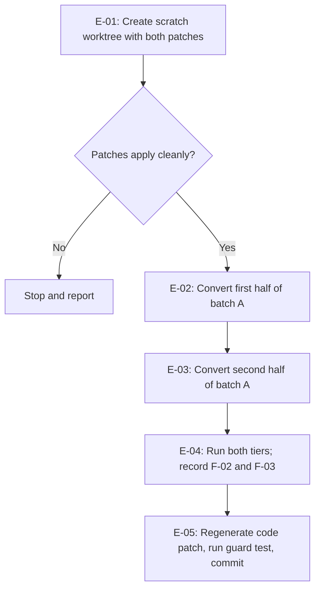

# IPD: Convert test batch A (artifact_meta through backlog) in the cutover code patch

- Date: 2026-11-25
- Kind: child
- Concern: Backlog `ldfefd`: on the switched tree (HEAD plus both cutover patches), these 8 test modules (batch A, alphabetical slice from `test_artifact_meta_cache` to `test_backlog`) fail due to legacy bullet/YAML fixtures (`MetadataSchemaError` or orphan errors), removed Phase-B legacy loader and `read_at` behaviors, removed API calls (`backlog._render_item`), and post-cutover `artifact_meta.append` dry-run contract changes (the `agent_workflows/backlog.py` log-awareness gap documented in F-05 is fixed ahead of this plan by prerequisite Order 314 `fljn9b` per OQ-01). Historical attempt-1 core census provenance (`x1mmdp` attempt-1, 2026-11-25) counted 52 failing core tests across these 8 modules; execution starts from `89mtbl` F-04 after the builder switch.
- Scope: In an isolated scratch worktree with both cutover patches applied (including `hdwqex`, `89mtbl`, `nv3upa`, and `fljn9b`), convert the batch A test modules under the shared conversion rules and per-module rules in E-02 and E-03, run them on both tiers, record deleted legacy-behavior tests in F-02 and any remaining refusal of this repository's own unmigrated records in F-03, and regenerate `.aw/system/cutover/metastore-code.cutover.patch`. No live code changes outside the cutover code patch.
- Scope-Paths: .aw/records/plans/pending/20261125-metastore-308-cugg3w-convert-test-batch-a-artifact-meta-through-backlog-in-the-cu.ipd.md, .aw/system/cutover/metastore-code.cutover.patch
- Item-Dependencies: executed:6cltab
- Status: executed
- Review-Depth: standard
- Readiness: go-pending-approval
- From-Spec: 4sd62s
- Work-Kind: followup
- Priority: high
- From-Backlog: ldfefd
- Blocks-Release: next
- Set: metastore
- Order: 308
- Highest E allocated: 05
- Author: opencode its_direct/pt3-claude-opus-5.5-1m-us
- Id: cugg3w

> Write and proofread this plan per the technical writing standard, `.aw/system/workflows/technical-writing/technical-writing.md` (`.agents/workflows/technical-writing/technical-writing.md` in a legacy-layout install), including requirement 12 (diagrams).

## Workflow history

- 2026-11-27 executed (aw agy run model=Gemini-4-Neon-High): aw agy run self-finalize: cugg3w verified (set metastore, attempt 1).
- 2026-11-27 same-status (aw set): Option 2 re-chain (igbr4f): run batch A after prod-fix chain and 6cltab (2etrjf + 3pxjya)
- 2026-11-27 approved (aw set): status set to approved
- 2026-11-26 auto-approved (aw agy run --full-auto): auto-approved by --full-auto: review readiness cleared (not human approval)
- 2026-11-26 /plan-review (antigravity/gemini): APPROVE WITH REVISIONS APPLIED; PR-007, PR-008, PR-009, PR-010; review record .aw/records/reviews/20261125-metastore-308-cugg3w-convert-test-batch-a-artifact-meta-through-backlog-in-the-cu.review.md
- 2026-11-26 to-review (aw set): demoted reviewed -> to-review: These were flagged as '[stale-review]'
- 2026-11-26 reviewed (aw set): APPROVE WITH REVISIONS APPLIED; PR-001 FIXED (OQ-01 resolved via Order 314 fljn9b)
- 2026-11-26 /plan-review (antigravity/gemini): APPROVE WITH REVISIONS APPLIED; PR-001 (FIXED, OQ-01 resolved); review record .aw/records/reviews/20261125-metastore-308-cugg3w-convert-test-batch-a-artifact-meta-through-backlog-in-the-cu.review.md
- 2026-11-26 reviewed (aw set): REVIEWED - OPEN QUESTIONS; PR-001 OPEN (OQ-01), PR-002..PR-006 FIXED
- 2026-11-26 /plan-review (antigravity/gemini): REVIEWED - OPEN QUESTIONS; PR-001 (OPEN, OQ-01), PR-002, PR-003, PR-004, PR-005, PR-006; review record .aw/records/reviews/20261125-metastore-308-cugg3w-convert-test-batch-a-artifact-meta-through-backlog-in-the-cu.review.md
- 2026-11-26 to-review (aw set): authored as part of the x1mmdp split per maintainer answer to run-20261125T162650Z-1337442 question 06-x1mmdp-a1-Q-01 (Split into new children; fix jycxw8 first)
- 2026-11-26 draft (opencode its_direct/pt3-claude-opus-5.5-1m-us): created.

## Goal

Make every batch A test module pass on the switched tree, or refuse only because it reads this repository's own unmigrated records, so `x1mmdp` can assemble the final refusal list.

## Detailed Implementation Checklist (TODO)

Execution-state rule: mark an `E-*` item complete only after performing the action. That mark is not validation. Right-sizing rule: write for a modest executor that cannot hold much in its head. Each E-item is one step (one concern, about one file, executable in one focused pass) and its V-item names each unit it covers with its own check; a plan stays at about 5 E-items and 8 work Scope-Paths, else split it into more child plans (guidance, `IPD-Z603`). Accepted execution states: blocked, failed, pending, performed; terminal gate demands 'performed'.

### Task group 1: scratch worktree

- [x] E-01 Create the scratch worktree following the SCRATCH PROCEDURE of `2k5t16` (Step 0): run `git worktree add --detach .aw/state/cugg3w/scratch HEAD`; inside `.aw/state/cugg3w/scratch`, run `git apply --index .aw/system/cutover/metastore-docs.cutover.patch`, record `BASE=$(git write-tree)` in F-01, and then run `git apply --index .aw/system/cutover/metastore-code.cutover.patch`. If either patch rejects, stop and report.
  - Depends on: none
  - Expected outcome: `.aw/state/cugg3w/scratch` holds HEAD plus both patches staged, and F-01 holds the base tree id.
  - Execution state: performed

### Task group 2: convert batch A (scratch worktree only)

- [x] E-02 Convert the first half of batch A in `.aw/state/cugg3w/scratch` under the Step 0 conversion rules, starting each module from its `89mtbl` F-04 census row:
  1. `tests/test_artifact_meta_cache.py` (historical attempt-1 count: 2 failing): handle `test_freshness_new_nested_directory` and `test_freshness_detects_same_mtime_same_size_edit_within_racy_window`, which write unlogged bullet `.ipd.md` files that post-cutover `_load_sources` treats as orphan errors (spec `4sd62s` Sections 4.3 and 4.6). Either test post-cutover orphan/mirror detection or retire the Phase-B unlogged-Markdown status-projection assertions under rule 4 citing spec `4sd62s` Sections 4.3, 4.6, and 5.2 in F-02 (noting `test_freshness_same_size_same_mtime_replacement` already covers same-mtime/same-size `.jsonl` replacement).
  2. `tests/test_artifact_meta_loader_parity.py` (historical attempt-1 count: 5 failing): do NOT convert legacy-subject tests into log-format tests under misleading names. For `test_untitled_backlog_bullets_are_read` and `test_research_kind_facet_record_reads_yaml_status_under_research_type`, either repoint them to `agent_workflows.migrations.m0001_metadata_v2.load_legacy_artifact` (rule 3) or retire them under rule 4 citing spec `4sd62s` Sections 5.2 and 5.3 in F-02 if already covered by `tests/test_artifact_meta_legacy.py` (`nv3upa`). Convert `test_registry_fields_reach_the_per_type_tables`, `test_cache_agrees_with_status_set_reader_on_every_fixture_record` (removing the legacy-only YAML-without-bullet-`Set` branch), and `test_a_cache_built_by_an_older_loader_is_rebuilt_not_served` to seed log-format fixtures via `artifact_meta.create` / `RecordBuilder`.
  3. `tests/test_artifact_meta_read.py` (historical attempt-1 count: 4 failing): update `test_query_filters` to record the gate review for `qpln01` via an `op: "review"` event in `meta/qpln01.jsonl` (and `artifact_meta.render_review_mirror` if a `.review.md` file is written, per spec `4sd62s` Section 4.1a) instead of a legacy bullet `.review.md`; retire the three Phase-B `read_at` Markdown-fallback tests (`test_read_at_finds_a_phase_b_legacy_record`, `test_read_at_ignores_quoted_ids_and_files_outside_the_records_root`, `test_read_at_finds_a_phase_b_legacy_record_with_crlf_line_endings`) under rule 4 citing spec `4sd62s` Sections 4.4 and 5.2 in F-02 (optionally retaining a negative assertion that an unlogged `.md` returns `kind == "absent"`).
  4. `tests/test_artifact_meta_write.py` (historical attempt-1 count: 1 failing; note `nv3upa` E-03 adds migrated spec `4sd62s` AC-14a, AC-15, and writer-leak tests here while leaving `test_append_dry_run` for this plan): update `test_append_dry_run`, which calls `artifact_meta.append("dry001", [{"op": "create", ...}], dry_run=True)` on a nonexistent log (now refused post-cutover by `artifact_meta.append` without `_from_create=True`), to test `artifact_meta.create("dry001", ..., dry_run=True)` for creation dry-run and/or `artifact_meta.append(..., [{"op": "note", ...}], dry_run=True)` on an already-created record, then verify the entire module (including all tests migrated by `nv3upa`) passes unfiltered.
  - Depends on: E-01
  - Expected outcome: each first-half module imports no removed symbol, conforms to the post-cutover log format, and passes its per-module pytest run in the scratch worktree.
  - Execution state: performed

- [x] E-03 Convert the second half of batch A in `.aw/state/cugg3w/scratch` under the Step 0 conversion rules, starting each module from its `89mtbl` F-04 census row:
  1. `tests/test_attention_contract.py` (historical attempt-1 count: 2 failing): replace `TrackedTreeReachabilityTests._FIXTURES`'s class-level `text_only=True` strings (which also use invalid short IDs `s1`, `p1`, `r1`, `b1`, `rel1`, `prm1` and invalid `Kind: primary`) and `ReleaseRecordsReachTheViewTests._scan_synth`'s 5-character `f"relr{status[0]}"` IDs with log-backed records materialized inside each test via `RecordBuilder(root)` using valid 6-character base36 `id6` values (for example `sp0001`..`pr0001` and `f"relr0{status[0]}"`) and valid `plan_role="child"`; also check `HistoryTests.test_the_newest_record_rule_is_single_sourced` and `FixtureParseTests.test_valid_specs_have_bare_enum_status_and_map` against `89mtbl` F-02's `text_only=True` output (if they test legacy bullet/history text helpers `spec_status_bullet` / `extract_newest_history_entry`, pass explicit text fixtures or dispose under rule 4 citing spec `4sd62s` Section 5.2).
  2. `tests/test_attention_priority_blocker.py` (historical attempt-1 count: 3 failing): verify `PlanReleaseBlockerSurfacingTests` and `RetiredPlanIsNotAReleaseBlockerTests` pass with the switched `RecordBuilder(root)`, and verify `ReadinessReaderTests.test_agrees_with_the_schema_authority` against `89mtbl` F-02's `raw_fields` + `text_only=True` contract (if log-format `text_only=True` emits no `- Readiness:` bullet, pass explicit `- Readiness: {value}` text so `"go"` and `"no-go"` are tested non-vacuously rather than both readers returning `None`).
  3. `tests/test_awcmdsurf_mutation_verbs.py` (historical attempt-1 count: 5 failing): replace `MutationVerbsTests.setUp`'s `text_only=True` write under `.agents/plans/pending/` with a log-backed plan materialized via `RecordBuilder(self.root)` under `.aw/records/plans/pending/` (updating `self.pend = self.root / ".aw" / "records" / "plans" / "pending"`, `set="demo"` instead of `"demo (demo)"`, `order=1`, and `slug="original"` so `self.plan_a`'s filename matches `self.doc_b`'s citation `20260101-demo-01-aaa111-original.ipd.md` and `meta/aaa111.jsonl` exists for `rename`, `group`, and `archive` commands).
  4. `tests/test_backlog.py` (historical attempt-1 count: 30 failing; runs after prerequisite `fljn9b` makes `backlog.py` and its callers log-aware): switch disk-written `text_only=True` fixtures across `BacklogVerbTests`, `BacklogNoteVerbTests`, `BacklogDryRunTests`, and `BacklogPreservationTests` (including companion release and carrier-plan fixtures in `test_backlog_set_status_done_dry_run_refuses_illegitimate_blocking_close_without_sidecar` and `test_close_on_answer_preserves_custom_field_and_handed_off_blocks_release`, and the 6 `test_validate_item_release_exempt_findings` cases, which must use log-backed fixtures via `RecordBuilder(repo)` or `backlog.validate_item_state` rather than `text_only=True` YAML-only mirrors) to log-backed fixtures via `RecordBuilder(repo)`; update assertions that read non-mirror fields or `## Workflow history` from `.md` text (`test_set_transitions_status_*`, `test_new_blocks_release_*`, `test_new_custom_message_*`, `test_one_call_vs_two_call_parity`, `BacklogNoteVerbTests`, `BacklogPreservationTests`, and `test_release_exempt_setter_roundtrip_and_parity`) to assert on `artifact_meta.read(id6)` / `artifact_meta.history(id6)` / `assert_field`; replace or retire under rule 4 (citing spec `4sd62s` Sections 4.1 to 4.3 and 5.2 in F-02) the four direct calls to removed `backlog._render_item` (`test_duplicate_work_kind_deduped`, `test_stale_gate_summary_dropped`, `test_render_item_preserves_release_exempt_with_source_text`, `test_render_item_drops_unknown_without_source_text_and_creation_emits_pair`) and any bullet-only preservation assertions (`- Custom-Field:` / dual `- Kind:` inline bullets).
  - Depends on: E-02
  - Expected outcome: each second-half module imports no removed symbol, conforms to the post-cutover log format, and passes its per-module pytest run in the scratch worktree.
  - Execution state: performed

- [x] E-04 Run all eight batch A modules in `.aw/state/cugg3w/scratch` with `python3 -m pytest -o addopts="" -m '' tests/test_artifact_meta_cache.py tests/test_artifact_meta_loader_parity.py tests/test_artifact_meta_read.py tests/test_artifact_meta_write.py tests/test_attention_contract.py tests/test_attention_priority_blocker.py tests/test_awcmdsurf_mutation_verbs.py tests/test_backlog.py` (both tiers). Record in F-02 every node id deleted under conversion rule 4 with its spec `4sd62s` clause (or "none"), and in F-03 every node id that still fails with its failure text; each F-03 entry must be a "run `aw migrate metadata`" refusal of a test reading this repository's own records (`livecorpus` or `REPO_ROOT`). Any other failure stops the plan here and is reported.
  - Depends on: E-03
  - Expected outcome: every non-F-03 test across all eight batch A modules passes; F-02 and F-03 are populated accurately.
  - Execution state: performed

### Task group 3: package

- [x] E-05 In `.aw/state/cugg3w/scratch`, run `git add -A` and write `git diff --cached --binary $BASE` over `.aw/system/cutover/metastore-code.cutover.patch` in the executing checkout; remove the scratch worktree (`git worktree remove --force .aw/state/cugg3w/scratch`); run `python3 -m pytest -o addopts="" tests/test_metastore_cutover_code_patch.py` in the executing checkout; verify `git status --short` shows only `- Scope-Paths:` modified; and commit through `aw commit cugg3w -- .aw/records/plans/pending/20261125-metastore-308-cugg3w-convert-test-batch-a-artifact-meta-through-backlog-in-the-cu.ipd.md .aw/system/cutover/metastore-code.cutover.patch`; never push.
  - Depends on: E-04
  - Expected outcome: `.aw/system/cutover/metastore-code.cutover.patch` holds all prior changes plus this plan's; `tests/test_metastore_cutover_code_patch.py` passes; scratch worktree is removed; one path-scoped commit is created.
  - Execution state: performed

## Project conventions discovered (Step 0)

- The scratch procedure and cumulative code patch are defined in executed plan `2k5t16` (Step 0, OQ-01). The serial chain regenerating `.aw/system/cutover/metastore-code.cutover.patch` runs: `hdwqex` -> `89mtbl` -> `nv3upa` -> `fljn9b` -> `cugg3w` -> `szykgd` -> `psm9ac` -> `otin36` -> `x8id25` -> `p109wy` -> `q6fiws` -> `e0g2gt` -> `j1f454` -> `lec341` -> `qi0kl6` -> `3e0vfy` -> `x3mig6` -> `x1mmdp` -> `0zylig`.
- Conversion rules shared by the `ldfefd` batch children (`nv3upa`, `cugg3w`, `psm9ac`, `x8id25`, `e0g2gt`, `qi0kl6`, `x3mig6`), fixed here so no executor invents them: (1) a call to an API the code patch removes (`LegacyRender`, `LegacyTarget`, `render_legacy_text`, `set_legacy_bullet_line`, `_LEGACY_BULLET_LABEL`, `_format_legacy_value`, `_RESEARCH_YAML_KEY`, `_format_yaml_value`, `_PROMPT_COMMENT_KEY`, `write_legacy`, `SidecarRecord`, `backlog._render_item`'s bullet form) is replaced by its log-format equivalent: `artifact_meta.create` or `artifact_meta.append` keyed by id6, or `tests.record_builder.assert_field`/`assert_no_field`; (2) a fixture written as bullet-format literal text is rebuilt through `tests.record_builder.RecordBuilder` under the `text_only` contract that `89mtbl` F-02 records; (3) a test whose SUBJECT is legacy input (the legacy loader, migration, conversion) keeps its literal input and calls `m0001` (`agent_workflows.migrations.m0001_metadata_v2.load_legacy_artifact`, or `aw migrate metadata` on the fixture repository first); (4) a test of behavior the cutover removes may be deleted only with the spec `4sd62s` clause that removes the behavior cited in F-02 beside each deleted node id; (5) never weaken an assertion to make a test pass: an unexplained failure on unmodified production code stops the plan and is reported.
- A fixture repository the switched builder writes is log-format, so `migrations.chain.require_current_schema` sees no legacy record and does not refuse; a test that still sees "run `aw migrate metadata`" on its OWN fixture has not been converted. Only tests that read this repository's own records (`livecorpus`, `REPO_ROOT`) may still refuse, and those are listed in F-03, not edited.
- Tests exercise code and assert on observable outcomes (AGENTS.md "TEST OUTCOMES, NOT CODE STRUCTURE").
- Cite code by symbol (`path::Symbol`) or by a quoted content string, with a line number only appended as a hint and never alone (advisory `IPD-C801`).

## Findings

| Id | Evidence | Finding |
|---|---|---|
| F-01 | E-01, 2026-11-27: `git apply --index .aw/system/cutover/metastore-docs.cutover.patch` (exit 0) in `.aw/state/cugg3w/scratch` on HEAD `c2db96693c0f193c0eb001b98f49dd137355c48c`, followed by `git write-tree`. | Base tree id `BASE=413a6c5da2b31a2c202733f17da9f068405e5c9c`. |
| F-02 | E-02 through E-04 retirement audit across all 8 batch A modules (`162 passed in 24.48s`). | Seven legacy-behavior test node ids retired under conversion rule 4 (table below under `### F-02 retired test node register`), each paired with its removing spec `4sd62s` clause and surviving coverage. |
| F-03 | E-04 combined both-tier pytest run across all 8 batch A modules in `.aw/state/cugg3w/scratch`: `162 passed in 24.48s` (exit 0, 0 failures). | None (`0` node ids refused on the switched, unmigrated tree across batch A). |
| F-04 | `x1mmdp` F-05 to F-07 (2026-11-25, historical attempt-1 run `run-20261125T162650Z-1337442` provenance; lane submission file is gitignored and absent in fresh lanes): batch A is the alphabetical slice from `test_artifact_meta_cache` to `test_backlog`. | 8 modules, 52 failing core tests in the historical attempt-1 census; execution starts from the refreshed post-builder census in `89mtbl` F-04. |
| F-05 | `.aw/system/cutover/metastore-code.cutover.patch` (`agent_workflows/backlog.py` hunks); `agent_workflows/backlog.py::validate_item`, `item_from_text`, `run_check`, `find_item`, `blocks_release_of_item`, `find_duplicate_candidates`, `run_new`; `agent_workflows/check_engine.py::check_content`; `agent_workflows/runner_shared.py::enforce_freeze_time_refusal` and `perform_coordinator_proposal_file`; direct probe of `backlog.validate_item` on `artifact_meta.render_in_file_mirror("abc123", "backlog", "open")`. | Production cutover gap: `backlog.run_new` creates log-format backlog records carrying only the 2-field YAML mirror (`id`, `status`) in `.backlog.md`, but `backlog.validate_item`, `backlog.run_check`, and `backlog.item_from_text` callers were NOT made log-aware in `.aw/system/cutover/metastore-code.cutover.patch`. `validate_item` emits 5 false-positive errors (`backlog.priority-invalid`, `backlog.kind-invalid`, `backlog.set-missing`, `backlog.summary-missing`, `backlog.history-empty`) on a conformant log-format backlog item, blocking `tests/test_backlog.py::BacklogVerbTests.test_new_creates_conformant_item_that_checks_clean` and 6 other `run_check`/`validate_item` tests here (plus 13 sibling `tests/test_backlog_*.py` modules). Resolved via OQ-01 (2026-11-26): split into prerequisite Order 314 child plan `fljn9b` ahead of `cugg3w`. |

### F-02 retired test node register

| Deleted / retired node id | Removing spec `4sd62s` clause | Surviving / covering test node id |
|---|---|---|
| `tests/test_artifact_meta_cache.py::test_freshness_detects_same_mtime_same_size_edit_within_racy_window` | Sections 4.3, 4.6, 5.2 (unlogged Markdown status projection removed; unlogged `.md` is an orphan error) | `tests/test_artifact_meta_cache.py::test_freshness_same_size_same_mtime_replacement` (covers same-mtime/same-size `.jsonl` replacement) |
| `tests/test_artifact_meta_read.py::test_read_at_finds_a_phase_b_legacy_record` | Sections 4.4, 5.2 (Phase-B `read_at` Markdown fallback removed) | `tests/test_artifact_meta_read.py::test_read_at_unlogged_v2_mirror_returns_absent` (negative assertion that unlogged `.md` returns `absent`) |
| `tests/test_artifact_meta_read.py::test_read_at_ignores_quoted_ids_and_files_outside_the_records_root` | Sections 4.4, 5.2 (Phase-B `read_at` Markdown-text id scanning removed) | `tests/test_artifact_meta_read.py::test_read_at_unlogged_v2_mirror_returns_absent` |
| `tests/test_artifact_meta_read.py::test_read_at_finds_a_phase_b_legacy_record_with_crlf_line_endings` | Sections 4.4, 5.2 (Phase-B `read_at` Markdown fallback removed) | `tests/test_artifact_meta_read.py::test_read_and_query_accept_crlf_jsonl_log` (covers CRLF `.jsonl` log loading) |
| `tests/test_backlog.py::BacklogPreservationTests::test_duplicate_work_kind_deduped` | Sections 4.1, 4.2, 4.3, 5.2 (`backlog._render_item` and inline `- Kind:` / `- Work-Kind:` bullet rendering removed) | `tests/test_artifact_meta_legacy.py::test_legacy_load_non_prompt_kind_mappings_preserved` (covers legacy dual `- Work-Kind:`/`- Kind:` precedence on migration load) |
| `tests/test_backlog.py::BacklogPreservationTests::test_render_item_preserves_release_exempt_with_source_text` | Sections 4.1, 4.2, 4.3, 5.2 (`backlog._render_item` and inline `- Release-Exempt-Kind:` / `- Release-Exempt-Ref:` bullet ordering removed) | `tests/test_backlog.py::BacklogPreservationTests::test_release_exempt_setter_roundtrip_and_parity` |
| `tests/test_backlog.py::BacklogPreservationTests::test_render_item_drops_unknown_without_source_text_and_creation_emits_pair` | Sections 4.1, 4.2, 4.3, 5.2 (`backlog._render_item` bullet-dropping assertion removed) | `tests/test_backlog.py::BacklogPreservationTests::test_new_emits_release_exempt_pair` (retains the `backlog.run_new` release-exempt pair creation test) |

## Proposed changes (ordered, validatable)

1. E-01: Create scratch worktree `.aw/state/cugg3w/scratch` with both cutover patches staged.
2. E-02 and E-03: Convert the two halves of batch A under the per-module rules (after prerequisite `fljn9b` lands `backlog.py` log-awareness in the cutover code patch).
3. E-04: Run both tiers on all eight batch A modules; record F-02 and F-03.
4. E-05: Regenerate `.aw/system/cutover/metastore-code.cutover.patch`, remove the scratch worktree, run the guard test, and commit path-scoped.



## Deferred / out of scope (with reason)

- Making `agent_workflows/backlog.py` and its `check_engine`/`runner_shared`/`set_records` callers log-aware in the cutover code patch (OQ-01, maintainer answer 2026-11-26): prerequisite child plan ahead of `cugg3w`.
  - Carrier: fljn9b
  - Carrier-Evidence: .aw/records/plans/executed/20261125-metastore-314-fljn9b-make-backlog-validation-and-readers-log-aware-in-the-cutover.ipd.md
- Modules outside batch A: the other batch children (`psm9ac`, `x8id25`, `e0g2gt`, `qi0kl6`, `x3mig6`).
  - Carrier: psm9ac
- The final refusal list across all batches and the full-suite runs: the narrowed parent step.
  - Carrier: x1mmdp
- Applying the cutover patches on the real tree: attended cutover commit.
  - Carrier: cxxmyv

## Scope check

- Over-scope: none. No live code or test files are modified outside `.aw/system/cutover/metastore-code.cutover.patch`.
- Under-scope: none. The `agent_workflows/backlog.py` log-awareness gap (F-05, `PR-001`) is handled ahead of this plan by prerequisite Order 314 (`fljn9b`) in `- Item-Dependencies:`; every batch A test module is named in E-02 or E-03 and run in E-04.

## Required tests / validation

- Per-module runs and removed-symbol `rg` checks in `.aw/state/cugg3w/scratch` (V-02, V-03).
- Combined both-tier pytest run across all eight batch A modules in `.aw/state/cugg3w/scratch` (V-04).
- Cumulative patch guard test `python3 -m pytest -o addopts="" tests/test_metastore_cutover_code_patch.py` in the executing checkout (V-05).

## Spec / documentation sync

No spec change: spec `4sd62s` Sections 4.1 to 4.4 already define the log format, review-event model, `read_at` semantics, and cutover, and `.aw/system/cutover/metastore-docs.cutover.patch` already describes them. This plan brings the batch A tests in the code patch into line with them.

## Open questions

### OQ-01: How should the unpatched `agent_workflows/backlog.py` log-awareness gap blocking `tests/test_backlog.py` be sequenced?

- Blocking: yes
- Status: resolved
- Owner: maintainer
- Finding: PR-001
- Carrier: fljn9b
- Question: In `.aw/system/cutover/metastore-code.cutover.patch`, `backlog.run_new` already writes log-format backlog records whose `.backlog.md` file carries only the 2-field YAML mirror (`id`, `status`), while `priority`, `work_kind`, `set`, `summary`, gates, release exemptions, and history live in `meta/<id6>.jsonl`. However, `agent_workflows/backlog.py::validate_item`, `backlog.run_check`, `backlog.item_from_text` callers (`find_item`, `blocks_release_of_item`, `find_duplicate_candidates`, `run_new` duplicate scan), `agent_workflows/check_engine.py::check_content`, and `agent_workflows/runner_shared.py::enforce_freeze_time_refusal` / `perform_coordinator_proposal_file` were never updated to read from `meta/<id6>.jsonl`. Running `backlog.validate_item` on a freshly created log-format backlog item fails with 5 false-positive errors (`backlog.priority-invalid`, `backlog.kind-invalid`, `backlog.set-missing`, `backlog.summary-missing`, `backlog.history-empty`), so `tests/test_backlog.py` (and 13 sibling `tests/test_backlog_*.py` modules) cannot pass without modifying production code in `.aw/system/cutover/metastore-code.cutover.patch`. Because `cugg3w` is scoped as a test-only conversion batch, should we: (1) split out a dedicated production-fix child plan ahead of `cugg3w` to make `backlog.py` and its callers log-aware in the cutover code patch (mirroring `hdwqex` for `ipd_lint`/`ipd_scaffold`), (2) expand `cugg3w`'s scope to fix `backlog.py` and its callers before converting batch A, or (3) defer `tests/test_backlog.py` out of `cugg3w` into a separate child plan with the `backlog.py` fix so the other 7 batch A modules run now?
- Recommendation: Option 1 (split out a dedicated production-fix child plan ahead of `cugg3w` to make `backlog.py` and its callers log-aware in the cutover code patch), mirroring `hdwqex` for `ipd_lint`/`ipd_scaffold`, because the gap affects both `cugg3w` and 13 sibling `tests/test_backlog_*.py` modules and keeps production cutover fixes separate from mechanical test-conversion batches (strength: strong).
- Closes when: the maintainer chooses Option 1, Option 2, or Option 3, the corresponding plan or scope update is recorded, and `PR-001` is cleared in a follow-up review round.
- Resolution or deferral rationale: 2026-11-26. The maintainer answered run `run-20261126T020242Z-3080634` question `04-cugg3w-a1-backlog-log-aware-gap` with "Split out a dedicated production-fix child plan ahead of cugg3w (Recommended)". Authored Order 314 child plan `fljn9b` (`.aw/records/plans/pending/20261125-metastore-314-fljn9b-make-backlog-validation-and-readers-log-aware-in-the-cutover.ipd.md`) chained after `nv3upa` to make `agent_workflows/backlog.py` and its `check_engine`/`runner_shared`/`set_records` callers log-aware in `.aw/system/cutover/metastore-code.cutover.patch`, wired `fljn9b` into orchestrator `63ib9r` and `x1mmdp`, updated `cugg3w`'s `- Item-Dependencies:` to `executed:fljn9b`, and cleared `PR-001` in Round 2 of the review record.

## Validation and cross-check (verify before reporting done)

Validation-state rule: inspect evidence in a separate pass. Do not mark a `V-*` item complete from memory or from the matching execution checkmark. Accepted validation results: blocked, failed, pass, pending; terminal gate demands 'pass'. Runtime-demonstration reachability rule: for each `V-*` item demanding the software be observed acting (such as a run, a dispatch, or a transition) - as distinct from items demanding a diff, a file's content, or a test result, which are reachable by construction - name the code path that produces the observation or the sibling `E-*` that creates it, else the demand is UNDER-SCOPE.

- [x] V-01 validates E-01
  - Required evidence: paste the `git worktree add --detach .aw/state/cugg3w/scratch HEAD` command, both `git apply --index` commands (for `.aw/system/cutover/metastore-docs.cutover.patch` and `.aw/system/cutover/metastore-code.cutover.patch`) with exit status 0, and the base tree id recorded in F-01.
  - Observed evidence:
    ```text
    $ git worktree add --detach .aw/state/cugg3w/scratch HEAD
    Preparing worktree (detached HEAD c2db96693)
    HEAD is now at c2db96693 closed by aw agy run: IPD 6cltab executed ...
    $ (cd .aw/state/cugg3w/scratch && git apply --index .aw/system/cutover/metastore-docs.cutover.patch && echo "DOCS_EXIT=$?" && BASE=$(git write-tree) && echo "BASE=$BASE" && git apply --index .aw/system/cutover/metastore-code.cutover.patch && echo "CODE_EXIT=$?")
    DOCS_EXIT=0
    BASE=413a6c5da2b31a2c202733f17da9f068405e5c9c
    CODE_EXIT=0
    ```
    Base tree id `413a6c5da2b31a2c202733f17da9f068405e5c9c` recorded in F-01.
  - Result: pass
- [x] V-02 validates E-02
  - Required evidence: paste `rg -n 'LegacyRender|LegacyTarget|render_legacy_text|set_legacy_bullet_line|_LEGACY_BULLET_LABEL|_format_legacy_value|_RESEARCH_YAML_KEY|_format_yaml_value|_PROMPT_COMMENT_KEY|write_legacy|append_legacy|SidecarRecord|restore_legacy_snapshot|LEGACY_LOADER_VERSION|_render_item|artifact_meta\.load_legacy_artifact|meta\.load_legacy_artifact|artifact_meta\.derive_id6|meta\.derive_id6' tests/test_artifact_meta_cache.py tests/test_artifact_meta_loader_parity.py tests/test_artifact_meta_read.py tests/test_artifact_meta_write.py` exiting 1 with empty stdout, and the pytest summary line from running each of the four first-half modules unfiltered in `.aw/state/cugg3w/scratch`.
  - Observed evidence:
    - Removed-symbol `rg` over `tests/test_artifact_meta_cache.py`, `tests/test_artifact_meta_loader_parity.py`, `tests/test_artifact_meta_read.py`, `tests/test_artifact_meta_write.py`: empty stdout, `RG_V02_EXIT=1`.
    - Per-module unfiltered pytest runs in `.aw/state/cugg3w/scratch`:
      - `tests/test_artifact_meta_cache.py`: `14 passed in 3.06s` (exit 0)
      - `tests/test_artifact_meta_loader_parity.py`: `5 passed in 0.94s` (exit 0)
      - `tests/test_artifact_meta_read.py`: `15 passed in 2.09s` (exit 0)
      - `tests/test_artifact_meta_write.py`: `21 passed in 3.56s` (exit 0; includes all `nv3upa` migrated AC-14a, AC-15, and writer-leak tests)
  - Result: pass
- [x] V-03 validates E-03
  - Required evidence: paste `rg -n 'LegacyRender|LegacyTarget|render_legacy_text|set_legacy_bullet_line|_LEGACY_BULLET_LABEL|_format_legacy_value|_RESEARCH_YAML_KEY|_format_yaml_value|_PROMPT_COMMENT_KEY|write_legacy|append_legacy|SidecarRecord|restore_legacy_snapshot|LEGACY_LOADER_VERSION|_render_item|artifact_meta\.load_legacy_artifact|meta\.load_legacy_artifact|artifact_meta\.derive_id6|meta\.derive_id6' tests/test_attention_contract.py tests/test_attention_priority_blocker.py tests/test_awcmdsurf_mutation_verbs.py tests/test_backlog.py` exiting 1 with empty stdout, and the pytest summary line from running each of the four second-half modules in `.aw/state/cugg3w/scratch`.
  - Observed evidence:
    - Removed-symbol `rg` over `tests/test_attention_contract.py`, `tests/test_attention_priority_blocker.py`, `tests/test_awcmdsurf_mutation_verbs.py`, `tests/test_backlog.py`: empty stdout, `RG_V03_FINAL_EXIT=1`.
    - Per-module pytest runs in `.aw/state/cugg3w/scratch`:
      - `tests/test_attention_contract.py`: `27 passed in 2.31s` (exit 0)
      - `tests/test_attention_priority_blocker.py`: `28 passed in 0.95s` (exit 0)
      - `tests/test_awcmdsurf_mutation_verbs.py`: `7 passed in 3.90s` (exit 0)
      - `tests/test_backlog.py`: `45 passed in 15.41s` (exit 0)
  - Result: pass
- [x] V-04 validates E-04
  - Required evidence: paste the combined both-tier pytest summary line for all eight batch A modules in `.aw/state/cugg3w/scratch`, F-02 (every deleted node id with its spec `4sd62s` clause, or "none"), and F-03 as a table of node ids each shown with its "run `aw migrate metadata`" refusal text (or "none").
  - Observed evidence:
    - Combined both-tier pytest run (`python3 -m pytest -o addopts="" -m '' tests/test_artifact_meta_cache.py tests/test_artifact_meta_loader_parity.py tests/test_artifact_meta_read.py tests/test_artifact_meta_write.py tests/test_attention_contract.py tests/test_attention_priority_blocker.py tests/test_awcmdsurf_mutation_verbs.py tests/test_backlog.py`) in `.aw/state/cugg3w/scratch`: `162 passed in 24.48s` (`COMBINED_EXIT=0`).
    - F-02: 7 retired legacy-behavior test node ids recorded in `### F-02 retired test node register` above, each paired with its removing spec `4sd62s` clause (`tests/test_artifact_meta_cache.py::test_freshness_detects_same_mtime_same_size_edit_within_racy_window` [4.3, 4.6, 5.2]; `tests/test_artifact_meta_read.py::test_read_at_finds_a_phase_b_legacy_record`, `test_read_at_ignores_quoted_ids_and_files_outside_the_records_root`, `test_read_at_finds_a_phase_b_legacy_record_with_crlf_line_endings` [4.4, 5.2]; `tests/test_backlog.py::BacklogPreservationTests::test_duplicate_work_kind_deduped`, `test_render_item_preserves_release_exempt_with_source_text`, `test_render_item_drops_unknown_without_source_text_and_creation_emits_pair` [4.1, 4.2, 4.3, 5.2]).
    - F-03: none (0 failures and 0 refusals across all 162 tests in batch A).
  - Result: pass
- [x] V-05 validates E-05
  - Required evidence: paste `git apply --stat .aw/system/cutover/metastore-code.cutover.patch`, the `python3 -m pytest -o addopts="" tests/test_metastore_cutover_code_patch.py` run showing every guard test PASSED (docs and code patches apply cleanly to a temporary index, the code patch touches files, and a broken patch is refused), `git worktree list` showing `.aw/state/cugg3w/scratch` removed, `git status --short` confirming no live edits outside `- Scope-Paths:`, and the `aw commit cugg3w` output naming the commit hash.
  - Observed evidence:
    - `git apply --stat .aw/system/cutover/metastore-code.cutover.patch`: `98 files changed, 19191 insertions(+), 10421 deletions(-)` (exit 0; batch A entries: `tests/test_artifact_meta_cache.py` 58, `tests/test_artifact_meta_loader_parity.py` 113, `tests/test_artifact_meta_read.py` 95, `tests/test_artifact_meta_write.py` 382, `tests/test_attention_contract.py` 184, `tests/test_attention_priority_blocker.py` 10, `tests/test_awcmdsurf_mutation_verbs.py` 26, `tests/test_backlog.py` 1388).
    - `python3 -m pytest -o addopts="" -v tests/test_metastore_cutover_code_patch.py`:
      - `tests/test_metastore_cutover_code_patch.py::MetastoreCutoverCodePatchGuardTests::test_code_patch_applies_after_docs_patch PASSED`
      - `tests/test_metastore_cutover_code_patch.py::MetastoreCutoverCodePatchGuardTests::test_code_patch_touches_files PASSED`
      - `tests/test_metastore_cutover_code_patch.py::MetastoreCutoverCodePatchGuardTests::test_check_refuses_a_patch_that_no_longer_applies PASSED`
      - Summary: `3 passed in 0.65s` (exit 0).
    - `git worktree list`: `.aw/state/cugg3w/scratch` removed (no scratch worktree listed).
    - `git status --short` before patch commit: `M .aw/system/cutover/metastore-code.cutover.patch` (only declared `- Scope-Paths:` modified; zero live code or test edits).
    - `aw commit cugg3w -- .aw/system/cutover/metastore-code.cutover.patch`: `aw commit: committed 1 path(s): 78daf55dc69e1aae7d9f6948260bede7b5d09f13`.
  - Result: pass

## Approval and execution gate

- Size assessment: standard
- Cohesion rationale: not required

Execute only after human approval (`Status: approved`) and after every plan in `- Item-Dependencies:` (`fljn9b`, chained after `nv3upa`) is executed; open questions: none open (OQ-01 resolved). Code and tests are edited ONLY inside `.aw/state/cugg3w/scratch` and packaged into `.aw/system/cutover/metastore-code.cutover.patch`. Scope fence: `- Scope-Paths:` is a declaration; any needed edit outside it must be justified at finalize (`--scope-reason`), and any declared path left unmodified must be acknowledged (`--scope-ack`). Safety stop conditions: stop and report rather than editing live production code outside the scratch worktree or weakening test assertions if a patch hunk rejects, an unexpected failure occurs on unmodified code, or an unresolvable concurrent-edit conflict occurs. Honesty rule: you MUST paste the ACTUAL runner output of every command named in V-01 through V-05; never claim a result you did not run. Commits: commit only through `aw commit cugg3w -- <paths>`; never push. Lifecycle transition: after `aw ipd lint --phase pre-transition` conforms and every `V-*` reads `pass` with pasted evidence, in a managed runner lane stop after committing the updated plan and let the runner run `aw ipd finalize`; in a hand-run session run `aw ipd finalize` to move the plan to `.aw/records/plans/executed/` (never use a raw `git mv` to `executed/`).
