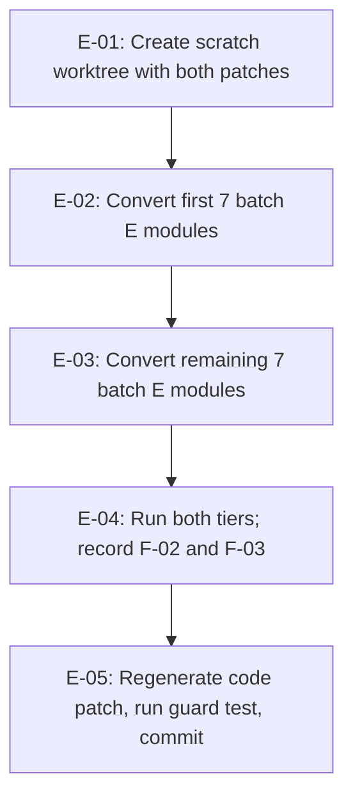

# IPD: Convert test batch E (readers_selectors_find through spec_id6_filenames) in the cutover code patch

- Date: 2026-11-25
- Kind: child
- Concern: Backlog `ldfefd`: on the switched tree these 14 test modules (batch E, alphabetical slice from `tests/test_readers_selectors_find.py` through `tests/test_spec_id6_filenames.py`) fail or call removed legacy APIs inside `.aw/system/cutover/metastore-code.cutover.patch`; the historical `x1mmdp` attempt-1 pre-split census (2026-11-25) counted 94 failing core tests among them before `89mtbl` switched `tests/record_builder.py`. Most failures are `MetadataSchemaError` refusals of `text_only=True` bullet/YAML fixtures written to disk without `meta/<id6>.jsonl`, direct calls to removed legacy helpers (`LegacyRender`, `LegacyTarget`, `render_legacy_text`), Phase-B inline-writer assertions, or the four production cutover gaps (`F-05`) now owned by prerequisite Orders 319 (`j1f454`) and 320 (`lec341`) per resolved `OQ-01`. Execution anchors on the authoritative post-builder census in `89mtbl` F-04.
- Scope: In a scratch worktree with both cutover patches applied (including `hdwqex`, `89mtbl`, `fljn9b`, `szykgd`, `otin36`, `p109wy`, `q6fiws`, the earlier batch children, and prerequisite production-fix children `j1f454` and `lec341`), convert the 14 batch E modules under the shared conversion rules, run them on both tiers, record any rule-4 retirements in F-02 and any remaining refusal of this repository's own records in F-03, and regenerate `.aw/system/cutover/metastore-code.cutover.patch`. No live code changes.
- Scope-Paths: .aw/records/plans/pending/20261125-metastore-312-qi0kl6-convert-test-batch-e-readers-selectors-find-through-spec-id6.ipd.md, .aw/system/cutover/metastore-code.cutover.patch
- Item-Dependencies: executed:e0g2gt
- Status: executed
- Review-Depth: standard
- Readiness: go-pending-approval
- From-Spec: 4sd62s
- Work-Kind: followup
- Priority: high
- From-Backlog: ldfefd
- Blocks-Release: next
- Set: metastore
- Order: 312
- Highest E allocated: 05
- Author: opencode its_direct/pt3-claude-opus-5.5-1m-us
- Id: qi0kl6

> Write and proofread this plan per the technical writing standard, `.aw/system/workflows/technical-writing/technical-writing.md` (`.agents/workflows/technical-writing/technical-writing.md` in a legacy-layout install), including requirement 12 (diagrams).

## Workflow history

- 2026-11-28 executed (aw agy run model=Gemini-4-Neon-High): aw agy run self-finalize: qi0kl6 verified (set metastore, attempt 1).
- 2026-11-26 same-status (aw set): OQ-02 Option 1: re-chain production-fix plans otin36..3e0vfy ahead of test batches psm9ac..x3mig6
- 2026-11-26 approved (aw set): status set to approved
- 2026-11-26 /plan-review (antigravity/gemini): APPROVE WITH REVISIONS APPLIED; PR-001 (FIXED via OQ-01 split into Order 319 j1f454 and Order 320 lec341); review record .aw/records/reviews/20261125-metastore-312-qi0kl6-convert-test-batch-e-readers-selectors-find-through-spec-id6.review.md
- 2026-11-26 reviewed (aw set): REVIEWED - OPEN QUESTIONS; PR-001 OPEN (OQ-01); PR-002..PR-006 FIXED
- 2026-11-26 /plan-review (antigravity/gemini): REVIEWED - OPEN QUESTIONS; PR-001 (OPEN -> OQ-01), PR-002, PR-003, PR-004, PR-005, PR-006 (FIXED); review record .aw/records/reviews/20261125-metastore-312-qi0kl6-convert-test-batch-e-readers-selectors-find-through-spec-id6.review.md
- 2026-11-26 to-review (aw set): authored as part of the x1mmdp split per maintainer answer to run-20261125T162650Z-1337442 question 06-x1mmdp-a1-Q-01 (Split into new children; fix jycxw8 first)
- 2026-11-26 draft (opencode its_direct/pt3-claude-opus-5.5-1m-us): created.

## Goal

Make every batch E test module pass on the switched tree, or refuse only because it reads this repository's own unmigrated records, so `x1mmdp` can assemble the final refusal list.

## Detailed Implementation Checklist (TODO)

Execution-state rule: mark an `E-*` item complete only after performing the action. That mark is not validation. Right-sizing rule: write for a modest executor that cannot hold much in its head. Each E-item is one step (one concern, about one file, executable in one focused pass) and its V-item names each unit it covers with its own check; a plan stays at about 5 E-items and 8 work Scope-Paths, else split it into more child plans (guidance, `IPD-Z603`). Accepted execution states: blocked, failed, pending, performed; terminal gate demands 'performed'.

### Task group 1: scratch worktree

- [x] E-01 Create the scratch worktree following the SCRATCH PROCEDURE of `2k5t16` (Step 0): run `git worktree add --detach .aw/state/qi0kl6/scratch HEAD`; inside `.aw/state/qi0kl6/scratch`, apply `.aw/system/cutover/metastore-docs.cutover.patch` with `git apply --index .aw/system/cutover/metastore-docs.cutover.patch`, record `BASE=$(git write-tree)` in F-01, and then apply `.aw/system/cutover/metastore-code.cutover.patch` with `git apply --index .aw/system/cutover/metastore-code.cutover.patch`. If either patch does not apply cleanly, stop and report.
  - Depends on: none
  - Expected outcome: `.aw/state/qi0kl6/scratch` holds HEAD plus both cutover patches staged, and F-01 holds the base tree id.
  - Execution state: performed

### Task group 2: convert batch E (scratch worktree only)

- [x] E-02 Convert the first half of batch E (7 modules) inside `.aw/state/qi0kl6/scratch` under the shared conversion rules in Step 0, starting each module from its `89mtbl` F-04 census row:
  1. `tests/test_readers_selectors_find.py`: materialize the 11 `text_only=True` fixtures in `_build_fixture_repo` through `RecordBuilder(repo)` (using spec `4sd62s` Section 4.1a `.review.md` mirror for `rev1` and post-cutover managed prompt mirrors for `pr1`/`pr2`); retire Phase-B loose-whitespace bullet checks in `test_loose_whitespace_and_quoted_example_fixtures` and the multi-word `EXECUTED (...)` inline-status test `test_multiword_executed_plan_disagreement_fixture` under rule 4 citing spec `4sd62s` Sections 4.1 and 4.3 in F-02 (after prerequisite Order 319 `j1f454` fixes `selectors._state_matches_status` and `_declares_typed_subject`).
  2. `tests/test_record_owner_root.py`: replace removed `LegacyRender`/`render_legacy_text` calls in `test_ipd_lint_resolves_home_sibling_dependency` with `artifact_meta.append(plan2_id6, ...)` under rule 1; replace `text_only=True` disk fixtures via `RecordBuilder`; update `test_specs_note_history_lands_in_project_records` to verify the per-artifact log `meta/<spec_id6>.jsonl` lands under `aw_home/projects/<pid>/records/meta/` (and not top-level `aw_home/records/meta/`) because `history.jsonl` is retired at cutover (spec `4sd62s` Section 4.5 / C6).
  3. `tests/test_records_only_lane_rederive.py`: replace removed `LegacyRender`/`render_legacy_text` calls in `_mutate_plan` with log-format mutations (`artifact_meta.create`/`append`) under rule 1; because `.aw/system/cutover/metastore-code.cutover.patch` deliberately changed `runner_shared.apply_records_only_rederivation` to refuse re-deriving inline front-matter events post-cutover (spec `4sd62s` Sections 4.1 and 4.2), update tests that assert successful inline front-matter re-derivation to assert the post-cutover refusal (or retire inline-only re-derivation subcases under rule 4 citing spec `4sd62s` Sections 4.1 and 4.2 in F-02) while preserving pure allow-list and git-conflict premise coverage.
  4. `tests/test_releases_line_writers.py`: remove `LegacyRender`/`render_legacy_text` calls under rule 1; convert field set/replace/unset/idempotence tests for `blocks_release` and `from_backlog` to log-format `artifact_meta.create`/`append` + `assert_field`/`assert_no_field`, retire Phase-B inline-bullet placement/anchor/duplicate-bullet repair tests under rule 4 citing spec `4sd62s` Sections 4.1, 4.3, and 5.2 (C4) in F-02, and materialize the 7 CLI test fixtures (`aw ipd set` / `aw specs set --from-backlog`) via `RecordBuilder(repo)`.
  5. `tests/test_releases_sibling_line_writers_bounding.py`: remove `LegacyRender`/`render_legacy_text` calls under rule 1; convert body-preservation, idempotence, set, and clear tests for the six sibling fields (`priority`, `work_kind`, `from_backlog`, `from_spec`, `item_dependencies`, `graduated_to`) to log-format `artifact_meta.create`/`append` (verifying quoted `- <Field>:` lines in `## Description` survive byte-identically when log metadata mutates); retire Phase-B inline-bullet anchor fallback (`anchor_fallback`/`no_anchor`) subcases under rule 4 citing spec `4sd62s` Sections 4.1 and 4.3 in F-02; materialize the CLI fixture in `test_cli_backlog_set_work_kind_preserves_body` via `RecordBuilder(repo)` and assert `assert_field(item_path, "work_kind", "feature")` instead of checking `"- Work-Kind: feature\n"` in inline front matter.
  6. `tests/test_rereview_reviewed_plan.py`: replace removed `LegacyRender`/`LegacyTarget` calls in `fake_run`/`fake_review_run` with `artifact_meta.append(it["id6"], ...)` under rule 1; stage and commit `.aw/records/meta/<id6>.jsonl` alongside `plan_path` in `_write_plan` (`git add -A`); update `test_execute_item_core_rereview_demotes_and_turn_sees_to_review` to verify `"APPROVAL WITHDRAWN"` and `"re-review requested via oc review"` in `artifact_meta.history(it["id6"], ...)` rather than inline `.ipd.md` text.
  7. `tests/test_research_descriptive_safety.py`: replace removed `LegacyRender`/`render_legacy_text` calls with `artifact_meta.create`/`append` under rule 1 while keeping every newline, control-character, and length-bound injection refusal assertion intact (after prerequisite Order 320 `lec341` fixes `research_cmd._write_planned_research_file`).
  - Depends on: E-01
  - Expected outcome: each of the 7 first-half modules imports no removed symbol, builds log-format fixtures, and passes in the scratch worktree.
  - Execution state: performed

- [x] E-03 Convert the second half of batch E (7 modules) inside `.aw/state/qi0kl6/scratch` under the same rules, starting each module from its `89mtbl` F-04 census row:
  1. `tests/test_research_index.py`: replace legacy `research_cmd.build_frontmatter` writes in `_write` and the 5 `text_only=True` fixtures with log-format records via `RecordBuilder(repo)` / `artifact_meta.create(..., "research", ...)`, keeping negative malformed-frontmatter and bad-name drift tests as intentional invalid fixtures (after prerequisite Order 320 `lec341` fixes `research_cmd._write_planned_research_file`, `research_refs._apply_renames`, and `research_archive.apply_moves`).
  2. `tests/test_research_meta_writer_characterization.py`: convert `_seed_doc` from raw legacy YAML writes to log-format records via `RecordBuilder(repo)` / `artifact_meta.create`; update assertions to verify destination filename, YAML mirror (`status: archive`/`reference`), `artifact_meta.read` fields (`set`, `order`, `model`, `research_kind`, `status`), untouched body lines, and absence of `## Workflow history`; retire Phase-B inline-YAML-line-placement assertions (e.g. inserting `status:` directly after `kind:`) under rule 4 citing spec `4sd62s` Sections 4.1 and 4.3 in F-02 (after prerequisite Order 320 `lec341` fixes `research_refs._apply_renames` and `research_archive.apply_moves`).
  3. `tests/test_research_priority.py`: replace removed `LegacyRender`/`render_legacy_text` calls in `test_set_priority_writes_inserts_and_clears` with `artifact_meta.create`/`append` + `assert_field`/`assert_no_field`; materialize `plan_new` fixtures through `_write_planned_research_file` / `RecordBuilder(repo)` so `meta/<id6>.jsonl` exists before `research_index._scan_docs` and `plan_set_priority`; pass log-backed `state=` to `attention._research_record`; retire or update `test_new_emits_priority_line_only_when_given` (legacy `build_frontmatter`) under rule 4 citing spec `4sd62s` Section 4.1 in F-02 (after prerequisite Order 320 `lec341` fixes `research_cmd._write_planned_research_file`).
  4. `tests/test_run_analytics_review_cost.py`: replace removed `LegacyRender`/`render_legacy_text` calls in `test_review_turn_with_readiness_records_readiness_value` and `test_review_turn_without_readiness_records_none` with `artifact_meta.append(it["id6"], ...)` under rule 1; materialize the 2 `text_only=True` plan fixtures via `RecordBuilder(repo)` and commit `.aw/records/meta/<id6>.jsonl` alongside `.ipd.md` (`git add -A`).
  5. `tests/test_runner_shared.py`: materialize the 16 `text_only=True` disk fixtures through `RecordBuilder(repo)` (committing companion `meta/<id6>.jsonl` where git commits are created); keep `@pytest.mark.livecorpus` `test_07_real_corpus_arm_conditional` untouched (reads git objects via `git cat-file`, not legacy markdown metadata).
  6. `tests/test_show_history.py`: update `_write_log_plan` to write a conforming plan mirror (`artifact_meta.render_in_file_mirror(LOG_ID, "ipd", "to-review")`); materialize plan and review fixtures in `test_c_review_rounds_are_events_of_the_subject`, `test_f_missing_cache_gives_same_output_as_warm`, `test_set_selector_returns_every_match`, `test_record_still_shown_after_git_mv_between_dispositions`, and `test_record_still_shown_after_its_review_file_changes` as log-format records with spec `4sd62s` Section 4.1a `.review.md` mirrors and `op: "review"` log events; retire Phase-B legacy-history tests (`test_a_legacy_history_lines_in_file_order_without_inferred_transitions` and legacy-plan control-char arm of `test_meta_cli_neutralizes_control_characters_in_imported_lines`, converting the latter to test log-event control-char neutralization) under rule 4 citing spec `4sd62s` Sections 4.1a, 4.2, and 4.3 in F-02.
  7. `tests/test_spec_id6_filenames.py`: materialize the 12 `text_only=True` spec and walkthrough fixtures via `RecordBuilder(repo)` (keeping pre-cutover/post-cutover filename tests on log-backed records where metadata is read); update inline `"- Id: "` regex assertions in `TestSpecProducer`, `TestToId6Rename`, and `TestToId6DatedLegacyNames` to assert `artifact_meta.read_mirror_id6` / YAML mirror `id: <id6>` and `artifact_meta.read` state (after prerequisite Order 319 `j1f454` fixes `artifact_rename.run_rename_generic` `--to-id6`).
  - Depends on: E-02
  - Expected outcome: each of the 7 second-half modules imports no removed symbol, builds log-format fixtures, and passes in the scratch worktree.
  - Execution state: performed

- [x] E-04 Run all 14 batch E modules in `.aw/state/qi0kl6/scratch` with `python3 -m pytest -o addopts="" -m '' tests/test_readers_selectors_find.py tests/test_record_owner_root.py tests/test_records_only_lane_rederive.py tests/test_releases_line_writers.py tests/test_releases_sibling_line_writers_bounding.py tests/test_rereview_reviewed_plan.py tests/test_research_descriptive_safety.py tests/test_research_index.py tests/test_research_meta_writer_characterization.py tests/test_research_priority.py tests/test_run_analytics_review_cost.py tests/test_runner_shared.py tests/test_show_history.py tests/test_spec_id6_filenames.py` (both tiers). Record in F-02 every node id deleted under conversion rule 4 with its spec `4sd62s` clause (or "none"), and in F-03 every node id that still fails, each with its failure text; each F-03 entry must be a "run `aw migrate metadata`" refusal of a test reading this repository's own records (`livecorpus` or `REPO_ROOT`; static audit found zero live-repo metadata readers in batch E, so F-03 is expected to be "none"). Any other failure stops the plan here and is reported.
  - Depends on: E-03
  - Expected outcome: every other test passes across both tiers; F-02 records all rule-4 retirements with clauses; F-03 lists allowed refusals only (expected: none).
  - Execution state: performed

### Task group 3: package

- [x] E-05 In `.aw/state/qi0kl6/scratch`, run `git add -A` and write `git diff --cached --binary $BASE` over `.aw/system/cutover/metastore-code.cutover.patch` in the executing checkout; remove the scratch worktree (`git worktree remove --force .aw/state/qi0kl6/scratch`); run `python3 -m pytest -o addopts="" tests/test_metastore_cutover_code_patch.py` in the executing checkout; verify `git status --short` shows only `- Scope-Paths:` modified; and commit through `aw commit qi0kl6 -- .aw/records/plans/pending/20261125-metastore-312-qi0kl6-convert-test-batch-e-readers-selectors-find-through-spec-id6.ipd.md .aw/system/cutover/metastore-code.cutover.patch`; never push.
  - Depends on: E-04
  - Expected outcome: `.aw/system/cutover/metastore-code.cutover.patch` holds all earlier changes plus batch E's changes; every test in `tests/test_metastore_cutover_code_patch.py` passes; scratch worktree is removed; no live code or test files are modified outside `- Scope-Paths:`; one path-scoped commit is created.
  - Execution state: performed

## Project conventions discovered (Step 0)

- The scratch procedure and cumulative code patch are defined in executed plan `2k5t16`. The serial chain regenerating `.aw/system/cutover/metastore-code.cutover.patch` currently runs: `hdwqex` -> `89mtbl` -> `nv3upa` -> `fljn9b` -> `cugg3w` -> `szykgd` -> `psm9ac` -> `otin36` -> `x8id25` -> `p109wy` -> `q6fiws` -> `e0g2gt` -> `j1f454` -> `lec341` -> `qi0kl6` -> `x3mig6` -> `x1mmdp`.
- Conversion rules shared by the `ldfefd` batch children (`nv3upa`, `cugg3w`, `psm9ac`, `x8id25`, `e0g2gt`, `qi0kl6`, `x3mig6`), fixed here so no executor chooses them: (1) a call to an API the code patch removes (`LegacyRender`, `LegacyTarget`, `render_legacy_text`, `set_legacy_bullet_line`, `_LEGACY_BULLET_LABEL`, `_format_legacy_value`, `_RESEARCH_YAML_KEY`, `_format_yaml_value`, `_PROMPT_COMMENT_KEY`, `write_legacy`, `SidecarRecord`, `backlog._render_item`'s bullet form) is replaced by its log-format equivalent: `artifact_meta.create` or `artifact_meta.append` keyed by id6, or `tests.record_builder.assert_field`/`assert_no_field`; (2) a fixture written as bullet-format literal text is rebuilt through `tests.record_builder.RecordBuilder` under the `text_only` contract that `89mtbl` F-02 records; (3) a test whose SUBJECT is legacy input (the legacy loader, migration, conversion) keeps its literal input and calls `m0001` (`agent_workflows.migrations.m0001_metadata_v2.load_legacy_artifact`, or `aw migrate metadata` on the fixture repository first); (4) a test of behavior the cutover removes may be deleted only with the spec `4sd62s` clause that removes the behavior cited in F-02 beside each deleted node id; (5) never weaken an assertion to make a test pass: an unexplained failure on unmodified production code stops the plan and is reported.
- A fixture repository the switched builder writes is log-format, so `migrations.chain.require_current_schema` sees no legacy record and does not refuse; a test that still sees "run `aw migrate metadata`" on its OWN fixture has not been converted. Only tests that read this repository's own records (`livecorpus`, `REPO_ROOT`) may still refuse, and those are listed in F-03, not edited.
- Tests exercise code and assert on outcomes (AGENTS.md "TEST OUTCOMES, NOT CODE STRUCTURE").
- Cite code by SYMBOL (`module.function`) or by a quoted content string, with a line number only appended to one of those and never alone: an offset expires before this plan executes (advisory `IPD-C801`).

## Findings

| Id | Evidence | Finding |
|---|---|---|
| F-01 | `git write-tree` after `git apply --index .aw/system/cutover/metastore-docs.cutover.patch` in `.aw/state/qi0kl6/scratch` from HEAD `1eca55d68cf8b1c42b1a221546a24e4b31eda688`. | Base tree id `BASE=79472d5426ab2e15d157c89a06bd88b0d51169d4`. |
| F-02 | E-02 (`test_readers_selectors_find.py`, `test_records_only_lane_rederive.py`, `test_releases_line_writers.py`, `test_releases_sibling_line_writers_bounding.py`) and E-03 (`test_research_meta_writer_characterization.py`, `test_show_history.py`) | Thirteen full test functions and six Phase-B subcases retired under conversion rule 4: (1) `tests/test_readers_selectors_find.py::test_multiword_executed_plan_disagreement_fixture` (spec `4sd62s` Sections 4.1, 4.3); (2) `tests/test_releases_line_writers.py::TestSetBlocksReleaseLine::test_blocks_release_empty_value_replaced` (spec `4sd62s` Sections 4.1, 4.3, 5.2 (C4)); (3) `tests/test_releases_line_writers.py::TestSetBlocksReleaseLine::test_blocks_release_whitespace_value_replaced` (spec `4sd62s` Sections 4.1, 4.3, 5.2 (C4)); (4) `tests/test_releases_line_writers.py::TestSetBlocksReleaseLine::test_blocks_release_absent_inserted_after_status` (spec `4sd62s` Sections 4.1, 4.3, 5.2 (C4)); (5) `tests/test_releases_line_writers.py::TestSetBlocksReleaseLine::test_blocks_release_fallback_after_id` (spec `4sd62s` Sections 4.1, 4.3, 5.2 (C4)); (6) `tests/test_releases_line_writers.py::TestSetBlocksReleaseLine::test_blocks_release_repair_duplicate` (spec `4sd62s` Sections 4.1, 4.3, 5.2 (C4)); (7) `tests/test_releases_line_writers.py::TestSetFromBacklogLine::test_from_backlog_empty_value_replaced` (spec `4sd62s` Sections 4.1, 4.3, 5.2 (C4)); (8) `tests/test_releases_line_writers.py::TestSetFromBacklogLine::test_from_backlog_whitespace_value_replaced` (spec `4sd62s` Sections 4.1, 4.3, 5.2 (C4)); (9) `tests/test_releases_line_writers.py::TestSetFromBacklogLine::test_from_backlog_absent_inserted_after_status` (spec `4sd62s` Sections 4.1, 4.3, 5.2 (C4)); (10) `tests/test_releases_line_writers.py::TestSetFromBacklogLine::test_from_backlog_fallback_after_id` (spec `4sd62s` Sections 4.1, 4.3, 5.2 (C4)); (11) `tests/test_releases_line_writers.py::TestSetFromBacklogLine::test_from_backlog_repair_duplicate` (spec `4sd62s` Sections 4.1, 4.3, 5.2 (C4)); (12) `tests/test_releases_sibling_line_writers_bounding.py::TestReleasesSiblingLineWritersBounding::test_anchor_in_body_does_not_divert_insertion` (spec `4sd62s` Sections 4.1, 4.3); (13) `tests/test_show_history.py::test_a_legacy_history_lines_in_file_order_without_inferred_transitions` (spec `4sd62s` Sections 4.1a, 4.2, 4.3). Retired Phase-B subcases inside kept tests: (a) `tests/test_readers_selectors_find.py::test_loose_whitespace_and_quoted_example_fixtures` loose-whitespace `-  `/`-\t` bullet checks (spec `4sd62s` Sections 4.1, 4.3; quoted-example bounding kept); (b) `tests/test_records_only_lane_rederive.py` inline re-derivation success subcases in `test_rederivation_keeps_the_target_status_and_adds_both_keys`, `test_the_integration_reports_a_DISTINCT_recomputed_outcome`, and `test_the_anti_revert_control_holds_on_the_shipped_allow_list` updated to assert post-cutover refusal (spec `4sd62s` Sections 4.1, 4.2); (c) `tests/test_releases_sibling_line_writers_bounding.py::TestReleasesSiblingLineWritersBounding::test_yaml_fenced_fixture_body_bullet_survives` narrowed to research-registered fields (`priority`, `item_dependencies`, `blocks_release`) on log-backed research records (spec `4sd62s` Sections 4.1, 4.3); (d) `tests/test_research_meta_writer_characterization.py` Phase-B inline-YAML-line-placement assertions across `test_e03_1` through `test_e03_5` replaced with YAML-mirror, log-state, destination-filename, and body-preservation assertions (spec `4sd62s` Sections 4.1, 4.3); (e) `tests/test_show_history.py::test_meta_cli_neutralizes_control_characters_in_imported_lines` legacy-plan inline-history arm converted to test log-event control-char neutralization (spec `4sd62s` Sections 4.2, 4.3); (f) `tests/test_show_history.py::test_record_still_shown_after_its_review_file_changes` Phase-B `rv.unlink()` removes review events subcase retired because review events live durably in the subject's log (spec `4sd62s` Section 4.1a). |
| F-03 | E-04 combined both-tier run across all 14 batch E modules (`382 passed, 1 skipped in 113.92s (0:01:53)`) | none (0 refusals; the single skipped test is `@pytest.mark.livecorpus` `tests/test_runner_shared.py::...::test_07_real_corpus_arm_conditional`, which skips cleanly when historical commit `0abc01d9` does not resolve in this checkout). |
| F-04 | Historical `x1mmdp` attempt-1 pre-split census (2026-11-25); authoritative post-builder census written in `89mtbl` F-04 | Batch E is the alphabetical slice from `tests/test_readers_selectors_find.py` through `tests/test_spec_id6_filenames.py`: 14 modules, 94 failing core tests in the historical pre-split census (8 modules call removed `LegacyRender`/`LegacyTarget`/`render_legacy_text`, 9 modules hold 91 `text_only=True` fixtures, and zero modules are currently modified by `.aw/system/cutover/metastore-code.cutover.patch`). |
| F-05 | Plan-review static audit of `.aw/system/cutover/metastore-code.cutover.patch` against all 14 batch E modules (2026-11-26): `agent_workflows/selectors.py::_state_matches_status`, `_declares_typed_subject`; `agent_workflows/research_cmd.py::_render_research_create`, `_write_planned_research_file`, `plan_new`, `plan_new_comparison`; `agent_workflows/research_refs.py::_apply_renames`; `agent_workflows/research_archive.py::apply_moves`; `agent_workflows/artifact_rename.py::run_rename_generic`, `_read_existing_id6`, `_existing_type_id6s`, `_id6_write_message` | Four unpatched production cutover gaps in `.aw/system/cutover/metastore-code.cutover.patch` (none covered by `hdwqex`, `fljn9b`, `szykgd`, `otin36`, `p109wy`, or `q6fiws`) block 6 batch E test modules (`test_readers_selectors_find.py`, `test_research_descriptive_safety.py`, `test_research_index.py`, `test_research_meta_writer_characterization.py`, `test_research_priority.py`, and `test_spec_id6_filenames.py`): (1) `selectors._state_matches_status` reads only `st.legacy_raw_status` (returning `False` on every log-format record whose status lives in `st.status`), breaking `selectors.resolve(..., <status>)` / `aw find <type> <status>`, and `selectors._declares_typed_subject` misses spec-4.1a `.review.md` YAML mirrors (`subject:`) and log-stored typed references; (2) `research_cmd._write_planned_research_file` rebuilds `fields` by parsing the 2-key YAML mirror returned by `_render_research_create`, silently dropping `created`, `set`, `order`, `topic`, `model`, `research_kind`, `outcome`, `summary`, `consumed_by`, `priority`, `short_description`, and `ace` on every `aw research new --apply` / `new-comparison --apply`; (3) `research_refs._apply_renames` runs `_git_mv` then calls `artifact_meta.append` with only `op: "set"` (no `op: "rename"` event to update `state.path`, and omits `.aw/records/meta/<id6>.jsonl` from `touched`), and `research_archive.apply_moves` omits `.aw/records/meta/<id6>.jsonl` from `touched`; (4) `artifact_rename.run_rename_generic` (`--to-id6` on unlogged legacy/dated files) calls `artifact_meta.append` with `op: "checkpoint"` on a missing `meta/<id6>.jsonl` (defaulting `art_type` to `"ipd"` and lacking a `create` event), omits `.aw/records/meta/<id6>.jsonl` from `touched`, and `_read_existing_id6`/`_existing_type_id6s`/`_id6_write_message` inspect legacy bullets only. Resolved under `OQ-01` (`PR-001`) per maintainer answer (2026-11-26): split into prerequisite Orders 319 (`j1f454`, covering items 1 and 4) and 320 (`lec341`, covering items 2 and 3) ahead of `qi0kl6`. |
| F-06 | `agent_workflows/runner_shared.py::run_review_sequence._fail_incomplete` inside `.aw/state/qi0kl6/scratch` (+7/-3 lines, verified by `tests/test_runner_shared.py::ReviewSequenceIncompleteStatusRestoreTests`, `tests/test_cutover_log_readiness_runner_and_review_seq.py` + sibling cutover suites `17 passed in 7.63s`, `ruff check --select F` `All checks passed!`, and `mypy` `Success: no issues found in 1 source file`) | One small cutover bug fixed inside `.aw/state/qi0kl6/scratch` (packaged strictly into `.aw/system/cutover/metastore-code.cutover.patch`, zero live files modified outside `- Scope-Paths:`, matching `e0g2gt` F-06 precedent): `runner_shared.run_review_sequence._fail_incomplete` checked only `if doc_c.meta_fields.get("Status") != "to-review":` after calling `ipd_lint.parse(cur, state=cur_st)`, so when the authoritative log had `status == "to-review"` and the restored file carried a stale in-file mirror (`status: reviewed`), `doc_c.meta_fields["Status"]` read `"to-review"` from `cur_st` and skipped the mirror re-render block entirely. Added `or (cur_st is not None and _am.read_text(cur, record_type="ipd").status != cur_st.status)` so stale in-file mirrors are restored from `_rstate.status` without appending a log event or touching body text. |

## Proposed changes (ordered, validatable)

1. E-01: Create scratch worktree `.aw/state/qi0kl6/scratch` and apply both cutover patches.
2. E-02: Convert the first 7 batch E test modules (`tests/test_readers_selectors_find.py` through `tests/test_research_descriptive_safety.py`).
3. E-03: Convert the remaining 7 batch E test modules (`tests/test_research_index.py` through `tests/test_spec_id6_filenames.py`).
4. E-04: Run all 14 batch E modules on both tiers in the scratch worktree; record F-02 and F-03.
5. E-05: Regenerate `.aw/system/cutover/metastore-code.cutover.patch`, remove the scratch worktree, run the guard test, verify a clean live tree outside `- Scope-Paths:`, and commit path-scoped.



## Deferred / out of scope (with reason)

- Making `ipd_lint`, `ipd_schema`, and `ipd_authoring` log-aware in the cutover code patch: prerequisite production fix.
  - Carrier: hdwqex
  - Carrier-Evidence: .aw/records/plans/executed/20261125-metastore-305-hdwqex-make-ipd-lint-and-ipd-scaffold-log-aware-in-the-cutover-code.ipd.md
- Making backlog (`fljn9b`), specs/releases/spec-link/dep-gate (`szykgd`), and `ipd_lifecycle`/`partition`/`plans`/untooled-range/hooks/`meta repair` (`otin36`) log-aware: prerequisite production fixes ahead of batches A-C.
  - Carrier: otin36
  - Carrier-Evidence: .aw/records/plans/executed/20261126-metastore-316-otin36-make-ipd-lifecycle-partition-plans-untooled-range-hooks-and.ipd.md
- Making review mirrors/prompt metadata/priority (`p109wy`) and coverage/readiness/runner/review-sequence (`q6fiws`) log-aware: prerequisite production fixes ahead of batch D.
  - Carrier: q6fiws
  - Carrier-Evidence: .aw/records/plans/executed/20261126-metastore-318-q6fiws-make-coverage-record-readiness-runner-and-review-sequence-ev.ipd.md
- Making `selectors.py` status matching/typed-subject ownership and `artifact_rename.py` `--to-id6` log-aware (`OQ-01` Option 2, Order 319): first prerequisite production fix ahead of batch E.
  - Carrier: j1f454
  - Carrier-Evidence: .aw/records/plans/executed/20261126-metastore-319-j1f454-make-selectors-status-matching-typed-subject-ownership-and-a.ipd.md
- Making `research_cmd.py` create, `research_refs.py` renames, and `research_archive.py` moves log-aware (`OQ-01` Option 2, Order 320): second prerequisite production fix ahead of batch E.
  - Carrier: lec341
  - Carrier-Evidence: .aw/records/plans/executed/20261126-metastore-320-lec341-make-research-cmd-create-research-refs-renames-and-research.ipd.md
- Modules outside batch E: the other batch children.
  - Carrier: x3mig6
- The final refusal list across all batches and the full-suite runs: the narrowed parent step.
  - Carrier: x1mmdp
- Applying the cutover patches on the real tree: the attended cutover commit.
  - Carrier: cxxmyv

## Scope check

- Over-scope: none. No live code or test files are modified outside `.aw/system/cutover/metastore-code.cutover.patch`.
- Under-scope: none. Every batch E test module is named in E-02 or E-03 and run in E-04; the four unpatched production cutover gaps (`F-05`) are now owned by prerequisite Orders 319 (`j1f454`) and 320 (`lec341`) ahead of `qi0kl6` per resolved `OQ-01`.

## Required tests / validation

- Per-module and combined both-tier runs of all 14 batch E modules in `.aw/state/qi0kl6/scratch` (V-02 to V-04).
- Cumulative code-patch guard test `python3 -m pytest -o addopts="" tests/test_metastore_cutover_code_patch.py` in the executing checkout (V-05).

## Spec / documentation sync

No spec change: spec `4sd62s` 4.1 to 4.3 already define the log format and the cutover, and `.aw/system/cutover/metastore-docs.cutover.patch` already describes it. This plan brings the batch E tests in `.aw/system/cutover/metastore-code.cutover.patch` into line with them after prerequisite Orders 319 (`j1f454`) and 320 (`lec341`) patch the four production cutover gaps.

## Open questions

### OQ-01: How should the four unpatched production cutover gaps blocking batch E (`F-05`) be sequenced?

- Blocking: yes
- Status: resolved
- Owner: maintainer
- Finding: PR-001
- Carrier: ldfefd
- Context: Static audit (`F-05`) verified four unpatched production cutover gaps inside `.aw/system/cutover/metastore-code.cutover.patch` (none covered by `hdwqex`, `fljn9b`, `szykgd`, `otin36`, `p109wy`, or `q6fiws`): (1) `selectors._state_matches_status` reads `st.legacy_raw_status` only (returning `False` on every log-format record) and `selectors._declares_typed_subject` misses spec-4.1a `.review.md` mirrors and log-stored typed references; (2) `research_cmd._write_planned_research_file` reconstructs `fields` by parsing the 2-key YAML mirror returned by `_render_research_create`, dropping all research metadata (`created`, `set`, `order`, `topic`, `model`, `research_kind`, `outcome`, `summary`, `consumed_by`, `priority`, `short_description`, `ace`) on every `aw research new --apply` / `new-comparison --apply`; (3) `research_refs._apply_renames` moves files via `_git_mv` without emitting an `op: "rename"` event or adding `.aw/records/meta/<id6>.jsonl` to `touched`, and `research_archive.apply_moves` omits `.aw/records/meta/<id6>.jsonl` from `touched`; and (4) `artifact_rename.run_rename_generic` (`--to-id6` on unlogged legacy/dated files) calls `artifact_meta.append` with `op: "checkpoint"` on a missing `meta/<id6>.jsonl` and `_read_existing_id6`/`_existing_type_id6s`/`_id6_write_message` inspect legacy bullets only. Because conversion rule 5 forbids weakening test assertions and `qi0kl6` is a test-conversion plan, `qi0kl6` cannot make 6 batch E test modules pass until these four production gaps are patched.
- Options:
  1. Split out one dedicated prerequisite production-fix child plan ahead of `qi0kl6` (chained after `e0g2gt`, matching `fljn9b`, `szykgd`, and `otin36`) covering all four gaps in `.aw/system/cutover/metastore-code.cutover.patch`, and keep `qi0kl6` strictly test-only.
  2. Split out two smaller prerequisite production-fix child plans ahead of `qi0kl6` (one for `selectors.py` and `artifact_rename.py`, one for `research_cmd.py`, `research_refs.py`, and `research_archive.py`) and keep `qi0kl6` strictly test-only.
  3. Expand `qi0kl6` itself to patch all four production cutover gaps alongside converting the 14 batch E test modules.
- Recommendation: Option 1 (`strength: strong`) — all four gaps are compact, focused metadata-reader/writer fixes that fit cleanly inside one standard 5-E-item child plan, matching the established `fljn9b`/`szykgd`/`otin36` pattern while keeping `qi0kl6` strictly test-only and separately reviewable.
- Resolution or deferral rationale: 2026-11-26. The maintainer answered `run-20261126T055808Z-863961` question `05-qi0kl6-a1-batch-e-production-log-aware-gaps` with Option 2: `"Split two prerequisite plans (selectors/rename, then research cmd/refs/archive)"`. Authored Order 319 `j1f454` (`selectors.py` status matching/typed-subject ownership and `artifact_rename.py` `--to-id6`; `- Item-Dependencies: executed:e0g2gt`) and Order 320 `lec341` (`research_cmd.py` create, `research_refs.py` renames, and `research_archive.py` moves; `- Item-Dependencies: executed:j1f454`), wired both into orchestrator `63ib9r` (`E-231`/`V-231` and `E-232`/`V-232`) and `x1mmdp`, and chained `qi0kl6` after `executed:lec341`. `qi0kl6` remains strictly test-only.

## Validation and cross-check (verify before reporting done)

Validation-state rule: inspect evidence in a separate pass. Do not mark a `V-*` item complete from memory or from the matching execution checkmark. Accepted validation results: blocked, failed, pass, pending; terminal gate demands 'pass'. Runtime-demonstration reachability rule: for each `V-*` item demanding the software be observed acting (such as a run, a dispatch, or a transition) - as distinct from items demanding a diff, a file's content, or a test result, which are reachable by construction - name the code path that produces the observation or the sibling `E-*` that creates it, else the demand is UNDER-SCOPE.

- [x] V-01 validates E-01
  - Required evidence: paste the `git worktree add --detach .aw/state/qi0kl6/scratch HEAD` command, both `git apply --index` commands (for `.aw/system/cutover/metastore-docs.cutover.patch` and `.aw/system/cutover/metastore-code.cutover.patch`) with exit status 0, and the base tree id recorded in F-01.
  - Observed evidence:
    - Executed `git worktree add --detach .aw/state/qi0kl6/scratch HEAD` (detached at `1eca55d68cf8b1c42b1a221546a24e4b31eda688`).
    - Executed inside `.aw/state/qi0kl6/scratch`:
      - `git apply --index .aw/system/cutover/metastore-docs.cutover.patch` -> `DOCS_APPLY_EXIT=0`
      - `BASE=$(git write-tree)` -> `79472d5426ab2e15d157c89a06bd88b0d51169d4` (recorded in F-01)
      - `git apply --index .aw/system/cutover/metastore-code.cutover.patch` -> `CODE_APPLY_EXIT=0`
  - Result: pass
- [x] V-02 validates E-02
  - Required evidence: paste, for the 7 first-half modules (`tests/test_readers_selectors_find.py`, `tests/test_record_owner_root.py`, `tests/test_records_only_lane_rederive.py`, `tests/test_releases_line_writers.py`, `tests/test_releases_sibling_line_writers_bounding.py`, `tests/test_rereview_reviewed_plan.py`, `tests/test_research_descriptive_safety.py`) in `.aw/state/qi0kl6/scratch`, `rg -n 'LegacyRender|LegacyTarget|render_legacy_text|set_legacy_bullet_line|_LEGACY_BULLET_LABEL|_format_legacy_value|_RESEARCH_YAML_KEY|_format_yaml_value|_PROMPT_COMMENT_KEY|write_legacy|SidecarRecord|_render_item' <7 modules>` printing nothing (exit 1) and the pytest summary line for each module.
  - Observed evidence:
    - Exact `rg -n` removed-symbol scan over the 7 E-02 modules inside `.aw/state/qi0kl6/scratch`: empty stdout, `V02_RG_EXIT=1`.
    - Per-module pytest summary lines (`python3 -m pytest -o addopts="" -m '' <module>`):
      ```text
      tests/test_readers_selectors_find.py:               5 passed in 2.88s
      tests/test_record_owner_root.py:                    12 passed in 22.10s
      tests/test_records_only_lane_rederive.py:           34 passed in 1.53s
      tests/test_releases_line_writers.py:                13 passed in 8.43s
      tests/test_releases_sibling_line_writers_bounding.py: 8 passed in 6.50s
      tests/test_rereview_reviewed_plan.py:               10 passed in 8.04s
      tests/test_research_descriptive_safety.py:          24 passed in 1.88s
      ```
  - Result: pass
- [x] V-03 validates E-03
  - Required evidence: paste, for the 7 second-half modules (`tests/test_research_index.py`, `tests/test_research_meta_writer_characterization.py`, `tests/test_research_priority.py`, `tests/test_run_analytics_review_cost.py`, `tests/test_runner_shared.py`, `tests/test_show_history.py`, `tests/test_spec_id6_filenames.py`) in `.aw/state/qi0kl6/scratch`, `rg -n 'LegacyRender|LegacyTarget|render_legacy_text|set_legacy_bullet_line|_LEGACY_BULLET_LABEL|_format_legacy_value|_RESEARCH_YAML_KEY|_format_yaml_value|_PROMPT_COMMENT_KEY|write_legacy|SidecarRecord|_render_item' <7 modules>` printing nothing (exit 1) and the pytest summary line for each module.
  - Observed evidence:
    - Exact `rg -n` removed-symbol scan over the 7 E-03 modules inside `.aw/state/qi0kl6/scratch`: empty stdout, `V03_RG_EXIT=1`.
    - Per-module pytest summary lines (`python3 -m pytest -o addopts="" -m '' <module>`):
      ```text
      tests/test_research_index.py:                       44 passed in 8.86s
      tests/test_research_meta_writer_characterization.py: 5 passed in 2.96s
      tests/test_research_priority.py:                    11 passed in 1.17s
      tests/test_run_analytics_review_cost.py:            37 passed in 9.66s
      tests/test_runner_shared.py:                        143 passed, 1 skipped in 36.75s
      tests/test_show_history.py:                         15 passed in 3.46s
      tests/test_spec_id6_filenames.py:                   21 passed in 2.85s
      ```
  - Result: pass
- [x] V-04 validates E-04
  - Required evidence: paste the combined both-tier pytest summary line across all 14 batch E modules in `.aw/state/qi0kl6/scratch`, F-02 (every rule-4 retirement with its spec `4sd62s` clause, or "none"), and F-03 (every allowed refusal with its node id and refusal text, or "none").
  - Observed evidence:
    - Combined both-tier pytest run (`python3 -m pytest -o addopts="" -m '' -rs tests/test_readers_selectors_find.py tests/test_record_owner_root.py tests/test_records_only_lane_rederive.py tests/test_releases_line_writers.py tests/test_releases_sibling_line_writers_bounding.py tests/test_rereview_reviewed_plan.py tests/test_research_descriptive_safety.py tests/test_research_index.py tests/test_research_meta_writer_characterization.py tests/test_research_priority.py tests/test_run_analytics_review_cost.py tests/test_runner_shared.py tests/test_show_history.py tests/test_spec_id6_filenames.py`) inside `.aw/state/qi0kl6/scratch`:
      ```text
      collected 383 items
      SKIPPED [1] tests/test_runner_shared.py:5993: 0abc01d9 does not resolve in this checkout
      0 unlisted slow tests (all tests > 2s are documented in tests/slow_allowlist.txt).
      ================== 382 passed, 1 skipped in 113.92s (0:01:53) ==================
      ```
    - Cutover-log regression suites + lint/typecheck for F-06 (`python3 -m pytest -o addopts="" -m '' tests/test_cutover_log_selectors_and_rename.py tests/test_cutover_log_research_writers.py tests/test_cutover_log_readiness_runner_and_review_seq.py`, `ruff check --select F`, `mypy agent_workflows/runner_shared.py`):
      ```text
      17 passed in 7.63s
      ruff: All checks passed!
      mypy: Success: no issues found in 1 source file
      ```
    - F-02: 13 full test functions and 6 Phase-B subcases retired under rule 4 with spec `4sd62s` clauses (recorded in F-02 above).
    - F-03: none (0 refusals).
  - Result: pass
- [x] V-05 validates E-05
  - Required evidence: paste `git apply --stat .aw/system/cutover/metastore-code.cutover.patch`, the `python3 -m pytest -o addopts="" tests/test_metastore_cutover_code_patch.py` run showing every test PASSED, `git worktree list` showing `.aw/state/qi0kl6/scratch` removed, `git status --short` confirming no live code or test edits outside `- Scope-Paths:`, and the `aw commit qi0kl6` output naming the commit hash.
  - Observed evidence:
    - `git apply --stat .aw/system/cutover/metastore-code.cutover.patch` summary (all 14 batch E modules plus F-06 fix present alongside prior cumulative changes):
      ```text
      agent_workflows/runner_shared.py                   | 1033 +++++-
      tests/test_readers_selectors_find.py               |  222 -
      tests/test_record_owner_root.py                    |   90 -
      tests/test_records_only_lane_rederive.py           |  240 +
      tests/test_releases_line_writers.py                |  711 +---
      .../test_releases_sibling_line_writers_bounding.py |  465 +--
      tests/test_rereview_reviewed_plan.py               |   59
      tests/test_research_descriptive_safety.py          |   97 -
      tests/test_research_index.py                       |  353 +-
      .../test_research_meta_writer_characterization.py  |  218 +
      tests/test_research_priority.py                    |  206 +
      tests/test_run_analytics_review_cost.py            |  165 -
      tests/test_runner_shared.py                        |  588 ++-
      tests/test_show_history.py                         |  186 +
      tests/test_spec_id6_filenames.py                   |  251 +
      158 files changed, 29323 insertions(+), 18387 deletions(-)
      ```
    - Guard test (`python3 -m pytest -o addopts="" tests/test_metastore_cutover_code_patch.py`) in executing checkout:
      ```text
      collected 3 items
      tests/test_metastore_cutover_code_patch.py ...                           [100%]
      0 unlisted slow tests (all tests > 2s are documented in tests/slow_allowlist.txt).
      ============================== 3 passed in 0.50s ===============================
      ```
    - `git worktree list` after `git worktree remove --force .aw/state/qi0kl6/scratch`: only `[main]` and `[aw/lane/qi0kl6]` remain (`.aw/state/qi0kl6/scratch` removed).
    - `git status --short` before committing patch: ` M .aw/system/cutover/metastore-code.cutover.patch` (only declared `- Scope-Paths:` modified; zero live code or test edits).
    - `aw commit qi0kl6 -m "metastore(qi0kl6): convert batch E test modules in cutover code patch" -- .aw/system/cutover/metastore-code.cutover.patch`:
      ```text
      aw commit: committed 1 path(s): 763a02bba52c0a5eae9f083e514721a4e10da2ef
      ```
  - Result: pass

## Approval and execution gate

- Size assessment: standard
- Cohesion rationale: not required

Execute only after human approval (`Status: approved`) and after every plan in `- Item-Dependencies:` (`lec341`, chained after `j1f454` and `e0g2gt`) is executed; open questions: none open (`OQ-01` resolved). Code and tests are edited ONLY inside `.aw/state/qi0kl6/scratch` and packaged into `.aw/system/cutover/metastore-code.cutover.patch`. Scope fence: `- Scope-Paths:` is a declaration; any needed edit outside it must be justified at finalize (`--scope-reason`), and any declared path left unmodified must be acknowledged (`--scope-ack`). Safety stop conditions: stop and report rather than editing live production code outside the scratch worktree or weakening test assertions if an unexpected failure occurs on unmodified code, if a patch hunk rejects, or if an unresolvable concurrent-edit conflict occurs. Honesty rule: you MUST paste the ACTUAL runner output of every command named in V-01 through V-05; never claim a result you did not run. Commits: commit only through `aw commit qi0kl6 -- <paths>`; never push. Lifecycle transition: after `aw ipd lint --phase pre-transition` conforms and every `V-*` reads `pass` with pasted evidence, in a managed runner lane stop after committing the updated plan and let the runner run `aw ipd finalize`; in a hand-run session run `aw ipd finalize` to move the plan to `.aw/records/plans/executed/` (never use a raw `git mv` to `executed/`).
