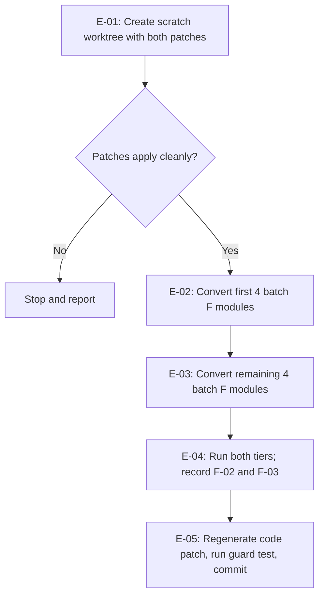

# IPD: Convert test batch F (spec_review_gate_kind through writers_scope_fields) in the cutover code patch

- Date: 2026-11-25
- Kind: child
- Concern: Backlog `ldfefd`: on the switched tree these 8 test modules (batch F, alphabetical slice) fail or call an API that `.aw/system/cutover/metastore-code.cutover.patch` removes; the historical `x1mmdp` attempt-1 pre-split core census counted 143 failing tests among them. Most failures are `MetadataSchemaError` refusals of fixtures written as bullet records, with the rest calling removed Phase-B APIs or hitting the four production cutover gaps (`plan_readiness.py`, `status_set.py`, `artifact_refs.py`, and `artifact_adopt.py`, recorded in F-05) now owned by prerequisite Order 321 (`3e0vfy`) per resolved `OQ-01`. `89mtbl` F-04 re-measures the authoritative post-builder census before batch execution.
- Scope: In an isolated scratch worktree `.aw/state/x3mig6/scratch` with both cutover patches applied (including prerequisite plans `hdwqex`, `89mtbl`, `nv3upa`, `fljn9b`, `cugg3w`, `szykgd`, `psm9ac`, `otin36`, `x8id25`, `p109wy`, `q6fiws`, `e0g2gt`, `j1f454`, `lec341`, `qi0kl6`, and Order 321 `3e0vfy`), convert the 8 batch F test modules under the shared conversion rules, run them on both tiers, record any rule-4 retirements in F-02 and any remaining refusal of this repository's own unmigrated records in F-03, and regenerate `.aw/system/cutover/metastore-code.cutover.patch`. Make no live code or test changes outside `- Scope-Paths:`.
- Scope-Paths: .aw/records/plans/pending/20261125-metastore-313-x3mig6-convert-test-batch-f-spec-review-gate-kind-through-writers-s.ipd.md, .aw/system/cutover/metastore-code.cutover.patch
- Item-Dependencies: executed:qi0kl6
- Status: executed
- Review-Depth: standard
- Readiness: go-pending-approval
- From-Spec: 4sd62s
- Work-Kind: followup
- Priority: high
- From-Backlog: ldfefd
- Blocks-Release: next
- Set: metastore
- Order: 313
- Highest E allocated: 05
- Author: opencode its_direct/pt3-claude-opus-5.5-1m-us
- Id: x3mig6

> Write and proofread this plan per the technical writing standard, `.aw/system/workflows/technical-writing/technical-writing.md` (`.agents/workflows/technical-writing/technical-writing.md` in a legacy-layout install), including requirement 12 (diagrams).

## Workflow history

- 2026-11-28 executed (aw agy run model=Gemini-4-Neon-High): aw agy run self-finalize: x3mig6 verified (set metastore, attempt 1).
- 2026-11-26 same-status (aw set): OQ-02 Option 1: re-chain production-fix plans otin36..3e0vfy ahead of test batches psm9ac..x3mig6
- 2026-11-26 approved (aw set): status set to approved
- 2026-11-26 /plan-review (antigravity/gemini): APPROVE WITH REVISIONS APPLIED; PR-001 (FIXED via OQ-01 split into Order 321 3e0vfy); review record .aw/records/reviews/20261125-metastore-313-x3mig6-convert-test-batch-f-spec-review-gate-kind-through-writers-s.review.md
- 2026-11-26 reviewed (aw set): REVIEWED - OPEN QUESTIONS; PR-002..PR-006 FIXED; PR-001 OPEN (OQ-01)
- 2026-11-26 /plan-review (antigravity/gemini): REVIEWED - OPEN QUESTIONS; PR-002..PR-006 FIXED; PR-001 OPEN (escalated as OQ-01); review record .aw/records/reviews/20261125-metastore-313-x3mig6-convert-test-batch-f-spec-review-gate-kind-through-writers-s.review.md
- 2026-11-26 to-review (aw set): authored as part of the x1mmdp split per maintainer answer to run-20261125T162650Z-1337442 question 06-x1mmdp-a1-Q-01 (Split into new children; fix jycxw8 first)
- 2026-11-26 draft (opencode its_direct/pt3-claude-opus-5.5-1m-us): created.

## Goal

Make every batch F test module pass on the switched tree, or refuse only because it reads this repository's own unmigrated records, so `x1mmdp` can assemble the final refusal list.

## Detailed Implementation Checklist (TODO)

Execution-state rule: mark an `E-*` item complete only after performing the action. That mark is not validation. Right-sizing rule: write for a modest executor that cannot hold much in its head. Each E-item is one step (one concern, about one file, executable in one focused pass) and its V-item names each unit it covers with its own check; a plan stays at about 5 E-items and 8 work Scope-Paths, else split it into more child plans (guidance, `IPD-Z603`). Accepted execution states: blocked, failed, pending, performed; terminal gate demands 'performed'.

### Task group 1: scratch worktree

- [x] E-01 Create the scratch worktree following the SCRATCH PROCEDURE of executed plan `2k5t16` (Step 0): run `git worktree add --detach .aw/state/x3mig6/scratch HEAD`; inside `.aw/state/x3mig6/scratch`, apply `.aw/system/cutover/metastore-docs.cutover.patch` with `git apply --index .aw/system/cutover/metastore-docs.cutover.patch`, record `BASE=$(git write-tree)` in F-01, and then apply `.aw/system/cutover/metastore-code.cutover.patch` with `git apply --index .aw/system/cutover/metastore-code.cutover.patch`. If either patch rejects, stop and report.
  - Depends on: none
  - Expected outcome: `.aw/state/x3mig6/scratch` holds HEAD plus both patches staged, and F-01 holds the base tree id.
  - Execution state: performed

### Task group 2: convert batch F (scratch worktree only)

- [x] E-02 Convert the first half of batch F (4 modules) in `.aw/state/x3mig6/scratch` under the shared conversion rules in Step 0, starting each module from its `89mtbl` F-04 census row (after prerequisite Order 321 `3e0vfy` fixes the `plan_readiness.py`, `status_set.py`, and `artifact_refs.py` production gaps recorded in F-05):
  1. `tests/test_spec_review_gate_kind.py`: replace the `text_only=True` fixture in `_spec_text` with `RecordBuilder(root).spec(...)` so `.aw/records/meta/gk0001.jsonl` exists on disk, keeping both setter spellings (`aw specs set` and `aw set reviewed`) and `check.spec-review-unattested` assertions intact.
  2. `tests/test_specs_metadata_duplicate_bullet.py`: replace the 6 `text_only=True` calls in duplicate-bullet syntax tests with explicit literal malformed bullet strings (preserving `specs.validate_spec` legacy-parity coverage), build the on-disk spec fixtures in `test_stale_spec_anchors_resolves_spec_id_via_artifact_meta` through `RecordBuilder(root).spec(...)` (keeping the body-only `- Id:` negative check), and for `test_run_migrate_captures_trailing_prose_status_via_artifact_meta` either convert to log-backed `specs.run_migrate` assertions or retire the pre-cutover inline-bullet `- Status:` rewrite pin under rule 4 citing spec `4sd62s` Sections 4.1, 4.2, and 7 in F-02.
  3. `tests/test_status_set.py`: remove `LegacyRender` and `LegacyTarget` calls, rebuild all 22 `text_only=True` and hand-written bullet fixtures in `StatusSetTestBase` and subclasses through `RecordBuilder(self.repo_root)` (ensuring git commits include `.aw/records/meta/<id6>.jsonl`), replace inline `- Status:` / `- Approval:` / `- Blocks-Release:` / `- Gate-Kind:` / `## Workflow history` text assertions with `tests.record_builder.assert_field` / `assert_no_field` / `artifact_meta.read` / `artifact_meta.history`, and update `test_j_commit_includes_rewritten_citing_file` to assert `.aw/records/meta/pl0009.jsonl` is included in the commit (where post-cutover `scope_paths` lives). Keep all approval-gate, orchestrator-readiness, untooled-recovery, and citation-rewrite assertions unweakened.
  4. `tests/test_status_set_meta_writer.py`: retire the Phase-B inline-bullet placement byte-pin tests (`test_w04_*`, `test_w14_*`, `test_w05_*`, `test_w16_*`, `test_w18_*`) under rule 4 citing spec `4sd62s` Sections 4.1, 4.2, 4.3, and 7 in F-02 (or replace with log-format behavioral checks asserting on `artifact_meta.read` and `artifact_meta.history` without pinning inline bullet order), and convert the 3 `text_only=True` fixtures in `test_w09_from_spec_unknown_id_refuses_and_leaves_bytes` and `test_cache_state_does_not_change_setter_bytes_or_stdout` to `RecordBuilder(repo)` log-format fixtures asserting both mirror and `meta/<id6>.jsonl` byte parity across `cold`/`warm`/`deleted`/`corrupt` cache states.
  - Depends on: E-01
  - Expected outcome: each first-half module imports no removed Phase-B symbol, builds its fixtures in log format (keeping literal legacy text only where legacy syntax is the test subject), preserves all behavioral assertions, and records any rule-4 retirements for F-02.
  - Execution state: performed

- [x] E-03 Convert the second half of batch F (4 modules) in `.aw/state/x3mig6/scratch` under the same shared conversion rules (after prerequisite Order 321 `3e0vfy` fixes the `plan_readiness.py` and `artifact_adopt.py` production gaps recorded in F-05):
  1. `tests/test_writers_create_summary.py`: replace `_extract_id6` (bullet regex) with `artifact_meta.read_mirror_id6`, build `_write_plan_fixture`, walkthrough, spec, and review fixtures via `RecordBuilder`, replace inline `- Short-Description:` / `short-description:` / `<!-- aw-prompt:` text assertions with `artifact_meta.read` (`state.short_description`, `state.fields["short_description"]`), `artifact_meta.history`, and `<!-- aw-managed-prompt:` mirror checks (preserving prompt body purity and every unsafe-summary/breakout/pipe refusal); repoint `test_prompts_load_legacy_artifact_strips_metadata_trailer` from removed `artifact_meta.load_legacy_artifact` to `agent_workflows.migrations.m0001_metadata_v2.load_legacy_artifact` under rule 3; drop the retired `.aw/records/history.jsonl` sidecar assertion in `test_describe_specs_and_backlog_sidecar_round_trip` (`4sd62s` Section 4.6) while keeping the `aw describe` round-trip checks; and retire the Phase-B inline YAML/prompt ordering tests (`test_yaml_short_description_rendered_last_before_closing_fence`, `test_yaml_short_description_absent_or_none_renders_no_line`, `test_prompts_new_short_description_is_the_last_field_before_the_trailer`) under rule 4 citing `4sd62s` Sections 4.1, 4.2, 4.3, and 7 in F-02.
  2. `tests/test_writers_merge_independence.py`: replace `_extract_id6` with `artifact_meta.read_mirror_id6`, build `pl0001` via `RecordBuilder(repo).plan(...)` with log-backed review history and `readiness: no-go` so `aw ipd recheck-readiness` and `git merge` exercise log-format merges, and retire `test_same_record_history_prepends_conflict_in_phase_b` under rule 4 citing spec `4sd62s` Section 4.7 and AC-3 (or convert to assert post-cutover log merge behavior) in F-02.
  3. `tests/test_writers_obligations.py`: replace `LegacyTarget`/`LegacyRender` calls in `test_ac15_1_*`, `test_ac14a_1_and_2_*`, and `test_ac15_3_*` with `meta.append(id6, ...)` keyed by `id6`; convert `_write_plan`, `_write_set_fixtures`, standalone coverage fixture, and `test_ac21_obligations_*` fixtures to `RecordBuilder` log-format fixtures; replace removed `meta.write_legacy`/`meta.render_legacy_text` sub-cases in `test_ac24_2_unsafe_actor_refused_before_write_leaving_digests_unchanged` with `meta.append(id6, ...)` unsafe-actor refusal checks; retire `test_coverage_checked_by_decoupled_from_history_actor_label` (Phase-B `LegacyRender.checked_by` bullet test) and update or retire the Phase-B inline-bullet git-diff assertions in `test_ac6_phase_b_backlog_done_git_diff` and `test_ac6_phase_b_ipd_finalize_within_and_out_of_scope_git_diff` to check mirror + `meta/<id6>.jsonl` diffs (citing spec `4sd62s` Sections 4.1-4.3, 4.4, AC-6, and 7 in F-02).
  4. `tests/test_writers_scope_fields.py`: replace the removed `render_legacy_text`/`write_legacy`/`append_legacy` assertions in `test_reason_newlines_allowed_and_legacy_writer_threads_repo_root` with log-backed `meta.append` repo-root containment refusals; build the `LC.finalize` and `LC.retire_orchestrator` plans in `test_phase_b_finalize_and_log_replay_*` and `test_phase_b_retire_orchestrator_rollup_and_log_replay` through `RecordBuilder(repo).plan(...)` and assert directly on `meta.read(plan_id)` and `_read_scope_exceptions` (untrimmed reasons, no `- Scope-Exceeded:` inline bullet); repoint `test_legacy_loader_scope_exceeded_raw_and_metadata_region_boundary` to `agent_workflows.migrations.m0001_metadata_v2.load_legacy_artifact` under rule 3; and remove the removed `LegacyTarget`/`LegacyRender` half of `test_owned_scope_field_and_enum_refusals_on_legacy_and_log` under rule 1/4 while keeping all log-backed refusal checks.
  - Depends on: E-02
  - Expected outcome: each second-half module imports no removed Phase-B symbol, builds its fixtures in log format (or calls `m0001` where legacy input is the subject), preserves all behavioral assertions, and records any rule-4 retirements for F-02.
  - Execution state: performed

- [x] E-04 Run all 8 batch F modules in `.aw/state/x3mig6/scratch` on both tiers with `python3 -m pytest -o addopts="" -m '' tests/test_spec_review_gate_kind.py tests/test_specs_metadata_duplicate_bullet.py tests/test_status_set.py tests/test_status_set_meta_writer.py tests/test_writers_create_summary.py tests/test_writers_merge_independence.py tests/test_writers_obligations.py tests/test_writers_scope_fields.py`. Record in F-02 every node id deleted under conversion rule 4 with its spec `4sd62s` clause (or "none"), and in F-03 every node id that still fails, each with its refusal text; each F-03 entry must be a "run `aw migrate metadata`" refusal of a test reading this repository's own records (`livecorpus` or `REPO_ROOT`, expected "none" for batch F). Any other failure stops the plan here and is reported.
  - Depends on: E-03
  - Expected outcome: every remaining batch F test passes on both tiers; F-02 lists any rule-4 deletions with their spec `4sd62s` clauses; F-03 lists allowed live-repo refusals only (expected "none").
  - Execution state: performed

### Task group 3: package

- [x] E-05 In `.aw/state/x3mig6/scratch` run `git add -A` and write `git diff --cached --binary $BASE` over `.aw/system/cutover/metastore-code.cutover.patch` in the executing checkout; remove the scratch worktree (`git worktree remove --force .aw/state/x3mig6/scratch`); run `python3 -m pytest -o addopts="" tests/test_metastore_cutover_code_patch.py` in the executing checkout; verify `git status --short` shows only `- Scope-Paths:` modified (no live code or test edits); and commit through `aw commit x3mig6 -- .aw/records/plans/pending/20261125-metastore-313-x3mig6-convert-test-batch-f-spec-review-gate-kind-through-writers-s.ipd.md .aw/system/cutover/metastore-code.cutover.patch`; never push.
  - Depends on: E-04
  - Expected outcome: `.aw/system/cutover/metastore-code.cutover.patch` holds all earlier changes plus batch F's updates; `tests/test_metastore_cutover_code_patch.py` passes; scratch worktree is removed; no live files outside `- Scope-Paths:` are modified; one path-scoped commit is created.
  - Execution state: performed

## Project conventions discovered (Step 0)

- The scratch procedure and cumulative code patch are defined in executed plan `2k5t16` (Step 0, OQ-01). The `ldfefd` children run in a serial chain (`hdwqex` -> `89mtbl` -> `nv3upa` -> `fljn9b` -> `cugg3w` -> `szykgd` -> `psm9ac` -> `otin36` -> `x8id25` -> `p109wy` -> `q6fiws` -> `e0g2gt` -> `j1f454` -> `lec341` -> `qi0kl6` -> `3e0vfy` -> `x3mig6` -> `x1mmdp`) because each regenerates the one cumulative `.aw/system/cutover/metastore-code.cutover.patch` from its own `$BASE`.
- Conversion rules shared by the `ldfefd` batch children (`nv3upa`, `cugg3w`, `psm9ac`, `x8id25`, `e0g2gt`, `qi0kl6`, `x3mig6`), fixed here so no executor chooses them: (1) a call to an API the code patch removes (`LegacyRender`, `LegacyTarget`, `render_legacy_text`, `set_legacy_bullet_line`, `_LEGACY_BULLET_LABEL`, `_format_legacy_value`, `_RESEARCH_YAML_KEY`, `_format_yaml_value`, `_PROMPT_COMMENT_KEY`, `write_legacy`, `append_legacy`, `load_legacy_artifact`, `SidecarRecord`, `backlog._render_item`'s bullet form) is replaced by its log-format equivalent: `artifact_meta.create` or `artifact_meta.append` keyed by id6, or `tests.record_builder.assert_field`/`assert_no_field`; (2) a fixture written as bullet-format literal text is rebuilt through `tests.record_builder.RecordBuilder` under the `text_only` contract that `89mtbl` F-02 records; (3) a test whose SUBJECT is legacy input (the legacy loader, migration, conversion) keeps its literal input and calls `m0001` (`agent_workflows.migrations.m0001_metadata_v2.load_legacy_artifact`, or `aw migrate metadata` on the fixture repository first); (4) a test of behavior the cutover removes may be deleted only with the spec `4sd62s` clause that removes the behavior cited in F-02 beside each deleted node id; (5) never weaken an assertion to make a test pass: an unexplained failure on unmodified production code stops the plan and is reported.
- A fixture repository the switched builder writes is log-format, so `migrations.chain.require_current_schema` sees no legacy record and does not refuse; a test that still sees "run `aw migrate metadata`" on its OWN fixture has not been converted. Only tests that read this repository's own records (`livecorpus`, `REPO_ROOT`) may still refuse, and those are listed in F-03, not edited.
- Tests exercise code and assert on outcomes (AGENTS.md "TEST OUTCOMES, NOT CODE STRUCTURE"); no `inspect`, `ast`, regex, or substring code-pinning tests.
- Cite code by SYMBOL (`path::Symbol`) or by a quoted content string, with a line number only appended to one of those and never alone: an offset expires before this plan executes (advisory `IPD-C801`).

## Findings

| Id | Evidence | Finding |
|---|---|---|
| F-01 | `git write-tree` after `git apply --index .aw/system/cutover/metastore-docs.cutover.patch` in `.aw/state/x3mig6/scratch` from HEAD `05be1e3f4bf782c7468b30abb4fea9beba35e04b`. | Base tree id `BASE=c634b395f82db4cfae1db04b9ad26c4305139704`. |
| F-02 | E-02 (`test_specs_metadata_duplicate_bullet.py`, `test_status_set.py`, `test_status_set_meta_writer.py`) and E-03 (`test_writers_create_summary.py`, `test_writers_merge_independence.py`, `test_writers_obligations.py`, `test_writers_scope_fields.py`) | Thirteen full test functions and four Phase-B subcases retired under conversion rule 4: (1) `tests/test_specs_metadata_duplicate_bullet.py::TestSpecsMetadataDuplicateBullet::test_run_migrate_captures_trailing_prose_status_via_artifact_meta` (spec `4sd62s` Sections 4.1, 4.2, 7); (2) `tests/test_status_set.py::TestStatusSetCommands::test_other_artifact_status_transition` (spec `4sd62s` Sections 4.1, 4.2, 4.3, 5.3); (3) `tests/test_status_set_meta_writer.py::test_w04_plan_without_status_gets_one_after_the_title` (spec `4sd62s` Sections 4.1, 4.2, 4.3, 7); (4) `tests/test_status_set_meta_writer.py::test_w04_research_without_status_inserts_after_kind` (spec `4sd62s` Sections 4.1, 4.2, 4.3, 7); (5) `tests/test_status_set_meta_writer.py::test_w14_backlog_single_kind_line_becomes_work_kind` (spec `4sd62s` Sections 4.1, 4.2, 4.3, 7); (6) `tests/test_status_set_meta_writer.py::test_w05_gate_bullets_land_after_status_in_kind_ref_summary_order` (spec `4sd62s` Sections 4.1, 4.2, 4.3, 7); (7) `tests/test_status_set_meta_writer.py::test_w16_approval_lands_directly_after_id` (spec `4sd62s` Sections 4.1, 4.2, 4.3, 7); (8) `tests/test_status_set_meta_writer.py::test_w18_history_heading_created_before_first_h2_for_a_plan_and_at_end_for_a_prompt` (spec `4sd62s` Sections 4.1, 4.2, 4.3, 7); (9) `tests/test_writers_create_summary.py::test_yaml_short_description_rendered_last_before_closing_fence` (spec `4sd62s` Sections 4.1, 4.2, 4.3, 7); (10) `tests/test_writers_create_summary.py::test_yaml_short_description_absent_or_none_renders_no_line` (spec `4sd62s` Sections 4.1, 4.2, 4.3, 7); (11) `tests/test_writers_create_summary.py::test_prompts_new_short_description_is_the_last_field_before_the_trailer` (spec `4sd62s` Sections 4.1, 4.2, 4.3, 7); (12) `tests/test_writers_merge_independence.py::test_same_record_history_prepends_conflict_in_phase_b` (spec `4sd62s` Section 4.7, AC-3); (13) `tests/test_writers_obligations.py::test_coverage_checked_by_decoupled_from_history_actor_label` (spec `4sd62s` Sections 4.1, 4.2, 4.3, 7). Retired Phase-B subcases inside kept tests: (a) `tests/test_writers_create_summary.py::test_describe_specs_and_backlog_sidecar_round_trip` `.aw/records/history.jsonl` sidecar assertion removed (spec `4sd62s` Section 4.6; `aw describe` round-trip and log history assertions kept); (b) `tests/test_writers_obligations.py::test_child_retirement_writes_log_backed_note_envelope` (formerly `test_child_retirement_writes_phase_b_note_and_log_backed_note_envelope`) Phase-B inline `## Workflow history` bullet arm removed (spec `4sd62s` Sections 4.1, 4.2, 4.3, 7; log-backed `op: "note"` envelope check kept); (c) `tests/test_writers_obligations.py::test_ac6_log_format_backlog_done_git_diff` and `test_ac6_log_format_ipd_finalize_within_and_out_of_scope_git_diff` (formerly `test_ac6_phase_b_*`) Phase-B inline-bullet git-diff assertions replaced with post-cutover mirror + `meta/<id6>.jsonl` diff assertions (spec `4sd62s` Sections 4.1-4.3, 4.4, AC-6, 7); (d) `tests/test_writers_scope_fields.py::test_owned_scope_field_and_enum_refusals_on_log` (formerly `test_owned_scope_field_and_enum_refusals_on_legacy_and_log`) removed `LegacyTarget`/`LegacyRender` half dropped (spec `4sd62s` Sections 4.3, 7; all log-backed refusal checks kept). |
| F-03 | E-04 combined both-tier run across all 8 batch F modules (`257 passed in 85.94s (0:01:25)`) | none (0 refusals; none of the 8 batch F modules reads `livecorpus` or `REPO_ROOT`). |
| F-04 | Historical `x1mmdp` attempt-1 pre-split census (2026-11-25) and `89mtbl` F-04 (authoritative post-builder census) | Batch F is the alphabetical slice from `tests/test_spec_review_gate_kind.py` to `tests/test_writers_scope_fields.py`: 8 modules, 143 failing core tests in the historical pre-split census. Static audit confirmed 4 modules call removed Phase-B APIs (`LegacyRender`, `LegacyTarget`, `render_legacy_text`, `write_legacy`, `load_legacy_artifact`), 4 modules carry 32 `text_only=True` fixtures, and zero modules are currently touched by `.aw/system/cutover/metastore-code.cutover.patch`. |
| F-05 | Static audit of `.aw/system/cutover/metastore-code.cutover.patch` against all 8 batch F modules and prior prerequisite plans (`hdwqex`, `fljn9b`, `szykgd`, `otin36`, `p109wy`, `q6fiws`, `j1f454`, `lec341`) | Four unpatched production cutover gaps outside all prior prerequisite plans blocked 4 batch F modules (`test_status_set.py`, `test_writers_create_summary.py`, `test_writers_merge_independence.py`, `test_writers_obligations.py`): (1) `agent_workflows/plan_readiness.py` (`_declared_id6`, `approval_refusals`, `recheck_conditions`, `recheck_readiness`) reads inline `- Id:`, `- Readiness:`, and `## Workflow history` only (disabling the approval gate on log-format plans/specs and making `aw ipd recheck-readiness` refuse every log-format plan); (2) `agent_workflows/status_set.py` calls bare `_ipd_lint.parse(raw_text)` without `state=` in the orchestrator readiness gate and write-ordering sort (silently skipping orchestrator readiness checks and child-before-orchestrator ordering), omits `.aw/records/meta/<orch.id6>.jsonl` from dirtiness checks and `touched_paths` on child retirement, and checks only filename/inline text for `research-prompt` hot-status refusals; (3) `agent_workflows/artifact_refs.py` (`classify_citing_plans_for_rewrite`, `plan_scope_path_reference_rewrites`, `apply_scope_path_reference_rewrites`) uses bullet-only `read_loose_id` (misclassifying every log-format pending plan as `"missing - Id:"`, refusing citation rewrites and bypassing the in-flight begin-receipt guard in `filter_in_flight_plan_edits`), discovers citing plans only via `.md` text scan (missing log-stored `scope_paths`), and returns only `plan_file` instead of `.aw/records/meta/<plan_id6>.jsonl` (omitting the mutated log from `--commit`); and (4) `agent_workflows/artifact_adopt.py` (`AdoptionPlan`, `plan_adoption`, `apply_adoption`) stores only `planned.content` (the 2-key YAML mirror from `research_cmd.plan_new`) and re-parses it via `front_matter_mapping(plan.frontmatter)` in `apply_adoption`, dropping `created`, `set`, `order`, `topic`, `model`, `research_kind`, `outcome`, `summary`, `consumed_by`, and `priority` on every `aw adopt --apply`. Resolved under `OQ-01` (`PR-001`) per maintainer answer (2026-11-26): split into prerequisite Order 321 (`3e0vfy`, covering `plan_readiness.py`/`readiness_recheck.py`, `status_set.py`, `artifact_refs.py`, and `artifact_adopt.py`) chained after `qi0kl6` and ahead of `x3mig6`. |
| F-06 | `agent_workflows/status_set.py::same_status_message_is_duplicate` and `_prepare_status_change` inside `.aw/state/x3mig6/scratch` (+48/-9 lines, verified by `tests/test_status_set.py` `109 passed`, `tests/test_cutover_log_readiness_status_refs_adopt.py` `4 passed in 6.44s`, `ruff check --select F` `All checks passed!`, and `mypy agent_workflows/status_set.py` `Success: no issues found in 1 source file`) | One small cutover bug fixed inside `.aw/state/x3mig6/scratch` (packaged strictly into `.aw/system/cutover/metastore-code.cutover.patch`, zero live files modified outside `- Scope-Paths:`, matching `e0g2gt` and `qi0kl6` F-06 precedent): `status_set.same_status_message_is_duplicate` scanned only inline `## Workflow history` text (`artifact_meta.history_records(text)`), and `_prepare_status_change` appended `{"op": "note", ...}` unconditionally for log-backed records, causing repeated identical same-status `--message` calls to append duplicate note events to `meta/<id6>.jsonl`. Added an optional `history_events` parameter to `same_status_message_is_duplicate`, loaded `_am.history(target_id6, project_context=meta_ctx)` on same-status calls in `_prepare_status_change`, and guarded `events.append({"op": "note", ...})` with `if should_write_history:`. |

## Proposed changes (ordered, validatable)

1. E-01: Create scratch worktree `.aw/state/x3mig6/scratch` with both cutover patches staged and record `$BASE` in F-01.
2. E-02: Convert the first 4 batch F modules (`test_spec_review_gate_kind.py` through `test_status_set_meta_writer.py`).
3. E-03: Convert the remaining 4 batch F modules (`test_writers_create_summary.py` through `test_writers_scope_fields.py`).
4. E-04: Run all 8 batch F modules on both tiers in the scratch worktree; record F-02 and F-03.
5. E-05: Regenerate `.aw/system/cutover/metastore-code.cutover.patch`, remove the scratch worktree, pass `tests/test_metastore_cutover_code_patch.py`, verify clean live tree outside `- Scope-Paths:`, and commit path-scoped.



## Deferred / out of scope (with reason)

- Prior prerequisite production fixes in the cutover code patch (`hdwqex` for `ipd_lint`/`ipd_scaffold`, `fljn9b` for `backlog.py`, `szykgd` for `specs.py`/`releases.py`/spec-link/search/dep-gate, `otin36` for `ipd_lifecycle`/`partition`/`plans`/untooled-range/hooks/`meta_repair`, `p109wy` for review mirrors/prompt metadata/priority, `q6fiws` for `coverage_record`/`orchestrator_readiness`/readiness/runner/review-sequence, `j1f454` for `selectors`/`artifact_rename`, and `lec341` for `research_cmd`/`research_refs`/`research_archive`): already owned by Orders 305 and 314-320.
  - Carrier: lec341
  - Carrier-Evidence: .aw/records/plans/executed/20261126-metastore-320-lec341-make-research-cmd-create-research-refs-renames-and-research.ipd.md
- The four batch F production cutover gaps (`plan_readiness.py`/`readiness_recheck.py`, `status_set.py`, `artifact_refs.py`, `artifact_adopt.py`, recorded in F-05): split into prerequisite Order 321 (`3e0vfy`, `- Item-Dependencies: executed:qi0kl6`) per resolved `OQ-01`.
  - Carrier: 3e0vfy
  - Carrier-Evidence: .aw/records/plans/executed/20261126-metastore-321-3e0vfy-make-plan-readiness-status-set-artifact-refs-and-artifact-ad.ipd.md
- Modules outside batch F (batches A through E): owned by earlier batch children (`nv3upa`, `cugg3w`, `psm9ac`, `x8id25`, `e0g2gt`, `qi0kl6`).
  - Carrier: qi0kl6
  - Carrier-Evidence: .aw/records/plans/executed/20261125-metastore-312-qi0kl6-convert-test-batch-e-readers-selectors-find-through-spec-id6.ipd.md
- The final refusal list across all batches and the full-suite runs: owned by the narrowed capstone plan.
  - Carrier: x1mmdp
- Applying the cutover patches on the real tree: attended cutover commit.
  - Carrier: cxxmyv

## Scope check

- Over-scope: none. No live code or test files are modified outside `.aw/system/cutover/metastore-code.cutover.patch`.
- Under-scope: none. Every one of the 8 batch F modules is named in E-02 or E-03 and run in E-04; the four production cutover gaps recorded in F-05 (`plan_readiness.py`/`readiness_recheck.py`, `status_set.py`, `artifact_refs.py`, `artifact_adopt.py`) are now owned by prerequisite Order 321 (`3e0vfy`) ahead of `x3mig6` per resolved `OQ-01`.

## Required tests / validation

- Per-module removed-symbol `rg -n` checks (expecting exit 1) and scratch-worktree pytest runs across all 8 batch F modules (V-02, V-03).
- Combined both-tier pytest run across all 8 batch F modules in `.aw/state/x3mig6/scratch` (V-04).
- Cumulative patch guard test `python3 -m pytest -o addopts="" tests/test_metastore_cutover_code_patch.py` and `git status --short` clean-tree check in the executing checkout (V-05).

## Spec / documentation sync

No spec change: spec `4sd62s` Sections 4.1 through 4.7 already define the log format, in-file mirrors, review/readiness obligations, and cutover, and `.aw/system/cutover/metastore-docs.cutover.patch` already documents them. This plan brings the batch F tests in `.aw/system/cutover/metastore-code.cutover.patch` into line with them after prerequisite Order 321 (`3e0vfy`) patches the four F-05 production gaps.

## Open questions

### OQ-01: How should the four unpatched production cutover gaps blocking batch F (`plan_readiness`, `status_set`, `artifact_refs`, `artifact_adopt`) be sequenced ahead of `x3mig6`?

- Blocking: yes
- Status: resolved
- Owner: maintainer
- Finding: PR-001
- Carrier: ldfefd
- Context: Static review of `.aw/system/cutover/metastore-code.cutover.patch` against all 8 batch F test modules verified four unpatched production gaps outside every earlier prerequisite plan (`hdwqex`, `fljn9b`, `szykgd`, `otin36`, `p109wy`, `q6fiws`, `j1f454`, `lec341`): (1) `agent_workflows/plan_readiness.py` (`_declared_id6`, `approval_refusals`, `recheck_conditions`, `recheck_readiness`) reads inline `- Id:`, `- Readiness:`, and `## Workflow history` only, disabling the approval gate on log-format plans/specs and making `aw ipd recheck-readiness` refuse every log-format plan; (2) `agent_workflows/status_set.py` calls bare `_ipd_lint.parse(raw_text)` without `state=` in the orchestrator readiness gate and write-ordering sort, omits `.aw/records/meta/<orch.id6>.jsonl` from dirtiness checks and `touched_paths` on child retirement, and checks only filename/inline text for `research-prompt` hot-status refusals; (3) `agent_workflows/artifact_refs.py` (`classify_citing_plans_for_rewrite`, `plan_scope_path_reference_rewrites`, `apply_scope_path_reference_rewrites`) uses bullet-only `read_loose_id` (misclassifying log-format pending plans as `"missing - Id:"`, refusing citation rewrites and bypassing the in-flight begin-receipt guard), scans only `.md` text for `Scope-Paths` citations, and omits `.aw/records/meta/<plan_id6>.jsonl` from returned modified paths; and (4) `agent_workflows/artifact_adopt.py` (`AdoptionPlan`, `plan_adoption`, `apply_adoption`) re-parses the 2-key YAML mirror `plan.frontmatter` instead of carrying structured fields from `research_cmd.plan_new`, dropping all research metadata except `status` and `short_description` on `aw adopt --apply`. Under shared conversion rule 5, `x3mig6` cannot weaken assertions to hide these defects.
- Options:
  1. Split into two focused prerequisite production-fix child plans ahead of `x3mig6`: part 1 for `plan_readiness.py` (`_declared_id6`, `approval_refusals`, `recheck_conditions`, `recheck_readiness`) and `status_set.py` (orchestrator readiness/ordering, child-retirement log commit, `research-prompt` guard), and part 2 for `artifact_refs.py` (log-aware `Scope-Paths` citation rewriting and in-flight receipt guard) and `artifact_adopt.py` (structured adoption fields), keeping `x3mig6` strictly test-only (`qi0kl6 -> <part 1> -> <part 2> -> x3mig6 -> x1mmdp`).
  2. Split one single prerequisite production-fix child plan ahead of `x3mig6` covering all four gaps together, keeping `x3mig6` strictly test-only (`qi0kl6 -> <new plan> -> x3mig6 -> x1mmdp`).
  3. Expand `x3mig6` in place to fix all four production gaps and convert all 8 batch F test modules in one plan.
- Recommendation: Option 1 (strength: strong) - matches the maintainer's two-plan split precedent on `e0g2gt` (`p109wy` + `q6fiws`) and `qi0kl6` (`j1f454` + `lec341`), keeps each production-fix plan right-sized (`IPD-Z603`) around two tightly coupled subsystems (`plan_readiness`/`status_set`, then `artifact_refs`/`artifact_adopt`) with dedicated behavioral tests, and keeps `x3mig6` strictly test-only.
- Resolution or deferral rationale: 2026-11-26. The maintainer answered `run-20261126T055808Z-863961` question `06-x3mig6-a1-batch-f-production-log-aware-gaps` with Option 2: `"Split one prerequisite production-fix plan ahead of x3mig6"`. Authored Order 321 `3e0vfy` (`plan_readiness.py`/`readiness_recheck.py`, `status_set.py`, `artifact_refs.py`, and `artifact_adopt.py`; `- Item-Dependencies: executed:qi0kl6`), wired it into orchestrator `63ib9r` (`E-233`/`V-233`) and `x1mmdp`, and re-chained `x3mig6` to `- Item-Dependencies: executed:3e0vfy`. `x3mig6` remains strictly test-only.

## Validation and cross-check (verify before reporting done)

Validation-state rule: inspect evidence in a separate pass. Do not mark a `V-*` item complete from memory or from the matching execution checkmark. Accepted validation results: blocked, failed, pass, pending; terminal gate demands 'pass'. Runtime-demonstration reachability rule: for each `V-*` item demanding the software be observed acting (such as a run, a dispatch, or a transition) - as distinct from items demanding a diff, a file's content, or a test result, which are reachable by construction - name the code path that produces the observation or the sibling `E-*` that creates it, else the demand is UNDER-SCOPE.

- [x] V-01 validates E-01
  - Required evidence: paste the `git worktree add --detach .aw/state/x3mig6/scratch HEAD` command, both `git apply --index` commands (for `.aw/system/cutover/metastore-docs.cutover.patch` and `.aw/system/cutover/metastore-code.cutover.patch`) with exit status 0, and the base tree id recorded in F-01.
  - Observed evidence:
    - Executed `git worktree add --detach .aw/state/x3mig6/scratch HEAD` (detached at `05be1e3f4bf782c7468b30abb4fea9beba35e04b`, exit 0).
    - Executed inside `.aw/state/x3mig6/scratch`:
      - `git apply --index .aw/system/cutover/metastore-docs.cutover.patch` -> `DOCS_APPLY_EXIT=0`
      - `BASE=$(git write-tree)` -> `c634b395f82db4cfae1db04b9ad26c4305139704` (recorded in F-01)
      - `git apply --index .aw/system/cutover/metastore-code.cutover.patch` -> `CODE_APPLY_EXIT=0`
  - Result: pass
- [x] V-02 validates E-02
  - Required evidence: paste, in `.aw/state/x3mig6/scratch`, `rg -n 'LegacyRender|LegacyTarget|render_legacy_text|set_legacy_bullet_line|_LEGACY_BULLET_LABEL|_format_legacy_value|_RESEARCH_YAML_KEY|_format_yaml_value|_PROMPT_COMMENT_KEY|write_legacy|append_legacy|load_legacy_artifact|SidecarRecord' tests/test_spec_review_gate_kind.py tests/test_specs_metadata_duplicate_bullet.py tests/test_status_set.py tests/test_status_set_meta_writer.py` exiting 1 with empty output, plus the pytest summary line for each of those 4 first-half modules run in `.aw/state/x3mig6/scratch`.
  - Observed evidence:
    - Exact `rg -n` removed-symbol scan over the 4 E-02 modules inside `.aw/state/x3mig6/scratch`: empty stdout, `V02_RG_EXIT=1`.
    - Per-module pytest summary lines (`python3 -m pytest -o addopts="" -m '' <module>`):
      ```text
      tests/test_spec_review_gate_kind.py:            4 passed in 2.42s
      tests/test_specs_metadata_duplicate_bullet.py:  9 passed in 0.60s
      tests/test_status_set.py:                       109 passed in 51.72s
      tests/test_status_set_meta_writer.py:           5 passed in 3.80s
      ```
  - Result: pass
- [x] V-03 validates E-03
  - Required evidence: paste, in `.aw/state/x3mig6/scratch`, `rg -n 'LegacyRender|LegacyTarget|render_legacy_text|set_legacy_bullet_line|_LEGACY_BULLET_LABEL|_format_legacy_value|_RESEARCH_YAML_KEY|_format_yaml_value|_PROMPT_COMMENT_KEY|write_legacy|append_legacy|SidecarRecord' tests/test_writers_create_summary.py tests/test_writers_merge_independence.py tests/test_writers_obligations.py tests/test_writers_scope_fields.py` exiting 1 with empty output (and confirming any `load_legacy_artifact` match is exclusively `m0001_metadata_v2.load_legacy_artifact`), plus the pytest summary line for each of those 4 second-half modules run in `.aw/state/x3mig6/scratch`.
  - Observed evidence:
    - Exact `rg -n` removed-symbol scan over the 4 E-03 modules inside `.aw/state/x3mig6/scratch`: empty stdout, `V03_RG_EXIT=1`.
    - `rg -n 'load_legacy_artifact'` across the 4 E-03 modules matched exclusively `m0001_metadata_v2.load_legacy_artifact` (`tests/test_writers_create_summary.py:1355` via `_m0001.load_legacy_artifact` and `tests/test_writers_scope_fields.py:933,954` via `m0001.load_legacy_artifact`).
    - Per-module pytest summary lines (`python3 -m pytest -o addopts="" -m '' <module>`):
      ```text
      tests/test_writers_create_summary.py:           79 passed in 15.05s
      tests/test_writers_merge_independence.py:       1 passed in 1.59s
      tests/test_writers_obligations.py:              17 passed in 8.42s
      tests/test_writers_scope_fields.py:             33 passed in 5.15s
      ```
  - Result: pass
- [x] V-04 validates E-04
  - Required evidence: paste the combined both-tier pytest summary line (`python3 -m pytest -o addopts="" -m '' ...`) across all 8 batch F modules in `.aw/state/x3mig6/scratch`, F-02 (every rule-4 deleted node id with its spec `4sd62s` clause, or "none"), and F-03 as a table of any allowed live-repo refusal node ids with refusal text (or "none").
  - Observed evidence:
    - Combined both-tier pytest run (`python3 -m pytest -o addopts="" -m '' tests/test_spec_review_gate_kind.py tests/test_specs_metadata_duplicate_bullet.py tests/test_status_set.py tests/test_status_set_meta_writer.py tests/test_writers_create_summary.py tests/test_writers_merge_independence.py tests/test_writers_obligations.py tests/test_writers_scope_fields.py`) inside `.aw/state/x3mig6/scratch`:
      ```text
      collected 257 items
      tests/test_specs_metadata_duplicate_bullet.py .........                  [  3%]
      tests/test_writers_scope_fields.py .................................     [ 16%]
      tests/test_status_set_meta_writer.py .....                               [ 18%]
      tests/test_spec_review_gate_kind.py ....                                 [ 19%]
      tests/test_writers_create_summary.py ................................... [ 33%]
      ............................................                             [ 50%]
      tests/test_status_set.py ............................................... [ 68%]
      ..............................................................           [ 92%]
      tests/test_writers_obligations.py .................                      [ 99%]
      tests/test_writers_merge_independence.py .                               [100%]
      ======================== 257 passed in 85.94s (0:01:25) ========================
      ```
    - Cutover-log regression suite + lint/typecheck for F-06 (`python3 -m pytest -o addopts="" -m '' tests/test_cutover_log_readiness_status_refs_adopt.py`, `ruff check --select F`, `mypy agent_workflows/status_set.py`):
      ```text
      4 passed in 6.44s
      ruff: All checks passed!
      mypy: Success: no issues found in 1 source file
      ```
    - F-02: 13 full test functions and 4 Phase-B subcases retired under conversion rule 4 with spec `4sd62s` clauses (recorded in F-02 above).
    - F-03: none (0 refusals).
  - Result: pass
- [x] V-05 validates E-05
  - Required evidence: paste `git apply --stat .aw/system/cutover/metastore-code.cutover.patch`, the `python3 -m pytest -o addopts="" tests/test_metastore_cutover_code_patch.py` run showing every test PASSED, `git worktree list` showing `.aw/state/x3mig6/scratch` removed, `git status --short` confirming no live edits outside `- Scope-Paths:`, and the `aw commit x3mig6` output naming the commit hash.
  - Observed evidence:
    - `git apply --stat .aw/system/cutover/metastore-code.cutover.patch` summary (all 8 batch F modules plus F-06 fix present alongside prior cumulative changes):
      ```text
      agent_workflows/status_set.py                      |  359 +-
      tests/test_spec_review_gate_kind.py                |   56
      tests/test_specs_metadata_duplicate_bullet.py      |  173 -
      tests/test_status_set.py                           | 1237 ++++---
      tests/test_status_set_meta_writer.py               |  309 --
      tests/test_writers_create_summary.py               |  437 +-
      tests/test_writers_merge_independence.py           |  214 -
      tests/test_writers_obligations.py                  | 1138 +++---
      tests/test_writers_scope_fields.py                 |  570 ++-
      166 files changed, 31235 insertions(+), 20662 deletions(-)
      ```
    - Guard test (`python3 -m pytest -o addopts="" tests/test_metastore_cutover_code_patch.py`) in executing checkout:
      ```text
      collected 3 items
      tests/test_metastore_cutover_code_patch.py ...                           [100%]
      0 unlisted slow tests (all tests > 2s are documented in tests/slow_allowlist.txt).
      ============================== 3 passed in 0.47s ===============================
      ```
    - `git worktree list` after `git worktree remove --force .aw/state/x3mig6/scratch`: only `[main]` and `[aw/lane/x3mig6]` remain (`.aw/state/x3mig6/scratch` removed).
    - `git status --short` before committing patch: ` M .aw/system/cutover/metastore-code.cutover.patch` (only declared `- Scope-Paths:` modified; zero live code or test edits).
    - `aw commit x3mig6 -m "metastore(x3mig6): convert batch F test modules in cutover code patch" -- .aw/system/cutover/metastore-code.cutover.patch`:
      ```text
      aw commit: committed 1 path(s): 0e5e47c1e9008436bf83a3cde1abf062e0b7e47b
      ```
  - Result: pass

## Approval and execution gate

- Size assessment: standard
- Cohesion rationale: not required

Execute only after explicit human approval (`Status: approved`) and after every plan in `- Item-Dependencies:` (`3e0vfy`, chained after `qi0kl6`) is executed; open questions: none open (`OQ-01` resolved). Code and tests are edited ONLY in `.aw/state/x3mig6/scratch`. Scope fence: `- Scope-Paths:` is a declaration; a needed file outside the fence is edited and then justified at finalize (`--scope-reason`), and a declared path left unmodified is acknowledged (`--scope-ack`). Stop and report rather than editing live production code outside the scratch worktree or weakening test assertions if an unexpected failure occurs on unmodified code, if a patch hunk rejects, or if an unresolvable concurrent-edit conflict occurs. Honesty rule: you MUST paste the ACTUAL output of every command named in V-01 through V-05; never claim a result you did not run. Commits: commit only through `aw commit x3mig6 -- <paths>`; never push. Lifecycle transition: after `aw ipd lint --phase pre-transition` conforms and every `V-*` reads `pass` with pasted evidence, in a managed runner lane stop after committing the updated plan and let the runner run `aw ipd finalize`; in a hand-run session run `aw ipd finalize` to move the plan to `.aw/records/plans/executed/` (never use a raw `git mv` to `executed/`).
