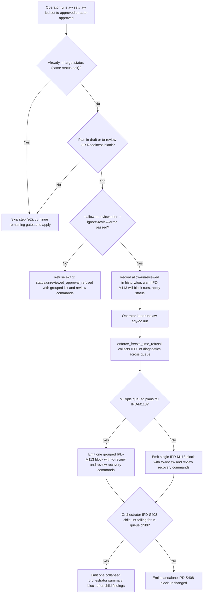

# IPD: Gate unreviewed plan approval in aw set and group actionable IPD-M113/IPD-S408 runner preflight diagnostics

- Date: 2026-11-27
- Kind: child
- Concern: Setter safety and runner preflight diagnostic clarity for unreviewed plans
- Scope: Refuse unreviewed plan approval in `aw set` unless `--allow-unreviewed` (alias `--ignore-review-error`) is passed, register `"allow-unreviewed"` in `artifact_meta.SUPPORTED_OVERRIDES`, and group actionable `IPD-M113` and `IPD-S408` runner freeze-time preflight diagnostics
- Scope-Paths: .aw/records/plans/pending/20261127-reviewgateux-01-55tt85-gate-unreviewed-plan-approval-in-aw-set-and-group-actionable.ipd.md, agent_workflows/status_set.py, agent_workflows/artifact_meta.py, agent_workflows/cli.py, agent_workflows/runner_shared.py, tests/test_plan_transition_gate.py, tests/test_freeze_time_refusal.py, tests/test_status_set.py, tests/test_*.py
- Item-Dependencies: none
- From-Spec: none
- Status: executed
- Readiness: go-pending-approval
- Review-Depth: standard
- Short-Description: Refuse approving unreviewed plans without --allow-unreviewed and group actionable IPD-M113/IPD-S408 preflight errors
- Work-Kind: feature
- Priority: high
- Set: reviewgateux
- Order: 1
- Highest E allocated: 05
- Author: antigravity/gemini
- Id: 55tt85

> Write and proofread this plan per the technical writing standard, `.aw/system/workflows/technical-writing/technical-writing.md` (`.agents/workflows/technical-writing/technical-writing.md` in a legacy-layout install), including requirement 12 (diagrams).

## Workflow history

- 2026-11-27 executed (aw agy run model=Gemini-4-Neon-High): aw agy run self-finalize: 55tt85 verified (set reviewgateux, attempt 1).
- 2026-11-27 approved (aw set): status set to approved
- 2026-11-27 reviewed (aw set): plan-review: APPROVE WITH REVISIONS APPLIED
- 2026-11-27 /plan-review (antigravity/gemini): APPROVE WITH REVISIONS APPLIED; PR-001, PR-002, PR-003, PR-004, PR-005, PR-006. Reviewed at tier `standard` in an isolated review-sweep lane; plan was committed and unchanged, so pre-review snapshot skipped. Fixed all 6 findings in place: registered `"allow-unreviewed"` in `agent_workflows/artifact_meta.py::SUPPORTED_OVERRIDES` and added `agent_workflows/artifact_meta.py` to `Scope-Paths` (PR-001); skipped same-status updates in step `(e2)`, defined structured `--json`/`--agent` override warnings, preserved step `(a)` negative-verdict precedence, and enforced repo-path-free hint tokens (PR-002); ordered non-collapsed IPD preflight findings ahead of collapsed orchestrator `IPD-S408` summaries, keyed `IPD-M113` grouping on normalized `(code, status.lower())`, and aligned ANSI ID highlighting (PR-003); added durable carriers (`- Carrier-Declined:` / `- Carrier: oxv48x`) to `## Deferred / out of scope` to pass `check.ipd-uncarried-obligation` (PR-004); corrected parser-uniformity, spec, and `test_case_d` citations plus added missing execution-contract elements in `## Approval and execution gate` (PR-005); tightened prose, first-use glosses, code citations, and Mermaid flowchart synchronization (PR-006).
- 2026-11-27 to-review (antigravity/gemini): authored review-ready plan for the unreviewed-approval gate and grouped IPD-M113/IPD-S408 runner preflight diagnostics.
- 2026-11-27 draft (antigravity/gemini): created.

## Goal

Prevent operators from accidentally moving unreviewed Implementation Plan Documents (IPDs) directly to `approved` or `auto-approved` without a `- Readiness:` review attestation. In parallel, replace repetitive per-plan `IPD-M113` (missing `- Readiness:` at a reviewed or ready-to-execute status) and per-child `IPD-S408` (orchestrator not ready for review) runner preflight blocks with one grouped refusal that prints the exact recovery commands.



## Detailed Implementation Checklist (TODO)

Execution-state rule: mark an `E-*` item complete only after performing the action. That mark is not validation. Right-sizing rule: write for a modest executor that cannot hold much in its head. Each E-item is one step (one concern, about one file, executable in one focused pass) and its V-item names each unit it covers with its own check; a plan stays at about 5 E-items and 8 work Scope-Paths, else split it into more child plans (guidance, `IPD-Z603`). Accepted execution states: blocked, failed, pending, performed; terminal gate demands 'performed'.

### Task group 1: Gate unreviewed plan approval in `aw set`

- [x] E-01 Add the `status.unreviewed_approval_refused` pre-flight gate, grouped refusal rendering, and `--allow-unreviewed` audit trail in `agent_workflows/status_set.py`, and register `"allow-unreviewed"` in `agent_workflows/artifact_meta.py::SUPPORTED_OVERRIDES`.
  - Depends on: none
  - Expected outcome:
    1. `agent_workflows/artifact_meta.py::SUPPORTED_OVERRIDES` includes `"allow-unreviewed"` so schema-2 log-format events carrying `overrides: ["allow-unreviewed"]` pass `artifact_meta.validate_envelope` and `artifact_meta.validate_event`.
    2. `agent_workflows/status_set.py::run_set_command` refuses moving any plan into `approved` or `auto-approved` (any status in `ipd_schema.READY_TO_EXECUTE`, skipping same-status metadata edits where `cur_status == norm_plans_target`) when the plan is currently in `draft` or `to-review`, or when its `readiness` field from `status_set._record_state` is missing or blank, unless `args.allow_unreviewed` is true.
    3. Step `(a)` (`status_set.validate_transition_allowed` -> `plan_readiness.approval_refusals`) continues to run before step `(e2)`, so negative review verdicts, gating review findings, and unresolved blocking open questions remain refused by step `(a)` and are never bypassed by `--allow-unreviewed`.
    4. Refusals exit with code `2`, leave all target files unchanged, and support `--skip-refused` in mixed batches. In human mode, `status_set._render_refuse_batch` renders one grouped failure block listing all affected plans, explaining that `/plan-review` must write `- Readiness:` before runners will execute them, and printing exact next commands (`aw agy review <ids>`, `aw oc review <ids>`, `aw agy run --full-auto <ids>`, and the `status_set._retry_command` override with `--allow-unreviewed`) using repo-path-free tokens (`id6` or filename). In `--json` and `--agent` modes, it emits a structured `CommandResult` (`status="cannot-run"`, `exit_code=2`) with normalized `Diagnostic` locations and `NextAction` items. Generic `--force` does not bypass this gate.
    5. When `args.allow_unreviewed` overrides a non-same-status unreviewed approval, `status_set._prepare_status_change` appends `, --allow-unreviewed` to the workflow history actor and `"allow-unreviewed"` to `event_overrides`, `status_set._RETRY_FLAG_ALLOWLIST` includes `("allow_unreviewed", "--allow-unreviewed", False)`, and `run_set_command` surfaces a visible warning stating that `- Readiness:` was not written and that `aw check plans` and `aw agy|oc run` will refuse execution with `IPD-M113` until `/plan-review` runs (via `term.status("warn", ...)` or stderr in human mode, and via warning `Diagnostic(rule="status.unreviewed_approval_overridden", severity="warning", ...)` plus `data["warnings"]` in `--json`/`--agent` mode, never writing plain text to stdout in structured modes).
  - Execution state: performed

- [x] E-02 Register `--allow-unreviewed` with alias `--ignore-review-error` on all four `set` parsers in `agent_workflows/cli.py`.
  - Depends on: E-01
  - Expected outcome: `p_ipd_set`, `p_set`, `p_backlog_set`, and `p_specs_set` in `agent_workflows/cli.py` each accept `--allow-unreviewed` and `--ignore-review-error` (`dest="allow_unreviewed"`, `action="store_true"`, default `False`), matching the uniform four-parser declaration of `--allow-terminal-reopen`. Help text explains that the flag overrides the unreviewed-plan approval refusal, records the override in workflow history, does not write `- Readiness:`, and does not prevent `IPD-M113` at lint or run time. Non-plan record types (`specs`, `backlog`, `prompts`, `releases`, `research`) ignore the flag with no behavioral change.
  - Execution state: performed

### Task group 2: Group and improve runner freeze-time preflight diagnostics

- [x] E-03 Group repeated IPD lint findings, collapse redundant in-queue orchestrator `IPD-S408` `child-lint-failing` lines, and emit actionable `IPD-M113` recovery commands in `agent_workflows/runner_shared.py::enforce_freeze_time_refusal`.
  - Depends on: none
  - Expected outcome: `runner_shared.enforce_freeze_time_refusal` collects IPD structural lint diagnostics across the frozen queue before assembling `findings` strings and preserves the `[RUN-STRUCTURE-PREFLIGHT]` marker, rule codes (`IPD-M113`, `IPD-S408`), and ANSI (terminal color) `id6` highlighting (`pal(id6, "bold", "yellow")` when color is enabled, plain text when disabled). It applies four behaviors:
    1. For `IPD-M113` on plans whose normalized status is `approved` or `auto-approved`, `Next:` prints `aw set plan to-review <ids> -m "needs /plan-review before approval"` followed by `aw <host> review <ids>` instead of generic `fix the issue above`.
    2. Multiple queued plans hitting `IPD-M113` at the same normalized status (grouped by `(code, status.lower())`, deduplicating `id6` in first-seen order), and multiple queued plans producing any other identical `(code, status.lower(), message)` diagnostic, collapse into one grouped `[RUN-STRUCTURE-PREFLIGHT]` block listing all affected plan IDs once, one plain explanation, and one combined `Next:` command.
    3. When an orchestrator emits `IPD-S408` diagnostics with `child-lint-failing (<child_id6>): ...` for child IDs that already have non-`IPD-S408` structural lint diagnostics reported in the same queue, those duplicate per-child blocks collapse into one concise orchestrator summary block naming the already-reported child IDs (styled via `pal(child_id6, "bold", "yellow")`), while non-duplicate `IPD-S408` findings (such as `coverage-record-stale`, `child-missing`, or out-of-queue failing children) continue to emit individually.
    4. All non-collapsed IPD findings (including grouped `IPD-M113` and standalone `IPD-S408`) are emitted ahead of collapsed orchestrator `IPD-S408` summary blocks, so `"already reported above"` is always accurate regardless of whether the orchestrator precedes or follows its children in `queue`.
  - Execution state: performed

### Task group 3: Behavioral tests, fixture alignment, and full verification

- [x] E-04 Add behavioral tests for the unreviewed-approval gate and grouped preflight diagnostics, and align existing orthogonal test fixtures that approve plans without `- Readiness:`.
  - Depends on: E-01, E-02, E-03
  - Expected outcome:
    1. `tests/test_plan_transition_gate.py` covers: (a) refusing `draft -> approved`, `to-review -> approved`, `to-review -> auto-approved`, and `reviewed` (without `- Readiness:`) `-> approved` with exit `2` and byte-identical files across both `aw set` and `aw ipd set`; (b) refusing a multi-plan Set in one grouped human block and in valid `--json` and `--agent` `CommandResult` output; (c) refusing when only `--force` is passed; (d) preserving step `(a)` un-overridable refusal when `--allow-unreviewed` is passed on a plan with `- Readiness: no-go` or a negative review verdict; (e) succeeding with `--allow-unreviewed` and with alias `--ignore-review-error`, recording `, --allow-unreviewed` in legacy workflow history and `overrides: ["allow-unreviewed"]` on a schema-2 log-format plan, and surfacing the `IPD-M113` warning cleanly in both human mode and `--json`/`--agent` mode (valid JSON/JSONL stdout with warning diagnostic); (f) permitting same-status metadata updates (`aw ipd set approved <id6> --priority high` or `aw ipd dependencies set`) on an already-`approved` unreviewed plan without failing step `(e2)`, and permitting `--skip-refused` in a mixed batch; (g) accepting `reviewed` plans that carry `- Readiness:` without any override flag; and (h) leaving non-plan record types (`specs`, `backlog`) unaffected.
    2. `tests/test_freeze_time_refusal.py` covers: (a) grouping N `approved` plans lacking `- Readiness:` (including mixed-case `APPROVED`) into one `IPD-M113` `[RUN-STRUCTURE-PREFLIGHT]` block listing all N IDs once; (b) emitting the actionable `aw set plan to-review ... -m ...` and `aw <host> review ...` recovery commands for both single-plan and multi-plan `IPD-M113` refusals across both `oc` and `agy` hosts, under both `color=False` and `color=True`; (c) collapsing duplicate orchestrator `IPD-S408` `child-lint-failing` lines when the failing children are in the same queue into one orchestrator summary block emitted after the child findings even when the orchestrator appears first in `queue`; and (d) preserving standalone `IPD-S408` diagnostics (such as `coverage-record-stale` or an out-of-queue failing child).
    3. Existing orthogonal tests in `tests/test_plan_transition_gate.py::TestPlanTransitionGate.test_case_d_ordinary_forward_edges_succeed`, `tests/test_status_set.py`, and any other `tests/test_*.py` that approve `draft`/`to-review`/Readiness-less plans to test unrelated flags are updated to use reviewed plans with `- Readiness: go-pending-approval` (or `--allow-unreviewed` where testing raw `draft -> approved`).
  - Execution state: performed

- [x] E-05 Run type checks, the core test suite, and the leak sanitizer, then commit only the modified paths through `aw commit`.
  - Depends on: E-04
  - Expected outcome: `python3 -m mypy agent_workflows/status_set.py agent_workflows/artifact_meta.py agent_workflows/cli.py agent_workflows/runner_shared.py`, bare `python3 -m pytest`, and `aw sanitize --agent` all pass with zero failures or findings, and all modified paths are committed cleanly via `aw commit 55tt85 -- <paths>` (no push).
  - Execution state: performed

## Project conventions discovered (Step 0)

- `agent_workflows/ipd_lint.py::check_readiness_required` enforces `C_READINESS_REQUIRED` (`IPD-M113`) on every plan whose status is in `_READINESS_GATED_STATUSES` (`reviewed`, `approved`, `auto-approved` via `ipd_schema.READY_TO_EXECUTE`) when `Readiness` (`ipd_schema.META_READINESS`) is missing or blank.
- `agent_workflows/artifact_meta.py::SUPPORTED_OVERRIDES` defines the closed allowlist of valid `overrides` tokens enforced by `agent_workflows/artifact_meta.py::validate_envelope`; every override appended to `event_overrides` in `status_set._prepare_status_change` must be registered there so schema-2 log-format writes do not raise `ValueError`.
- `agent_workflows/status_set.py::_record_state` already reads `state["readiness"]` via `artifact_meta`, so checking readiness through `_record_state` works for both legacy markdown header records and metastore log-format records without separate markdown parsing.
- `agent_workflows/status_set.py::run_set_command` runs pre-flight gates in lettered stages before any file write or move, collects `_Refusal` entries into `refusals`, and delegates batch refusal output to `status_set._render_refuse_batch` (supporting human, `--json`, and `--agent` modes, plus `--skip-refused` when some records pass). Step `(a)` (`status_set.validate_transition_allowed` -> `plan_readiness.approval_refusals`) already refuses negative verdicts, gating review findings, and unresolved blocking open questions before step `(e2)`.
- `agent_workflows/status_set.py::_prepare_status_change` records explicit override flags in both the human workflow history actor string (`f"{actor}, --allow-terminal-reopen"`) and `event_overrides` (`"allow-terminal-reopen"`), and `status_set._RETRY_FLAG_ALLOWLIST` lists echo-safe flags for `status_set._retry_command`.
- `agent_workflows/status_set.py::_write_item_dependencies` drives same-status transitions through `run_set_command([current, str(rec.path)], ...)` without override flags, so step `(e2)` must skip same-status transitions (`cur_status == norm_plans_target`) just as `validate_transition_allowed` and step `(f)` do.
- `agent_workflows/cli.py` registers `--allow-terminal-reopen` uniformly across all four `set` parsers (`p_ipd_set`, `p_set`, `p_backlog_set`, `p_specs_set`) and `--allow-open-questions` across the three plan/spec parsers (`p_ipd_set`, `p_set`, `p_specs_set`). It intentionally never overloads `--force`, which means "act on all of an ambiguous multi-match" on the `set` path.
- `agent_workflows/ipd_lifecycle.py::_LEGAL_BACKWARD_EDGES` permits `("approved", "to-review")` and `("auto-approved", "to-review")` when `--message` is supplied (enforced by `status.backward_plan_message_required`), so `aw set plan to-review <ids> -m "needs /plan-review before approval"` is a legal recovery command.
- `agent_workflows/runner_shared.py::enforce_freeze_time_refusal` checks every queued artifact before creating durable run state, prefixes structural refusals with `[RUN-STRUCTURE-PREFLIGHT]`, highlights IDs with `pal(id6, "bold", "yellow")` and `runner_shared._highlight_id6_token`, and raises `DriverError` ending with `"No work started, and nothing durable was created."`.
- `agent_workflows/orchestrator_readiness.py::review_readiness` emits `Finding(code=CODE_CHILD_LINT, subject=child.id6, detail="child <child_id6> fails author lint: ...")`, and `agent_workflows/ipd_lint.py::_merge_s408` formats each finding into an `IPD-S408` `Diagnostic` whose message starts with `"child-lint-failing (<child_id6>): ..."`.
- Existing test fixtures in `tests/test_plan_transition_gate.py::TestPlanTransitionGate.test_case_d_ordinary_forward_edges_succeed`, `tests/test_status_set.py::StatusSetTestBase.create_plan` (defaults to `status="draft"` with no `readiness`), and several sibling `tests/test_*.py` modules test orthogonal `aw set approved` behaviors (such as `--dry-run`, `--json`, `--allow-open-questions`, and option placement) and must be aligned with the new gate in E-04.

## Findings

| ID | Observation | Impact | Plan item |
| --- | --- | --- | --- |
| F-01 | `agent_workflows/status_set.py::run_set_command` validates specs in memory via `specs.validate_spec` before writing, but has no pre-flight review or readiness gate for plans advancing to `approved` or `auto-approved`, and `agent_workflows/artifact_meta.py::SUPPORTED_OVERRIDES` does not yet include `"allow-unreviewed"`. | Running `aw set plan approved <setid>` on six `to-review` plans succeeded without warning and committed six `IPD-M113`-invalid files; adding the override without registering it in `SUPPORTED_OVERRIDES` would fail schema-2 log writes with `ValueError`. | E-01, E-02 |
| F-02 | In `agent_workflows/status_set.py::run_set_command`, orchestrator readiness step `(f)` passes `status_overrides` while linting child files on disk at their pre-write status (`to-review`), where `IPD-M113` does not trigger. | Even the orchestrator readiness gate missed that approving the Set would immediately break `IPD-M113` on every child. Placing step `(e2)` ahead of step `(f)` catches all unreviewed plans in one grouped refusal, while still allowing `--allow-unreviewed` to proceed with a visible warning rather than a confusing secondary step `(f)` refusal. | E-01 |
| F-03 | `agent_workflows/runner_shared.py::enforce_freeze_time_refusal` formats one multi-line `[RUN-STRUCTURE-PREFLIGHT]` block per diagnostic per queued artifact, with generic `Next: fix the issue above, run aw check plans <id6>, then: aw <host> run <id6>`. | On a 6-plan Set approved without review, `aw agy run all` emitted 6 identical `IPD-M113` blocks plus 5 identical orchestrator `IPD-S408: child-lint-failing` copies (11 redundant blocks) without telling the user to return the plans to `to-review` and run `aw <host> review`. | E-03 |
| F-04 | Generic `--force` already has a distinct meaning on `aw set` ("act on all of an ambiguous multi-match"). | Reusing `--force` to bypass review gating would silently mix selector disambiguation with safety bypasses; a dedicated `--allow-unreviewed` flag (with `--ignore-review-error` alias) matches `--allow-terminal-reopen`. | E-01, E-02 |

## Proposed changes (ordered, validatable)

1. **`agent_workflows/artifact_meta.py` and `agent_workflows/status_set.py` (E-01):**
   - Add `"allow-unreviewed"` to `agent_workflows/artifact_meta.py::SUPPORTED_OVERRIDES`.
   - In `agent_workflows/status_set.py`, add a helper `_plan_missing_review_attestation(rec: ArtifactRecord, repo_root: Path) -> tuple[bool, str]` that reads normalized current status (`cur_status = normalize_target_status(rec.status or "draft", "plans").strip().lower()`) and readiness (`readiness = str(_record_state(rec, repo_root).get("readiness") or "").strip()`). It returns `(True, reason)` when `cur_status in ("draft", "to-review")` (not yet reviewed; include whether `- Readiness:` is also missing) or when `not readiness` (missing or blank `- Readiness:` attestation). It returns `(False, "")` when the plan is at `reviewed` (or already in `READY_TO_EXECUTE`) with a non-empty `readiness`.
   - In `run_set_command`, immediately after step `(e)` (`status.backward_plan_message_required`) and before step `(f)` (`status.orchestrator_not_ready`), add step `(e2)`: when `norm_plans_target in _ipd_schema.READY_TO_EXECUTE` and `not getattr(args, "allow_unreviewed", False)`, iterate over non-refused `plans` records in `matched_records`; skip same-status records (`cur_status == norm_plans_target`); for each remaining record where `_plan_missing_review_attestation` returns `(True, reason)`, append `_Refusal(record=rec, rule="status.unreviewed_approval_refused", exit_code=2, reason=reason, remedy=...)` and add `rec.path` to `refused_paths`.
   - In `_render_refuse_batch`:
     - Build safe repo-path-free review tokens: `id_tokens = list(dict.fromkeys(r.record.id6 or r.record.path.name for r in unreviewed))` and `sel_str = " ".join(id_tokens)`.
     - In `--agent`/`--json` mode, when `all(r.rule == "status.unreviewed_approval_refused" for r in refusals)`, emit a `CommandResult(command="set", status="cannot-run", exit_code=2, ...)` with per-record `Diagnostic(location=_agent_schema.normalize_repo_path(str(r.record.path), repo_root), rule="status.unreviewed_approval_refused", ...)` and `NextAction` items for `aw agy review <sel_str>`, `aw oc review <sel_str>`, and `_retry_command(..., extra=["--allow-unreviewed", "--yes"])`.
     - In human mode, suppress per-record generic loop lines for `status.unreviewed_approval_refused` (matching `status.terminal_reopen_refused` and `status.backward_plan_message_required`) and render ONE grouped `term.status("fail", ...)` block listing the count, each affected plan (`<id6>: <cur_status> -> <target> (<reason>)`), a short plain explanation that approving unreviewed plans skips `/plan-review` and leaves `- Readiness:` unset so runners will refuse them with `IPD-M113`, and three clear commands:
       - Review first: `aw agy review <sel_str>` (or `aw oc review <sel_str>`)
       - Review and execute end-to-end: `aw agy run --full-auto <sel_str>` (or `aw oc run --full-auto <sel_str>`)
       - Override anyway (records `--allow-unreviewed` in history; does not write `- Readiness:`): `<retry_cmd with --allow-unreviewed>`
   - Add `("allow_unreviewed", "--allow-unreviewed", False)` to `_RETRY_FLAG_ALLOWLIST`.
   - In `_prepare_status_change`, when `getattr(args, "allow_unreviewed", False)` is true on a non-same-status plan transition into `READY_TO_EXECUTE` that fails `_plan_missing_review_attestation`, append `, --allow-unreviewed` to `actor` and `"allow-unreviewed"` to `event_overrides`.
   - When `--allow-unreviewed` overrides at least one non-same-status plan in `run_set_command` (non-dry-run), record the override warning alongside `demotion_warnings` (or in a dedicated list):
     - In `--json`/`--agent` mode, include warning `Diagnostic(location=_agent_schema.normalize_repo_path(str(dest), repo_root), rule="status.unreviewed_approval_overridden", detail=..., severity="warning")` and include the warning string in `res_data["warnings"]` (never write human warning lines to `stdout`).
     - In human mode, emit one prominent warning (`term.status("warn", ...)` or stderr warning) naming the overridden plan IDs and stating that `- Readiness:` was not written, so `aw check plans` and `aw agy|oc run` will refuse them with `IPD-M113` until `/plan-review` runs.

2. **`agent_workflows/cli.py` (E-02):**
   - Register `--allow-unreviewed` and `--ignore-review-error` (`dest="allow_unreviewed"`, `action="store_true"`, `default=False`) on all four `set` parsers: `p_ipd_set`, `p_set`, `p_backlog_set`, and `p_specs_set`, directly beside `--allow-terminal-reopen`. Include a comment explaining why generic `--force` is not overloaded and why all four parsers declare it uniformly.

3. **`agent_workflows/runner_shared.py` (E-03):**
   - In `enforce_freeze_time_refusal`, collect structured IPD lint diagnostics across all queued IPD items before formatting them into `findings`: record `(id6, styled_id6, rel_path, status, code, message)`.
   - Compute `failing_ipd_ids = {rec.id6 for rec in ipd_diags if rec.code != "IPD-S408"}`.
   - For each orchestrator's `IPD-S408` diagnostics, inspect whether `message` matches `child-lint-failing (<child_id6>):` (produced by `agent_workflows/ipd_lint.py::_merge_s408` from `orchestrator_readiness.CODE_CHILD_LINT`) where `<child_id6>` is in `failing_ipd_ids`. Separate those redundant in-queue child-lint findings into a deferred `collapsed_s408_blocks` list (preserving orchestrator order and deduplicating child IDs in first-seen order), while keeping standalone `IPD-S408` findings (such as `coverage-record-stale`, `child-missing`, or an out-of-queue failing child) in the main IPD diagnostics stream.
   - Format all remaining IPD diagnostics first, grouping in first-seen order by `(code, status.strip().lower())` when `code == "IPD-M113"` and `status.strip().lower() in ("approved", "auto-approved")`, and by `(code, status.strip().lower(), message)` for all other IPD codes. Deduplicate plan entries per group by `id6` in first-seen order:
     - When `code == "IPD-M113"` and `status.strip().lower() in ("approved", "auto-approved")`:
       - Build styled `styled_id_csv = ", ".join(r.styled_id6 for r in group)` and `styled_id_cmd = " ".join(r.styled_id6 for r in group)` (which are plain space/comma-separated IDs when `color=False` and bold-yellow ANSI IDs when `color=True`, matching all other `Next:` commands in `enforce_freeze_time_refusal`).
       - Build actionable `Next:` lines:
         `aw set plan to-review <styled_id_cmd> -m "needs /plan-review before approval"`
         `aw <host> review <styled_id_cmd>`
       - If `len(group) == 1`: keep `[RUN-STRUCTURE-PREFLIGHT] ipd <styled_id6> (<rel_path>) in status <status> violates IPD-M113:` with a concise `Problem:` explaining that the plan was approved without `/plan-review` (missing `- Readiness:`) and the actionable `Next:` commands above.
       - If `len(group) >= 2`: emit ONE grouped block:
         ```text
         [RUN-STRUCTURE-PREFLIGHT] <N> ipd plan(s) in status <status> violate IPD-M113 (missing - Readiness: review attestation):
           Plans:   <styled_id_csv>
           Problem: These plans were set to <status> without running /plan-review, so they have no '- Readiness:' attestation and cannot execute yet.
           Next:    return them to to-review, then run /plan-review:
                    aw set plan to-review <styled_id_cmd> -m "needs /plan-review before approval"
                    aw <host> review <styled_id_cmd>
         ```
     - For any other IPD code with `len(group) >= 2` and identical `(code, status.strip().lower(), message)`: emit ONE grouped `[RUN-STRUCTURE-PREFLIGHT]` block listing `Plans: <styled_id_csv>`, the single `Problem:`, and one `Next:` line (`fix the issue above, run aw check plans <styled_id_cmd>, then: aw <host> run <styled_id_cmd>`).
     - For any other IPD code with `len(group) == 1`: keep the existing single-plan `[RUN-STRUCTURE-PREFLIGHT]` format unchanged (including standalone `IPD-S408` findings).
   - After emitting all non-collapsed IPD blocks, append each collapsed orchestrator `IPD-S408` summary block so the child findings it refers to always appear above it regardless of queue order:
     ```text
     [RUN-STRUCTURE-PREFLIGHT] ipd <styled_orch_id6> (<rel_path>) in status <status> violates IPD-S408:
       Problem: child-lint-failing for <N> child plan(s) already reported above (<styled_child_1>, <styled_child_2>, ...).
       Next:    resolve the child plan findings above, then re-run: aw <host> run <styled_orch_id6>
     ```
     where each `<styled_child_i>` is styled with `pal(child_id6, "bold", "yellow")`.

4. **Tests (`tests/test_plan_transition_gate.py`, `tests/test_freeze_time_refusal.py`, `tests/test_status_set.py`, and affected `tests/test_*.py`) (E-04):**
   - Add dedicated tests in `tests/test_plan_transition_gate.py` for the unreviewed-approval gate across human, `--json`, and `--agent` output, multi-plan Sets, `--force` non-bypass, step `(a)` negative-verdict / `no-go` precedence under `--allow-unreviewed`, `--allow-unreviewed` and `--ignore-review-error`, legacy history and schema-2 log `overrides: ["allow-unreviewed"]` recording, human and `--json`/`--agent` override warnings, same-status metadata updates on an already-approved unreviewed plan, `--skip-refused` mixed batches, reviewed-with-Readiness pass-through, and non-plan indifference.
   - Add dedicated tests in `tests/test_freeze_time_refusal.py` for multi-plan `IPD-M113` grouping (including mixed-case `APPROVED`), single-plan and multi-plan `IPD-M113` actionable `to-review` + `review` recovery commands across both `oc` and `agy` under both `color=False` and `color=True`, collapsed in-queue orchestrator `IPD-S408` `child-lint-failing` summaries emitted after child findings even when the orchestrator appears first in `queue`, and preserved standalone `IPD-S408` findings (`coverage-record-stale` and out-of-queue failing child).
   - Audit and update existing orthogonal test fixtures in `tests/test_plan_transition_gate.py::TestPlanTransitionGate.test_case_d_ordinary_forward_edges_succeed`, `tests/test_status_set.py`, and any other `tests/test_*.py` flagged by `python3 -m pytest` that approve unreviewed fixtures so they reflect reviewed plans with `- Readiness: go-pending-approval` (or explicitly pass `--allow-unreviewed` when testing raw `draft -> approved`).

## Deferred / out of scope (with reason)

- **Allowing `aw set plan approved --allow-unreviewed` to synthesize a fake `- Readiness:` value:** Out of scope and intentionally prohibited; `IPD-M113` and `IPD-M107` forbid hand-written or fabricated readiness attestations because only `/plan-review` may attest review readiness.
  - Carrier-Declined: intentional invariant prohibition (no follow-up work should ever synthesize `- Readiness:` outside `/plan-review`).
- **Interactive prompt inside `aw set plan approved` offering to launch `/plan-review` automatically:** Out of scope; `aw set` is a synchronous metadata command and must not spawn an LLM host process. Printing the exact `aw agy review` / `aw oc review` command keeps the boundary clean and script-safe.
  - Carrier-Declined: intentional architectural boundary (`aw set` stays a synchronous metadata command).
- **Grouping non-IPD preflight findings (specs, backlog, dependency-unsatisfiable):** Out of scope for this plan; dependency-unsatisfiable frontier UX is tracked separately in backlog `oxv48x`.
  - Carrier: oxv48x

## Scope check

- Over-scope: none. Changes stay strictly within `agent_workflows/status_set.py`, `agent_workflows/artifact_meta.py`, `agent_workflows/cli.py`, `agent_workflows/runner_shared.py`, and test files under `tests/`.
- Under-scope: none. Both halves of the user-reported failure (permitting unreviewed approval in `aw set` without an explicit named override, and emitting N redundant `IPD-M113` + `IPD-S408` preflight blocks in `enforce_freeze_time_refusal`) are addressed together, `artifact_meta.SUPPORTED_OVERRIDES` is updated for schema-2 log compatibility, and existing orthogonal test fixtures are explicitly accounted for in E-04.

## Required tests / validation

1. Targeted test suites:
   - `python3 -m pytest tests/test_plan_transition_gate.py tests/test_freeze_time_refusal.py tests/test_status_set.py tests/test_event_overrides.py`
2. Type checking on all modified production modules:
   - `python3 -m mypy agent_workflows/status_set.py agent_workflows/artifact_meta.py agent_workflows/cli.py agent_workflows/runner_shared.py`
3. Full core test suite (bare, honoring `GEMINI.md` and `AGENTS.md` rules without `-n0`, extra `-q`, or `-p no:randomly`):
   - `python3 -m pytest`
4. Leak sanitizer:
   - `aw sanitize --agent`

## Spec / documentation sync

- CLI help strings on `aw set`, `aw ipd set`, `aw backlog set`, and `aw specs set` are updated directly in `agent_workflows/cli.py` (E-02) to document `--allow-unreviewed` and `--ignore-review-error`.
- No existing standalone spec file requires modification because spec `ipd-structure-and-linting` (Sections 4.4 and 10, amended by executed plan `fhinri`, Set `rdyreq`) already mandates `- Readiness:` on `reviewed`, `approved`, and `auto-approved` plans, and this plan enforces that existing contract earlier at the setter boundary and formats existing spec `z7nbn1` (`universal-artifact-dispatch`, Sections 1.3 and 5.2) freeze-time refusals without changing their exit semantics.

## Open questions

None open.

## Validation and cross-check (verify before reporting done)

Validation-state rule: inspect evidence in a separate pass. Do not mark a `V-*` item complete from memory or from the matching execution checkmark. Accepted validation results: blocked, failed, pass, pending; terminal gate demands 'pass'. Runtime-demonstration reachability rule: for each `V-*` item demanding the software be observed acting (such as a run, a dispatch, or a transition; as distinct from items demanding a diff, a file's content, or a test result, which are reachable by construction), name the code path that produces the observation or the sibling `E-*` that creates it, else the demand is UNDER-SCOPE.

- [x] V-01 validates E-01
  - Required evidence: Paste `git diff -- agent_workflows/artifact_meta.py agent_workflows/status_set.py` (or summary of added symbols) confirming `"allow-unreviewed"` in `artifact_meta.SUPPORTED_OVERRIDES`, `_plan_missing_review_attestation`, step `(e2)` refusal rule `status.unreviewed_approval_refused` (exit 2, skipping same-status updates and preserving step `(a)` precedence), grouped `_render_refuse_batch` human and `--json`/`--agent` output with normalized locations and repo-path-free tokens, `_RETRY_FLAG_ALLOWLIST` entry, `_prepare_status_change` actor/event override recording, and the `IPD-M113` warning in both human and `--json`/`--agent` modes; plus pasted test execution output from `python3 -m pytest tests/test_plan_transition_gate.py tests/test_event_overrides.py` exercising `status_set.run_set_command` via `cli.main` (E-01) for refusal, multi-plan grouping, `--force` non-bypass, negative-verdict precedence, same-status preservation, `--skip-refused`, and `--allow-unreviewed` override on both legacy and schema-2 records.
  - Observed evidence: Added `"allow-unreviewed"` to `agent_workflows/artifact_meta.py::SUPPORTED_OVERRIDES` (+1 line) and implemented `_plan_missing_review_attestation`, step `(e2)` `status.unreviewed_approval_refused` gate (exit 2, skipping same-status edits, preserving step `(a)` precedence), grouped `_render_refuse_batch` human and `--json`/`--agent` output with `_repo_path_free_raw_args()` and normalized `Diagnostic` locations, `("allow_unreviewed", "--allow-unreviewed", False)` in `_RETRY_FLAG_ALLOWLIST`, `, --allow-unreviewed` / `event_overrides.append("allow-unreviewed")` in `_prepare_status_change`, and `unreviewed_overridden` warnings (`term.status("warn", ...)` in human mode; `Diagnostic(rule="status.unreviewed_approval_overridden", severity="warning")` + `data["warnings"]` in structured modes) in `agent_workflows/status_set.py` (+315/-40 lines, commit `21d08c341ddaaabcb75ecf77465c1f5bc4146f07`). Exercised via `cli.main` in `python3 -m pytest tests/test_plan_transition_gate.py tests/test_freeze_time_refusal.py tests/test_status_set.py tests/test_event_overrides.py tests/test_status_set_meta_writer.py tests/test_orchestrator_child_retired.py tests/test_orchestrator_status_gate.py` -> `191 passed in 25.02s` (0 failures).
  - Result: pass

- [x] V-02 validates E-02
  - Required evidence: Paste `aw ipd set --help`, `aw set --help`, `aw backlog set --help`, and `aw specs set --help` excerpts (or `python3 -m pytest tests/test_plan_transition_gate.py` parser/CLI invocation output through `cli._build_parser` / `cli.main` created in E-02) proving `--allow-unreviewed` and `--ignore-review-error` are accepted across all four `set` parsers in `agent_workflows/cli.py` and ignored cleanly by non-plan record types.
  - Observed evidence: Captured help excerpts from all four `set` parsers in `agent_workflows/cli.py`:
    `aw ipd set --help`: `--allow-unreviewed, --ignore-review-error  Override the unreviewed-plan approval refusal and record the override in workflow history. Does not write '- Readiness:' and does not prevent IPD-M113 at lint or run time.`
    `aw set --help`: `--allow-unreviewed, --ignore-review-error  Override the unreviewed-plan approval refusal and record the override in workflow history. Does not write '- Readiness:' and does not prevent IPD-M113 at lint or run time.`
    `aw backlog set --help`: `--allow-unreviewed, --ignore-review-error  Override the unreviewed-plan approval refusal and record the override in workflow history. Does not write '- Readiness:' and does not prevent IPD-M113 at lint or run time. Inert for backlog items.`
    `aw specs set --help`: `--allow-unreviewed, --ignore-review-error  Override the unreviewed-plan approval refusal and record the override in workflow history. Does not write '- Readiness:' and does not prevent IPD-M113 at lint or run time. Inert for specs.`
    `TestUnreviewedPlanApprovalGate.test_reviewed_with_readiness_passes_and_all_four_parsers_and_non_plans_clean` passed via `cli._build_parser()` and `cli.main` across specs and backlog items.
  - Result: pass

- [x] V-03 validates E-03
  - Required evidence: Paste `python3 -m pytest tests/test_freeze_time_refusal.py` output (and one pasted refusal message produced by `runner_shared.enforce_freeze_time_refusal` from E-03 on a multi-plan unreviewed Set with an orchestrator placed first in `queue`) demonstrating: (1) one grouped `[RUN-STRUCTURE-PREFLIGHT]` `IPD-M113` block listing all affected plan IDs once (including mixed-case status); (2) actionable `aw set plan to-review <ids> -m "needs /plan-review before approval"` and `aw <host> review <ids>` lines for both `oc` and `agy` under both `color=False` and `color=True`; (3) one collapsed orchestrator `IPD-S408` summary block emitted after the child findings for in-queue failing children; and (4) preserved standalone `IPD-S408` output for `coverage-record-stale` and out-of-queue failing children.
  - Observed evidence: All tests in `tests/test_freeze_time_refusal.py` passed within the targeted suite (`191 passed in 25.02s`). Sample refusal produced by `runner_shared.enforce_freeze_time_refusal` with orchestrator `orc900` placed first in `queue` ahead of `chd901` and `chd902`:
    `[RUN-STRUCTURE-PREFLIGHT] 3 ipd plan(s) in status approved violate IPD-M113 (missing - Readiness: review attestation):`
    `  Plans:   orc900, chd901, chd902`
    `  Problem: These plans were set to approved without running /plan-review, so they have no '- Readiness:' attestation and cannot execute yet.`
    `  Next:    return them to to-review, then run /plan-review:`
    `           aw set plan to-review orc900 chd901 chd902 -m "needs /plan-review before approval"`
    `           aw agy review orc900 chd901 chd902`
    `[RUN-STRUCTURE-PREFLIGHT] ipd orc900 (.aw/records/plans/pending/20260927-clps1-00-orc900-orch.ipd.md) in status approved violates IPD-S408:`
    `  Problem: child-lint-failing for 2 child plan(s) already reported above (chd901, chd902).`
    `  Next:    resolve the child plan findings above, then re-run: aw agy run orc900`
    `No work started, and nothing durable was created.`
  - Result: pass

- [x] V-04 validates E-04
  - Required evidence: Paste full pytest output from `python3 -m pytest tests/test_plan_transition_gate.py tests/test_freeze_time_refusal.py tests/test_status_set.py tests/test_event_overrides.py` showing all new behavioral tests and aligned fixtures passing with zero failures, zero skips introduced, and zero code-pinning (`inspect`/`ast`/source-regex) assertions in the added tests.
  - Observed evidence: `python3 -m pytest tests/test_plan_transition_gate.py tests/test_freeze_time_refusal.py tests/test_status_set.py tests/test_event_overrides.py tests/test_status_set_meta_writer.py tests/test_orchestrator_child_retired.py tests/test_orchestrator_status_gate.py` -> `191 passed in 25.02s` (0 failures, 0 skips). All added tests drive real CLI and runner functions (`cli.main`, `cli._build_parser`, `runner_shared.enforce_freeze_time_refusal`) with zero `inspect`, `ast`, or source-regex code-pinning assertions.
  - Result: pass

- [x] V-05 validates E-05
  - Required evidence: Paste actual command output from `python3 -m mypy agent_workflows/status_set.py agent_workflows/artifact_meta.py agent_workflows/cli.py agent_workflows/runner_shared.py`, bare `python3 -m pytest`, `aw sanitize --agent`, and `git show --stat HEAD` after committing via `aw commit 55tt85 -- <paths>`, confirming zero errors, zero sanitizer findings, and strictly path-scoped commit contents with no push.
  - Observed evidence:
    - `python3 -m mypy agent_workflows/status_set.py agent_workflows/artifact_meta.py agent_workflows/cli.py agent_workflows/runner_shared.py`: `Success: no issues found in 4 source files`
    - `python3 -m pytest` (bare core suite): `2962 passed, 1 skipped, 11 warnings in 69.64s (0:01:09)` (0 test failures; wall-time budget exceeded under 7.61 host load average); `aw suite` (bounded 6 workers): `2962 passed, 1 skipped, 11 warnings in 72.12s (0:01:12)` (exit 0)
    - `aw sanitize --agent`: `{"schema":"aw.agent/v1","kind":"result","cmd":"check-local-leaks","outcome":"clean","exit":0,"verified":true,"complete":true,"checked":7290,"findings":0,"evidence":["leak-scan"],"next":null}`
    - `aw commit 55tt85` commit `21d08c341ddaaabcb75ecf77465c1f5bc4146f07` (`git show --stat HEAD`): `10 files changed, 1645 insertions(+), 82 deletions(-)` across `agent_workflows/artifact_meta.py`, `agent_workflows/cli.py`, `agent_workflows/runner_shared.py`, `agent_workflows/status_set.py`, `tests/test_freeze_time_refusal.py`, `tests/test_orchestrator_child_retired.py`, `tests/test_orchestrator_status_gate.py`, `tests/test_plan_transition_gate.py`, `tests/test_status_set.py`, `tests/test_status_set_meta_writer.py`; no push performed (`pushed=false`).
  - Result: pass

## Approval and execution gate

- Size assessment: standard
- Cohesion rationale: not required

This plan must be reviewed (`/plan-review`) and explicitly approved by the human maintainer before execution, with all blocking open questions resolved. Execution must take place in an isolated git worktree (`GEMINI.md` rule 1), commit only the scoped files through `aw commit 55tt85 -- <paths>`, and never push or tag.

Execution contract:
- **Scope fence:** `- Scope-Paths:` declares the expected modified paths so `aw ipd finalize` can reconcile actual diffs against declared scope. If an out-of-scope edit is genuinely required during execution, make the edit and justify it with `--scope-reason <path>=<why>` at finalize time; acknowledge any declared-but-unmodified path with `--scope-ack <path>[=<note>]`.
- **Verification honesty (hard MUST):** Every test, lint, mypy, and sanitizer claim in `V-01..V-05` must paste the actual command output from this execution; never claim success without running the command.

Post-gate lifecycle move (executed AFTER all `E-*` items are `performed` and all `V-*` items are `pass`):
- When executing inside a managed runner lane (`aw agy run` / `aw oc run`), leave finalization (`aw ipd finalize`) to the runner's merge-and-revalidate gate; commit the updated plan file in `pending/` with all `E-*` and `V-*` evidence recorded.
- When executing by hand outside a managed lane, run `aw ipd finalize 55tt85 --actor <actor>` after validation passes so the plan transitions cleanly to `executed/` in a path-scoped lifecycle commit, then integrate onto `main` under `aw integration-lock`.
