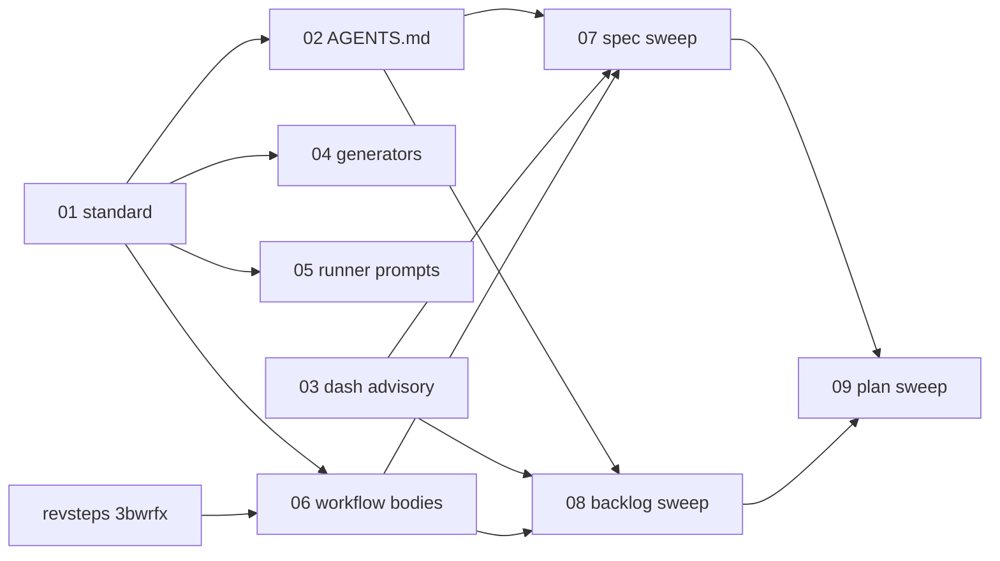

# IPD: Adopt the technical artifact writing standard (spec ecmw83)

- Date: 2026-10-25
- Kind: orchestrator
- Concern: Spec `ecmw83` (from backlog `qph7c5`) requires one shipped writing standard for specs, backlog items, and plans, including rules for entity and flow diagrams; every authoring and review surface must apply it, and every live artifact must be proofread against it once. None of this exists.
- Scope: Orchestration only: sequence the nine children below and confirm each reaches `executed`. No file, test, or record of its own.
- Scope-Paths: .aw/records/plans/pending/20261025-writestd-00-8fvkmp-adopt-the-technical-artifact-writing-standard-spec-ecmw83.ipd.md
- Item-Dependencies: none
- Status: to-review
- Coverage: pass
- Coverage-Fingerprint: 37d51202d269db14c22d4a12c2e6eec387d6ec096160170d40e43aa9f8a6d150
- Coverage-Checked: 2026-10-26 by uri/its_direct/pt3-claude-opus-5.5-1m-us
- Work-Kind: feature
- Priority: high
- From-Backlog: qph7c5
- From-Spec: ecmw83
- Set: writestd
- Order: 0
- Highest E allocated: 09
- Author: opencode its_direct/pt3-claude-opus-5.5-1m-us
- Id: 8fvkmp

## Workflow history
- 2026-10-26 to-review (aw set): authored review-ready: orchestrates spec ecmw83 across 9 children; coverage pass

- 2026-10-26 coverage pass (aw oc run): fingerprint 37d51202d269, model uri/its_direct/pt3-claude-opus-5.5-1m-us
- 2026-10-26 draft (opencode its_direct/pt3-claude-opus-5.5-1m-us): created.

## Goal

Deliver spec `ecmw83` as nine independently executable children: ship the standard, wire it into every authoring and review surface, add the dash advisory, then sweep live specs, backlog items, and plans.

## Detailed Implementation Checklist (TODO)

Execution-state rule: mark an `E-*` item complete only after performing the action. That mark is not validation. Right-sizing rule: each E-item must address one concern and be executable in one focused pass; split when an E-item names multiple distinct deliverables or independent test-surfaces. Accepted execution states: blocked, failed, pending, performed; terminal gate demands 'performed'.

### Task group 1: Children

- [ ] E-01 CONFIRM g4719s REACHED executed
  - Depends on: none
  - Expected outcome: `aw find plans g4719s` shows it under `executed/`.
  - Execution state: pending

- [ ] E-02 CONFIRM gzhw9c REACHED executed
  - Depends on: E-01
  - Expected outcome: `aw find plans gzhw9c` shows it under `executed/`.
  - Execution state: pending

- [ ] E-03 CONFIRM k2x0yl REACHED executed
  - Depends on: none
  - Expected outcome: `aw find plans k2x0yl` shows it under `executed/`.
  - Execution state: pending

- [ ] E-04 CONFIRM yz4jdm REACHED executed
  - Depends on: E-01
  - Expected outcome: `aw find plans yz4jdm` shows it under `executed/`.
  - Execution state: pending

- [ ] E-05 CONFIRM jhdti8 REACHED executed
  - Depends on: E-01
  - Expected outcome: `aw find plans jhdti8` shows it under `executed/`.
  - Execution state: pending

- [ ] E-06 CONFIRM e4n4p3 REACHED executed
  - Depends on: E-01
  - Expected outcome: `aw find plans e4n4p3` shows it under `executed/`.
  - Execution state: pending

- [ ] E-07 CONFIRM sfez3e REACHED executed
  - Depends on: E-01, E-02, E-03, E-06
  - Expected outcome: `aw find plans sfez3e` shows it under `executed/`.
  - Execution state: pending

- [ ] E-08 CONFIRM uog8nc REACHED executed
  - Depends on: E-01, E-02, E-03, E-06
  - Expected outcome: `aw find plans uog8nc` shows it under `executed/`.
  - Execution state: pending

- [ ] E-09 CONFIRM 381ml6 REACHED executed
  - Depends on: E-01, E-02, E-03, E-06, E-07, E-08
  - Expected outcome: `aw find plans 381ml6` shows it under `executed/`.
  - Execution state: pending

## Child IPDs, sequence, and dependencies

| Order | Id | File | What it does | Depends on |
|---|---|---|---|---|
| 01 | `g4719s` | `20261025-writestd-01-g4719s-ship-the-writing-standard-file-and-point-prompt-wcisgc-at-it.ipd.md` | Ships `.aw/system/workflows/standards/technical-artifact-writing.md` (requirements 1 to 12 and the proofreading procedure); `wcisgc` becomes a pointer (R-01 to R-04). | none |
| 02 | `gzhw9c` | `20261025-writestd-02-gzhw9c-add-the-writing-standard-paragraph-to-the-agents-md-managed.ipd.md` | Managed `AGENTS.md` paragraph; dash rule widened in the execution contract, P13, CONTRIBUTING, GEMINI, prose-style, intent-audit; DECISIONS entry (R-05). | `executed:g4719s` |
| 03 | `k2x0yl` | `20261025-writestd-03-k2x0yl-report-em-and-en-dashes-as-info-advisories-in-ipd-lint-specs.ipd.md` | Prose em/en dash `info` advisory: `IPD-C802`, `spec.prose-dash`, `backlog.prose-dash`; amends the IPD linting spec item 17 (R-07). | none |
| 04 | `yz4jdm` | `20261025-writestd-04-yz4jdm-point-the-spec-backlog-and-plan-generators-at-the-writing-st.ipd.md` | Pointer line in `aw ipd scaffold`, `aw specs new`, `aw backlog new` output and the `assess` IPD templates (R-06). | `executed:g4719s` |
| 05 | `jhdti8` | `20261025-writestd-05-jhdti8-point-the-runner-authoring-and-review-prompts-at-the-writing.ipd.md` | Requirement line in the runner's spec and backlog plan-production prompts (R-06). | `executed:g4719s` |
| 06 | `e4n4p3` | `20261025-writestd-06-e4n4p3-point-the-authoring-and-review-workflow-bodies-at-the-writin.ipd.md` | Workflow bodies: `spec`, `spec-review`, `plan-review` steps, `plan-review-long`, `ipd-lifecycle`, `spec-editor`; amends `k3yx72` N5 (R-06). | `executed:g4719s, executed:3bwrfx` |
| 07 | `sfez3e` | `20261025-writestd-07-sfez3e-sweep-live-specs-against-the-writing-standard.ipd.md` | One-time sweep of live specs (R-08, R-11). | `executed:g4719s, executed:gzhw9c, executed:k2x0yl, executed:e4n4p3` |
| 08 | `uog8nc` | `20261025-writestd-08-uog8nc-sweep-live-backlog-items-against-the-writing-standard.ipd.md` | One-time sweep of live backlog items, parked included (R-08, R-11). | `executed:g4719s, executed:gzhw9c, executed:k2x0yl, executed:e4n4p3` |
| 09 | `381ml6` | `20261025-writestd-09-381ml6-sweep-pending-and-reusable-plans-against-the-writing-standar.ipd.md` | One-time sweep of pending and reusable plans, frozen region untouched for reviewed and approved plans, live-run plans skipped (R-08 to R-11). | `executed:g4719s, executed:gzhw9c, executed:k2x0yl, executed:e4n4p3, executed:sfez3e, executed:uog8nc` |

Orders 01 and 03 have no prerequisite. Orders 02, 04, 05, and 06 need the standard from 01. Order 06 also needs `3bwrfx` (Set `revsteps`), which creates the `plan-review/steps/` files it edits. The sweeps (07, 08, 09) run after the wiring so the dash advisory can find defects and the amended specs are what gets proofread; 09 runs last so plans are checked against proofread specs.

## Completion criteria (the whole Set is done only when)

- The standard ships and installs, with requirements 1 to 12 and the proofreading procedure (AC-01, AC-02). Owner: `g4719s`.
- Every agent's managed `AGENTS.md` names the standard and the widened dash rule (AC-03). Owner: `gzhw9c`.
- Prose dashes are reported as `info` advisories with unchanged exit status (AC-05). Owner: `k2x0yl`.
- New specs, backlog items, and plans name the standard (AC-04). Owner: `yz4jdm`.
- Runner plan-production prompts name the standard. Owner: `jhdti8`.
- Authoring and review workflows apply the standard and requirement 12. Owner: `e4n4p3`.
- Live specs, backlog items, and plans are swept, with metadata, approvals, and review freshness unchanged (AC-06 to AC-08). Owners: `sfez3e`, `uog8nc`, `381ml6`.

## Cross-IPD validation

- The path every pointer names is the path Order 01 ships: `gzhw9c` V-04, `yz4jdm` V-04, and `e4n4p3` V-07 each assert the named path exists in an installed repository.
- The sweeps use the advisory Order 03 builds: `sfez3e` V-05 and `uog8nc` V-02 paste its output.
- No sweep stales a review: `381ml6` V-04 compares frozen-region digests.
- Post-merge revalidation is the runner's merge-and-revalidate gate on each child, not work of this plan.

## Deferred / out of scope (with reason)

- Other record types (research, prompts, walkthroughs, reviews): spec `ecmw83` N2.
  - Carrier-Declined: deliberate non-goal of the spec.

## Scope check

- Over-scope: none.
- Under-scope: none. Every requirement R-01 to R-11 of spec `ecmw83` has an owning child.

## Required tests / validation

This plan runs no tests. Each child runs its own; `381ml6` performs the last whole-Set check (`aw check all` against its baseline).

## Open questions

None.

## Validation and cross-check (verify before reporting the Set complete)

Validation-state rule: inspect evidence in a separate pass. Do not mark a `V-*` item complete from memory or from the matching execution checkmark. Accepted validation results: blocked, failed, pass, pending; terminal gate demands 'pass'. Runtime-demonstration reachability rule: for each `V-*` item demanding the software be observed acting (such as a run, a dispatch, or a transition), as distinct from items demanding a diff, a file's content, or a test result, which are reachable by construction, name the code path that produces the observation or the sibling `E-*` that creates it, else the demand is UNDER-SCOPE.

- [ ] V-01 validates E-01
  - Required evidence: paste the actual `aw find plans g4719s` output showing the plan under `executed/`.
  - Observed evidence:
  - Result: pending

- [ ] V-02 validates E-02
  - Required evidence: paste the actual `aw find plans gzhw9c` output showing the plan under `executed/`.
  - Observed evidence:
  - Result: pending

- [ ] V-03 validates E-03
  - Required evidence: paste the actual `aw find plans k2x0yl` output showing the plan under `executed/`.
  - Observed evidence:
  - Result: pending

- [ ] V-04 validates E-04
  - Required evidence: paste the actual `aw find plans yz4jdm` output showing the plan under `executed/`.
  - Observed evidence:
  - Result: pending

- [ ] V-05 validates E-05
  - Required evidence: paste the actual `aw find plans jhdti8` output showing the plan under `executed/`.
  - Observed evidence:
  - Result: pending

- [ ] V-06 validates E-06
  - Required evidence: paste the actual `aw find plans e4n4p3` output showing the plan under `executed/`.
  - Observed evidence:
  - Result: pending

- [ ] V-07 validates E-07
  - Required evidence: paste the actual `aw find plans sfez3e` output showing the plan under `executed/`.
  - Observed evidence:
  - Result: pending

- [ ] V-08 validates E-08
  - Required evidence: paste the actual `aw find plans uog8nc` output showing the plan under `executed/`.
  - Observed evidence:
  - Result: pending

- [ ] V-09 validates E-09
  - Required evidence: paste the actual `aw find plans 381ml6` output showing the plan under `executed/`.
  - Observed evidence:
  - Result: pending

## Approval and execution gate

- Size assessment: standard
- Cohesion rationale: not required

Execute only after explicit human approval (`Status: approved`) of this plan and of each child. This plan performs no work of its own; each child carries its own scope fence, test evidence, and path-scoped `aw commit`. Each `V-*` item MUST paste the actual `aw find plans <id6>` output. Under `aw oc run` / `aw agy run` the runner retires this plan once every child is `executed` on disk. When executing by hand, run the children in dependency order, then run `aw ipd lint --phase pre-transition` and `aw ipd finalize` on this plan. Commit only through `aw commit 8fvkmp -- <paths>`; never push.
