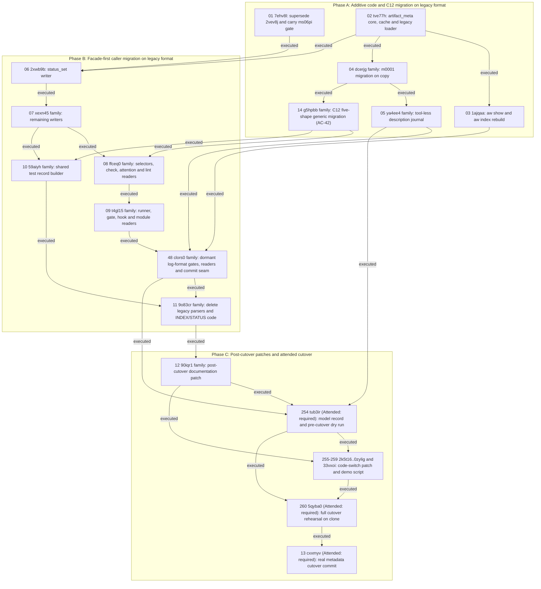

# IPD: Build the artifact metadata store of spec 4sd62s (orchestrator)

- Date: 2026-11-02
- Kind: orchestrator
- Concern: Spec `4sd62s` (artifact metadata store, approved 2026-11-02, amended 2026-11-07 for C12 generic prior-format migration, `Blocks-Release: next`) replaces hand-editable bullet metadata and `## Workflow history` sections with tracked per-artifact event logs, a SQLite read cache and one interface, `artifact_meta`, ending with a one-commit attended cutover (spec `4sd62s` section 7). Four early children (`7ehv8l`, `tve77h`, `1ajqaa`, `2xwb9b`) are `executed`; the remaining 208 children are `pending`.
- Scope: Orchestration only: sequence the 212 children below (14 top-level families and their split parts) in dependency order and confirm each reaches `executed`. No code, test or record work of its own.
- Scope-Paths: .aw/records/plans/pending/20261102-metastore-00-63ib9r-build-the-artifact-metadata-store-of-spec-4sd62s-orchestrato.ipd.md
- Item-Dependencies: none
- Status: approved
- Readiness: go-pending-approval
- From-Spec: 4sd62s
- Coverage: pass
- Coverage-Fingerprint: 3b14c951d8544c4903c75ae60ec2844251015d0b9dc5a6e269128b0b3ace116f
- Coverage-Checked: 2026-11-27 by host-default
- Work-Kind: feature
- Priority: high
- Blocks-Release: next
- Set: metastore
- Order: 0
- Highest E allocated: 233
- Author: opencode its_direct/pt3-claude-opus-5.5-1m-us
- Id: 63ib9r
- Approval: 2026-11-16, recorded via aw ipd set: status set to approved
- Review-Depth: orchestrator

> Write and proofread this plan per the technical writing standard, `.aw/system/workflows/technical-writing/technical-writing.md` (`.agents/workflows/technical-writing/technical-writing.md` in a legacy-layout install), including requirement 12 (diagrams).

## Workflow history
- 2026-11-27 coverage pass (aw agy run): fingerprint 3b14c951d854, model by host-default
- 2026-11-27 coverage pass (aw agy run): fingerprint 98f7d5fe4eae, model by host-default
- 2026-11-27 coverage pass (aw agy run): fingerprint 48a208fc592d, model by host-default
- 2026-11-27 note (antigravity/gemini): added Order 323 (ztvubn: status_set, selectors, and runner commit meta log fixes for 2zknl8, kj0neb, nwz9nd, tjfc7p) and Order 324 (639g02: check_engine log readers and dep-gate hook corrupt-log refusal for 0wilvu, ay07de, 1fmcdk, 197ak8) after executed cugg3w and ahead of psm9ac per run-20261127T195325Z-3081649 verified batch B blockers; updated psm9ac -> executed:639g02 and x1mmdp to include executed:ztvubn, executed:639g02.
- 2026-11-27 note (antigravity/gemini): per maintainer Option 2 decision on run-20261127T045218Z-1963184 question g-b366f2ff84656927 (proposal igbr4f), expanded Order 322 (6cltab) with backlog 3pxjya (status_set and check_engine bare-repo context fallbacks) and re-chained the cutover code-patch order to fljn9b -> szykgd -> otin36 -> p109wy -> q6fiws -> j1f454 -> lec341 -> 3e0vfy -> 6cltab -> cugg3w -> psm9ac -> x8id25 -> e0g2gt -> qi0kl6 -> x3mig6 -> x1mmdp.
- 2026-11-26 note (antigravity/gemini): split Order 321 (3e0vfy, make plan_readiness, status_set, artifact_refs, and artifact_adopt log-aware in the cutover code patch) ahead of x3mig6 per maintainer answer to run-20261126T055808Z-863961 question 06-x3mig6-a1-batch-f-production-log-aware-gaps; E-233 confirms 3e0vfy; E-225 (x3mig6) depends on E-233; E-179 (x1mmdp) and E-13 (cxxmyv) depend on E-233.
- 2026-11-26 note (antigravity/gemini): split Orders 319 (j1f454, make selectors status matching, typed-subject ownership, and artifact_rename to-id6 log-aware in the cutover code patch) and 320 (lec341, make research_cmd create, research_refs renames, and research_archive moves log-aware in the cutover code patch) ahead of qi0kl6 per maintainer answer to run-20261126T055808Z-863961 question 05-qi0kl6-a1-batch-e-production-log-aware-gaps; E-231 confirms j1f454; E-232 confirms lec341; E-224 (qi0kl6) depends on E-232; E-179 (x1mmdp) and E-13 (cxxmyv) depend on E-231 and E-232.
- 2026-11-26 note (antigravity/gemini): split Orders 317 (p109wy, make review mirrors, prompt metadata, and check_engine priority log-aware in the cutover code patch) and 318 (q6fiws, make coverage_record, readiness, runner, and review-sequence evaluators log-aware in the cutover code patch) ahead of e0g2gt per maintainer answer to run-20261126T055808Z-863961 question 04-e0g2gt-a1-batch-d-production-log-aware-gaps; E-229 confirms p109wy; E-230 confirms q6fiws; E-223 (e0g2gt) depends on E-230; E-179 (x1mmdp) and E-13 (cxxmyv) depend on E-229 and E-230.
- 2026-11-26 note (antigravity/gemini): split Order 316 (otin36, make ipd_lifecycle, partition, plans, untooled-range, hooks, and meta_repair log-aware in the cutover code patch) ahead of x8id25 per recovery of run-20261126T020242Z-3080634 parked x8id25 OQ-01 Option 1; E-228 confirms otin36; E-222 (x8id25), E-179 (x1mmdp), and E-13 (cxxmyv) depend on E-228.
- 2026-11-26 coverage pass (aw oc run): fingerprint c43b7eb71194, model uri/its_direct/pt3-claude-opus-5.5-1m-us
- 2026-11-26 note (antigravity/gemini): split Order 315 (szykgd, make specs, releases, spec-link, search, and dep-gate log-aware in the cutover code patch) ahead of psm9ac per maintainer answer to run-20261126T020242Z-3080634 question 05-psm9ac-a1-batch-b-production-log-aware-gaps; E-227 confirms szykgd; E-221 (psm9ac), E-179 (x1mmdp), and E-13 (cxxmyv) depend on E-227.
- 2026-11-26 note (antigravity/gemini): split Order 314 (fljn9b, make backlog validation and readers log-aware in the cutover code patch) ahead of cugg3w per maintainer answer to run-20261126T020242Z-3080634 question 04-cugg3w-a1-backlog-log-aware-gap; E-226 confirms fljn9b; E-220 (cugg3w), E-179 (x1mmdp), and E-13 (cxxmyv) depend on E-226.
- 2026-11-26 coverage pass (aw oc run): fingerprint 4e5bec5a7e81, model uri/its_direct/pt3-claude-opus-5.5-1m-us
- 2026-11-26 note (opencode its_direct/pt3-claude-opus-5.5-1m-us): split x1mmdp per the maintainer answer to run-20261125T162650Z-1337442 question 06-x1mmdp-a1-Q-01 ("Split into new children; fix jycxw8 first"): added Orders 305-313 (hdwqex, 89mtbl, nv3upa, cugg3w, psm9ac, x8id25, e0g2gt, qi0kl6, x3mig6) as a chain after g45vyv and before x1mmdp; E-217..E-225 confirm them; E-179 and E-13 depend on them.
- 2026-11-25 coverage pass (aw oc run): fingerprint 6106283b926c, model uri/its_direct/pt3-claude-opus-5.5-1m-us
- 2026-11-25 coverage pass (aw oc run): fingerprint 05de8ffbbfea, model uri/its_direct/pt3-claude-opus-5.5-1m-us
- 2026-11-16 approved (aw set): status set to approved
- 2026-11-13 reviewed (aw set): APPROVE WITH REVISIONS APPLIED; PR-004..PR-007 FIXED
- 2026-11-13 /plan-review (antigravity/gemini): APPROVE WITH REVISIONS APPLIED; PR-004..PR-007 FIXED; review record .aw/records/reviews/20261102-metastore-00-63ib9r-build-the-artifact-metadata-store-of-spec-4sd62s-orchestrato.review.md
- 2026-11-13 coverage pass (aw oc run): fingerprint 702f3b688c5b, model uri/its_direct/pt3-claude-opus-5.5-1m-us
- 2026-11-09 coverage pass (aw oc run): fingerprint a27fb86976ec, model uri/its_direct/pt3-claude-opus-5.5-1m-us
- 2026-11-09 note (opencode its_direct/pt3-claude-opus-5.5-1m-us): child table and checklist regenerated for the round-3 split (212 children; research nj8zdp followability guidance).
- 2026-11-08 coverage pass (aw oc run): fingerprint 5ee2b9b89d8c, model uri/its_direct/pt3-claude-opus-5.5-1m-us
- 2026-11-07 note (opencode its_direct/pt3-claude-opus-5.5-1m-us): child table and checklist regenerated for the step-complexity split (54 children; Orders 15-62 are split parts plus the 653ndz codemod; ordering by dependency edges).
- 2026-11-07 coverage pass (aw oc run): fingerprint 979ef50d956a, model uri/its_direct/pt3-claude-opus-5.5-1m-us
- 2026-11-07 to-review (aw set): demoted approved -> to-review: APPROVAL WITHDRAWN: maintainer direction 2026-11-07: paused before re-review; the metastore plans MUST build the tools that migrate ANY repo from ANY prior format (.agents layout, id-less/untitled records, no sidecar), not only this repository. Re-review against the amended spec 4sd62s before re-approval.
- 2026-11-07 approved (aw set): status set to approved
- 2026-11-06 reviewed (aw set): APPROVE WITH REVISIONS APPLIED; PR-001..PR-003 FIXED
- 2026-11-06 /plan-review (opencode/its_direct/pt3-claude-opus-5.5-1m-us): APPROVE WITH REVISIONS APPLIED; PR-001..PR-003 FIXED; review record .aw/records/reviews/20261102-metastore-00-63ib9r-build-the-artifact-metadata-store-of-spec-4sd62s-orchestrato.review.md
- 2026-11-06 coverage pass (aw oc run): fingerprint 96fe24cd857b, model uri/its_direct/pt3-claude-opus-5.5-1m-us
- 2026-11-05 to-review (aw set): authored review-ready: orchestrates spec 4sd62s across 13 children; coverage pass
- 2026-11-05 coverage pass (aw oc run): fingerprint b5e3d8673f4a, model uri/its_direct/pt3-claude-opus-5.5-1m-us
- 2026-11-05 coverage fail (aw oc run): fingerprint c66561f7c8ed, model uri/its_direct/pt3-claude-opus-5.5-1m-us
- 2026-11-02 draft (opencode its_direct/pt3-claude-opus-5.5-1m-us): created.

## Goal

Deliver spec `4sd62s` across 212 independently executable children (14 top-level families and their split parts) in the facade-first dependency order of spec `4sd62s` section 7, proving generic prior-format migration before cutover (`g5hpbb`) and ending with the attended pre-cutover dry run (`tub3ir`), clone rehearsal (`5qyba0`) and real cutover commit (`cxxmyv`).

## Detailed Implementation Checklist (TODO)

Execution-state rule: mark an `E-*` item complete only after performing the action. That mark is not validation. Right-sizing rule: each E-item must address one concern and be executable in one focused pass; split when an E-item names multiple distinct deliverables or independent test-surfaces. Accepted execution states: blocked, failed, pending, performed; terminal gate demands 'performed'.

### Task group 1: Children

- [ ] E-01 CONFIRM 7ehv8l REACHED executed
  - Depends on: none
  - Expected outcome: `aw find plans 7ehv8l` shows it under `executed/`.
  - Execution state: pending

- [ ] E-02 CONFIRM tve77h REACHED executed
  - Depends on: none
  - Expected outcome: `aw find plans tve77h` shows it under `executed/`.
  - Execution state: pending

- [ ] E-03 CONFIRM 1ajqaa REACHED executed
  - Depends on: E-02
  - Expected outcome: `aw find plans 1ajqaa` shows it under `executed/`.
  - Execution state: pending

- [ ] E-04 CONFIRM dcerjg REACHED executed
  - Depends on: E-02, E-15, E-16, E-17, E-18, E-19, E-55
  - Expected outcome: `aw find plans dcerjg` shows it under `executed/`.
  - Execution state: pending

- [ ] E-05 CONFIRM ya4ee4 REACHED executed
  - Depends on: E-04, E-20
  - Expected outcome: `aw find plans ya4ee4` shows it under `executed/`.
  - Execution state: pending

- [ ] E-06 CONFIRM 2xwb9b REACHED executed
  - Depends on: E-02, E-01
  - Expected outcome: `aw find plans 2xwb9b` shows it under `executed/`.
  - Execution state: pending

- [ ] E-07 CONFIRM xexn45 REACHED executed
  - Depends on: E-02, E-06, E-21, E-22, E-23, E-24, E-25, E-26, E-75
  - Expected outcome: `aw find plans xexn45` shows it under `executed/`.
  - Execution state: pending

- [ ] E-08 CONFIRM ffceq0 REACHED executed
  - Depends on: E-14, E-02, E-07, E-27, E-28, E-29, E-30, E-31, E-32, E-79
  - Expected outcome: `aw find plans ffceq0` shows it under `executed/`.
  - Execution state: pending

- [ ] E-09 CONFIRM t4gl15 REACHED executed
  - Depends on: E-36, E-80, E-08, E-14, E-33, E-35, E-02, E-07, E-34
  - Expected outcome: `aw find plans t4gl15` shows it under `executed/`.
  - Execution state: pending

- [ ] E-10 CONFIRM 59aiyh REACHED executed
  - Depends on: E-50, E-39, E-37, E-14, E-40, E-02, E-38, E-07, E-49, E-94, E-95, E-96, E-97, E-98, E-99, E-100, E-101, E-102, E-103, E-104, E-105, E-106, E-107, E-108, E-109, E-110, E-111, E-112, E-113, E-114, E-115, E-116, E-117, E-118, E-119, E-120, E-121, E-122, E-123, E-124, E-125, E-126, E-127, E-128, E-129, E-130, E-131, E-132, E-133, E-134, E-135, E-136, E-137, E-138, E-139, E-140, E-141
  - Expected outcome: `aw find plans 59aiyh` shows it under `executed/`.
  - Execution state: pending

- [ ] E-11 CONFIRM 9o83cr REACHED executed
  - Depends on: E-46, E-03, E-48, E-10, E-04, E-45, E-08, E-14, E-43, E-41, E-42, E-09, E-213, E-214, E-215, E-216
  - Expected outcome: `aw find plans 9o83cr` shows it under `executed/`.
  - Execution state: pending

- [ ] E-12 CONFIRM 90iqr1 REACHED executed
  - Depends on: E-11, E-172, E-173, E-174, E-175
  - Expected outcome: `aw find plans 90iqr1` shows it under `executed/`.
  - Execution state: pending

- [ ] E-14 CONFIRM g5hpbb REACHED executed
  - Depends on: E-04, E-57, E-58, E-59, E-60
  - Expected outcome: `aw find plans g5hpbb` shows it under `executed/`.
  - Execution state: pending

- [ ] E-13 CONFIRM cxxmyv REACHED executed
  - Depends on: E-03, E-51, E-12, E-53, E-48, E-04, E-14, E-44, E-52, E-47, E-05, E-54, E-176, E-177, E-178, E-179, E-180, E-181, E-182, E-213, E-214, E-215, E-216, E-217, E-218, E-219, E-220, E-221, E-222, E-223, E-224, E-225, E-226, E-227, E-228, E-229, E-230, E-231, E-232, E-233
  - Expected outcome: `aw find plans cxxmyv` shows it under `executed/`.
  - Execution state: pending

### Task group 2: split parts (added 2026-11-07)

- [ ] E-15 CONFIRM vxevph REACHED executed
  - Depends on: E-02, E-56
  - Expected outcome: `aw find plans vxevph` shows it under `executed/`.
  - Execution state: pending

- [ ] E-16 CONFIRM 1vfqdu REACHED executed
  - Depends on: E-02, E-15
  - Expected outcome: `aw find plans 1vfqdu` shows it under `executed/`.
  - Execution state: pending

- [ ] E-17 CONFIRM dky26u REACHED executed
  - Depends on: E-02, E-15
  - Expected outcome: `aw find plans dky26u` shows it under `executed/`.
  - Execution state: pending

- [ ] E-18 CONFIRM ghhzb6 REACHED executed
  - Depends on: E-02, E-15, E-17
  - Expected outcome: `aw find plans ghhzb6` shows it under `executed/`.
  - Execution state: pending

- [ ] E-19 CONFIRM hpedmn REACHED executed
  - Depends on: E-02, E-15, E-17, E-18
  - Expected outcome: `aw find plans hpedmn` shows it under `executed/`.
  - Execution state: pending

- [ ] E-20 CONFIRM odeo9z REACHED executed
  - Depends on: E-04, E-61
  - Expected outcome: `aw find plans odeo9z` shows it under `executed/`.
  - Execution state: pending

- [ ] E-21 CONFIRM 7yr827 REACHED executed
  - Depends on: E-02, E-06
  - Expected outcome: `aw find plans 7yr827` shows it under `executed/`.
  - Execution state: pending

- [ ] E-22 CONFIRM g6tw94 REACHED executed
  - Depends on: E-02, E-06, E-21, E-62, E-63, E-76
  - Expected outcome: `aw find plans g6tw94` shows it under `executed/`.
  - Execution state: pending

- [ ] E-23 CONFIRM n5sxxk REACHED executed
  - Depends on: E-02, E-06, E-21, E-22, E-64, E-65, E-77
  - Expected outcome: `aw find plans n5sxxk` shows it under `executed/`.
  - Execution state: pending

- [ ] E-24 CONFIRM 6e93gt REACHED executed
  - Depends on: E-02, E-06, E-21, E-22, E-23, E-66, E-67, E-68, E-78
  - Expected outcome: `aw find plans 6e93gt` shows it under `executed/`.
  - Execution state: pending

- [ ] E-25 CONFIRM bsl45u REACHED executed
  - Depends on: E-02, E-06, E-21, E-69, E-70, E-71
  - Expected outcome: `aw find plans bsl45u` shows it under `executed/`.
  - Execution state: pending

- [ ] E-26 CONFIRM 8q27jt REACHED executed
  - Depends on: E-02, E-06, E-21, E-72, E-73, E-74
  - Expected outcome: `aw find plans 8q27jt` shows it under `executed/`.
  - Execution state: pending

- [ ] E-27 CONFIRM r81uvz REACHED executed
  - Depends on: E-14, E-02, E-07, E-81
  - Expected outcome: `aw find plans r81uvz` shows it under `executed/`.
  - Execution state: pending

- [ ] E-28 CONFIRM dqutt8 REACHED executed
  - Depends on: E-14, E-02, E-07, E-27, E-29, E-30, E-31, E-32, E-90
  - Expected outcome: `aw find plans dqutt8` shows it under `executed/`.
  - Execution state: pending

- [ ] E-29 CONFIRM w1cs3p REACHED executed
  - Depends on: E-14, E-02, E-07
  - Expected outcome: `aw find plans w1cs3p` shows it under `executed/`.
  - Execution state: pending

- [ ] E-30 CONFIRM na188y REACHED executed
  - Depends on: E-14, E-02, E-07
  - Expected outcome: `aw find plans na188y` shows it under `executed/`.
  - Execution state: pending

- [ ] E-31 CONFIRM i3b5zu REACHED executed
  - Depends on: E-14, E-02, E-07
  - Expected outcome: `aw find plans i3b5zu` shows it under `executed/`.
  - Execution state: pending

- [ ] E-32 CONFIRM ebrc4t REACHED executed
  - Depends on: E-14, E-02, E-07, E-29, E-30, E-31, E-82, E-83
  - Expected outcome: `aw find plans ebrc4t` shows it under `executed/`.
  - Execution state: pending

- [ ] E-33 CONFIRM h58z9n REACHED executed
  - Depends on: E-08, E-14, E-02, E-07, E-84, E-85
  - Expected outcome: `aw find plans h58z9n` shows it under `executed/`.
  - Execution state: pending

- [ ] E-34 CONFIRM y97k46 REACHED executed
  - Depends on: E-08, E-14, E-33, E-02, E-07, E-86, E-91
  - Expected outcome: `aw find plans y97k46` shows it under `executed/`.
  - Execution state: pending

- [ ] E-35 CONFIRM jd7874 REACHED executed
  - Depends on: E-08, E-14, E-33, E-02, E-07, E-87, E-92
  - Expected outcome: `aw find plans jd7874` shows it under `executed/`.
  - Execution state: pending

- [ ] E-36 CONFIRM 2zpw22 REACHED executed
  - Depends on: E-08, E-14, E-33, E-02, E-07, E-88, E-89, E-93
  - Expected outcome: `aw find plans 2zpw22` shows it under `executed/`.
  - Execution state: pending

- [ ] E-37 CONFIRM 9rgn2w REACHED executed
  - Depends on: E-14, E-02, E-07, E-94, E-95, E-98, E-137, E-138, E-141
  - Expected outcome: `aw find plans 9rgn2w` shows it under `executed/`.
  - Execution state: pending

- [ ] E-38 CONFIRM x05v02 REACHED executed
  - Depends on: E-49, E-37, E-14, E-02, E-07, E-99, E-100, E-101, E-102, E-103, E-104, E-105
  - Expected outcome: `aw find plans x05v02` shows it under `executed/`.
  - Execution state: pending

- [ ] E-39 CONFIRM 7qxey9 REACHED executed
  - Depends on: E-49, E-37, E-14, E-02, E-07, E-106, E-107, E-108, E-109, E-110, E-111, E-112, E-113, E-114, E-115
  - Expected outcome: `aw find plans 7qxey9` shows it under `executed/`.
  - Execution state: pending

- [ ] E-40 CONFIRM nbfg7w REACHED executed
  - Depends on: E-49, E-37, E-14, E-02, E-07, E-116, E-117, E-118, E-119, E-120, E-121, E-122, E-123, E-124, E-125, E-126
  - Expected outcome: `aw find plans nbfg7w` shows it under `executed/`.
  - Execution state: pending

- [ ] E-41 CONFIRM q6epwc REACHED executed
  - Depends on: E-03, E-10, E-151, E-145, E-04, E-147, E-08, E-14, E-149, E-143, E-148, E-144, E-150, E-09, E-142, E-146
  - Expected outcome: `aw find plans q6epwc` shows it under `executed/`.
  - Execution state: pending

- [ ] E-42 CONFIRM snin8q REACHED executed
  - Depends on: E-03, E-158, E-152, E-10, E-154, E-04, E-157, E-153, E-08, E-14, E-159, E-41, E-156, E-09, E-155
  - Expected outcome: `aw find plans snin8q` shows it under `executed/`.
  - Execution state: pending

- [ ] E-43 CONFIRM k6jd6l REACHED executed
  - Depends on: E-03, E-10, E-202, E-193, E-196, E-206, E-199, E-207, E-200, E-204, E-203, E-205, E-04, E-08, E-14, E-194, E-209, E-208, E-211, E-201, E-09, E-195, E-210, E-198, E-212, E-197
  - Expected outcome: `aw find plans k6jd6l` shows it under `executed/`.
  - Execution state: pending

- [ ] E-44 CONFIRM iog3cw REACHED executed
  - Depends on: E-03, E-10, E-12, E-04, E-14, E-05, E-183, E-184
  - Expected outcome: `aw find plans iog3cw` shows it under `executed/`.
  - Execution state: pending

- [ ] E-45 CONFIRM e8420v REACHED executed
  - Depends on: E-03, E-10, E-160, E-161, E-163, E-04, E-08, E-14, E-162, E-43, E-164, E-165, E-09
  - Expected outcome: `aw find plans e8420v` shows it under `executed/`.
  - Execution state: pending

- [ ] E-46 CONFIRM 0xsx2n REACHED executed
  - Depends on: E-03, E-10, E-160, E-169, E-04, E-08, E-14, E-43, E-171, E-168, E-167, E-09, E-166, E-170
  - Expected outcome: `aw find plans 0xsx2n` shows it under `executed/`.
  - Execution state: pending

- [ ] E-47 CONFIRM w13bkp REACHED executed
  - Depends on: E-03, E-10, E-12, E-04, E-14, E-44, E-05, E-185, E-186, E-187
  - Expected outcome: `aw find plans w13bkp` shows it under `executed/`.
  - Execution state: pending

- [ ] E-48 CONFIRM clors0 REACHED executed
  - Depends on: E-03, E-04, E-08, E-14, E-09, E-07, E-05, E-188, E-189, E-190, E-191
  - Expected outcome: `aw find plans clors0` shows it under `executed/`.
  - Execution state: pending

- [ ] E-49 CONFIRM 653ndz REACHED executed
  - Depends on: E-37, E-14, E-02, E-07, E-96, E-97, E-140
  - Expected outcome: `aw find plans 653ndz` shows it under `executed/`.
  - Execution state: pending

- [ ] E-50 CONFIRM 1upea0 REACHED executed
  - Depends on: E-49, E-37, E-14, E-02, E-07, E-127, E-128, E-129, E-130, E-131, E-132, E-133
  - Expected outcome: `aw find plans 1upea0` shows it under `executed/`.
  - Execution state: pending

- [ ] E-51 CONFIRM 87rvs2 REACHED executed
  - Depends on: E-03, E-10, E-12, E-04, E-14, E-44, E-05
  - Expected outcome: `aw find plans 87rvs2` shows it under `executed/`.
  - Execution state: pending

- [ ] E-52 CONFIRM rdg0qv REACHED executed
  - Depends on: E-03, E-10, E-12, E-04, E-14, E-44, E-05, E-192
  - Expected outcome: `aw find plans rdg0qv` shows it under `executed/`.
  - Execution state: pending

- [ ] E-53 CONFIRM aqc3m6 REACHED executed
  - Depends on: E-03, E-10, E-12, E-04, E-14, E-44, E-05
  - Expected outcome: `aw find plans aqc3m6` shows it under `executed/`.
  - Execution state: pending

- [ ] E-54 CONFIRM zgyna1 REACHED executed
  - Depends on: E-03, E-10, E-12, E-04, E-14, E-44, E-05
  - Expected outcome: `aw find plans zgyna1` shows it under `executed/`.
  - Execution state: pending

### Task group 3: round-3 split parts (added 2026-11-09)

- [ ] E-55 CONFIRM o19353 REACHED executed
  - Depends on: E-02, E-15, E-16, E-17, E-18, E-19
  - Expected outcome: `aw find plans o19353` shows it under `executed/`.
  - Execution state: pending

- [ ] E-56 CONFIRM g8na48 REACHED executed
  - Depends on: E-02
  - Expected outcome: `aw find plans g8na48` shows it under `executed/`.
  - Execution state: pending

- [ ] E-57 CONFIRM 9vf2iv REACHED executed
  - Depends on: E-04
  - Expected outcome: `aw find plans 9vf2iv` shows it under `executed/`.
  - Execution state: pending

- [ ] E-58 CONFIRM 6oi2nu REACHED executed
  - Depends on: E-04, E-57
  - Expected outcome: `aw find plans 6oi2nu` shows it under `executed/`.
  - Execution state: pending

- [ ] E-59 CONFIRM 3g20ms REACHED executed
  - Depends on: E-04, E-57, E-58
  - Expected outcome: `aw find plans 3g20ms` shows it under `executed/`.
  - Execution state: pending

- [ ] E-60 CONFIRM bv4kkj REACHED executed
  - Depends on: E-04, E-57, E-59
  - Expected outcome: `aw find plans bv4kkj` shows it under `executed/`.
  - Execution state: pending

- [ ] E-61 CONFIRM 830wku REACHED executed
  - Depends on: E-04
  - Expected outcome: `aw find plans 830wku` shows it under `executed/`.
  - Execution state: pending

- [ ] E-62 CONFIRM b3l7y6 REACHED executed
  - Depends on: E-02, E-06, E-21
  - Expected outcome: `aw find plans b3l7y6` shows it under `executed/`.
  - Execution state: pending

- [ ] E-63 CONFIRM jlwedt REACHED executed
  - Depends on: E-02, E-06, E-21
  - Expected outcome: `aw find plans jlwedt` shows it under `executed/`.
  - Execution state: pending

- [ ] E-64 CONFIRM s95hj6 REACHED executed
  - Depends on: E-02, E-06, E-21, E-22
  - Expected outcome: `aw find plans s95hj6` shows it under `executed/`.
  - Execution state: pending

- [ ] E-65 CONFIRM ernmom REACHED executed
  - Depends on: E-02, E-06, E-21, E-22
  - Expected outcome: `aw find plans ernmom` shows it under `executed/`.
  - Execution state: pending

- [ ] E-66 CONFIRM fekdwv REACHED executed
  - Depends on: E-02, E-06, E-21, E-22, E-23
  - Expected outcome: `aw find plans fekdwv` shows it under `executed/`.
  - Execution state: pending

- [ ] E-67 CONFIRM bir7xm REACHED executed
  - Depends on: E-02, E-06, E-21, E-22, E-23, E-66
  - Expected outcome: `aw find plans bir7xm` shows it under `executed/`.
  - Execution state: pending

- [ ] E-68 CONFIRM py2vu9 REACHED executed
  - Depends on: E-02, E-06, E-21, E-22, E-23, E-66
  - Expected outcome: `aw find plans py2vu9` shows it under `executed/`.
  - Execution state: pending

- [ ] E-69 CONFIRM 1hfmpb REACHED executed
  - Depends on: E-02, E-06, E-21
  - Expected outcome: `aw find plans 1hfmpb` shows it under `executed/`.
  - Execution state: pending

- [ ] E-70 CONFIRM fnu6kw REACHED executed
  - Depends on: E-02, E-06, E-21, E-69
  - Expected outcome: `aw find plans fnu6kw` shows it under `executed/`.
  - Execution state: pending

- [ ] E-71 CONFIRM 9gy5jk REACHED executed
  - Depends on: E-02, E-06, E-21, E-70
  - Expected outcome: `aw find plans 9gy5jk` shows it under `executed/`.
  - Execution state: pending

- [ ] E-72 CONFIRM d4w53g REACHED executed
  - Depends on: E-02, E-06, E-21
  - Expected outcome: `aw find plans d4w53g` shows it under `executed/`.
  - Execution state: pending

- [ ] E-73 CONFIRM 9qhtrc REACHED executed
  - Depends on: E-02, E-06, E-21
  - Expected outcome: `aw find plans 9qhtrc` shows it under `executed/`.
  - Execution state: pending

- [ ] E-74 CONFIRM 1dvb08 REACHED executed
  - Depends on: E-02, E-06, E-21, E-73
  - Expected outcome: `aw find plans 1dvb08` shows it under `executed/`.
  - Execution state: pending

- [ ] E-75 CONFIRM b4y4ee REACHED executed
  - Depends on: E-02, E-06, E-21, E-22, E-23, E-24, E-25, E-26
  - Expected outcome: `aw find plans b4y4ee` shows it under `executed/`.
  - Execution state: pending

- [ ] E-76 CONFIRM 3466h8 REACHED executed
  - Depends on: E-02, E-06, E-21
  - Expected outcome: `aw find plans 3466h8` shows it under `executed/`.
  - Execution state: pending

- [ ] E-77 CONFIRM x2dxvf REACHED executed
  - Depends on: E-02, E-06, E-21, E-22, E-63
  - Expected outcome: `aw find plans x2dxvf` shows it under `executed/`.
  - Execution state: pending

- [ ] E-78 CONFIRM h06gs7 REACHED executed
  - Depends on: E-02, E-06, E-21, E-22, E-23, E-66, E-68
  - Expected outcome: `aw find plans h06gs7` shows it under `executed/`.
  - Execution state: pending

- [ ] E-79 CONFIRM a5ijjx REACHED executed
  - Depends on: E-14, E-02, E-07, E-27, E-28, E-29, E-30, E-31, E-32
  - Expected outcome: `aw find plans a5ijjx` shows it under `executed/`.
  - Execution state: pending

- [ ] E-80 CONFIRM jq82as REACHED executed
  - Depends on: E-36, E-08, E-14, E-33, E-35, E-02, E-07, E-34
  - Expected outcome: `aw find plans jq82as` shows it under `executed/`.
  - Execution state: pending

- [ ] E-81 CONFIRM cdglt1 REACHED executed
  - Depends on: E-14, E-02, E-07
  - Expected outcome: `aw find plans cdglt1` shows it under `executed/`.
  - Execution state: pending

- [ ] E-82 CONFIRM dbq57g REACHED executed
  - Depends on: E-14, E-02, E-07, E-29, E-30, E-31
  - Expected outcome: `aw find plans dbq57g` shows it under `executed/`.
  - Execution state: pending

- [ ] E-83 CONFIRM i16on1 REACHED executed
  - Depends on: E-14, E-02, E-07, E-29, E-30, E-31, E-82
  - Expected outcome: `aw find plans i16on1` shows it under `executed/`.
  - Execution state: pending

- [ ] E-84 CONFIRM snh19k REACHED executed
  - Depends on: E-08, E-14, E-02, E-07
  - Expected outcome: `aw find plans snh19k` shows it under `executed/`.
  - Execution state: pending

- [ ] E-85 CONFIRM iqhzse REACHED executed
  - Depends on: E-08, E-14, E-02, E-07, E-84
  - Expected outcome: `aw find plans iqhzse` shows it under `executed/`.
  - Execution state: pending

- [ ] E-86 CONFIRM k86yq7 REACHED executed
  - Depends on: E-08, E-14, E-33, E-02, E-07
  - Expected outcome: `aw find plans k86yq7` shows it under `executed/`.
  - Execution state: pending

- [ ] E-87 CONFIRM kyl3m4 REACHED executed
  - Depends on: E-08, E-14, E-33, E-02, E-07
  - Expected outcome: `aw find plans kyl3m4` shows it under `executed/`.
  - Execution state: pending

- [ ] E-88 CONFIRM y4spqy REACHED executed
  - Depends on: E-08, E-14, E-33, E-02, E-07
  - Expected outcome: `aw find plans y4spqy` shows it under `executed/`.
  - Execution state: pending

- [ ] E-89 CONFIRM 0i0zsg REACHED executed
  - Depends on: E-08, E-14, E-33, E-02, E-07, E-88
  - Expected outcome: `aw find plans 0i0zsg` shows it under `executed/`.
  - Execution state: pending

- [ ] E-90 CONFIRM 1suzlp REACHED executed
  - Depends on: E-14, E-02, E-07, E-27, E-29, E-30, E-31, E-32
  - Expected outcome: `aw find plans 1suzlp` shows it under `executed/`.
  - Execution state: pending

- [ ] E-91 CONFIRM k3hb06 REACHED executed
  - Depends on: E-08, E-14, E-33, E-02, E-07, E-86
  - Expected outcome: `aw find plans k3hb06` shows it under `executed/`.
  - Execution state: pending

- [ ] E-92 CONFIRM cb5eda REACHED executed
  - Depends on: E-08, E-14, E-33, E-02, E-07, E-87
  - Expected outcome: `aw find plans cb5eda` shows it under `executed/`.
  - Execution state: pending

- [ ] E-93 CONFIRM awmsyq REACHED executed
  - Depends on: E-08, E-14, E-33, E-02, E-07, E-89
  - Expected outcome: `aw find plans awmsyq` shows it under `executed/`.
  - Execution state: pending

- [ ] E-94 CONFIRM j6o96i REACHED executed
  - Depends on: E-14, E-02, E-07
  - Expected outcome: `aw find plans j6o96i` shows it under `executed/`.
  - Execution state: pending

- [ ] E-95 CONFIRM ijpay0 REACHED executed
  - Depends on: E-14, E-02, E-07, E-94
  - Expected outcome: `aw find plans ijpay0` shows it under `executed/`.
  - Execution state: pending

- [ ] E-96 CONFIRM y3uowx REACHED executed
  - Depends on: E-37, E-14, E-02, E-07
  - Expected outcome: `aw find plans y3uowx` shows it under `executed/`.
  - Execution state: pending

- [ ] E-97 CONFIRM j2xjtt REACHED executed
  - Depends on: E-37, E-14, E-02, E-07, E-96
  - Expected outcome: `aw find plans j2xjtt` shows it under `executed/`.
  - Execution state: pending

- [ ] E-98 CONFIRM 7fpc8v REACHED executed
  - Depends on: E-14, E-02, E-07, E-94
  - Expected outcome: `aw find plans 7fpc8v` shows it under `executed/`.
  - Execution state: pending

- [ ] E-99 CONFIRM id2pdx REACHED executed
  - Depends on: E-49, E-37, E-14, E-02, E-07
  - Expected outcome: `aw find plans id2pdx` shows it under `executed/`.
  - Execution state: pending

- [ ] E-100 CONFIRM 2fn0vd REACHED executed
  - Depends on: E-49, E-37, E-14, E-02, E-07
  - Expected outcome: `aw find plans 2fn0vd` shows it under `executed/`.
  - Execution state: pending

- [ ] E-101 CONFIRM isj48z REACHED executed
  - Depends on: E-49, E-37, E-14, E-02, E-07
  - Expected outcome: `aw find plans isj48z` shows it under `executed/`.
  - Execution state: pending

- [ ] E-102 CONFIRM dg43sc REACHED executed
  - Depends on: E-49, E-37, E-14, E-02, E-07
  - Expected outcome: `aw find plans dg43sc` shows it under `executed/`.
  - Execution state: pending

- [ ] E-103 CONFIRM wirc2e REACHED executed
  - Depends on: E-49, E-37, E-14, E-02, E-07
  - Expected outcome: `aw find plans wirc2e` shows it under `executed/`.
  - Execution state: pending

- [ ] E-104 CONFIRM 872zd9 REACHED executed
  - Depends on: E-49, E-37, E-14, E-02, E-07
  - Expected outcome: `aw find plans 872zd9` shows it under `executed/`.
  - Execution state: pending

- [ ] E-105 CONFIRM zl2pki REACHED executed
  - Depends on: E-49, E-37, E-14, E-02, E-07
  - Expected outcome: `aw find plans zl2pki` shows it under `executed/`.
  - Execution state: pending

- [ ] E-106 CONFIRM jutivt REACHED executed
  - Depends on: E-49, E-37, E-14, E-02, E-07
  - Expected outcome: `aw find plans jutivt` shows it under `executed/`.
  - Execution state: pending

- [ ] E-107 CONFIRM 52rpc1 REACHED executed
  - Depends on: E-49, E-37, E-14, E-02, E-07
  - Expected outcome: `aw find plans 52rpc1` shows it under `executed/`.
  - Execution state: pending

- [ ] E-108 CONFIRM 2zo3g5 REACHED executed
  - Depends on: E-49, E-37, E-14, E-02, E-07
  - Expected outcome: `aw find plans 2zo3g5` shows it under `executed/`.
  - Execution state: pending

- [ ] E-109 CONFIRM qqaqw8 REACHED executed
  - Depends on: E-49, E-37, E-14, E-02, E-07
  - Expected outcome: `aw find plans qqaqw8` shows it under `executed/`.
  - Execution state: pending

- [ ] E-110 CONFIRM xxiou0 REACHED executed
  - Depends on: E-49, E-37, E-14, E-02, E-07
  - Expected outcome: `aw find plans xxiou0` shows it under `executed/`.
  - Execution state: pending

- [ ] E-111 CONFIRM 3k142n REACHED executed
  - Depends on: E-49, E-37, E-14, E-02, E-07
  - Expected outcome: `aw find plans 3k142n` shows it under `executed/`.
  - Execution state: pending

- [ ] E-112 CONFIRM 2etvye REACHED executed
  - Depends on: E-49, E-37, E-14, E-02, E-07
  - Expected outcome: `aw find plans 2etvye` shows it under `executed/`.
  - Execution state: pending

- [ ] E-113 CONFIRM 80p88l REACHED executed
  - Depends on: E-49, E-37, E-14, E-02, E-07
  - Expected outcome: `aw find plans 80p88l` shows it under `executed/`.
  - Execution state: pending

- [ ] E-114 CONFIRM qb3n9s REACHED executed
  - Depends on: E-49, E-37, E-14, E-02, E-07
  - Expected outcome: `aw find plans qb3n9s` shows it under `executed/`.
  - Execution state: pending

- [ ] E-115 CONFIRM 723ct1 REACHED executed
  - Depends on: E-49, E-37, E-14, E-02, E-07
  - Expected outcome: `aw find plans 723ct1` shows it under `executed/`.
  - Execution state: pending

- [ ] E-116 CONFIRM i29bd5 REACHED executed
  - Depends on: E-49, E-37, E-14, E-02, E-07
  - Expected outcome: `aw find plans i29bd5` shows it under `executed/`.
  - Execution state: pending

- [ ] E-117 CONFIRM v1t2ai REACHED executed
  - Depends on: E-49, E-37, E-14, E-02, E-07
  - Expected outcome: `aw find plans v1t2ai` shows it under `executed/`.
  - Execution state: pending

- [ ] E-118 CONFIRM hp6ydi REACHED executed
  - Depends on: E-49, E-37, E-14, E-02, E-07
  - Expected outcome: `aw find plans hp6ydi` shows it under `executed/`.
  - Execution state: pending

- [ ] E-119 CONFIRM lf0fe4 REACHED executed
  - Depends on: E-49, E-37, E-14, E-02, E-07
  - Expected outcome: `aw find plans lf0fe4` shows it under `executed/`.
  - Execution state: pending

- [ ] E-120 CONFIRM jjvnhb REACHED executed
  - Depends on: E-49, E-37, E-14, E-02, E-07
  - Expected outcome: `aw find plans jjvnhb` shows it under `executed/`.
  - Execution state: pending

- [ ] E-121 CONFIRM f8jntm REACHED executed
  - Depends on: E-49, E-37, E-14, E-02, E-07
  - Expected outcome: `aw find plans f8jntm` shows it under `executed/`.
  - Execution state: pending

- [ ] E-122 CONFIRM a1b70x REACHED executed
  - Depends on: E-49, E-37, E-14, E-02, E-07
  - Expected outcome: `aw find plans a1b70x` shows it under `executed/`.
  - Execution state: pending

- [ ] E-123 CONFIRM j5mwpk REACHED executed
  - Depends on: E-49, E-37, E-14, E-02, E-07
  - Expected outcome: `aw find plans j5mwpk` shows it under `executed/`.
  - Execution state: pending

- [ ] E-124 CONFIRM abf6yk REACHED executed
  - Depends on: E-49, E-37, E-14, E-02, E-07
  - Expected outcome: `aw find plans abf6yk` shows it under `executed/`.
  - Execution state: pending

- [ ] E-125 CONFIRM qjxcgf REACHED executed
  - Depends on: E-49, E-37, E-14, E-02, E-07
  - Expected outcome: `aw find plans qjxcgf` shows it under `executed/`.
  - Execution state: pending

- [ ] E-126 CONFIRM 0punmn REACHED executed
  - Depends on: E-49, E-37, E-14, E-02, E-07
  - Expected outcome: `aw find plans 0punmn` shows it under `executed/`.
  - Execution state: pending

- [ ] E-127 CONFIRM 2ll84l REACHED executed
  - Depends on: E-49, E-37, E-14, E-02, E-07
  - Expected outcome: `aw find plans 2ll84l` shows it under `executed/`.
  - Execution state: pending

- [ ] E-128 CONFIRM 9hk3rh REACHED executed
  - Depends on: E-49, E-37, E-14, E-02, E-07
  - Expected outcome: `aw find plans 9hk3rh` shows it under `executed/`.
  - Execution state: pending

- [ ] E-129 CONFIRM 5mg9g1 REACHED executed
  - Depends on: E-49, E-37, E-14, E-02, E-07
  - Expected outcome: `aw find plans 5mg9g1` shows it under `executed/`.
  - Execution state: pending

- [ ] E-130 CONFIRM 1cgrgp REACHED executed
  - Depends on: E-49, E-37, E-14, E-02, E-07
  - Expected outcome: `aw find plans 1cgrgp` shows it under `executed/`.
  - Execution state: pending

- [ ] E-131 CONFIRM z8hu7r REACHED executed
  - Depends on: E-49, E-37, E-14, E-02, E-07
  - Expected outcome: `aw find plans z8hu7r` shows it under `executed/`.
  - Execution state: pending

- [ ] E-132 CONFIRM tsonlq REACHED executed
  - Depends on: E-49, E-37, E-14, E-02, E-07
  - Expected outcome: `aw find plans tsonlq` shows it under `executed/`.
  - Execution state: pending

- [ ] E-133 CONFIRM erulw3 REACHED executed
  - Depends on: E-49, E-37, E-14, E-02, E-07
  - Expected outcome: `aw find plans erulw3` shows it under `executed/`.
  - Execution state: pending

- [ ] E-134 CONFIRM vaqtii REACHED executed
  - Depends on: E-50, E-39, E-37, E-14, E-40, E-02, E-38, E-07, E-49
  - Expected outcome: `aw find plans vaqtii` shows it under `executed/`.
  - Execution state: pending

- [ ] E-135 CONFIRM 30zur4 REACHED executed
  - Depends on: E-50, E-39, E-37, E-14, E-40, E-02, E-38, E-07, E-49
  - Expected outcome: `aw find plans 30zur4` shows it under `executed/`.
  - Execution state: pending

- [ ] E-136 CONFIRM 9jmt3w REACHED executed
  - Depends on: E-50, E-39, E-37, E-14, E-40, E-02, E-38, E-07, E-49
  - Expected outcome: `aw find plans 9jmt3w` shows it under `executed/`.
  - Execution state: pending

- [ ] E-137 CONFIRM z4x192 REACHED executed
  - Depends on: E-14, E-02, E-07, E-94, E-98
  - Expected outcome: `aw find plans z4x192` shows it under `executed/`.
  - Execution state: pending

- [ ] E-138 CONFIRM 9zcuyh REACHED executed
  - Depends on: E-14, E-02, E-07, E-94, E-98, E-137
  - Expected outcome: `aw find plans 9zcuyh` shows it under `executed/`.
  - Execution state: pending

- [ ] E-139 CONFIRM 1bshrb REACHED executed
  - Depends on: E-50, E-39, E-37, E-14, E-40, E-02, E-38, E-07, E-49, E-94
  - Expected outcome: `aw find plans 1bshrb` shows it under `executed/`.
  - Execution state: pending

- [ ] E-140 CONFIRM n0li9v REACHED executed
  - Depends on: E-37, E-14, E-02, E-07, E-97
  - Expected outcome: `aw find plans n0li9v` shows it under `executed/`.
  - Execution state: pending

- [ ] E-141 CONFIRM b3eilr REACHED executed
  - Depends on: E-14, E-02, E-07, E-94
  - Expected outcome: `aw find plans b3eilr` shows it under `executed/`.
  - Execution state: pending

- [ ] E-142 CONFIRM tqknnc REACHED executed
  - Depends on: E-03, E-10, E-04, E-08, E-14, E-150, E-09
  - Expected outcome: `aw find plans tqknnc` shows it under `executed/`.
  - Execution state: pending

- [ ] E-143 CONFIRM lywgzs REACHED executed
  - Depends on: E-03, E-10, E-04, E-08, E-14, E-150, E-09, E-142
  - Expected outcome: `aw find plans lywgzs` shows it under `executed/`.
  - Execution state: pending

- [ ] E-144 CONFIRM mv0j4k REACHED executed
  - Depends on: E-03, E-10, E-04, E-08, E-14, E-150, E-09, E-142
  - Expected outcome: `aw find plans mv0j4k` shows it under `executed/`.
  - Execution state: pending

- [ ] E-145 CONFIRM 9eqgcl REACHED executed
  - Depends on: E-03, E-10, E-04, E-08, E-14, E-143, E-144, E-150, E-09, E-142
  - Expected outcome: `aw find plans 9eqgcl` shows it under `executed/`.
  - Execution state: pending

- [ ] E-146 CONFIRM w819as REACHED executed
  - Depends on: E-03, E-10, E-04, E-08, E-14, E-150, E-09, E-142
  - Expected outcome: `aw find plans w819as` shows it under `executed/`.
  - Execution state: pending

- [ ] E-147 CONFIRM f1yjlx REACHED executed
  - Depends on: E-03, E-10, E-151, E-04, E-08, E-14, E-150, E-09, E-142
  - Expected outcome: `aw find plans f1yjlx` shows it under `executed/`.
  - Execution state: pending

- [ ] E-148 CONFIRM m8dblq REACHED executed
  - Depends on: E-03, E-10, E-04, E-08, E-14, E-150, E-09, E-142
  - Expected outcome: `aw find plans m8dblq` shows it under `executed/`.
  - Execution state: pending

- [ ] E-149 CONFIRM kkftwj REACHED executed
  - Depends on: E-03, E-10, E-151, E-04, E-08, E-14, E-150, E-09, E-142
  - Expected outcome: `aw find plans kkftwj` shows it under `executed/`.
  - Execution state: pending

- [ ] E-150 CONFIRM sdzcur REACHED executed
  - Depends on: E-03, E-10, E-04, E-08, E-14, E-09
  - Expected outcome: `aw find plans sdzcur` shows it under `executed/`.
  - Execution state: pending

- [ ] E-151 CONFIRM 6qh68x REACHED executed
  - Depends on: E-03, E-10, E-04, E-08, E-14, E-150, E-09, E-142, E-146
  - Expected outcome: `aw find plans 6qh68x` shows it under `executed/`.
  - Execution state: pending

- [ ] E-152 CONFIRM 54a80m REACHED executed
  - Depends on: E-03, E-10, E-04, E-08, E-14, E-41, E-09
  - Expected outcome: `aw find plans 54a80m` shows it under `executed/`.
  - Execution state: pending

- [ ] E-153 CONFIRM f6y2yy REACHED executed
  - Depends on: E-03, E-152, E-10, E-04, E-08, E-14, E-41, E-09
  - Expected outcome: `aw find plans f6y2yy` shows it under `executed/`.
  - Execution state: pending

- [ ] E-154 CONFIRM 6966zq REACHED executed
  - Depends on: E-03, E-152, E-10, E-04, E-08, E-14, E-41, E-09
  - Expected outcome: `aw find plans 6966zq` shows it under `executed/`.
  - Execution state: pending

- [ ] E-155 CONFIRM uopi8z REACHED executed
  - Depends on: E-03, E-152, E-10, E-154, E-04, E-153, E-08, E-14, E-41, E-09
  - Expected outcome: `aw find plans uopi8z` shows it under `executed/`.
  - Execution state: pending

- [ ] E-156 CONFIRM s6k01k REACHED executed
  - Depends on: E-03, E-152, E-10, E-154, E-04, E-153, E-08, E-14, E-41, E-09, E-155
  - Expected outcome: `aw find plans s6k01k` shows it under `executed/`.
  - Execution state: pending

- [ ] E-157 CONFIRM drav0u REACHED executed
  - Depends on: E-03, E-152, E-10, E-154, E-04, E-153, E-08, E-14, E-41, E-09
  - Expected outcome: `aw find plans drav0u` shows it under `executed/`.
  - Execution state: pending

- [ ] E-158 CONFIRM 3v2ew2 REACHED executed
  - Depends on: E-03, E-152, E-10, E-04, E-08, E-14, E-41, E-09
  - Expected outcome: `aw find plans 3v2ew2` shows it under `executed/`.
  - Execution state: pending

- [ ] E-159 CONFIRM h3jp4e REACHED executed
  - Depends on: E-03, E-152, E-10, E-04, E-08, E-14, E-41, E-09
  - Expected outcome: `aw find plans h3jp4e` shows it under `executed/`.
  - Execution state: pending

- [ ] E-160 CONFIRM 786w7r REACHED executed
  - Depends on: E-03, E-10, E-04, E-08, E-14, E-43, E-09
  - Expected outcome: `aw find plans 786w7r` shows it under `executed/`.
  - Execution state: pending

- [ ] E-161 CONFIRM 7uq6xg REACHED executed
  - Depends on: E-03, E-10, E-160, E-04, E-08, E-14, E-43, E-09
  - Expected outcome: `aw find plans 7uq6xg` shows it under `executed/`.
  - Execution state: pending

- [ ] E-162 CONFIRM js35bz REACHED executed
  - Depends on: E-03, E-10, E-160, E-161, E-04, E-08, E-14, E-43, E-09
  - Expected outcome: `aw find plans js35bz` shows it under `executed/`.
  - Execution state: pending

- [ ] E-163 CONFIRM bcrko1 REACHED executed
  - Depends on: E-03, E-10, E-160, E-04, E-08, E-14, E-162, E-43, E-09
  - Expected outcome: `aw find plans bcrko1` shows it under `executed/`.
  - Execution state: pending

- [ ] E-164 CONFIRM k6nukd REACHED executed
  - Depends on: E-03, E-10, E-160, E-161, E-04, E-08, E-14, E-43, E-09
  - Expected outcome: `aw find plans k6nukd` shows it under `executed/`.
  - Execution state: pending

- [ ] E-165 CONFIRM kmf6w4 REACHED executed
  - Depends on: E-03, E-10, E-160, E-161, E-04, E-08, E-14, E-43, E-09
  - Expected outcome: `aw find plans kmf6w4` shows it under `executed/`.
  - Execution state: pending

- [ ] E-166 CONFIRM tbvx4r REACHED executed
  - Depends on: E-03, E-10, E-160, E-04, E-08, E-14, E-43, E-09
  - Expected outcome: `aw find plans tbvx4r` shows it under `executed/`.
  - Execution state: pending

- [ ] E-167 CONFIRM qttoyc REACHED executed
  - Depends on: E-03, E-10, E-160, E-04, E-08, E-14, E-43, E-09, E-166
  - Expected outcome: `aw find plans qttoyc` shows it under `executed/`.
  - Execution state: pending

- [ ] E-168 CONFIRM nx7fws REACHED executed
  - Depends on: E-03, E-10, E-160, E-04, E-08, E-14, E-43, E-09
  - Expected outcome: `aw find plans nx7fws` shows it under `executed/`.
  - Execution state: pending

- [ ] E-169 CONFIRM akhrp5 REACHED executed
  - Depends on: E-03, E-10, E-160, E-04, E-08, E-14, E-43, E-168, E-09
  - Expected outcome: `aw find plans akhrp5` shows it under `executed/`.
  - Execution state: pending

- [ ] E-170 CONFIRM tdhav3 REACHED executed
  - Depends on: E-03, E-10, E-160, E-04, E-08, E-14, E-43, E-09
  - Expected outcome: `aw find plans tdhav3` shows it under `executed/`.
  - Execution state: pending

- [ ] E-171 CONFIRM n2cvf0 REACHED executed
  - Depends on: E-03, E-10, E-160, E-04, E-08, E-14, E-43, E-09
  - Expected outcome: `aw find plans n2cvf0` shows it under `executed/`.
  - Execution state: pending

- [ ] E-172 CONFIRM qhay6a REACHED executed
  - Depends on: E-11
  - Expected outcome: `aw find plans qhay6a` shows it under `executed/`.
  - Execution state: pending

- [ ] E-173 CONFIRM a49djh REACHED executed
  - Depends on: E-11, E-172
  - Expected outcome: `aw find plans a49djh` shows it under `executed/`.
  - Execution state: pending

- [ ] E-174 CONFIRM y1zihp REACHED executed
  - Depends on: E-11, E-173
  - Expected outcome: `aw find plans y1zihp` shows it under `executed/`.
  - Execution state: pending

- [ ] E-175 CONFIRM ngc2a2 REACHED executed
  - Depends on: E-11, E-174
  - Expected outcome: `aw find plans ngc2a2` shows it under `executed/`.
  - Execution state: pending

- [ ] E-176 CONFIRM tub3ir REACHED executed
  - Depends on: E-03, E-51, E-12, E-53, E-48, E-04, E-14, E-44, E-52, E-47, E-05, E-54
  - Expected outcome: `aw find plans tub3ir` shows it under `executed/`.
  - Execution state: pending

- [ ] E-177 CONFIRM 2k5t16 REACHED executed
  - Depends on: E-03, E-51, E-12, E-53, E-48, E-04, E-14, E-44, E-52, E-47, E-05, E-54
  - Expected outcome: `aw find plans 2k5t16` shows it under `executed/`.
  - Execution state: pending

- [ ] E-178 CONFIRM g45vyv REACHED executed
  - Depends on: E-03, E-51, E-12, E-53, E-48, E-04, E-14, E-44, E-52, E-47, E-05, E-54, E-177
  - Expected outcome: `aw find plans g45vyv` shows it under `executed/`.
  - Execution state: pending

- [ ] E-179 CONFIRM x1mmdp REACHED executed
  - Depends on: E-03, E-51, E-12, E-53, E-48, E-04, E-14, E-44, E-52, E-47, E-05, E-54, E-178, E-217, E-218, E-219, E-220, E-221, E-222, E-223, E-224, E-225, E-226, E-227, E-228, E-229, E-230, E-231, E-232, E-233
  - Expected outcome: `aw find plans x1mmdp` shows it under `executed/`.
  - Execution state: pending

- [ ] E-180 CONFIRM 0zylig REACHED executed
  - Depends on: E-03, E-51, E-12, E-53, E-48, E-04, E-14, E-44, E-52, E-47, E-05, E-54, E-179
  - Expected outcome: `aw find plans 0zylig` shows it under `executed/`.
  - Execution state: pending

- [ ] E-181 CONFIRM 33vxoi REACHED executed
  - Depends on: E-03, E-51, E-12, E-53, E-48, E-04, E-14, E-44, E-52, E-47, E-05, E-54, E-176
  - Expected outcome: `aw find plans 33vxoi` shows it under `executed/`.
  - Execution state: pending

- [ ] E-182 CONFIRM 5qyba0 REACHED executed
  - Depends on: E-03, E-51, E-12, E-53, E-48, E-04, E-14, E-44, E-52, E-47, E-05, E-54, E-176, E-180, E-181
  - Expected outcome: `aw find plans 5qyba0` shows it under `executed/`.
  - Execution state: pending

- [ ] E-183 CONFIRM j5fqax REACHED executed
  - Depends on: E-03, E-10, E-12, E-04, E-14, E-05
  - Expected outcome: `aw find plans j5fqax` shows it under `executed/`.
  - Execution state: pending

- [ ] E-184 CONFIRM 545ag7 REACHED executed
  - Depends on: E-03, E-10, E-12, E-04, E-14, E-05, E-183
  - Expected outcome: `aw find plans 545ag7` shows it under `executed/`.
  - Execution state: pending

- [ ] E-185 CONFIRM qtvk2q REACHED executed
  - Depends on: E-03, E-10, E-12, E-04, E-14, E-44, E-05
  - Expected outcome: `aw find plans qtvk2q` shows it under `executed/`.
  - Execution state: pending

- [ ] E-186 CONFIRM cxylsu REACHED executed
  - Depends on: E-03, E-10, E-12, E-04, E-14, E-44, E-05
  - Expected outcome: `aw find plans cxylsu` shows it under `executed/`.
  - Execution state: pending

- [ ] E-187 CONFIRM 810kpy REACHED executed
  - Depends on: E-03, E-10, E-12, E-04, E-14, E-44, E-05
  - Expected outcome: `aw find plans 810kpy` shows it under `executed/`.
  - Execution state: pending

- [ ] E-188 CONFIRM 6jd6mh REACHED executed
  - Depends on: E-03, E-04, E-08, E-14, E-09, E-07, E-05
  - Expected outcome: `aw find plans 6jd6mh` shows it under `executed/`.
  - Execution state: pending

- [ ] E-189 CONFIRM wilgfy REACHED executed
  - Depends on: E-03, E-04, E-08, E-14, E-09, E-07, E-05
  - Expected outcome: `aw find plans wilgfy` shows it under `executed/`.
  - Execution state: pending

- [ ] E-190 CONFIRM 724acb REACHED executed
  - Depends on: E-03, E-04, E-08, E-14, E-09, E-07, E-05
  - Expected outcome: `aw find plans 724acb` shows it under `executed/`.
  - Execution state: pending

- [ ] E-191 CONFIRM v45j1n REACHED executed
  - Depends on: E-03, E-04, E-08, E-14, E-09, E-07, E-05
  - Expected outcome: `aw find plans v45j1n` shows it under `executed/`.
  - Execution state: pending

- [ ] E-192 CONFIRM wdz2l9 REACHED executed
  - Depends on: E-03, E-10, E-12, E-04, E-14, E-44, E-05
  - Expected outcome: `aw find plans wdz2l9` shows it under `executed/`.
  - Execution state: pending

- [ ] E-193 CONFIRM 6bxlzb REACHED executed
  - Depends on: E-03, E-10, E-04, E-08, E-14, E-09
  - Expected outcome: `aw find plans 6bxlzb` shows it under `executed/`.
  - Execution state: pending

- [ ] E-194 CONFIRM h1kfyp REACHED executed
  - Depends on: E-03, E-10, E-193, E-04, E-08, E-14, E-09
  - Expected outcome: `aw find plans h1kfyp` shows it under `executed/`.
  - Execution state: pending

- [ ] E-195 CONFIRM tfvby1 REACHED executed
  - Depends on: E-03, E-10, E-04, E-08, E-14, E-194, E-09
  - Expected outcome: `aw find plans tfvby1` shows it under `executed/`.
  - Execution state: pending

- [ ] E-196 CONFIRM 6v4uao REACHED executed
  - Depends on: E-03, E-10, E-04, E-08, E-14, E-09, E-195
  - Expected outcome: `aw find plans 6v4uao` shows it under `executed/`.
  - Execution state: pending

- [ ] E-197 CONFIRM zs7a45 REACHED executed
  - Depends on: E-03, E-10, E-196, E-04, E-08, E-14, E-09
  - Expected outcome: `aw find plans zs7a45` shows it under `executed/`.
  - Execution state: pending

- [ ] E-198 CONFIRM v0ucnz REACHED executed
  - Depends on: E-03, E-10, E-04, E-08, E-14, E-09, E-197
  - Expected outcome: `aw find plans v0ucnz` shows it under `executed/`.
  - Execution state: pending

- [ ] E-199 CONFIRM 8fxic1 REACHED executed
  - Depends on: E-03, E-10, E-04, E-08, E-14, E-09, E-198
  - Expected outcome: `aw find plans 8fxic1` shows it under `executed/`.
  - Execution state: pending

- [ ] E-200 CONFIRM ad86ym REACHED executed
  - Depends on: E-03, E-10, E-199, E-04, E-08, E-14, E-09
  - Expected outcome: `aw find plans ad86ym` shows it under `executed/`.
  - Execution state: pending

- [ ] E-201 CONFIRM sq6v7i REACHED executed
  - Depends on: E-03, E-10, E-200, E-04, E-08, E-14, E-09
  - Expected outcome: `aw find plans sq6v7i` shows it under `executed/`.
  - Execution state: pending

- [ ] E-202 CONFIRM 5lgpix REACHED executed
  - Depends on: E-03, E-10, E-04, E-08, E-14, E-201, E-09
  - Expected outcome: `aw find plans 5lgpix` shows it under `executed/`.
  - Execution state: pending

- [ ] E-203 CONFIRM bxupy8 REACHED executed
  - Depends on: E-03, E-10, E-202, E-04, E-08, E-14, E-09
  - Expected outcome: `aw find plans bxupy8` shows it under `executed/`.
  - Execution state: pending

- [ ] E-204 CONFIRM ay6sxp REACHED executed
  - Depends on: E-03, E-10, E-203, E-04, E-08, E-14, E-09
  - Expected outcome: `aw find plans ay6sxp` shows it under `executed/`.
  - Execution state: pending

- [ ] E-205 CONFIRM csobg7 REACHED executed
  - Depends on: E-03, E-10, E-204, E-04, E-08, E-14, E-09
  - Expected outcome: `aw find plans csobg7` shows it under `executed/`.
  - Execution state: pending

- [ ] E-206 CONFIRM 71ewpn REACHED executed
  - Depends on: E-03, E-10, E-205, E-04, E-08, E-14, E-09
  - Expected outcome: `aw find plans 71ewpn` shows it under `executed/`.
  - Execution state: pending

- [ ] E-207 CONFIRM 8ysz6b REACHED executed
  - Depends on: E-03, E-10, E-206, E-04, E-08, E-14, E-09
  - Expected outcome: `aw find plans 8ysz6b` shows it under `executed/`.
  - Execution state: pending

- [ ] E-208 CONFIRM iup4lp REACHED executed
  - Depends on: E-03, E-10, E-207, E-04, E-08, E-14, E-09
  - Expected outcome: `aw find plans iup4lp` shows it under `executed/`.
  - Execution state: pending

- [ ] E-209 CONFIRM hrbbhy REACHED executed
  - Depends on: E-03, E-10, E-04, E-08, E-14, E-208, E-09
  - Expected outcome: `aw find plans hrbbhy` shows it under `executed/`.
  - Execution state: pending

- [ ] E-210 CONFIRM um2kvx REACHED executed
  - Depends on: E-03, E-10, E-04, E-08, E-14, E-209, E-09
  - Expected outcome: `aw find plans um2kvx` shows it under `executed/`.
  - Execution state: pending

- [ ] E-211 CONFIRM po3o1c REACHED executed
  - Depends on: E-03, E-10, E-04, E-08, E-14, E-09, E-210
  - Expected outcome: `aw find plans po3o1c` shows it under `executed/`.
  - Execution state: pending

- [ ] E-212 CONFIRM vw88h0 REACHED executed
  - Depends on: E-03, E-10, E-04, E-08, E-14, E-211, E-09
  - Expected outcome: `aw find plans vw88h0` shows it under `executed/`.
  - Execution state: pending

- [ ] E-213 CONFIRM wgn3bl REACHED executed
  - Depends on: E-41, E-42, E-43, E-45, E-46
  - Expected outcome: `aw find plans wgn3bl` shows it under `executed/`.
  - Execution state: pending

- [ ] E-214 CONFIRM t3t7za REACHED executed
  - Depends on: E-41, E-42, E-43, E-45, E-46
  - Expected outcome: `aw find plans t3t7za` shows it under `executed/`.
  - Execution state: pending

- [ ] E-215 CONFIRM fkvrc7 REACHED executed
  - Depends on: E-41, E-42, E-43, E-45, E-46
  - Expected outcome: `aw find plans fkvrc7` shows it under `executed/`.
  - Execution state: pending

- [ ] E-216 CONFIRM 75jciz REACHED executed
  - Depends on: E-41, E-42, E-43, E-45, E-46
  - Expected outcome: `aw find plans 75jciz` shows it under `executed/`.
  - Execution state: pending

- [ ] E-217 CONFIRM hdwqex REACHED executed
  - Depends on: E-03, E-51, E-12, E-53, E-48, E-04, E-14, E-44, E-52, E-47, E-05, E-54, E-178
  - Expected outcome: `aw find plans hdwqex` shows it under `executed/`.
  - Execution state: pending

- [ ] E-218 CONFIRM 89mtbl REACHED executed
  - Depends on: E-03, E-51, E-12, E-53, E-48, E-04, E-14, E-44, E-52, E-47, E-05, E-54, E-217
  - Expected outcome: `aw find plans 89mtbl` shows it under `executed/`.
  - Execution state: pending

- [ ] E-219 CONFIRM nv3upa REACHED executed
  - Depends on: E-03, E-51, E-12, E-53, E-48, E-04, E-14, E-44, E-52, E-47, E-05, E-54, E-218
  - Expected outcome: `aw find plans nv3upa` shows it under `executed/`.
  - Execution state: pending

- [ ] E-220 CONFIRM cugg3w REACHED executed
  - Depends on: E-03, E-51, E-12, E-53, E-48, E-04, E-14, E-44, E-52, E-47, E-05, E-54, E-226
  - Expected outcome: `aw find plans cugg3w` shows it under `executed/`.
  - Execution state: pending

- [ ] E-221 CONFIRM psm9ac REACHED executed
  - Depends on: E-03, E-51, E-12, E-53, E-48, E-04, E-14, E-44, E-52, E-47, E-05, E-54, E-227
  - Expected outcome: `aw find plans psm9ac` shows it under `executed/`.
  - Execution state: pending

- [ ] E-222 CONFIRM x8id25 REACHED executed
  - Depends on: E-03, E-51, E-12, E-53, E-48, E-04, E-14, E-44, E-52, E-47, E-05, E-54, E-228
  - Expected outcome: `aw find plans x8id25` shows it under `executed/`.
  - Execution state: pending

- [ ] E-223 CONFIRM e0g2gt REACHED executed
  - Depends on: E-03, E-51, E-12, E-53, E-48, E-04, E-14, E-44, E-52, E-47, E-05, E-54, E-230
  - Expected outcome: `aw find plans e0g2gt` shows it under `executed/`.
  - Execution state: pending

- [ ] E-224 CONFIRM qi0kl6 REACHED executed
  - Depends on: E-03, E-51, E-12, E-53, E-48, E-04, E-14, E-44, E-52, E-47, E-05, E-54, E-232
  - Expected outcome: `aw find plans qi0kl6` shows it under `executed/`.
  - Execution state: pending

- [ ] E-225 CONFIRM x3mig6 REACHED executed
  - Depends on: E-03, E-51, E-12, E-53, E-48, E-04, E-14, E-44, E-52, E-47, E-05, E-54, E-233
  - Expected outcome: `aw find plans x3mig6` shows it under `executed/`.
  - Execution state: pending

- [ ] E-226 CONFIRM fljn9b REACHED executed
  - Depends on: E-03, E-51, E-12, E-53, E-48, E-04, E-14, E-44, E-52, E-47, E-05, E-54, E-219
  - Expected outcome: `aw find plans fljn9b` shows it under `executed/`.
  - Execution state: pending

- [ ] E-227 CONFIRM szykgd REACHED executed
  - Depends on: E-03, E-51, E-12, E-53, E-48, E-04, E-14, E-44, E-52, E-47, E-05, E-54, E-220
  - Expected outcome: `aw find plans szykgd` shows it under `executed/`.
  - Execution state: pending

- [ ] E-228 CONFIRM otin36 REACHED executed
  - Depends on: E-03, E-51, E-12, E-53, E-48, E-04, E-14, E-44, E-52, E-47, E-05, E-54, E-221
  - Expected outcome: `aw find plans otin36` shows it under `executed/`.
  - Execution state: pending

- [ ] E-229 CONFIRM p109wy REACHED executed
  - Depends on: E-03, E-51, E-12, E-53, E-48, E-04, E-14, E-44, E-52, E-47, E-05, E-54, E-222
  - Expected outcome: `aw find plans p109wy` shows it under `executed/`.
  - Execution state: pending

- [ ] E-230 CONFIRM q6fiws REACHED executed
  - Depends on: E-03, E-51, E-12, E-53, E-48, E-04, E-14, E-44, E-52, E-47, E-05, E-54, E-229
  - Expected outcome: `aw find plans q6fiws` shows it under `executed/`.
  - Execution state: pending

- [ ] E-231 CONFIRM j1f454 REACHED executed
  - Depends on: E-03, E-51, E-12, E-53, E-48, E-04, E-14, E-44, E-52, E-47, E-05, E-54, E-223
  - Expected outcome: `aw find plans j1f454` shows it under `executed/`.
  - Execution state: pending

- [ ] E-232 CONFIRM lec341 REACHED executed
  - Depends on: E-03, E-51, E-12, E-53, E-48, E-04, E-14, E-44, E-52, E-47, E-05, E-54, E-231
  - Expected outcome: `aw find plans lec341` shows it under `executed/`.
  - Execution state: pending

- [ ] E-233 CONFIRM 3e0vfy REACHED executed
  - Depends on: E-03, E-51, E-12, E-53, E-48, E-04, E-14, E-44, E-52, E-47, E-05, E-54, E-224
  - Expected outcome: `aw find plans 3e0vfy` shows it under `executed/`.
  - Execution state: pending

## Child IPDs, sequence, and dependencies

| Order | Id | File | What it does | Depends on |
|---|---|---|---|---|
| 01 | `7ehv8l` | `20261102-metastore-01-7ehv8l-supersede-spec-2vev8j-and-re-home-backlog-ms06pi-s-release-g.ipd.md` | Supersede spec 2vev8j and re-home backlog ms06pi's release gate to 4sd62s. | none |
| 02 | `tve77h` | `20261102-metastore-02-tve77h-build-the-artifact-meta-core-registry-event-schema-append-ke.ipd.md` | Build the artifact_meta core: registry, event schema, append key, SQLite cache, legacy loader. | none |
| 03 | `1ajqaa` | `20261102-metastore-03-1ajqaa-serve-aw-show-history-aw-show-format-json-and-aw-index-rebui.ipd.md` | Serve aw show --history, aw show --format json and aw index rebuild through artifact_meta. | `executed:tve77h` |
| 04 | `dcerjg` | `20261102-metastore-04-dcerjg-build-the-migration-chain-and-the-m0001-dry-run-with-census.ipd.md` | Build the migration chain and the m0001 dry run with census, renames, citations and round trip. | `executed:tve77h`, `executed:vxevph`, `executed:1vfqdu`, `executed:dky26u`, `executed:ghhzb6`, `executed:hpedmn`, `executed:o19353` |
| 05 | `ya4ee4` | `20261102-metastore-05-ya4ee4-build-the-short-description-journal-and-the-tool-less-saniti.ipd.md` | Build the short-description journal and the tool-less sanitized generation prompt. | `executed:dcerjg`, `executed:odeo9z` |
| 06 | `2xwb9b` | `20261102-metastore-06-2xwb9b-move-the-status-set-setter-engine-onto-artifact-meta.ipd.md` | Move the status_set setter engine onto artifact_meta. | `executed:tve77h`, `executed:7ehv8l` |
| 07 | `xexn45` | `20261102-metastore-07-xexn45-move-the-remaining-metadata-writers-onto-artifact-meta.ipd.md` | Move the remaining metadata writers onto artifact_meta. | `executed:tve77h`, `executed:2xwb9b`, `executed:7yr827`, `executed:g6tw94`, `executed:n5sxxk`, `executed:6e93gt`, `executed:bsl45u`, `executed:8q27jt`, `executed:b4y4ee` |
| 08 | `ffceq0` | `20261102-metastore-08-ffceq0-move-selectors-check-engine-attention-and-ipd-lint-reads-ont.ipd.md` | Move selectors, check_engine, attention and ipd_lint reads onto artifact_meta. | `executed:g5hpbb`, `executed:tve77h`, `executed:xexn45`, `executed:r81uvz`, `executed:dqutt8`, `executed:w1cs3p`, `executed:na188y`, `executed:i3b5zu`, `executed:ebrc4t`, `executed:a5ijjx` |
| 09 | `t4gl15` | `20261102-metastore-09-t4gl15-move-runner-gate-hook-and-module-reads-onto-artifact-meta-an.ipd.md` | Move runner, gate, hook and module reads onto artifact_meta and read_at. | `executed:2zpw22`, `executed:jq82as`, `executed:ffceq0`, `executed:g5hpbb`, `executed:h58z9n`, `executed:jd7874`, `executed:tve77h`, `executed:xexn45`, `executed:y97k46` |
| 10 | `59aiyh` | `20261102-metastore-10-59aiyh-move-test-data-to-one-shared-record-builder-over-artifact-me.ipd.md` | Move test data to one shared record builder over artifact_meta. | `executed:1upea0`, `executed:7qxey9`, `executed:9rgn2w`, `executed:g5hpbb`, `executed:nbfg7w`, `executed:tve77h`, `executed:x05v02`, `executed:xexn45`, `executed:653ndz`, `executed:j6o96i`, `executed:ijpay0`, `executed:y3uowx`, `executed:j2xjtt`, `executed:7fpc8v`, `executed:id2pdx`, `executed:2fn0vd`, `executed:isj48z`, `executed:dg43sc`, `executed:wirc2e`, `executed:872zd9`, `executed:zl2pki`, `executed:jutivt`, `executed:52rpc1`, `executed:2zo3g5`, `executed:qqaqw8`, `executed:xxiou0`, `executed:3k142n`, `executed:2etvye`, `executed:80p88l`, `executed:qb3n9s`, `executed:723ct1`, `executed:i29bd5`, `executed:v1t2ai`, `executed:hp6ydi`, `executed:lf0fe4`, `executed:jjvnhb`, `executed:f8jntm`, `executed:a1b70x`, `executed:j5mwpk`, `executed:abf6yk`, `executed:qjxcgf`, `executed:0punmn`, `executed:2ll84l`, `executed:9hk3rh`, `executed:5mg9g1`, `executed:1cgrgp`, `executed:z8hu7r`, `executed:tsonlq`, `executed:erulw3`, `executed:vaqtii`, `executed:30zur4`, `executed:9jmt3w`, `executed:z4x192`, `executed:9zcuyh`, `executed:1bshrb`, `executed:n0li9v`, `executed:b3eilr` |
| 11 | `9o83cr` | `20261102-metastore-11-9o83cr-delete-index-and-status-code-and-every-legacy-parser-outside.ipd.md` | Delete INDEX and STATUS code and every legacy parser outside artifact_meta. | `executed:0xsx2n`, `executed:1ajqaa`, `executed:59aiyh`, `executed:75jciz`, `executed:clors0`, `executed:dcerjg`, `executed:e8420v`, `executed:ffceq0`, `executed:fkvrc7`, `executed:g5hpbb`, `executed:k6jd6l`, `executed:q6epwc`, `executed:snin8q`, `executed:t3t7za`, `executed:t4gl15`, `executed:wgn3bl` |
| 12 | `90iqr1` | `20261102-metastore-12-90iqr1-rewrite-documents-managed-block-templates-and-quickstarts-fo.ipd.md` | Rewrite documents, managed block, templates and quickstarts for the log format. | `executed:9o83cr`, `executed:qhay6a`, `executed:a49djh`, `executed:y1zihp`, `executed:ngc2a2` |
| 13 | `cxxmyv` | `20261102-metastore-13-cxxmyv-perform-the-attended-metadata-cutover-commit.ipd.md` | Perform the attended metadata cutover commit. | `executed:1ajqaa`, `executed:75jciz`, `executed:87rvs2`, `executed:90iqr1`, `executed:aqc3m6`, `executed:clors0`, `executed:dcerjg`, `executed:fkvrc7`, `executed:g5hpbb`, `executed:iog3cw`, `executed:rdg0qv`, `executed:t3t7za`, `executed:w13bkp`, `executed:wgn3bl`, `executed:ya4ee4`, `executed:zgyna1`, `executed:tub3ir`, `executed:2k5t16`, `executed:g45vyv`, `executed:x1mmdp`, `executed:0zylig`, `executed:33vxoi`, `executed:5qyba0` |
| 14 | `g5hpbb` | `20261107-metastore-14-g5hpbb-make-aw-migrate-metadata-migrate-any-repository-from-any-pri.ipd.md` | Make `aw migrate metadata` migrate any repository from any prior format (spec C12, 5.2a, AC-42), and make the phase-A cache read every shape. Runs AFTER 04 and BEFORE 08, 09, 10, 11 and 13, by dependency edge (the number is only the next free Order; added 2026-11-07). | `executed:dcerjg`, `executed:9vf2iv`, `executed:6oi2nu`, `executed:3g20ms`, `executed:bv4kkj` |
| 15 | `vxevph` | `20261107-metastore-15-vxevph-build-the-migration-chain-metadata-schema-stamp-m0001-prefli.ipd.md` | Build the migration chain, metadata_schema stamp, m0001 preflight, migration journal and sidecar import. | `executed:tve77h`, `executed:g8na48` |
| 16 | `1vfqdu` | `20261107-metastore-16-1vfqdu-add-the-aw-migrate-command-group-bare-aw-migrate-and-the-ins.ipd.md` | Add the aw migrate command group, bare aw migrate, and the install pending-migration prompt. | `executed:tve77h`, `executed:vxevph` |
| 17 | `dky26u` | `20261107-metastore-17-dky26u-build-the-m0001-legacy-name-rename-map-and-citation-rewrite.ipd.md` | Build the m0001 legacy-name rename map and citation rewrite. | `executed:tve77h`, `executed:vxevph` |
| 18 | `ghhzb6` | `20261107-metastore-18-ghhzb6-build-the-m0001-log-builder-and-convert-plans-backlog-items.ipd.md` | Build the m0001 log builder and convert plans, backlog items, releases, specs and staged prompts. | `executed:tve77h`, `executed:vxevph`, `executed:dky26u` |
| 19 | `hpedmn` | `20261107-metastore-19-hpedmn-build-the-m0001-review-events-and-convert-research-records-w.ipd.md` | Build the m0001 review events and convert research records, walkthroughs, the roadmap and review files. | `executed:tve77h`, `executed:vxevph`, `executed:dky26u`, `executed:ghhzb6` |
| 20 | `odeo9z` | `20261107-metastore-20-odeo9z-build-the-m0001-description-journal-tool-less-model-call-and.ipd.md` | Build the m0001 description journal, tool-less model call and description validation. | `executed:dcerjg`, `executed:830wku` |
| 21 | `7yr827` | `20261107-metastore-21-7yr827-add-the-phase-b-legacy-writer-and-move-the-runner-writer-hel.ipd.md` | Add the phase-B legacy writer and move the runner writer helpers onto it. | `executed:tve77h`, `executed:2xwb9b` |
| 22 | `g6tw94` | `20261107-metastore-22-g6tw94-move-the-specs-backlog-and-releases-create-note-and-setter-w.ipd.md` | Move the specs, backlog and releases create, note and setter writers onto artifact_meta. | `executed:tve77h`, `executed:2xwb9b`, `executed:7yr827`, `executed:b3l7y6`, `executed:jlwedt`, `executed:3466h8` |
| 23 | `n5sxxk` | `20261107-metastore-23-n5sxxk-move-the-prompts-scaffold-research-adopt-and-set-records-cre.ipd.md` | Move the prompts, scaffold, research, adopt and set_records create, note and setter writers onto artifact_meta. | `executed:tve77h`, `executed:2xwb9b`, `executed:7yr827`, `executed:g6tw94`, `executed:s95hj6`, `executed:ernmom`, `executed:x2dxvf` |
| 24 | `6e93gt` | `20261107-metastore-24-6e93gt-write-short-description-at-creation-and-add-the-aw-describe.ipd.md` | Write short_description at creation and add the aw describe setter. | `executed:tve77h`, `executed:2xwb9b`, `executed:7yr827`, `executed:g6tw94`, `executed:n5sxxk`, `executed:fekdwv`, `executed:bir7xm`, `executed:py2vu9`, `executed:h06gs7` |
| 25 | `bsl45u` | `20261107-metastore-25-bsl45u-move-the-rename-regroup-and-archive-field-writers-onto-artif.ipd.md` | Move the rename, regroup and archive field writers onto artifact_meta. | `executed:tve77h`, `executed:2xwb9b`, `executed:7yr827`, `executed:1hfmpb`, `executed:fnu6kw`, `executed:9gy5jk` |
| 26 | `8q27jt` | `20261107-metastore-26-8q27jt-move-the-attestation-finalize-scope-and-retirement-writers-o.ipd.md` | Move the attestation, finalize scope and retirement writers onto artifact_meta. | `executed:tve77h`, `executed:2xwb9b`, `executed:7yr827`, `executed:d4w53g`, `executed:9qhtrc`, `executed:1dvb08` |
| 27 | `r81uvz` | `20261107-metastore-27-r81uvz-move-selectors-aw-find-aw-ipd-board-and-status-set-reads-ont.ipd.md` | Move selectors, aw find, aw ipd board and status_set reads onto artifact_meta. | `executed:g5hpbb`, `executed:tve77h`, `executed:xexn45`, `executed:cdglt1` |
| 28 | `dqutt8` | `20261107-metastore-28-dqutt8-move-the-attention-and-ipd-lint-reads-onto-artifact-meta.ipd.md` | Move the attention and ipd_lint reads onto artifact_meta. | `executed:g5hpbb`, `executed:tve77h`, `executed:xexn45`, `executed:r81uvz`, `executed:w1cs3p`, `executed:na188y`, `executed:i3b5zu`, `executed:ebrc4t`, `executed:1suzlp` |
| 29 | `w1cs3p` | `20261107-metastore-29-w1cs3p-move-the-check-engine-identity-set-date-and-from-spec-reader.ipd.md` | Move the check_engine identity, Set, date and From-Spec readers onto artifact_meta. | `executed:g5hpbb`, `executed:tve77h`, `executed:xexn45` |
| 30 | `na188y` | `20261107-metastore-30-na188y-move-the-check-engine-plan-rule-and-review-readers-onto-arti.ipd.md` | Move the check_engine plan-rule and review readers onto artifact_meta. | `executed:g5hpbb`, `executed:tve77h`, `executed:xexn45` |
| 31 | `i3b5zu` | `20261107-metastore-31-i3b5zu-move-the-check-engine-release-gate-and-from-backlog-readers.ipd.md` | Move the check_engine release-gate and From-Backlog readers onto artifact_meta. | `executed:g5hpbb`, `executed:tve77h`, `executed:xexn45` |
| 32 | `ebrc4t` | `20261107-metastore-32-ebrc4t-move-the-check-engine-graduation-and-handoff-readers-onto-ar.ipd.md` | Move the check_engine graduation and handoff readers onto artifact_meta and unify the record skip list. | `executed:g5hpbb`, `executed:tve77h`, `executed:xexn45`, `executed:w1cs3p`, `executed:na188y`, `executed:i3b5zu`, `executed:dbq57g`, `executed:i16on1` |
| 33 | `h58z9n` | `20261107-metastore-33-h58z9n-move-the-check-engine-hook-and-setter-git-content-readers-on.ipd.md` | Move the check_engine, hook and setter git-content readers onto read_at. | `executed:ffceq0`, `executed:g5hpbb`, `executed:tve77h`, `executed:xexn45`, `executed:snh19k`, `executed:iqhzse` |
| 34 | `y97k46` | `20261107-metastore-34-y97k46-pin-the-runner-reads-and-move-the-runner-selection-and-git-c.ipd.md` | Pin the runner reads and move the runner selection and execution reads onto artifact_meta. | `executed:ffceq0`, `executed:g5hpbb`, `executed:h58z9n`, `executed:tve77h`, `executed:xexn45`, `executed:k86yq7`, `executed:k3hb06` |
| 35 | `jd7874` | `20261107-metastore-35-jd7874-move-the-plans-research-and-prompts-module-reads-onto-artifa.ipd.md` | Move the plans, research and prompts module reads onto artifact_meta. | `executed:ffceq0`, `executed:g5hpbb`, `executed:h58z9n`, `executed:tve77h`, `executed:xexn45`, `executed:kyl3m4`, `executed:cb5eda` |
| 36 | `2zpw22` | `20261107-metastore-36-2zpw22-move-the-review-orchestration-production-check-and-work-modu.ipd.md` | Move the review, orchestration, production-check and work module reads onto artifact_meta. | `executed:ffceq0`, `executed:g5hpbb`, `executed:h58z9n`, `executed:tve77h`, `executed:xexn45`, `executed:y4spqy`, `executed:0i0zsg`, `executed:awmsyq` |
| 37 | `9rgn2w` | `20261107-metastore-37-9rgn2w-add-the-shared-test-record-builder-and-convert-the-tracked-r.ipd.md` | Add the shared test record builder and convert the tracked record fixtures. | `executed:g5hpbb`, `executed:tve77h`, `executed:xexn45`, `executed:j6o96i`, `executed:ijpay0`, `executed:7fpc8v`, `executed:z4x192`, `executed:9zcuyh`, `executed:b3eilr` |
| 38 | `x05v02` | `20261107-metastore-38-x05v02-move-backlog-release-gate-check-engine-production-and-setter.ipd.md` | Move backlog, release-gate, check-engine, production and setter test data onto the record builder. | `executed:653ndz`, `executed:9rgn2w`, `executed:g5hpbb`, `executed:tve77h`, `executed:xexn45`, `executed:id2pdx`, `executed:2fn0vd`, `executed:isj48z`, `executed:dg43sc`, `executed:wirc2e`, `executed:872zd9`, `executed:zl2pki` |
| 39 | `7qxey9` | `20261107-metastore-39-7qxey9-move-spec-plan-lifecycle-orchestration-and-runner-test-data.ipd.md` | Move spec, plan, lifecycle, orchestration and runner test data onto the record builder. | `executed:653ndz`, `executed:9rgn2w`, `executed:g5hpbb`, `executed:tve77h`, `executed:xexn45`, `executed:jutivt`, `executed:52rpc1`, `executed:2zo3g5`, `executed:qqaqw8`, `executed:xxiou0`, `executed:3k142n`, `executed:2etvye`, `executed:80p88l`, `executed:qb3n9s`, `executed:723ct1` |
| 40 | `nbfg7w` | `20261107-metastore-40-nbfg7w-move-runner-family-reader-record-surface-review-and-unmatche.ipd.md` | Move runner-family, reader, record-surface, review and unmatched test data onto the record builder. | `executed:653ndz`, `executed:9rgn2w`, `executed:g5hpbb`, `executed:tve77h`, `executed:xexn45`, `executed:i29bd5`, `executed:v1t2ai`, `executed:hp6ydi`, `executed:lf0fe4`, `executed:jjvnhb`, `executed:f8jntm`, `executed:a1b70x`, `executed:j5mwpk`, `executed:abf6yk`, `executed:qjxcgf`, `executed:0punmn` |
| 41 | `q6epwc` | `20261108-metastore-41-q6epwc-make-the-typed-aw-index-spellings-aliases-and-stop-index-reg.ipd.md` | Make the typed aw index spellings aliases and stop INDEX regeneration and the stale-index rules. | `executed:1ajqaa`, `executed:59aiyh`, `executed:6qh68x`, `executed:9eqgcl`, `executed:dcerjg`, `executed:f1yjlx`, `executed:ffceq0`, `executed:g5hpbb`, `executed:kkftwj`, `executed:lywgzs`, `executed:m8dblq`, `executed:mv0j4k`, `executed:sdzcur`, `executed:t4gl15`, `executed:tqknnc`, `executed:w819as` |
| 42 | `snin8q` | `20261108-metastore-42-snin8q-delete-the-index-writers-the-status-code-and-the-audit-index.ipd.md` | Delete the INDEX writers, the STATUS code and the audit index cache. | `executed:1ajqaa`, `executed:3v2ew2`, `executed:54a80m`, `executed:59aiyh`, `executed:6966zq`, `executed:dcerjg`, `executed:drav0u`, `executed:f6y2yy`, `executed:ffceq0`, `executed:g5hpbb`, `executed:h3jp4e`, `executed:q6epwc`, `executed:s6k01k`, `executed:t4gl15`, `executed:uopi8z` |
| 43 | `k6jd6l` | `20261108-metastore-43-k6jd6l-fold-the-value-writers-into-artifact-meta-delete-the-writer.ipd.md` | Fold the value writers into artifact_meta, delete the writer adapters and record text readers, and move the borrowed grammars. | `executed:1ajqaa`, `executed:59aiyh`, `executed:5lgpix`, `executed:6bxlzb`, `executed:6v4uao`, `executed:71ewpn`, `executed:8fxic1`, `executed:8ysz6b`, `executed:ad86ym`, `executed:ay6sxp`, `executed:bxupy8`, `executed:csobg7`, `executed:dcerjg`, `executed:ffceq0`, `executed:g5hpbb`, `executed:h1kfyp`, `executed:hrbbhy`, `executed:iup4lp`, `executed:po3o1c`, `executed:sq6v7i`, `executed:t4gl15`, `executed:tfvby1`, `executed:um2kvx`, `executed:v0ucnz`, `executed:vw88h0`, `executed:zs7a45` |
| 44 | `iog3cw` | `20261108-metastore-44-iog3cw-add-the-format-aware-field-assertion-helper-and-move-the-fir.ipd.md` | Add the format-aware field assertion helper and move the first setter-byte test assertions onto it. | `executed:1ajqaa`, `executed:59aiyh`, `executed:90iqr1`, `executed:dcerjg`, `executed:g5hpbb`, `executed:ya4ee4`, `executed:j5fqax`, `executed:545ag7` |
| 45 | `e8420v` | `20261108-metastore-45-e8420v-delete-the-check-engine-runner-setter-and-release-metadata-p.ipd.md` | Delete the check_engine, runner, setter and release metadata parsers and regular expressions. | `executed:1ajqaa`, `executed:59aiyh`, `executed:786w7r`, `executed:7uq6xg`, `executed:bcrko1`, `executed:dcerjg`, `executed:ffceq0`, `executed:g5hpbb`, `executed:js35bz`, `executed:k6jd6l`, `executed:k6nukd`, `executed:kmf6w4`, `executed:t4gl15` |
| 46 | `0xsx2n` | `20261108-metastore-46-0xsx2n-delete-the-remaining-plans-family-ipd-family-and-module-meta.ipd.md` | Delete the remaining plans-family, ipd-family and module metadata regular expressions. | `executed:1ajqaa`, `executed:59aiyh`, `executed:786w7r`, `executed:akhrp5`, `executed:dcerjg`, `executed:ffceq0`, `executed:g5hpbb`, `executed:k6jd6l`, `executed:n2cvf0`, `executed:nx7fws`, `executed:qttoyc`, `executed:t4gl15`, `executed:tbvx4r`, `executed:tdhav3` |
| 47 | `w13bkp` | `20261108-metastore-47-w13bkp-move-the-remaining-setter-byte-test-assertions-onto-the-form.ipd.md` | Move the remaining setter-byte test assertions onto the format-aware field assertion helper. | `executed:1ajqaa`, `executed:59aiyh`, `executed:90iqr1`, `executed:dcerjg`, `executed:g5hpbb`, `executed:iog3cw`, `executed:ya4ee4`, `executed:qtvk2q`, `executed:cxylsu`, `executed:810kpy` |
| 48 | `clors0` | `20261108-metastore-48-clors0-build-the-dormant-log-format-gates-readers-event-overrides-c.ipd.md` | Build the dormant log-format gates, readers, event overrides, commands and option aliases for the cutover. | `executed:1ajqaa`, `executed:dcerjg`, `executed:ffceq0`, `executed:g5hpbb`, `executed:t4gl15`, `executed:xexn45`, `executed:ya4ee4`, `executed:6jd6mh`, `executed:wilgfy`, `executed:724acb`, `executed:v45j1n` |
| 49 | `653ndz` | `20261108-metastore-49-653ndz-build-and-prove-the-test-fixture-codemod.ipd.md` | Build and prove the test-fixture codemod. | `executed:9rgn2w`, `executed:g5hpbb`, `executed:tve77h`, `executed:xexn45`, `executed:y3uowx`, `executed:j2xjtt`, `executed:n0li9v` |
| 50 | `1upea0` | `20261108-metastore-50-1upea0-move-setter-runner-lane-and-first-half-unmatched-test-data-o.ipd.md` | Move setter, runner-lane and first-half unmatched test data onto the record builder with the fixture codemod. | `executed:653ndz`, `executed:9rgn2w`, `executed:g5hpbb`, `executed:tve77h`, `executed:xexn45`, `executed:2ll84l`, `executed:9hk3rh`, `executed:5mg9g1`, `executed:1cgrgp`, `executed:z8hu7r`, `executed:tsonlq`, `executed:erulw3` |
| 59 | `87rvs2` | `20261108-metastore-59-87rvs2-move-setter-byte-assertions-of-batches-s05-to-s07-onto-the-f.ipd.md` | Move setter-byte assertions of batches S05 to S07 onto the format-aware field helper. | `executed:1ajqaa`, `executed:59aiyh`, `executed:90iqr1`, `executed:dcerjg`, `executed:g5hpbb`, `executed:iog3cw`, `executed:ya4ee4` |
| 60 | `rdg0qv` | `20261108-metastore-60-rdg0qv-move-setter-byte-assertions-of-batches-s08-to-s10-onto-the-f.ipd.md` | Move setter-byte assertions of batches S08 to S10 onto the format-aware field helper. | `executed:1ajqaa`, `executed:59aiyh`, `executed:90iqr1`, `executed:dcerjg`, `executed:g5hpbb`, `executed:iog3cw`, `executed:ya4ee4`, `executed:wdz2l9` |
| 61 | `aqc3m6` | `20261108-metastore-61-aqc3m6-move-setter-byte-assertions-of-batches-s15-to-s17-onto-the-f.ipd.md` | Move setter-byte assertions of batches S15 to S17 onto the format-aware field helper. | `executed:1ajqaa`, `executed:59aiyh`, `executed:90iqr1`, `executed:dcerjg`, `executed:g5hpbb`, `executed:iog3cw`, `executed:ya4ee4` |
| 62 | `zgyna1` | `20261108-metastore-62-zgyna1-move-the-test-status-set-setter-byte-assertions-of-batches-s.ipd.md` | Move the test_status_set setter-byte assertions of batches S18 to S20 onto the format-aware field helper. | `executed:1ajqaa`, `executed:59aiyh`, `executed:90iqr1`, `executed:dcerjg`, `executed:g5hpbb`, `executed:iog3cw`, `executed:ya4ee4` |
| 100 | `o19353` | `20261109-metastore-100-o19353-build-the-m0001-terminal-commit-marker-index-cleanup-step-an.ipd.md` | Build the m0001 terminal-commit marker, INDEX cleanup step and hook marker acceptance. | `executed:tve77h`, `executed:vxevph`, `executed:1vfqdu`, `executed:dky26u`, `executed:ghhzb6`, `executed:hpedmn` |
| 101 | `g8na48` | `20261109-metastore-101-g8na48-build-the-migration-chain-the-metadata-schema-stamp-and-the.ipd.md` | Build the migration chain, the metadata_schema stamp and the read-path schema check. | `executed:tve77h` |
| 102 | `9vf2iv` | `20261109-metastore-102-9vf2iv-build-the-five-shape-migration-fixture-corpus-from-a-structu.ipd.md` | Build the five-shape migration fixture corpus from a structural survey. | `executed:dcerjg` |
| 103 | `6oi2nu` | `20261109-metastore-103-6oi2nu-make-the-artifact-meta-cache-scan-every-record-tree-and-give.ipd.md` | Make the artifact_meta cache scan every record tree and give id-less records a stable identity. | `executed:dcerjg`, `executed:9vf2iv` |
| 104 | `3g20ms` | `20261109-metastore-104-3g20ms-make-m0001-discover-its-inputs-and-convert-id-less-records.ipd.md` | Make m0001 discover its inputs and convert id-less records. | `executed:dcerjg`, `executed:9vf2iv`, `executed:6oi2nu` |
| 105 | `bv4kkj` | `20261109-metastore-105-bv4kkj-chain-the-layout-migration-as-stage-one-of-aw-migrate-metada.ipd.md` | Chain the layout migration as stage one of aw migrate metadata and handle no-sidecar and companion backends. | `executed:dcerjg`, `executed:9vf2iv`, `executed:3g20ms` |
| 106 | `830wku` | `20261109-metastore-106-830wku-build-the-m0001-short-description-validation.ipd.md` | Build the m0001 short-description validation. | `executed:dcerjg` |
| 120 | `b3l7y6` | `20261109-metastore-120-b3l7y6-move-the-specs-create-note-and-migrate-writers-onto-artifact.ipd.md` | Move the specs create, note and migrate writers onto artifact_meta. | `executed:tve77h`, `executed:2xwb9b`, `executed:7yr827` |
| 121 | `jlwedt` | `20261109-metastore-121-jlwedt-move-the-backlog-create-and-note-writers-onto-artifact-meta.ipd.md` | Move the backlog create and note writers onto artifact_meta. | `executed:tve77h`, `executed:2xwb9b`, `executed:7yr827` |
| 122 | `s95hj6` | `20261109-metastore-122-s95hj6-move-the-research-create-and-setter-writers-onto-artifact-me.ipd.md` | Move the research create and setter writers onto artifact_meta. | `executed:tve77h`, `executed:2xwb9b`, `executed:7yr827`, `executed:g6tw94` |
| 123 | `ernmom` | `20261109-metastore-123-ernmom-move-the-plan-scaffold-plan-sync-and-prompt-create-writers-o.ipd.md` | Move the plan scaffold, plan sync and prompt create writers onto artifact_meta. | `executed:tve77h`, `executed:2xwb9b`, `executed:7yr827`, `executed:g6tw94` |
| 124 | `fekdwv` | `20261109-metastore-124-fekdwv-write-short-description-at-creation-for-backlog-specs-and-re.ipd.md` | Write short_description at creation for backlog, specs and releases. | `executed:tve77h`, `executed:2xwb9b`, `executed:7yr827`, `executed:g6tw94`, `executed:n5sxxk` |
| 125 | `bir7xm` | `20261109-metastore-125-bir7xm-write-short-description-at-creation-for-research-and-adopt.ipd.md` | Write short_description at creation for research and adopt. | `executed:tve77h`, `executed:2xwb9b`, `executed:7yr827`, `executed:g6tw94`, `executed:n5sxxk`, `executed:fekdwv` |
| 126 | `py2vu9` | `20261109-metastore-126-py2vu9-add-summary-to-aw-ipd-scaffold-and-aw-prompts-new.ipd.md` | Add --summary to aw ipd scaffold and aw prompts new. | `executed:tve77h`, `executed:2xwb9b`, `executed:7yr827`, `executed:g6tw94`, `executed:n5sxxk`, `executed:fekdwv` |
| 127 | `1hfmpb` | `20261109-metastore-127-1hfmpb-move-the-artifact-rename-field-writers-onto-artifact-meta.ipd.md` | Move the artifact_rename field writers onto artifact_meta. | `executed:tve77h`, `executed:2xwb9b`, `executed:7yr827` |
| 128 | `fnu6kw` | `20261109-metastore-128-fnu6kw-move-the-plans-refs-regroup-field-writers-onto-artifact-meta.ipd.md` | Move the plans_refs regroup field writers onto artifact_meta. | `executed:tve77h`, `executed:2xwb9b`, `executed:7yr827`, `executed:1hfmpb` |
| 129 | `9gy5jk` | `20261109-metastore-129-9gy5jk-move-the-research-refs-move-and-set-assign-field-writers-ont.ipd.md` | Move the research_refs move and set-assign field writers onto artifact_meta. | `executed:tve77h`, `executed:2xwb9b`, `executed:7yr827`, `executed:fnu6kw` |
| 130 | `d4w53g` | `20261109-metastore-130-d4w53g-move-the-readiness-re-check-and-coverage-writers-onto-artifa.ipd.md` | Move the readiness re-check and coverage writers onto artifact_meta. | `executed:tve77h`, `executed:2xwb9b`, `executed:7yr827` |
| 131 | `9qhtrc` | `20261109-metastore-131-9qhtrc-apply-the-repository-root-path-rule-to-the-finalize-scope-pa.ipd.md` | Apply the repository-root path rule to the finalize scope paths and amend spec 4sd62s. | `executed:tve77h`, `executed:2xwb9b`, `executed:7yr827` |
| 132 | `1dvb08` | `20261109-metastore-132-1dvb08-write-the-finalize-scope-fields-in-the-executed-append.ipd.md` | Write the finalize scope fields in the executed append. | `executed:tve77h`, `executed:2xwb9b`, `executed:7yr827`, `executed:9qhtrc` |
| 133 | `b4y4ee` | `20261109-metastore-133-b4y4ee-prove-the-phase-b-writers-keep-different-record-merges-confl.ipd.md` | Prove the phase-B writers keep different-record merges conflict-free. | `executed:tve77h`, `executed:2xwb9b`, `executed:7yr827`, `executed:g6tw94`, `executed:n5sxxk`, `executed:6e93gt`, `executed:bsl45u`, `executed:8q27jt` |
| 134 | `3466h8` | `20261109-metastore-134-3466h8-move-the-releases-create-and-line-setter-writers-onto-artifa.ipd.md` | Move the releases create and line-setter writers onto artifact_meta. | `executed:tve77h`, `executed:2xwb9b`, `executed:7yr827` |
| 135 | `x2dxvf` | `20261109-metastore-135-x2dxvf-move-the-adopt-and-set-records-create-and-setter-writers-ont.ipd.md` | Move the adopt and set_records create and setter writers onto artifact_meta. | `executed:tve77h`, `executed:2xwb9b`, `executed:7yr827`, `executed:g6tw94`, `executed:jlwedt` |
| 136 | `h06gs7` | `20261109-metastore-136-h06gs7-add-the-aw-describe-short-description-setter.ipd.md` | Add the aw describe short-description setter. | `executed:tve77h`, `executed:2xwb9b`, `executed:7yr827`, `executed:g6tw94`, `executed:n5sxxk`, `executed:fekdwv`, `executed:py2vu9` |
| 140 | `a5ijjx` | `20261109-metastore-140-a5ijjx-add-aw-check-meta-and-aw-meta-repair-over-artifact-meta.ipd.md` | Add aw check meta and aw meta repair over artifact_meta. | `executed:g5hpbb`, `executed:tve77h`, `executed:xexn45`, `executed:r81uvz`, `executed:dqutt8`, `executed:w1cs3p`, `executed:na188y`, `executed:i3b5zu`, `executed:ebrc4t` |
| 141 | `jq82as` | `20261109-metastore-141-jq82as-add-the-staged-meta-log-append-hook-over-artifact-meta.ipd.md` | Add the staged meta log append hook over artifact_meta. | `executed:2zpw22`, `executed:ffceq0`, `executed:g5hpbb`, `executed:h58z9n`, `executed:jd7874`, `executed:tve77h`, `executed:xexn45`, `executed:y97k46` |
| 142 | `cdglt1` | `20261109-metastore-142-cdglt1-pin-and-move-the-selectors-and-aw-find-reads-onto-artifact-m.ipd.md` | Pin and move the selectors and aw find reads onto artifact_meta. | `executed:g5hpbb`, `executed:tve77h`, `executed:xexn45` |
| 143 | `dbq57g` | `20261109-metastore-143-dbq57g-move-the-check-engine-graduation-and-handoff-readers-onto-ar.ipd.md` | Move the check_engine graduation and handoff readers onto artifact_meta. | `executed:g5hpbb`, `executed:tve77h`, `executed:xexn45`, `executed:w1cs3p`, `executed:na188y`, `executed:i3b5zu` |
| 144 | `i16on1` | `20261109-metastore-144-i16on1-add-the-one-record-skip-list-in-layout-and-use-it-in-check-e.ipd.md` | Add the one record skip list in layout and use it in check_engine, selectors and artifact_refs. | `executed:g5hpbb`, `executed:tve77h`, `executed:xexn45`, `executed:w1cs3p`, `executed:na188y`, `executed:i3b5zu`, `executed:dbq57g` |
| 145 | `snh19k` | `20261109-metastore-145-snh19k-save-the-read-at-split-baseline-and-move-the-check-engine-an.ipd.md` | Save the read_at split baseline and move the check_engine and hook git readers onto read_at. | `executed:ffceq0`, `executed:g5hpbb`, `executed:tve77h`, `executed:xexn45` |
| 146 | `iqhzse` | `20261109-metastore-146-iqhzse-move-the-setter-staleness-lifecycle-and-runner-merge-path-gi.ipd.md` | Move the setter, staleness, lifecycle and runner merge-path git readers onto read_at. | `executed:ffceq0`, `executed:g5hpbb`, `executed:tve77h`, `executed:xexn45`, `executed:snh19k` |
| 147 | `k86yq7` | `20261109-metastore-147-k86yq7-pin-the-runner-reads-and-move-the-runner-selection-reads-ont.ipd.md` | Pin the runner reads and move the runner selection reads onto artifact_meta. | `executed:ffceq0`, `executed:g5hpbb`, `executed:h58z9n`, `executed:tve77h`, `executed:xexn45` |
| 148 | `kyl3m4` | `20261109-metastore-148-kyl3m4-move-the-plans-module-reads-onto-artifact-meta.ipd.md` | Move the plans module reads onto artifact_meta. | `executed:ffceq0`, `executed:g5hpbb`, `executed:h58z9n`, `executed:tve77h`, `executed:xexn45` |
| 149 | `y4spqy` | `20261109-metastore-149-y4spqy-move-the-review-findings-audit-and-reviews-module-reads-onto.ipd.md` | Move the review findings, audit and reviews module reads onto artifact_meta. | `executed:ffceq0`, `executed:g5hpbb`, `executed:h58z9n`, `executed:tve77h`, `executed:xexn45` |
| 150 | `0i0zsg` | `20261109-metastore-150-0i0zsg-move-the-review-sequence-tier-rereview-and-orchestrator-read.ipd.md` | Move the review sequence, tier, rereview and orchestrator readiness reads onto artifact_meta. | `executed:ffceq0`, `executed:g5hpbb`, `executed:h58z9n`, `executed:tve77h`, `executed:xexn45`, `executed:y4spqy` |
| 151 | `1suzlp` | `20261109-metastore-151-1suzlp-pin-and-move-the-ipd-lint-metadata-reads-onto-artifact-meta.ipd.md` | Pin and move the ipd_lint metadata reads onto artifact_meta. | `executed:g5hpbb`, `executed:tve77h`, `executed:xexn45`, `executed:r81uvz`, `executed:w1cs3p`, `executed:na188y`, `executed:i3b5zu`, `executed:ebrc4t` |
| 152 | `k3hb06` | `20261109-metastore-152-k3hb06-move-the-runner-execution-reads-onto-artifact-meta-and-add-t.ipd.md` | Move the runner execution reads onto artifact_meta and add the own-log finalize scope. | `executed:ffceq0`, `executed:g5hpbb`, `executed:h58z9n`, `executed:tve77h`, `executed:xexn45`, `executed:k86yq7` |
| 153 | `cb5eda` | `20261109-metastore-153-cb5eda-move-the-research-and-prompts-module-reads-onto-artifact-met.ipd.md` | Move the research and prompts module reads onto artifact_meta and make the research body test banner-blind. | `executed:ffceq0`, `executed:g5hpbb`, `executed:h58z9n`, `executed:tve77h`, `executed:xexn45`, `executed:kyl3m4` |
| 154 | `awmsyq` | `20261109-metastore-154-awmsyq-move-the-production-checks-work-cmd-and-artifact-adopt-reads.ipd.md` | Move the production_checks, work_cmd and artifact_adopt reads onto artifact_meta. | `executed:ffceq0`, `executed:g5hpbb`, `executed:h58z9n`, `executed:tve77h`, `executed:xexn45`, `executed:0i0zsg` |
| 170 | `j6o96i` | `20261109-metastore-170-j6o96i-capture-the-test-baselines-and-build-the-shared-test-record.ipd.md` | Capture the test baselines and build the shared test record builder. | `executed:g5hpbb`, `executed:tve77h`, `executed:xexn45` |
| 171 | `ijpay0` | `20261109-metastore-171-ijpay0-test-the-shared-test-record-builder.ipd.md` | Test the shared test record builder. | `executed:g5hpbb`, `executed:tve77h`, `executed:xexn45`, `executed:j6o96i` |
| 172 | `y3uowx` | `20261109-metastore-172-y3uowx-build-the-fixture-codemod-detector-rewriter-and-equivalence.ipd.md` | Build the fixture codemod detector, rewriter and equivalence proof. | `executed:9rgn2w`, `executed:g5hpbb`, `executed:tve77h`, `executed:xexn45` |
| 173 | `j2xjtt` | `20261109-metastore-173-j2xjtt-test-the-fixture-codemod-rewrite-invalid-input-dry-run-idemp.ipd.md` | Test the fixture codemod rewrite, invalid-input, dry-run, idempotence and equivalence cases. | `executed:9rgn2w`, `executed:g5hpbb`, `executed:tve77h`, `executed:xexn45`, `executed:y3uowx` |
| 174 | `7fpc8v` | `20261109-metastore-174-7fpc8v-move-the-attnview-spec-fixture-consumers-onto-the-record-bui.ipd.md` | Move the attnview spec fixture consumers onto the record builder. | `executed:g5hpbb`, `executed:tve77h`, `executed:xexn45`, `executed:j6o96i` |
| 175 | `id2pdx` | `20261109-metastore-175-id2pdx-move-backlog-release-gate-and-check-test-data-chunk-1-of-7-o.ipd.md` | Move backlog, release-gate and check test data chunk 1 of 7 onto the record builder. | `executed:653ndz`, `executed:9rgn2w`, `executed:g5hpbb`, `executed:tve77h`, `executed:xexn45` |
| 176 | `2fn0vd` | `20261109-metastore-176-2fn0vd-move-backlog-release-gate-and-check-test-data-chunk-2-of-7-o.ipd.md` | Move backlog, release-gate and check test data chunk 2 of 7 onto the record builder. | `executed:653ndz`, `executed:9rgn2w`, `executed:g5hpbb`, `executed:tve77h`, `executed:xexn45` |
| 177 | `isj48z` | `20261109-metastore-177-isj48z-move-backlog-release-gate-and-check-test-data-chunk-3-of-7-o.ipd.md` | Move backlog, release-gate and check test data chunk 3 of 7 onto the record builder. | `executed:653ndz`, `executed:9rgn2w`, `executed:g5hpbb`, `executed:tve77h`, `executed:xexn45` |
| 178 | `dg43sc` | `20261109-metastore-178-dg43sc-move-backlog-release-gate-and-check-test-data-chunk-4-of-7-o.ipd.md` | Move backlog, release-gate and check test data chunk 4 of 7 onto the record builder. | `executed:653ndz`, `executed:9rgn2w`, `executed:g5hpbb`, `executed:tve77h`, `executed:xexn45` |
| 179 | `wirc2e` | `20261109-metastore-179-wirc2e-move-backlog-release-gate-and-check-test-data-chunk-5-of-7-o.ipd.md` | Move backlog, release-gate and check test data chunk 5 of 7 onto the record builder. | `executed:653ndz`, `executed:9rgn2w`, `executed:g5hpbb`, `executed:tve77h`, `executed:xexn45` |
| 180 | `872zd9` | `20261109-metastore-180-872zd9-move-backlog-release-gate-and-check-test-data-chunk-6-of-7-o.ipd.md` | Move backlog, release-gate and check test data chunk 6 of 7 onto the record builder. | `executed:653ndz`, `executed:9rgn2w`, `executed:g5hpbb`, `executed:tve77h`, `executed:xexn45` |
| 181 | `zl2pki` | `20261109-metastore-181-zl2pki-move-backlog-release-gate-and-check-test-data-chunk-7-of-7-o.ipd.md` | Move backlog, release-gate and check test data chunk 7 of 7 onto the record builder. | `executed:653ndz`, `executed:9rgn2w`, `executed:g5hpbb`, `executed:tve77h`, `executed:xexn45` |
| 182 | `jutivt` | `20261109-metastore-182-jutivt-move-spec-plan-lifecycle-and-orchestration-test-data-chunk-1.ipd.md` | Move spec, plan, lifecycle and orchestration test data chunk 1 of 10 onto the record builder. | `executed:653ndz`, `executed:9rgn2w`, `executed:g5hpbb`, `executed:tve77h`, `executed:xexn45` |
| 183 | `52rpc1` | `20261109-metastore-183-52rpc1-move-spec-plan-lifecycle-and-orchestration-test-data-chunk-2.ipd.md` | Move spec, plan, lifecycle and orchestration test data chunk 2 of 10 onto the record builder. | `executed:653ndz`, `executed:9rgn2w`, `executed:g5hpbb`, `executed:tve77h`, `executed:xexn45` |
| 184 | `2zo3g5` | `20261109-metastore-184-2zo3g5-move-spec-plan-lifecycle-and-orchestration-test-data-chunk-3.ipd.md` | Move spec, plan, lifecycle and orchestration test data chunk 3 of 10 onto the record builder. | `executed:653ndz`, `executed:9rgn2w`, `executed:g5hpbb`, `executed:tve77h`, `executed:xexn45` |
| 185 | `qqaqw8` | `20261109-metastore-185-qqaqw8-move-spec-plan-lifecycle-and-orchestration-test-data-chunk-4.ipd.md` | Move spec, plan, lifecycle and orchestration test data chunk 4 of 10 onto the record builder. | `executed:653ndz`, `executed:9rgn2w`, `executed:g5hpbb`, `executed:tve77h`, `executed:xexn45` |
| 186 | `xxiou0` | `20261109-metastore-186-xxiou0-move-spec-plan-lifecycle-and-orchestration-test-data-chunk-5.ipd.md` | Move spec, plan, lifecycle and orchestration test data chunk 5 of 10 onto the record builder. | `executed:653ndz`, `executed:9rgn2w`, `executed:g5hpbb`, `executed:tve77h`, `executed:xexn45` |
| 187 | `3k142n` | `20261109-metastore-187-3k142n-move-spec-plan-lifecycle-and-orchestration-test-data-chunk-6.ipd.md` | Move spec, plan, lifecycle and orchestration test data chunk 6 of 10 onto the record builder. | `executed:653ndz`, `executed:9rgn2w`, `executed:g5hpbb`, `executed:tve77h`, `executed:xexn45` |
| 188 | `2etvye` | `20261109-metastore-188-2etvye-move-spec-plan-lifecycle-and-orchestration-test-data-chunk-7.ipd.md` | Move spec, plan, lifecycle and orchestration test data chunk 7 of 10 onto the record builder. | `executed:653ndz`, `executed:9rgn2w`, `executed:g5hpbb`, `executed:tve77h`, `executed:xexn45` |
| 189 | `80p88l` | `20261109-metastore-189-80p88l-move-spec-plan-lifecycle-and-orchestration-test-data-chunk-8.ipd.md` | Move spec, plan, lifecycle and orchestration test data chunk 8 of 10 onto the record builder. | `executed:653ndz`, `executed:9rgn2w`, `executed:g5hpbb`, `executed:tve77h`, `executed:xexn45` |
| 190 | `qb3n9s` | `20261109-metastore-190-qb3n9s-move-spec-plan-lifecycle-and-orchestration-test-data-chunk-9.ipd.md` | Move spec, plan, lifecycle and orchestration test data chunk 9 of 10 onto the record builder. | `executed:653ndz`, `executed:9rgn2w`, `executed:g5hpbb`, `executed:tve77h`, `executed:xexn45` |
| 191 | `723ct1` | `20261109-metastore-191-723ct1-move-spec-plan-lifecycle-and-orchestration-test-data-chunk-1.ipd.md` | Move spec, plan, lifecycle and orchestration test data chunk 10 of 10 onto the record builder. | `executed:653ndz`, `executed:9rgn2w`, `executed:g5hpbb`, `executed:tve77h`, `executed:xexn45` |
| 192 | `i29bd5` | `20261109-metastore-192-i29bd5-move-runner-family-reader-record-and-review-test-data-chunk.ipd.md` | Move runner-family, reader, record and review test data chunk 1 of 11 onto the record builder. | `executed:653ndz`, `executed:9rgn2w`, `executed:g5hpbb`, `executed:tve77h`, `executed:xexn45` |
| 193 | `v1t2ai` | `20261109-metastore-193-v1t2ai-move-runner-family-reader-record-and-review-test-data-chunk.ipd.md` | Move runner-family, reader, record and review test data chunk 2 of 11 onto the record builder. | `executed:653ndz`, `executed:9rgn2w`, `executed:g5hpbb`, `executed:tve77h`, `executed:xexn45` |
| 194 | `hp6ydi` | `20261109-metastore-194-hp6ydi-move-runner-family-reader-record-and-review-test-data-chunk.ipd.md` | Move runner-family, reader, record and review test data chunk 3 of 11 onto the record builder. | `executed:653ndz`, `executed:9rgn2w`, `executed:g5hpbb`, `executed:tve77h`, `executed:xexn45` |
| 195 | `lf0fe4` | `20261109-metastore-195-lf0fe4-move-runner-family-reader-record-and-review-test-data-chunk.ipd.md` | Move runner-family, reader, record and review test data chunk 4 of 11 onto the record builder. | `executed:653ndz`, `executed:9rgn2w`, `executed:g5hpbb`, `executed:tve77h`, `executed:xexn45` |
| 196 | `jjvnhb` | `20261109-metastore-196-jjvnhb-move-runner-family-reader-record-and-review-test-data-chunk.ipd.md` | Move runner-family, reader, record and review test data chunk 5 of 11 onto the record builder. | `executed:653ndz`, `executed:9rgn2w`, `executed:g5hpbb`, `executed:tve77h`, `executed:xexn45` |
| 197 | `f8jntm` | `20261109-metastore-197-f8jntm-move-runner-family-reader-record-and-review-test-data-chunk.ipd.md` | Move runner-family, reader, record and review test data chunk 6 of 11 onto the record builder. | `executed:653ndz`, `executed:9rgn2w`, `executed:g5hpbb`, `executed:tve77h`, `executed:xexn45` |
| 198 | `a1b70x` | `20261109-metastore-198-a1b70x-move-runner-family-reader-record-and-review-test-data-chunk.ipd.md` | Move runner-family, reader, record and review test data chunk 7 of 11 onto the record builder. | `executed:653ndz`, `executed:9rgn2w`, `executed:g5hpbb`, `executed:tve77h`, `executed:xexn45` |
| 199 | `j5mwpk` | `20261109-metastore-199-j5mwpk-move-runner-family-reader-record-and-review-test-data-chunk.ipd.md` | Move runner-family, reader, record and review test data chunk 8 of 11 onto the record builder. | `executed:653ndz`, `executed:9rgn2w`, `executed:g5hpbb`, `executed:tve77h`, `executed:xexn45` |
| 200 | `abf6yk` | `20261109-metastore-200-abf6yk-move-runner-family-reader-record-and-review-test-data-chunk.ipd.md` | Move runner-family, reader, record and review test data chunk 9 of 11 onto the record builder. | `executed:653ndz`, `executed:9rgn2w`, `executed:g5hpbb`, `executed:tve77h`, `executed:xexn45` |
| 201 | `qjxcgf` | `20261109-metastore-201-qjxcgf-move-runner-family-reader-record-and-review-test-data-chunk.ipd.md` | Move runner-family, reader, record and review test data chunk 10 of 11 onto the record builder. | `executed:653ndz`, `executed:9rgn2w`, `executed:g5hpbb`, `executed:tve77h`, `executed:xexn45` |
| 202 | `0punmn` | `20261109-metastore-202-0punmn-move-runner-family-reader-record-and-review-test-data-chunk.ipd.md` | Move runner-family, reader, record and review test data chunk 11 of 11 onto the record builder. | `executed:653ndz`, `executed:9rgn2w`, `executed:g5hpbb`, `executed:tve77h`, `executed:xexn45` |
| 203 | `2ll84l` | `20261109-metastore-203-2ll84l-move-setter-runner-lane-and-first-half-unmatched-test-data-c.ipd.md` | Move setter, runner-lane and first-half unmatched test data chunk 1 of 7 onto the record builder. | `executed:653ndz`, `executed:9rgn2w`, `executed:g5hpbb`, `executed:tve77h`, `executed:xexn45` |
| 204 | `9hk3rh` | `20261109-metastore-204-9hk3rh-move-setter-runner-lane-and-first-half-unmatched-test-data-c.ipd.md` | Move setter, runner-lane and first-half unmatched test data chunk 2 of 7 onto the record builder. | `executed:653ndz`, `executed:9rgn2w`, `executed:g5hpbb`, `executed:tve77h`, `executed:xexn45` |
| 205 | `5mg9g1` | `20261109-metastore-205-5mg9g1-move-setter-runner-lane-and-first-half-unmatched-test-data-c.ipd.md` | Move setter, runner-lane and first-half unmatched test data chunk 3 of 7 onto the record builder. | `executed:653ndz`, `executed:9rgn2w`, `executed:g5hpbb`, `executed:tve77h`, `executed:xexn45` |
| 206 | `1cgrgp` | `20261109-metastore-206-1cgrgp-move-setter-runner-lane-and-first-half-unmatched-test-data-c.ipd.md` | Move setter, runner-lane and first-half unmatched test data chunk 4 of 7 onto the record builder. | `executed:653ndz`, `executed:9rgn2w`, `executed:g5hpbb`, `executed:tve77h`, `executed:xexn45` |
| 207 | `z8hu7r` | `20261109-metastore-207-z8hu7r-move-setter-runner-lane-and-first-half-unmatched-test-data-c.ipd.md` | Move setter, runner-lane and first-half unmatched test data chunk 5 of 7 onto the record builder. | `executed:653ndz`, `executed:9rgn2w`, `executed:g5hpbb`, `executed:tve77h`, `executed:xexn45` |
| 208 | `tsonlq` | `20261109-metastore-208-tsonlq-move-setter-runner-lane-and-first-half-unmatched-test-data-c.ipd.md` | Move setter, runner-lane and first-half unmatched test data chunk 6 of 7 onto the record builder. | `executed:653ndz`, `executed:9rgn2w`, `executed:g5hpbb`, `executed:tve77h`, `executed:xexn45` |
| 209 | `erulw3` | `20261109-metastore-209-erulw3-move-setter-runner-lane-and-first-half-unmatched-test-data-c.ipd.md` | Move setter, runner-lane and first-half unmatched test data chunk 7 of 7 onto the record builder. | `executed:653ndz`, `executed:9rgn2w`, `executed:g5hpbb`, `executed:tve77h`, `executed:xexn45` |
| 210 | `vaqtii` | `20261109-metastore-210-vaqtii-move-second-half-unmatched-test-data-chunk-1-of-3-onto-the-r.ipd.md` | Move second-half unmatched test data chunk 1 of 3 onto the record builder. | `executed:1upea0`, `executed:7qxey9`, `executed:9rgn2w`, `executed:g5hpbb`, `executed:nbfg7w`, `executed:tve77h`, `executed:x05v02`, `executed:xexn45`, `executed:653ndz` |
| 211 | `30zur4` | `20261109-metastore-211-30zur4-move-second-half-unmatched-test-data-chunk-2-of-3-onto-the-r.ipd.md` | Move second-half unmatched test data chunk 2 of 3 onto the record builder. | `executed:1upea0`, `executed:7qxey9`, `executed:9rgn2w`, `executed:g5hpbb`, `executed:nbfg7w`, `executed:tve77h`, `executed:x05v02`, `executed:xexn45`, `executed:653ndz` |
| 212 | `9jmt3w` | `20261109-metastore-212-9jmt3w-move-second-half-unmatched-test-data-chunk-3-of-3-onto-the-r.ipd.md` | Move second-half unmatched test data chunk 3 of 3 onto the record builder. | `executed:1upea0`, `executed:7qxey9`, `executed:9rgn2w`, `executed:g5hpbb`, `executed:nbfg7w`, `executed:tve77h`, `executed:x05v02`, `executed:xexn45`, `executed:653ndz` |
| 213 | `z4x192` | `20261109-metastore-213-z4x192-retire-five-converted-attnview-spec-fixtures.ipd.md` | Retire five converted attnview spec fixtures. | `executed:g5hpbb`, `executed:tve77h`, `executed:xexn45`, `executed:j6o96i`, `executed:7fpc8v` |
| 214 | `9zcuyh` | `20261109-metastore-214-9zcuyh-retire-four-converted-attnview-spec-fixtures-and-update-the.ipd.md` | Retire four converted attnview spec fixtures and update the attnview fixture README. | `executed:g5hpbb`, `executed:tve77h`, `executed:xexn45`, `executed:j6o96i`, `executed:7fpc8v`, `executed:z4x192` |
| 215 | `1bshrb` | `20261109-metastore-215-1bshrb-delete-orphaned-record-building-helpers-in-test-modules-outs.ipd.md` | Delete orphaned record-building helpers in test modules outside every batch. | `executed:1upea0`, `executed:7qxey9`, `executed:9rgn2w`, `executed:g5hpbb`, `executed:nbfg7w`, `executed:tve77h`, `executed:x05v02`, `executed:xexn45`, `executed:653ndz`, `executed:j6o96i` |
| 216 | `n0li9v` | `20261109-metastore-216-n0li9v-test-that-the-fixture-codemod-refuses-each-static-reason-cod.ipd.md` | Test that the fixture codemod refuses each static reason code. | `executed:9rgn2w`, `executed:g5hpbb`, `executed:tve77h`, `executed:xexn45`, `executed:j2xjtt` |
| 217 | `b3eilr` | `20261109-metastore-217-b3eilr-generate-the-conforming-orchestrator-fixture-from-the-shared.ipd.md` | Generate the conforming orchestrator fixture from the shared record builder. | `executed:g5hpbb`, `executed:tve77h`, `executed:xexn45`, `executed:j6o96i` |
| 220 | `tqknnc` | `20261109-metastore-220-tqknnc-make-the-typed-aw-index-spellings-aliases-of-aw-index-rebuil.ipd.md` | Make the typed aw index spellings aliases of aw index rebuild. | `executed:1ajqaa`, `executed:59aiyh`, `executed:dcerjg`, `executed:ffceq0`, `executed:g5hpbb`, `executed:sdzcur`, `executed:t4gl15` |
| 221 | `lywgzs` | `20261109-metastore-221-lywgzs-stop-the-finalize-transaction-regenerating-the-plans-index.ipd.md` | Stop the finalize transaction regenerating the plans INDEX. | `executed:1ajqaa`, `executed:59aiyh`, `executed:dcerjg`, `executed:ffceq0`, `executed:g5hpbb`, `executed:sdzcur`, `executed:t4gl15`, `executed:tqknnc` |
| 222 | `mv0j4k` | `20261109-metastore-222-mv0j4k-stop-status-set-and-the-generic-rename-and-group-regeneratin.ipd.md` | Stop status set and the generic rename and group regenerating INDEX files. | `executed:1ajqaa`, `executed:59aiyh`, `executed:dcerjg`, `executed:ffceq0`, `executed:g5hpbb`, `executed:sdzcur`, `executed:t4gl15`, `executed:tqknnc` |
| 223 | `9eqgcl` | `20261109-metastore-223-9eqgcl-stop-research-commands-plan-renames-and-adopt-regenerating-i.ipd.md` | Stop research commands, plan renames and adopt regenerating INDEX files. | `executed:1ajqaa`, `executed:59aiyh`, `executed:dcerjg`, `executed:ffceq0`, `executed:g5hpbb`, `executed:lywgzs`, `executed:mv0j4k`, `executed:sdzcur`, `executed:t4gl15`, `executed:tqknnc` |
| 224 | `w819as` | `20261109-metastore-224-w819as-delete-the-stale-index-rules-from-the-registry-and-the-check.ipd.md` | Delete the stale-index emitters of the plans and prompts check_drift. | `executed:1ajqaa`, `executed:59aiyh`, `executed:dcerjg`, `executed:ffceq0`, `executed:g5hpbb`, `executed:sdzcur`, `executed:t4gl15`, `executed:tqknnc` |
| 225 | `f1yjlx` | `20261109-metastore-225-f1yjlx-delete-the-stale-index-remediation-from-doctor.ipd.md` | Delete the stale-index remediation from doctor. | `executed:1ajqaa`, `executed:59aiyh`, `executed:6qh68x`, `executed:dcerjg`, `executed:ffceq0`, `executed:g5hpbb`, `executed:sdzcur`, `executed:t4gl15`, `executed:tqknnc` |
| 226 | `m8dblq` | `20261109-metastore-226-m8dblq-update-the-index-statements-in-the-user-documents-and-the-ch.ipd.md` | Update the INDEX statements in the user documents and the changelog. | `executed:1ajqaa`, `executed:59aiyh`, `executed:dcerjg`, `executed:ffceq0`, `executed:g5hpbb`, `executed:sdzcur`, `executed:t4gl15`, `executed:tqknnc` |
| 227 | `kkftwj` | `20261109-metastore-227-kkftwj-update-the-index-paragraphs-in-the-plans-and-research-readme.ipd.md` | Update the INDEX paragraphs in the plans and research READMEs and template. | `executed:1ajqaa`, `executed:59aiyh`, `executed:6qh68x`, `executed:dcerjg`, `executed:ffceq0`, `executed:g5hpbb`, `executed:sdzcur`, `executed:t4gl15`, `executed:tqknnc` |
| 228 | `sdzcur` | `20261109-metastore-228-sdzcur-record-the-baseline-for-the-index-alias-and-stale-index-fami.ipd.md` | Record the baseline for the INDEX alias and stale-index family. | `executed:1ajqaa`, `executed:59aiyh`, `executed:dcerjg`, `executed:ffceq0`, `executed:g5hpbb`, `executed:t4gl15` |
| 229 | `6qh68x` | `20261109-metastore-229-6qh68x-delete-the-research-stale-index-emitter-and-the-two-stale-in.ipd.md` | Delete the research stale-index emitter and the two stale-index registry entries. | `executed:1ajqaa`, `executed:59aiyh`, `executed:dcerjg`, `executed:ffceq0`, `executed:g5hpbb`, `executed:sdzcur`, `executed:t4gl15`, `executed:tqknnc`, `executed:w819as` |
| 230 | `54a80m` | `20261109-metastore-230-54a80m-record-the-baseline-for-the-index-writer-deletion-family.ipd.md` | Record the baseline for the INDEX writer deletion family. | `executed:1ajqaa`, `executed:59aiyh`, `executed:dcerjg`, `executed:ffceq0`, `executed:g5hpbb`, `executed:q6epwc`, `executed:t4gl15` |
| 231 | `f6y2yy` | `20261109-metastore-231-f6y2yy-retarget-the-index-agent-record-tests-off-the-index-write-pa.ipd.md` | Retarget the index agent-record tests off the INDEX write path. | `executed:1ajqaa`, `executed:54a80m`, `executed:59aiyh`, `executed:dcerjg`, `executed:ffceq0`, `executed:g5hpbb`, `executed:q6epwc`, `executed:t4gl15` |
| 232 | `6966zq` | `20261109-metastore-232-6966zq-retarget-five-research-and-registry-tests-off-the-index-buil.ipd.md` | Retarget five research and registry tests off the INDEX builders. | `executed:1ajqaa`, `executed:54a80m`, `executed:59aiyh`, `executed:dcerjg`, `executed:ffceq0`, `executed:g5hpbb`, `executed:q6epwc`, `executed:t4gl15` |
| 233 | `uopi8z` | `20261109-metastore-233-uopi8z-delete-the-plans-index-writers-and-the-plans-archive-refresh.ipd.md` | Delete the plans INDEX writers and the plans archive refresh. | `executed:1ajqaa`, `executed:54a80m`, `executed:59aiyh`, `executed:6966zq`, `executed:dcerjg`, `executed:f6y2yy`, `executed:ffceq0`, `executed:g5hpbb`, `executed:q6epwc`, `executed:t4gl15` |
| 234 | `s6k01k` | `20261109-metastore-234-s6k01k-delete-the-research-index-writers-and-the-research-archive-r.ipd.md` | Delete the research INDEX writers and the research archive refresh. | `executed:1ajqaa`, `executed:54a80m`, `executed:59aiyh`, `executed:6966zq`, `executed:dcerjg`, `executed:f6y2yy`, `executed:ffceq0`, `executed:g5hpbb`, `executed:q6epwc`, `executed:t4gl15`, `executed:uopi8z` |
| 235 | `drav0u` | `20261109-metastore-235-drav0u-delete-the-prompts-index-writers.ipd.md` | Delete the prompts INDEX writers. | `executed:1ajqaa`, `executed:54a80m`, `executed:59aiyh`, `executed:6966zq`, `executed:dcerjg`, `executed:f6y2yy`, `executed:ffceq0`, `executed:g5hpbb`, `executed:q6epwc`, `executed:t4gl15` |
| 236 | `3v2ew2` | `20261109-metastore-236-3v2ew2-delete-the-unreachable-status-renderer.ipd.md` | Delete the unreachable STATUS renderer. | `executed:1ajqaa`, `executed:54a80m`, `executed:59aiyh`, `executed:dcerjg`, `executed:ffceq0`, `executed:g5hpbb`, `executed:q6epwc`, `executed:t4gl15` |
| 237 | `h3jp4e` | `20261109-metastore-237-h3jp4e-delete-the-artifact-audit-in-process-index-cache.ipd.md` | Delete the artifact audit in-process index cache. | `executed:1ajqaa`, `executed:54a80m`, `executed:59aiyh`, `executed:dcerjg`, `executed:ffceq0`, `executed:g5hpbb`, `executed:q6epwc`, `executed:t4gl15` |
| 238 | `786w7r` | `20261109-metastore-238-786w7r-record-the-baseline-for-the-remaining-metadata-regex-deletio.ipd.md` | Record the baseline for the remaining metadata regex deletions. | `executed:1ajqaa`, `executed:59aiyh`, `executed:dcerjg`, `executed:ffceq0`, `executed:g5hpbb`, `executed:k6jd6l`, `executed:t4gl15` |
| 239 | `7uq6xg` | `20261109-metastore-239-7uq6xg-delete-the-check-engine-blob-and-status-parsers-and-retarget.ipd.md` | Delete the check_engine blob and status parsers and retarget their callers. | `executed:1ajqaa`, `executed:59aiyh`, `executed:786w7r`, `executed:dcerjg`, `executed:ffceq0`, `executed:g5hpbb`, `executed:k6jd6l`, `executed:t4gl15` |
| 240 | `js35bz` | `20261109-metastore-240-js35bz-delete-the-named-check-engine-metadata-regex-patterns.ipd.md` | Delete the named check_engine metadata regex patterns. | `executed:1ajqaa`, `executed:59aiyh`, `executed:786w7r`, `executed:7uq6xg`, `executed:dcerjg`, `executed:ffceq0`, `executed:g5hpbb`, `executed:k6jd6l`, `executed:t4gl15` |
| 241 | `bcrko1` | `20261109-metastore-241-bcrko1-delete-the-inline-check-engine-metadata-regex-literals.ipd.md` | Delete the inline check_engine metadata regex literals. | `executed:1ajqaa`, `executed:59aiyh`, `executed:786w7r`, `executed:dcerjg`, `executed:ffceq0`, `executed:g5hpbb`, `executed:js35bz`, `executed:k6jd6l`, `executed:t4gl15` |
| 242 | `k6nukd` | `20261109-metastore-242-k6nukd-delete-the-runner-shared-metadata-parsers-and-regex-literals.ipd.md` | Delete the runner_shared metadata parsers and regex literals. | `executed:1ajqaa`, `executed:59aiyh`, `executed:786w7r`, `executed:7uq6xg`, `executed:dcerjg`, `executed:ffceq0`, `executed:g5hpbb`, `executed:k6jd6l`, `executed:t4gl15` |
| 243 | `kmf6w4` | `20261109-metastore-243-kmf6w4-delete-the-status-set-and-releases-metadata-regex-literals.ipd.md` | Delete the status_set and releases metadata regex literals. | `executed:1ajqaa`, `executed:59aiyh`, `executed:786w7r`, `executed:7uq6xg`, `executed:dcerjg`, `executed:ffceq0`, `executed:g5hpbb`, `executed:k6jd6l`, `executed:t4gl15` |
| 244 | `tbvx4r` | `20261109-metastore-244-tbvx4r-delete-the-plans-index-plans-refs-and-plans-archive-metadata.ipd.md` | Delete the plans_index plans_refs and plans_archive metadata regex literals. | `executed:1ajqaa`, `executed:59aiyh`, `executed:786w7r`, `executed:dcerjg`, `executed:ffceq0`, `executed:g5hpbb`, `executed:k6jd6l`, `executed:t4gl15` |
| 245 | `qttoyc` | `20261109-metastore-245-qttoyc-delete-the-artifact-family-metadata-regex-literals.ipd.md` | Delete the artifact family metadata regex literals. | `executed:1ajqaa`, `executed:59aiyh`, `executed:786w7r`, `executed:dcerjg`, `executed:ffceq0`, `executed:g5hpbb`, `executed:k6jd6l`, `executed:t4gl15`, `executed:tbvx4r` |
| 246 | `nx7fws` | `20261109-metastore-246-nx7fws-delete-the-ipd-module-metadata-regex-literals.ipd.md` | Delete the ipd module metadata regex literals. | `executed:1ajqaa`, `executed:59aiyh`, `executed:786w7r`, `executed:dcerjg`, `executed:ffceq0`, `executed:g5hpbb`, `executed:k6jd6l`, `executed:t4gl15` |
| 247 | `akhrp5` | `20261109-metastore-247-akhrp5-delete-the-readiness-and-coverage-metadata-regex-literals.ipd.md` | Delete the readiness and coverage metadata regex literals. | `executed:1ajqaa`, `executed:59aiyh`, `executed:786w7r`, `executed:dcerjg`, `executed:ffceq0`, `executed:g5hpbb`, `executed:k6jd6l`, `executed:nx7fws`, `executed:t4gl15` |
| 248 | `tdhav3` | `20261109-metastore-248-tdhav3-delete-the-attention-review-and-research-metadata-regex-lite.ipd.md` | Delete the attention review and research metadata regex literals. | `executed:1ajqaa`, `executed:59aiyh`, `executed:786w7r`, `executed:dcerjg`, `executed:ffceq0`, `executed:g5hpbb`, `executed:k6jd6l`, `executed:t4gl15` |
| 249 | `n2cvf0` | `20261109-metastore-249-n2cvf0-delete-the-remaining-module-metadata-regex-literals.ipd.md` | Delete the remaining module metadata regex literals. | `executed:1ajqaa`, `executed:59aiyh`, `executed:786w7r`, `executed:dcerjg`, `executed:ffceq0`, `executed:g5hpbb`, `executed:k6jd6l`, `executed:t4gl15` |
| 250 | `qhay6a` | `20261109-metastore-250-qhay6a-inventory-the-docs-surface-and-start-the-cutover-docs-patch.ipd.md` | Inventory the docs surface and start the cutover docs patch with the managed block. | `executed:9o83cr` |
| 251 | `a49djh` | `20261109-metastore-251-a49djh-add-review-workflow-recorder-command-and-template-rewrites-t.ipd.md` | Add review workflow, recorder command and template rewrites to the cutover docs patch. | `executed:9o83cr`, `executed:qhay6a` |
| 252 | `y1zihp` | `20261109-metastore-252-y1zihp-add-readme-docs-and-reference-document-rewrites-to-the-cutov.ipd.md` | Add README, docs and reference document rewrites to the cutover docs patch. | `executed:9o83cr`, `executed:a49djh` |
| 253 | `ngc2a2` | `20261109-metastore-253-ngc2a2-add-kind-rename-and-quickstart-rewrites-to-the-cutover-docs.ipd.md` | Add Kind rename and quickstart rewrites to the cutover docs patch. | `executed:9o83cr`, `executed:y1zihp` |
| 254 | `tub3ir` | `20261109-metastore-254-tub3ir-record-the-description-model-and-run-the-attended-pre-cutove.ipd.md` | Record the description model and run the attended pre-cutover migration dry run. | `executed:1ajqaa`, `executed:87rvs2`, `executed:90iqr1`, `executed:aqc3m6`, `executed:clors0`, `executed:dcerjg`, `executed:g5hpbb`, `executed:iog3cw`, `executed:rdg0qv`, `executed:w13bkp`, `executed:ya4ee4`, `executed:zgyna1` |
| 255 | `2k5t16` | `20261109-metastore-255-2k5t16-start-the-cutover-code-patch-with-the-log-format-loader-and.ipd.md` | Start the cutover code patch with the log-format loader and writer switch. | `executed:1ajqaa`, `executed:87rvs2`, `executed:90iqr1`, `executed:aqc3m6`, `executed:clors0`, `executed:dcerjg`, `executed:g5hpbb`, `executed:iog3cw`, `executed:rdg0qv`, `executed:w13bkp`, `executed:ya4ee4`, `executed:zgyna1` |
| 256 | `g45vyv` | `20261109-metastore-256-g45vyv-add-the-log-only-writers-and-ledger-retirement-to-the-cutove.ipd.md` | Add the log-only writers and ledger retirement to the cutover code patch. | `executed:1ajqaa`, `executed:87rvs2`, `executed:90iqr1`, `executed:aqc3m6`, `executed:clors0`, `executed:dcerjg`, `executed:g5hpbb`, `executed:iog3cw`, `executed:rdg0qv`, `executed:w13bkp`, `executed:ya4ee4`, `executed:zgyna1`, `executed:2k5t16` |
| 257 | `x1mmdp` | `20261109-metastore-257-x1mmdp-add-the-log-format-test-builder-switch-to-the-cutover-code-p.ipd.md` | Add the log-format test builder switch to the cutover code patch. | `executed:1ajqaa`, `executed:87rvs2`, `executed:90iqr1`, `executed:aqc3m6`, `executed:clors0`, `executed:dcerjg`, `executed:g5hpbb`, `executed:iog3cw`, `executed:rdg0qv`, `executed:w13bkp`, `executed:ya4ee4`, `executed:zgyna1`, `executed:g45vyv`, `executed:hdwqex`, `executed:89mtbl`, `executed:nv3upa`, `executed:fljn9b`, `executed:cugg3w`, `executed:szykgd`, `executed:psm9ac`, `executed:otin36`, `executed:x8id25`, `executed:p109wy`, `executed:q6fiws`, `executed:e0g2gt`, `executed:j1f454`, `executed:lec341`, `executed:qi0kl6`, `executed:3e0vfy`, `executed:x3mig6`, `executed:6cltab`, `executed:ztvubn`, `executed:639g02` |
| 258 | `0zylig` | `20261109-metastore-258-0zylig-add-the-kind-option-renames-and-text-test-updates-to-the-cut.ipd.md` | Add the Kind option renames and text-test updates to the cutover code patch. | `executed:1ajqaa`, `executed:87rvs2`, `executed:90iqr1`, `executed:aqc3m6`, `executed:clors0`, `executed:dcerjg`, `executed:g5hpbb`, `executed:iog3cw`, `executed:rdg0qv`, `executed:w13bkp`, `executed:ya4ee4`, `executed:zgyna1`, `executed:x1mmdp` |
| 259 | `33vxoi` | `20261109-metastore-259-33vxoi-write-the-post-cutover-acceptance-demonstration-script.ipd.md` | Write the post-cutover acceptance demonstration script. | `executed:1ajqaa`, `executed:87rvs2`, `executed:90iqr1`, `executed:aqc3m6`, `executed:clors0`, `executed:dcerjg`, `executed:g5hpbb`, `executed:iog3cw`, `executed:rdg0qv`, `executed:w13bkp`, `executed:ya4ee4`, `executed:zgyna1`, `executed:tub3ir` |
| 260 | `5qyba0` | `20261109-metastore-260-5qyba0-rehearse-the-full-metadata-cutover-on-a-clone-with-the-prepa.ipd.md` | Rehearse the full metadata cutover on a clone with the prepared patches. | `executed:1ajqaa`, `executed:87rvs2`, `executed:90iqr1`, `executed:aqc3m6`, `executed:clors0`, `executed:dcerjg`, `executed:g5hpbb`, `executed:iog3cw`, `executed:rdg0qv`, `executed:w13bkp`, `executed:ya4ee4`, `executed:zgyna1`, `executed:tub3ir`, `executed:0zylig`, `executed:33vxoi` |
| 261 | `j5fqax` | `20261109-metastore-261-j5fqax-add-the-format-aware-field-assertion-helper-and-move-batch-s.ipd.md` | Add the format-aware field assertion helper and move batch S04 onto it. | `executed:1ajqaa`, `executed:59aiyh`, `executed:90iqr1`, `executed:dcerjg`, `executed:g5hpbb`, `executed:ya4ee4` |
| 262 | `545ag7` | `20261109-metastore-262-545ag7-move-setter-byte-assertions-of-batch-s01-onto-the-format-awa.ipd.md` | Move setter-byte assertions of batch S01 onto the format-aware helper. | `executed:1ajqaa`, `executed:59aiyh`, `executed:90iqr1`, `executed:dcerjg`, `executed:g5hpbb`, `executed:ya4ee4`, `executed:j5fqax` |
| 263 | `qtvk2q` | `20261109-metastore-263-qtvk2q-move-setter-byte-assertions-of-batch-s11-except-question-vis.ipd.md` | Move setter-byte assertions of batch S11 except question visibility onto the helper. | `executed:1ajqaa`, `executed:59aiyh`, `executed:90iqr1`, `executed:dcerjg`, `executed:g5hpbb`, `executed:iog3cw`, `executed:ya4ee4` |
| 264 | `cxylsu` | `20261109-metastore-264-cxylsu-move-setter-byte-assertions-of-batch-s12-first-eight-modules.ipd.md` | Move setter-byte assertions of batch S12 first eight modules onto the helper. | `executed:1ajqaa`, `executed:59aiyh`, `executed:90iqr1`, `executed:dcerjg`, `executed:g5hpbb`, `executed:iog3cw`, `executed:ya4ee4` |
| 265 | `810kpy` | `20261109-metastore-265-810kpy-move-setter-byte-assertions-of-batch-s13-and-the-s11-and-s12.ipd.md` | Move setter-byte assertions of batch S13 and the S11 and S12 remainders onto the helper. | `executed:1ajqaa`, `executed:59aiyh`, `executed:90iqr1`, `executed:dcerjg`, `executed:g5hpbb`, `executed:iog3cw`, `executed:ya4ee4` |
| 266 | `6jd6mh` | `20261109-metastore-266-6jd6mh-build-the-dormant-post-cutover-gates-for-log-format-records.ipd.md` | Build the dormant post-cutover gates for log-format records. | `executed:1ajqaa`, `executed:dcerjg`, `executed:ffceq0`, `executed:g5hpbb`, `executed:t4gl15`, `executed:xexn45`, `executed:ya4ee4` |
| 267 | `wilgfy` | `20261109-metastore-267-wilgfy-build-the-dormant-post-cutover-readers-and-event-overrides.ipd.md` | Build the dormant post-cutover readers and event overrides. | `executed:1ajqaa`, `executed:dcerjg`, `executed:ffceq0`, `executed:g5hpbb`, `executed:t4gl15`, `executed:xexn45`, `executed:ya4ee4` |
| 268 | `724acb` | `20261109-metastore-268-724acb-build-the-dormant-reviews-record-and-walkthrough-new-command.ipd.md` | Build the dormant reviews record and walkthrough new commands. | `executed:1ajqaa`, `executed:dcerjg`, `executed:ffceq0`, `executed:g5hpbb`, `executed:t4gl15`, `executed:xexn45`, `executed:ya4ee4` |
| 269 | `v45j1n` | `20261109-metastore-269-v45j1n-write-dormant-rename-events-for-log-format-rename-group-and.ipd.md` | Write dormant rename events for log-format rename, group and archive. | `executed:1ajqaa`, `executed:dcerjg`, `executed:ffceq0`, `executed:g5hpbb`, `executed:t4gl15`, `executed:xexn45`, `executed:ya4ee4` |
| 270 | `wdz2l9` | `20261109-metastore-270-wdz2l9-move-setter-byte-assertions-of-batch-s08-onto-the-format-awa.ipd.md` | Move setter-byte assertions of batch S08 onto the format-aware helper. | `executed:1ajqaa`, `executed:59aiyh`, `executed:90iqr1`, `executed:dcerjg`, `executed:g5hpbb`, `executed:iog3cw`, `executed:ya4ee4` |
| 280 | `6bxlzb` | `20261109-metastore-280-6bxlzb-baseline-the-k6jd6l-family-and-copy-the-releases-value-write.ipd.md` | Baseline the k6jd6l family and copy the releases value writers into artifact_meta. | `executed:1ajqaa`, `executed:59aiyh`, `executed:dcerjg`, `executed:ffceq0`, `executed:g5hpbb`, `executed:t4gl15` |
| 281 | `h1kfyp` | `20261109-metastore-281-h1kfyp-copy-the-backlog-and-research-value-writers-and-retarget-the.ipd.md` | Copy the backlog and research value writers and retarget their production callers. | `executed:1ajqaa`, `executed:59aiyh`, `executed:6bxlzb`, `executed:dcerjg`, `executed:ffceq0`, `executed:g5hpbb`, `executed:t4gl15` |
| 282 | `tfvby1` | `20261109-metastore-282-tfvby1-retarget-the-value-writer-tests-part-1-to-artifact-meta.ipd.md` | Retarget the value writer tests part 1 to artifact_meta. | `executed:1ajqaa`, `executed:59aiyh`, `executed:dcerjg`, `executed:ffceq0`, `executed:g5hpbb`, `executed:h1kfyp`, `executed:t4gl15` |
| 283 | `6v4uao` | `20261109-metastore-283-6v4uao-retarget-the-value-writer-tests-part-2-to-artifact-meta.ipd.md` | Retarget the value writer tests part 2 to artifact_meta. | `executed:1ajqaa`, `executed:59aiyh`, `executed:dcerjg`, `executed:ffceq0`, `executed:g5hpbb`, `executed:t4gl15`, `executed:tfvby1` |
| 284 | `zs7a45` | `20261109-metastore-284-zs7a45-delete-the-original-value-writers-and-update-their-comment-s.ipd.md` | Delete the original value writers and update their comment sites. | `executed:1ajqaa`, `executed:59aiyh`, `executed:6v4uao`, `executed:dcerjg`, `executed:ffceq0`, `executed:g5hpbb`, `executed:t4gl15` |
| 285 | `v0ucnz` | `20261109-metastore-285-v0ucnz-delete-the-plans-refs-and-artifact-rename-metadata-adapters.ipd.md` | Delete the plans_refs and artifact_rename metadata adapters. | `executed:1ajqaa`, `executed:59aiyh`, `executed:dcerjg`, `executed:ffceq0`, `executed:g5hpbb`, `executed:t4gl15`, `executed:zs7a45` |
| 286 | `8fxic1` | `20261109-metastore-286-8fxic1-delete-the-prompts-and-runner-shared-metadata-adapters.ipd.md` | Delete the prompts and runner_shared metadata adapters. | `executed:1ajqaa`, `executed:59aiyh`, `executed:dcerjg`, `executed:ffceq0`, `executed:g5hpbb`, `executed:t4gl15`, `executed:v0ucnz` |
| 287 | `ad86ym` | `20261109-metastore-287-ad86ym-move-parse-metadata-block-and-parse-metadata-comment-into-ar.ipd.md` | Move parse_metadata_block and _parse_metadata_comment into artifact_meta. | `executed:1ajqaa`, `executed:59aiyh`, `executed:8fxic1`, `executed:dcerjg`, `executed:ffceq0`, `executed:g5hpbb`, `executed:t4gl15` |
| 288 | `sq6v7i` | `20261109-metastore-288-sq6v7i-move-parse-frontmatter-into-artifact-meta-and-retarget-its-p.ipd.md` | Move parse_frontmatter into artifact_meta and retarget its production readers. | `executed:1ajqaa`, `executed:59aiyh`, `executed:ad86ym`, `executed:dcerjg`, `executed:ffceq0`, `executed:g5hpbb`, `executed:t4gl15` |
| 289 | `5lgpix` | `20261109-metastore-289-5lgpix-retarget-the-tests-that-still-call-parse-frontmatter.ipd.md` | Retarget the tests that still call parse_frontmatter. | `executed:1ajqaa`, `executed:59aiyh`, `executed:dcerjg`, `executed:ffceq0`, `executed:g5hpbb`, `executed:sq6v7i`, `executed:t4gl15` |
| 290 | `bxupy8` | `20261109-metastore-290-bxupy8-delete-parse-frontmatter-and-move-the-history-grammar-into-a.ipd.md` | Delete parse_frontmatter and move the history grammar into artifact_meta. | `executed:1ajqaa`, `executed:59aiyh`, `executed:5lgpix`, `executed:dcerjg`, `executed:ffceq0`, `executed:g5hpbb`, `executed:t4gl15` |
| 291 | `ay6sxp` | `20261109-metastore-291-ay6sxp-move-the-plan-readiness-backlog-and-setter-history-readers-o.ipd.md` | Move the plan readiness backlog and setter history readers onto artifact_meta. | `executed:1ajqaa`, `executed:59aiyh`, `executed:bxupy8`, `executed:dcerjg`, `executed:ffceq0`, `executed:g5hpbb`, `executed:t4gl15` |
| 292 | `csobg7` | `20261109-metastore-292-csobg7-move-the-attention-history-readers-and-spec-status-re-and-de.ipd.md` | Move the attention history readers and SPEC_STATUS_RE and delete the borrowed grammars. | `executed:1ajqaa`, `executed:59aiyh`, `executed:ay6sxp`, `executed:dcerjg`, `executed:ffceq0`, `executed:g5hpbb`, `executed:t4gl15` |
| 293 | `71ewpn` | `20261109-metastore-293-71ewpn-move-metadata-region-into-artifact-meta-and-retarget-the-gat.ipd.md` | Move metadata_region into artifact_meta and retarget the gate and readiness callers. | `executed:1ajqaa`, `executed:59aiyh`, `executed:csobg7`, `executed:dcerjg`, `executed:ffceq0`, `executed:g5hpbb`, `executed:t4gl15` |
| 294 | `8ysz6b` | `20261109-metastore-294-8ysz6b-delete-the-selectors-record-text-readers-and-rebind-the-runn.ipd.md` | Delete the selectors record text readers and rebind the runner re-exports. | `executed:1ajqaa`, `executed:59aiyh`, `executed:71ewpn`, `executed:dcerjg`, `executed:ffceq0`, `executed:g5hpbb`, `executed:t4gl15` |
| 295 | `iup4lp` | `20261109-metastore-295-iup4lp-delete-the-prompts-text-readers-and-attention-frontmatter-bl.ipd.md` | Delete the prompts text readers and attention frontmatter block reader. | `executed:1ajqaa`, `executed:59aiyh`, `executed:8ysz6b`, `executed:dcerjg`, `executed:ffceq0`, `executed:g5hpbb`, `executed:t4gl15` |
| 296 | `hrbbhy` | `20261109-metastore-296-hrbbhy-delete-the-plans-record-text-readers-and-verify-the-subset-1.ipd.md` | Delete the plans record text readers and verify the subset-1 deletions. | `executed:1ajqaa`, `executed:59aiyh`, `executed:dcerjg`, `executed:ffceq0`, `executed:g5hpbb`, `executed:iup4lp`, `executed:t4gl15` |
| 297 | `um2kvx` | `20261109-metastore-297-um2kvx-delete-the-specs-record-text-readers.ipd.md` | Delete the specs record text readers. | `executed:1ajqaa`, `executed:59aiyh`, `executed:dcerjg`, `executed:ffceq0`, `executed:g5hpbb`, `executed:hrbbhy`, `executed:t4gl15` |
| 298 | `po3o1c` | `20261109-metastore-298-po3o1c-move-the-backlog-parse-item-metadata-callers-onto-artifact-m.ipd.md` | Move the backlog parse_item metadata callers onto artifact_meta. | `executed:1ajqaa`, `executed:59aiyh`, `executed:dcerjg`, `executed:ffceq0`, `executed:g5hpbb`, `executed:t4gl15`, `executed:um2kvx` |
| 299 | `vw88h0` | `20261109-metastore-299-vw88h0-remove-the-metadata-part-of-backlog-parse-item-and-verify-th.ipd.md` | Remove the metadata part of backlog parse_item and verify the subset-2 deletions. | `executed:1ajqaa`, `executed:59aiyh`, `executed:dcerjg`, `executed:ffceq0`, `executed:g5hpbb`, `executed:po3o1c`, `executed:t4gl15` |
| 301 | `wgn3bl` | `20261124-metastore-301-wgn3bl-migrate-surviving-workflow-history-section-readers-onto-arti.ipd.md` | Migrate surviving Workflow history section readers onto artifact_meta (rzxd1x, q4gwp9) ahead of 9o83cr. | `executed:0xsx2n`, `executed:e8420v`, `executed:k6jd6l`, `executed:q6epwc`, `executed:snin8q` |
| 302 | `t3t7za` | `20261124-metastore-302-t3t7za-move-surviving-aw-prompt-and-managed-prompt-comment-helpers.ipd.md` | Move surviving aw-prompt and managed-prompt comment helpers into artifact_meta (iedbnn) ahead of 9o83cr. | `executed:0xsx2n`, `executed:e8420v`, `executed:k6jd6l`, `executed:q6epwc`, `executed:snin8q` |
| 303 | `fkvrc7` | `20261124-metastore-303-fkvrc7-replace-surviving-specs-and-backlog-front-matter-regexes-via.ipd.md` | Replace surviving specs and backlog front-matter regexes via artifact_meta bullet helper (ebbfmn, vl7ybn) ahead of 9o83cr. | `executed:0xsx2n`, `executed:e8420v`, `executed:k6jd6l`, `executed:q6epwc`, `executed:snin8q` |
| 304 | `75jciz` | `20261124-metastore-304-75jciz-replace-scope-paths-bullet-writer-and-widened-front-matter-r.ipd.md` | Replace Scope-Paths bullet writer and widened front-matter readers via artifact_meta (avze51, hmtpj2) ahead of 9o83cr. | `executed:0xsx2n`, `executed:e8420v`, `executed:k6jd6l`, `executed:q6epwc`, `executed:snin8q` |
| 305 | `hdwqex` | `20261125-metastore-305-hdwqex-make-ipd-lint-and-ipd-scaffold-log-aware-in-the-cutover-code.ipd.md` | Make ipd lint and ipd scaffold log-aware in the cutover code patch (jycxw8). | `executed:2k5t16`, `executed:g45vyv` |
| 306 | `89mtbl` | `20261125-metastore-306-89mtbl-switch-the-shared-test-record-builder-and-codemod-to-the-log.ipd.md` | Switch the shared test record builder and codemod to the log format in the cutover code patch. | `executed:hdwqex` |
| 307 | `nv3upa` | `20261125-metastore-307-nv3upa-retire-or-repoint-the-legacy-loader-and-writer-unit-tests-in.ipd.md` | Retire or repoint the legacy loader and writer unit tests in the cutover code patch. | `executed:89mtbl` |
| 308 | `cugg3w` | `20261125-metastore-308-cugg3w-convert-test-batch-a-artifact-meta-through-backlog-in-the-cu.ipd.md` | Convert test batch A (artifact_meta through backlog) in the cutover code patch. | `executed:6cltab` |
| 309 | `psm9ac` | `20261125-metastore-309-psm9ac-convert-test-batch-b-backlog-handoff-close-through-ipd-depen.ipd.md` | Convert test batch B (backlog_handoff_close through ipd_dependency_statement_gate) in the cutover code patch. | `executed:639g02` |
| 310 | `x8id25` | `20261125-metastore-310-x8id25-convert-test-batch-c-ipd-lifecycle-cli-through-prompts-set-s.ipd.md` | Convert test batch C (ipd_lifecycle_cli through prompts_set_surface) in the cutover code patch. | `executed:psm9ac` |
| 311 | `e0g2gt` | `20261125-metastore-311-e0g2gt-convert-test-batch-d-prose-dash-advisory-through-readers-run.ipd.md` | Convert test batch D (prose_dash_advisory through readers_runner) in the cutover code patch. | `executed:x8id25` |
| 312 | `qi0kl6` | `20261125-metastore-312-qi0kl6-convert-test-batch-e-readers-selectors-find-through-spec-id6.ipd.md` | Convert test batch E (readers_selectors_find through spec_id6_filenames) in the cutover code patch. | `executed:e0g2gt` |
| 313 | `x3mig6` | `20261125-metastore-313-x3mig6-convert-test-batch-f-spec-review-gate-kind-through-writers-s.ipd.md` | Convert test batch F (spec_review_gate_kind through writers_scope_fields) in the cutover code patch. | `executed:qi0kl6` |
| 314 | `fljn9b` | `20261125-metastore-314-fljn9b-make-backlog-validation-and-readers-log-aware-in-the-cutover.ipd.md` | Make backlog validation and readers log-aware in the cutover code patch (cugg3w OQ-01). | `executed:nv3upa` |
| 315 | `szykgd` | `20261125-metastore-315-szykgd-make-specs-releases-spec-link-search-and-dep-gate-log-aware.ipd.md` | Make specs, releases, spec-link, search, and dep-gate log-aware in the cutover code patch (psm9ac OQ-01). | `executed:fljn9b` |
| 316 | `otin36` | `20261126-metastore-316-otin36-make-ipd-lifecycle-partition-plans-untooled-range-hooks-and.ipd.md` | Make ipd_lifecycle, partition, plans, untooled-range, hooks, and meta_repair log-aware in the cutover code patch (x8id25 OQ-01). | `executed:szykgd` |
| 317 | `p109wy` | `20261126-metastore-317-p109wy-make-review-mirrors-prompt-metadata-and-check-engine-priorit.ipd.md` | Make review mirrors, prompt metadata, and check_engine priority log-aware in the cutover code patch (e0g2gt OQ-01 part 1). | `executed:otin36` |
| 318 | `q6fiws` | `20261126-metastore-318-q6fiws-make-coverage-record-readiness-runner-and-review-sequence-ev.ipd.md` | Make coverage_record, readiness, runner, and review-sequence evaluators log-aware in the cutover code patch (e0g2gt OQ-01 part 2). | `executed:p109wy` |
| 319 | `j1f454` | `20261126-metastore-319-j1f454-make-selectors-status-matching-typed-subject-ownership-and-a.ipd.md` | Make selectors status matching, typed-subject ownership, and artifact_rename to-id6 log-aware in the cutover code patch (qi0kl6 OQ-01 part 1). | `executed:q6fiws` |
| 320 | `lec341` | `20261126-metastore-320-lec341-make-research-cmd-create-research-refs-renames-and-research.ipd.md` | Make research_cmd create, research_refs renames, and research_archive moves log-aware in the cutover code patch (qi0kl6 OQ-01 part 2). | `executed:j1f454` |
| 321 | `3e0vfy` | `20261126-metastore-321-3e0vfy-make-plan-readiness-status-set-artifact-refs-and-artifact-ad.ipd.md` | Make plan_readiness, status_set, artifact_refs, and artifact_adopt log-aware in the cutover code patch (x3mig6 OQ-01). | `executed:lec341` |
| 322 | `6cltab` | `20261127-metastore-322-6cltab-populate-cli-creator-log-fields-and-align-aw-find-bare-repo.ipd.md` | Populate CLI creator log fields (0b3ynm) and align bare-repo context in aw find (2etrjf), status_set, and check_engine (3pxjya) in the cutover code patch. | `executed:3e0vfy` |
| 323 | `ztvubn` | `20261127-metastore-323-ztvubn-fix-post-cutover-status-set-selectors-and-runner-commit-log.ipd.md` | Fix post-cutover status_set clear/field-only writes (2zknl8, kj0neb), selectors bare-repo fallback (nwz9nd), and runner commit meta logs (tjfc7p) in the cutover code patch. | `executed:cugg3w` |
| 324 | `639g02` | `20261127-metastore-324-639g02-fix-post-cutover-check-engine-log-readers-and-dependency-hoo.ipd.md` | Fix post-cutover check_engine identity/date/ipd-lint deps readers (0wilvu, ay07de, 1fmcdk) and dep-gate hook corrupt-log fail-closed refusal (197ak8) in the cutover code patch. | `executed:ztvubn` |

SPLIT 2026-11-07 and again 2026-11-09 (maintainer step-complexity rule, then research `nj8zdp` followability guidance: a modest agent must be able to execute each plan). Orders 15 to 299 are parts split out of Orders 04, 05, 07, 08, 09, 10, 11, 12, 13 and 14; each original keeps its id6 as its family's final capstone and depends on every part in its family, so an `executed:<original>` edge still means the whole family is done. Order numbers past 14 are only the next free numbers: the runner orders by the dependency edges in this table (`dependency_depth` first), not by `Order`.

Phase A (Orders 01 to 05, plus Order 14 `g5hpbb` added 2026-11-07 for spec `4sd62s` C12, and their split parts) adds code on today's format and moves no caller; Order 01 (`7ehv8l`) is records only. Phase B (Orders 06 to 11 and their split parts) moves every writer and reader onto `artifact_meta` while the on-disk format stays the legacy bullet block, so `main` has one format at every merge (spec `4sd62s` C10a). Order 12 (`90iqr1` and Orders 250 to 253) prepares the post-cutover documentation as a patch file that never reaches the live documents before the cutover. Three plans in the Order 13 cutover family carry `- Attended: required` (`tub3ir` at Order 254, `5qyba0` at Order 260, and `cxxmyv` at Order 13) because they run against or clone from the maintainer's main checkout, which holds `.aw/records/history.jsonl`; an `--unattended` run holds all three `not-run`, so this orchestrator cannot retire until `tub3ir`, `5qyba0` and `cxxmyv` have been run attended.

## Completion criteria (the whole Set is done only when)

- Spec `2vev8j` is superseded and backlog `ms06pi`'s release gate is carried by `4sd62s`. Owner: `7ehv8l`.
- `artifact_meta` provides the registry, event schema, `append` key, path rule, cache and legacy loader (AC-4, AC-5, AC-8, AC-17, AC-18, AC-23, AC-24, AC-26, AC-33, AC-39). Owner: `tve77h`.
- `aw show --history`, `aw show --format json` and `aw index rebuild` exist (AC-2 on a fixture). Owner: `1ajqaa`.
- Migration `m0001` is built and proven on a copy (AC-10, AC-11, AC-14, AC-14a(5), AC-19, AC-20, AC-22(1), AC-27, AC-28, AC-29, AC-30, AC-32, AC-40, AC-41). Owner: `dcerjg`.
- `aw migrate metadata` and the phase-A cache handle every prior repository format (C12 shapes (a) to (e), section 5.2a chained layout stage, records-root resolution through `project_context`, id minting and sidecar-free operation) with zero repository-specific constants (AC-42, AC-10 per fixture repository, AC-18 on non-default records roots). Owners: `g5hpbb`, `9vf2iv`, `6oi2nu`, `3g20ms`, `bv4kkj`.
- Short descriptions are generated tool-less and sanitized through the journal (AC-36 cases 3, 4, 5, 7). Owner: `ya4ee4`.
- Every writer goes through `artifact_meta` (AC-15, AC-14a(1-4), AC-21, and the phase-B forms of AC-3, AC-6 and AC-31). Owners: `2xwb9b`, `xexn45`.
- Every reader goes through `artifact_meta` or `read_at` (AC-1a, AC-7, AC-9 reader part, AC-12). Owners: `ffceq0`, `t4gl15`.
- Test data uses one shared record builder. Owner: `59aiyh`.
- No legacy parser or INDEX/STATUS code remains outside `artifact_meta` (AC-1, AC-9). Owner: `9o83cr`.
- The post-cutover documentation is ready as an applicable patch (`qhay6a`, `a49djh`, `y1zihp`, `ngc2a2`). Owner: `90iqr1`.
- The attended pre-cutover dry run (`tub3ir`), full clone rehearsal (`5qyba0`) and real cutover commit (`cxxmyv`) have landed and the real-repository criteria are demonstrated (AC-1b, AC-13, AC-16, and the real forms of AC-1, AC-2, AC-3, AC-6, AC-7, AC-9, AC-10, AC-11, AC-22(2), AC-30(2), AC-30(3), AC-31, AC-34, AC-36(6), AC-41). Owners: `tub3ir`, `5qyba0`, `cxxmyv`.

## Cross-IPD validation

- Interface consistency is owned by the phase-B children themselves: `2xwb9b`, `xexn45`, `ffceq0`, `t4gl15` and `59aiyh` each call the `artifact_meta` names `tve77h` and `bv4kkj` define, and each of their `V-*` items runs its moved consumers' existing tests against that interface.
- The migration `cxxmyv` runs is the one `dcerjg` proved on a copy and `g5hpbb` (`9vf2iv`, `6oi2nu`, `3g20ms`, `bv4kkj`) proved generic across all five C12 prior-format shapes (AC-42), using the description journal of `ya4ee4` and the attended pre-cutover dry run and baseline timings of `tub3ir`.
- The dormant log-format gates, readers, commands and extra-path commit seam that `cxxmyv` activates are built by `clors0` (`6jd6mh`, `wilgfy`, `724acb`, `v45j1n`); the code-switch patch is assembled by `2k5t16`, `g45vyv`, `x1mmdp` and `0zylig`; the documentation patch is assembled and apply-tested by `90iqr1` (`qhay6a`, `a49djh`, `y1zihp`, `ngc2a2`); and `5qyba0` rehearses applying both patches and running `33vxoi`'s demonstration script on a clone before `cxxmyv` touches `main`.
- Post-merge revalidation of each child is the runner's merge-and-revalidate gate, not work of this plan (`63ib9r` runs no step of its own; each child in `## Child IPDs` validates its own deliverables).

## Deferred / out of scope (with reason)

- The execution record (`finalize` and `turn` events, per-item cost; spec `37am1y`, AC-35, AC-37) was split out of `4sd62s` on 2026-11-01 so it lands after this Set's cutover.
  - Carrier: nq1src
- The run index (spec `bfuzs6`, AC-25, AC-38) was split out of `4sd62s` on 2026-11-01 so it lands after this Set's cutover.
  - Carrier: f4p4vn

## Scope check

- Over-scope: none.
- Under-scope: none. Every step of spec `4sd62s` section 7 has a child family: step 1 `tve77h`, step 2 `1ajqaa`, step 3 `dcerjg` and `ya4ee4`, step 3a `g5hpbb` (`9vf2iv`, `6oi2nu`, `3g20ms`, `bv4kkj`), step 4 `2xwb9b` and `xexn45`, step 5 `ffceq0` and `t4gl15`, step 6 `59aiyh`, step 7 `9o83cr`, step 8 `90iqr1`, step 9 `cxxmyv` (with `clors0`, `tub3ir`, `2k5t16`, `g45vyv`, `x1mmdp`, `0zylig`, `33vxoi` and `5qyba0`), and the OQ-4 supersede step `7ehv8l`.

## Required tests / validation

This plan runs no tests of its own: each child in `## Child IPDs` (`7ehv8l` through `vw88h0`) runs its own suites, `g5hpbb` proves generic five-shape migration (AC-42) before cutover, `5qyba0` rehearses the full cutover and `33vxoi` acceptance script on a clone, and `cxxmyv` performs the whole-repository demonstration at the cutover.

## Open questions

### OQ-01: Should Orders 02 and 04 be split now, as their own open questions propose?

- Blocking: no
- Status: resolved
- Owner: plan author
- Resolution or deferral rationale: Not now. Both are within the size limits (18 and 16 E-items, 5 task groups), and each records a concrete split point; `/plan-review` of each child decides. A split adds rows to this table before approval, so it cannot leave an unauthored row. Recommendation strength: medium. Confirmed 2026-11-06: the `/plan-review` of `tve77h` (decision D-1) and of `dcerjg` (decision D-2) each declined the split (`tve77h` executed intact; `dcerjg` was later split alongside Orders 05, 07 to 14 in the 2026-11-07 and 2026-11-09 Set-wide splits).

## Validation and cross-check (verify before reporting the Set complete)

Validation-state rule: inspect evidence in a separate pass. Do not mark a `V-*` item complete from memory or from the matching execution checkmark. Accepted validation results: blocked, failed, pass, pending; terminal gate demands 'pass'. Runtime-demonstration reachability rule: for each `V-*` item demanding the software be observed acting (such as a run, a dispatch, or a transition) (as distinct from items demanding a diff, a file's content, or a test result, which are reachable by construction), name the code path that produces the observation or the sibling `E-*` that creates it, else the demand is UNDER-SCOPE.

- [ ] V-01 validates E-01
  - Required evidence: paste `aw find plans 7ehv8l` output showing the plan under `.aw/records/plans/executed/`.
  - Observed evidence:
  - Result: pending

- [ ] V-02 validates E-02
  - Required evidence: paste `aw find plans tve77h` output showing the plan under `.aw/records/plans/executed/`.
  - Observed evidence:
  - Result: pending

- [ ] V-03 validates E-03
  - Required evidence: paste `aw find plans 1ajqaa` output showing the plan under `.aw/records/plans/executed/`.
  - Observed evidence:
  - Result: pending

- [ ] V-04 validates E-04
  - Required evidence: paste `aw find plans dcerjg` output showing the plan under `.aw/records/plans/executed/`.
  - Observed evidence:
  - Result: pending

- [ ] V-05 validates E-05
  - Required evidence: paste `aw find plans ya4ee4` output showing the plan under `.aw/records/plans/executed/`.
  - Observed evidence:
  - Result: pending

- [ ] V-06 validates E-06
  - Required evidence: paste `aw find plans 2xwb9b` output showing the plan under `.aw/records/plans/executed/`.
  - Observed evidence:
  - Result: pending

- [ ] V-07 validates E-07
  - Required evidence: paste `aw find plans xexn45` output showing the plan under `.aw/records/plans/executed/`.
  - Observed evidence:
  - Result: pending

- [ ] V-08 validates E-08
  - Required evidence: paste `aw find plans ffceq0` output showing the plan under `.aw/records/plans/executed/`.
  - Observed evidence:
  - Result: pending

- [ ] V-09 validates E-09
  - Required evidence: paste `aw find plans t4gl15` output showing the plan under `.aw/records/plans/executed/`.
  - Observed evidence:
  - Result: pending

- [ ] V-10 validates E-10
  - Required evidence: paste `aw find plans 59aiyh` output showing the plan under `.aw/records/plans/executed/`.
  - Observed evidence:
  - Result: pending

- [ ] V-11 validates E-11
  - Required evidence: paste `aw find plans 9o83cr` output showing the plan under `.aw/records/plans/executed/`.
  - Observed evidence:
  - Result: pending

- [ ] V-12 validates E-12
  - Required evidence: paste `aw find plans 90iqr1` output showing the plan under `.aw/records/plans/executed/`.
  - Observed evidence:
  - Result: pending

- [ ] V-13 validates E-13
  - Required evidence: paste `aw find plans cxxmyv` output showing the plan under `.aw/records/plans/executed/`.
  - Observed evidence:
  - Result: pending

- [ ] V-14 validates E-14
  - Required evidence: paste `aw find plans g5hpbb` output showing the plan under `.aw/records/plans/executed/`.
  - Observed evidence:
  - Result: pending

- [ ] V-15 validates E-15
  - Required evidence: paste `aw find plans vxevph` output showing the plan under `.aw/records/plans/executed/`.
  - Observed evidence:
  - Result: pending

- [ ] V-16 validates E-16
  - Required evidence: paste `aw find plans 1vfqdu` output showing the plan under `.aw/records/plans/executed/`.
  - Observed evidence:
  - Result: pending

- [ ] V-17 validates E-17
  - Required evidence: paste `aw find plans dky26u` output showing the plan under `.aw/records/plans/executed/`.
  - Observed evidence:
  - Result: pending

- [ ] V-18 validates E-18
  - Required evidence: paste `aw find plans ghhzb6` output showing the plan under `.aw/records/plans/executed/`.
  - Observed evidence:
  - Result: pending

- [ ] V-19 validates E-19
  - Required evidence: paste `aw find plans hpedmn` output showing the plan under `.aw/records/plans/executed/`.
  - Observed evidence:
  - Result: pending

- [ ] V-20 validates E-20
  - Required evidence: paste `aw find plans odeo9z` output showing the plan under `.aw/records/plans/executed/`.
  - Observed evidence:
  - Result: pending

- [ ] V-21 validates E-21
  - Required evidence: paste `aw find plans 7yr827` output showing the plan under `.aw/records/plans/executed/`.
  - Observed evidence:
  - Result: pending

- [ ] V-22 validates E-22
  - Required evidence: paste `aw find plans g6tw94` output showing the plan under `.aw/records/plans/executed/`.
  - Observed evidence:
  - Result: pending

- [ ] V-23 validates E-23
  - Required evidence: paste `aw find plans n5sxxk` output showing the plan under `.aw/records/plans/executed/`.
  - Observed evidence:
  - Result: pending

- [ ] V-24 validates E-24
  - Required evidence: paste `aw find plans 6e93gt` output showing the plan under `.aw/records/plans/executed/`.
  - Observed evidence:
  - Result: pending

- [ ] V-25 validates E-25
  - Required evidence: paste `aw find plans bsl45u` output showing the plan under `.aw/records/plans/executed/`.
  - Observed evidence:
  - Result: pending

- [ ] V-26 validates E-26
  - Required evidence: paste `aw find plans 8q27jt` output showing the plan under `.aw/records/plans/executed/`.
  - Observed evidence:
  - Result: pending

- [ ] V-27 validates E-27
  - Required evidence: paste `aw find plans r81uvz` output showing the plan under `.aw/records/plans/executed/`.
  - Observed evidence:
  - Result: pending

- [ ] V-28 validates E-28
  - Required evidence: paste `aw find plans dqutt8` output showing the plan under `.aw/records/plans/executed/`.
  - Observed evidence:
  - Result: pending

- [ ] V-29 validates E-29
  - Required evidence: paste `aw find plans w1cs3p` output showing the plan under `.aw/records/plans/executed/`.
  - Observed evidence:
  - Result: pending

- [ ] V-30 validates E-30
  - Required evidence: paste `aw find plans na188y` output showing the plan under `.aw/records/plans/executed/`.
  - Observed evidence:
  - Result: pending

- [ ] V-31 validates E-31
  - Required evidence: paste `aw find plans i3b5zu` output showing the plan under `.aw/records/plans/executed/`.
  - Observed evidence:
  - Result: pending

- [ ] V-32 validates E-32
  - Required evidence: paste `aw find plans ebrc4t` output showing the plan under `.aw/records/plans/executed/`.
  - Observed evidence:
  - Result: pending

- [ ] V-33 validates E-33
  - Required evidence: paste `aw find plans h58z9n` output showing the plan under `.aw/records/plans/executed/`.
  - Observed evidence:
  - Result: pending

- [ ] V-34 validates E-34
  - Required evidence: paste `aw find plans y97k46` output showing the plan under `.aw/records/plans/executed/`.
  - Observed evidence:
  - Result: pending

- [ ] V-35 validates E-35
  - Required evidence: paste `aw find plans jd7874` output showing the plan under `.aw/records/plans/executed/`.
  - Observed evidence:
  - Result: pending

- [ ] V-36 validates E-36
  - Required evidence: paste `aw find plans 2zpw22` output showing the plan under `.aw/records/plans/executed/`.
  - Observed evidence:
  - Result: pending

- [ ] V-37 validates E-37
  - Required evidence: paste `aw find plans 9rgn2w` output showing the plan under `.aw/records/plans/executed/`.
  - Observed evidence:
  - Result: pending

- [ ] V-38 validates E-38
  - Required evidence: paste `aw find plans x05v02` output showing the plan under `.aw/records/plans/executed/`.
  - Observed evidence:
  - Result: pending

- [ ] V-39 validates E-39
  - Required evidence: paste `aw find plans 7qxey9` output showing the plan under `.aw/records/plans/executed/`.
  - Observed evidence:
  - Result: pending

- [ ] V-40 validates E-40
  - Required evidence: paste `aw find plans nbfg7w` output showing the plan under `.aw/records/plans/executed/`.
  - Observed evidence:
  - Result: pending

- [ ] V-41 validates E-41
  - Required evidence: paste `aw find plans q6epwc` output showing the plan under `.aw/records/plans/executed/`.
  - Observed evidence:
  - Result: pending

- [ ] V-42 validates E-42
  - Required evidence: paste `aw find plans snin8q` output showing the plan under `.aw/records/plans/executed/`.
  - Observed evidence:
  - Result: pending

- [ ] V-43 validates E-43
  - Required evidence: paste `aw find plans k6jd6l` output showing the plan under `.aw/records/plans/executed/`.
  - Observed evidence:
  - Result: pending

- [ ] V-44 validates E-44
  - Required evidence: paste `aw find plans iog3cw` output showing the plan under `.aw/records/plans/executed/`.
  - Observed evidence:
  - Result: pending

- [ ] V-45 validates E-45
  - Required evidence: paste `aw find plans e8420v` output showing the plan under `.aw/records/plans/executed/`.
  - Observed evidence:
  - Result: pending

- [ ] V-46 validates E-46
  - Required evidence: paste `aw find plans 0xsx2n` output showing the plan under `.aw/records/plans/executed/`.
  - Observed evidence:
  - Result: pending

- [ ] V-47 validates E-47
  - Required evidence: paste `aw find plans w13bkp` output showing the plan under `.aw/records/plans/executed/`.
  - Observed evidence:
  - Result: pending

- [ ] V-48 validates E-48
  - Required evidence: paste `aw find plans clors0` output showing the plan under `.aw/records/plans/executed/`.
  - Observed evidence:
  - Result: pending

- [ ] V-49 validates E-49
  - Required evidence: paste `aw find plans 653ndz` output showing the plan under `.aw/records/plans/executed/`.
  - Observed evidence:
  - Result: pending

- [ ] V-50 validates E-50
  - Required evidence: paste `aw find plans 1upea0` output showing the plan under `.aw/records/plans/executed/`.
  - Observed evidence:
  - Result: pending

- [ ] V-51 validates E-51
  - Required evidence: paste `aw find plans 87rvs2` output showing the plan under `.aw/records/plans/executed/`.
  - Observed evidence:
  - Result: pending

- [ ] V-52 validates E-52
  - Required evidence: paste `aw find plans rdg0qv` output showing the plan under `.aw/records/plans/executed/`.
  - Observed evidence:
  - Result: pending

- [ ] V-53 validates E-53
  - Required evidence: paste `aw find plans aqc3m6` output showing the plan under `.aw/records/plans/executed/`.
  - Observed evidence:
  - Result: pending

- [ ] V-54 validates E-54
  - Required evidence: paste `aw find plans zgyna1` output showing the plan under `.aw/records/plans/executed/`.
  - Observed evidence:
  - Result: pending

- [ ] V-55 validates E-55
  - Required evidence: paste `aw find plans o19353` output showing the plan under `.aw/records/plans/executed/`.
  - Observed evidence:
  - Result: pending

- [ ] V-56 validates E-56
  - Required evidence: paste `aw find plans g8na48` output showing the plan under `.aw/records/plans/executed/`.
  - Observed evidence:
  - Result: pending

- [ ] V-57 validates E-57
  - Required evidence: paste `aw find plans 9vf2iv` output showing the plan under `.aw/records/plans/executed/`.
  - Observed evidence:
  - Result: pending

- [ ] V-58 validates E-58
  - Required evidence: paste `aw find plans 6oi2nu` output showing the plan under `.aw/records/plans/executed/`.
  - Observed evidence:
  - Result: pending

- [ ] V-59 validates E-59
  - Required evidence: paste `aw find plans 3g20ms` output showing the plan under `.aw/records/plans/executed/`.
  - Observed evidence:
  - Result: pending

- [ ] V-60 validates E-60
  - Required evidence: paste `aw find plans bv4kkj` output showing the plan under `.aw/records/plans/executed/`.
  - Observed evidence:
  - Result: pending

- [ ] V-61 validates E-61
  - Required evidence: paste `aw find plans 830wku` output showing the plan under `.aw/records/plans/executed/`.
  - Observed evidence:
  - Result: pending

- [ ] V-62 validates E-62
  - Required evidence: paste `aw find plans b3l7y6` output showing the plan under `.aw/records/plans/executed/`.
  - Observed evidence:
  - Result: pending

- [ ] V-63 validates E-63
  - Required evidence: paste `aw find plans jlwedt` output showing the plan under `.aw/records/plans/executed/`.
  - Observed evidence:
  - Result: pending

- [ ] V-64 validates E-64
  - Required evidence: paste `aw find plans s95hj6` output showing the plan under `.aw/records/plans/executed/`.
  - Observed evidence:
  - Result: pending

- [ ] V-65 validates E-65
  - Required evidence: paste `aw find plans ernmom` output showing the plan under `.aw/records/plans/executed/`.
  - Observed evidence:
  - Result: pending

- [ ] V-66 validates E-66
  - Required evidence: paste `aw find plans fekdwv` output showing the plan under `.aw/records/plans/executed/`.
  - Observed evidence:
  - Result: pending

- [ ] V-67 validates E-67
  - Required evidence: paste `aw find plans bir7xm` output showing the plan under `.aw/records/plans/executed/`.
  - Observed evidence:
  - Result: pending

- [ ] V-68 validates E-68
  - Required evidence: paste `aw find plans py2vu9` output showing the plan under `.aw/records/plans/executed/`.
  - Observed evidence:
  - Result: pending

- [ ] V-69 validates E-69
  - Required evidence: paste `aw find plans 1hfmpb` output showing the plan under `.aw/records/plans/executed/`.
  - Observed evidence:
  - Result: pending

- [ ] V-70 validates E-70
  - Required evidence: paste `aw find plans fnu6kw` output showing the plan under `.aw/records/plans/executed/`.
  - Observed evidence:
  - Result: pending

- [ ] V-71 validates E-71
  - Required evidence: paste `aw find plans 9gy5jk` output showing the plan under `.aw/records/plans/executed/`.
  - Observed evidence:
  - Result: pending

- [ ] V-72 validates E-72
  - Required evidence: paste `aw find plans d4w53g` output showing the plan under `.aw/records/plans/executed/`.
  - Observed evidence:
  - Result: pending

- [ ] V-73 validates E-73
  - Required evidence: paste `aw find plans 9qhtrc` output showing the plan under `.aw/records/plans/executed/`.
  - Observed evidence:
  - Result: pending

- [ ] V-74 validates E-74
  - Required evidence: paste `aw find plans 1dvb08` output showing the plan under `.aw/records/plans/executed/`.
  - Observed evidence:
  - Result: pending

- [ ] V-75 validates E-75
  - Required evidence: paste `aw find plans b4y4ee` output showing the plan under `.aw/records/plans/executed/`.
  - Observed evidence:
  - Result: pending

- [ ] V-76 validates E-76
  - Required evidence: paste `aw find plans 3466h8` output showing the plan under `.aw/records/plans/executed/`.
  - Observed evidence:
  - Result: pending

- [ ] V-77 validates E-77
  - Required evidence: paste `aw find plans x2dxvf` output showing the plan under `.aw/records/plans/executed/`.
  - Observed evidence:
  - Result: pending

- [ ] V-78 validates E-78
  - Required evidence: paste `aw find plans h06gs7` output showing the plan under `.aw/records/plans/executed/`.
  - Observed evidence:
  - Result: pending

- [ ] V-79 validates E-79
  - Required evidence: paste `aw find plans a5ijjx` output showing the plan under `.aw/records/plans/executed/`.
  - Observed evidence:
  - Result: pending

- [ ] V-80 validates E-80
  - Required evidence: paste `aw find plans jq82as` output showing the plan under `.aw/records/plans/executed/`.
  - Observed evidence:
  - Result: pending

- [ ] V-81 validates E-81
  - Required evidence: paste `aw find plans cdglt1` output showing the plan under `.aw/records/plans/executed/`.
  - Observed evidence:
  - Result: pending

- [ ] V-82 validates E-82
  - Required evidence: paste `aw find plans dbq57g` output showing the plan under `.aw/records/plans/executed/`.
  - Observed evidence:
  - Result: pending

- [ ] V-83 validates E-83
  - Required evidence: paste `aw find plans i16on1` output showing the plan under `.aw/records/plans/executed/`.
  - Observed evidence:
  - Result: pending

- [ ] V-84 validates E-84
  - Required evidence: paste `aw find plans snh19k` output showing the plan under `.aw/records/plans/executed/`.
  - Observed evidence:
  - Result: pending

- [ ] V-85 validates E-85
  - Required evidence: paste `aw find plans iqhzse` output showing the plan under `.aw/records/plans/executed/`.
  - Observed evidence:
  - Result: pending

- [ ] V-86 validates E-86
  - Required evidence: paste `aw find plans k86yq7` output showing the plan under `.aw/records/plans/executed/`.
  - Observed evidence:
  - Result: pending

- [ ] V-87 validates E-87
  - Required evidence: paste `aw find plans kyl3m4` output showing the plan under `.aw/records/plans/executed/`.
  - Observed evidence:
  - Result: pending

- [ ] V-88 validates E-88
  - Required evidence: paste `aw find plans y4spqy` output showing the plan under `.aw/records/plans/executed/`.
  - Observed evidence:
  - Result: pending

- [ ] V-89 validates E-89
  - Required evidence: paste `aw find plans 0i0zsg` output showing the plan under `.aw/records/plans/executed/`.
  - Observed evidence:
  - Result: pending

- [ ] V-90 validates E-90
  - Required evidence: paste `aw find plans 1suzlp` output showing the plan under `.aw/records/plans/executed/`.
  - Observed evidence:
  - Result: pending

- [ ] V-91 validates E-91
  - Required evidence: paste `aw find plans k3hb06` output showing the plan under `.aw/records/plans/executed/`.
  - Observed evidence:
  - Result: pending

- [ ] V-92 validates E-92
  - Required evidence: paste `aw find plans cb5eda` output showing the plan under `.aw/records/plans/executed/`.
  - Observed evidence:
  - Result: pending

- [ ] V-93 validates E-93
  - Required evidence: paste `aw find plans awmsyq` output showing the plan under `.aw/records/plans/executed/`.
  - Observed evidence:
  - Result: pending

- [ ] V-94 validates E-94
  - Required evidence: paste `aw find plans j6o96i` output showing the plan under `.aw/records/plans/executed/`.
  - Observed evidence:
  - Result: pending

- [ ] V-95 validates E-95
  - Required evidence: paste `aw find plans ijpay0` output showing the plan under `.aw/records/plans/executed/`.
  - Observed evidence:
  - Result: pending

- [ ] V-96 validates E-96
  - Required evidence: paste `aw find plans y3uowx` output showing the plan under `.aw/records/plans/executed/`.
  - Observed evidence:
  - Result: pending

- [ ] V-97 validates E-97
  - Required evidence: paste `aw find plans j2xjtt` output showing the plan under `.aw/records/plans/executed/`.
  - Observed evidence:
  - Result: pending

- [ ] V-98 validates E-98
  - Required evidence: paste `aw find plans 7fpc8v` output showing the plan under `.aw/records/plans/executed/`.
  - Observed evidence:
  - Result: pending

- [ ] V-99 validates E-99
  - Required evidence: paste `aw find plans id2pdx` output showing the plan under `.aw/records/plans/executed/`.
  - Observed evidence:
  - Result: pending

- [ ] V-100 validates E-100
  - Required evidence: paste `aw find plans 2fn0vd` output showing the plan under `.aw/records/plans/executed/`.
  - Observed evidence:
  - Result: pending

- [ ] V-101 validates E-101
  - Required evidence: paste `aw find plans isj48z` output showing the plan under `.aw/records/plans/executed/`.
  - Observed evidence:
  - Result: pending

- [ ] V-102 validates E-102
  - Required evidence: paste `aw find plans dg43sc` output showing the plan under `.aw/records/plans/executed/`.
  - Observed evidence:
  - Result: pending

- [ ] V-103 validates E-103
  - Required evidence: paste `aw find plans wirc2e` output showing the plan under `.aw/records/plans/executed/`.
  - Observed evidence:
  - Result: pending

- [ ] V-104 validates E-104
  - Required evidence: paste `aw find plans 872zd9` output showing the plan under `.aw/records/plans/executed/`.
  - Observed evidence:
  - Result: pending

- [ ] V-105 validates E-105
  - Required evidence: paste `aw find plans zl2pki` output showing the plan under `.aw/records/plans/executed/`.
  - Observed evidence:
  - Result: pending

- [ ] V-106 validates E-106
  - Required evidence: paste `aw find plans jutivt` output showing the plan under `.aw/records/plans/executed/`.
  - Observed evidence:
  - Result: pending

- [ ] V-107 validates E-107
  - Required evidence: paste `aw find plans 52rpc1` output showing the plan under `.aw/records/plans/executed/`.
  - Observed evidence:
  - Result: pending

- [ ] V-108 validates E-108
  - Required evidence: paste `aw find plans 2zo3g5` output showing the plan under `.aw/records/plans/executed/`.
  - Observed evidence:
  - Result: pending

- [ ] V-109 validates E-109
  - Required evidence: paste `aw find plans qqaqw8` output showing the plan under `.aw/records/plans/executed/`.
  - Observed evidence:
  - Result: pending

- [ ] V-110 validates E-110
  - Required evidence: paste `aw find plans xxiou0` output showing the plan under `.aw/records/plans/executed/`.
  - Observed evidence:
  - Result: pending

- [ ] V-111 validates E-111
  - Required evidence: paste `aw find plans 3k142n` output showing the plan under `.aw/records/plans/executed/`.
  - Observed evidence:
  - Result: pending

- [ ] V-112 validates E-112
  - Required evidence: paste `aw find plans 2etvye` output showing the plan under `.aw/records/plans/executed/`.
  - Observed evidence:
  - Result: pending

- [ ] V-113 validates E-113
  - Required evidence: paste `aw find plans 80p88l` output showing the plan under `.aw/records/plans/executed/`.
  - Observed evidence:
  - Result: pending

- [ ] V-114 validates E-114
  - Required evidence: paste `aw find plans qb3n9s` output showing the plan under `.aw/records/plans/executed/`.
  - Observed evidence:
  - Result: pending

- [ ] V-115 validates E-115
  - Required evidence: paste `aw find plans 723ct1` output showing the plan under `.aw/records/plans/executed/`.
  - Observed evidence:
  - Result: pending

- [ ] V-116 validates E-116
  - Required evidence: paste `aw find plans i29bd5` output showing the plan under `.aw/records/plans/executed/`.
  - Observed evidence:
  - Result: pending

- [ ] V-117 validates E-117
  - Required evidence: paste `aw find plans v1t2ai` output showing the plan under `.aw/records/plans/executed/`.
  - Observed evidence:
  - Result: pending

- [ ] V-118 validates E-118
  - Required evidence: paste `aw find plans hp6ydi` output showing the plan under `.aw/records/plans/executed/`.
  - Observed evidence:
  - Result: pending

- [ ] V-119 validates E-119
  - Required evidence: paste `aw find plans lf0fe4` output showing the plan under `.aw/records/plans/executed/`.
  - Observed evidence:
  - Result: pending

- [ ] V-120 validates E-120
  - Required evidence: paste `aw find plans jjvnhb` output showing the plan under `.aw/records/plans/executed/`.
  - Observed evidence:
  - Result: pending

- [ ] V-121 validates E-121
  - Required evidence: paste `aw find plans f8jntm` output showing the plan under `.aw/records/plans/executed/`.
  - Observed evidence:
  - Result: pending

- [ ] V-122 validates E-122
  - Required evidence: paste `aw find plans a1b70x` output showing the plan under `.aw/records/plans/executed/`.
  - Observed evidence:
  - Result: pending

- [ ] V-123 validates E-123
  - Required evidence: paste `aw find plans j5mwpk` output showing the plan under `.aw/records/plans/executed/`.
  - Observed evidence:
  - Result: pending

- [ ] V-124 validates E-124
  - Required evidence: paste `aw find plans abf6yk` output showing the plan under `.aw/records/plans/executed/`.
  - Observed evidence:
  - Result: pending

- [ ] V-125 validates E-125
  - Required evidence: paste `aw find plans qjxcgf` output showing the plan under `.aw/records/plans/executed/`.
  - Observed evidence:
  - Result: pending

- [ ] V-126 validates E-126
  - Required evidence: paste `aw find plans 0punmn` output showing the plan under `.aw/records/plans/executed/`.
  - Observed evidence:
  - Result: pending

- [ ] V-127 validates E-127
  - Required evidence: paste `aw find plans 2ll84l` output showing the plan under `.aw/records/plans/executed/`.
  - Observed evidence:
  - Result: pending

- [ ] V-128 validates E-128
  - Required evidence: paste `aw find plans 9hk3rh` output showing the plan under `.aw/records/plans/executed/`.
  - Observed evidence:
  - Result: pending

- [ ] V-129 validates E-129
  - Required evidence: paste `aw find plans 5mg9g1` output showing the plan under `.aw/records/plans/executed/`.
  - Observed evidence:
  - Result: pending

- [ ] V-130 validates E-130
  - Required evidence: paste `aw find plans 1cgrgp` output showing the plan under `.aw/records/plans/executed/`.
  - Observed evidence:
  - Result: pending

- [ ] V-131 validates E-131
  - Required evidence: paste `aw find plans z8hu7r` output showing the plan under `.aw/records/plans/executed/`.
  - Observed evidence:
  - Result: pending

- [ ] V-132 validates E-132
  - Required evidence: paste `aw find plans tsonlq` output showing the plan under `.aw/records/plans/executed/`.
  - Observed evidence:
  - Result: pending

- [ ] V-133 validates E-133
  - Required evidence: paste `aw find plans erulw3` output showing the plan under `.aw/records/plans/executed/`.
  - Observed evidence:
  - Result: pending

- [ ] V-134 validates E-134
  - Required evidence: paste `aw find plans vaqtii` output showing the plan under `.aw/records/plans/executed/`.
  - Observed evidence:
  - Result: pending

- [ ] V-135 validates E-135
  - Required evidence: paste `aw find plans 30zur4` output showing the plan under `.aw/records/plans/executed/`.
  - Observed evidence:
  - Result: pending

- [ ] V-136 validates E-136
  - Required evidence: paste `aw find plans 9jmt3w` output showing the plan under `.aw/records/plans/executed/`.
  - Observed evidence:
  - Result: pending

- [ ] V-137 validates E-137
  - Required evidence: paste `aw find plans z4x192` output showing the plan under `.aw/records/plans/executed/`.
  - Observed evidence:
  - Result: pending

- [ ] V-138 validates E-138
  - Required evidence: paste `aw find plans 9zcuyh` output showing the plan under `.aw/records/plans/executed/`.
  - Observed evidence:
  - Result: pending

- [ ] V-139 validates E-139
  - Required evidence: paste `aw find plans 1bshrb` output showing the plan under `.aw/records/plans/executed/`.
  - Observed evidence:
  - Result: pending

- [ ] V-140 validates E-140
  - Required evidence: paste `aw find plans n0li9v` output showing the plan under `.aw/records/plans/executed/`.
  - Observed evidence:
  - Result: pending

- [ ] V-141 validates E-141
  - Required evidence: paste `aw find plans b3eilr` output showing the plan under `.aw/records/plans/executed/`.
  - Observed evidence:
  - Result: pending

- [ ] V-142 validates E-142
  - Required evidence: paste `aw find plans tqknnc` output showing the plan under `.aw/records/plans/executed/`.
  - Observed evidence:
  - Result: pending

- [ ] V-143 validates E-143
  - Required evidence: paste `aw find plans lywgzs` output showing the plan under `.aw/records/plans/executed/`.
  - Observed evidence:
  - Result: pending

- [ ] V-144 validates E-144
  - Required evidence: paste `aw find plans mv0j4k` output showing the plan under `.aw/records/plans/executed/`.
  - Observed evidence:
  - Result: pending

- [ ] V-145 validates E-145
  - Required evidence: paste `aw find plans 9eqgcl` output showing the plan under `.aw/records/plans/executed/`.
  - Observed evidence:
  - Result: pending

- [ ] V-146 validates E-146
  - Required evidence: paste `aw find plans w819as` output showing the plan under `.aw/records/plans/executed/`.
  - Observed evidence:
  - Result: pending

- [ ] V-147 validates E-147
  - Required evidence: paste `aw find plans f1yjlx` output showing the plan under `.aw/records/plans/executed/`.
  - Observed evidence:
  - Result: pending

- [ ] V-148 validates E-148
  - Required evidence: paste `aw find plans m8dblq` output showing the plan under `.aw/records/plans/executed/`.
  - Observed evidence:
  - Result: pending

- [ ] V-149 validates E-149
  - Required evidence: paste `aw find plans kkftwj` output showing the plan under `.aw/records/plans/executed/`.
  - Observed evidence:
  - Result: pending

- [ ] V-150 validates E-150
  - Required evidence: paste `aw find plans sdzcur` output showing the plan under `.aw/records/plans/executed/`.
  - Observed evidence:
  - Result: pending

- [ ] V-151 validates E-151
  - Required evidence: paste `aw find plans 6qh68x` output showing the plan under `.aw/records/plans/executed/`.
  - Observed evidence:
  - Result: pending

- [ ] V-152 validates E-152
  - Required evidence: paste `aw find plans 54a80m` output showing the plan under `.aw/records/plans/executed/`.
  - Observed evidence:
  - Result: pending

- [ ] V-153 validates E-153
  - Required evidence: paste `aw find plans f6y2yy` output showing the plan under `.aw/records/plans/executed/`.
  - Observed evidence:
  - Result: pending

- [ ] V-154 validates E-154
  - Required evidence: paste `aw find plans 6966zq` output showing the plan under `.aw/records/plans/executed/`.
  - Observed evidence:
  - Result: pending

- [ ] V-155 validates E-155
  - Required evidence: paste `aw find plans uopi8z` output showing the plan under `.aw/records/plans/executed/`.
  - Observed evidence:
  - Result: pending

- [ ] V-156 validates E-156
  - Required evidence: paste `aw find plans s6k01k` output showing the plan under `.aw/records/plans/executed/`.
  - Observed evidence:
  - Result: pending

- [ ] V-157 validates E-157
  - Required evidence: paste `aw find plans drav0u` output showing the plan under `.aw/records/plans/executed/`.
  - Observed evidence:
  - Result: pending

- [ ] V-158 validates E-158
  - Required evidence: paste `aw find plans 3v2ew2` output showing the plan under `.aw/records/plans/executed/`.
  - Observed evidence:
  - Result: pending

- [ ] V-159 validates E-159
  - Required evidence: paste `aw find plans h3jp4e` output showing the plan under `.aw/records/plans/executed/`.
  - Observed evidence:
  - Result: pending

- [ ] V-160 validates E-160
  - Required evidence: paste `aw find plans 786w7r` output showing the plan under `.aw/records/plans/executed/`.
  - Observed evidence:
  - Result: pending

- [ ] V-161 validates E-161
  - Required evidence: paste `aw find plans 7uq6xg` output showing the plan under `.aw/records/plans/executed/`.
  - Observed evidence:
  - Result: pending

- [ ] V-162 validates E-162
  - Required evidence: paste `aw find plans js35bz` output showing the plan under `.aw/records/plans/executed/`.
  - Observed evidence:
  - Result: pending

- [ ] V-163 validates E-163
  - Required evidence: paste `aw find plans bcrko1` output showing the plan under `.aw/records/plans/executed/`.
  - Observed evidence:
  - Result: pending

- [ ] V-164 validates E-164
  - Required evidence: paste `aw find plans k6nukd` output showing the plan under `.aw/records/plans/executed/`.
  - Observed evidence:
  - Result: pending

- [ ] V-165 validates E-165
  - Required evidence: paste `aw find plans kmf6w4` output showing the plan under `.aw/records/plans/executed/`.
  - Observed evidence:
  - Result: pending

- [ ] V-166 validates E-166
  - Required evidence: paste `aw find plans tbvx4r` output showing the plan under `.aw/records/plans/executed/`.
  - Observed evidence:
  - Result: pending

- [ ] V-167 validates E-167
  - Required evidence: paste `aw find plans qttoyc` output showing the plan under `.aw/records/plans/executed/`.
  - Observed evidence:
  - Result: pending

- [ ] V-168 validates E-168
  - Required evidence: paste `aw find plans nx7fws` output showing the plan under `.aw/records/plans/executed/`.
  - Observed evidence:
  - Result: pending

- [ ] V-169 validates E-169
  - Required evidence: paste `aw find plans akhrp5` output showing the plan under `.aw/records/plans/executed/`.
  - Observed evidence:
  - Result: pending

- [ ] V-170 validates E-170
  - Required evidence: paste `aw find plans tdhav3` output showing the plan under `.aw/records/plans/executed/`.
  - Observed evidence:
  - Result: pending

- [ ] V-171 validates E-171
  - Required evidence: paste `aw find plans n2cvf0` output showing the plan under `.aw/records/plans/executed/`.
  - Observed evidence:
  - Result: pending

- [ ] V-172 validates E-172
  - Required evidence: paste `aw find plans qhay6a` output showing the plan under `.aw/records/plans/executed/`.
  - Observed evidence:
  - Result: pending

- [ ] V-173 validates E-173
  - Required evidence: paste `aw find plans a49djh` output showing the plan under `.aw/records/plans/executed/`.
  - Observed evidence:
  - Result: pending

- [ ] V-174 validates E-174
  - Required evidence: paste `aw find plans y1zihp` output showing the plan under `.aw/records/plans/executed/`.
  - Observed evidence:
  - Result: pending

- [ ] V-175 validates E-175
  - Required evidence: paste `aw find plans ngc2a2` output showing the plan under `.aw/records/plans/executed/`.
  - Observed evidence:
  - Result: pending

- [ ] V-176 validates E-176
  - Required evidence: paste `aw find plans tub3ir` output showing the plan under `.aw/records/plans/executed/`.
  - Observed evidence:
  - Result: pending

- [ ] V-177 validates E-177
  - Required evidence: paste `aw find plans 2k5t16` output showing the plan under `.aw/records/plans/executed/`.
  - Observed evidence:
  - Result: pending

- [ ] V-178 validates E-178
  - Required evidence: paste `aw find plans g45vyv` output showing the plan under `.aw/records/plans/executed/`.
  - Observed evidence:
  - Result: pending

- [ ] V-179 validates E-179
  - Required evidence: paste `aw find plans x1mmdp` output showing the plan under `.aw/records/plans/executed/`.
  - Observed evidence:
  - Result: pending

- [ ] V-180 validates E-180
  - Required evidence: paste `aw find plans 0zylig` output showing the plan under `.aw/records/plans/executed/`.
  - Observed evidence:
  - Result: pending

- [ ] V-181 validates E-181
  - Required evidence: paste `aw find plans 33vxoi` output showing the plan under `.aw/records/plans/executed/`.
  - Observed evidence:
  - Result: pending

- [ ] V-182 validates E-182
  - Required evidence: paste `aw find plans 5qyba0` output showing the plan under `.aw/records/plans/executed/`.
  - Observed evidence:
  - Result: pending

- [ ] V-183 validates E-183
  - Required evidence: paste `aw find plans j5fqax` output showing the plan under `.aw/records/plans/executed/`.
  - Observed evidence:
  - Result: pending

- [ ] V-184 validates E-184
  - Required evidence: paste `aw find plans 545ag7` output showing the plan under `.aw/records/plans/executed/`.
  - Observed evidence:
  - Result: pending

- [ ] V-185 validates E-185
  - Required evidence: paste `aw find plans qtvk2q` output showing the plan under `.aw/records/plans/executed/`.
  - Observed evidence:
  - Result: pending

- [ ] V-186 validates E-186
  - Required evidence: paste `aw find plans cxylsu` output showing the plan under `.aw/records/plans/executed/`.
  - Observed evidence:
  - Result: pending

- [ ] V-187 validates E-187
  - Required evidence: paste `aw find plans 810kpy` output showing the plan under `.aw/records/plans/executed/`.
  - Observed evidence:
  - Result: pending

- [ ] V-188 validates E-188
  - Required evidence: paste `aw find plans 6jd6mh` output showing the plan under `.aw/records/plans/executed/`.
  - Observed evidence:
  - Result: pending

- [ ] V-189 validates E-189
  - Required evidence: paste `aw find plans wilgfy` output showing the plan under `.aw/records/plans/executed/`.
  - Observed evidence:
  - Result: pending

- [ ] V-190 validates E-190
  - Required evidence: paste `aw find plans 724acb` output showing the plan under `.aw/records/plans/executed/`.
  - Observed evidence:
  - Result: pending

- [ ] V-191 validates E-191
  - Required evidence: paste `aw find plans v45j1n` output showing the plan under `.aw/records/plans/executed/`.
  - Observed evidence:
  - Result: pending

- [ ] V-192 validates E-192
  - Required evidence: paste `aw find plans wdz2l9` output showing the plan under `.aw/records/plans/executed/`.
  - Observed evidence:
  - Result: pending

- [ ] V-193 validates E-193
  - Required evidence: paste `aw find plans 6bxlzb` output showing the plan under `.aw/records/plans/executed/`.
  - Observed evidence:
  - Result: pending

- [ ] V-194 validates E-194
  - Required evidence: paste `aw find plans h1kfyp` output showing the plan under `.aw/records/plans/executed/`.
  - Observed evidence:
  - Result: pending

- [ ] V-195 validates E-195
  - Required evidence: paste `aw find plans tfvby1` output showing the plan under `.aw/records/plans/executed/`.
  - Observed evidence:
  - Result: pending

- [ ] V-196 validates E-196
  - Required evidence: paste `aw find plans 6v4uao` output showing the plan under `.aw/records/plans/executed/`.
  - Observed evidence:
  - Result: pending

- [ ] V-197 validates E-197
  - Required evidence: paste `aw find plans zs7a45` output showing the plan under `.aw/records/plans/executed/`.
  - Observed evidence:
  - Result: pending

- [ ] V-198 validates E-198
  - Required evidence: paste `aw find plans v0ucnz` output showing the plan under `.aw/records/plans/executed/`.
  - Observed evidence:
  - Result: pending

- [ ] V-199 validates E-199
  - Required evidence: paste `aw find plans 8fxic1` output showing the plan under `.aw/records/plans/executed/`.
  - Observed evidence:
  - Result: pending

- [ ] V-200 validates E-200
  - Required evidence: paste `aw find plans ad86ym` output showing the plan under `.aw/records/plans/executed/`.
  - Observed evidence:
  - Result: pending

- [ ] V-201 validates E-201
  - Required evidence: paste `aw find plans sq6v7i` output showing the plan under `.aw/records/plans/executed/`.
  - Observed evidence:
  - Result: pending

- [ ] V-202 validates E-202
  - Required evidence: paste `aw find plans 5lgpix` output showing the plan under `.aw/records/plans/executed/`.
  - Observed evidence:
  - Result: pending

- [ ] V-203 validates E-203
  - Required evidence: paste `aw find plans bxupy8` output showing the plan under `.aw/records/plans/executed/`.
  - Observed evidence:
  - Result: pending

- [ ] V-204 validates E-204
  - Required evidence: paste `aw find plans ay6sxp` output showing the plan under `.aw/records/plans/executed/`.
  - Observed evidence:
  - Result: pending

- [ ] V-205 validates E-205
  - Required evidence: paste `aw find plans csobg7` output showing the plan under `.aw/records/plans/executed/`.
  - Observed evidence:
  - Result: pending

- [ ] V-206 validates E-206
  - Required evidence: paste `aw find plans 71ewpn` output showing the plan under `.aw/records/plans/executed/`.
  - Observed evidence:
  - Result: pending

- [ ] V-207 validates E-207
  - Required evidence: paste `aw find plans 8ysz6b` output showing the plan under `.aw/records/plans/executed/`.
  - Observed evidence:
  - Result: pending

- [ ] V-208 validates E-208
  - Required evidence: paste `aw find plans iup4lp` output showing the plan under `.aw/records/plans/executed/`.
  - Observed evidence:
  - Result: pending

- [ ] V-209 validates E-209
  - Required evidence: paste `aw find plans hrbbhy` output showing the plan under `.aw/records/plans/executed/`.
  - Observed evidence:
  - Result: pending

- [ ] V-210 validates E-210
  - Required evidence: paste `aw find plans um2kvx` output showing the plan under `.aw/records/plans/executed/`.
  - Observed evidence:
  - Result: pending

- [ ] V-211 validates E-211
  - Required evidence: paste `aw find plans po3o1c` output showing the plan under `.aw/records/plans/executed/`.
  - Observed evidence:
  - Result: pending

- [ ] V-212 validates E-212
  - Required evidence: paste `aw find plans vw88h0` output showing the plan under `.aw/records/plans/executed/`.
  - Observed evidence:
  - Result: pending

- [ ] V-213 validates E-213
  - Required evidence: paste `aw find plans wgn3bl` output showing the plan under `.aw/records/plans/executed/`.
  - Observed evidence:
  - Result: pending

- [ ] V-214 validates E-214
  - Required evidence: paste `aw find plans t3t7za` output showing the plan under `.aw/records/plans/executed/`.
  - Observed evidence:
  - Result: pending

- [ ] V-215 validates E-215
  - Required evidence: paste `aw find plans fkvrc7` output showing the plan under `.aw/records/plans/executed/`.
  - Observed evidence:
  - Result: pending

- [ ] V-216 validates E-216
  - Required evidence: paste `aw find plans 75jciz` output showing the plan under `.aw/records/plans/executed/`.
  - Observed evidence:
  - Result: pending

- [ ] V-217 validates E-217
  - Required evidence: paste `aw find plans hdwqex` output showing the plan under `.aw/records/plans/executed/`.
  - Observed evidence:
  - Result: pending

- [ ] V-218 validates E-218
  - Required evidence: paste `aw find plans 89mtbl` output showing the plan under `.aw/records/plans/executed/`.
  - Observed evidence:
  - Result: pending

- [ ] V-219 validates E-219
  - Required evidence: paste `aw find plans nv3upa` output showing the plan under `.aw/records/plans/executed/`.
  - Observed evidence:
  - Result: pending

- [ ] V-220 validates E-220
  - Required evidence: paste `aw find plans cugg3w` output showing the plan under `.aw/records/plans/executed/`.
  - Observed evidence:
  - Result: pending

- [ ] V-221 validates E-221
  - Required evidence: paste `aw find plans psm9ac` output showing the plan under `.aw/records/plans/executed/`.
  - Observed evidence:
  - Result: pending

- [ ] V-222 validates E-222
  - Required evidence: paste `aw find plans x8id25` output showing the plan under `.aw/records/plans/executed/`.
  - Observed evidence:
  - Result: pending

- [ ] V-223 validates E-223
  - Required evidence: paste `aw find plans e0g2gt` output showing the plan under `.aw/records/plans/executed/`.
  - Observed evidence:
  - Result: pending

- [ ] V-224 validates E-224
  - Required evidence: paste `aw find plans qi0kl6` output showing the plan under `.aw/records/plans/executed/`.
  - Observed evidence:
  - Result: pending

- [ ] V-225 validates E-225
  - Required evidence: paste `aw find plans x3mig6` output showing the plan under `.aw/records/plans/executed/`.
  - Observed evidence:
  - Result: pending

- [ ] V-226 validates E-226
  - Required evidence: paste `aw find plans fljn9b` output showing the plan under `.aw/records/plans/executed/`.
  - Observed evidence:
  - Result: pending

- [ ] V-227 validates E-227
  - Required evidence: paste `aw find plans szykgd` output showing the plan under `.aw/records/plans/executed/`.
  - Observed evidence:
  - Result: pending

- [ ] V-228 validates E-228
  - Required evidence: paste `aw find plans otin36` output showing the plan under `.aw/records/plans/executed/`.
  - Observed evidence:
  - Result: pending

- [ ] V-229 validates E-229
  - Required evidence: paste `aw find plans p109wy` output showing the plan under `.aw/records/plans/executed/`.
  - Observed evidence:
  - Result: pending

- [ ] V-230 validates E-230
  - Required evidence: paste `aw find plans q6fiws` output showing the plan under `.aw/records/plans/executed/`.
  - Observed evidence:
  - Result: pending

- [ ] V-231 validates E-231
  - Required evidence: paste `aw find plans j1f454` output showing the plan under `.aw/records/plans/executed/`.
  - Observed evidence:
  - Result: pending

- [ ] V-232 validates E-232
  - Required evidence: paste `aw find plans lec341` output showing the plan under `.aw/records/plans/executed/`.
  - Observed evidence:
  - Result: pending

- [ ] V-233 validates E-233
  - Required evidence: paste `aw find plans 3e0vfy` output showing the plan under `.aw/records/plans/executed/`.
  - Observed evidence:
  - Result: pending

## Approval and execution gate

- Size assessment: exception
- Cohesion rationale: An orchestrator's items are one CONFIRM-executed check per child and carry no work of their own; the item count equals the child count (212 after the 2026-11-09 round-3 split). Splitting the orchestrator would not shrink any unit of work, only scatter the Set's completion checklist.

Execute only after explicit human approval (`Status: approved`) of this plan and of each child. This plan performs no work of its own; each child carries its own scope fence, test evidence and path-scoped `aw commit`. Each `V-*` item MUST paste the actual `aw find plans <id6>` output. Under `aw oc run` / `aw agy run` the runner retires this plan once every child is `executed` on disk (`tub3ir`, `5qyba0` and `cxxmyv` carry `- Attended: required` and are held `not-run` under `--unattended`). When executing by hand, run the children in `- Item-Dependencies:` topological order (never table row order, because rows 04 to 13 depend on split parts at Orders 14 to 299), running `tub3ir`, `5qyba0` and `cxxmyv` attended in the main checkout, then confirm each child, run `aw ipd lint --phase pre-transition` and `aw ipd finalize` on this plan. Commit only through `aw commit 63ib9r -- <paths>`; never push.
