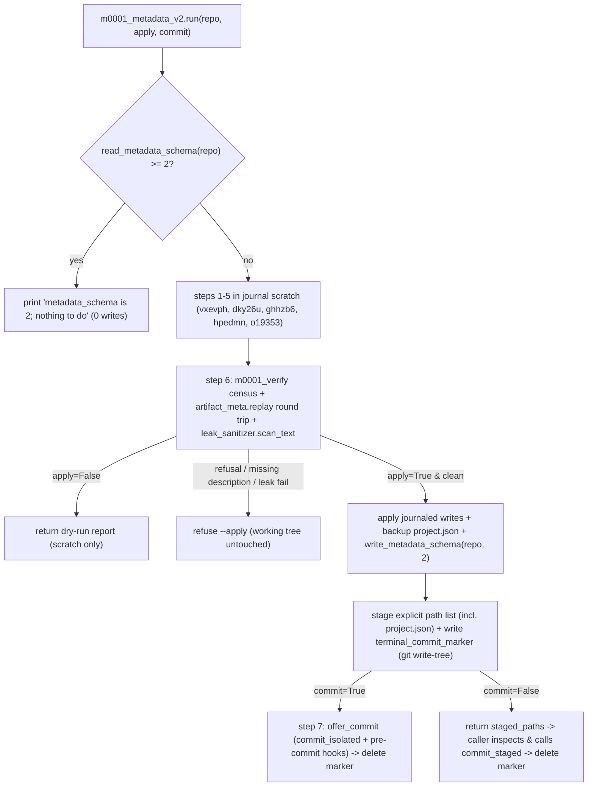

# IPD: Build the migration chain and the m0001 dry run with census, renames, citations and round trip

- Date: 2026-11-02
- Kind: child
- Concern: Spec `4sd62s` makes the cutover one scripted migration (`4sd62s` 5.1, 5.2, 5.2a). After the 2026-11-07 and 2026-11-09 splits, the chain, stamp, preflight, journal, sidecar, CLI, renames, conversion, and terminal commit marker are built by parts `g8na48`, `vxevph`, `1vfqdu`, `dky26u`, `ghhzb6`, `hpedmn`, and `o19353`. What no part can prove alone is the END-TO-END result: the step-6 field census over every type, the round-trip verifier, the step-6 `metadata_schema: 2` stamp write and step-7 commit wiring in `m0001_metadata_v2.run`, the full 10-module `m0001` test suite, and one complete dry run, apply, commit, and second apply on a COPY of this repository (`4sd62s` section 7 phase A step 3), which must succeed before Order 13 (`cxxmyv`) runs the one irreversible commit. Measured at authoring: 35 tracked legacy-timestamp records outside comms, 2,035 citation hits in 457 files over the widened roots (F-05), and 70 distinct bullet names before the first `##` (F-07); re-measured at review `HEAD` `0ea2db75d` in F-18.
- Scope: Integration and finishing part of the `m0001` build, after its parts (`g8na48` chain, `metadata_schema` stamp, read-path hook, and `aw check` baseline; `vxevph` preflight, journal, and sidecar; `1vfqdu` CLI group, bare `aw migrate`, and install prompt; `dky26u` renames and citations; `ghhzb6` and `hpedmn` conversion; `o19353` terminal marker and cleanup): the step-6 field census (E-12), the round-trip verifier plus step-6 stamp, idempotency guard, and step-7 commit wiring in `m0001_metadata_v2.run` (E-13), `tests/test_m0001_roundtrip.py` plus the end-of-family run of all ten `m0001` test modules (E-14), the proof on a disposable clone of this repository with installed commit hooks (E-15), and the `CHANGELOG.md` line and validation gates (E-16). Everything runs ONLY on `tmp_path` test fixtures and on a disposable clone; this plan never migrates this checkout. EXCLUDES: every item moved to the parts above (see Deferred); multi-repository layout/shape discovery, id-less record conversion, and five-shape corpus parity (`4sd62s` C12, 5.2a, AC-42: `9vf2iv`, `6oi2nu`, `3g20ms`, `bv4kkj`, `g5hpbb`); the description journal and model generation (Order 05: `odeo9z`, `830wku`, `ya4ee4`); explicit `--include-paths` commit staging (`clors0` E-19); switching the toolkit's loader and writer to logs, moving the legacy loader into `m0001`, the real cutover run, and flipping `CURRENT_METADATA_SCHEMA` to 2 (Order 13, `cxxmyv`); removing the sidecar writer and the `history.jsonl` lines from `engine.py` and `placement_switch.py` (Order 13, `cxxmyv`); deleting INDEX/STATUS code (Order 11, `9o83cr`); and `aw check meta` (Order 08, `ffceq0`).
- Scope-Paths: agent_workflows/migrations/m0001_verify.py, agent_workflows/migrations/m0001_metadata_v2.py, tests/test_m0001_roundtrip.py, CHANGELOG.md, .aw/records/plans/pending/20261102-metastore-04-dcerjg-build-the-migration-chain-and-the-m0001-dry-run-with-census.ipd.md
- Item-Dependencies: executed:tve77h, executed:g8na48, executed:vxevph, executed:1vfqdu, executed:dky26u, executed:ghhzb6, executed:hpedmn, executed:o19353
- Status: approved
- Readiness: go-pending-approval
- From-Spec: 4sd62s
- Work-Kind: feature
- Priority: high
- Blocks-Release: next
- Set: metastore
- Order: 4
- Highest E allocated: 16
- Author: opencode its_direct/pt3-claude-opus-5.5-1m-us
- Id: dcerjg
- Approval: 2026-11-16, recorded via aw ipd set: status set to approved
- Review-Depth: complex

> Written to `.aw/system/workflows/technical-writing/technical-writing.md`. Every obligation, exact identifier, quotation, evidence record, and lifecycle status is preserved.

## Workflow history
- 2026-11-16 approved (aw set): status set to approved
- 2026-11-14 reviewed (aw set): APPROVE WITH REVISIONS APPLIED; PR-010..PR-015 FIXED
- 2026-11-14 /plan-review (antigravity/gemini): APPROVE WITH REVISIONS APPLIED; PR-010..PR-015 FIXED; review record .aw/records/reviews/20261102-metastore-04-dcerjg-build-the-migration-chain-and-the-m0001-dry-run-with-census.review.md
- 2026-11-09 note (opencode its_direct/pt3-claude-opus-5.5-1m-us): round-3 split per research nj8zdp; items E-11 (and the gate-marker module of E-14) moved to o19353.
- 2026-11-07 note (opencode its_direct/pt3-claude-opus-5.5-1m-us): split per maintainer step-complexity rule; items E-01, E-04, E-05, E-06 moved to vxevph; E-02, E-03 moved to 1vfqdu (with the new bare `aw migrate` item); E-07, E-08 moved to dky26u; E-09, E-10 split by record type across ghhzb6 and hpedmn; E-11 kept; E-14's test modules split across the parts.
- 2026-11-07 to-review (aw set): demoted approved -> to-review: APPROVAL WITHDRAWN: maintainer direction 2026-11-07: paused before re-review; the metastore plans MUST build the tools that migrate ANY repo from ANY prior format (.agents layout, id-less/untitled records, no sidecar), not only this repository. Re-review against the amended spec 4sd62s before re-approval.
- 2026-11-07 approved (aw set): status set to approved
- 2026-11-06 reviewed (aw set): APPROVE WITH REVISIONS APPLIED; PR-001..PR-009 FIXED
- 2026-11-06 /plan-review (opencode/its_direct/pt3-claude-opus-5.5-1m-us): APPROVE WITH REVISIONS APPLIED; PR-001..PR-009 FIXED; review record .aw/records/reviews/20261102-metastore-04-dcerjg-build-the-migration-chain-and-the-m0001-dry-run-with-census.review.md
- 2026-11-05 to-review (aw set): authored review-ready for spec 4sd62s (Set metastore)

- 2026-11-02 draft (opencode its_direct/pt3-claude-opus-5.5-1m-us): created.

## Goal

After its parts have built each step, finish the one-time `aw migrate metadata` cutover code with the field census and the round-trip verifier, and prove the whole of it on a disposable clone, so that Order 13 runs code that has already produced a complete, verified, idempotent migration of a full copy of this repository.

## Detailed Implementation Checklist (TODO)

Execution-state rule: mark an `E-*` item complete only after performing the action. That mark is not validation. Right-sizing rule: each E-item must address one concern and be executable in one focused pass; split when an E-item names multiple distinct deliverables or independent test-surfaces. Accepted execution states: blocked, failed, pending, performed; terminal gate demands 'performed'.

Items E-01 to E-11 were moved to the parts named in `## Deferred / out of scope (with reason)` (`g8na48`, `vxevph`, `1vfqdu`, `dky26u`, `ghhzb6`, `hpedmn`, and `o19353`); their ids are not reused.

### Task group 5: census, round trip, real-copy proof and commit

- [ ] E-12 Create `agent_workflows/migrations/m0001_verify.py` with the step-6 field census (`4sd62s` AC-20, 5.2 step 6, 5.2a items 1, 3, 5): resolve `records_root` from the caller's argument or `project_context.project_records_dir(repo)` with zero repository-specific `id6` or count constants, and enumerate every distinct field name found before the first `##` heading, in research YAML, in leading `aw-prompt` comments, and as D177 filename facets, each with its destination (log field, body section, review-event field, or a recorded drop with reason) and its count; `unknown-field` and unparseable-value refusals (for example an `Item-Dependencies` value outside the closed grammar); `plan_role` legacy values and absent-`Kind` counts; staged prompts with no comment; sidecar orphan `id6` values with counts (or `"no sidecar (none expected)"` with zero orphans when `vxevph` E-04 reports `not sidecar_expected`); the present excluded templates and non-leading research `aw-prompt` comments by relative path (skipping absent template paths cleanly on non-self repositories); the count of records with and without a `short_description`; and the rename and citation summaries. `--apply` refuses when the census has any refusal or when any record lacks a `short_description` that the census does not list as a deliberate absence (walkthroughs and roadmaps carry `short_description` in `4sd62s` 4.5c; excluded templates, READMEs, comms, and `.data/` files are non-records).
  - Depends on: none
  - Expected outcome: the census on the clone lists every field the corpus uses (70 bullet names measured at authoring plus YAML, comment, and facet keys) with zero `unknown-field` refusals, handles both sidecar-present and `"no sidecar (none expected)"` repositories without hard-coded counts, and reports a nonzero "without description" count that makes `--apply` refuse when no `describer` ran.
  - Execution state: pending

- [ ] E-13 Add the round-trip verifier (`4sd62s` AC-10) in `m0001_verify.py` and wire step 6, the top-of-`run` idempotency guard, the `metadata_schema: 2` stamp write, and step 7 into `agent_workflows/migrations/m0001_metadata_v2.py`:
  - At the very top of `m0001_metadata_v2.run(repo, *, apply=False, force=False, force_worktree=False, describer=None, fault_injection=None, commit=True)` (before step-1 preflight, step-2 sidecar check, or journal directory creation), check `chain.read_metadata_schema(repo)`: when `>= 2`, return a no-op report printing `"metadata_schema is 2; nothing to do"` with zero writes.
  - In `m0001_verify.py` (invoked on every dry run and on `apply=True` before working-tree mutation), replay each produced `meta/<id6>.jsonl` log directly through `artifact_meta.replay(id6, art_type, lines, records_root=scratch_records_root)` (avoiding Phase-B `check_freshness`'s legacy `.md`/`.review.md` loader scan; if `hpedmn` E-01 added `"roadmap"` only to `artifact_meta.REGISTRY` and omitted `artifact_meta.SUPPORTED_TYPES`, add `"roadmap"` to `SUPPORTED_TYPES` as well and justify `agent_workflows/artifact_meta.py` via `--scope-reason` at finalize), parse each rewritten mirror through `artifact_meta.parse_artifact_mirror`, `parse_staged_prompt_mirror`, or `parse_review_mirror`, and assert that every legacy field value (under its 4.2/4.5c name, or verbatim in the body or `scope_exceeded_raw`), every raw inline history line, every resolvable sidecar JSON object, and every migrated review round is recoverable byte for byte; that no two plans share a `(set_id, order)`; and that no artifact, walkthrough, or roadmap filename matches `artifact_naming._LEGACY_TIMESTAMP_RE` (excluding the OQ-02 templates by relative path when present). Run `leak_sanitizer.scan_text` with `leak_sanitizer.build_ruleset(repo_root)` over every new log and mirror, refusing `--apply` on any `fail` diagnostic (`4sd62s` 5.2 step 6, AC-16); `warn` findings are listed in the report without refusing because imported legacy bytes use `migration_import=True` (`tve77h` E-03 (d)).
  - On `apply=True`, after step 6 passes, back up the resolved `project.json` (or an absence marker) in `journal_dir / "backups"` so `rollback(repo)` restores pre-apply `project.json`, call `chain.write_metadata_schema(repo, 2)` (`4sd62s` 5.2 step 6), include the resolved `project.json` path in the migration's explicit path list whenever it sits inside `repo`, stage that complete path list, and write `o19353` E-01's step-4a `terminal_commit_marker` (`git write-tree` of the staged index, which now covers `project.json`). When `commit=True` (the default used by `aw migrate metadata --apply` and bare `aw migrate --apply`), execute `4sd62s` 5.2 step 7 via `git_commit_helper.offer_commit(..., assume_yes=True, runner=git_commit_helper.RUNNER_AW_COMMIT)` (no `--no-verify`) and delete `terminal_commit_marker` on commit success (and in `rollback(repo)`); when `commit=False`, return `staged_paths` with the index and marker intact so a caller or test can inspect the staged tree and complete step 7 via a helper `commit_staged(repo, paths)` that runs the same `offer_commit` / `aw commit --no-plan` path and deletes `terminal_commit_marker`.
  - Depends on: E-12
  - Expected outcome: a fixture holding a history line longer than `MAX_PROSE_DESCRIPTIVE_LEN` (4,300) and one with a control character round-trips both byte for byte, while the same long value given to `artifact_meta`'s writer validation is refused; a fixture with a planted home-directory path in a field value makes `--apply` refuse on the sanitizer; `apply=True` writes `"metadata_schema": 2`, commits cleanly in step 7, and consumes `terminal_commit_marker`; and a second `--apply` on a stamped repository reports `"metadata_schema is 2; nothing to do"` and changes no file.
  - Execution state: pending

- [ ] E-14 Add `tests/test_m0001_roundtrip.py` (`4sd62s` AC-10 fixture cases, AC-20 fixture census including `"no sidecar (none expected)"`, step-6 stamp + step-7 commit + `rollback` restoration of `project.json`, and second-apply idempotence) on `tmp_path` fixture repositories built with real `git init`, including an end-to-end `apply=True` (`commit=True`) fixture holding an executed legacy-timestamp plan, a release-blocking `done` backlog item, and an installed executable `.git/hooks/pre-commit` script invoking `python3 -m agent_workflows ipd-executed-gate` and `python3 -m agent_workflows backlog-blocking-close-gate` (exercising `commit_lock.commit_isolated`'s detached `.aw-isocommit-*` worktree; if `o19353` E-01's hook marker lookup read only worktree-local `state_durable` instead of falling back to `ipd_lifecycle.checkout_control_root(root) / "state" / "durable"`, fix both hook modules and justify them via `--scope-reason` at finalize), calling the real functions and CLI leaves and asserting on outputs, exit codes, commit history, and file bytes (zero source inspection). Then RUN, once, as the family gate, all ten `m0001` test modules listed under `## Required tests / validation` ("New module here" plus "Run as the family gate"): this module plus the nine written by `g8na48`, `vxevph`, `1vfqdu`, `dky26u`, `ghhzb6`, `hpedmn`, and `o19353`. Mark the new module `core`; any module whose slowest test exceeds 2 s in `--durations=10` is marked `slow` instead and named in V-14.
  - Depends on: E-12, E-13
  - Expected outcome: all ten modules pass under `python3 -m pytest -o addopts="" -n auto <modules>`, including the real `.git/hooks/pre-commit` `commit_isolated` case, and the bare core gate stays inside its 30 s budget.
  - Execution state: pending

- [ ] E-15 Prove the migration on a COPY of this repository, never on this checkout: commit the E-12 to E-14 code first (every earlier step is already committed by the executed parts; E-16's commit obligation splits cleanly into code before E-15 and `CHANGELOG.md` plus plan/evidence updates after E-15), then run `git clone --no-hardlinks . tmp/dcerjg-clone` (inside the gitignored `tmp/` of this checkout so a runner lane stays inside its workspace), install an executable `tmp/dcerjg-clone/.git/hooks/pre-commit` script (`#!/usr/bin/env sh`, `set -eu`) running `python3 -m agent_workflows ipd-executed-gate` and `python3 -m agent_workflows backlog-blocking-close-gate` (`git clone` installs only `.sample` hooks and `backlog-blocking-close-gate` is opt-in), copy `.aw/records/history.jsonl` into `tmp/dcerjg-clone/.aw/records/history.jsonl` when this checkout has one (a runner lane has none: record that, write a synthetic sidecar containing at least one resolvable tracked `id6` record and one orphan `id6` record, and leave the real-sidecar line to `cxxmyv` E-02, which owns AC-22 case 2), and in a subshell `(cd tmp/dcerjg-clone && ...)` using the clone's own package (`python3 -m agent_workflows ...`, resolved to the clone by `checkout_pin`) run: (a) `aw migrate metadata` (dry run), (b) `aw migrate metadata --apply` (must refuse on missing descriptions), (c) a short `python3 -c` driver calling `m0001_metadata_v2.run(copy, apply=True, describer=<fixed-text fake>, commit=False)` followed by `aw sanitize --agent` on the staged clone tree, (d) `python3 -m agent_workflows ipd-executed-gate` and `python3 -m agent_workflows backlog-blocking-close-gate` directly against the staged index and then the step-7 commit via `m0001_metadata_v2.commit_staged` / `aw commit --no-plan` with the migration's explicit path list (which also runs the installed `.git/hooks/pre-commit` inside `commit_lock.commit_isolated` and deletes `terminal_commit_marker`; verify the marker file is absent afterwards), (e) `aw migrate metadata --apply` again (printing `"metadata_schema is 2; nothing to do"`), and (f) `git status --porcelain --ignored` in the clone. Step (c) exercises the `describer` seam with a fixed-text fake and is NOT evidence about real descriptions. Record wall time and peak scratch size, then delete `tmp/dcerjg-clone`. Before and after, `git status --porcelain` of THIS checkout must be identical.
  - Depends on: E-14
  - Expected outcome: (a) prints the preflight (sidecar presence and record count, real or synthetic as recorded), the rename map (every `_LEGACY_TIMESTAMP_RE` artifact, walkthrough, and roadmap in the clone mapped except the OQ-02 template; 34 entries measured at `HEAD` `0ea2db75d`), per-location citation counts with `0 ambiguity warnings`, the census, and `round trip: pass`; (b) refuses naming the missing descriptions; (c) stages the migrated tree plus `"metadata_schema": 2` and passes `aw sanitize --agent` with zero `fail`; (d) passes both gate CLIs directly and via `.git/hooks/pre-commit` inside `aw commit --no-plan` and consumes `terminal_commit_marker`; (e) prints `"metadata_schema is 2; nothing to do"` and changes nothing; (f) shows a clean clone with no `records/history.jsonl`, no `STATUS.md`, and no `INDEX` file.
  - Execution state: pending

- [ ] E-16 Add one `CHANGELOG.md` entry under `2.0.0 (pending)` (new `aw migrate metadata` dry-run command and `aw migrate layout` spelling; `aw install --migrate`; the migration does not yet run on any repository), with no em or en dashes. Run the ten named `m0001` modules, the existing regression modules in `## Required tests / validation`, the bare core gate `python3 -m pytest`, `make test-all`, `aw sanitize --agent`, and `aw check --agent`; when `.aw/state/dcerjg/check-before.jsonl` is absent because `dcerjg` executes in an isolated runner worktree separate from `g8na48`, regenerate `.aw/state/dcerjg/check-before.jsonl` first from a temporary detached worktree under `tmp/` checked out at the pre-edit `HEAD` SHA recorded in `g8na48` `F-03` (or at `dcerjg`'s own pre-edit `HEAD` if `g8na48` `F-03` was recorded on a prior branch) and remove that temporary worktree immediately. Commit through `aw commit dcerjg -- <each changed path>` (code before E-15, then `CHANGELOG.md`, any E-15 fixes, and this plan's progress updates after E-15). Never push.
  - Depends on: E-14, E-15
  - Expected outcome: every test run and `aw sanitize --agent` pass; `aw check --agent` reports zero added `(location, rule)` error or warning pairs against `.aw/state/dcerjg/check-before.jsonl`; each path-scoped commit's `git show --stat` lists only `- Scope-Paths:` files (or paths explicitly justified at finalize via `--scope-reason`).
  - Execution state: pending

## Project conventions discovered (Step 0)

- Transactional migrations reuse `layout_migration.MigrationManager` (`_acquire_lock`, `_release_lock`, `_save_transaction`, `_load_transaction`); `4sd62s` 5.1 forbids new journal or lock components. Its shared journal path (`state/runtime/transactions/migration_transaction.json`) belongs to the layout migration, so `m0001` uses `state/durable/migrations/m0001/journal.json` (`vxevph` E-03).
- Path roots come from `project_context`: `project_context.project_records_dir(repo)` for `records_root` (honoring companion/home backends while resolving `<repo>/.aw/records` on unconfigured `tmp_path` repositories), `project_context.project_config_dir(repo) / "project.json"` for `metadata_schema` (`g8na48` E-01), and `resolve_project_context(target_repo=str(repo)).physical_classes["state_durable"]` (with `ipd_lifecycle.checkout_control_root` collapse across `commit_lock.commit_isolated`'s detached `.aw-isocommit-*` linked worktree) for durable state (`4sd62s` 4.5, 5.1, 5.2a).
- The integration lock is `runner_shared.integration_lock_path` and `runner_shared.integration_lock` (bounded, loud wait); a non-mutating probe is `platform_lock.probe_free`. Worktree identity is `ipd_lifecycle.checkout_git_common_dir`. Lane landing is `runner_shared.lane_work_has_landed` (`True`/`False`/`None`, with `None` kept visible as `"unknown"`).
- Naming authority is `artifact_naming` (`_LEGACY_TIMESTAMP_RE`, `parse_clustered`); citations go through `artifact_refs.plan_reference_rewrites_with_warnings`, whose `scan_roots` is a parameter; ids are minted by `artifact_core.mint_id6` (repository-wide collision check).
- Every CLI leaf must be declared in `command_surface` (`command_surface.find_undeclared_leaves`, enforced by `tests/test_command_surface_declarations.py`); `migrate-layout`'s declaration is the template for a mutation verb with a confirmation gate.
- Descriptive-value safety is `attention_contract.refuse_unsafe_descriptive` with `MAX_DESCRIPTIVE_LEN` 300 and `MAX_PROSE_DESCRIPTIVE_LEN` 4,300; leak scanning is `leak_sanitizer.scan_text` with `leak_sanitizer.build_ruleset`.
- Cite code by symbol (`module.function`) or by a quoted content string rather than by a bare line number alone (`IPD-C801`).
- Tests exercise code and assert on outputs (AGENTS.md "TEST OUTCOMES, NOT CODE STRUCTURE"); a real model or network call from a test is refused by construction, as `runner_shared._assert_probe_spawn_is_permitted` does for the coverage probe.

## Findings

Values F-01 to F-16 were measured at authoring; F-17 was re-measured in Round 1 (`HEAD` `4f09df0c7`) and F-18 in Round 2 (`HEAD` `0ea2db75d`).

| Id | Evidence | Finding |
|---|---|---|
| F-01 | `ls agent_workflows/migrations` fails; `cli.build_parser` has `migrate-layout` (top level) and `specs migrate` only | No migration chain and no `aw migrate` group exist. |
| F-02 | `git ls-files .aw/records` filtered by `_LEGACY_TIMESTAMP_RE`, comms excluded: 35 files: 5 executed plans, 15 implemented specs, 3 superseded specs, 11 walkthroughs, and `research/plan-review/20260712-0156-14-chatgpt-modular-report-template.md` | The spec's 34 plus one research template, which OQ-02 excludes. |
| F-03 | Of those, `parse_clustered` also matches 7: plan `20260817-1357-01-assess-...`, specs `...-agents-artifact-organization`, `...-honest-human-approval-attestation`, `...-prompt-purity-lint`, walkthroughs `...-assess-bugs-and-tests-...`, `...-agents-docs-...`, `...-mirror-workflow-pointer-...` | Classification must test the legacy form first (5.2 step 3). |
| F-04 | `grep '^- Id:\|^- Set:\|^- Order:'` on the 34: `lus9ou`, `7qx7ys`, `8q6yr9` (`plans-adopter`, orders 0, 6, 7), `4o5lt9` (no Set), `wvlk84` (`awphysical`, order 17), spec `4w7d6s` (no Set); the other 28 (17 specs, 11 walkthroughs) carry no `- Id:` | Matches OQ-26 and its round-18 correction exactly. |
| F-05 | `artifact_refs.plan_reference_rewrites_with_warnings` on a synthetic 34-entry map: default roots 1,951 hits in 423 files; with `agent_workflows`, `docs`, `.aw/system`, `CHANGELOG.md` added 2,035 hits in 457 files (agent_workflows 70, `.aw/system/workflows` 6, docs 5, CHANGELOG 3); 0 warnings both ways | Up from 1,940/419 at r18; widening adds 84 hits in 34 files. |
| F-06 | `python3` over `.aw/records/history.jsonl`: 481 records, 325 `id6`; 442 status/history, 20 rename, 19 group; by tree backlog 335, specs 124, research 11, plans 8, walkthroughs 2, roadmaps 1; 4 `id6` (`3srje9`, `6rya7d`, `jpmhjb`, `frq8c2`, one record each) match no tracked filename `id6` or in-file `- Id:` | Spec r9 said 8 records for 7 `id6`; the census must report the real count at run time. |
| F-07 | `git ls-files .aw/records` `.md`: 4,441 (4,415 non-README); 2,959 contain `## Workflow history`; 70 distinct `- Field:` names before the first `##` | Spec section 1 said 68 fields; the census, not this plan, is the registry check. |
| F-08 | Reviews: 1,289 `.review.md`; 24 whose filename `id6` differs from `Subject-Id` (all subject `18hh1u`); multi-file subjects `18hh1u` 24, `rtvdak`/`e25iy9`/`l4vw9o`/`urv602` 2 each; 35 off-vocabulary verdicts: `REVIEWED - MATERIAL CHANGES APPLIED` 20, `REVIEWED` 11, `REVIEWED - NO MATERIAL IMPROVEMENTS FOUND IN THIS ITERATION` 3, `REVIEWED - CONVERGED WITH REVISIONS` 1 | Matches the spec's r11 counts; 4 distinct strings for AC-14a(5). |
| F-09 | Staged prompts: 30 `.md` under `.aw/records/prompts` (README excluded), 25 with a leading `<!-- aw-prompt:` comment; 3 research files embed a `<!-- aw-prompt:` comment below YAML (`8it88r`, `yq6aub`, `9bd3j8`) | 5 prompts take status from disposition; OQ-04 decides the 3 research comments. |
| F-10 | `project_schema.parse_portable_policy` `known_keys` lacks `metadata_schema`; other keys land in `unknown_fields` | The stamp must be added as a known key. |
| F-11 | `hooks/executed_transition_gate._staged_plan_executed_transitions` flags a plan "ARRIVING in an `executed/` directory ... not ALREADY there at HEAD under the SAME `- Id:`"; `hooks/backlog_blocking_close_gate.check` delegates to `check_engine.check_release_gate_consistency` | The 5 renamed executed plans and every rewritten terminal file need the positive marker (5.2 step 4a). |
| F-12 | `cli` `install` `-y/--yes` help "Skip preflight confirmations."; `setup` `-y/--yes` "Install without per-repo prompts." | Neither may answer the migration question (5.1). |
| F-13 | `artifact_rename.compute_target_name` builds the `--to-id6` name with `set_id=mint_id6, order=1` (called from `artifact_rename.run_rename_generic`) | It cannot be reused for the OQ-26 rule. |
| F-14 | `.aw/.gitignore` line `records/history.jsonl`; INDEX lines for plans, research, prompts; tracked `.aw/records/plans/STATUS.md`; `engine.py` template and adder and `placement_switch.py` list also name `records/history.jsonl` | Target-repo lines are step 2/5 output; the source-code lines are Order 13's. |
| F-15 | `.aw/records/roadmaps/` holds 1 record (`7ny1bg`, bold-prose metadata, 1 sidecar record); `prompt-library/` 4 `.prompt.md` with no id; research templates `conformance-results-template.md` and the F-02 template; `research/reference/` 74 files with clustered names | Inputs to the by-name decisions of OQ-02. |
| F-16 | `opencode` 1.18.35 and `agy` on PATH; clone size: `.git` 240 MB, 6,211 tracked files | A `--no-hardlinks` clone for E-15 is feasible under `tmp/`. |
| F-17 | Re-measured at Round 1 review (`HEAD` `4f09df0c7`): 35 tracked legacy-timestamp files outside comms (unchanged); 4,470 tracked `.md` under `.aw/records`, 2,898 with `## Workflow history`, 1,300 tracked review files; `install_wizard` rebuilds `project.json` from `ProjectPolicySchema` named fields plus `unknown_fields`, with a fallback `known_proj_keys` copy of the key set; `tve77h` E-01 registers seven types and no `roadmap`; this review lane has no `.aw/records/history.jsonl` | Counts drift (context only); the stamp needs a round-trip field (PR-001); a lane-run E-15 needs a synthetic sidecar (PR-004). |
| F-18 | Re-measured at Round 2 review (`HEAD` `0ea2db75d`): 35 tracked legacy-timestamp files outside comms (unchanged), 4,719 tracked `.md` under `.aw/records`, 1,330 `.review.md` files; `artifact_meta.SUPPORTED_TYPES` (`artifact_meta.py`, checked in `replay`, `_load_sources`, and `read`) is a separate 7-tuple from `REGISTRY`; `git clone --no-hardlinks` installs only `.git/hooks/*.sample` and `backlog-blocking-close-gate` is absent from `.pre-commit-config.yaml`; `aw commit` (`commit_lock.commit_isolated`) runs `.git/hooks/pre-commit` inside a detached `.aw-isocommit-*` linked worktree where worktree-local `.aw/state/durable` is absent (`ipd_lifecycle.checkout_control_root` collapses back to the primary checkout's `.aw`); `g8na48` E-01/F-03 owns `.aw/state/dcerjg/check-before.jsonl` plus `HEAD=<sha>` for cross-lane regeneration | Step-6/step-7 wiring (`PR-010`), `.git/hooks/pre-commit` installation and `commit_isolated` marker lookup (`PR-011`), direct `artifact_meta.replay` plus `SUPPORTED_TYPES` check (`PR-012`), and `g8na48` dependency + cross-lane baseline regeneration (`PR-013`) are required. |

## Proposed changes (ordered, validatable)

1. E-12: create `agent_workflows/migrations/m0001_verify.py` with the repository-agnostic step-6 field census (`4sd62s` AC-20, 5.2a).
2. E-13: add the round-trip and leak-scan verifier in `m0001_verify.py`, and wire the top-of-`run` `read_metadata_schema >= 2` guard, step 6, the journal-backed `write_metadata_schema(repo, 2)` stamp write, and the step-7 `offer_commit` + marker consumption into `agent_workflows/migrations/m0001_metadata_v2.py`.
3. E-14: add `tests/test_m0001_roundtrip.py` (including a real `.git/hooks/pre-commit` `commit_isolated` fixture) and run all ten `m0001` test modules as the family gate.
4. E-15: commit code, clone into `tmp/dcerjg-clone`, install `.git/hooks/pre-commit`, and prove dry run, refusal, apply, hook-verified step-7 commit, second-apply no-op, and clean status on the clone.
5. E-16: add the `CHANGELOG.md` entry, run the module, core, thorough, sanitize, and `aw check --agent` baseline gates, and commit path-scoped changes via `aw commit dcerjg`.

Every earlier `m0001` step is built by the parts in `- Item-Dependencies:`, which this plan waits for.

## Deferred / out of scope (with reason)

- E-01 chain half (`migrations/__init__.py`, `chain.py`, `metadata_schema` stamp in `project_schema.py` and `install_wizard.py`, `artifact_meta._require_schema`, `aw check` baseline capture in `F-03`) and `tests/test_migrations_chain.py`: Moved to `g8na48` (round-3 split 2026-11-09 from `vxevph` per research `nj8zdp`).
  - Carrier: g8na48
- E-04 (step-1 preflight), E-05 (migration journal), E-06 (step-2 sidecar import), and their tests from E-14 (`tests/test_m0001_preflight.py`, `tests/test_m0001_sidecar.py`): Moved to `vxevph` (split 2026-11-07 per maintainer step-complexity rule).
  - Carrier: vxevph
- E-02 (`aw migrate` group with `metadata` and `layout`), E-03 (install pending-migration prompt and `--migrate`), bare `aw migrate`, and their tests from E-14 (`tests/test_install_migrate_prompt.py`, `tests/test_migrate_cli.py`): Moved to `1vfqdu` (split 2026-11-07 per maintainer step-complexity rule).
  - Carrier: 1vfqdu
- E-07 (rename map), E-08 (citation rewrite), and their tests from E-14 (`tests/test_m0001_renames.py`): Moved to `dky26u` (split 2026-11-07 per maintainer step-complexity rule).
  - Carrier: dky26u
- E-09 and E-10 subset A (log builder and file rewrite for plans, backlog items, releases, specs, and staged prompts) and `tests/test_m0001_conversion.py`: Moved to `ghhzb6` (split 2026-11-07 per maintainer step-complexity rule).
  - Carrier: ghhzb6
- E-09 and E-10 subset B (`review` events, `roadmap` registry entry, and log builder and file rewrite for research records, walkthroughs, the roadmap, and review files) and `tests/test_m0001_review_conversion.py`: Moved to `hpedmn` (split 2026-11-07 per maintainer step-complexity rule).
  - Carrier: hpedmn
- E-11 (steps 4a and 5: terminal-commit marker, STATUS/INDEX cleanup, read-only marker acceptance in both hooks) and `tests/test_m0001_gate_marker.py` from E-14: Moved to `o19353` (round-3 split 2026-11-09 per research `nj8zdp` guidance).
  - Carrier: o19353
- Multi-repository layout/shape discovery, `.agents/` layout stage chaining, id-less/prose record conversion, and five-shape corpus parity (`4sd62s` C12, 5.2a, AC-42; split across `9vf2iv`, `6oi2nu`, `3g20ms`, `bv4kkj`, and finishing plan `g5hpbb`).
  - Carrier: g5hpbb
- The description journal, the tracked generation prompt, the tool-less model call, and the cost trial (Order 05: `odeo9z`, `830wku`, and finishing plan `ya4ee4`); this plan provides only the `describer` seam and the census and refusal accounting.
  - Carrier: ya4ee4
- Explicit `--include-paths` staging on `m0001`'s step-7 commit so the one attended cutover commit can carry code, test, and documentation patches alongside migrated records (`cxxmyv` E-17 mechanism half).
  - Carrier: clors0
- Switching `artifact_meta`'s loader and writer to logs, moving the legacy loader into `migrations/m0001_metadata_v2.py`, flipping `CURRENT_METADATA_SCHEMA` to 2, running the migration on this checkout, the real preflight sidecar line (AC-22 case 2), the real census orphan lines (AC-30 case 3), and final AC-10, AC-11, AC-16, and AC-41 evidence on the real repository, including AC-41 case 4's `aw show --history` display with the current name (the phase-A toolkit cannot read a v2 copy, C9).
  - Carrier: cxxmyv
- Retiring `record_history.append`, `append_advisory`, `append_rename` and removing `records/history.jsonl` from the `engine.py` template, the `engine.py` adder, and `placement_switch.py` (AC-30 case 2, source half): done in phase A it would stop ignoring a sidecar the toolkit still writes, so a broad `git add` could commit purged records.
  - Carrier: cxxmyv
- Deleting INDEX and STATUS code and the `check.stale-index-*` rules (AC-9).
  - Carrier: 9o83cr
- `aw check meta`, which AC-29 case 2 and AC-40 case 4 use, and the 5.2 step 6 "`aw check meta` clean" condition.
  - Carrier: ffceq0
- A setter transition rewriting only the staged-prompt comment `status` (AC-40 case 3), and recording a NEW review round as one subject event (AC-14 writer form).
  - Carrier: xexn45
- `inferred-from-git` ordering for legacy events: optional in 5.2 step 4 ("can add"); every imported event uses `ordering_confidence: unknown` (OQ-05).
  - Carrier-Declined: optional by spec wording; adding it later needs no log-format change because `ordering_confidence` already exists.

## Scope check

- Over-scope: none. `m0001_metadata_v2.py` is touched only to add the top-of-`run` `read_metadata_schema >= 2` idempotency guard, invoke step 6 (census, round trip, and leak scan), write the journal-backed `metadata_schema: 2` stamp before staging and `o19353`'s `git write-tree` marker, and run step 7 (`offer_commit` + marker deletion); steps 4a and 5 and the hook edits moved to `o19353`.
- Under-scope: none. Every item moved out is carried by a named part in `## Deferred / out of scope (with reason)`; multi-shape discovery and id-less conversion are carried by the `g5hpbb` family; and the cutover-only parts are carried by `clors0` and `cxxmyv`.

## Required tests / validation

New module here (`core` unless E-14's duration rule moves it to `slow`): `tests/test_m0001_roundtrip.py`. Run as the family gate (written by the parts): `tests/test_migrations_chain.py` (`g8na48`), `tests/test_m0001_preflight.py` and `tests/test_m0001_sidecar.py` (`vxevph`), `tests/test_install_migrate_prompt.py` and `tests/test_migrate_cli.py` (`1vfqdu`), `tests/test_m0001_renames.py` (`dky26u`), `tests/test_m0001_conversion.py` (`ghhzb6`), `tests/test_m0001_review_conversion.py` (`hpedmn`), and `tests/test_m0001_gate_marker.py` (`o19353`). Existing: `tests/test_command_surface_declarations.py`, `tests/test_layout_migration.py`, `tests/test_migrate_layout_cli.py`, `tests/test_plans_rename_selectors.py`, `tests/test_date_reader_clock_parity.py`. Gates: bare `python3 -m pytest`, `make test-all`, `aw sanitize --agent`, `aw check --agent`.

Acceptance criteria of spec `4sd62s` this plan OWNS (after the 2026-11-07 and 2026-11-09 splits, each fixture half is proven by the part named in parentheses, and this plan proves the clone half and pastes the final evidence; Order 13 re-demonstrates on the real repository where noted):

- AC-10: fixture round trip with the long and control-character lines plus step-6 stamp, step-7 commit, and second-apply idempotence (E-13, E-14), and clone dry run, apply, commit, second apply, and round trip (E-15). Final real-repo run: `cxxmyv`.
- AC-11: mechanism (the read-path call in `artifact_meta`) and all three cases with `CURRENT_METADATA_SCHEMA` patched to 2 (`g8na48` E-01, E-02, E-04; `1vfqdu` E-03, E-04); the shipped value flips in `cxxmyv`, which re-demonstrates.
- AC-14 (migration form): every migrated review round becomes one subject event, no review log, K4 bindings for the 24 own-`id6` files and the 4 pairs (`ghhzb6`, `hpedmn`).
- AC-14a case 5: all 4 off-vocabulary strings recovered byte for byte (`hpedmn` E-03).
- AC-19 (migration cases): research filename date differing from creation day kept without drift, unknown creation stays unknown, age and grandfathering identical before and after (`ghhzb6`, `hpedmn`); the new-record-at-23:30 case is a creation-path test owned by `tve77h`.
- AC-20: fixture census (`hpedmn` E-03, E-14 here) and the clone census (E-15).
- AC-22 case 1 (`vxevph` E-02, E-04).
- AC-27 cases 1 to 4 (`vxevph` E-02, E-05).
- AC-28 cases 1 to 4 (`1vfqdu` E-03, E-04).
- AC-29 case 1 (`hpedmn` E-02, E-03).
- AC-30 cases 1 and 2 (target-repo half) on fixture and clone (`vxevph` E-04, E-06; E-15 here).
- AC-32 cases 1 to 3 and 5 on fixtures (`ghhzb6` E-01, `hpedmn` E-01); case 4 needs a post-cutover setter: `cxxmyv`.
- AC-40 cases 1 and 2 (`ghhzb6` E-02).
- AC-41 cases 1, 2, 3, 5 and the byte-for-byte half of case 4 (`dky26u` E-01, E-02, and E-13, E-15 here).

CONTRIBUTES to: AC-16 case 1 (marker acceptance by both hooks, built and fixture-proven by `o19353` and exercised end-to-end through `.git/hooks/pre-commit` inside `commit_lock.commit_isolated` in E-14 and E-15, plus the sanitizer on the clone; `aw attention --check --agent` on the migrated tree is `cxxmyv`'s), AC-22 case 2, AC-29 case 2, AC-30 case 3, AC-34 case 5 (checkpoint at old path then `rename`), AC-36 case 6 (census counts with and without description), AC-42 (this-repository clone proof reused by `g5hpbb` E-07), and AC-13 (clone wall time as an input).

## Spec / documentation sync

No spec change; implements `4sd62s` sections 5.1, 5.2 (steps 0 to 7 on a copy), and 5.2a (items 1, 3, and 5 in `m0001_verify.py`), 4.1 (by-name record decisions), 4.1a K4 to K6, 4.2a, and OQ-12, OQ-26, OQ-27, OQ-28. User documentation for `aw migrate metadata` is written for the post-cutover state by Order 12 (`90iqr1`) and lands in the cutover commit (C10a); this plan adds only the `CHANGELOG.md` line.

## Open questions

### OQ-01: Does this plan fit one pass, or should it be split?

- Blocking: no
- Status: resolved
- Owner: none
- Resolution or deferral rationale: It fits the limits: 16 E-items in 5 task groups (limits 18 and 5). It is dense, so if review finds it too large, split at the task-group boundary: `04a` = task groups 1 and 2 plus the E-14 tests for them (chain, stamp, `aw migrate`, install prompt and `--migrate`, preflight and force flags, journal, sidecar import; AC-11, AC-22 case 1, AC-27, AC-28, AC-30 case 1), and `04b` = task groups 3 to 5 (renames, citations, conversion, file rewrite, marker, cleanup, census, round trip, clone proof; AC-10, AC-14, AC-14a(5), AC-19, AC-20, AC-29(1), AC-32, AC-40(1,2), AC-41), with `04b` depending on `executed:04a` and Order 05 depending on `04b`. Recommendation strength: medium (keep one plan).
- Note: superseded 2026-11-07 and 2026-11-09 by the maintainer's step-complexity rule and research `nj8zdp`: the plan was split into `g8na48`, `vxevph`, `1vfqdu`, `dky26u`, `ghhzb6`, `hpedmn`, `o19353`, and this 5-item finishing part (see Deferred), finer than the two-way split proposed above.

### OQ-02: How are roadmaps, prompt-library files, research templates, reference packages and READMEs handled (spec 4.1 "the plan must also decide, by name")?

- Blocking: no
- Status: resolved
- Owner: none
- Resolution or deferral rationale: Decided from the evidence in F-15, as 4.1 delegates it to the plan. `roadmaps/` (`7ny1bg`): a status-less logged record like a walkthrough (one-key front matter, log with no `transition`, its 1 sidecar record imported), because it has an `id6` and sidecar history that 5.2 step 2 must not lose, and N2 forbids adding a status vocabulary; its bold-prose header stays body prose. Executed `tve77h`'s `artifact_meta.REGISTRY` and `artifact_meta.SUPPORTED_TYPES` list seven types (`ipd`, `spec`, `backlog`, `research`, `release`, `prompt`, `walkthrough`) and no `roadmap`, so `hpedmn` E-01 adds the `roadmap` registry entry with the walkthrough field set (and E-13 ensures `SUPPORTED_TYPES` includes `"roadmap"` as well so `artifact_meta.replay` accepts roadmap logs). `prompt-library/` (4 files) and the 2 research templates (`conformance-results-template.md` and `plan-review/20260712-0156-14-chatgpt-modular-report-template.md`): excluded and byte-identical when present, listed by relative path in the census (and skipped cleanly when absent on another repository, `4sd62s` 5.2a), because they are reusable text with no lifecycle, and 4.6 explicitly places "any template the plan leaves unrenamed" outside the filename check; the legacy-named template therefore stays the one remaining `_LEGACY_TIMESTAMP_RE` match in this repository and the AC-41(3) check excludes it by relative path. `research/reference/` (74 files): ordinary research records, migrated like research. READMEs (including `research/20260726-0054-.../README.md`): not records, excluded. Comms and `.data/` files: unchanged (OQ-2 of the spec).

### OQ-03: How can `metadata_schema` and the AC-11 refusal ship in phase A without refusing this unmigrated repository?

- Blocking: no
- Status: resolved
- Owner: none
- Resolution or deferral rationale: `require_current_schema` is called from `artifact_meta`'s read-path refresh (`g8na48` E-01, E-02), and compares against `CURRENT_METADATA_SCHEMA`, which is 1 (the legacy format, the only format phase-A code reads) and an absent stamp counts as 1. So nothing refuses before the cutover, and install stamps a legacy-free new repository with 1, which is true. Order 13 (`cxxmyv`) sets the constant to 2 in the cutover commit, which makes every legacy repository refuse and every new install stamp 2, exactly AC-11. Tests patch the constant to 2 to prove the behavior now (`g8na48` E-04, `1vfqdu` E-04). This keeps C10a (one format per commit) and avoids a stamp that lies.

### OQ-04: Are the 3 non-leading `aw-prompt` comments in research files metadata or body prose (4.2c row)?

- Blocking: no
- Status: resolved
- Owner: none
- Resolution or deferral rationale: Body prose, unchanged. In `8it88r`, `yq6aub`, and `9bd3j8` the `<!-- aw-prompt:` comment sits below the record's closing YAML `---` delimiter and repeats the header of the prompt the research record quotes; the record's own metadata is its YAML. Moving it to the log would invent metadata for a different artifact. The census lists any non-leading `<!-- aw-prompt:` research comments under this disposition when present.

### OQ-05: Does the migration infer `inferred-from-git` ordering?

- Blocking: no
- Status: resolved
- Owner: none
- Resolution or deferral rationale: No. 5.2 step 4 says the migration "can" add it; running `git log -p` per record over 2,959 history-bearing files would dominate the migration time for an order that 4.2a says carries no replay meaning. Every imported event records its original file position and `ordering_confidence: unknown`, which is the honest value.

### OQ-06: Does `aw migrate-layout` become `aw migrate layout` (5.1, research `ffi66q`)?

- Blocking: no
- Status: resolved
- Owner: none
- Resolution or deferral rationale: Yes, as an added spelling (`1vfqdu` E-01). `aw migrate layout` dispatches to the existing `cli._run_migrate_layout`; `aw migrate-layout` stays as an alias with unchanged output, because README and help text name it and removing a shipped verb is a separate breaking decision. This gives one `aw migrate <name>` family for migrations, which is what 5.1 asks. Research `ffi66q` is still `status: todo` and names no conflicting spelling.

## Validation and cross-check (verify before reporting done)

Validation-state rule: inspect evidence in a separate pass. Do not mark a `V-*` item complete from memory or from the matching execution checkmark. Accepted validation results: blocked, failed, pass, pending; terminal gate demands 'pass'. Runtime-demonstration reachability rule: for each `V-*` item demanding the software be observed acting (such as a run, a dispatch, or a transition, as distinct from items demanding a diff, a file's content, or a test result, which are reachable by construction), name the code path that produces the observation or the sibling `E-*` that creates it, else the demand is UNDER-SCOPE.
- [ ] V-12 validates E-12
  - Required evidence: paste the census section of the E-15 clone dry run in full (`m0001_verify` invoked from `m0001_metadata_v2.run` via `aw migrate metadata`): field rows with destinations and counts, zero `unknown-field` refusals, the excluded templates by relative path, the orphan sidecar `id6` lines, and the with/without description counts; paste the `"no sidecar (none expected)"` census test output from `tests/test_m0001_roundtrip.py`; and paste the refusal text of E-15 step (b) `aw migrate metadata --apply`.
  - Observed evidence:
  - Result: pending
- [ ] V-13 validates E-13
  - Required evidence: paste `python3 -m pytest -o addopts="" -v tests/test_m0001_roundtrip.py` all PASSED, naming the long-line (over 4,300 characters), control-character, writer-refusal, sanitizer-refusal, step-6 `metadata_schema: 2` stamp + `rollback` restoration, step-7 `commit=True` hook-verified commit + marker consumption, and second-apply `"metadata_schema is 2; nothing to do"` tests.
  - Observed evidence:
  - Result: pending
- [ ] V-14 validates E-14
  - Required evidence: paste `python3 -m pytest -o addopts="" -n auto tests/test_migrations_chain.py tests/test_install_migrate_prompt.py tests/test_m0001_preflight.py tests/test_m0001_renames.py tests/test_m0001_conversion.py tests/test_m0001_roundtrip.py tests/test_m0001_gate_marker.py tests/test_m0001_sidecar.py tests/test_migrate_cli.py tests/test_m0001_review_conversion.py --durations=10` summary with 0 failed and the durations table, naming any module marked `slow`; and the bare `python3 -m pytest` summary line inside the 30 s budget.
  - Observed evidence:
  - Result: pending
- [ ] V-15 validates E-15
  - Required evidence: paste the `git clone --no-hardlinks . tmp/dcerjg-clone` command line, the installed `tmp/dcerjg-clone/.git/hooks/pre-commit` script contents, and whether the real or a synthetic sidecar was used; then, from the clone (`E-15` subshell): the step (a) dry-run output (preflight with sidecar record count; rename-map section with its row count beside the clone's re-derived legacy-timestamp count minus the OQ-02 exclusions, including `20260817-awphysical-17-wvlk84-assess-bugs-leftover-remove-dataloss.ipd.md` and the three `plans-adopter` rows with orders 00, 06, 07; citation section with hits per location, `0 ambiguity warnings`, and the left-unchanged list with reasons; census summary; `round trip: pass`), the step (b) refusal, `head -3` of one migrated staged prompt, one walkthrough, and one review file plus `aw sanitize --agent` output from step (c), the step (d) direct `ipd-executed-gate` and `backlog-blocking-close-gate` exit statuses plus `aw commit --no-plan` output with `.git/hooks/pre-commit` passing and confirmation that `terminal_commit_marker` is absent afterwards, the step (e) `"metadata_schema is 2; nothing to do"` line, and step (f) `git status --porcelain --ignored | grep -E 'history.jsonl|STATUS.md|INDEX'` printing nothing; the wall time and peak scratch size; and `git status --porcelain | sha256sum` of THIS checkout before and after, equal.
  - Observed evidence:
  - Result: pending
- [ ] V-16 validates E-16
  - Required evidence: paste the `CHANGELOG.md` diff hunk; the summary lines of the named-module runs, bare `python3 -m pytest`, `make test-all`, and `aw sanitize --agent`; the `(location, rule)` pair comparison of `aw check --agent` after E-16 against `.aw/state/dcerjg/check-before.jsonl` (noting whether `.aw/state/dcerjg/check-before.jsonl` was present or regenerated from `g8na48` `F-03`'s recorded `HEAD` SHA), with zero added error or warning pairs; and every `aw commit dcerjg` output with its `git show --stat`, listing only `- Scope-Paths:` files (or paths justified at finalize via `--scope-reason`).
  - Observed evidence:
  - Result: pending

## Approval and execution gate

- Size assessment: standard
- Cohesion rationale: not required

Execute only after human approval (`Status: approved`) and after every plan in `- Item-Dependencies:` is executed. All open questions are resolved.

Scope fence: the paths in `- Scope-Paths:` are a declaration; a needed file outside the fence is edited and then justified at finalize (`--scope-reason`), and a declared path left unmodified is acknowledged (`--scope-ack`).

Safety: this plan NEVER runs `aw migrate metadata --apply` in this checkout. Every apply is on a `tmp_path` fixture or on the E-15 clone under `tmp/dcerjg-clone`, and E-15's evidence includes `git status --porcelain` of this checkout before and after. If an apply would touch this checkout's records, stop and report: that is a genuinely unsafe condition, not a scope question.

Honesty rule: run the named test modules, the bare core gate `python3 -m pytest` and `make test-all`, and paste the ACTUAL summary lines; never claim a result you did not run. E-15 step (c) uses a fake describer and proves only the seam.

Commits: commit only through `aw commit dcerjg -- <paths>` (the E-15 clone commit uses `aw commit --no-plan` INSIDE the clone); never `git add -A`, a bare `git add` or `git commit -a`; never push.

Lifecycle transition: the plan moves to `.aw/records/plans/executed/` only through `aw ipd finalize`, never a hand `git mv`, and only after `aw ipd lint --phase pre-transition` conforms and every `V-*` reads `pass` with pasted evidence. When `aw oc run` or `aw agy run` executes the plan, the runner performs the finalize; a hand executor runs `aw ipd finalize dcerjg` itself.
