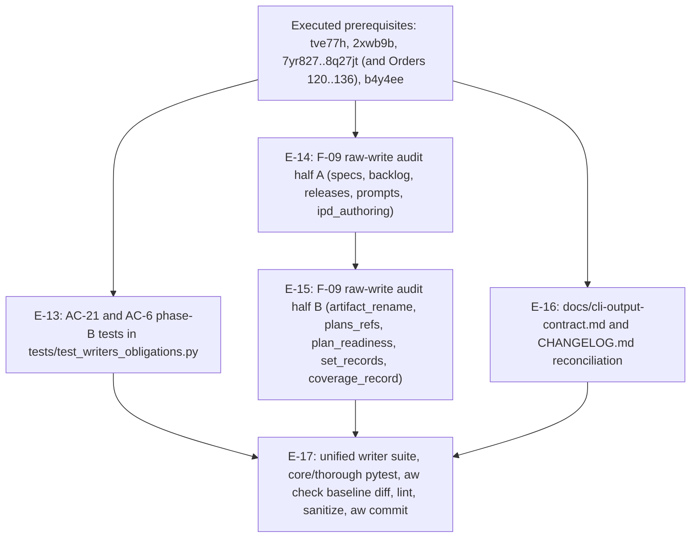

# IPD: Move the remaining metadata writers onto artifact_meta

- Date: 2026-11-02
- Kind: child
- Concern: Spec `4sd62s` section 7 step 4 requires every metadata WRITER to change to write through `artifact_meta` in phase B, while `artifact_meta` still writes today's bullets and history lines, so that the cutover (Order 13) switches one writer and not dozens (C1, C10a). Order 06 (`2xwb9b`) moves the `status_set` engine. Every other writer still edits metadata text by hand. Measured 2026-11-02 at `0cbfcc706`: 12 writer modules in this plan's scope hold 99 hand-formatted `- Field: value` literals and 47 `## Workflow history` references (`specs` 14/8, `backlog` 29/18, `releases` 11/4, `ipd_authoring` 11/1, `artifact_rename` 11/0, `plans_refs` 4/0, `plan_readiness` 1/10, `coverage_record` 3/5, `set_records` 1/1, `review_sequence` 3/1, `runner_shared` writer helpers, `ipd_lifecycle` finalize), plus `prompts` comment writers. These modules use four different history-insertion rules (F-04), and three of them write the gitignored rename ledger (`record_history.record_rename`). Finalize writes `- Scope-Exceeded:` through `ipd_lifecycle._insert_scope_exceeded_metadata` (41 tracked plans carry it), which 4.2c and 4.4 replace with `scope_result`, `out_of_scope_paths` and `widened_paths` written in the executed append. No creating command can write `short_description` yet (AC-36 case 1). Section 7 and 3c require each phase-B plan to name each moved writer's behavior and the test that checks it, because a behavior that no test exercises can change unnoticed.
- Scope: Phase B step 4, part 2 of 2 (`4sd62s` section 7), FINISHING PART. Split 2026-11-07 per the maintainer step-complexity rule into six writer parts (`7yr827` Order 21, `g6tw94` 22, `n5sxxk` 23, `6e93gt` 24, `bsl45u` 25, `8q27jt` 26), which round 3 (2026-11-09, research `nj8zdp`) split further into Orders 120 to 136; and round 3 moved the merge-independence test (E-12) to `b4y4ee` (Order 133). This plan keeps the integration work that needs all of them: the AC-21 obligations and AC-6 phase-B diff test (E-13), the raw-write audit F-09 in two halves (E-14, E-15), the `docs/cli-output-contract.md` reconciliation and `CHANGELOG.md` line (E-16), and the full gates and commit (E-17). It still OWNS AC-21. EXCLUDES: every writer move (the parts above); the `status_set` engine itself (`2xwb9b`); readers (`ffceq0`, `t4gl15`); deleting old parsers (`9o83cr`); the log format, `rename` and path events and sidecar retirement, which start at the cutover (`cxxmyv`).
- Scope-Paths: tests/test_writers_obligations.py, docs/cli-output-contract.md, CHANGELOG.md, .aw/records/plans/pending/20261102-metastore-07-xexn45-move-the-remaining-metadata-writers-onto-artifact-meta.ipd.md
- Item-Dependencies: executed:tve77h, executed:2xwb9b, executed:7yr827, executed:g6tw94, executed:n5sxxk, executed:6e93gt, executed:bsl45u, executed:8q27jt, executed:b4y4ee
- Status: approved
- From-Spec: 4sd62s
- Work-Kind: feature
- Priority: high
- Blocks-Release: next
- Set: metastore
- Order: 7
- Highest E allocated: 17
- Author: opencode its_direct/pt3-claude-opus-5.5-1m-us
- Id: xexn45
- Approval: 2026-11-16, recorded via aw ipd set: status set to approved
- Readiness: go-pending-approval
- Review-Depth: complex

## Workflow history
- 2026-11-16 approved (aw set): status set to approved
- 2026-11-14 reviewed (aw set): APPROVE WITH REVISIONS APPLIED; PR-201..PR-206 FIXED
- 2026-11-14 /plan-review (antigravity/gemini): APPROVE WITH REVISIONS APPLIED; PR-201..PR-206 FIXED; review record .aw/records/reviews/20261102-metastore-07-xexn45-move-the-remaining-metadata-writers-onto-artifact-meta.review.md
- 2026-11-09 note (opencode its_direct/pt3-claude-opus-5.5-1m-us): round-3 split per research nj8zdp; items E-12 moved to b4y4ee; E-14 (the finish, 12 named units) redistributed in place into new items E-14 to E-17 (no obligation moved out); the six 2026-11-07 parts were themselves re-split into Orders 120 to 136.
- 2026-11-07 note (opencode its_direct/pt3-claude-opus-5.5-1m-us): split per maintainer step-complexity rule; items E-01, E-11 moved to 7yr827; E-02 (subset A), E-05 (subset A) moved to g6tw94; E-02 (subset B), E-05 (subset B) moved to n5sxxk; E-03, E-04 moved to 6e93gt; E-06 moved to bsl45u; E-07, E-08, E-09, E-10 moved to 8q27jt.
- 2026-11-07 to-review (aw set): demoted approved -> to-review: APPROVAL WITHDRAWN: maintainer direction 2026-11-07: paused before re-review; the metastore plans MUST build the tools that migrate ANY repo from ANY prior format (.agents layout, id-less/untitled records, no sidecar), not only this repository. Re-review against the amended spec 4sd62s before re-approval.
- 2026-11-07 approved (aw set): status set to approved
- 2026-11-06 reviewed (aw set): APPROVE WITH REVISIONS APPLIED; PR-001..PR-008 FIXED
- 2026-11-06 /plan-review (opencode/its_direct/pt3-claude-opus-5.5-1m-us): APPROVE WITH REVISIONS APPLIED; PR-001..PR-008 FIXED; review record .aw/records/reviews/20261102-metastore-07-xexn45-move-the-remaining-metadata-writers-onto-artifact-meta.review.md
- 2026-11-05 to-review (aw set): authored review-ready for spec 4sd62s (Set metastore)

- 2026-11-02 draft (opencode its_direct/pt3-claude-opus-5.5-1m-us): created.

## Goal

Every metadata write outside the `status_set` engine goes through `artifact_meta`, which validates it with the Order 02 rules and renders it, in phase B, into today's bullets and history lines through one legacy writer. The writer parts listed in `- Scope:` perform the moves and `b4y4ee` proves merge independence; this plan proves the AC-21 obligations and the AC-6 phase-B diff, audits the raw writes that remain, reconciles the documentation, and runs the full gates once every part is executed.

## Detailed Implementation Checklist (TODO)

Execution-state rule: mark an `E-*` item complete only after performing the action. That mark is not validation. Right-sizing rule: each E-item must address one concern and be executable in one focused pass; split when an E-item names multiple distinct deliverables or independent test-surfaces. Accepted execution states: blocked, failed, pending, performed; terminal gate demands 'performed'.

Deterministic test-run rule (shared with the writer-move parts): the prerequisite parts ran PIN-FIRST before/after outcome diffs in their own lanes under Behavior decisions D-1 to D-6 below; this finishing plan performs no writer moves of its own and instead adds the `4sd62s` AC-21 and AC-6 phase-B tests, audits remaining raw writes, reconciles documentation, and runs the unified post-move verification suite under gitignored `.aw/state/xexn45/` (`mkdir -p .aw/state/xexn45 && python3 -m pytest -o addopts="" -m "" -p no:randomly -n 0 -rA <modules> | grep -E "^(PASSED|FAILED|ERROR|SKIPPED|XFAIL|XPASS) " | sed -E 's/ - .*//' | sort > .aw/state/xexn45/writers-suite-after.txt`; `-m ""` includes `slow` modules, `-p no:randomly -n 0` makes the list deterministic, and `-q` is not repeated because `addopts` is cleared). New tests in `tests/test_writers_obligations.py` keep `pytestmark = pytest.mark.core`, build isolated fixtures in `tmp_path`, drive the real CLI or function, and never read production source (AGENTS.md "TEST OUTCOMES, NOT CODE STRUCTURE").

### Task group 1: obligations, audit and finish (after every part is executed)

- [ ] E-13 Add to `tests/test_writers_obligations.py` (created by `d4w53g`) the `4sd62s` AC-21 (Section 4.4a) and `4sd62s` AC-6 phase-B cases, and commit `tests/test_writers_obligations.py` via `aw commit xexn45 -- tests/test_writers_obligations.py` once green so its commit SHA is immutable on `git log` for V-13: (a) `4sd62s` AC-21 rows: exercise and run `tests/test_find_filters.py` (`wja06w`), the zero-match `aw find` exit-2 behavior (`zyj8io`, via `tests/test_cli_find.py`), `tests/test_graduation_forward_links.py` (`pw2ln3`: declarations alone, origin links alone, both), `tests/test_readiness_absence_invariant.py` (`l56tyz`), and the `4sd62s` AC-15 tests of Order 06 (`fhinri`, via `tests/test_status_set_meta_writer.py` and `tests/test_writers_obligations.py`), closing the `63zo2f` row (`Carrier: 4sd62s`, "the setters change to use `artifact_meta`") by citing Order 06 (`2xwb9b`), the executed `g6tw94`/`n5sxxk` setter parts, and this E-13 commit SHA, while recording that the `me227c` and `6tjye0` rows are owned by `4sd62s` AC-1 (`9o83cr`) and `4sd62s` AC-20 (`dcerjg`); (b) `4sd62s` AC-6 phase-B form in real `tmp_path` git fixtures: (i) an `open` non-release-blocking backlog fixture (`- Blocks-Release: -`, no gate) transitioned via `aw backlog set <id6> done -m "closed"` produces a `git diff -U0` whose metadata changes are strictly `- Status: open` -> `- Status: done` and ONE new line under `## Workflow history` (zero scope or close-evidence bullets), and (ii) two `approved` plan fixtures prepared with passing `E-*`/`V-*` items and finalized via `aw ipd finalize` (`git diff -M -U0` across the `pending/` -> `executed/` move) produce strictly `- Status: approved` -> `- Status: executed`, removal of `- Approval:`, and ONE new `executed` line under `## Workflow history`, with zero scope bullet on the within-scope fixture (D-3) and the single `- Scope-Exceeded:` bullet added on the out-of-scope (`--scope-reason`) fixture; (c) keep `d4w53g` E-02 and E-03's existing `4sd62s` AC-15 and AC-14a attestation-refusal tests passing unchanged.
  - Depends on: none
  - Expected outcome: every listed obligation module and every new `tests/test_writers_obligations.py` case passes; the backlog `done`, within-scope finalize, and out-of-scope finalize `git diff` hunks match their exact Phase-B metadata lines; `tests/test_writers_obligations.py` is committed via `aw commit`.
  - Execution state: pending

- [ ] E-14 Audit the remaining raw writes, half A of F-09: run `rg -n "atomic_write\(|write_text\(" agent_workflows/specs.py agent_workflows/backlog.py agent_workflows/releases.py agent_workflows/prompts.py agent_workflows/ipd_authoring.py` (which matches both `atomic_write(` and private `_atomic_write(` wrappers) and record in `## Findings` (table F-09) every hit with its enclosing `def` and its reason (body text per `4sd62s` N3, a generated index file, a non-record file, or a legitimate helper/call into `artifact_meta`). A hit that writes record metadata outside `artifact_meta` inside a writer that a prerequisite part moved is a defect of that part: record it and stop rather than editing production modules here.
  - Depends on: none
  - Expected outcome: F-09 has one row per hit in the five modules of half A, each with its enclosing `def` and verified non-metadata-bypass reason.
  - Execution state: pending

- [ ] E-15 Audit the remaining raw writes, half B of F-09: run `rg -n "atomic_write\(|write_text\(" agent_workflows/artifact_rename.py agent_workflows/plans_refs.py agent_workflows/plan_readiness.py agent_workflows/set_records.py agent_workflows/coverage_record.py` and record in `## Findings` (table F-09) every hit with its enclosing `def` and its reason (body text per `4sd62s` N3, a generated index file, a non-record file, or a legitimate call into `artifact_meta`), alongside a summary cross-reference to the sibling audits in `7yr827`, `n5sxxk` E-03, `bsl45u` E-03, and `8q27jt`/`1dvb08` covering the eight F-03 modules. A hit that writes record metadata outside `artifact_meta` inside a writer that a prerequisite part moved is a defect of that part: record it and stop rather than editing production modules here.
  - Depends on: E-14
  - Expected outcome: F-09 has one row per hit in the five modules of half B plus the F-03 sibling-audit cross-reference, with zero unmigrated metadata writers.
  - Execution state: pending

- [ ] E-16 Reconcile `docs/cli-output-contract.md` beside the `aw describe` contract entry added by `h06gs7` E-02 (leaving `## 6. Token Control` untouched so `tests/test_cli_agent_protocol_doc.py` stays green) so creation-time `--summary <text>` short-description support, including the new `aw ipd scaffold --summary` and `aw prompts new --summary` options added by `py2vu9`, is documented alongside `aw describe`, and add one `CHANGELOG.md` `2.0.0 (pending)` entry naming creation-time `--summary` and `aw describe`. Write zero em or en dashes in either user-facing file (AGENTS.md prose rule) and run `tests/test_cli_agent_protocol_doc.py`.
  - Depends on: none
  - Expected outcome: `docs/cli-output-contract.md` documents `aw ipd scaffold --summary` and `aw prompts new --summary` beside `aw describe` with zero em or en dashes, `CHANGELOG.md` has one new `2.0.0 (pending)` entry with zero em or en dashes, and `tests/test_cli_agent_protocol_doc.py` passes.
  - Execution state: pending

- [ ] E-17 Run the finishing gates once every prerequisite part is executed and commit all remaining changes: (1) record `- Carrier-Evidence: .aw/records/plans/executed/<executed-plan-filename>` under each of the seven finished split-part `- Carrier:` rows (`b4y4ee`, `7yr827`, `g6tw94`, `n5sxxk`, `6e93gt`, `bsl45u`, `8q27jt`) in `## Deferred / out of scope (with reason)` after confirming its `executed/` record, then collect the deduplicated union of existing repository test files (`tests/test_*.py` present on disk) referenced in the `V-*` items of `tve77h`, `2xwb9b`, the six Order 21-26 parts (`7yr827`, `g6tw94`, `n5sxxk`, `6e93gt`, `bsl45u`, `8q27jt`), their sixteen round-3 writer children (`b3l7y6`, `jlwedt`, `3466h8`, `s95hj6`, `ernmom`, `x2dxvf`, `fekdwv`, `bir7xm`, `py2vu9`, `h06gs7`, `1hfmpb`, `fnu6kw`, `9gy5jk`, `d4w53g`, `9qhtrc`, `1dvb08`), `b4y4ee`, and this plan, run that union deterministically into `.aw/state/xexn45/writers-suite-after.txt`, and assert zero `FAILED`, `ERROR`, or `XPASS` lines; (2) run the bare core gate `python3 -m pytest` (within its 30 s budget) and `make test-all` (`4sd62s` AC-1b); (3) if `.aw/state/xexn45/check-before.jsonl` is absent in this lane worktree, read the pre-`7yr827` baseline commit SHA from `.aw/records/plans/executed/*-7yr827-*.ipd.md` (`F-04`), materialize a temporary detached git worktree at that SHA (cleaned up via `git worktree remove --force`), regenerate `.aw/state/xexn45/check-before.jsonl` via `aw check --dir <tmpdir> --agent` (verifying its `diagnostics` `(location, rule)` pair count matches `7yr827` `F-04`), and run `aw check --agent` on `HEAD`, asserting zero diagnostics on `xexn45`, zero net-new `error` or `warning` `(location, rule)` pairs anywhere, and zero net-new `info` `(location, rule)` pairs other than `check.ipd-carrier-finished-unverified` on sibling pending plans whose carriers finished after that baseline SHA (after normalizing `pending/` -> `executed/` path moves); (4) run `aw ipd lint --all` (no new diagnostic) and `aw sanitize --agent` (zero leak findings); and (5) commit `docs/cli-output-contract.md`, `CHANGELOG.md`, and this plan's updated `F-09`, `Carrier-Evidence`, and `V-*` records through path-scoped `aw commit xexn45 -- <paths>`. Never push.
  - Depends on: E-13, E-14, E-15, E-16
  - Expected outcome: the unified writer test suite, bare `python3 -m pytest`, `make test-all`, `aw check --agent` baseline comparison (with zero diagnostics on `xexn45`), `aw ipd lint --all`, and `aw sanitize --agent` all pass, and every changed path in `- Scope-Paths:` is committed cleanly via `aw commit`.
  - Execution state: pending

## Project conventions discovered (Step 0)

- The `artifact_meta` interface names come from Order 02 (`tve77h`) and are used exactly: `artifact_meta.read(id6) -> State`, `history`, `query`, `resolve`, `read_at`, `append(id6, events, *, expect_seq)`, `create(...)`, `validate_new_events(type, events, *, records_root, migration_import=False)`, `repair`. Order 02's `append`/`create` are log-format and switched on at the cutover; Order 06 (`2xwb9b`) added `append_legacy` for `status_set`, and `7yr827` (Order 21) extracts and completes `write_legacy`, `render_legacy_text`, and `restore_legacy_snapshot` that Order 13 (`cxxmyv`) removes.
- Atomic replacement is `artifact_core.atomic_write(path, text, *, prefix)`; the lock is `platform_lock.held`; UTC history days come from `artifact_core.utc_history_date` (spec `2vev8j` 4.4).
- Today's history-insertion rules differ (F-04): `status_set._prepend_workflow_history_entry` and `backlog.run_note` insert DIRECTLY under the heading; `specs._append_history` normalizes to exactly one blank line then the record; `plan_readiness._prepend_history_entry` keeps an existing blank line and inserts after it; `coverage_record.write` inserts directly under the heading.
- The newest-history reader is `attention_contract.newest_history_record` over `attention_contract.history_block`, which drops blank lines; so the blank-line difference changes no reader result.
- Descriptive refusals: `attention_contract.refuse_unsafe_descriptive` with `MAX_DESCRIPTIVE_LEN` 300 and `MAX_PROSE_DESCRIPTIVE_LEN` 4300; `specs._refuse_unsafe_descriptive(..., prose=True)` is the spec `--summary` path.
- Recognized plan bullets are `ipd_schema.META_RECOGNIZED`; an unrecognized bullet is lint error `IPD-M103` (`ipd_lint.C_META_UNKNOWN`). Backlog keeps unknown bullets in order (`backlog._render_item`, rendrop 2yqt0a).
- The prompt mirror is the single `aw-prompt` comment (`prompts.render_metadata_comment`, `inject_metadata_id6`, `update_metadata_status`); nothing visible may precede the prompt body (spec `20260808-1958-01-prompt-purity-lint` R1/P4).
- Finalize scope evidence is `evidence["scope_reconciliation"]` with `reasons` and `widened_paths` (`ipd_lifecycle._finalize_transaction`, `runner_shared.compute_scope_reconciliation`).
- Rollup retirement is `ipd_lifecycle.retire_orchestrator` -> `_finalize_transaction` with `evidence["transition"] == "orchestrator-rollup"`.
- The rename ledger is `record_history.record_rename`, written by `artifact_rename` and `plans_refs`; the sidecar is gitignored (`.aw/.gitignore` `records/history.jsonl`).
- Core tier: `pyproject.toml` marker `core`; modules set `pytestmark = pytest.mark.core`.

## Findings

| Id | Evidence (measured 2026-11-02 at `0cbfcc706`) | Finding |
|---|---|---|
| F-01 | Per-module counts of hand-formatted bullet literals (`f"- Field: {` or `"- Field: "`) and `Workflow history` references: `specs` 14/8, `backlog` 29/18, `releases` 11/4, `ipd_authoring` 11/1, `artifact_rename` 11/0, `plans_refs` 4/0, `plan_readiness` 1/10, `coverage_record` 3/5, `set_records` 1/1, `review_sequence` 3/1; `prompts` writes only inside its comment (`render_metadata_comment`, `inject_metadata_id6`, `update_metadata_status`) | Each module builds metadata text itself; the move replaces those sites with events. |
| F-02 | Raw write calls (`atomic_write`, `write_text`, `git_mv`): `set_records` 6, `artifact_rename` 5, `ipd_authoring` 4, `specs` 3, `backlog` 2, `releases` 2, `plans_refs` 2, `prompts` 1, `plan_readiness` 1, `coverage_record` 1; `readiness_recheck` 0 (it calls `plan_readiness.recheck_readiness`) | The writer surface of this plan. E-14 re-measures what remains. |
| F-03 | Writers the spec's step-4 list does not name but that write metadata: `research_cmd.run_new`/`run_set_outcome`/`run_set_priority`, `research_refs.run_mv`/`run_set_assign`, `research_archive.apply_moves` (`_rewrite_status_in_text`), `plans_archive.apply_shard_moves`, `artifact_adopt.apply_adoption`; the runner writers `mark_plan_attended`, `rederive_front_matter`, `perform_coordinator_proposal_file`, `restore_pre_s7_plan` (handed here by `t4gl15` Deferred) | 4.8 lists them as tooled writers ("the research shelf moves", `aw archive plans`, `aw adopt --summary`); no other child owns their write side, so this plan carries them. |
| F-04 | Blank line directly under `## Workflow history`: plans 1,430 none / 250 one; specs 19 / 29; backlog 1,133 / 0; walkthroughs 0 / 1. Four insertion rules exist (Step 0) | The writers disagree today; D-1 decides the kept behavior. |
| F-05 | 41 tracked plans carry `- Scope-Exceeded:`; their entries name 29 `.aw/records/` paths and 35 code paths; `_format_scope_exceeded_value` sorts, strips `;()`, folds newlines and caps a reason at 200 characters | Finalize paths are repository-relative and include code paths (OQ-03); the legacy render must keep today's sanitizing. |
| F-06 | 39 plans carry `- Coverage:` (`coverage_record.write`); 61 plan history lines contain `readiness re-check`; 3 plans carry `- Attended:` | Volume of the attestation and runner-field writers. |
| F-07 | `aw prompts new --help` and `aw ipd scaffold --help` show no `--summary`; `aw adopt --help` does; no `aw describe` or walkthrough-creating verb exists (`aw walkthroughs` is an invalid choice) | `4sd62s` AC-36 case 1 needs two new `--summary` options (`py2vu9`) and the `aw describe` setter (`h06gs7`), coordinated by `6e93gt` and documented in E-16. |
| F-08 | Tests that call private writer helpers directly: `tests/test_plans_order_grammar.py` (`plans_refs._set_metadata`, 3 tests), `tests/test_spec_id6_filenames.py` (`artifact_rename._update_frontmatter_metadata`), `tests/test_prompts_set_surface.py` (`prompts.render_metadata_comment`), `tests/test_records_only_lane_rederive.py` (`runner_shared.rederive_front_matter`) | These functions keep their signatures as thin adapters over `artifact_meta`, so the pins stay valid without editing assertions; Order 11 (`9o83cr`) may delete the adapters. |
| F-09 | (filled by E-14 and E-15) remaining raw writes with reasons across the ten F-02 modules, plus cross-references to the sibling audits of the eight F-03 modules (`7yr827` for `runner_shared` and `review_sequence`, `n5sxxk` E-03 for `research_cmd` and `artifact_adopt`, `bsl45u` E-03 for `plans_archive`, `research_refs`, and `research_archive`, and `8q27jt`/`1dvb08` for `ipd_lifecycle`) | Complete raw-write audit record for `4sd62s` AC-1 (owned by `9o83cr`). |

## Behavior decisions (kept behavior where writers disagreed, 4.3)

- D-1 (blank line under the history heading). KEPT per file: the legacy writer inserts the new line after an existing blank line when one is present and directly under the heading otherwise; it never adds or removes a blank line. This keeps every existing file's shape (F-04) and matches `attention_contract.history_block`, which ignores blank lines. CHANGED: `specs._append_history`'s normalization of a missing blank line (19 specs) no longer adds one, and `specs._append_history` and `status_set._prepend_workflow_history_entry` create a missing section differently today (specs at end of file, plans before the first `##`); the legacy writer uses the `status_set` rule for every type except prompts, which keep end-of-file (pinned by `2xwb9b` E-02). Named tests: `tests/test_specs_verbs.py::test_note_appends_one_record_only` (asserts the record count, not the blank line), `tests/test_history_order.py::test_fixture_a_newest_first`, and `tests/test_artifact_meta_legacy_writer.py` cases per insertion rule (with blank line, without, section absent, added in `7yr827` E-02) that compare full file bytes, plus `tests/test_specs_date_containment.py::test_non_regression_conforming_bytes` updated in `b3l7y6` E-05.
- D-2 (new bullet position). KEPT: in place when present; otherwise after `- Status:`, else after `- Id:`, else end of an existing metadata bullet block before the first `## `; never in the body (`a88210`). The few writers with a different anchor (`coverage_record` after `- Readiness:`, `runner_shared.mark_plan_attended` at block end, `perform_coordinator_proposal_file` after `- Priority:`) change position only; no reader depends on bullet order (`ipd_schema.parse_metadata_block` is order-free). Named tests: `tests/test_coverage_record.py`, `tests/test_run_proposal_channel.py`.
- D-3 (scope fields in phase B). The logged values `within` and `widened` have no legacy bullet; the legacy file shows only `- Scope-Exceeded:` for `exceeded`, exactly as today. So in phase B the cache returns `scope_result` only from a just-written append (fixture tests) and the legacy loader reads it back from `- Scope-Exceeded:` as `exceeded`; `within` and `widened` become durable only at the cutover. This is the honest phase-B form of `4sd62s` AC-39 (4); Order 13 (`cxxmyv`) re-demonstrates it on logs.
- D-4 (rename ledger). KEPT until the cutover: `record_history.record_rename` still writes the gitignored sidecar; no `rename` event exists in phase B.
- D-5 (`restore_pre_s7_plan`, `7yr827` E-04). KEPT as an in-memory snapshot restore of the pre-pass values of `- Status:`, `- Readiness:`, and post-snapshot review history lines through `artifact_meta.restore_legacy_snapshot` (sharing `_render_status`, `_set_bullet`, and the history-block primitives rather than calling `validate_new_events`, which refuses `set readiness`); it emits no `set readiness` event because it reverts an unauthorized pre-S7 write rather than authoring a review verdict. After the cutover the equivalent is a log-level refusal of the S7-premature event, owned by the runner review path (`cxxmyv`).
- D-6 (finalize path root, OQ-03, `9qhtrc` E-01 to E-03). CHANGED: `out_of_scope_paths` and `widened_paths` are validated against the repository root (relative, no `..`, non-empty, string-safe, leak-sanitizer-scanned, inside `repo_root`), while `path` keeps records-root containment. Named test: `tests/test_writers_scope_fields.py` (`tests/test_artifact_meta_registry.py` stays unmodified, verified in `9qhtrc` V-01).

## Proposed changes (ordered, validatable)

1. Prerequisite writer moves execute in Orders 21 to 26 (`7yr827`, `g6tw94`, `n5sxxk`, `6e93gt`, `bsl45u`, `8q27jt` and their Orders 120 to 136 split children), and `b4y4ee` (Order 133) proves different-record merge independence.
2. Extend `tests/test_writers_obligations.py` with the `4sd62s` AC-21 (Section 4.4a) obligation checks and the `4sd62s` AC-6 phase-B `git diff` hunk assertions, and commit `tests/test_writers_obligations.py` via `aw commit` (E-13).
3. Audit remaining raw `atomic_write` and `write_text` sites across the ten F-02 writer modules in two five-module passes and record F-09 alongside the F-03 sibling-audit cross-references (E-14, E-15).
4. Reconcile `docs/cli-output-contract.md` (`aw ipd scaffold --summary` and `aw prompts new --summary` beside `aw describe`) and add one `CHANGELOG.md` `2.0.0 (pending)` entry (E-16).
5. Run the unified writer-family pytest suite, bare `python3 -m pytest`, `make test-all`, the `aw check --agent` baseline comparison (regenerating from `7yr827` F-04 when running in an isolated lane), `aw ipd lint --all`, and `aw sanitize --agent`, then commit all remaining declared paths via `aw commit` (E-17).

## Deferred / out of scope (with reason)

- E-12 (the merge-independence test `tests/test_writers_merge_independence.py`, AC-3 phase-B form): Moved to b4y4ee (round-3 split 2026-11-09 per research nj8zdp guidance)
  - Carrier: b4y4ee
  - Carrier-Evidence: .aw/records/plans/executed/20261109-metastore-133-b4y4ee-prove-the-phase-b-writers-keep-different-record-merges-confl.ipd.md
- E-01 (the phase-B legacy writer, and the `.aw/state/xexn45/` baselines) and E-11 (runner writer helpers), with OQ-04: Moved to 7yr827 (split 2026-11-07 per maintainer step-complexity rule).
  - Carrier: 7yr827
  - Carrier-Evidence: .aw/records/plans/executed/20261107-metastore-21-7yr827-add-the-phase-b-legacy-writer-and-move-the-runner-writer-hel.ipd.md
- E-02 subset A (`specs.run_new`, `backlog.run_new`, `releases.create_release`/`plan_release`) and E-05 subset A (`specs.run_note`, `specs.run_migrate`, `backlog.run_note`, `backlog._reattach_history`, `releases.set_item_dependencies_line`, `set_graduated_to_line`): Moved to g6tw94 (split 2026-11-07 per maintainer step-complexity rule).
  - Carrier: g6tw94
  - Carrier-Evidence: .aw/records/plans/executed/20261107-metastore-22-g6tw94-move-the-specs-backlog-and-releases-create-note-and-setter-w.ipd.md
- E-02 subset B (`prompts.run_new` with `render_metadata_comment`, `ipd_authoring.run_scaffold`, `research_cmd.run_new`/`run_new_comparison`, `artifact_adopt.apply_adoption`, `set_records.write_walkthrough`) and E-05 subset B (`research_cmd.run_set_outcome`/`run_set_priority`, `ipd_authoring.run_sync`, `set_records.close_on_answer`/`promote_question_to_backlog`): Moved to n5sxxk (split 2026-11-07 per maintainer step-complexity rule).
  - Carrier: n5sxxk
  - Carrier-Evidence: .aw/records/plans/executed/20261107-metastore-23-n5sxxk-move-the-prompts-scaffold-research-adopt-and-set-records-cre.ipd.md
- E-03 (`--summary` at creation) and E-04 (`aw describe`), with OQ-02: Moved to 6e93gt (split 2026-11-07 per maintainer step-complexity rule).
  - Carrier: 6e93gt
  - Carrier-Evidence: .aw/records/plans/executed/20261107-metastore-24-6e93gt-write-short-description-at-creation-and-add-the-aw-describe.ipd.md
- E-06 (rename, regroup and archive field writers): Moved to bsl45u (split 2026-11-07 per maintainer step-complexity rule).
  - Carrier: bsl45u
  - Carrier-Evidence: .aw/records/plans/executed/20261107-metastore-25-bsl45u-move-the-rename-regroup-and-archive-field-writers-onto-artif.ipd.md
- E-07 (readiness re-check), E-08 (coverage record), E-09 (finalize scope fields and the `4sd62s` 4.2 path-root amendment), E-10 (retirement writers), with OQ-03: Moved to 8q27jt (split 2026-11-07 per maintainer step-complexity rule).
  - Carrier: 8q27jt
  - Carrier-Evidence: .aw/records/plans/executed/20261107-metastore-26-8q27jt-move-the-attestation-finalize-scope-and-retirement-writers-o.ipd.md
- The `status_set` setter engine, including the `approval` and `readiness` attestation writes on transition and the `->reviewed` gate predicate.
  - Carrier: 2xwb9b
  - Carrier-Evidence: .aw/records/plans/executed/20261102-metastore-06-2xwb9b-move-the-status-set-setter-engine-onto-artifact-meta.ipd.md
- Reader moves (`selectors`, `check_engine`, `attention`, `ipd_lint`, including `IPD-M112` reading the last `coverage` event and the display of `short_description`).
  - Carrier: ffceq0
- Reader moves of the runner, hooks and git-content gates through `read_at`.
  - Carrier: t4gl15
- A tooled command that records a NEW review round as one subject event (AC-14 writer form, handed here by `dcerjg`), and the `plan-review` and `spec-review` workflow text that tells agents to run it instead of writing `- Readiness:` (4.4 "The implementing plan names that command"). No `aw` verb writes review records today (`aw reviews` is read-only; `review_findings.write_review` has no CLI caller), so the command must be NEW, and its text changes the managed workflow bodies, which may land only in the cutover commit (C10a). This plan names the command `aw reviews record <subject-id6> --round <n> --verdict <v> [--readiness <r>] [--review-depth <t>] --file <review.md>` and leaves its build to the documents child, which already rewrites those workflow bodies.
  - Carrier: 90iqr1
- `rename` and path-bearing events, retiring the sidecar writer and the rename ledger (AC-31, AC-34 post-cutover form), and switching `write_legacy` off.
  - Carrier: cxxmyv
- Deleting the thin adapters kept for F-08 and every remaining legacy parser, plus the AC-1 test.
  - Carrier: 9o83cr
- A walkthrough-creating command (4.2 SHORT DESCRIPTION: "the plan names the tooled command"). Named here as `aw walkthrough new --set <set> --order <nn> --target <id6> --slug <slug> [--summary ...]` over the existing `set_records.write_walkthrough`; its CLI is needed only after the cutover, when a hand-written walkthrough has no log, so it lands with the documents that describe it.
  - Carrier: 90iqr1
- The `finalize` event payload that later replaces the interim scope fields.
  - Carrier: nq1src

## Scope check

- Over-scope: none.
- Under-scope: none. Every writer move lives in exactly one part (see Deferred), and the merge test in `b4y4ee`. Round 3 redistributed the original E-14 in place into E-14 to E-17 without moving any obligation out: the ten-module audit is E-14 plus E-15 (five modules each, together the original list), the documentation and changelog are E-16, and the gates and commit are E-17. Plan size after the split: 5 E-items in 1 task group.

## Required tests / validation

No new test module is created here: `tests/test_writers_obligations.py` is created by `d4w53g` and extended here; `tests/test_writers_merge_independence.py` is created by `b4y4ee`; `tests/test_artifact_meta_legacy_writer.py`, `tests/test_writers_create_summary.py` and `tests/test_writers_scope_fields.py` are created by `7yr827`, `fekdwv` and `9qhtrc`. All use `tmp_path` fixtures and real git repositories where git is involved; none reads source code.

Existing modules pinned before and after each move now live in the V-items of the prerequisite parts (Orders 21 to 26 and their Orders 120 to 136 children); E-17 re-runs their deduplicated union once all parts are executed. `tests/test_specs_date_containment.py`, listed in this plan's original module list, is pinned and updated in `b3l7y6` E-05 (split from `g6tw94` in round 3).

Acceptance criteria of `4sd62s` that this plan OWNS:

| AC | Proven by | Note |
|---|---|---|
| `4sd62s` AC-21 | E-13 | every Section 4.4a row with its pasted evidence; the `63zo2f` row is closed by Order 06 (`2xwb9b`), the setter parts, and E-13's commit |

CONTRIBUTES to (owned or finally shown elsewhere):

| AC | Proven by | Owner / final demonstration |
|---|---|---|
| `4sd62s` AC-3 | `b4y4ee` E-01 (phase-B form: different artifacts merge without conflict through the moved writers) | `cxxmyv` re-demonstrates on logs |
| `4sd62s` AC-6 | E-13 (b) (phase-B form: status line, owned `- Approval:` unset on finalize, conditional `- Scope-Exceeded:` on out-of-scope finalize, and one history line) | `cxxmyv` shows the `transition` event diff |
| `4sd62s` AC-34 | `7yr827` E-01 and the `bsl45u` parts (`1hfmpb`, `fnu6kw`, `9gy5jk`) keep path writes as moves only; the path rules are enforced by `validate_new_events` on every event this plan writes | `cxxmyv` (path-bearing events start at the cutover); `tve77h` owns the projection |
| `4sd62s` AC-36 case 1 | `fekdwv`, `bir7xm`, `py2vu9`, `h06gs7`; cross-checked by `6e93gt` E-03 | `cxxmyv` re-demonstrates the full criterion |
| `4sd62s` AC-39 (4) | `1dvb08` E-01, E-02 (writer side; phase-B rendering per D-3) | `tve77h` owns the projection; `cxxmyv` re-demonstrates on logs |
| `4sd62s` AC-15 | `d4w53g` E-02, E-03 (writer-side refusal of `set readiness` and `set coverage`) | `2xwb9b` |
| `4sd62s` AC-14a (1)-(2) | `d4w53g` E-01, E-02 (the recheck writes only a `gate` event with `readiness`) | `2xwb9b`, `dcerjg` |
| `4sd62s` AC-40 case 3 | `ernmom` E-03 and `1hfmpb` E-02 (a prompt edit rewrites only its comment key) | `dcerjg`, `cxxmyv` |
| `4sd62s` AC-1b | E-17 (core and thorough tier lines at this merge) | `cxxmyv` |

Commands: the unified writer-suite run in E-17, `tests/test_cli_agent_protocol_doc.py` in E-16, E-17's bare core gate `python3 -m pytest`, `make test-all`, `aw check --agent`, `aw ipd lint --all`, and `aw sanitize --agent`.

## Spec / documentation sync

No spec amendment here: the `4sd62s` 4.2 path-root amendment for `out_of_scope_paths` and `widened_paths` moved with E-09 to `8q27jt` and in round 3 to `9qhtrc` (OQ-03). Otherwise the work of this plan and its parts implements `4sd62s` section 7 step 4 (second half), 4.2 SHORT DESCRIPTION, 4.4, 4.4a (AC-21) and 4.8. `docs/cli-output-contract.md` gains the `aw describe` contract in `h06gs7` E-02; E-16 here reconciles that metadata short-description documentation with creation-time `--summary` (including `aw ipd scaffold --summary` and `aw prompts new --summary` from `py2vu9`) and adds one `CHANGELOG.md` `2.0.0 (pending)` entry, with zero em or en dashes in either user-facing file. Workflow bodies (`plan-review`, `spec-review`) are NOT changed here (C10a; carried by `90iqr1`).

## Open questions

### OQ-01: Split this plan into 07a and 07b?

- Blocking: no
- Status: resolved
- Owner: none
- Resolution or deferral rationale: The plan fits the limits (14 E-items, 5 task groups), but its pinned-module list is the longest of the Set. If review judges a group too large for one pass, split at the natural seam, each half one green merge under C10a: 07a = Task groups 1 to 3 (E-01 to E-06: the legacy writer, creating commands, `--summary`, `aw describe`, notes, field setters, renames; owns AC-36 case 1 contribution) and 07b = Task groups 4 and 5 (E-07 to E-14: recheck, coverage, finalize scope fields, retirement, runner helpers, merge test, AC-21 obligations), with 07b depending on `executed:<07a id6>`, and Orders 08 and 09 depending on 07b. AC-21 stays with 07b. Recommendation strength: medium (keep as one plan unless an executor reports a group exceeded one focused pass). Resolved: keep as one plan; `/plan-review` of this plan may apply the split at the stated seam. Superseded 2026-11-07: the plan was split into six parts by writer family under the maintainer step-complexity rule (see Workflow history and Deferred), not at the 07a/07b seam.

Questions OQ-02, OQ-03 and OQ-04 moved with the items they decide, under the same ids: OQ-02 to `6e93gt`, OQ-03 to `8q27jt`, OQ-04 to `7yr827`.

## Validation and cross-check (verify before reporting done)

Validation-state rule: inspect evidence in a separate pass. Do not mark a `V-*` item complete from memory or from the matching execution checkmark. Accepted validation results: blocked, failed, pass, pending; terminal gate demands 'pass'. Runtime-demonstration reachability rule: for each `V-*` item demanding the software be observed acting (such as a run, a dispatch, or a transition), as distinct from items demanding a diff, a file's content, or a test result, which are reachable by construction, name the code path that produces the observation or the sibling `E-*` that creates it, else the demand is UNDER-SCOPE.
- [ ] V-13 validates E-13
  - Required evidence: paste `python3 -m pytest -o addopts="" -v tests/test_writers_obligations.py tests/test_find_filters.py tests/test_cli_find.py tests/test_graduation_forward_links.py tests/test_readiness_absence_invariant.py tests/test_status_set_meta_writer.py` with the per-module PASSED counts and, by name, every PASSED case in `tests/test_writers_obligations.py` (`4sd62s` AC-21, AC-6 phase-B, AC-15, and AC-14a); paste the `4sd62s` Section 4.4a AC-21 row table with one evidence reference per row (the `63zo2f` row citing `2xwb9b`, the executed `g6tw94`/`n5sxxk` setter commits, and E-13's `aw commit xexn45 -- tests/test_writers_obligations.py` SHA); and paste the three fixture `git diff` metadata hunks from E-13 (b) (`aw backlog set <id6> done`, within-scope `aw ipd finalize`, and out-of-scope `aw ipd finalize --scope-reason`) showing the exact metadata lines specified in E-13 (b).
  - Observed evidence:
  - Result: pending
- [ ] V-14 validates E-14
  - Required evidence: paste the E-14 `rg` command and its full output, and the F-09 rows for half A, one per hit, each with its enclosing `def` and reason; for each of `agent_workflows/specs.py`, `agent_workflows/backlog.py`, `agent_workflows/releases.py`, `agent_workflows/prompts.py`, and `agent_workflows/ipd_authoring.py`, state its hit count and confirm zero unmigrated metadata writers.
  - Observed evidence:
  - Result: pending
- [ ] V-15 validates E-15
  - Required evidence: paste the E-15 `rg` command and its full output, the F-09 rows for half B (one per hit, each with its enclosing `def` and reason), and the F-09 cross-reference rows for the eight F-03 modules (`7yr827`, `n5sxxk` E-03, `bsl45u` E-03, `8q27jt`/`1dvb08`); for each of `agent_workflows/artifact_rename.py`, `agent_workflows/plans_refs.py`, `agent_workflows/plan_readiness.py`, `agent_workflows/set_records.py`, and `agent_workflows/coverage_record.py`, state its hit count and confirm zero unmigrated metadata writers.
  - Observed evidence:
  - Result: pending
- [ ] V-16 validates E-16
  - Required evidence: paste `git diff docs/cli-output-contract.md CHANGELOG.md` showing `aw ipd scaffold --summary` and `aw prompts new --summary` documented beside `aw describe` and the one new `CHANGELOG.md` `2.0.0 (pending)` entry, paste `rg -n "[\x{2014}\x{2013}]" docs/cli-output-contract.md CHANGELOG.md` confirming zero em or en dashes added in the modified lines (or zero matches), and paste `python3 -m pytest -o addopts="" -v tests/test_cli_agent_protocol_doc.py` all PASSED.
  - Observed evidence:
  - Result: pending
- [ ] V-17 validates E-17
  - Required evidence: paste: (1) confirmation of the seven `- Carrier-Evidence:` paths added in `## Deferred / out of scope (with reason)` plus the deduplicated module count and the `PASSED`, `SKIPPED`, `FAILED`, `ERROR`, and `XPASS` line counts of `.aw/state/xexn45/writers-suite-after.txt` across the union of existing `tests/test_*.py` modules from `tve77h`, `2xwb9b`, `7yr827`..`8q27jt`, Orders 120..136, `b4y4ee`, and `xexn45` (`0` `FAILED`/`ERROR`/`XPASS`); (2) the bare `python3 -m pytest` summary line with its wall time and the `make test-all` summary line (`4sd62s` AC-1b); (3) the pre-`7yr827` baseline SHA from `7yr827` `F-04`, the `diagnostics` `(location, rule)` pair count of `.aw/state/xexn45/check-before.jsonl`, and the `aw check --agent` comparison showing `0` diagnostics on `xexn45`, `0` net-new `error` or `warning` pairs, and `0` unexpected net-new `info` pairs; (4) the `aw ipd lint --all` summary with no new diagnostic and the `aw sanitize --agent` result record; and (5) the `aw commit` outputs listing every committed path.
  - Observed evidence:
  - Result: pending

## Approval and execution gate

- Size assessment: standard
- Cohesion rationale: not required

Execute only after human approval (`Status: approved`) and after every plan in `- Item-Dependencies:` is executed: `tve77h`, `2xwb9b`, the six parts `7yr827` (Order 21), `g6tw94` (22), `n5sxxk` (23), `6e93gt` (24), `bsl45u` (25), `8q27jt` (26), each of which waits for its own round-3 parts, and `b4y4ee` (133). All open questions are resolved.

Scope fence: the paths in `- Scope-Paths:` are a declaration; a needed file outside the fence is edited and then justified at finalize (`--scope-reason`), and a declared path left unmodified is acknowledged (`--scope-ack`). Behavior decisions D-1 to D-6 govern the prerequisite writer-move parts; this finishing plan performs no writer moves of its own. Stop and report rather than editing production writer modules here if E-14 or E-15 finds an unmigrated metadata write in a prerequisite part's module, if a prerequisite test fails on unmodified `HEAD`, or if an unresolvable concurrent-edit conflict occurs.

Honesty rule: run the named modules, `python3 -m pytest` (core gate) and `make test-all`, and paste the ACTUAL summary lines; never claim a result you did not run.

Commits: commit only through `aw commit xexn45 -- <paths>`; never `git add -A`, a bare `git add` or `git commit -a`; never push.

Lifecycle transition: the plan moves to `.aw/records/plans/executed/` only through `aw ipd finalize`, never a hand `git mv`, and only after `aw ipd lint --phase pre-transition` conforms and every `V-*` reads `pass` with pasted evidence. When `aw oc run` or `aw agy run` executes the plan, the runner performs the finalize; a hand executor runs `aw ipd finalize xexn45` itself.
