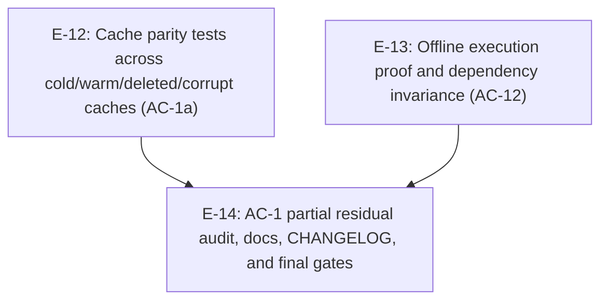

# IPD: Move selectors, check_engine, attention and ipd_lint reads onto artifact_meta

- Date: 2026-11-02
- Kind: child
- Concern: Spec `4sd62s` C5 and C5a require that every metadata read goes through `artifact_meta` and its SQLite cache, and section 7 step 5 moves the readers while the bullet format is still on disk. Measured 2026-11-02 at `0cbfcc706`: 59 of 211 package modules contain a legacy bullet pattern, a `^-` metadata regular expression or a `## Workflow history` reference; 200 metadata regular-expression call sites start with `^-`; the four read surfaces this plan owns (`selectors`, `check_engine`, the `attention` modules, `ipd_lint`, plus the `aw find` and `aw ipd board` paths in `cli` that consume them) hold 52 of those call sites and every one of the 17 `history_block` and `last_history_at` reader calls outside the setters. Two readers of the same field disagree today: `selectors._read_status` (single token) and `plans_index.plan_entry` (whole line) return different statuses for 24 tracked plans, so `aw find plans executed` lists 1,610 plans while `aw find plans --status executed` lists 1,635. Until these readers move, Order 11 (`9o83cr`) cannot delete the parsers and AC-1 cannot hold.
- Scope: Phase B readers, part 1 of 2 (`4sd62s` section 7 step 5), FINISHING PART. Split 2026-11-07 per the maintainer step-complexity rule: the reader moves now live in six child plans, Order 27 `r81uvz` (`selectors`, `aw find`/`aw search`/`aw ipd board`, `artifact_meta.read_text` with its spec 4.3 entry, and the `status_set` reads), Order 28 `dqutt8` (`attention` and `ipd_lint`), and Orders 29 to 32 `w1cs3p`, `na188y`, `i3b5zu`, `ebrc4t` (the `check_engine` working-tree readers in four site partitions, and the one record skip list). Round 3 (2026-11-09, research `nj8zdp` guidance): `aw check meta` (4.6) and `aw meta repair` (4.3, 4.7), formerly E-10 and E-11 here, moved to `a5ijjx` (Order 140); `r81uvz` and `dqutt8` were themselves re-split (into `cdglt1` and `1suzlp`) and each still finishes after its new part, so the `executed:r81uvz` and `executed:dqutt8` edges keep their meaning. THIS plan keeps the reader ledger and decisions D-1 to D-6 that govern all of them, and the finishing work: the cache-parity test (AC-1a), the offline proof (AC-12), the AC-1 partial residual audit (F-12), the docs and CHANGELOG lines, and the final gates. EXCLUDES: every reader of HEAD, staged or branch content and the runner, plans/research/prompts index, `artifact_audit` and `review_findings` modules (Order 09, `t4gl15`); deleting the old parsers and INDEX code (Order 11, `9o83cr`); writers (Orders 06 and 07).
- Scope-Paths: agent_workflows/artifact_meta.py, tests/test_readers_cache_parity.py, tests/test_readers_offline.py, docs/cli-output-contract.md, CHANGELOG.md, .aw/records/plans/pending/20261102-metastore-08-ffceq0-move-selectors-check-engine-attention-and-ipd-lint-reads-ont.ipd.md
- Item-Dependencies: executed:g5hpbb, executed:tve77h, executed:xexn45, executed:r81uvz, executed:dqutt8, executed:w1cs3p, executed:na188y, executed:i3b5zu, executed:ebrc4t, executed:a5ijjx
- Status: approved
- Readiness: go-pending-approval
- From-Spec: 4sd62s
- Work-Kind: feature
- Priority: high
- Blocks-Release: next
- Set: metastore
- Order: 8
- Highest E allocated: 16
- Author: opencode its_direct/pt3-claude-opus-5.5-1m-us
- Id: ffceq0
- Approval: 2026-11-16, recorded via aw ipd set: status set to approved
- Review-Depth: complex

> Written to .aw/system/workflows/technical-writing/technical-writing.md. Every obligation, exact identifier, quotation, evidence record, and lifecycle status is preserved.

## Workflow history
- 2026-11-16 approved (aw set): status set to approved
- 2026-11-14 reviewed (aw set): APPROVE WITH REVISIONS APPLIED; PR-001..PR-005 FIXED
- 2026-11-14 /plan-review (antigravity/gemini): APPROVE WITH REVISIONS APPLIED; PR-001..PR-005 FIXED; review record .aw/records/reviews/20261102-metastore-08-ffceq0-move-selectors-check-engine-attention-and-ipd-lint-reads-ont.review.md
- 2026-11-09 note (opencode its_direct/pt3-claude-opus-5.5-1m-us): round-3 split per research nj8zdp; items E-10, E-11 moved to a5ijjx.
- 2026-11-07 note (opencode its_direct/pt3-claude-opus-5.5-1m-us): split per maintainer step-complexity rule; items E-01, E-02, E-03, E-15, E-16 moved to r81uvz; E-04, E-05, E-09 moved to dqutt8; E-06 and E-07 (site list partitioned by function) moved to w1cs3p, na188y, i3b5zu and ebrc4t; E-08 moved to ebrc4t. Kept: E-10 to E-14, the reader ledger and D-1 to D-6.
- 2026-11-07 same-status (aw set): maintainer direction 2026-11-07 (spec 4sd62s C12/5.2a step 3a): the any-repo migration and multi-shape cache (g5hpbb) must land before any reader move and before the cutover
- 2026-11-07 to-review (aw set): demoted approved -> to-review: APPROVAL WITHDRAWN: maintainer direction 2026-11-07: paused before re-review; the metastore plans MUST build the tools that migrate ANY repo from ANY prior format (.agents layout, id-less/untitled records, no sidecar), not only this repository. Re-review against the amended spec 4sd62s before re-approval.
- 2026-11-07 approved (aw set): status set to approved
- 2026-11-06 reviewed (aw set): APPROVE WITH REVISIONS APPLIED; PR-001..PR-012 FIXED
- 2026-11-06 /plan-review (opencode/its_direct/pt3-claude-opus-5.5-1m-us): APPROVE WITH REVISIONS APPLIED; PR-001..PR-012 FIXED; review record .aw/records/reviews/20261102-metastore-08-ffceq0-move-selectors-check-engine-attention-and-ipd-lint-reads-ont.review.md
- 2026-11-05 to-review (aw set): authored review-ready for spec 4sd62s (Set metastore)

- 2026-11-02 draft (opencode its_direct/pt3-claude-opus-5.5-1m-us): created.

## Goal

With every reader move done by the six split parts (`r81uvz`, `dqutt8`, `w1cs3p`, `na188y`, `i3b5zu`, `ebrc4t`) and `aw check meta` and `aw meta repair` added by `a5ijjx`, the moved readers are proven to give byte-identical answers across cold, warm, deleted and corrupt caches and with no network, and the residual `^-` and history hits in the moved modules are each listed with a reason. The reader ledger and decisions D-1 to D-6 below remain the single record of what each moved consumer kept or lost.

## Detailed Implementation Checklist (TODO)

Execution-state rule: mark an `E-*` item complete only after performing the action. That mark is not validation. Right-sizing rule: each E-item must address one concern and be executable in one focused pass; split when an E-item names multiple distinct deliverables or independent test-surfaces. Accepted execution states: blocked, failed, pending, performed; terminal gate demands 'performed'.

Every E-item that moves a reader follows one rule, so a reviewer can check each the same way: (1) BEFORE the edit, add or extend a behavioral test in the named module that pins the reader's CURRENT observable behavior on a `tmp_path` fixture repository (the "prior behavior" column of the reader ledger in `## Findings`), and run it green against the unmodified code; (2) change the reader to call `artifact_meta`; (3) run the same test unchanged. A test that has to change in step 3 is a behavior change and must be one of the decisions listed in the ledger (D-1 to D-5), never a silent one. For every existing module named as a baseline, save the per-test outcome list under the gitignored `.aw/state/ffceq0/` (`python3 -m pytest -o addopts="" -m "" -p no:randomly -n 0 -rA <modules> | grep -E "^(PASSED|FAILED|ERROR|SKIPPED|XFAIL|XPASS) " | sed -E 's/ - .*//' | sort > .aw/state/ffceq0/<E>-before.txt`) before the move and the same command into `<E>-after.txt` after it; `diff` of the two prints nothing except lines a named decision explains. Every saved baseline (command output, JSON, rule counts) also goes under `.aw/state/ffceq0/`, never `/tmp`, so it survives a lane integration. A count measured at authoring (for example the 1,635 executed plans of F-03) is context, never the bar: each expected outcome compares a before and after value re-derived on the same tree. New test modules set `pytestmark = pytest.mark.core`, call real functions or the real `aw` CLI, and never read production source.

Split note (2026-11-07): the items this plan keeps used to depend on moved items (E-10 on E-07, E-12 on E-03/E-05/E-07/E-09, E-13 on E-03/E-05/E-07, E-14 on E-08/E-15/E-16). Those edges are carried by the `- Item-Dependencies:` edges on the six split parts, which must all be executed before this plan starts, so the in-plan `Depends on` rows name only the items this plan still holds. The reader-move rule above still governs the parts; each part copies it and the decision rows that apply to it.

Round-3 note (2026-11-09): Task group 4 (E-10 `aw check meta`, E-11 `aw meta repair`) moved to `a5ijjx`, an `- Item-Dependencies:` edge of this plan, so E-12's former `Depends on: E-10` is carried by that edge.

### Task group 5: cache parity, offline proof and finish

- [ ] E-12 Add `tests/test_readers_cache_parity.py` (AC-1a, phase B form): for a fixture corpus with one record of each type, run `aw find` (all types), `aw attention --format json`, `aw check meta --agent`, `aw check all --agent` and `aw ipd lint` with (a) a cold cache, (b) a warm cache, (c) `.aw/state/index.db` deleted, (d) `index.db` overwritten with random bytes; assert byte-identical normalized outputs. Then edit one record's `- Status:` bullet outside `artifact_meta` (as a pull does) and assert the next `aw find` and `aw attention` show it with no rebuild; then replace a record with an unparseable one and assert it is REPORTED (`incomplete`/violation), not silently omitted and not served stale. Also covers AC-8 at the command level (with and without `index.db`, empty diff). Also cover the legacy `.agents/` record root, which `selectors`, `attention._TREE_TO_SCAN_ROOTS` and `check_engine` read today (measured at review: a repository holding only `.agents/plans/pending/<plan>` is listed by `aw find plans <id6>` and `aw attention --all`): a fixture with one plan under `.agents/plans/pending/` must give the same `aw find` and `aw attention` rows after the move as before it. If `artifact_meta.query` does not scan that root, the executor either extends the legacy loader's scan roots or records the loss as a named decision in the reader ledger; it never drops the rows silently.
  - Depends on: none
  - Expected outcome: every case passes; the module is marked `core`, and its wall time from `--durations=0` is pasted (each case spawns the CLI, so keep the fixture small enough that the module adds no more than a few seconds to the 30 s core budget).
  - Execution state: pending

- [ ] E-13 Add `tests/test_readers_offline.py` (AC-12 reader half): run `aw find`, `aw attention --format json` and `aw check all --agent` in a fixture repository with `PATH` stripped of every host binary (`opencode`, `agy`, `claude`) and with `socket.socket` patched to raise in a `sitecustomize` on `PYTHONPATH`; assert each succeeds. Paste `git diff 0cbfcc706 -- pyproject.toml` and the `dependencies = [...]` line of `pyproject.toml` (the line must not change; `0cbfcc706` is the measurement commit of `## Findings`).
  - Depends on: none
  - Expected outcome: three successful runs; the `dependencies` list reads `["filelock>=3"]`.
  - Execution state: pending

- [ ] E-14 Record the AC-1 partial audit and finish: run `rg -n "re\.(compile|search|match|finditer|findall|sub|fullmatch)\(\s*r?[\"'](\(\?m\))?\^-" agent_workflows/selectors.py agent_workflows/attention.py agent_workflows/check_engine.py agent_workflows/ipd_lint.py agent_workflows/plans.py` and `rg -n "history_block\(|last_history_at\(" agent_workflows/attention.py agent_workflows/check_engine.py agent_workflows/ipd_lint.py`; every remaining hit must be in the written exclusion list (the check_engine parts `w1cs3p`, `na188y`, `i3b5zu` and `ebrc4t` each name the N3 sites they leave) (body-prose bullets per N3, git-content readers carried by Order 09, or the plan's own `- [ ] E-` leaf grammar), which this item writes into the plan's `## Findings` as table F-12. Update `docs/cli-output-contract.md` with the two new leaves that `a5ijjx` added (`aw check meta`, `aw meta repair`) and add a `CHANGELOG.md` `2.0.0 (pending)` line, with no em or en dashes in that user-facing prose. Run the named modules of E-01 to E-13 (the E-01 to E-11, E-15 and E-16 modules now live in the split parts `r81uvz`, `cdglt1`, `dqutt8`, `1suzlp`, `w1cs3p`, `na188y`, `i3b5zu`, `ebrc4t` and their round-3 parts, and `a5ijjx`, all executed before this item; re-run them here as the final check), the bare core gate `python3 -m pytest`, `make test-all`, `aw check all --agent` (rule-id multiset equal to `.aw/state/ffceq0/check-before.txt`, any difference explained by a record changed in between) and `aw sanitize --agent`; commit through `aw commit ffceq0 -- <each changed path>`, one commit per task group allowed, never `git add -A`, a bare `git add` or `git commit -a`. Never push.
  - Depends on: E-12, E-13
  - Expected outcome: every residual hit is listed with its reason; all runs pass; every commit is path-scoped to Scope-Paths (or justified at finalize).
  - Execution state: pending

Add further leaves as `- [ ] E-NEW <action>` and run `aw ipd sync` to assign ids.

## Project conventions discovered (Step 0)

- The `artifact_meta` interface names come from Order 02 (`tve77h`) and are used exactly: `artifact_meta.read(id6) -> State`, `artifact_meta.history(id6)`, `artifact_meta.query(...)` with typed filters (type, status, Set, order, `depends_on`, `latest_gate_review_of`, `path`) and an `incomplete` list, `artifact_meta.resolve(path_or_id6)`, `artifact_meta.read_at(id6, rev)` (Order 09 only), `artifact_meta.repair(id6, *, confirm=None)`, and the `artifacts.short_description` column. The legacy loader stores a multi-word `- Status:` raw value in a legacy-only column and sets `artifacts.status` only for a single token (tve77h OQ-03, which names this plan as the carrier of the reader decision).
- One status normalizer already exists: `plans.normalize_status` maps `EXECUTED`/`DONE` to `executed` and any other unrecognized token to `plans.LEGACY_GROUP` (`legacy/unknown`); `plans.read_status` applies it to the FIRST token of the whole-file `- Status:` line. `attention._plans_record` and `ipd_lint.lint_text` (M105) already use it.
- `selectors.metadata_region` is the shared region bound (the bullet block before the first `##`, or the YAML fence). The PARITY CONSTRAINT comment above `selectors._STATUS_RE` records the 24-plan disagreement and forbids changing it without "owning that contract change", which D-1 does here.
- Shared history rules: `attention_contract.history_block`, `attention_contract.newest_history_record`, `attention_contract.last_history_at`.
- `aw find` for plans uses `plans_index.plan_entry` and `plans_index.query` for display rows and `selectors.resolve` (through `cli._resolve_selectors_with_kinds`) for selector hits; `aw ipd board` is `cli._run_plans` over `plans.scan`.
- New CLI leaves are declared in `command_surface` (`CommandDeclaration`) and covered by `tests/conformance_matrix.py`. Order 03 (`1ajqaa`) creates `agent_workflows/meta_cli.py` for `aw show --history`, so this plan adds `check meta` and `meta repair` to that module.
- Traversal exclusions live in `layout.TRAVERSAL_EXCLUSIONS` (consumed by `selectors`); `_SKIP_NAMES` is defined separately in `check_engine`, `selectors` and `artifact_refs`.
- Core tier: modules set `pytestmark = pytest.mark.core`; the bare gate is `python3 -m pytest` (30 s budget).
- Cite code by SYMBOL (`module.function`) or by a quoted content string, with a line number only appended to one of those and never alone: an offset expires before this plan executes (spec `ipd-structure-and-linting` Section 10.2; advisory `IPD-C801`).

## Findings

Measured 2026-11-02 at `0cbfcc706` (211 package modules under `agent_workflows/`).

| Id | Evidence | Finding |
|---|---|---|
| F-01 | Union of `rg -l` for (a) `^-` regex literals, (b) `- <Field>:` strings for 21 metadata fields, (c) `Workflow history`: 59 modules. Regex call sites starting `^-`: 200 (spec r5: 95 literals, a narrower count). `Workflow history` references: 28 modules (spec: 27) | Spec section 1 counts re-measured; the reader modules are split between this plan and Order 09 (F-02). |
| F-02 | Reader modules by owner (writers are Orders 06/07). THIS PLAN: `selectors` (7 regex sites), `cli` find/search/board paths (`_find_type_records`, `_find_prompt_id6`, `_find_prompt_setid`, `_run_search`, `_run_plans`), `attention` (10), `attention_contract` (history readers), `plans` (3), `check_engine` working-tree readers (30 sites in the module; its 12 `_blob_text` git call sites go to Order 09), `ipd_lint` (5), `ipd_schema.parse_metadata_block` (via its caller), `artifact_refs._SKIP_NAMES`. ORDER 09: `runner_shared` (20), `oc_runipd`, `agy_runipd`, the four hooks, `check_engine` git readers, `plan_readiness.review_staleness_index`, `ipd_lifecycle._release_own_plan_edit_before_landing`, `status_set._prepare_status_change` HEAD read, `plans_index` (6), `plans_archive` (5), `plans_refs` read side, `research_index` (2), `research_archive`, `prompts_index`, `artifact_audit` (1), `review_findings` (1), `review_sequence` (2), `review_tier`, `review_rereview`, `orchestrator_readiness` (1), `production_checks` (5), `work_cmd` (2), `artifact_adopt` (1), `ipd_set_plan`, `completion` | 9 reader modules here, 27 in Order 09; with the writer modules of Orders 06/07 they cover the 59. Comment-only mentions (`term`, `config`, `lifecycle_style`, `command_surface`, docstrings in `agy_runipd`) are not readers. |
| F-03 | `aw find plans executed` lists 1,610 paths; `aw find plans --status executed` lists 1,635. The 25 extra: 24 multi-word `- Status:` plans in `executed/` (`EXECUTED 2026-07-0x ...` 13, `DONE (...)` 7, `EXECUTED (approved ...)` 4) plus `vfa1tl`, whose single token is upper-case `EXECUTED` | The selector path (`selectors._read_status`, exact token) and the filter path (`plans_index.query`, status OR disposition) answer the same question differently. |
| F-04 | Python check over all tracked plans: `selectors._read_status` and `plans_index.plan_entry(...).status` disagree on exactly 24 plans; for all 24, `plans.normalize_status(<whole line>)` is `legacy/unknown`, `plans.read_status` (first token) is `executed`, and `aw attention` reports `native_status: executed` | Three answers exist: none (selectors), the prose line (plans_index), `executed` (plans, attention). D-1 picks one. |
| F-05 | `selectors._read_status` (strict `^- `, YAML fallback) and `selectors.read_front_matter_status` (loose `^-\s*`, no YAML) disagree on 157 records, ALL research files with YAML status. No tracked record uses `-  ` or `-\t` before a metadata field (0 matches) | The whitespace difference has no corpus effect; the YAML difference is real, and D-2 keeps each caller's answer. |
| F-06 | 4 records have a `- Status:` bullet only OUTSIDE the metadata region (3 reviews, 1 walkthrough quoting `- Status: approved <- unchanged`); `plans.read_status` (whole file) reads them, the region readers do not | No plan is affected (D-4). |
| F-07 | `aw attention --all --format json`: 3,096 items (plans 1,719, backlog 1,133, research 165, specs 48, prompts 30, releases 1), 1 violation, `valid: true` | Baseline for E-05. |
| F-08 | `history_block(` call sites: `attention` 6, `check_engine` 3; `last_history_at(` and `history_block(` together 10 sites in `attention` and `check_engine` | All history reads in this plan's modules go through `artifact_meta.history`. |
| F-09 | `_SKIP_NAMES = {"README.md", "INDEX.md", "STATUS.md"}` is defined identically in `check_engine`, `selectors` and `artifact_refs`; `layout.TRAVERSAL_EXCLUSIONS` holds 7 directory names | 4.4 asks for one list; E-08 places it in `layout`. |
| F-10 | No `aw check meta` and no `aw meta` command exist (`aw check --help` lists plans, specs, prompts, research, backlog, walkthroughs, roadmaps, comms, releases, all). Order 02 defers the `aw meta repair` CLI here; Orders 03, 04 and 05 defer `aw check meta` and the `short_description` display in `aw find`/`aw attention --details` here | `a5ijjx` (E-10, E-11) and the split parts (E-03, E-05) own them. |
| F-11 | `aw find plans zzzzzz` exits 2 today (4.4a `zyj8io`) | Pinned by E-01, re-checked after E-03. |
| F-12 | (written by E-14) residual `^-` and history hits in this plan's modules after the move, each with its exclusion reason | Input to Order 11's AC-1 audit. |

Step-complexity measurement of the items this plan keeps (2026-11-07, maintainer rule: no E-item hides more than about 25 units of work):

- E-10 and E-11 (the meta commands, about 17 and 8 units) moved to `a5ijjx` in round 3.
- E-12 (cache parity): 5 commands x 4 cache states (20 cases), plus external edit, invalid replacement and the `.agents/` root case. About 23 units.
- E-13 (offline proof): 3 commands and the `pyproject.toml` check. About 4 units.
- E-14 (audit and finish): the residual-hit table F-12, estimated from `rg -n '_LEAF_RE|_TARGET_BULLET_RE|_SCOPE_PATHS_LINE_RE|_OQ_STATUS_RE' agent_workflows/{ipd_lint,check_engine,attention}.py` (5 N3 definitions: `ipd_lint._LEAF_RE`, `attention._OQ_STATUS_RE`, `attention._EV_LEAF_RE`, `check_engine._TARGET_BULLET_RE`, `check_engine._SCOPE_PATHS_LINE_RE`) plus the git-content reader definitions that stay in `check_engine` for Order 09 (about 6), so about 12 rows; 2 documentation files; 5 gate runs; path-scoped commits. About 22 units.
- The items moved out measured: E-07 alone 93 working-tree metadata-read site lines in 50 `check_engine` functions (an `ast` walk of `agent_workflows/check_engine.py`, recorded in each check_engine part), which is why it was split by function across Orders 29 to 32.

READER LEDGER: prior behavior, the test that pins it, and the result (section 7: "name the behavior that its moved consumers had and the test that checks it").

| Reader | Prior behavior | Pinning test | After |
|---|---|---|---|
| `selectors._read_status`, `resolve` `MATCH_STATUS` | exact single token of the region `- Status:`; YAML `status:` for research; none for multi-word | E-01 module; `tests/test_selector_two_dialect_readers.py`; `tests/test_front_matter_loose_whitespace.py::test_single_token_status_contract_survives` | D-1: canonical status from the cache; multi-word executed plans match `executed` |
| `selectors.read_front_matter_id`/`_status`/`_blocks_release` | loose `^-\s*` bullet only, region-bounded, no YAML | `tests/test_front_matter_loose_whitespace.py`, `tests/test_blocks_release_reader_bounding.py` | D-2: same answers |
| `selectors.declared_id6`, `id6_ownership` | whole-file id read for the ownership verdict | `tests/test_plans_rename_selectors.py`, E-01 | cached `id` |
| `plans_index.plan_entry` status in `aw find plans` JSON | whole prose line | `tests/test_find_single_read.py::test_d_status_disagreement_record_matches_and_preserves_plans_index_status` | D-1: canonical value (the printed row already shows the disposition first, `e.disposition or e.status`, so it does not change) |
| `plans.read_status`, `plans.scan` (`aw ipd board`, attention, M105) | first token of whole-file line, normalized | `tests/test_plan_status.py`, `tests/test_plans_board.py` | same normalized value from the cached raw status |
| `attention._plans_record` and siblings | per-tree reads, drift on missing/unknown status | E-04 module, `tests/test_attention.py`, `tests/test_attention_degraded_item.py` | same Items and drift |
| `attention._extract_detail` | Summary, Scope, Concern, Question, Title, H1 cascade | `tests/test_attention.py`, `tests/test_specs_releases_unsafe_field.py` | D-3 |
| `attention_contract.last_history_at` callers | newest history record date | `tests/test_history_consumers_shared_reader.py`, `tests/test_history_date_clock_readers.py` | same rule over `artifact_meta.history` |
| `check_engine` identity, status, Set, Item-Dependencies and From-* readers | region-bounded `^- ` bullets with mixed whitespace rules | E-06 module and its nine baseline modules | cached fields; identical rule ids on this checkout |
| `check_engine.build_graduation_reverse_index`, `graduation_cluster` | declarations and reverse links read separately | `tests/test_graduation_forward_links.py`, `tests/test_from_backlog_cardinality.py` | `lineage` and `graduation_targets` rows, still distinct (4.4a `pw2ln3`) |
| `check_engine.check_spec_review_attestation` | any parsing record naming the subject | `tests/test_spec_review_attestation.py` | unchanged here (the gate-only rule of 4.4 SR-601 is Order 06's deliberate change) |
| `ipd_lint.parse` metadata, `IPD-S405`, `M107`, `M112`, `M113`, `run_lint` rows | `ipd_schema.parse_metadata_block` slice; history lines parsed in `ipd_lint` | E-09 module, `tests/test_ipd_lint.py`, `tests/test_readiness_absence_invariant.py`, `tests/test_orchestrator_readiness.py` | same verdict per plan |
| `cli._find_prompt_id6`/`_find_prompt_setid` | `aw-prompt` comment first, then guarded filename slot | `tests/test_find_prompts_lane_status.py`, E-01 | cached `id`/`set` (the legacy loader applies the same order) |
| `cli._run_search._artifact_status` | loose `^-\s*Status:` over the whole file | `tests/test_cli_search.py` | cached status |

DECISIONS where readers disagreed (4.3: "record which behavior each consumer of the two disagreeing readers loses"):

- D-1 (status of the 24 multi-word plans; F-03, F-04). KEPT: the canonical normalized status that `aw attention`, `aw ipd board` and `ipd_lint` already report (`executed` for `EXECUTED ...` and `DONE ...`, `legacy/unknown` for any other unrecognized token). For PLAN records only, both `aw find` paths match `plans.normalize_status` of the FIRST token of the cached raw value (the `plans.read_status` rule). Every other type keeps today's exact single-token match on the raw value, because `plans.normalize_status` knows only the plan vocabulary and maps `open`, `implemented`, `active` and `planned` to `legacy/unknown` (measured at review: `aw find backlog open` lists 27 rows and `aw find specs implemented` 22 today, and both must stay unchanged). The rule lives in `selectors`' `MATCH_STATUS` branch, so every `selectors.resolve` caller that allows `MATCH_STATUS` sees it; E-01 pins one non-find caller (`tests/test_selector_resolver_matrix.py`) so the change to those callers is observed, not assumed. WHAT EACH CONSUMER LOSES OR GAINS: `aw find plans executed` (selector path) GAINS the 24 plans plus `vfa1tl` and agrees with `--status executed` (1,635 rows at authoring); `aw find plans EXECUTED` stops matching `vfa1tl` by exact case (its only match today); the `aw find` JSON `status` of those 24 changes from the prose line to `executed` (the prose stays in the raw legacy column and in the file); the test edits are the expected value in `tests/test_find_single_read.py::test_d_status_disagreement_record_matches_and_preserves_plans_index_status` (only if its `plans_index` assertion reads through the moved path; Order 09 owns `plans_index`) and the `_read_status(multi)` assertion in `tests/test_front_matter_loose_whitespace.py::test_single_token_status_contract_survives`, whose `read_front_matter_status(multi)` and `parse_plan_file` assertions stay unchanged (D-2; the runner is Order 09's). Reason: one reader, one answer (4.3), and it is the answer three surfaces already give. The migration (Order 04) normalizes these terminal records at the cutover.
- D-2 (whitespace and YAML; F-05). KEPT: each caller's current answer. The cache holds research YAML status, so `_read_status`/`MATCH_STATUS` keep matching research by it, while the public `read_front_matter_status` keeps returning None for a YAML-only record (Order 09's runner callers read plans, which use bullets). Whitespace keeps each caller's current answer too: the legacy loader parses "one strict `- Field: value` grammar" (`tve77h` E-11), which matches the strict internal readers (`_read_id`/`_read_status` reject `-  ` and `-\t`, pinned by `tests/test_front_matter_loose_whitespace.py::test_internal_readers_stay_strict`), while the public `read_front_matter_*` readers keep accepting `-  ` and `-\t` (pinned by `test_public_readers_tolerate_loose_leading_whitespace`) through the loose values that `read_text` also returns (E-02). Today 0 tracked records use the loose spelling (F-05), so the cache and the public readers agree on the whole corpus; Order 11 retires the loose values with the public readers.
- D-3 (detail text). KEPT: the `_extract_detail` cascade as the fallback; `short_description` wins when present (4.4 first bullet). In phase B no record has one, so output is unchanged until Order 13.
- D-4 (status bullet outside the metadata region; F-06). KEPT: region-bounded reading. The 4 records are 3 reviews and 1 walkthrough, which have no lifecycle status, so no plan-status consumer changes.
- D-5 (where the skip list applies; E-08). KEPT: record walkers skip `README.md`, `INDEX.md` and `STATUS.md` exactly as today; citation scans through `artifact_core.iter_scan_files` keep reading `README.md` (0u0ako). ADDED: every walker skips `records/meta/`. No record row changes today, because no `meta/` directory exists before the cutover.
- D-6 (records with no in-file `- Set:` bullet; added 2026-11-07, maintainer decision recorded on backlog `suth7l`). KEPT: the cache's filename-derived Set. `status_set`'s reader returns no Set for these records (242 on this repository on 2026-11-07: 164 research, 30 prompts, 23 specs, 14 plans, 8 walkthroughs, 3 roadmaps), while the cache takes it from the filename, which spec `4sd62s` C1/C10 make the checked mirror of `set` and 5.2 step 3 already uses as the default. What a consumer loses: nothing; what changes: `aw set <setid>` and `aw find <setid>` also match those records once E-15 lands. Pinned by `tests/test_artifact_meta_loader_parity.py::test_cache_agrees_with_status_set_reader_on_every_fixture_record`.

## Proposed changes (ordered, validatable)

1. Cache parity (AC-1a), offline proof (AC-12), residual audit, docs, commit (E-12 to E-14), after the six split parts are executed.

## Deferred / out of scope (with reason)

- E-10, E-11 (`aw check meta`, `aw meta repair`). Moved to a5ijjx (round-3 split 2026-11-09 per research nj8zdp guidance).
  - Carrier: a5ijjx
- E-01, E-02, E-03 (selectors, `aw find`, `read_text` and its spec 4.3 entry) and E-15, E-16 (the `status_set` reads). Moved to r81uvz (split 2026-11-07 per maintainer step-complexity rule).
  - Carrier: r81uvz
- E-04, E-05 (attention) and E-09 (ipd_lint). Moved to dqutt8 (split 2026-11-07 per maintainer step-complexity rule).
  - Carrier: dqutt8
- E-06, E-07 identity, Set, date and From-Spec subset of the check_engine site list. Moved to w1cs3p (split 2026-11-07 per maintainer step-complexity rule).
  - Carrier: w1cs3p
- E-06, E-07 plan-rule and review subset. Moved to na188y (split 2026-11-07 per maintainer step-complexity rule).
  - Carrier: na188y
  - Carrier-Evidence: .aw/records/plans/executed/20261107-metastore-30-na188y-move-the-check-engine-plan-rule-and-review-readers-onto-arti.ipd.md
- E-06, E-07 release-gate, close and From-Backlog subset. Moved to i3b5zu (split 2026-11-07 per maintainer step-complexity rule).
  - Carrier: i3b5zu
  - Carrier-Evidence: .aw/records/plans/executed/20261107-metastore-31-i3b5zu-move-the-check-engine-release-gate-and-from-backlog-readers.ipd.md
- E-06, E-07 graduation and handoff subset, and E-08 (the one record skip list). Moved to ebrc4t (split 2026-11-07 per maintainer step-complexity rule).
  - Carrier: ebrc4t
- Readers of HEAD, staged or branch content (`check_engine._blob_text`/`_status_meta` git callers: `check_status_untooled`, `check_status_untooled_range`, `check_staged_illegal_backlog_transition`, `_lane_carrier_is_executed`, `_staged_backlog_done_items`, `check_release_gate_consistency`), the hooks, the runners and `runner_shared`, `plan_readiness.review_staleness_index`, `ipd_lifecycle._release_own_plan_edit_before_landing`, `status_set._prepare_status_change`: they need `read_at` (4.4 list).
  - Carrier: t4gl15
- The `plans_index`, `plans_archive`, `plans_refs`, `research_*`, `prompts_index`, `artifact_audit`, `review_findings`, `review_*`, `orchestrator_readiness`, `production_checks`, `work_cmd`, `artifact_adopt`, `ipd_set_plan` and `completion` readers (section 7 step 5, second half).
  - Carrier: t4gl15
- The hook that refuses a non-append change to `meta/*.jsonl` (4.8 last bullet).
  - Carrier: t4gl15
- Deleting `selectors._STATUS_RE` and every other leftover parser and regex, the INDEX/STATUS code, and the AC-1 test.
  - Carrier: 9o83cr
- The `->reviewed` gate-only attestation change in `review_findings.review_attestation_missing` (4.4 SR-601) and the event-owned readiness/approval/coverage rules (AC-15).
  - Carrier: 2xwb9b
- Writing `short_description` (creating commands and the setter; AC-36 case 1).
  - Carrier: xexn45
  - Carrier-Evidence: .aw/records/plans/executed/20261102-metastore-07-xexn45-move-the-remaining-metadata-writers-onto-artifact-meta.ipd.md
- The post-cutover `last_history_at` from the newest event `at` with `last_history_precision` (4.4), the logged-path drift row of `aw check meta`, and AC-7 "zero findings on the migrated corpus".
  - Carrier: cxxmyv

## Scope check

- Over-scope: none. `artifact_meta.py` changes only if E-12 must extend the legacy loader's scan roots to the `.agents/` record root (or to fix an interface defect a parity test exposes), which the finalize scope reconciliation records.
- Under-scope: none known. Plan size after the round-3 split: 3 E-items in 1 task group, 5 work Scope-Paths; the reader moves of the first half of F-02 are carried by the six split parts named in `## Deferred`.

## Required tests / validation

New core test modules of this plan: `tests/test_readers_cache_parity.py`, `tests/test_readers_offline.py` (`tests/test_check_meta.py` and `tests/test_meta_repair_cli.py` moved to `a5ijjx`). All build `tmp_path` fixture repositories, call real functions or the `aw` CLI, assert on outputs and exit codes, and never read production source. The reader pin modules (`tests/test_readers_selectors_find.py`, `tests/test_readers_attention.py`, `tests/test_readers_check_engine.py`, `tests/test_readers_ipd_lint.py`) are created by the split parts and re-run by E-14.

Acceptance criteria of `4sd62s` this plan OWNS jointly with Order 09 (`t4gl15`), the phase-B reader pair. Each case has exactly one owner:

| AC | This plan's part | Order 09's part |
|---|---|---|
| AC-1a | `aw find`, `aw attention --format json`, `aw check meta`, `aw check all`, `aw ipd lint` across cold, warm, deleted and corrupt caches; external edit visible; invalid replacement reported (E-12) | the setter and the pre-commit gate cases |
| AC-7 | every 4.6 row the legacy format can express, one fixture per drift kind (`a5ijjx` E-01, formerly E-10 here) | none; Order 13 shows zero findings on the migrated corpus |
| AC-9 (reader parts) | none of this plan's readers consults an INDEX file (checked in E-14) | the `plans_index`/`research_index`/`prompts_index` readers; deletion is Order 11 |
| AC-12 | `aw find` and `aw attention` with no model launcher and no network; `dependencies` unchanged (E-13) | the setter case |

CONTRIBUTES to: AC-8 (command-level form in E-12; owned by `tve77h`), AC-36 case 2 (`aw find` and `aw attention --details` read the column; finally shown by `cxxmyv`), AC-21 rows `wja06w`, `zyj8io`, `pw2ln3` (pasted runs; AC-21 is owned by `xexn45`), AC-1 (residual audit F-12; owned by `9o83cr`), AC-18 (`aw find` on a companion fixture in E-12; owned by `tve77h`).

Commands: the named modules, the bare core gate `python3 -m pytest`, `make test-all` (the phase-B thorough checkpoint belongs to Order 11, but this plan must not break it), `aw check`, `aw sanitize --agent`.

## Spec / documentation sync

The ONE spec amendment of the original plan is now carried by Order 27 `r81uvz` (split 2026-11-07): `4sd62s` 4.3 gains `read_text(text, *, record_type=None) -> State` in its function list (OQ-03). Reason: the spec's function list is the C5 contract, and without the entry an in-memory text reader (the public `selectors.read_front_matter_*(text)` readers, `ipd_lint.lint_text`, `review_sequence` snapshots, Order 09's merge-stage text) would need either a second grammar or a function the spec does not name. The amendment adds a function; it changes no existing rule, and before the cutover nothing else depends on it. Implements `4sd62s` 4.3 (one reader; the D-1 record), 4.4 (IPD-S405 through `history`, the shared exclusion list, the `_extract_detail` replacement), 4.6 (`aw check meta`) and 4.7/4.8 (`aw meta repair`) through `a5ijjx`, and section 7 step 5 (first half). This plan itself changes no spec text. `docs/cli-output-contract.md` gains the two new leaves, and a `CHANGELOG.md` line records the D-1 matching change, because `aw find plans executed` returns more rows than before.

## Open questions

### OQ-01: Is the D-1 matching change acceptable before the cutover?

- Blocking: no
- Status: resolved
- Owner: plan author
- Resolution or deferral rationale: Yes, from repository evidence. The PARITY CONSTRAINT comment asks only that the change be owned, and 4.3 requires the plan to pick one behavior. D-1 makes the two `aw find` paths agree with `aw attention`, `aw ipd board` and `ipd_lint` (F-04), affects 25 records in `executed/`, removes no row from any listing, and is recorded in `CHANGELOG.md`. Recommendation strength: strong.

### OQ-02: Does the plan fit the size limits?

- Blocking: no
- Status: resolved
- Owner: plan author
- Resolution or deferral rationale: Superseded 2026-11-07 by the maintainer step-complexity rule (no single E/V item may hide hundreds of steps): `ffceq0` E-07 alone measured 93 working-tree metadata-read site lines in 50 `check_engine` functions, so the plan was split into six child plans (Orders 27 to 32) and kept 5 finishing E-items; round 3 (2026-11-09) moved E-10 and E-11 to `a5ijjx`, leaving 3. Recommendation strength: strong.

### OQ-03: How does a reader get metadata for TEXT that is not a tracked working-tree file?

- Blocking: no
- Status: resolved
- Owner: plan author
- Resolution or deferral rationale: `tve77h` defines `read`, `history`, `query`, `resolve` and `read_at` (revision blobs), but no entry point for an in-memory string, and today 58 test call sites plus `review_sequence` (before/after snapshots) and the public `selectors.read_front_matter_*(text)` readers pass text. This plan adds ONE additive function, `artifact_meta.read_text(text, *, record_type=None) -> State`, which runs the SAME loader that `read_at` feeds a blob to (tve77h E-14), writes no cache row, and returns the same `State` type. It is the only way to keep C5 (no parser outside `artifact_meta`) without a second grammar. After the cutover a text carries only `id` and `status`, so Order 13 (`cxxmyv`) must either switch each `read_text` caller to `read`/`read_at` or accept the mirror-only `State`; Order 11 (`9o83cr`) lists the remaining callers. Order 09 (`t4gl15`) uses this function, so it depends on this plan. Because spec 4.3 lists the interface functions and C5 makes that list the contract, this plan amends spec `4sd62s` 4.3 to add `read_text(text, *, record_type=None) -> State` beside `read_at`, with one sentence stating that it runs the same loader, caches nothing, and exists for in-memory text in phase B (declared in Scope-Paths and in `## Spec / documentation sync`). Its tests go in `tve77h`'s `tests/test_artifact_meta_legacy.py`, beside the loader they exercise. Reviewed 2026-11-06: `2xwb9b` OQ-04 and `59aiyh` state that they do not need it, and `t4gl15` E-04 and `9o83cr` E-10/E-11 name it, which matches this resolution. Recommendation strength: medium; the coordinator may instead move `read_text` into `tve77h` before that plan executes. Split 2026-11-07: adding `read_text` and its spec 4.3 entry is now Order 27 `r81uvz` E-02.

## Validation and cross-check (verify before reporting done)

Validation-state rule: inspect evidence in a separate pass. Do not mark a `V-*` item complete from memory or from the matching execution checkmark. Accepted validation results: blocked, failed, pass, pending; terminal gate demands 'pass'. Runtime-demonstration reachability rule: for each `V-*` item demanding the software be observed acting (such as a run, a dispatch, or a transition), as distinct from items demanding a diff, a file's content, or a test result, which are reachable by construction, name the code path that produces the observation or the sibling `E-*` that creates it, else the demand is UNDER-SCOPE.
- [ ] V-12 validates E-12
  - Required evidence: paste `python3 -m pytest -o addopts="" -v --durations=0 tests/test_readers_cache_parity.py` with every test PASSED: one per (command x cache state) pair for the five commands and four cache states, the external-edit test, the invalid-replacement test asserting the record is named in a violation, and the legacy `.agents/` root test (rows equal before and after, or the ledger decision that records the loss); the module's total wall time from the `--durations=0` output.
  - Observed evidence:
  - Result: pending

- [ ] V-13 validates E-13
  - Required evidence: paste `python3 -m pytest -o addopts="" -v tests/test_readers_offline.py` all PASSED (three named tests, each asserting exit 0 with host binaries removed from `PATH` and sockets disabled), `git diff 0cbfcc706 -- pyproject.toml` showing no change to the `dependencies` line, and `rg -n "^dependencies" pyproject.toml` printing `dependencies = ["filelock>=3"]`.
  - Observed evidence:
  - Result: pending

- [ ] V-14 validates E-14
  - Required evidence: paste the two `rg` commands of E-14 and the F-12 table they produced (each residual hit with its exclusion reason); the bare `python3 -m pytest` summary line and wall time; the `make test-all` summary line; `aw check all --agent` rule counts diffed against `.aw/state/ffceq0/check-before.txt` (empty, or each difference traced); the `aw sanitize --agent` result record with zero `fail`; `rg -n "[\u2013\u2014]" docs/cli-output-contract.md CHANGELOG.md` limited to the lines this plan added, printing nothing; and every `aw commit ffceq0` output listing only Scope-Paths (or paths justified at finalize).
  - Observed evidence:
  - Result: pending

## Approval and execution gate

- Size assessment: standard
- Cohesion rationale: not required

Execute only after human approval (`Status: approved`) and after `g5hpbb`, `tve77h`, `xexn45`, the six split parts `r81uvz`, `dqutt8`, `w1cs3p`, `na188y`, `i3b5zu` and `ebrc4t`, and `a5ijjx` are executed. Open questions: OQ-01 to OQ-03 are resolved and none is blocking.

Scope fence: the paths in `- Scope-Paths:` are a declaration; a needed file outside the fence is edited and then justified at finalize (`--scope-reason`), and a declared path left unmodified is acknowledged (`--scope-ack`). Every reader move (now in the split parts) is pin-first, and a test edited after a move must be one that D-1 to D-6 name; this plan compares against the baselines those parts saved under `.aw/state/ffceq0/`.

Honesty rule: run the named modules, `python3 -m pytest` (core gate) and `make test-all`, and paste the ACTUAL summary lines; never claim a result you did not run.

Commits: commit only through `aw commit ffceq0 -- <paths>`; never `git add -A`, a bare `git add` or `git commit -a`; never push.

Safety rule: uncommitted changes and untracked files you did not create are not yours; never revert, stage, commit, discard, reformat, or clean up another party's work. If a file you must edit is being changed under you and the two sets of changes cannot be safely combined, STOP and report rather than overwriting.

Lifecycle transition: the plan moves to `.aw/records/plans/executed/` only through `aw ipd finalize`, never a hand `git mv`, and only after `aw ipd lint --phase pre-transition` conforms and every `V-*` reads `pass` with pasted evidence. When `aw oc run` or `aw agy run` executes the plan, the runner performs the finalize; a hand executor runs `aw ipd finalize ffceq0` itself.
