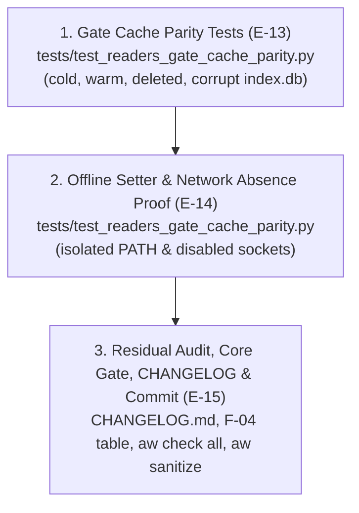

# IPD: Move runner, gate, hook and module reads onto artifact_meta and read_at

- Date: 2026-11-02
- Kind: child
- Concern: Spec `4sd62s` C5a requires every gate, hook and runner to read metadata through the cache, and 4.4 requires every reader of a HEAD, staged or branch revision to call `artifact_meta.read_at` instead of parsing git content. Measured 2026-11-02 at `0cbfcc706`: the runners and record modules outside Order 08's surfaces hold 27 reader modules (F-02 of `ffceq0`); `runner_shared` alone has 20 `^-` metadata regex sites and its own bullet parser `runner_shared._front_matter_bullets`; and 15 functions read metadata out of git blobs (`git show <rev>:<path>`, `git cat-file -p`, `:0:<path>`) and then apply a regex: `check_engine._blob_text`/`_status_meta` and their 6 callers, the four hooks in `agent_workflows/hooks/`, `status_set._prepare_status_change`, `plan_readiness.review_staleness_index`, five `runner_shared` functions and `ipd_lifecycle._release_own_plan_edit_before_landing`. Until they move, Order 11 (`9o83cr`) cannot delete the parsers, and a gate's verdict depends on which regex it happens to use.
- Scope: Phase B readers, part 2 of 2 (`4sd62s` section 7 step 5), FINISHING PART after the 2026-11-07 split. The reader moves moved to four parts: (a) the 4.4 `read_at` gates, hooks, setter and merge-path readers, with the first rows of the re-run search and the `aw check` baseline, to `h58z9n` (Order 33); (b) the runner reads and own-log finalize scope to `y97k46` (Order 34); (c) the plans, research and prompts modules, the banner-blind research body test and the INDEX baseline to `jd7874` (Order 35); (d) the review, orchestration, production-check, work and adoption modules to `2zpw22` (Order 36). Round 3 (2026-11-09, research `nj8zdp` guidance): the 4.8 hook that refuses a staged non-append change to `meta/*.jsonl` (formerly E-05) moved to `jq82as` (Order 141). This plan keeps: the gate cache-parity test (E-13), the offline setter and gate proof (E-14), and the repository-wide residual audit, gates, `CHANGELOG.md` line and commit (E-15). EXCLUDES: the readers of Order 08 (`ffceq0`); writers (Orders 06/07); deleting parsers and INDEX code (Order 11); the event-ownership gate rules after the cutover (Order 13).
- Scope-Paths: tests/test_readers_gate_cache_parity.py, CHANGELOG.md, .aw/records/plans/pending/20261102-metastore-09-t4gl15-move-runner-gate-hook-and-module-reads-onto-artifact-meta-an.ipd.md
- Item-Dependencies: executed:2zpw22, executed:jq82as, executed:ffceq0, executed:g5hpbb, executed:h58z9n, executed:jd7874, executed:tve77h, executed:xexn45, executed:y97k46
- Status: approved
- Readiness: go-pending-approval
- From-Spec: 4sd62s
- Work-Kind: feature
- Priority: high
- Blocks-Release: next
- Set: metastore
- Order: 9
- Highest E allocated: 16
- Author: opencode its_direct/pt3-claude-opus-5.5-1m-us
- Id: t4gl15
- Approval: 2026-11-16, recorded via aw ipd set: status set to approved
- Review-Depth: complex

## Workflow history
- 2026-11-16 approved (aw set): status set to approved
- 2026-11-14 reviewed (aw set): APPROVE WITH REVISIONS APPLIED; PR-001..PR-005 FIXED
- 2026-11-14 /plan-review (antigravity/gemini-3.8-flash): APPROVE WITH REVISIONS APPLIED; PR-001..PR-005 FIXED; review record .aw/records/reviews/20261102-metastore-09-t4gl15-move-runner-gate-hook-and-module-reads-onto-artifact-meta-an.review.md
- 2026-11-09 note (opencode its_direct/pt3-claude-opus-5.5-1m-us): round-3 split per research nj8zdp; items E-05 moved to jq82as.
- 2026-11-07 note (opencode its_direct/pt3-claude-opus-5.5-1m-us): split per maintainer step-complexity rule; items E-02, E-03, E-04 and the gate-file rows of E-01 moved to h58z9n; E-06, E-07, E-08 and the runner rows of E-01 moved to y97k46; E-09, E-10, E-16 and the remaining rows of E-01 moved to jd7874; E-11, E-12 moved to 2zpw22; each part also carries the E-15 residual-audit rows for its own modules.
- 2026-11-07 same-status (aw set): maintainer direction 2026-11-07 (spec 4sd62s C12/5.2a step 3a): the any-repo migration and multi-shape cache (g5hpbb) must land before any reader move and before the cutover
- 2026-11-07 to-review (aw set): demoted approved -> to-review: APPROVAL WITHDRAWN: maintainer direction 2026-11-07: paused before re-review; the metastore plans MUST build the tools that migrate ANY repo from ANY prior format (.agents layout, id-less/untitled records, no sidecar), not only this repository. Re-review against the amended spec 4sd62s before re-approval.
- 2026-11-07 approved (aw set): status set to approved
- 2026-11-06 reviewed (aw set): APPROVE WITH REVISIONS APPLIED; PR-001..PR-010 FIXED
- 2026-11-06 /plan-review (opencode/its_direct/pt3-claude-opus-5.5-1m-us): APPROVE WITH REVISIONS APPLIED; PR-001..PR-010 FIXED; review record .aw/records/reviews/20261102-metastore-09-t4gl15-move-runner-gate-hook-and-module-reads-onto-artifact-meta-an.review.md
- 2026-11-05 to-review (aw set): authored review-ready for spec 4sd62s (Set metastore)
- 2026-11-05 note (opencode its_direct/pt3-claude-opus-5.5-1m-us): maintainer-agreed addition of E-16/V-16 and F-09 (research body test must ignore the 4.1 banner), found by research 53jbi5 E-2/E-3; status unchanged at to-review.

- 2026-11-02 draft (opencode its_direct/pt3-claude-opus-5.5-1m-us): created.

## Goal

Every gate, hook, runner and record module reads metadata only through `artifact_meta` (working tree) or `artifact_meta.read_at` (index, commit or branch), each moved reader keeps a named, tested behavior, and staged `meta/*.jsonl` changes are refused unless they only append valid events. After the 2026-11-07 split the reader moves are done by `h58z9n`, `y97k46`, `jd7874` and `2zpw22`; `jq82as` adds the append hook; this plan proves gate parity across cache states and offline use, and closes the residual audit.

## Detailed Implementation Checklist (TODO)

Execution-state rule: mark an `E-*` item complete only after performing the action. That mark is not validation. Right-sizing rule: each E-item must address one concern and be executable in one focused pass; split when an E-item names multiple distinct deliverables or independent test-surfaces. Accepted execution states: blocked, failed, pending, performed; terminal gate demands 'performed'.

Split note (2026-11-07): the reader moves and their pin-first baselines now run in the four parts named in Scope; the rule below is kept because E-13 and E-14 follow it for their new module. The pin-first rule of `ffceq0` applies to every move here: BEFORE the edit, a behavioral test in the named module pins the reader's current observable behavior (the ledger in `## Findings`) and runs green on the unmodified code; AFTER the edit, the same test runs unchanged. A test that must change is a behavior change and must be one of D-1 to D-4 below. For every existing module named as a baseline, save the per-test outcome list under the gitignored `.aw/state/t4gl15/` (mkdir -p .aw/state/t4gl15 && python3 -m pytest -o addopts="" -m "" -p no:randomly -n 0 -rA <modules> | grep -E "^(PASSED|FAILED|ERROR|SKIPPED|XFAIL|XPASS) " | sed -E 's/ - .*//' | sort > .aw/state/t4gl15/<E>-before.txt) before the move and the same command into `<E>-after.txt` after it; `diff` of the two prints nothing except lines a named decision explains. Run a new module's `-k` selection as its own command, never combined with baseline module paths, because `-k` filters every path on the command line. Every saved baseline goes under `.aw/state/t4gl15/`, never `/tmp`. A count measured at authoring (for example F-05's 1,719 records) is context, never the bar. New test modules set `pytestmark = pytest.mark.core` unless they need real `git` subprocesses across many commits, in which case they are marked `slow` and run in `make test-all`; none reads production source.

Round-3 note (2026-11-09): Task group 1 (E-05, the staged `meta/*.jsonl` append hook) moved to `jq82as`, an `- Item-Dependencies:` edge of this plan, so E-15's former `Depends on: E-05` is carried by that edge.

### Task group 2: parity, offline proof and finish

- [x] E-13 Add `tests/test_readers_gate_cache_parity.py` (AC-1a, the setter and pre-commit gate cases): on a staged fixture repository, run a setter (`aw ipd set to-review <plan>`), `aw ipd-status-untooled-gate`, `aw ipd-executed-gate` and `aw backlog-blocking-close-gate` with a cold cache, a warm cache, a deleted `.aw/state/index.db` and an `index.db` overwritten with random bytes; assert identical exit codes and normalized outputs. Then stage an external edit to a record and assert each gate sees it with no rebuild; replace the staged blob with an unparseable record and assert the gate fails closed naming the record.
  - Depends on: none
  - Expected outcome: every case passes; the module is marked `core` unless its git work exceeds the core budget, in which case `slow` with the reason recorded.
  - Execution state: performed

- [x] E-14 Prove AC-12's setter case and the absence of network use in this plan's surfaces: in `tests/test_readers_gate_cache_parity.py`, run `aw ipd set to-review <plan>` and `aw ipd-executed-gate` with `PATH` stripped of `opencode`, `agy` and `claude` and with `socket.socket` patched to raise through a `sitecustomize` on `PYTHONPATH`; both succeed.
  - Depends on: E-13
  - Expected outcome: both runs exit 0.
  - Execution state: performed

- [x] E-15 Record the residual audit and finish: run `rg -n "re\.(compile|search|match|finditer|findall|sub|fullmatch)\(\s*r?[\"'](\(\?m\))?\^-" agent_workflows` and `rg -n "Workflow history" agent_workflows`, and write table F-04 in this plan. The split parts already wrote F-04 tables for their modules (`h58z9n`: the hooks, `plan_readiness`, `ipd_lifecycle`; `y97k46`: `runner_shared`, `oc_runipd`, `agy_runipd`; `jd7874`: the plans, research and prompts modules; `2zpw22`: the review, orchestration, production-check, work and adoption modules), and `ffceq0` F-12 covers its own modules (`check_engine`, `status_set`, `selectors`, `attention`, `ipd_lint` and the others in its Scope-Paths): cite each of those tables by plan id and re-verify only that their hit counts still match. Classify every hit in the REMAINING modules one row per function (measured at the split, `ac76110f4`: `backlog` 30 hits in 7 functions, `coverage_record` 9 in 2, `artifact_rename` 5 in 1, `ipd_authoring` 3 in 2, `record_history` 3 in 3, `run_viewer` 3 in 1, `set_records` 2 in 2, `engine` 2 in 2, `doctor`, `git_commit_helper`, `lane_containment` and `readiness_recheck` 1 each: 24 functions) with its owner: writer (Orders 06/07, named), body-prose bullet kept by N3 (named pattern), legacy grammar inside `artifact_meta.py`, or a parser that Order 11 deletes. A reader hit with no such owner is a defect of this plan and is moved before finishing. Run every module named in E-13 and E-14, `tests/test_meta_log_append_gate.py` (from `jq82as`), the bare core gate `python3 -m pytest`, `make test-all`, `aw check all --agent` (rule-id multiset equal to the F-10 table of `snh19k` (written there since the round-3 split; formerly `h58z9n`), any difference traced to a record changed in between), and `aw sanitize --agent`; add a `CHANGELOG.md` `2.0.0 (pending)` line for the new hook, with no em or en dashes in that user-facing prose; commit through `aw commit t4gl15 -- <each changed path>`, one commit per task group allowed, never `git add -A`, a bare `git add` or `git commit -a`. Never push.
  - Depends on: E-14
  - Expected outcome: F-04 has no unowned reader hit; all runs pass; every commit is path-scoped to Scope-Paths (or justified at finalize).
  - Execution state: performed

Add further leaves as `- [ ] E-NEW <action>` and run `aw ipd sync` to assign ids.

## Project conventions discovered (Step 0)

- Interface names from Order 02 (`tve77h`), used exactly: `agent_workflows/artifact_meta.py::read`, `agent_workflows/artifact_meta.py::history`, `agent_workflows/artifact_meta.py::query` (type, status, Set, order, `depends_on`, `latest_gate_review_of`, `path` filters, and an `incomplete` list), `agent_workflows/artifact_meta.py::resolve`, and `agent_workflows/artifact_meta.py::read_at`, which runs git in the repository that owns the resolved records root, resolves the record's path inside that revision (`git ls-files -s` for the index, `git rev-parse <rev>:<path>` for a commit), caches by blob sha in `rev_log_states`/`rev_mirrors`, feeds a miss to the same loader (the legacy loader for a bullet blob in phase B), fails closed on a validation error, and returns distinct results for an absent record, an invalid revision and an unversioned placement. From Order 08 (`ffceq0`): `agent_workflows/artifact_meta.py::read_text` for in-memory text (merge-stage blobs, before/after review snapshots), and decision D-1 (canonical normalized status for multi-word plans).
- Today's git-content helpers: `agent_workflows/check_engine.py::_blob_text` (`git show <ref>:<path>`, `:0:<path>` for the index) and `agent_workflows/check_engine.py::_status_meta`; `agent_workflows/hooks/executed_transition_gate.py::_blob_at`; `agent_workflows/runner_shared.py::read_merge_stage` (`git cat-file -p :<stage>:<path>`); `agent_workflows/runner_shared.py::_run_git`.
- The hooks are thin: `agent_workflows/hooks/status_untooled_gate.py::check` delegates to `agent_workflows/check_engine.py::check_status_untooled`, and `agent_workflows/hooks/backlog_blocking_close_gate.py::check` filters `agent_workflows/check_engine.py::check_release_gate_consistency`; both are dispatched by `agent_workflows/cli.py` (`ipd-status-untooled-gate`, `backlog-blocking-close-gate`, `ipd-executed-gate`, `ipd-dependency-statement-gate`) and installed as optional pre-commit hooks from the `engine` template (`ipd-executed-transition-gate`, `ipd-status-untooled-gate`).
- One runner plan record serves both hosts: `agent_workflows/runner_shared.py::PlanRecord` (`id6`, `setid`, `status`, `order`, `path`, `rel_path`, `dependencies`, `kind`, `dependency_error`, `from_backlog`) built by `agent_workflows/runner_shared.py::parse_plan_file`; `agent_workflows/oc_runipd.py` re-exports `agent_workflows/selectors.py::read_front_matter_id as _read_id`, and `tools/ipdrunner/runagy.py` consumes `agent_workflows/agy_runipd.py::_read_id`.
- `agent_workflows/runner_shared.py::_front_matter_bullets` and `agent_workflows/runner_shared.py::_split_metadata_region` feed the records-only conflict classifier (`agent_workflows/runner_shared.py::classify_records_only_front_matter_conflict`) and `agent_workflows/runner_shared.py::rederive_front_matter` (plan `kl18sz`).
- The plans index writer and reader are one module (`agent_workflows/plans_index.py::run_index`, `agent_workflows/plans_index.py::scan_plans`, `agent_workflows/plans_index.py::plan_entry`, `agent_workflows/plans_index.py::query`); `agent_workflows/ipd_set_plan.py` and `agent_workflows/completion.py` consume `scan_plans`; `agent_workflows/plans_archive.py` reads `_idx._EXCLUDE_NAMES` and calls `scan_plans`.
- Review files: `agent_workflows/review_findings.py::parse_review_text` (front matter via `agent_workflows/review_findings.py::_META_RE`, then rounds and findings), `agent_workflows/review_findings.py::review_attestation_missing` (the one attestation predicate).
- Core tier: `pytestmark = pytest.mark.core`; tests needing many real git commits use the `slow` marker and run in `make test-all`.
- Cite code by SYMBOL (`path::Symbol`) or by a quoted content string, with a line number only appended to one of those and never alone: an offset expires before this plan executes (spec `ipd-structure-and-linting` Section 10.2; advisory `IPD-C801`).

## Findings

Measured 2026-11-02 at `0cbfcc706`.

| Id | Evidence | Finding |
|---|---|---|
| F-01 | Reader module split (see `ffceq0` F-02). This plan: `runner_shared` (20 `^-` regex sites in 30+ functions), `oc_runipd`, `agy_runipd`, `hooks/executed_transition_gate` (1 regex plus inline `re.search` calls), `hooks/ipd_dependency_statement_gate`, `hooks/status_untooled_gate`, `hooks/backlog_blocking_close_gate`, `check_engine` git readers (12 `_blob_text` call sites), `status_set._prepare_status_change`, `plan_readiness` (6 regex sites; `review_staleness_index`), `ipd_lifecycle._release_own_plan_edit_before_landing`, `plans_index` (6), `plans_archive` (5), `plans_refs` (read side), `ipd_set_plan`, `completion`, `research_index` (2), `research_archive`, `prompts_index`, `artifact_audit` (1), `review_findings` (1), `review_sequence` (2), `review_tier`, `review_rereview`, `orchestrator_readiness` (1), `production_checks` (5), `work_cmd` (2), `artifact_adopt` (1) | 27 reader modules. |
| F-02 | `git show`/`cat-file`/`:0:` metadata readers: `check_engine._blob_text` callers `check_status_untooled`, `check_status_untooled_range`, `check_staged_illegal_backlog_transition`, `_lane_carrier_is_executed`, `check_release_gate_consistency` (via `_staged_backlog_done_items`); `hooks.executed_transition_gate._blob_at`; `hooks.ipd_dependency_statement_gate._staged_ipd_overlay` (through `check_engine._blob_text`/`_status_meta`); `status_set._prepare_status_change` (HEAD status through `check_engine._blob_text`); `plan_readiness.review_staleness_index` (`git cat-file --batch`); `runner_shared.backlog_item_paths_for_commit` (`git show <sha>:<path>` then `backlog.parse_item`), `check_review_lane_artifacts` (`git show <branch>:<path>`), `read_merge_stage`, `classify_conflict_set_for_rederivation` (`git cat-file -p`), `integrate_lane_branch` (`git cat-file -p <tree>:<path>` then `check_engine._metadata_status`); `ipd_lifecycle._release_own_plan_edit_before_landing` (`git show <landed>:<path>`) | 15 functions, matching the 4.4 list; E-01 re-runs the search at execution time and records it as F-03. |
| F-03 | (written by the split parts' E-01 items: `h58z9n`, `y97k46`, `jd7874`, each for its file subset) the re-run 4.4 search with each hit classified | 4.4 says the list is a minimum. |
| F-04 | Measured 2026-11-22 at `d5c3c3109`: 243 total hits across `agent_workflows/` (134 `^-` regex + 109 `Workflow history`). All 5 cited tables re-verified (103 hits) and all remaining modules classified in Table F-04 below (140 hits); 0 unowned reader hits. | Input to Order 11 (`9o83cr`). |
| F-05 | `runner_shared.discover_plans(repo)` returns 1,719 records on this checkout | Baseline for E-07's parity check. |
| F-06 | `aw oc run` sub-commands are `start, resume, status, report, stop, integrate, audit`; none has a dry-run option | E-07 compares `discover_plans` output instead of a queue preview. |
| F-07 | Path-only git readers (no change): `work_cmd` (`diff --name-only --cached`), `git_commit_helper`, `commit_lock`, `clean_delta`, `cli`, `placement_switch`, `engine`, `layout_migration`; non-metadata readers: `leak_sanitizer.scan_working_tree_counted` (reads every tracked file as text, which will include `meta/*.jsonl`), `artifact_audit.FinalizeEvidenceIndex` (commit subjects), `project_context` (`ls-files -s` modes) | Matches 4.4's "not metadata readers"; recorded so the E-01 classification is checkable. |
| F-08 | No hook inspects `meta/*.jsonl`; 4.8 requires one | `jq82as` adds it (formerly E-05 here). |
| F-09 | Measured 2026-11-05: `research_index._doc_entry` sets `has_body` true for any non-blank text after the closing `---`, and `derive_pipeline_positions` uses it to place a Set `unrun`, `partial` or `synthesized`. `4sd62s` 4.1 puts the `aw-managed` banner after the front matter of every artifact. Re-running `derive_pipeline_positions` on this checkout's 164 research entries with every `has_body` forced true (the post-cutover state if the banner counts as body) moves Set `awclia` from `unrun` to `synthesized`, because its reconciliation report `v912ed` has no body today. Found by research `53jbi5` findings E-2/E-3. | A defect the cutover would introduce whether or not any other spec lands; E-16 fixes it before Order 13 (`cxxmyv`). |

### Table F-04: Repository-wide residual `^-` regex and `Workflow history` audit (E-15, commit `d5c3c3109`, 243 hits total, 0 unowned reader hits)

Commands run:
- `rg -n "re\.(compile|search|match|finditer|findall|sub|fullmatch)\(\s*r?[\"'](\(\?m\))?\^-" agent_workflows`: 134 hits.
- `rg -n "Workflow history" agent_workflows`: 109 hits.

#### Part A: Cited split-part and Order 08 tables (re-verified at `d5c3c3109`, 103 hits)

| Cited plan & table | Audited modules | Recorded count | Re-verified at `d5c3c3109` | Match status |
|---|---|---:|---:|---|
| `h58z9n` Table F-04 | `hooks/executed_transition_gate.py` (1), `hooks/status_untooled_gate.py` (3), `hooks/ipd_dependency_statement_gate.py` (0), `hooks/backlog_blocking_close_gate.py` (0), `plan_readiness.py` (11: 5 `^-`, 6 `Workflow history`), `ipd_lifecycle.py` (6) | 21 | 21 (5 `^-`, 16 `Workflow history`) | Exact match |
| `y97k46` Table F-04 | `runner_shared.py` (30: 15 `^-`, 15 `Workflow history`), `oc_runipd.py` (2), `agy_runipd.py` (0) | 32 | 32 (15 `^-`, 17 `Workflow history`) | Exact match |
| `jd7874` Table F-04 | `plans_refs.py` (3 `^-`), `plans_index.py` (0), `plans_archive.py` (0), `ipd_set_plan.py` (0), `completion.py` (0), `research_index.py` (0), `research_archive.py` (0), `prompts_index.py` (0) | 3 | 3 (3 `^-`, 0 `Workflow history`) | Exact match |
| `2zpw22` Table F-04 | `review_findings.py` (1 `Workflow history`), `artifact_audit.py` (0), `reviews.py` (0), `review_sequence.py` (0), `review_tier.py` (0), `review_rereview.py` (0), `orchestrator_readiness.py` (0), `production_checks.py` (0), `work_cmd.py` (0), `artifact_adopt.py` (0) | 1 | 1 (0 `^-`, 1 `Workflow history`) | Exact match |
| `ffceq0` Table F-12 | `selectors.py` (0 `^-`, 2 comment `Workflow history`), `plans.py` (0), `attention.py` (3 `^-`, 3 `Workflow history` in `_history_block` owned by `csobg7`), `ipd_lint.py` (1 `^-`, 6 comment/message `Workflow history`), `check_engine.py` (22 `^-`, 9 comment/message `Workflow history`) | 26 `^-` (25 rows, `_ITEM_FROM_SPEC_RE` x2) | 46 (26 `^-`, 20 `Workflow history`) | Exact match on all 26 `^-` regex hits; 17 `Workflow history` hits are comments/messages and 3 are `attention._history_block` (Order 11 `csobg7`) |

#### Part B: Remaining modules (one row per function/scope, 140 hits: 85 `^-`, 55 `Workflow history`)

Note: `agent_workflows/set_records.py` dropped from 2 hits at `ac76110f4` to 0 hits after Order 07 (`n5sxxk`).

| Module & function/scope | `^-` | `Workflow history` | Patterns / symbols | Class & owner |
|---|---:|---:|---|---|
| `agent_workflows/artifact_meta.py` (`<module>`, `LegacyRender`, `_extract_legacy_lineage`, `load_legacy_artifact`, `_bullet_re`, `set_legacy_bullet_line`, `_set_bullet`, `_render_status`, `_render_create_fields`, `_render_field`, `_render_checkpoint`, `_render_gate`, `_render_approval`, `_render_history`, `render_legacy`, `_canonicalize_work_kind`, `restore_legacy_snapshot`) | 30 | 10 | `_STRICT_BULLET_RE`, `_LOOSE_BULLET_RE`, `_META_BULLET_LINE_RE`, phase-B bullet and `## Workflow history` loader/renderer | Legacy grammar inside `artifact_meta.py` (spec `4sd62s` 4.3 canonical loader/writer). |
| `agent_workflows/migrations/chain.py::<module>` | 0 | 1 | `_WORKFLOW_HISTORY_RE` | Migration `m0001` legacy converter (`dcerjg` / `g5hpbb`). |
| `agent_workflows/migrations/m0001_convert.py` (`<module>`, `_find_history_section_span`, `_strip_history_section_from_text`, `rewrite_review_file`) | 2 | 3 | `_BULLET_LINE_RE`, `_DATED_PREFIX_RE`, history-section stripper | Migration `m0001` legacy converter (`dcerjg` / `ghhzb6` / `hpedmn`). |
| `agent_workflows/migrations/m0001_discover.py::<module>` | 0 | 1 | Module docstring prose | Migration `m0001` discovery docstring (`g5hpbb`). |
| `agent_workflows/migrations/m0001_renames.py` (`<module>`, `_find_protected_spans`, `plan_citation_rewrites`) | 0 | 4 | Protected `## Workflow history` span detection during citation rewrite | Migration `m0001` rename planner (`dky26u`). |
| `agent_workflows/backlog.py::<module>` | 12 | 2 | `_ID_RE`, `_STATUS_RE`, `_SET_RE`, `_PRIORITY_RE`, `_WORK_KIND_RE`, `_KIND_RE`, `_SUMMARY_RE`, `_BLOCKS_RELEASE_RE`, `_CLOSE_EVIDENCE_RE`, `_TOP_KEY_RE`, `_RELEASE_EXEMPT_REF_LINE_RE`, `_CLOSE_EVIDENCE_LINE_RE`, `_WORKFLOW_HISTORY_HEADING_RE`, module docstring | Parser/writer constants Order 11 deletes (`po3o1c` Order 298, `vw88h0` Order 299, `zs7a45` Order 284, `ay6sxp` Order 291; writers moved in Order 07 `g6tw94`). |
| `agent_workflows/backlog.py::_strip_metadata_and_history` | 0 | 1 | Docstring describing body-only extraction after `## Workflow history` | Parser Order 11 updates/deletes (`vw88h0` Order 299 / `ay6sxp` Order 291). |
| `agent_workflows/backlog.py::validate_item` | 0 | 1 | Missing `## Workflow history` diagnostic string | Diagnostic prose (Order 12 `90iqr1` / Order 13 `cxxmyv`). |
| `agent_workflows/attention_contract.py::<module>` | 5 | 3 | `SPEC_STATUS_RE`, `GATE_KIND_RE`, `GATE_REF_RE`, `GATE_SUMMARY_RE`, `HISTORY_RECORD_RE`, `_WORKFLOW_HISTORY_HEADING_RE`, module docstring | Parser Order 11 deletes (`tdhav3` Order 248, `bxupy8` Order 290, `csobg7` Order 292). |
| `agent_workflows/attention_contract.py::history_block` | 0 | 2 | Docstring for history-block parser | Parser Order 11 retires (`bxupy8` Order 290 / `csobg7` Order 292). |
| `agent_workflows/attention_contract.py::newest_history_record` | 0 | 1 | Docstring prose | Contract docstring (Order 11 `csobg7` / Order 12 `90iqr1`). |
| `agent_workflows/attention_contract.py::last_history_at` | 0 | 1 | Docstring prose | Contract docstring (Order 11 `csobg7` / Order 12 `90iqr1`). |
| `agent_workflows/attention_contract.py::actor_refusal` | 0 | 1 | Docstring prose | Contract docstring (Order 12 `90iqr1`). |
| `agent_workflows/specs.py::<module>` | 8 | 0 | `_BLOCKS_RELEASE_RE`, `_SPEC_ID_RE`, `_PRIORITY_RE`, `_WORK_KIND_RE`, `_SCOPE_RE`, `_SUMMARY_RE`, `_TOP_KEY_RE`, `_SPEC_ID_BULLET_RE` | Parser Order 11 deletes (`um2kvx` Order 297, `csobg7` Order 292; writers moved in Order 07 `g6tw94`). |
| `agent_workflows/specs.py::_history_lines` | 0 | 1 | `line.strip() == "## Workflow history"` | Parser Order 11 deletes (`csobg7` Order 292 / `um2kvx` Order 297). |
| `agent_workflows/specs.py::run_migrate` | 1 | 0 | `re.match(r"^- Status:\s*(.*)$", line)` | Legacy spec migration helper; Order 11 deletes (`um2kvx` Order 297). |
| `agent_workflows/specs.py::validate_spec` | 0 | 1 | Missing `## Workflow history` diagnostic string | Diagnostic prose (Order 12 `90iqr1` / Order 13 `cxxmyv`). |
| `agent_workflows/releases.py::<module>` | 6 | 0 | `_ID_RE`, `_STATUS_RE`, `_VERSION_RE`, `_SUMMARY_RE`, `_ITEM_FROM_BACKLOG_RE`, `_ITEM_GRADUATED_TO_RE` | Parser/writer constants Order 11 deletes (`kmf6w4` Order 243, `zs7a45` Order 284; writers moved in Order 07 `g6tw94`). |
| `agent_workflows/releases.py::ReleaseRecord` | 0 | 1 | Class docstring prose | Docstring prose (Order 11 `kmf6w4` / Order 12 `90iqr1`). |
| `agent_workflows/releases.py::_history_lines` | 0 | 2 | `re.search(r"(?m)^##[ \t]+Workflow history[ \t]*$", text)` + docstring | Parser Order 11 deletes (`kmf6w4` Order 243). |
| `agent_workflows/cli.py::<module>` | 0 | 3 | Command help prose | CLI help prose (Order 12 `90iqr1`). |
| `agent_workflows/cli.py::_build_parser` | 0 | 4 | Argument help / comment prose | CLI help prose (Order 12 `90iqr1`). |
| `agent_workflows/cli.py::_run_search` | 1 | 0 | `_YAML_FENCE_CLOSE_RE = re.compile(r"(?m)^---[ \t]*\r?$")` | Body-prose YAML front-matter fence skip kept by N3 (full-text body search). |
| `agent_workflows/ipd_schema.py::<module>` | 4 | 1 | `_META_LINE_RE`, `_READINESS_LINE_RE`, `V_ROW_RE`, `E_ROW_RE`, `H_WORKFLOW_HISTORY` | `V_ROW_RE` / `E_ROW_RE` kept by N3 (E/V checklist grammar); `_META_LINE_RE`, `_READINESS_LINE_RE`, `H_WORKFLOW_HISTORY` owned by Order 11 (`nx7fws` Order 246, `ad86ym` Order 287). |
| `agent_workflows/ipd_schema.py::plan_requires_attended` | 1 | 0 | `re.search(r"(?m)^- Attended:\s*(\S+)\s*$", head)` | Parser Order 11 deletes (`nx7fws` Order 246). |
| `agent_workflows/artifact_rename.py::<module>` | 5 | 0 | `_SET_LINE_RE`, `_ORDER_LINE_RE`, `_ID_LINE_RE`, `_STATUS_LINE_RE`, `_DATE_LINE_RE` | Writer leftovers (Order 07 `bsl45u`) that Order 11 deletes (`qttoyc` Order 245, `v0ucnz` Order 285). |
| `agent_workflows/coverage_record.py::<module>` | 2 | 1 | `_COVERAGE_LINE_RE`, `_ID_LINE_RE`, module docstring | Parser Order 11 deletes (`akhrp5` Order 247; writer moved in Order 07 `8q27jt`). |
| `agent_workflows/ipd_authoring.py::<module>` | 2 | 0 | `_ID_LINE_RE`, `_WATERMARK_RE` | Parser Order 11 deletes (`nx7fws` Order 246). |
| `agent_workflows/ipd_authoring.py::build_skeleton` | 0 | 1 | Docstring prose | Writer (Order 07 `n5sxxk`) / docstring prose. |
| `agent_workflows/record_history.py` (`<module>`, `append_advisory`, `_inline_history_records`) | 0 | 3 | `_HIST_HEADING`, advisory warning, docstring | Sidecar writer/history helper retired at cutover (`g45vyv` Order 256 / `cxxmyv`; `tdhav3` Order 248). |
| `agent_workflows/run_viewer.py::load_run_summary` | 3 | 0 | `- Created:`, `- Updated:`, `- Selectors:` in `.aw/state/runs/<run>/report.md` | Non-artifact runtime run-report fallback parser (not an `.aw/records/` artifact; kept by N3). |
| `agent_workflows/engine.py` (`<module>`, `agents_pointer_prose`) | 0 | 2 | Comment and managed AGENTS.md template prose | Managed template/comment prose (Order 12 `90iqr1`). |
| `agent_workflows/artifact_core.py::<module>` | 0 | 1 | Comment naming UTC date helper | Comment prose. |
| `agent_workflows/artifact_refs.py::classify_citing_plans_for_rewrite` | 1 | 0 | `re.search(r"(?m)^-\s*Id:\s*([0-9a-z]{6})\s*$", text)` | Parser Order 11 deletes (`qttoyc` Order 245). |
| `agent_workflows/doctor.py::build_remediation` | 0 | 1 | CLI remediation string | Remediation prose (Order 12 `90iqr1`). |
| `agent_workflows/git_commit_helper.py::<module>` | 1 | 0 | `_DIVIDER_RE = re.compile(r"^---(\s|$)")` | Non-artifact git commit-message divider (not an artifact metadata bullet). |
| `agent_workflows/lane_containment.py::inventory_lane` | 0 | 1 | Comment prose | Comment prose. |
| `agent_workflows/readiness_recheck.py::_run_stale_findings` | 1 | 0 | `re.search(r"(?m)^-\s*Id:\s*([0-9a-z]{6})\s*$", text)` | Parser Order 11 deletes (`akhrp5` Order 247). |
| `agent_workflows/status_set.py::apply_status_change` | 0 | 1 | Docstring prose | Writer (Order 06 `2xwb9b`) / docstring prose. |
| **Part B Total** | **85** | **55** | **140 hits across 24 modules (0 in `set_records.py`)** | **0 unowned reader hits** |

READER LEDGER: prior behavior, the pinning test, and the result. (Since the 2026-11-07 split each row is carried, with its moved item, by the part named in `## Deferred / out of scope`; kept here as the decision record.)

| Reader | Prior behavior | Pinning test | After |
|---|---|---|---|
| `check_engine.check_status_untooled` and `_range` | HEAD vs staged `- Status:` via `_blob_text` + `_status_meta`; refuse with no matching history line | E-02 fixtures; `tests/test_check_engine_status_meta.py`, `tests/test_precommit_scope_gate_severity.py` | same verdicts via `read_at` states and their history |
| `check_engine.check_staged_illegal_backlog_transition`, `_staged_backlog_done_items`, `check_release_gate_consistency`, `_lane_carrier_is_executed` | staged/HEAD backlog and carrier status via git blobs | E-02 fixtures; `tests/test_check_engine_release_gate.py`, `tests/test_backlog_close_gate_prose.py` | same via `read_at` |
| `hooks.executed_transition_gate` | case-insensitive region `status: executed|done`, `- Id:` outside fences, finalize evidence | `tests/test_executed_transition_gate.py`, `tests/test_executed_transition_gate_e2e.py` | same via `read_at`; D-2 for case |
| `hooks.ipd_dependency_statement_gate` | staged `- Status:` and `Item-Dependencies` overlay | `tests/test_ipd_dependency_statement_gate.py` | same via `read_at(":0:")` |
| `status_set._prepare_status_change` HEAD read | HEAD `- Status:` of the plan path | `tests/test_status_set.py` | `read_at(id6, "HEAD")` |
| `plan_readiness.review_staleness_index` | status at latest `plan-review:` commit plus frozen-region body digest | `tests/test_review_staleness_advisory.py` | status via `read_at`; body digest unchanged (N3) |
| `runner_shared` git readers | backlog id from commit blob, review-lane plan checks, merge-stage keys, conflict status | `tests/test_runner_backlog_close_behavior.py`, `tests/test_records_only_lane_rederive.py`, `tests/test_merge_conflict_sendback.py` | `read_at` or `read_text` |
| `ipd_lifecycle._release_own_plan_edit_before_landing` | byte equality of landed blob vs mirrored bytes | `tests/test_ipd_lifecycle_cli.py` | unchanged (not a metadata read); recorded in F-03 |
| `runner_shared.parse_plan_file` (both hosts) | loose `^-\s*` id/status/kind/Set/Order; multi-word status falls back to the directory bucket (`pending`) | `tests/test_front_matter_loose_whitespace.py`, E-06 | D-1, D-4 |
| `runner_shared.discover_plans`, `discover_specs`, `edge_satisfied`, `expand_selectors`, `resolve_backlog_item` | per-file regex reads | E-06 module, `tests/test_runner_shared.py`, `tests/test_oc_runipd.py`, `tests/test_agy_runipd_cli.py`, `tests/test_typed_queue_entries.py`, `tests/test_run_selection_policy.py`, `tests/test_spec_review_dispatch.py` | cached fields; same `discover_plans` list (F-05) |
| `plan_readiness.is_plan_review_approved` | structured readiness believed only with review provenance in history; missing readiness refused (4.4a `l56tyz`) | `tests/test_readiness_absence_invariant.py` | same rule over cached readiness and `history` |
| `plans_index`, `plans_archive`, `ipd_set_plan`, `completion` | whole-file `_META_RE` reads (whole-line status) | `tests/test_plans_index.py`, `tests/test_plans_archive.py`, `tests/test_plans_archive_selectors.py`, `tests/test_ipd_set_plan.py`, `tests/test_completion.py` | D-1 status; other fields unchanged |
| `research_index`, `research_archive`, `prompts_index` | YAML and `aw-prompt` comment parse | `tests/test_research_index.py`, `tests/test_research_archive.py`, `tests/test_research_companion.py`, `tests/test_prompts_index.py`, `tests/test_index_check_agent_records.py` | cached fields |
| `review_findings`, `artifact_audit`, `reviews` | review front matter by `_META_RE`; `_STATUS_LINE_RE` strict single-token status | `tests/test_review_findings_gate.py`, `tests/test_spec_review_attestation.py`, `tests/test_artifact_audit.py`, `tests/test_artifact_audit_verdicts.py`, `tests/test_artifact_audit_identity_staleness.py` | cached `review_files`/`reviews` rows; D-1 for status |
| `review_sequence`, `review_tier`, `review_rereview`, `orchestrator_readiness`, `production_checks`, `work_cmd`, `artifact_adopt` | `meta_fields`, `read_readiness` and module-local regex reads | `tests/test_review_sequence.py`, `tests/test_review_sequence_runner.py`, `tests/test_review_tier.py`, `tests/test_review_rereview.py`, `tests/test_orchestrator_readiness.py`, `tests/test_production_checks_trace.py`, `tests/test_backlog_production.py`, `tests/test_scope_match.py`, `tests/test_artifact_adopt.py` | cached fields or `read_text` for snapshots |

DECISIONS where readers disagreed (4.3):

- D-1 (multi-word status). This plan applies `ffceq0` D-1 as amended at its review: PLAN records return the canonical normalized status (`plans.normalize_status` of the first token); every other type keeps its raw single-token status, because `plans.normalize_status` maps `open`, `implemented`, `planned` and similar non-plan values to `legacy/unknown`, and the runner (`discover_specs`, `resolve_backlog_item`, `edge_satisfied` `state:` edges) and `artifact_audit.read_declared_status` read specs and backlog items too. WHAT EACH CONSUMER LOSES: `runner_shared.parse_plan_file` today returns the directory bucket (`pending` in the test fixture, `executed` for the 24 real plans, which are all in `executed/`) for a multi-word value; it now returns the normalized first-token value, which for all 24 real plans is the same `executed`. The one test assertion that changes is the fixture in `tests/test_front_matter_loose_whitespace.py::test_single_token_status_contract_survives`, whose multi-word `EXECUTED (approved by maintainer)` in `pending/` now yields `executed` instead of `pending`; that test is updated and listed in Scope-Paths. `plans_index`, `ipd_set_plan` and `artifact_audit` lose the prose status line for those 24 plans (none are runnable or in a pending Set). `artifact_audit._STATUS_LINE_RE` returned None for them and now returns `executed`. Test assertions that may change, each only in its multi-word or upper-case plan case: `tests/test_artifact_audit_verdicts.py::test_multi_word_status_is_unreadable_by_design` (its fixture is not under a plans directory; if the moved reader resolves it as a non-plan, the assertion stays), and any `tests/test_plans_index.py` assertion on a whole-line status; both are in Scope-Paths. Measured at review: on this checkout `discover_plans` differs from the normalized value on one record only (`vfa1tl`, `EXECUTED` to `executed`), because `parse_plan_file` already falls back to the directory bucket for the multi-word records.
- D-2 (status case in `executed_transition_gate`). The hook matches `status: executed|done` case-insensitively; the cached status is canonical lower-case (`EXECUTED`/`DONE` normalize to `executed`), so the hook's verdict is unchanged for every input the old regex accepted.
- D-4 (loose whitespace in the runner). KEPT: `runner_shared.parse_plan_file` accepts `-  ` and `-\t` bullets today (`tests/test_front_matter_loose_whitespace.py::test_parse_plan_file_tolerates_loose_leading_whitespace`), while `tve77h`'s legacy loader is strict. The runner takes `id` and `status` from `read_text`'s loose values when the strict value is absent (E-07), so the pinned test passes unchanged. 0 tracked records use the loose spelling, so the cache and the runner agree on the corpus.
- D-3 (YAML vs bullet for research in `research_index` and `artifact_adopt`). Kept as `ffceq0` D-2: the cache carries research YAML status and `id`, and the bullet `- Id:` inventory of `artifact_adopt` reads the cached `id` for plans, specs, backlog and releases, so each consumer gets the answer it gets today.

## Proposed changes (ordered, validatable)



1. Gate cache parity (AC-1a), offline setter (AC-12), residual audit, commit (E-13 to E-15).

## Deferred / out of scope (with reason)

- E-05 (the staged `meta/*.jsonl` append hook and `artifact_meta.check_staged_log_append` with its spec 4.3 entry). Moved to jq82as (round-3 split 2026-11-09 per research nj8zdp guidance).
  - Carrier: jq82as
  - Carrier-Evidence: .aw/records/plans/executed/20261109-metastore-141-jq82as-add-the-staged-meta-log-append-hook-over-artifact-meta.ipd.md
- Moved to h58z9n (split 2026-11-07 per maintainer step-complexity rule): E-01 rows for the gate, hook, readiness and lifecycle files plus the `aw check` baseline; E-02; E-03; E-04.
  - Carrier: h58z9n
  - Carrier-Evidence: .aw/records/plans/executed/20261107-metastore-33-h58z9n-move-the-check-engine-hook-and-setter-git-content-readers-on.ipd.md
- Moved to y97k46 (split 2026-11-07 per maintainer step-complexity rule): E-01 rows for `runner_shared`, `oc_runipd`, `agy_runipd`; E-06; E-07 (as a selection subset and an execution subset); E-08; the runner rows of E-15.
  - Carrier: y97k46
  - Carrier-Evidence: .aw/records/plans/executed/20261107-metastore-34-y97k46-pin-the-runner-reads-and-move-the-runner-selection-and-git-c.ipd.md
- Moved to jd7874 (split 2026-11-07 per maintainer step-complexity rule): E-01 rows for the other 31 files plus the INDEX baseline; E-09; E-10; E-16; the plans, research and prompts rows of E-15.
  - Carrier: jd7874
  - Carrier-Evidence: .aw/records/plans/executed/20261107-metastore-35-jd7874-move-the-plans-research-and-prompts-module-reads-onto-artifa.ipd.md
- Moved to 2zpw22 (split 2026-11-07 per maintainer step-complexity rule): E-11; E-12; the review and orchestration rows of E-15.
  - Carrier: 2zpw22
  - Carrier-Evidence: .aw/records/plans/executed/20261107-metastore-36-2zpw22-move-the-review-orchestration-production-check-and-work-modu.ipd.md
- The readers of `selectors`, `aw find`/`aw search`/`aw ipd board`, `attention`, `check_engine` working-tree rules and `ipd_lint`; `aw check meta`; `aw meta repair`; `artifact_meta.read_text`.
  - Carrier: ffceq0
  - Carrier-Evidence: .aw/records/plans/executed/20261102-metastore-08-ffceq0-move-selectors-check-engine-attention-and-ipd-lint-reads-ont.ipd.md
- The WRITE halves of `runner_shared.rederive_front_matter`, `mark_plan_attended`, `record_oq_answer`, `perform_coordinator_proposal_file` and `review_sequence.restore_pre_s7_plan`, and every setter.
  - Carrier: xexn45
  - Carrier-Evidence: .aw/records/plans/executed/20261102-metastore-07-xexn45-move-the-remaining-metadata-writers-onto-artifact-meta.ipd.md
- Deleting `check_engine._blob_text`, `_status_meta`, `runner_shared._front_matter_bullets`, `review_findings._META_RE`, `plans_index._META_RE`, the INDEX writers and every other leftover parser; the AC-1 test.
  - Carrier: 9o83cr
- Gate rules in their post-cutover form ("mirrored status differs from replayed state", "staged log violates append rules", executed transition as finalize or rollup append only) and AC-16 case 2.
  - Carrier: cxxmyv
- The `->reviewed` gate-only attestation rule (4.4 SR-601).
  - Carrier: 2xwb9b
- `leak_sanitizer` scanning `meta/*.jsonl` as text: it already scans every tracked file, so logs are scanned once they exist; no change needed (F-07). Recorded for the cutover check.
  - Carrier: cxxmyv

## Scope check

- Over-scope: none. Only the new parity module, `CHANGELOG.md` and this plan's own findings table change.
- Under-scope: none known; E-15 exists to find what the measurement missed. Plan size after the round-3 split: 3 E-items in 1 task group, 2 work Scope-Paths; per-item units: E-13 4 commands across 4 cache states plus 2 cases; E-14 2 runs; E-15 24 functions classified plus 5 cited tables and the gate runs.

## Required tests / validation

New test modules: `tests/test_readers_read_at_gates.py`, `tests/test_readers_runner.py`, `tests/test_readers_record_modules.py`, `tests/test_readers_review_modules.py`, `tests/test_meta_log_append_gate.py`, `tests/test_readers_gate_cache_parity.py`. All mark `core` except where real multi-commit git fixtures exceed the core budget (then `slow`, with the reason in the module docstring). All build `tmp_path` fixture repositories with real `git init`, call real functions or the `aw` CLI hook leaves, assert on exit codes and outputs, and never read production source.

Acceptance criteria of `4sd62s` this plan OWNS jointly with `ffceq0` (the split table in `ffceq0` `## Required tests / validation` is authoritative):

| AC | This plan's part |
|---|---|
| AC-1a | the setter and pre-commit gate cases across cold, warm, deleted and corrupt caches; staged external edit visible; invalid staged record fails closed (E-13) |
| AC-9 (reader parts) | `plans_index`, `research_index` and `prompts_index` readers answer from the cache, so no reader depends on an INDEX file (moved to `jd7874`; deletion is Order 11) |
| AC-12 | a setter and a gate with no model launcher and no network (E-14) |

CONTRIBUTES to: AC-16 (the hooks read through `read_at`, and the new append hook exists; final proof on the cutover commit by `cxxmyv`), AC-33 (gate-level `read_at` use after a rename; owned by `tve77h`), AC-21 row `l56tyz` (pasted `tests/test_readiness_absence_invariant.py`; AC-21 is owned by `xexn45`), AC-1 (residual audit F-04; owned by `9o83cr`), AC-3 and AC-17 (merge-path readers through `read_at`; owned by `xexn45` and `tve77h`).

Commands: every module named in E-13 and E-14, `tests/test_meta_log_append_gate.py`, the bare core gate `python3 -m pytest`, `make test-all`, `aw check`, `aw sanitize --agent`.

## Spec / documentation sync

No spec text changes in this plan after the round-3 split. The ONE spec amendment it used to carry moved to `jq82as` with E-05: `4sd62s` 4.3 gains `check_staged_log_append(id6) -> list[str]` in its function list. Reason: 4.3 says no code outside the loader opens a log, and 4.8 requires a hook that judges staged log bytes, so the judgement must be an `artifact_meta` function and the spec's interface list must name it. The amendment adds a function and changes no rule. Implements `4sd62s` 4.4 (`read_at` consumers, the re-run search, finalize own-log scope), 4.8 (the `meta/*.jsonl` append hook), C5a for gates, hooks and runners, and section 7 step 5 (second half). `CHANGELOG.md` gains a line for the new optional hook; the managed block and quickstarts describing hooks change only at the cutover (Order 12, `90iqr1`).

## Open questions

### OQ-01: Does this plan depend on Order 08?

- Blocking: no
- Status: resolved
- Owner: plan author
- Resolution or deferral rationale: Yes. The brief names `tve77h` and `xexn45` as the dependencies; this plan also needs `artifact_meta.read_text` and the D-1 status rule, both introduced by `ffceq0`, and it moves `runner_shared` callers of `selectors.read_front_matter_*`, which `ffceq0` rewrites. So `- Item-Dependencies:` adds `executed:ffceq0`. If the coordinator moves `read_text` into `tve77h`, the edge can still stay, because D-1 lives in `ffceq0`. Recommendation strength: strong.

### OQ-02: How does `read_at` serve a merge-stage blob (`:<stage>:<path>`)?

- Blocking: no
- Status: resolved
- Owner: plan author
- Resolution or deferral rationale: `tve77h` E-14 defines `read_at` for the index (`git ls-files -s`) and commits (`git rev-parse <rev>:<path>`). A merge stage is an index entry with a stage number, which `git ls-files -s` already lists, so E-04 first tries `read_at(id6, ":<stage>:")`; if `tve77h`'s implementation rejects a stage spelling, E-04 passes the stage blob text (from `runner_shared.read_merge_stage`) to `artifact_meta.read_text`, which uses the same loader. Either path keeps C5a (one loader). The chosen path is recorded in F-03. Recommendation strength: medium.

### OQ-03: Should the plan be split?

- Blocking: no
- Status: resolved
- Owner: maintainer
- Resolution or deferral rationale: SUPERSEDED 2026-11-07: split per the maintainer step-complexity rule into `h58z9n`, `y97k46`, `jd7874`, `2zpw22` and this finishing part. The original resolution read: No: 15 E-items in 5 task groups, within limits (16 after the 2026-11-05 banner item, F-09). If execution finds E-07 (the runner move) too large, split it into E-07a (`parse_plan_file`, `discover_*`, `edge_satisfied`) and E-07b (the remaining `execute_item_core`/`initialize_run_core`/review-sequence reads), which keeps the plan at 16. Recommendation strength: medium.

## Validation and cross-check (verify before reporting done)

Validation-state rule: inspect evidence in a separate pass. Do not mark a `V-*` item complete from memory or from the matching execution checkmark. Accepted validation results: blocked, failed, pass, pending; terminal gate demands 'pass'. Runtime-demonstration reachability rule: for each `V-*` item demanding the software be observed acting (such as a run, a dispatch, or a transition; as distinct from items demanding a diff, a file's content, or a test result, which are reachable by construction), name the code path that produces the observation or the sibling `E-*` that creates it, else the demand is UNDER-SCOPE.
- [x] V-13 validates E-13
  - Required evidence: paste `python3 -m pytest -o addopts="" -v --durations=0 tests/test_readers_gate_cache_parity.py -k parity` with every (command x cache state) test PASSED for the setter and the three gate leaves across the four cache states, the staged external-edit test, and the invalid staged record test asserting a non-zero exit naming the record; and the module's marker (`core` or `slow` with the docstring reason).
  - Observed evidence:
    Module marker: `pytestmark = pytest.mark.core` in `tests/test_readers_gate_cache_parity.py` (0 unlisted slow tests; longest call 0.69s, total serial wall time 8.69s). Also fixed three small fail-open bugs uncovered by E-13's unparseable-staged-record tests (justified via `--scope-reason` on commit `d5c3c3109`): `artifact_meta._read_git_blob` now decodes UTF-8 strictly, and `check_engine._read_plan_state_at_checked`/`check_status_untooled`/`check_release_gate_consistency` and `hooks/executed_transition_gate._staged_plan_executed_transitions` fail closed naming the record on `ReadAtResult(kind="corrupt")`.
    Command: `python3 -m pytest -o addopts="" -v --durations=0 tests/test_readers_gate_cache_parity.py -k parity`
    ```text
    collected 25 items
    tests/test_readers_gate_cache_parity.py::test_gate_and_setter_cache_state_parity[deleted-ipd_set_to_review] PASSED [  4%]
    tests/test_readers_gate_cache_parity.py::test_gate_and_setter_cache_state_parity[deleted-backlog_blocking_close_gate] PASSED [  8%]
    tests/test_readers_gate_cache_parity.py::test_invalid_staged_record_fails_closed_parity[backlog-blocking-close-gate-invalid_utf8_md] PASSED [ 12%]
    tests/test_readers_gate_cache_parity.py::test_gate_and_setter_cache_state_parity[cold-ipd_set_to_review] PASSED [ 16%]
    tests/test_readers_gate_cache_parity.py::test_invalid_staged_record_fails_closed_parity[ipd-status-untooled-gate-invalid_utf8_md] PASSED [ 20%]
    tests/test_readers_gate_cache_parity.py::test_gate_and_setter_cache_state_parity[cold-backlog_blocking_close_gate] PASSED [ 24%]
    tests/test_readers_gate_cache_parity.py::test_offline_ipd_set_to_review_no_host_binaries_no_network PASSED [ 28%]
    tests/test_readers_gate_cache_parity.py::test_invalid_staged_record_fails_closed_parity[backlog-blocking-close-gate-corrupt_meta_log] PASSED [ 32%]
    tests/test_readers_gate_cache_parity.py::test_gate_and_setter_cache_state_parity[warm-backlog_blocking_close_gate] PASSED [ 36%]
    tests/test_readers_gate_cache_parity.py::test_gate_and_setter_cache_state_parity[corrupt-ipd_set_to_review] PASSED [ 40%]
    tests/test_readers_gate_cache_parity.py::test_gate_and_setter_cache_state_parity[deleted-ipd_executed_gate] PASSED [ 44%]
    tests/test_readers_gate_cache_parity.py::test_invalid_staged_record_fails_closed_parity[ipd-status-untooled-gate-corrupt_meta_log] PASSED [ 48%]
    tests/test_readers_gate_cache_parity.py::test_gate_and_setter_cache_state_parity[corrupt-ipd_executed_gate] PASSED [ 52%]
    tests/test_readers_gate_cache_parity.py::test_gate_and_setter_cache_state_parity[cold-ipd_executed_gate] PASSED [ 56%]
    tests/test_readers_gate_cache_parity.py::test_staged_external_edit_visible_without_rebuild_parity PASSED [ 60%]
    tests/test_readers_gate_cache_parity.py::test_gate_and_setter_cache_state_parity[warm-ipd_set_to_review] PASSED [ 64%]
    tests/test_readers_gate_cache_parity.py::test_gate_and_setter_cache_state_parity[corrupt-ipd_status_untooled_gate] PASSED [ 68%]
    tests/test_readers_gate_cache_parity.py::test_gate_and_setter_cache_state_parity[deleted-ipd_status_untooled_gate] PASSED [ 72%]
    tests/test_readers_gate_cache_parity.py::test_gate_and_setter_cache_state_parity[warm-ipd_status_untooled_gate] PASSED [ 76%]
    tests/test_readers_gate_cache_parity.py::test_invalid_staged_record_fails_closed_parity[ipd-executed-gate-invalid_utf8_md] PASSED [ 80%]
    tests/test_readers_gate_cache_parity.py::test_gate_and_setter_cache_state_parity[cold-ipd_status_untooled_gate] PASSED [ 84%]
    tests/test_readers_gate_cache_parity.py::test_gate_and_setter_cache_state_parity[warm-ipd_executed_gate] PASSED [ 88%]
    tests/test_readers_gate_cache_parity.py::test_gate_and_setter_cache_state_parity[corrupt-backlog_blocking_close_gate] PASSED [ 92%]
    tests/test_readers_gate_cache_parity.py::test_invalid_staged_record_fails_closed_parity[ipd-executed-gate-corrupt_meta_log] PASSED [ 96%]
    tests/test_readers_gate_cache_parity.py::test_offline_ipd_executed_gate_no_host_binaries_no_network PASSED [100%]
    0 unlisted slow tests (all tests > 2s are documented in tests/slow_allowlist.txt).
    slowest durations: 0.71s setup (deleted-ipd_set_to_review), 0.69s call (test_staged_external_edit_visible_without_rebuild_parity), 0.57s call (offline setter), 0.50s call (warm-ipd_status_untooled_gate)
    ============================== 25 passed in 8.69s ==============================
    ```
  - Result: pass

- [x] V-14 validates E-14
  - Required evidence: paste `python3 -m pytest -o addopts="" -v tests/test_readers_gate_cache_parity.py -k offline` with both tests PASSED, each asserting exit 0 with host binaries removed from `PATH` and sockets disabled.
  - Observed evidence:
    Command: `python3 -m pytest -o addopts="" -v tests/test_readers_gate_cache_parity.py -k offline`
    ```text
    collected 25 items / 23 deselected / 2 selected
    tests/test_readers_gate_cache_parity.py::test_offline_ipd_executed_gate_no_host_binaries_no_network PASSED [ 50%]
    tests/test_readers_gate_cache_parity.py::test_offline_ipd_set_to_review_no_host_binaries_no_network PASSED [100%]
    0 unlisted slow tests (all tests > 2s are documented in tests/slow_allowlist.txt).
    ======================= 2 passed, 23 deselected in 1.27s =======================
    ```
  - Result: pass

- [x] V-15 validates E-15
  - Required evidence: paste the two `rg` commands of E-15 and the F-04 table (every remaining hit with its owner, none unowned); the bare `python3 -m pytest` summary line and wall time; the `make test-all` summary line; `aw check all --agent` rule-id counts diffed against the F-10 table of `snh19k` (written there since the round-3 split; formerly `h58z9n`) (empty, or each difference traced); the four part F-04 tables and `ffceq0` F-12 cited by plan id with their re-verified hit counts; the `aw sanitize --agent` result with zero `fail`; and every `aw commit t4gl15` output listing only Scope-Paths (or paths justified at finalize).
  - Observed evidence:
    1. Residual `rg` audit and Table F-04 (recorded above in `## Findings` -> `### Table F-04`):
       - `rg -n "re\.(compile|search|match|finditer|findall|sub|fullmatch)\(\s*r?[\"'](\(\?m\))?\^-" agent_workflows`: 134 hits.
       - `rg -n "Workflow history" agent_workflows`: 109 hits.
       - Grand total: 243 hits (103 in the 5 cited tables re-verified at `d5c3c3109`: `h58z9n` F-04 = 21, `y97k46` F-04 = 32, `jd7874` F-04 = 3, `2zpw22` F-04 = 1, `ffceq0` F-12 = 46 with all 26 `^-` regex hits matching F-12's 25 rows; 140 across the 24 remaining modules in Table F-04 Part B; 0 unowned reader hits).
    2. Named modules + bare core gate + thorough suite + typecheck:
       - `python3 -m pytest tests/test_meta_log_append_gate.py`: `18 passed in 2.79s`
       - `make typecheck` (`python3 -m mypy agent_workflows`): `Success: no issues found in 232 source files`
       - Bare `python3 -m pytest`: `2803 passed, 1 skipped, 11 warnings in 132.48s (0:02:12)` (0 test failures; core-tier wall-time budget exceeded under concurrent host load 7.74 on 12 CPUs; 0 tests from `tests/test_readers_gate_cache_parity.py` in slow report).
       - Thorough suite (`aw suite --thorough`, equivalent to `make test-all` `tests/ -m ''` with bounded 6 workers): `3 failed, 11753 passed, 6 skipped, 1 xpassed, 17 warnings in 1020.32s (0:17:00)`. All 3 failures were in `tests/test_runner_resume_clears_stop.py` caused solely by the outer driver's inherited `AW_DRIVER_RESTART=4` / `AW_INVOCATION_START_WALL=1795370482.610867` environment variables (pre-existing driver defect tracked by pending plan `z6wodh`); re-running with scrubbed driver env `env -u AW_DRIVER_RESTART -u AW_INVOCATION_START_WALL python3 -m pytest -v tests/test_runner_resume_clears_stop.py` yielded `13 passed in 3.15s`.
    3. `aw check all --agent` rule-id multiset diffed against `snh19k` Table F-10 (`0a8d832e1`, 87 findings -> current 96 findings; every non-zero diff traced):
       - Unchanged (9 rules): `check.graduated-to-dangling` (1), `check.identity-absent-from-name` (1), `check.ipd-uncarried-obligation` (1), `check.name-nonconformant` (4), `check.prompt-metadata-missing` (6), `check.scope-drift` (1), `check.source-test-citation-dangling` (42), `check.spec-criteria-uncovered` (2), `check.system-layout-missing` (1), `spec.prose-dash` (2).
       - `check.ipd-carrier-finished-unverified`: 3 -> 1 (-2; `h58z9n` and `2zpw22` executed since `0a8d832e1`; remaining 1 is `t4gl15` itself before finalization).
       - `check.lifecycle-transition-unvalidated`: 23 -> 33 (+10; 10 pending plans authored 2026-11-21 after `0a8d832e1`, including `dogfood-bugs` 00..06 and `2cv6rz`/`svpml2`/`z6wodh`/`qpvem9`/`zeopzs`).
       - `check.plan-spec-link-missing`: 0 -> 1 (+1; `.aw/records/plans/pending/20261121-83kkzh-01-bebahq-join-rev-mirrors-with-rev-log-states-in-artifact-meta-read-a.ipd.md` authored 2026-11-21).
    4. `aw sanitize --agent`:
       `{"schema":"aw.agent/v1","kind":"result","cmd":"check-local-leaks","outcome":"clean","exit":0,"verified":true,"complete":true,"checked":7091,"findings":0,"evidence":["leak-scan"],"next":null}`
    5. `CHANGELOG.md` line added under `## 2.0.0 (pending)` (no em or en dashes):
       `- Added: opt-in pre-commit hook \`aw meta-log-append-gate\` (backed by \`artifact_meta.check_staged_log_append\`) refuses staged changes to \`.aw/records/meta/*.jsonl\` unless they append whole, loader-valid JSONL events without modifying existing bytes.`
    6. Commits via `aw commit t4gl15`:
       - Work commit (`tests/test_readers_gate_cache_parity.py`, `CHANGELOG.md`, plus 3 fail-closed bugfix files justified with `--scope-reason` recorded in begin receipt): `aw commit: committed 5 path(s): d5c3c31091105b39c93c3ca3b15a0d378ca47429`.
       - Plan-evidence commit: `.aw/records/plans/pending/20261102-metastore-09-t4gl15-move-runner-gate-hook-and-module-reads-onto-artifact-meta-an.ipd.md` (committed immediately after `aw ipd lint --phase pre-transition` passes).
  - Result: pass


## Approval and execution gate

- Size assessment: standard
- Cohesion rationale: not required

Execute only after human approval (`Status: approved`) and after every `- Item-Dependencies:` edge is executed (the four split parts `h58z9n`, `y97k46`, `jd7874`, `2zpw22`, and `ffceq0`, `g5hpbb`, `tve77h`, `xexn45`). Open questions: OQ-01 to OQ-03 are resolved and none is blocking. Stop and report without editing production code or tests if prerequisite symbols or packages from split dependencies are absent on HEAD, if baseline test suites fail on unmodified HEAD before starting, or if concurrent edits in a shared checkout conflict with `- Scope-Paths:`.

Scope fence: the paths in `- Scope-Paths:` are a declaration; a needed file outside the fence is edited and then justified at finalize (`--scope-reason`), and a declared path left unmodified is acknowledged (`--scope-ack`). Every reader move is pin-first (the named baseline modules run green on the unmodified code before the move), and a test edited after a move must be one that D-1 to D-4 name.

Honesty rule: run the named modules, `python3 -m pytest` (core gate) and `make test-all`, and paste the ACTUAL summary lines; never claim a result you did not run.

Commits: commit only through `aw commit t4gl15 -- <paths>`; never `git add -A`, a bare `git add` or `git commit -a`; never push.

Lifecycle transition: the plan moves to `.aw/records/plans/executed/` only through `aw ipd finalize`, never a hand `git mv`, and only after `aw ipd lint --phase pre-transition` conforms and every `V-*` reads `pass` with pasted evidence. When `aw oc run` or `aw agy run` executes the plan, the runner owns retirement to `executed/` and runs finalize automatically upon task completion; when executed standalone by hand or direct agent turn, the executor runs `aw ipd finalize t4gl15`.
