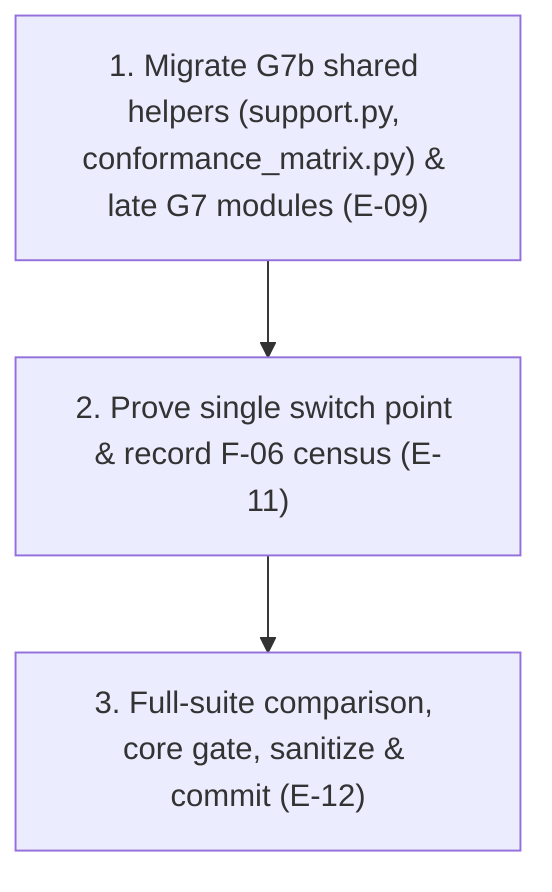

# IPD: Move test data to one shared record builder over artifact_meta

- Date: 2026-11-02
- Kind: child
- Concern: Spec `4sd62s` section 6 requires that test data be written by ONE shared record builder in phase B, so that the cutover (Order 13) changes the builder and not hundreds of test files; C10a requires the suite to pass at every commit, including the cutover commit. Measured 2026-11-02 at `0cbfcc706`: 309 of 717 Python files under `tests/` (307 test modules plus `tests/support.py` and `tests/conformance_matrix.py`) contain 6,638 lines with a legacy bullet string (`- Id:`, `- Status:`, `- Set:` and 18 other metadata fields) or `## Workflow history`; 88 private helper functions in 60 modules build plans, specs, backlog items, reviews, research and prompts by hand (24 copies of `_write_plan`, 12 of `_write_spec`, 7 of `_write_backlog_item`); 7 modules hand-write `aw-prompt` comments; 26 of the 40 tracked `.md` files under `tests/fixtures/` and `tests/benchmark_fixtures/` carry `- Id:` or `- Status:` bullets (27 carry an F-01 string). The one existing shared helper, `support.ready_plan_text`, is used by 14 modules. If the cutover had to rewrite these strings, the cutover commit would carry thousands of test edits and C10a would be unverifiable.
- Scope: Phase B step 6 (`4sd62s` section 7), FINISHING PART after the 2026-11-07 split. The builder, its tests, the baselines and the tracked-fixture conversion moved to `9rgn2w` (Order 37); batch subsets G1a to G7a moved to `x05v02` (Order 38), `7qxey9` (Order 39) and `nbfg7w` (Order 40). Round-3 split (2026-11-09, research `nj8zdp` guidance): 22 G7b modules moved to `vaqtii`, `30zur4`, `9jmt3w` and the out-of-batch helper deletions to `1bshrb`. This plan keeps: the shared helpers `tests/support.py` and `tests/conformance_matrix.py`, edited last, and the G7 late-module catch-up (E-09); the single-switch-point proof and the F-06 census of every remaining legacy string (E-11); the full-suite comparison, core-gate timing, `make test-all`, `aw check` comparison and commit (E-12). EXCLUDES: changing production code; tests whose subject IS the legacy text format (the F-03 EXCLUDED list), which are listed and left unchanged; the review-pilot plan corpus (F-05); changing the builder's on-disk output to the log format (Order 13, `cxxmyv`).
- Scope-Paths: tests/support.py, tests/conformance_matrix.py, tests/test_record_builder.py, .aw/records/plans/pending/20261102-metastore-10-59aiyh-move-test-data-to-one-shared-record-builder-over-artifact-me.ipd.md
- Item-Dependencies: executed:1upea0, executed:7qxey9, executed:9rgn2w, executed:g5hpbb, executed:nbfg7w, executed:tve77h, executed:x05v02, executed:xexn45, executed:653ndz, executed:j6o96i, executed:ijpay0, executed:y3uowx, executed:j2xjtt, executed:7fpc8v, executed:id2pdx, executed:2fn0vd, executed:isj48z, executed:dg43sc, executed:wirc2e, executed:872zd9, executed:zl2pki, executed:jutivt, executed:52rpc1, executed:2zo3g5, executed:qqaqw8, executed:xxiou0, executed:3k142n, executed:2etvye, executed:80p88l, executed:qb3n9s, executed:723ct1, executed:i29bd5, executed:v1t2ai, executed:hp6ydi, executed:lf0fe4, executed:jjvnhb, executed:f8jntm, executed:a1b70x, executed:j5mwpk, executed:abf6yk, executed:qjxcgf, executed:0punmn, executed:2ll84l, executed:9hk3rh, executed:5mg9g1, executed:1cgrgp, executed:z8hu7r, executed:tsonlq, executed:erulw3, executed:vaqtii, executed:30zur4, executed:9jmt3w, executed:z4x192, executed:9zcuyh, executed:1bshrb, executed:n0li9v, executed:b3eilr
- Status: approved
- From-Spec: 4sd62s
- Work-Kind: feature
- Priority: high
- Blocks-Release: next
- Set: metastore
- Order: 10
- Highest E allocated: 13
- Author: opencode its_direct/pt3-claude-opus-5.5-1m-us
- Id: 59aiyh
- Approval: 2026-11-16, recorded via aw ipd set: status set to approved
- Review-Depth: complex
- Readiness: go-pending-approval

## Workflow history
- 2026-11-22 cap-update (maintainer decision): raised Batch rule step 4 hand-refusal cap from 25 to 150 and late-module stop threshold from 8 to 20 (matching 6edbb2c83 rationale; raw site count over-counts list elements and .replace() pairs).
- 2026-11-16 approved (aw set): status set to approved
- 2026-11-14 reviewed (aw set): APPROVE WITH REVISIONS APPLIED; PR-001..PR-005 FIXED
- 2026-11-14 /plan-review (antigravity/gemini-3.8-flash): APPROVE WITH REVISIONS APPLIED; PR-001..PR-005 FIXED; review record .aw/records/reviews/20261102-metastore-10-59aiyh-move-test-data-to-one-shared-record-builder-over-artifact-me.review.md
- 2026-11-09 note (opencode its_direct/pt3-claude-opus-5.5-1m-us): round-3 split per research nj8zdp; items E-09 (22 G7b modules) moved to vaqtii, 30zur4, 9jmt3w; E-09 (out-of-batch helper deletions) moved to 1bshrb; added executed edges to every round-3 part (48 plans, Orders 170 to 216) so this plan stays the family's last part.
- 2026-11-08 note (opencode its_direct/pt3-claude-opus-5.5-1m-us): added executed:1upea0 (new batch part at Order 50 carrying subsets G3a, G5a, G7a from x05v02, 7qxey9 and nbfg7w) per maintainer decision 2026-11-07 ("Codemod first, then small runs").
- 2026-11-07 note (opencode its_direct/pt3-claude-opus-5.5-1m-us): split per maintainer step-complexity rule; items E-01, E-02, E-10, E-13 moved to 9rgn2w; E-03, E-04 and the G3a part of E-05 moved to x05v02; the G3b part of E-05, E-06 and the G5a part of E-07 moved to 7qxey9; the G5b part of E-07, E-08 and the G7a part of E-09 moved to nbfg7w.
- 2026-11-07 same-status (aw set): maintainer direction 2026-11-07 (spec 4sd62s C12/5.2a step 3a): the any-repo migration and multi-shape cache (g5hpbb) must land before any reader move and before the cutover
- 2026-11-07 to-review (aw set): demoted approved -> to-review: APPROVAL WITHDRAWN: maintainer direction 2026-11-07: paused before re-review; the metastore plans MUST build the tools that migrate ANY repo from ANY prior format (.agents layout, id-less/untitled records, no sidecar), not only this repository. Re-review against the amended spec 4sd62s before re-approval.
- 2026-11-07 approved (aw set): status set to approved
- 2026-11-06 reviewed (aw set): APPROVE WITH REVISIONS APPLIED; PR-001..PR-010 FIXED
- 2026-11-06 /plan-review (opencode/its_direct/pt3-claude-opus-5.5-1m-us): APPROVE WITH REVISIONS APPLIED; PR-001..PR-010 FIXED; review record .aw/records/reviews/20261102-metastore-10-59aiyh-move-test-data-to-one-shared-record-builder-over-artifact-me.review.md
- 2026-11-05 to-review (aw set): authored review-ready for spec 4sd62s (Set metastore)

- 2026-11-02 draft (opencode its_direct/pt3-claude-opus-5.5-1m-us): created.

## Goal

Every test that needs a record gets it from one builder, so that the cutover switches the test corpus to the log format by changing one module, and the suite proves C10a at the cutover commit without rewriting test data. After the 2026-11-07 and 2026-11-09 splits, this plan finishes that work: it migrates the shared helpers last, proves the builder is the single switch, censuses what remains, and runs the full-suite comparison.

## Detailed Implementation Checklist (TODO)

Execution-state rule: mark an `E-*` item complete only after performing the action. That mark is not validation. Right-sizing rule: each E-item must address one concern and be executable in one focused pass; split when an E-item names multiple distinct deliverables or independent test-surfaces. Accepted execution states: blocked, failed, pending, performed; terminal gate demands 'performed'.

Split note (2026-11-07): items E-01 to E-08, E-10 and E-13 moved to `9rgn2w`, `x05v02`, `7qxey9` and `nbfg7w` (see `## Deferred / out of scope`). Round-3 split (2026-11-09, research `nj8zdp` guidance): 22 of E-09's modules moved to `vaqtii`, `30zur4`, `9jmt3w` and its out-of-batch helper deletions to `1bshrb`; `9rgn2w`'s E-13 and E-01 now live in Order 170 (`j6o96i`) with the same ids, so "E-13" and "E-01" below mean `j6o96i` E-13 and E-01, and F-10 is written into `j6o96i`. In the text kept here, "E-13" and its baseline files mean `9rgn2w` E-13 and its F-10 table: when this plan runs in a worktree without those gitignored files, regenerate `full-before.txt` and `check-before.jsonl` at F-10's recorded commit in a temporary `git worktree add` under `.aw/state/59aiyh/` before comparing. "The builder's `raw_fields=` escape (E-01)" means `9rgn2w` E-01.

Batch rule, applied to every batch E-item (originally E-03 to E-09; here E-09 only):
1. Before the batch, re-derive its file list with the F-03 first-match partition over the F-01 `rg -l` output at the current HEAD, minus the F-03 EXCLUDED list, and save it as `.aw/state/59aiyh/<batch>-files.txt`. The counts in each E-item are context measured at `0cbfcc706`, not the bar.
2. Record the unmodified per-test outcome list (a batch whose files a previous batch did not touch may reuse the matching lines of E-13's `full-before.txt`): `python3 -m pytest -o addopts="" -m "" -p no:randomly -n 0 -rA $(cat .aw/state/59aiyh/<batch>-files.txt) | grep -E "^(PASSED|FAILED|ERROR|SKIPPED|XFAIL|XPASS) " | sed -E 's/ - .*//' | sort > .aw/state/59aiyh/<batch>-before.txt`. `-p no:randomly` and `-n 0` make the list deterministic; `-m ""` includes `slow` and `livecorpus` modules.
3. Replace hand-built records with builder calls. A test that deliberately writes an INVALID value (an unknown status, `- Status: EXECUTED`, `- Priority: bogus`, a malformed gate) gets it through the builder's `raw_fields=` escape (E-01) and is listed with reason class `invalid-input`.
4. Re-run the same command into `<batch>-after.txt` and require `diff` to print nothing. A batch that would need any changed assertion other than a raw-byte metadata stand-in moved to `artifact_meta.read` (scope rule) stops and is reported; it does not weaken the assertion.
5. Count the remaining legacy strings with the F-01 `rg` pattern over the batch files, and give each remaining line one reason class from F-06: `legacy-format subject`, `displayed-output assertion`, `setter-byte assertion`, `invalid-input`, or `body prose` (for example open-question `- Status: open` rows, which N3 keeps in Markdown).
6. The builder never reads production source, and no test gains a source-reading assertion.

### Task group 1: last batch subset and the shared helpers

Batch rule for E-09 (restructured 2026-11-08 per maintainer decision 2026-11-07 "Codemod first, then small runs"): E-09 applies the SAME batch rule as `x05v02`, quoted here verbatim so this plan is self-contained:

Batch rule,  (the `59aiyh` batch rule, restructured 2026-11-08 for the Order-49 fixture codemod `653ndz` per maintainer decision 2026-11-07 "Codemod first, then small runs": the tool performs the mechanical rewrite, and the hand work is bounded by its measured refusals). In it, "E-13's `full-before.txt`" and "the builder's `raw_fields=` escape (E-01)" are items of Order 37 (`9rgn2w`), carried by the round-3 split into Order 170 (`j6o96i`) with the same ids; because `.aw/state/` does not travel between lane worktrees, step 2 always records a fresh before list here. Step 1's partition is restricted to the modules each batch item names (round-3 split 2026-11-09: a subset is now spread over several plans of at most 8 modules each): a module that the partition now places in the item's subset but that no plan names is NOT added here; it is reported, and the finishing item of `59aiyh` converts it; a named module that no longer matches F-01 is reported and skipped:
1. Before the batch, re-derive its file list with the F-03 first-match partition over the F-01 `rg -l` output at the current HEAD, minus the F-03 EXCLUDED list, and save it as `.aw/state/59aiyh/<batch>-files.txt`. The counts in each E-item are context measured at `0cbfcc706` or `ac76110f4`, not the bar.
2. Record the unmodified per-test outcome list (a batch whose files a previous batch did not touch may reuse the matching lines of E-13's `full-before.txt`): `python3 -m pytest -o addopts="" -m "" -p no:randomly -n 0 -rA $(cat .aw/state/59aiyh/<batch>-files.txt) | grep -E "^(PASSED|FAILED|ERROR|SKIPPED|XFAIL|XPASS) " | sed -E 's/ - .*//' | sort > .aw/state/59aiyh/<batch>-before.txt`. `-p no:randomly` and `-n 0` make the list deterministic; `-m ""` includes `slow` and `livecorpus` modules.
3. Run the codemod: `python3 tools/fixture_codemod.py --apply --format json $(cat .aw/state/59aiyh/<batch>-files.txt) > .aw/state/59aiyh/<batch>-codemod.json`. It rewrites only the sites whose module outcome list it proved identical (`653ndz` E-03, carried with the same id into Order 172, `y3uowx`, by the round-3 split) and lists every other site as a refusal with a reason code and a disposition (`hand` or `legacy-kept`, the `653ndz` reason-code table).
4. Hand-convert ONLY the refusals with disposition `hand`: the static count is the sum of the `653ndz` F-30 rows of the item's modules (round-3 split 2026-11-09: an item now carries part of a subset, so the subset's F-31 row is context only), and the codemod report adds any apply-time `not-equivalent` refusals; the item's hand count is their sum. If the hand count exceeds 150, stop after step 3 (the proved codemod rewrites may be committed), convert nothing by hand, and report the subset for re-splitting. A hand conversion uses builder calls; a test that deliberately writes an INVALID value (an unknown status, `- Status: EXECUTED`, `- Priority: bogus`, a malformed gate) gets it through the builder's `raw_fields=` escape (E-01) and is listed with reason class `invalid-input`. A refusal with disposition `legacy-kept` stays in legacy form on purpose and is listed with its F-06 reason class.
5. Re-run step 2's command into `<batch>-after.txt` and require `diff` to print nothing. A batch that would need any changed assertion other than a raw-byte metadata stand-in moved to `artifact_meta.read` (scope rule) stops and is reported; it does not weaken the assertion.
6. Count the remaining legacy strings with the F-01 `rg` pattern over the batch files, and give each remaining line one reason class from F-06: `legacy-format subject`, `displayed-output assertion`, `setter-byte assertion`, `invalid-input`, or `body prose` (for example open-question `- Status: open` rows, which N3 keeps in Markdown).
7. The builder never reads production source, and no test gains a source-reading assertion.

### Task group 1 (cont.): the shared-helper part

- [ ] E-09 Batch G7b, its shared-helper part (round-3 split 2026-11-09, research `nj8zdp` guidance: the other 22 modules of G7b moved to `vaqtii`, `30zur4` and `9jmt3w`, the helper deletions in modules outside every batch moved to `1bshrb`): `tests/support.py` (`support.ready_plan_text`, `support.scope_drift_repo`) and `tests/conformance_matrix.py`, edited LAST because every other part depends on `support.ready_plan_text` staying byte-identical until then. F-01 legacy lines at `3d0ddb845` (context): `tests/support.py` 15, `tests/conformance_matrix.py` 24. Apply the batch rule above with `<batch>` = `G7b-shared` (the codemod performs the rewrite; hand-convert only the refusals the `653ndz` F-30 rows of these two modules mark `hand`). Then re-derive the F-03 partition for G7 at the current HEAD and convert, under the same rule with `<batch>` = `G7-late`, every module it places in G7 that neither this item nor a chunk plan (F-41) names (if more than 20, stop and report them for re-splitting).
  - Depends on: none
  - Expected outcome: an empty before/after `diff` for `G7b-shared` (and `G7-late`, if any); the late-module list or `no late modules`; the remaining legacy-string count and reason classes for each of the two modules pasted.
  - Execution state: pending

### Task group 2: prove the switch point and finish

- [ ] E-11 Prove that the builder is the single switch point, and write F-06:
  - Add to `tests/test_record_builder.py` a test that monkeypatches `record_builder.RECORD_FORMAT` to an unknown value and asserts that every builder method, including `text_only=True` and `raw_fields=`, raises. This proves that no builder path bypasses the switch. It does not prove that no test builds records outside the builder; the F-06 census below is the evidence for that.
  - Run the F-01 `rg` pattern over `tests/` and write table F-06 in this plan: every remaining legacy string, grouped by file, each with one reason class (`legacy-format subject`, `displayed-output assertion`, `setter-byte assertion`, `invalid-input`, `body prose`).
  - Compare the remaining-line count with the baseline recorded before the first batch (F-10 of `j6o96i`, carried from `9rgn2w`).
  - Depends on: E-09
  - Expected outcome: the test passes; F-06 has no row without a reason class; the remaining-line count and E-13's `legacy-before.txt` are pasted.
  - Execution state: pending

- [ ] E-12 Finish:
  - Full-suite comparison. Run `python3 -m pytest -o addopts="" -m "" -p no:randomly -n 0 -rA tests`, with the batch rule's `grep`, `sed` and `sort` filter, into `.aw/state/59aiyh/full-after.txt`, and compare it with the E-13 `full-before.txt`. The two outcome multisets must be identical except for the new `tests/test_record_builder.py` node ids, which `full-after.txt` adds and which are listed.
  - Core gate. Run the bare `python3 -m pytest` and compare its summary line and wall time with E-13's `core-before.txt`. The after time must be within 110 percent of the before time and inside the 30 s core budget.
  - Also run `make test-all`, `aw check --agent` (no `(location, rule)` pair that E-13's `check-before.jsonl` lacks), and `aw sanitize --agent`.
  - Commit through `aw commit 59aiyh -- <each changed path>`. One commit per batch is allowed, each through `aw commit`. Never push.
  - Depends on: E-11
  - Expected outcome: identical result multisets apart from the listed added node ids; core wall time within 110 percent of the baseline; all runs pass.
  - Execution state: pending

Add further leaves as `- [ ] E-NEW <action>` and run `aw ipd sync` to assign ids.

## Project conventions discovered (Step 0)

- Interface names from Order 02 (`tve77h`): `agent_workflows/artifact_meta.py::registry_fields(type)`, `agent_workflows/artifact_meta.py::validate_event`, `agent_workflows/artifact_meta.py::validate_new_events(type, events, *, records_root, migration_import=False)`, `agent_workflows/artifact_meta.py::read(id6) -> State`, `agent_workflows/artifact_meta.py::create(...)` and `agent_workflows/artifact_meta.py::append(id6, events, *, expect_seq)`. Order 02's `create`/`append` write the log format; `2xwb9b` E-03 adds the phase-B legacy branch of `append` and `xexn45` E-01 routes the phase-B branch of `create` and `append` through `agent_workflows/artifact_core.py::write_legacy`, with `agent_workflows/artifact_core.py::render_legacy_text(text, events)` (`xexn45` E-11) as the same renderer over a string. In phase B the on-disk format is the bullet format; the legacy loader reads it into the cache.
- `agent_workflows/review_findings.py::render_review` (pure) and `agent_workflows/review_findings.py::write_review` render and write a `.review.md` record; no CLI calls `write_review` (`xexn45` Findings).
- The existing shared plan builder is `tests/support.py::ready_plan_text`, which is "BUILT FROM THE REAL GENERATOR (`agent_workflows/ipd_authoring.py::build_skeleton`)" and then fills the fields a draft leaves open; the builder keeps that approach for plans, so a scaffold change still reaches every fixture.
- Shared test plumbing lives in `tests/support.py` (`tests/support.py::init_repo`, `tests/support.py::git`, `tests/support.py::run_cli`, `tests/support.py::pinned_env`, `tests/support.py::ready_plan_text`, `tests/support.py::scope_drift_repo`); `tests/repo_template.py` (`tests/repo_template.py::copy_template_repo`) gives a pre-built repository; there is no `tests/conftest.py`, and the root `conftest.py` owns tier selection.
- Tests are behavioral (AGENTS.md "TEST OUTCOMES, NOT CODE STRUCTURE"); core modules set `pytestmark = pytest.mark.core`; `slow` tests are listed in `tests/slow_allowlist.txt`; `pyproject.toml` `addopts` deselects `slow` and `livecorpus`, so a complete comparison passes `-m ""`, and `pytest-randomly` is installed, so a deterministic order needs `-p no:randomly`.
- `tests/fixtures/review-pilot/` is the input corpus of `tools/review_pilot.py` (`manifest.json` names each plan file, `defects.json` quotes exact text to plant), and `tests/test_review_pilot.py` copies the whole directory into its fixture repository.
- Filenames come from `agent_workflows/artifact_naming.py::build_clustered_name` and parse with `agent_workflows/artifact_naming.py::parse_clustered`.
- Cite code by SYMBOL (`module.function`) or by a quoted content string, with a line number only appended to one of those and never alone: an offset expires before this plan executes (spec `ipd-structure-and-linting` Section 10.2; advisory `IPD-C801`).

## Findings

Measured 2026-11-02 at `0cbfcc706`.

| Id | Evidence | Finding |
|---|---|---|
| F-01 | `rg -l --glob '*.py' -e '- (Id|Status|Set|Kind|Blocks-Release|Readiness|Item-Dependencies|Scope-Paths|From-Backlog|From-Spec|Work-Kind|Priority|Order|Date|Gate-Kind|Gate-Ref|Approval|Subject-Id|Verdict|Graduated-To):|## Workflow history' tests` lists 309 files (307 test modules, `support.py`, `conformance_matrix.py`) of 717 Python files; 6,638 matching lines. The narrower `- Id:`/`- Status:`/`## Workflow history` pattern: 300 files, 3,430 lines | Spec section 6 counted 268 of 680 files and 2,607 matches at round 2; the plan's pattern is broader (21 fields). |
| F-02 | Distribution: 44 files have 40 or more matching lines, 126 have 10 to 39, 139 have fewer than 10; top files `test_check_engine_release_gate.py` 442, `test_status_set.py` 216, `test_backlog.py` 205, `test_releases_line_writers.py` 151, `test_graduated_closable_warning.py` 148, `test_check_engine.py` 146 | Effort is concentrated: about 170 files hold 6,056 of the 6,638 lines. |
| F-03 | Family split by filename prefix, re-measured at review (HEAD `4a7499289`, 311 files, 6,657 lines) with a FIRST-MATCH rule (a file goes to the first group, in order G1 to G6, whose pattern list matches its basename; unmatched files go to G7): G1 39 files, 1,568 lines; G2 22, 1,102; G3 28, 795; G4 63, 1,244; G5 46, 598; G6 69, 1,004; G7 44, 346. Six files match two groups and are assigned by that rule (`test_ipd_authoring` G3, `test_readiness_absence_invariant` G4, `test_runner_backlog_close_behavior` G1, `test_orchestrator_retire_closes_backlog` G1, `test_records_only_lane_rederive` G5, `test_ipdrunner_runagy_shim` G4). The authored counts (G6 99, G7 11) did not sum to the file total; the first-match rule makes the partition exhaustive and disjoint. EXCLUDED from every batch (literal legacy input is their subject; owned by other plans): `tests/test_artifact_meta_*.py` (`tve77h`, `2xwb9b`), `tests/test_artifact_meta_legacy_writer.py` and `tests/test_writers_*.py` (`xexn45`), `tests/test_m0001_*.py` and `tests/test_migrations_chain.py` (`dcerjg`, `ya4ee4`) | Seven batches (E-03 to E-09); G1, G4 and G6 carry a pre-measured split seam (OQ-01). |
| F-04 | 88 private record-building helpers in 60 modules (89 matches of the E-09 pattern at review) (`_write_plan` 24, `_write_spec` 12, `_write_backlog_item` 7, `_make_item` 5, `write_plan` 3, `_mk_plan` 3, `_make_plan_text` 3, others 31); by type: plan 43, spec 15, backlog 16, review 5, research 4, release 2, prompt 1, walkthrough 0; `support.ready_plan_text` is used by 14 modules (29 calls) | The builder replaces these helpers. |
| F-05 | 7 test modules hand-write `aw-prompt` comments; 40 tracked `.md` files under `tests/fixtures/` and `tests/benchmark_fixtures/`, of which 26 carry `^- (Id|Status):` (`fixtures/attnview/specs-valid` 9, `fixtures/attnview/violations` 7, `fixtures/review-pilot/plans` 9, `fixtures/conforming-orchestrator.md` 1; the same 26 at `0cbfcc706`); the other 14 are READMEs, prompts, rubrics and workflow-source fixtures with no record metadata. `fixtures/review-pilot/plans` is read by `tools/review_pilot.py` through `manifest.json` filenames and `defects.json` quotations, so it cannot become builder output without changing a tool outside the test tree. 58 `ipd_lint.lint_text(` calls in 10 test modules pass plan text | The builder needs a text form (`text_only=True`) and a prompt form; the review-pilot corpus stays literal (E-10). |
| F-06 | (written by E-11) remaining legacy strings in `tests/` after the batches, each with one reason class: `legacy-format subject`, `displayed-output assertion`, `setter-byte assertion`, `invalid-input`, `body prose` | Order 13 changes the builder plus the F-06 rows of class `setter-byte assertion`; `invalid-input` rows already go through `raw_fields=` and need a decision at the cutover (an invalid bullet has no log-format equivalent); every other class is either a legacy-format test (moved to the migration tests at the cutover) or prose. |
| F-08 | At review, 15 test modules write a deliberately invalid metadata value (for example `tests/test_releases.py` "`- Status: bogus`", `tests/test_check_engine.py` "`- Status: EXECUTED`", `tests/test_specs_set_adapter.py` "`- Priority: bogus`") | A builder that validates every field cannot build these; E-01 adds `raw_fields=` and the batch rule lists them as `invalid-input`. |
| F-09 | At review, in an empty installed fixture repository: `aw find plans` 0.47 s, `aw attention --format json` 2.4 s, `aw check all --agent` 0.9 s; `aw install` into a fresh repository 4.6 s | E-02's visibility and parity tests cost several seconds, so its bound is 10 s, not 3 s, with a stated fallback. |
| F-41 | Round-3 split 2026-11-09 (research `nj8zdp` guidance): where each module of the former E-09 now lives (basenames under `tests/`, each `.py`); every module in exactly one row, checked by script | See the table below. |
| F-07 | `python3 -m pytest --collect-only -q -o addopts="" tests` collects 10,469 tests (10,498 at review) | Context only; the bar is E-12's comparison with E-13's re-derived baseline. |

| Plan | Subset | Count | Modules |
|---|---|---|---|
| `vaqtii` (Order 210) | G7b | 8 | `test_legacy_finalize`, `test_limit_reach_check_search`, `test_live_conformance_sweep`, `test_migrate_layout_cli`, `test_mutation_result_facts`, `test_notify_cli`, `test_notify_core`, `test_notify_groups` |
| `30zur4` (Order 211) | G7b | 7 | `test_notify_telegram`, `test_nv_backend_args_climb`, `test_prose_dash_advisory`, `test_receipt_lane_record`, `test_repo_relative_posix`, `test_rereview_reviewed_plan`, `test_resolve_plan_path_typed` |
| `9jmt3w` (Order 212) | G7b | 7 | `test_show_history`, `test_staged_illegal_backlog_transition_gate`, `test_support_section`, `test_term_components`, `test_term`, `test_validator_nonsurveyable_dir`, `test_workflow_artifacts_prune` |
| this plan, E-09 | G7b | 2 | `support`, `conformance_matrix` |
| `1bshrb` (Order 215) | none (helper deletions only) | 8 | `test_lane_submission_retention_narrowing`, `test_suite_baseline_direction`, `test_lifecycle_lane_nudge`, `test_finidem_reusable_not_finalized`, `test_research_set_assign_date_containment`, `test_finalize_trailer_attribution`, `test_finalize_disregarded_record`, `test_research_rename_frontmatter` |

## Proposed changes (ordered, validatable)

1. Migrate the shared helpers of G7b and catch late G7 modules (E-09).
2. Prove the single switch point and write F-06 (E-11).
3. Run the full comparison and commit (E-12).

## Deferred / out of scope (with reason)

- Moved to vaqtii (round-3 split 2026-11-09 per research nj8zdp guidance): 8 modules of subset G7b from E-09, with their helper deletions (F-41).
  - Carrier: vaqtii
- Moved to 30zur4 (round-3 split 2026-11-09 per research nj8zdp guidance): 7 modules of subset G7b from E-09, with their helper deletions (F-41).
  - Carrier: 30zur4
- Moved to 9jmt3w (round-3 split 2026-11-09 per research nj8zdp guidance): 7 modules of subset G7b from E-09, with their helper deletions (F-41).
  - Carrier: 9jmt3w
- Moved to 1bshrb (round-3 split 2026-11-09 per research nj8zdp guidance): E-09's deletion of the record-building helpers in the 8 test modules no batch names (F-41).
  - Carrier: 1bshrb
- Moved to 9rgn2w (split 2026-11-07 per maintainer step-complexity rule): E-13 (baselines), E-01 (the builder), E-02 (its tests), E-10 (tracked `.md` fixtures).
  - Carrier: 9rgn2w
  - Carrier-Evidence: .aw/records/plans/executed/20261107-metastore-37-9rgn2w-add-the-shared-test-record-builder-and-convert-the-tracked-r.ipd.md
- Moved to x05v02 (split 2026-11-07 per maintainer step-complexity rule): E-03 (batch G1, as subsets G1a and G1b) and E-04 (batch G2, as subsets G2a and G2b).
  - Carrier: x05v02
  - Carrier-Evidence: .aw/records/plans/executed/20261107-metastore-38-x05v02-move-backlog-release-gate-check-engine-production-and-setter.ipd.md
- Moved to 1upea0 (restructuring 2026-11-08 from x05v02 per maintainer decision "Codemod first, then small runs"): the setter subset G3a of E-05.
  - Carrier: 1upea0
- Moved to 7qxey9 (split 2026-11-07 per maintainer step-complexity rule): the spec subset G3b of E-05 and E-06 (batch G4, as subsets G4a, G4b and G4c).
  - Carrier: 7qxey9
  - Carrier-Evidence: .aw/records/plans/executed/20261107-metastore-39-7qxey9-move-spec-plan-lifecycle-orchestration-and-runner-test-data.ipd.md
- Moved to 1upea0 (re-split 2026-11-08 from 7qxey9 per maintainer decision "Codemod first, then small runs"): the runner subset G5a of E-07.
  - Carrier: 1upea0
- Moved to nbfg7w (split 2026-11-07 per maintainer step-complexity rule): the runner-family subset G5b of E-07, E-08 (batch G6, as subsets G6a, G6b and G6c), and the first unmatched subset G7a of E-09.
  - Carrier: nbfg7w
- Adding `RECORD_FORMAT = "log"` (builder writes through `artifact_meta.create`/`append` and the two-key front matter) and converting the F-06 setter-byte assertions to `artifact_meta.read` plus the in-file mirror: both belong in the cutover commit (C10a: one format per commit).
  - Carrier: cxxmyv
- The legacy-format tests that must keep literal input (the legacy loader tests in `tve77h`, the legacy writer tests in `2xwb9b` and `xexn45`, the migration round-trip and conversion tests in `dcerjg` and `ya4ee4`; the F-03 EXCLUDED list).
  - Carrier: dcerjg
  - Carrier-Evidence: .aw/records/plans/executed/20261102-metastore-04-dcerjg-build-the-migration-chain-and-the-m0001-dry-run-with-census.ipd.md
- The `tests/fixtures/review-pilot/plans/` corpus stays literal legacy input (F-05); its fate after the cutover belongs with the migrated corpus.
  - Carrier: cxxmyv
- Deleting production parsers (the builder must not depend on them; it validates through the registry only).
  - Carrier: 9o83cr
- Tests added by later Set children (Orders 11 to 13) use the builder from the start; enforcing that is a review concern of those plans.
  - Carrier: 9o83cr

## Scope check

- Over-scope: none. No production module changes. Scope-Paths names `tests/support.py`, `tests/conformance_matrix.py` (E-09) and `tests/test_record_builder.py` (the E-11 switch test).
- Under-scope: none known. Plan size after the round-3 split: 3 E-items in 2 task groups, 3 work Scope-Paths; per-item units: E-09 2 modules plus the late-module catch-up, E-11 1 test plus a census table, E-12 5 runs and a commit. E-09's late-module catch-up may touch a module outside Scope-Paths; it is justified at finalize (`--scope-reason`).

## Required tests / validation

New core test module: `tests/test_record_builder.py`. Every batch is validated by an identical per-test result list before and after (the batch rule), which is behavioral by construction: the same tests, unchanged assertions, the same outcomes.

Acceptance criteria of `4sd62s`:

- OWNS: none outright. This plan supplies the switch point that makes AC-1b provable at the cutover.
- CONTRIBUTES to AC-1b (owned by `cxxmyv`): the core-tier summary line pasted for this plan's merge (E-12), and the single builder switch (E-11) so the cutover commit passes the thorough tier without a test-data rewrite. CONTRIBUTES to AC-1 (owned by `9o83cr`): the builder validates through the registry and parses nothing itself, so no test helper becomes a second parser.

Commands: the batch rule's `python3 -m pytest -o addopts="" -m "" -p no:randomly -n 0 -rA <batch files>` per batch, `tests/test_record_builder.py`, the bare core gate `python3 -m pytest`, `make test-all`, `aw check --agent`, `aw sanitize --agent`.

## Spec / documentation sync

No spec change; implements `4sd62s` section 6 ("Rewrite the test data with ONE shared record builder in phase B") and section 7 step 6. `CONTRIBUTING.md` needs no change in phase B; Order 12 (`90iqr1`) documents the builder for test authors after the cutover.

## Open questions

### OQ-01: Should the plan be split?

- Blocking: no
- Status: resolved
- Owner: plan author
- Resolution or deferral rationale: SUPERSEDED 2026-11-07: split per the maintainer step-complexity rule into `9rgn2w`, `x05v02`, `7qxey9`, `nbfg7w` and this finishing part. The original resolution read: No: 13 E-items in 5 task groups. The work is large in files, not in decisions; each batch is mechanical under the batch rule. If a batch proves too large for one pass during execution, split it at the seam its E-item names, measured at review: G1 into G1a/G1b (1,012 and 556 lines), G4 into G4a/G4b (403 and 841), G6 into G6a/G6b (503 and 501). Adding all three splits brings the plan to 16 E-items, inside the 18-item limit. Recommendation strength: medium.

### OQ-02: Which prior Orders does the builder depend on?

- Blocking: no
- Status: resolved
- Owner: maintainer
- Resolution or deferral rationale: `tve77h` and `xexn45`. It does NOT depend on Order 08's `artifact_meta.read_text`: `test_record_builder.py` reads built records back with `artifact_meta.read` (Order 02), and text-only records are checked by writing them into a fixture repository. But spec `4sd62s` section 7 step 6 requires a builder "that writes through `artifact_meta`", and in phase B only `xexn45` gives `artifact_meta.create` a legacy-format branch (`write_legacy`) and adds `render_legacy_text`; Order 02's `create` writes the log format. Depending only on `tve77h` would force the builder to carry its own legacy renderer, a second copy of the format that the cutover would have to change as well. The authored resolution said `executed:tve77h` was sufficient; review revised it to `executed:tve77h, executed:xexn45`. Critical-path cost: none, because Order 11 (`9o83cr`) already waits for `ffceq0` and `t4gl15`, which both wait for `xexn45`. Batches may run before or after Orders 08 and 09; each batch's before/after comparison runs against whatever production code is on `main` at that time. Recommendation strength: strong.

## Validation and cross-check (verify before reporting done)

Validation-state rule: inspect evidence in a separate pass. Do not mark a `V-*` item complete from memory or from the matching execution checkmark. Accepted validation results: blocked, failed, pass, pending; terminal gate demands 'pass'. Runtime-demonstration reachability rule: for each `V-*` item demanding the software be observed acting (such as a run, a dispatch, or a transition), as distinct from items demanding a diff, a file's content, or a test result, which are reachable by construction, name the code path that produces the observation or the sibling `E-*` that creates it, else the demand is UNDER-SCOPE.
- [ ] V-09 validates E-09
  - Required evidence: paste `.aw/state/59aiyh/G7b-shared-files.txt` and the empty `diff` of the `G7b-shared` before/after outcome lists; for `tests/support.py` and for `tests/conformance_matrix.py` separately, its before and after F-01 `rg -c` count, the reason class of every remaining match, its `653ndz` F-30 row and its rows of `.aw/state/59aiyh/G7b-shared-codemod.json`; `rg -n "def ready_plan_text|def scope_drift_repo" tests/support.py` showing both helpers still exist; the re-derived G7 partition beside the F-41 union (a `diff`) and, per late module, its empty outcome `diff`, or the line `no late modules`; and the helper count from `rg --no-filename -o "def _?(make|write|build|mk|seed)_(plan|spec|backlog|item|record|ipd|release|research|prompt|review|walkthrough)\w*" tests | wc -l` beside E-13's `helpers-before.txt`, with each surviving helper across `tests/` and its reason.
  - Observed evidence:
  - Result: pending

- [ ] V-11 validates E-11
  - Required evidence: paste `python3 -m pytest -o addopts="" -v tests/test_record_builder.py -k switch` PASSED, the F-06 table written into this plan with a reason class on every row, and the remaining-line count beside E-13's `legacy-before.txt` value.
  - Observed evidence:
  - Result: pending

- [ ] V-12 validates E-12
  - Required evidence: paste the `diff` of `full-before.txt` and `full-after.txt`, showing only added `tests/test_record_builder.py` node ids, with both line counts; the bare `python3 -m pytest` summary line and wall time now beside E-13's `core-before.txt` (now within 110 percent); the `make test-all` summary line; the `aw check --agent` `(location, rule)` comparison with `check-before.jsonl` showing no added pair; the `aw sanitize --agent` result with zero `fail`; and every `aw commit 59aiyh` output, listing only Scope-Paths.
  - Observed evidence:
  - Result: pending

## Approval and execution gate

- Size assessment: standard
- Cohesion rationale: not required

Execute only after human approval (`Status: approved`) and after every `- Item-Dependencies:` edge is executed: the builder part `9rgn2w` and its round-3 parts, the codemod `653ndz` and its round-3 parts, every batch plan (`x05v02`, `7qxey9`, `nbfg7w`, `1upea0` and the round-3 chunk plans of Orders 175 to 212), the fixture and helper parts of Orders 213 to 215, and `g5hpbb`, `tve77h`, `xexn45`. All open questions are resolved.

Stop and report without editing production code or tests if prerequisite symbols from writer/builder dependencies are absent on HEAD, if baseline test suites fail on unmodified HEAD before starting, or if concurrent edits in a shared checkout conflict with - Scope-Paths:.

Scope fence: the paths in `- Scope-Paths:` are a declaration. A needed test-tree file outside the fence is edited and then justified at finalize (`--scope-reason`), and a declared path left unmodified is acknowledged (`--scope-ack`). Production code under `agent_workflows/` and `tools/` is out of this plan's purpose: if a batch cannot keep its outcome list identical without a production change, stop that batch and report the missing capability rather than changing production code or an assertion. Each batch keeps every assertion except those its V-item lists.

Honesty rule: run the batch comparisons, `tests/test_record_builder.py`, the bare `python3 -m pytest` core gate and `make test-all`, and paste the ACTUAL output; never claim a result you did not run.

Commits: commit only through `aw commit 59aiyh -- <paths>` (one commit per batch allowed); never `git add -A`, a bare `git add` or `git commit -a`; never push.

Lifecycle transition: the plan moves to `.aw/records/plans/executed/` only through `aw ipd finalize`, never a hand `git mv`, and only after `aw ipd lint --phase pre-transition` conforms and every `V-*` reads `pass` with pasted evidence. When aw oc run or aw agy run executes the plan, the runner owns retirement to executed/ and runs finalize automatically upon task completion; when executed standalone by hand or direct agent turn, the executor runs aw ipd finalize 59aiyh.
