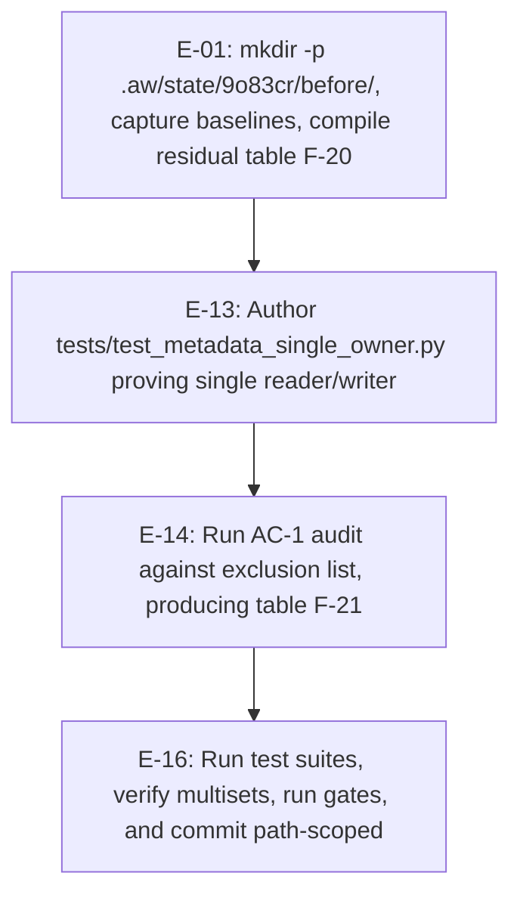

# IPD: Delete INDEX and STATUS code and every legacy parser outside artifact_meta

- Date: 2026-11-02
- Kind: child
- Concern: Spec `4sd62s` C5 allows exactly one metadata reader and writer (`artifact_meta`), 4.3 requires deleting every parser listed in section 1 plus the smaller helpers, and 4.5 says the SQLite cache REPLACES the `INDEX.{json,md}` files, `plans/STATUS.md` and `artifact_audit._INDEX_CACHE`, with `aw index plans|research|prompts` kept only as informational aliases of `aw index rebuild` and `check.stale-index-*` deleted. Phases A and B (Orders 02 to 10) move every caller onto `artifact_meta` but deliberately leave the old code in place (handoffs from `1ajqaa`, `dcerjg`, `2xwb9b`, `xexn45`, `ffceq0`, `t4gl15`, `59aiyh`). Measured 2026-11-02 at `0cbfcc706`: `stale-index` occurs 36 times in 7 modules; 31 package modules name `INDEX.json`, `INDEX.md` or `STATUS.md`; three `run_index` functions write INDEX files and 11 production call sites regenerate them; 200 `^-` metadata regex call sites remain in 35 files; and at least 25 named parser or helper symbols outside `artifact_meta` exist (F-06). Until they are deleted, C5 is not met and AC-1 and AC-9 cannot pass.
- Scope: Phase B, section 7 step 7 of `4sd62s`, FINISHING PART after the 2026-11-07 split. The deletions themselves now run in five earlier parts: aliases, regeneration calls, stale-index rules and the INDEX documents (`q6epwc`); INDEX writers, STATUS code and `_INDEX_CACHE` (`snin8q`); value writers, adapters, borrowed grammars and record text readers (`k6jd6l`); `check_engine`, runner, setter and release parsers (`e8420v`); every other metadata regex literal (`0xsx2n`). This plan keeps: (1) the residual audit F-20 after all five parts (E-01); (2) the AC-1 behavioral test (E-13); (3) the AC-1 audit F-21 with its exclusion file (E-14); (4) the final validation and commit (E-16). EXCLUDES: anything that needs the log format or the migrated tree (cutover, `cxxmyv`), and document rewrites for log-based commands (`90iqr1`).
- Scope-Paths: tests/test_metadata_single_owner.py, .aw/records/plans/pending/20261102-metastore-11-9o83cr-delete-index-and-status-code-and-every-legacy-parser-outside.ipd.md
- Item-Dependencies: executed:0xsx2n, executed:1ajqaa, executed:clors0, executed:59aiyh, executed:dcerjg, executed:e8420v, executed:ffceq0, executed:g5hpbb, executed:k6jd6l, executed:q6epwc, executed:snin8q, executed:t4gl15
- Status: approved
- Readiness: go-pending-approval
- From-Spec: 4sd62s
- Work-Kind: feature
- Priority: high
- Blocks-Release: next
- Set: metastore
- Order: 11
- Highest E allocated: 16
- Author: opencode its_direct/pt3-claude-opus-5.5-1m-us
- Id: 9o83cr
- Approval: 2026-11-16, recorded via aw ipd set: status set to approved
- Review-Depth: complex

## Workflow history
- 2026-11-16 approved (aw set): status set to approved

- 2026-11-14 reviewed (antigravity/gemini-3.8-flash): /plan-review (antigravity/gemini-3.8-flash): APPROVE WITH REVISIONS APPLIED; PR-001, PR-002, PR-003, PR-004, PR-005, PR-006
- 2026-11-09 note (opencode its_direct/pt3-claude-opus-5.5-1m-us): round-3 check per research nj8zdp; already within guidance (0 IPD-Z603), no items moved; V-16 evidence now names the E-13 module and the F-21 recount.
- 2026-11-07 note (opencode its_direct/pt3-claude-opus-5.5-1m-us): split per maintainer step-complexity rule; items E-02, E-04, E-05, E-15 moved to q6epwc; E-03, E-06, E-07 to snin8q; E-08, E-09, E-10, E-11 to k6jd6l; E-12 split across e8420v and 0xsx2n.
- 2026-11-07 same-status (aw set): maintainer direction 2026-11-07 (spec 4sd62s C12/5.2a step 3a): the any-repo migration and multi-shape cache (g5hpbb) must land before any reader move and before the cutover
- 2026-11-07 to-review (aw set): demoted approved -> to-review: APPROVAL WITHDRAWN: maintainer direction 2026-11-07: paused before re-review; the metastore plans MUST build the tools that migrate ANY repo from ANY prior format (.agents layout, id-less/untitled records, no sidecar), not only this repository. Re-review against the amended spec 4sd62s before re-approval.
- 2026-11-07 approved (aw set): status set to approved
- 2026-11-06 reviewed (aw set): APPROVE WITH REVISIONS APPLIED; PR-001..PR-010 FIXED
- 2026-11-06 /plan-review (opencode/its_direct/pt3-claude-opus-5.5-1m-us): APPROVE WITH REVISIONS APPLIED; PR-001..PR-010 FIXED; review record .aw/records/reviews/20261102-metastore-11-9o83cr-delete-index-and-status-code-and-every-legacy-parser-outside.review.md
- 2026-11-05 to-review (aw set): authored review-ready for spec 4sd62s (Set metastore)

- 2026-11-02 draft (opencode its_direct/pt3-claude-opus-5.5-1m-us): created.

## Goal

Prove that `artifact_meta` is the only code that reads or writes artifact metadata and that the SQLite cache is the only metadata index, after the five split parts deleted the INDEX and STATUS code, the stale-index rules and every legacy parser, writer helper and adapter: a residual audit (E-01), the AC-1 behavioral test (E-13) and the AC-1 audit (E-14).

## Detailed Implementation Checklist (TODO)

Execution-state rule: mark an `E-*` item complete only after performing the action. That mark is not validation. Right-sizing rule: each E-item must address one concern and be executable in one focused pass; split when an E-item names multiple distinct deliverables or independent test-surfaces. Accepted execution states: blocked, failed, pending, performed; terminal gate demands 'performed'.

PIN RULE for every deletion or retarget: before the edit, save the named test modules' per-test outcome list (`python3 -m pytest -o addopts="" -m "" -p no:randomly -n 0 -rA <modules> | grep -E "^(PASSED|FAILED|ERROR|SKIPPED|XFAIL|XPASS) " | sed -E 's/ - .*//' | sort > .aw/state/9o83cr/<E>-before.txt`); after it, run the same command into `<E>-after.txt`. A retargeted test keeps every input case, so the after-list may rename a test but not drop a case; the evidence pastes both lists and maps each removed name to its successor. A count measured at authoring (F-01 to F-11) is context, never the bar.

### Task group 1: baseline and residual audit

- [ ] E-01 Record the baseline and the residual inventory: ensure `.aw/state/9o83cr/before/` exists (`mkdir -p .aw/state/9o83cr/before/`), and save to the gitignored `.aw/state/9o83cr/before/` (never `/tmp`, which a lane integration discards) the stdout and exit code of `aw index plans --agent`, `aw index research --check --agent`, `aw check plans --all --agent`, `aw check research --all --agent`, `aw check prompts --all --agent`, `aw find plans --agent`, `aw attention --format json`, `aw doctor --agent`, `aw ipd board` (as `board.txt`) and `aw check all --agent` and `aw check all --all --agent` (rule-id multisets, `jq -r '.diagnostics[].rule' | sort | uniq -c`), plus the core gate summary line of `python3 -m pytest`. `--all` matters: `check_engine.check_content` reaches `plans_index.check_drift` and `research_index.check_drift` only when `include_retired` is set, so without it the INDEX rules and the F-04 content rules never appear (measured at review: `aw check all --agent` has 0 `check.stale-index-*` findings and `aw check all --all --agent` has 2). Re-run the four AC-1 searches of E-14 and `rg -n "INDEX\.(json|md)|STATUS\.md|stale-index|_INDEX_CACHE|run_index|check_drift" agent_workflows`, merge in the residual tables F-12 of `ffceq0`, F-04 of `t4gl15` and F-09 of `xexn45`, and write table F-20 in this plan: one row per hit, classed `delete (E-nn)`, `body prose (N3)`, `comms (N4)`, `user prose (90iqr1)` or `cutover (cxxmyv)`. Any hit not in F-06 gets a row. After the split, every `delete` row is expected to be gone already (deleted by `q6epwc`, `snin8q`, `k6jd6l`, `e8420v` or `0xsx2n`, which all execute before this plan); a surviving `delete` row is a defect of the part that owned it and is reported as `delete (follow-on)` with that part's id rather than fixed here. Also search `tools/` for callers of every symbol this plan deletes (measured at review: `tools/gate_drop_audit.py` calls `check_engine._status_meta` and `backlog.parse_item`, pinned by `tests/test_gate_drop_audit.py`), and give each a row; a `tools/` caller should already be retargeted by the part that deleted its symbol (`k6jd6l` E-18, `e8420v` E-20).
  - Depends on: none
  - Expected outcome: the saved outputs and a core gate summary exist under `.aw/state/9o83cr/before/`; F-20 exists with no unclassed row and covers `agent_workflows` and `tools`.
  - Execution state: pending

### Task group 2: single-owner proof (AC-1)

- [ ] E-13 Add `tests/test_metadata_single_owner.py` (core, records built with `tests/record_builder.py`) for AC-1 part (2), without reading any source: (a) monkeypatch `artifact_meta.read`, `query`, `history`, `resolve` and `read_at` to return one sentinel state for a built plan, then drive `aw find`, `aw attention --format json`, `aw show <id6> --format json`, `aw ipd lint`, `aw check plans --agent` and the `aw ipd-executed-gate` leaf on a staged fixture, and assert each output reflects the sentinel status, not the on-disk bullet; (b) monkeypatch `artifact_meta.append` and `create` to raise, then run `aw ipd set`, `aw backlog set`, `aw specs set`, `aw group plans` and `aw prompts new`, and assert each exits nonzero and every record file is byte-identical afterwards; (c) with no patch, the same setters change the state that `artifact_meta.read` returns.
  - Depends on: E-01
  - Expected outcome: a passing core module whose assertions are on CLI exit codes, stdout and file bytes.
  - Execution state: pending

- [ ] E-14 Run the AC-1 part (1) audit and record it as table F-21: `rg -n "re\.(compile|search|match|finditer|findall|sub|fullmatch)\(\s*r?[\"'](\(\?m\))?\^-" agent_workflows`, `rg -n "Workflow history" agent_workflows`, `rg -n "aw-prompt|aw-managed-prompt" agent_workflows` and `rg -n "records/meta" agent_workflows`, each piped through ONE listed exclusion pattern file `.aw/state/9o83cr/ac1-exclusions.txt` (also pasted in full into F-21, so the evidence survives the lane) that names every excluded pattern (N3 body prose: OQ-row fields such as `Carrier`, `Carrier-Evidence`, `Carrier-Declined`, `Blocking`, and `plan_readiness._OQ_FIELD_RE`/`_OQ_HEADING_RE`; E/V checklist fields; N4 `comms`; user-facing help or managed-block text rewritten by `90iqr1`; code that the cutover moves into `m0001`). F-21 lists each surviving hit with its class; no hit outside `artifact_meta.py` and `migrations/m0001_*.py` may be a parser or writer. The phase-B legacy loader lives in `artifact_meta.py` (`tve77h` E-11), so its hits are expected there until `cxxmyv` moves it into `m0001`.
  - Depends on: E-13
  - Expected outcome: F-21 shows parser and writer hits only in `artifact_meta.py` and `migrations/m0001_*.py`; every other hit is covered by a listed exclusion.
  - Execution state: pending

### Task group 3: finish

- [ ] E-16 Finish: run every test module named in E-13 and E-14, the bare core gate `python3 -m pytest` (within its 30 s budget), `make test-all`, `aw check all --agent` and `aw check all --all --agent` (rule-id multisets equal the E-01 baselines; any difference traced to a record changed in between), `aw ipd lint --all` (no new diagnostic), `aw sanitize --agent`, and `pyproject.toml` `dependencies` unchanged; commit through `aw commit 9o83cr -- <paths>` with only Scope-Paths files,  never `git add -A`, a bare `git add` or `git commit -a`; never push.
  - Depends on: E-14
  - Expected outcome: all runs pass; every commit's `git show --stat` lists only Scope-Paths files (or paths justified at finalize).
  - Execution state: pending

## Project conventions discovered (Step 0)

- Typed verbs route through `artifact_types.TYPE_BACKENDS` (`"index": "plans_index.run_index"`, `"research_index.run_index"`, `"prompts_index.run_index"`) and `artifact_types.resolve_backend`, dispatched by `cli._run_noun_verb`; `aw research index` has its own branch in `cli.py` (`if research_cmd == "index":`). `aw index rebuild` is added by `1ajqaa` as `meta_cli.index_rebuild(repo_root) -> CommandResult`, routed before type normalization.
- Drift findings are `artifact_core.Drift(location, rule, detail)`; exit codes come from `artifact_core.drift_exit_code`; severities come from `check_engine.RULE_REGISTRY` (`RuleSpec`), and an unregistered rule falls through to `check_engine._DEFAULT_RULESPEC` (severity `error`), so deleting a rule's emitter and its registry entry must happen together.
- `doctor.build_remediation` matches `"stale-index" in rule` by substring, and its comment states the five `doctor` sites must change together.
- `check_engine.check_content` calls `plans_index.check_drift` and `research_index.check_drift`, which host non-INDEX rules (`name-metadata-mismatch`, `dangling-citation`, `research_index.STALE_STATE_RULE` and six more), so those functions survive with their INDEX classes removed.
- The `artifact_meta` interface (names from `tve77h`, `ffceq0`, `xexn45`): `read(id6) -> State`, `query(...)`, `history(id6)`, `resolve(path_or_id6)`, `read_at(id6, rev)`, `read_text(text, *, record_type=None) -> State`, `create(...)`, `append(id6, events, *, expect_seq)` with `dry_run`, the phase-B `write_legacy` renderer, and the legacy loader (`tve77h` E-11, E-12).
- Test data comes from ONE builder, `tests/record_builder.py` (`RecordBuilder(repo_root)`, `59aiyh`); new tests use it from the start. Core tests carry `pytestmark = pytest.mark.core` (for example `tests/test_plans_index.py`, `tests/test_research_index.py`); the root `conftest.py` selects them on a bare `python3 -m pytest`.
- Commits go through `aw commit <id6> -- <paths>`; plans move to `executed/` only through `aw ipd finalize`.

## Findings

Measured 2026-11-02 at `0cbfcc706` (before phase B; E-01 re-measures, because Orders 06 to 10 and the five split parts delete these). F-01 to F-12 are kept as the authoring record; after the 2026-11-07 split their E-item references (E-02 to E-12, E-15) point at the same ids in the split parts named in `## Deferred`. The re-measurement at `ac76110f4` that sized the split is in each part's Findings (`q6epwc` F-22, `snin8q` F-23, `k6jd6l` F-24 and F-25, `e8420v` F-26, `0xsx2n` F-27).

| # | Evidence | Consequence |
|---|---|---|
| F-01 | `rg -c "stale-index" agent_workflows --type py`: 36 hits in 7 modules (`check_engine` 18, `doctor` 8, `ipd_lifecycle` 3, `plans_index`/`research_index`/`prompts_index` 2 each, `engine` 1). Registry: `"check.stale-index-missing": RuleSpec("info", ...)`, `"check.stale-index-stale": RuleSpec("warning", ...)`. | E-05 deletes all except the `engine.py` `.aw/.gitignore` template comment (cutover). |
| F-02 | 31 package modules name `INDEX.json`, `INDEX.md` or `STATUS.md`. Writers: `plans_index.run_index` (`json_path.write_text`, `md_path.write_text`), `research_index.run_index`, `prompts_index.run_index`, `artifact_core.emit_index_write_result`. `plans.render_status_index` is reached only from `cli._run_plans` `if getattr(args, "write_index", False)`, and no parser defines `--write-index` (`aw ipd board --help` lists no write option). Tracked `.aw/records/plans/STATUS.md` last changed 2026-08-17. | E-03, E-06. The rest are skip-name lists and ignore lines that protect against on-disk files; F-20 classes them `cutover`. |
| F-03 | `run_index` and refresh callers: `artifact_rename.run_rename_generic` (4), `status_set._auto_index_types` (2 calls), `research_cmd` (2), `research_refs` (1), `plans_refs.apply_renames` (1), `artifact_adopt._default_refresh_index`, `ipd_lifecycle._refresh_plans_index_fail_loud` (called from `_finalize_transaction`), `cli` research branch, `artifact_types.TYPE_BACKENDS` (3), `record_producers` (`plans_index`, `research_index` entries). | E-02, E-03, E-04. |
| F-04 | Non-INDEX drift rules inside `check_drift`: `plans_index` emits `name-metadata-mismatch` and `dangling-citation`; `research_index` emits `stale-state-to-promote`, `dangling-consumed-by`, `adopted-without-consumer`, `unrecognized-model`, `research.frontmatter-key-repeated`, `status-tier-mismatch`, `check.research-companion-orphaned`. | These are kept (E-03); E-02 `--check` reports them. |
| F-05 | No CI, Makefile or pre-commit file runs `aw index ... --check` (`rg "aw index\|index --check" .github Makefile .pre-commit-config.yaml .pre-commit-hooks.yaml`: no output). `aw index plans|research` appears 33 times in 10 package modules (help text, notes, managed block). | Alias behavior for `--check` is a compatibility choice, not a CI constraint (OQ-01). |
| F-06 | Section 1 parsers and helpers verified to exist by `rg -n "^def ..."`: `ipd_schema.parse_metadata_block`, `runner_shared._front_matter_bullets`, `status_set._STATUS_RE` (and its loop), `plan_readiness._OQ_FIELD_RE` (body prose, N3), `backlog.parse_item`, `specs._read_status`/`_read_gate`/`_read_blocks_release`/`_read_priority`/`_read_work_kind`/`_read_scope`/`_read_summary`, `research_contract.parse_frontmatter`, `comms.parse_envelope_header` (N4), `prompts.read_metadata_id6`/`read_metadata_status`/`_METADATA_STATUS_RE`, `prompts_index._parse_metadata_comment`, `review_findings._META_RE`, `attention_contract.history_block`/`last_history_at`/`newest_history_record`/`SPEC_STATUS_RE`, `selectors.read_front_matter_id`/`_status`/`_blocks_release`/`metadata_region`/`_ID_RE`/`_STATUS_RE`/`_SET_RE`, `check_engine._metadata_status`/`_blob_text`/`_status_meta`, `releases._in_metadata_region`/`_STATUS_RE`, `attention._frontmatter_block`, `plans._STATUS_RE`/`_SET_RE`/`_ORDER_RE`/`read_status`, `plans_index._META_RE`/`_meta`, `plan_readiness._STATUS_RE`, `artifact_audit._STATUS_LINE_RE`. | E-10 to E-12. `comms` and the OQ-row parser are excluded with a listed pattern (E-14). |
| F-07 | `rg` regex literals starting `^-`: 200 call sites in 35 files; `Workflow history` in 28 modules; `aw-prompt` in 6 modules (`artifact_rename`, `prompts`, `prompts_index`, `artifact_naming`, `check_engine`, `cli`); `records/meta`: none yet. | E-01 and E-14 re-measure after phase B. |
| F-08 | Value writers: 7 `releases.set_*_line`, 3 `backlog` (`set_release_exempt_kind_line`, `set_release_exempt_ref_line`, `set_close_evidence_line`), `research_cmd._set_priority_line`; callers today `status_set` (17 sites), `backlog` (5), `research_cmd` (1). `2xwb9b` reuses them inside `artifact_meta`'s legacy branch. | E-08 moves them into `artifact_meta`. |
| F-09 | `xexn45` F-08 adapters: `plans_refs._set_metadata` (caller `apply_renames`), `artifact_rename._update_frontmatter_metadata` (caller `run_rename_generic`), `prompts.render_metadata_comment` (caller `run_new`), `runner_shared.rederive_front_matter` (caller `apply_records_only_rederivation`); pinned by 5 test files. | E-09. |
| F-10 | `artifact_audit._INDEX_CACHE: OrderedDict` with `_INDEX_CACHE_MAX = 8` inside `artifact_audit.build_index`; tests `tests/test_artifact_audit_index_cache.py` (6 tests), `tests/test_artifact_audit_cache_eviction.py` (4), `tests/test_artifact_audit_identity_staleness.py`. No other Set plan deletes it (`rg _INDEX_CACHE` over the Set's plans: only spec text). | E-07. |
| F-11 | 45 test files reference a symbol this plan deletes (`rg -l` over `tests`). | Each is retargeted to behavior in the E-item that deletes the symbol. |
| F-12 | Documents describing INDEX generation: `README.md`, `CONTRIBUTING.md`, `docs/cli-agent-protocol.md`, `docs/cli-output-contract.md`, `.aw/records/plans/README.md`, `.aw/records/research/README.md` and its template; `tests/test_installed_text_current.py` checks the template text. | E-15. |
| F-20 | (written by E-01) residual hits after phase B and the five split parts, with class and owner | Expected to hold no `delete` row; any survivor is reported as `delete (follow-on)` with its owning part. |
| F-21 | (written by E-14) AC-1 audit with the exclusion list | AC-1 part (1) evidence. |

## Proposed changes (ordered, validatable)

1. Create baseline directory and capture baseline outputs and residual inventory F-20 after the five split parts (E-01).
2. Author single-owner behavioral test `tests/test_metadata_single_owner.py` (E-13).
3. Execute AC-1 regex audit with exclusion list and record table F-21 (E-14).
4. Run full test suites, verify multisets, run validation gates, and commit path-scoped (E-16).

## Deferred / out of scope (with reason)

- Moved to q6epwc (split 2026-11-07 per maintainer step-complexity rule): E-02 (aliases), E-04 (regeneration calls), E-05 (stale-index rules), E-15 (INDEX statements in user documents).
  - Carrier: q6epwc
  - Carrier-Evidence: .aw/records/plans/executed/20261108-metastore-41-q6epwc-make-the-typed-aw-index-spellings-aliases-and-stop-index-reg.ipd.md
- Moved to snin8q (split 2026-11-07 per maintainer step-complexity rule): E-03 (INDEX writers), E-06 (STATUS code), E-07 (`_INDEX_CACHE`).
  - Carrier: snin8q
- Moved to k6jd6l (split 2026-11-07 per maintainer step-complexity rule): E-08 (value writers), E-09 (thin adapters), E-10 (borrowed grammars), and E-11 split into subset 1 (selectors, plans, prompts and attention readers, kept as E-11) and subset 2 (spec readers and `backlog.parse_item`, as E-18).
  - Carrier: k6jd6l
  - Carrier-Evidence: .aw/records/plans/executed/20261108-metastore-43-k6jd6l-fold-the-value-writers-into-artifact-meta-delete-the-writer.ipd.md
- Moved to e8420v (split 2026-11-07 per maintainer step-complexity rule): E-12, the subset of sites in `check_engine` (kept as E-12), `runner_shared` with its `oc_runipd`/`agy_runipd` re-exports (E-19), and `status_set`, `releases` and the `tools/gate_drop_audit.py` retarget (E-20).
  - Carrier: e8420v
  - Carrier-Evidence: .aw/records/plans/executed/20261108-metastore-45-e8420v-delete-the-check-engine-runner-setter-and-release-metadata-p.ipd.md
- Moved to 0xsx2n (split 2026-11-07 per maintainer step-complexity rule): E-12, the subset of sites in every other module (E-21 plans and artifact family, E-22 ipd and readiness family, E-23 attention, review and research, E-24 remaining modules). With `e8420v`'s subset this equals the original E-12 list.
  - Carrier: 0xsx2n
  - Carrier-Evidence: .aw/records/plans/executed/20261108-metastore-46-0xsx2n-delete-the-remaining-plans-family-ipd-family-and-module-meta.ipd.md
- Residue of the row above, left after 0xsx2n executed (2026-11-24): five `^-` metadata regex literals in `agent_workflows/specs.py` (`specs._SPEC_ID_RE`, `specs._TOP_KEY_RE`, the `^- Status:` match in `specs.run_migrate`, `specs._SPEC_ID_BULLET_RE`) and `agent_workflows/backlog.py` (`backlog._TOP_KEY_RE`). Order 43 (`k6jd6l`) owned them and left them; 0xsx2n V-17 recorded them as `delete (follow-on)` without fixing them.
  - Carrier: ebbfmn
- Deleting the on-disk `INDEX.*` files, this repository's tracked `plans/STATUS.md`, and the INDEX ignore lines in the `engine.py` `.aw/.gitignore` template, the `engine.py` adder (`_ensure_aw_gitignore`) and `placement_switch.py`, plus the skip-name entries that protect scans from those files (`_SKIP_NAMES` and `layout.RECORD_SCAN_SKIP_NAMES` entries `INDEX.md`/`STATUS.md`, `artifact_refs._GENERATED_MANIFEST_NAMES`, `install_wizard._RECORDS_SCAFFOLD_NAMES`, `layout_migration._NON_DURABLE_BASENAMES`, `runner_shared.generated_manifest_paths` and its `lane_containment.inventory_lane` clause). These files exist in every unmigrated repository until `m0001` step 5 deletes them (5.2 CLEANUP, built by `dcerjg` E-11); removing the ignore lines or skip names first would surface stale INDEX files to `git status` and to record scans. AC-9's final `git ls-files` and `rg` proof therefore happens after the migration.
  - Carrier: cxxmyv
- Retiring `record_history.append`, `append_advisory`, `append_rename` and `records/history.jsonl` from the `engine.py` template, adder and `placement_switch.py` (AC-30 case 2, source half). Listed in the `9o83cr` handoff file but carried by `dcerjg`'s deferral to `cxxmyv`: the sidecar is still written in phase B.
  - Carrier: cxxmyv
- `rename` and path-bearing events, retiring the sidecar writer and the rename ledger (AC-31, AC-34 post-cutover form), switching `write_legacy` off, and removing the value writers that `k6jd6l` E-08 folds into `artifact_meta`'s legacy writer. They need the log format, which is legacy until the cutover.
  - Carrier: cxxmyv
- Moving the legacy loader (with the grammars `k6jd6l` E-10 moves into it) from `artifact_meta` into `migrations/m0001_metadata_v2.py`, which is what makes the strict AC-1 `rg` result hold; and re-running the E-14 audit on the cutover commit.
  - Carrier: cxxmyv
- The post-cutover rules of the hook that refuses a non-append change to `meta/*.jsonl` (4.8 last bullet). `t4gl15` adds the phase-B hook; its terminal-log rules apply only once logs exist.
  - Carrier: cxxmyv
- The WRITE halves of `runner_shared.rederive_front_matter`, `mark_plan_attended`, `record_oq_answer`, `perform_coordinator_proposal_file`, `review_sequence.restore_pre_s7_plan` and the remaining writers (appear in the `9o83cr` handoff file only as context; `k6jd6l` E-09 deletes only the adapters those moves leave).
  - Carrier: xexn45
  - Carrier-Evidence: .aw/records/plans/executed/20261102-metastore-07-xexn45-move-the-remaining-metadata-writers-onto-artifact-meta.ipd.md
- Converting the legacy-format tests that must keep literal input (legacy loader tests of `tve77h`, migration round-trip and conversion tests of `dcerjg` and `ya4ee4`); this plan does not convert them.
  - Carrier: dcerjg
  - Carrier-Evidence: .aw/records/plans/executed/20261102-metastore-04-dcerjg-build-the-migration-chain-and-the-m0001-dry-run-with-census.ipd.md
- Rewording the managed block in `engine.py`/`AGENTS.md` ("`aw index plans [--check]`/`aw find plans` for the manifest"), quickstarts and other text for log-based commands. The alias keeps that command working, so the text is dated rather than wrong until the cutover.
  - Carrier: 90iqr1

## Scope check

- Over-scope: none.
- Under-scope: none known; E-01 exists to catch residue that the five parts left. Size: 4 E-items in 3 task groups after the split; the deletion work and its hidden steps live in the five parts named in `## Deferred`.

## Required tests / validation

New test module (core, built with `tests/record_builder.py`): `tests/test_metadata_single_owner.py` (E-13). The retargeted modules and `tests/test_index_aliases.py` belong to the five split parts. Commands: `python3 -m pytest` (core gate), `make test-all`, `aw check --agent`, `aw ipd lint --all`, `aw sanitize --agent`, and the `rg` audits of E-01 and E-14.

Acceptance criteria of `4sd62s` this plan OWNS:

| AC | This plan's part |
|---|---|
| AC-1 | part (2): the behavioral test (E-13); part (1): the `rg` audit with the listed exclusion patterns (E-14). Phase-B form; `cxxmyv` re-runs the audit after the legacy loader moves into `m0001`. |
| AC-9 | deletion of every INDEX and STATUS writer and the `check.stale-index-*` rules, so nothing creates the files again (`q6epwc` E-02, E-04, E-05; `snin8q` E-03, E-06), proved by a test that each former producer creates no `INDEX.*` (`q6epwc` E-02, E-04); E-01's F-20 confirms no writer survived. The final `git ls-files` and filesystem proof follows the migration's file deletion on the cutover commit (`cxxmyv`). |

CONTRIBUTES to: AC-26 (finalize, rename and adopt stop regenerating INDEX and rely on the freshness rule; owned by `tve77h`), AC-1a (the aliases and `artifact_audit.build_index` read through the cache; owned by `ffceq0`/`t4gl15`), AC-1b (the core-tier summary line for this merge; owned by `cxxmyv`).

## Spec / documentation sync

No spec change; implements `4sd62s` 4.3 (delete every section 1 parser and the regex literals), 4.5 (the cache replaces INDEX files, `STATUS.md` and `artifact_audit._INDEX_CACHE`; typed `aw index` spellings become aliases; `--check` INDEX drift and `check.stale-index-*` deleted) and section 7 step 7. Documentation: the INDEX statements this change makes false are updated by `q6epwc` E-15.

## Open questions

### OQ-01: What does `aw index <type> --check` do once INDEX drift is gone?

- Blocking: no
- Status: resolved
- Owner: plan author
- Resolution or deferral rationale: It runs the non-INDEX drift classes that the same `check_drift` reported before (F-04) and exits as `aw check <type>` would, after printing the alias information line. Reason: those classes were part of what `--check` gated, so silently passing would weaken a check a user may rely on, while refusing the flag would break scripts; no CI in this repository uses it (F-05). Recommendation strength: strong.

### OQ-02: Should `plans_index`, `research_index` and `prompts_index` be renamed once they write no index?

- Blocking: no
- Status: resolved
- Owner: plan author
- Resolution or deferral rationale: No. They still host `aw find` backends (`run_find`, `query`) and the F-04 content rules; renaming is churn the spec does not ask for and would widen this plan's diff across 17 importing modules. Recommendation strength: strong.

### OQ-03: Is the plan too large?

- Blocking: no
- Status: resolved
- Owner: plan author
- Resolution or deferral rationale: Yes, by hidden steps: measured 2026-11-07 at `ac76110f4`, E-12 alone hid 168 regex sites and E-10 102 grammar references. RESOLVED 2026-11-07 by the maintainer's step-complexity rule: the deletions were split into five parts (`q6epwc`, `snin8q`, `k6jd6l`, `e8420v`, `0xsx2n`), each item at about 25 units; this plan keeps the residual audit, the AC-1 test and audit and the final validation. Recommendation strength: strong.

### OQ-05: Which plans must execute before this one?

- Blocking: no
- Status: resolved
- Owner: plan reviewer
- Resolution or deferral rationale: After the 2026-11-07 split, this plan also depends on its five parts, and each part carries these same edges. As authored: `ffceq0`, `t4gl15` and `59aiyh`, plus `1ajqaa` (E-02, now `q6epwc` E-02, calls `meta_cli.index_rebuild`, which `1ajqaa` E-05 creates) and `dcerjg` (E-10 moves `attention_contract.newest_history_record`, which `dcerjg` E-09's `m0001_convert` calls, and E-14 audits `migrations/m0001_*.py`, which `dcerjg` creates). Neither is reached transitively: both depend only on `tve77h` (measured). Adding the two edges changes no order in practice, because both are Order 03 and 04 and run before Order 11, but it makes the runner refuse to dispatch this plan if either has not executed. Recommendation strength: strong.

### OQ-04: Can the strict AC-1 `rg` result (matches only in `artifact_meta.py` and `m0001`) hold before the cutover?

- Blocking: no
- Status: resolved
- Owner: plan author
- Resolution or deferral rationale: Not fully: user-facing help and managed-block text (`90iqr1`) and the legacy loader location (`cxxmyv`) change only at the cutover. AC-1 allows explicit exclusions; E-14 lists every one, and `cxxmyv` re-runs the audit when the loader moves into `m0001`. Recommendation strength: strong.

## Validation and cross-check (verify before reporting done)

Validation-state rule: inspect evidence in a separate pass. Do not mark a `V-*` item complete from memory or from the matching execution checkmark. Accepted validation results: blocked, failed, pass, pending; terminal gate demands 'pass'. Runtime-demonstration reachability rule: for each `V-*` item demanding the software be observed acting (such as a run, a dispatch, or a transition, as distinct from items demanding a diff, a file's content, or a test result, which are reachable by construction), name the code path that produces the observation or the sibling `E-*` that creates it, else the demand is UNDER-SCOPE.

- [ ] V-01 validates E-01
  - Required evidence: paste `ls -l .aw/state/9o83cr/before/` showing the saved outputs with their exit codes (including both `aw check all` rule multisets), the core gate `N passed` summary line, and the F-20 table written into this plan with one row per hit of the E-01 searches and a non-empty class column on every row (`grep -c` of F-20 rows equal to the pasted search hit count minus duplicates), including the `tools/` rows.
  - Observed evidence:
  - Result: pending

- [ ] V-13 validates E-13
  - Required evidence: paste `python3 -m pytest -o addopts="" -v tests/test_metadata_single_owner.py` with every case PASSED (a: six read surfaces reflect the sentinel; b: five writers exit nonzero with byte-identical files; c: unpatched setters change `artifact_meta.read`), and `rg -n "inspect\.|import ast|getsource|read_text\(.*agent_workflows" tests/test_metadata_single_owner.py` empty (the test reads no source). Code path: each command's normal dispatch through `cli.main`.
  - Observed evidence:
  - Result: pending

- [ ] V-14 validates E-14
  - Required evidence: paste the four `rg` commands with the exclusion file `.aw/state/9o83cr/ac1-exclusions.txt` printed in full (and copied into F-21), the surviving hit list, and F-21 written into this plan, where every row outside `artifact_meta.py` and `migrations/m0001_*.py` names an exclusion class and none is a parser or writer.
  - Observed evidence:
  - Result: pending

- [ ] V-16 validates E-16
  - Required evidence: paste `python3 -m pytest -o addopts="" -v tests/test_metadata_single_owner.py` with every case PASSED (the named module of E-13), the F-21 surviving-hit count re-run from the four E-14 `rg` commands equal to the count recorded in F-21, then, beside that specific evidence, the bare `python3 -m pytest` summary line with its wall time under 30 s, the `make test-all` summary line, the `aw check all --agent` and `aw check all --all --agent` rule multiset diffs against E-01 (only `check.stale-index-*` findings removed, any other difference traced), `aw ipd lint --all` with no new diagnostic, `aw sanitize --agent` result `pass`, `git diff 0cbfcc706 -- pyproject.toml` with no `dependencies` change, and `git show --stat` of every `aw commit 9o83cr` commit listing only Scope-Paths files (or paths justified at finalize).
  - Observed evidence:
  - Result: pending

## Approval and execution gate

- Size assessment: standard
- Cohesion rationale: not required

Execute only after human approval (`Status: approved`) and after every plan in `- Item-Dependencies:` is executed (the five split parts plus `ffceq0`, `t4gl15`, `59aiyh`, `1ajqaa`, `dcerjg` and `g5hpbb`, and `clors0`: an ordering edge added at the split because `clors0` edits `agent_workflows/cli.py` and must merge before `90iqr1`, which depends on this plan, generates its documentation patch with `cli.py` help-string hunks). Open questions: OQ-01 to OQ-05 are resolved and none is blocking; OQ-01 and OQ-02 now govern `q6epwc` and `snin8q`. If F-20 holds a surviving `delete` row, record it as `delete (follow-on)` naming the part that owned it and report it; do not delete it here.

Scope fence: the paths in `- Scope-Paths:` are a declaration; a needed file outside the fence is edited and then justified at finalize (`--scope-reason`), and a declared path left unmodified is acknowledged (`--scope-ack`). Production code is not modified by this plan; only `tests/test_metadata_single_owner.py` and this plan are edited. This plan deletes nothing; the PIN RULE above applies only if E-13 retargets an existing test.

Safety: if prerequisite modules from `0xsx2n`, `e8420v`, `k6jd6l`, `q6epwc`, `snin8q`, or `artifact_meta` are absent, stop and report immediately: that is an unsafe condition, not a scope question.

Honesty rule: run the named modules, `python3 -m pytest` (core gate) and `make test-all`, and paste the ACTUAL summary lines; never claim a result you did not run.

Commits: commit only through `aw commit 9o83cr -- <paths>`; never `git add -A`, a bare `git add` or `git commit -a`; never push.

Lifecycle transition: the plan moves to `.aw/records/plans/executed/` only through `aw ipd finalize`, never a hand `git mv`, and only after `aw ipd lint --phase pre-transition` conforms and every `V-*` reads `pass` with pasted evidence. When `aw oc run` or `aw agy run` executes the plan, the runner performs the finalize; a hand executor runs `aw ipd finalize 9o83cr` itself.
