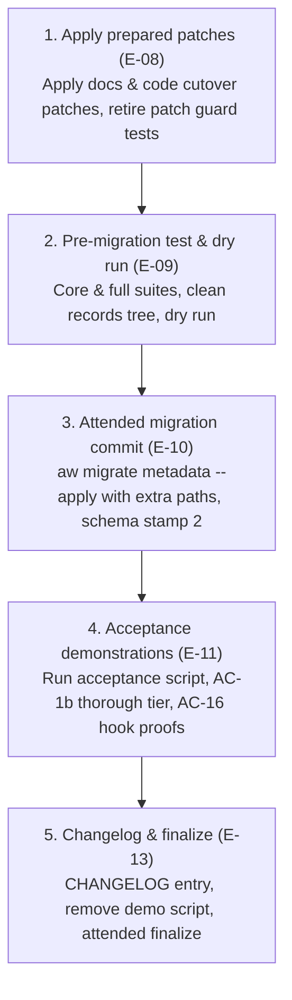

# IPD: Perform the attended metadata cutover commit

- Date: 2026-11-02
- Kind: child
- Concern: Spec `4sd62s` section 7 step 9 and section 5.2 require ONE attended commit that switches `artifact_meta` from the legacy bullet-block format to per-artifact event logs, runs migration `m0001` on this repository in the checkout that holds the gitignored history sidecar, applies the post-cutover documentation, and stamps `metadata_schema: 2`. Every earlier child deferred its log-format half here (re-measured 2026-11-06: deferral rows naming `Carrier: cxxmyv` in 11 of the 12 sibling plans; `7ehv8l` has none), because C10a forbids a second on-disk format on `main` before this commit.
- Scope: Apply the two prepared cutover patches (documentation: `90iqr1` family; code switch to the log format: `2k5t16`, `g45vyv`, `x1mmdp`, `0zylig`), run the real migration on this repository with the invocation the `5qyba0` rehearsal proved, and make the ONE cutover commit; then run the prepared demonstration script (`33vxoi`) on the migrated repository, add the changelog and finalize. The post-cutover code that is dormant on `main` was built earlier by `clors0`, the setter-byte test conversion by `iog3cw` and `w13bkp` (split 2026-11-07), and the preparation, patch writing and rehearsal by the round-3 parts (split 2026-11-09). One commit, attended by the maintainer.
- Scope-Paths: .aw/records/specs/approved/20260925-metastore-01-4sd62s-artifact-metadata-store.spec.md, agent_workflows/, tests/, .aw/records/, .aw/system/workflows/, .aw/system/cutover/, .aw/system/managed-sections.json, .aw/.gitignore, .aw/config/project.json, .aw/AGENT_QUICKSTART.md, .aw/QUICKSTART.md, docs/, AGENTS.md, CHANGELOG.md, .aw/records/plans/pending/20261102-metastore-13-cxxmyv-perform-the-attended-metadata-cutover-commit.ipd.md
- Item-Dependencies: executed:0zylig, executed:1ajqaa, executed:2k5t16, executed:33vxoi, executed:5qyba0, executed:60mazt, executed:75jciz, executed:87rvs2, executed:90iqr1, executed:aqc3m6, executed:clors0, executed:dcerjg, executed:fkvrc7, executed:g45vyv, executed:g5hpbb, executed:iog3cw, executed:rdg0qv, executed:t3t7za, executed:tub3ir, executed:w13bkp, executed:wgn3bl, executed:x1mmdp, executed:ya4ee4, executed:zgyna1
- Status: approved
- Readiness: go-pending-approval
- From-Spec: 4sd62s
- Work-Kind: feature
- Priority: high
- Blocks-Release: next
- Attended: required
- Set: metastore
- Order: 13
- Highest E allocated: 17
- Author: opencode its_direct/pt3-claude-opus-5.5-1m-us
- Id: cxxmyv
- Approval: 2026-11-16, recorded via aw ipd set: status set to approved
- Review-Depth: complex

## Workflow history
- 2026-11-25 note (antigravity): replaced executed:rgva3w with Orders 301-304 (executed:wgn3bl, executed:t3t7za, executed:fkvrc7, executed:75jciz) per maintainer decision on run-20261125T031842Z-2538031.
- 2026-11-18 same-status (aw set): Add executed:60mazt per maintainer decision on g5hpbb-ac42-order08-circular-dependency
- 2026-11-16 approved (aw set): status set to approved
- 2026-11-14 reviewed (antigravity/gemini-3.8-flash): plan-review round 2 verified post-split scope (E-08, E-09, E-10, E-11, E-13), dependencies, and attended execution gate; findings PR-201..PR-203 fixed; marked reviewed and go-pending-approval.
- 2026-11-09 note (opencode its_direct/pt3-claude-opus-5.5-1m-us): round-3 split per research nj8zdp; items E-01, E-02 moved to tub3ir; E-03 to 2k5t16 (which starts the inert code patch and its guard test); E-04 to g45vyv; E-07 to x1mmdp; E-16 to 0zylig; E-17 to 5qyba0 (rehearsal now runs before the attended turn on the prepared patches); E-11 and E-12 prepared as a script by 33vxoi, with E-12's obligation merged into E-11, which runs the script on the real repository. E-08 now applies both patches; E-09, E-10, E-11, E-13 kept. The format switch, the migration run on this repository and the single cutover commit stay here (spec 5.2, C10a).
- 2026-11-08 note (opencode its_direct/pt3-claude-opus-5.5-1m-us): added executed:87rvs2, executed:rdg0qv, executed:aqc3m6, executed:zgyna1 (setter-byte assertion batches split from iog3cw and w13bkp, Orders 59 to 62) per maintainer step-complexity rule.
- 2026-11-07 note (opencode its_direct/pt3-claude-opus-5.5-1m-us): split per maintainer step-complexity rule; items E-05, E-06, E-14, E-15 and the log-format halves of E-04 (rename events) and E-17 (the one-commit extra-path mechanism, with its spec 5.2 step 7 amendment) moved to clors0; the setter-byte half of E-07 moved to iog3cw and w13bkp. The format switch, the migration run and the single cutover commit stay here (spec 5.2, C10a).
- 2026-11-07 same-status (aw set): maintainer direction 2026-11-07 (spec 4sd62s C12/5.2a step 3a): the any-repo migration and multi-shape cache (g5hpbb) must land before any reader move and before the cutover
- 2026-11-07 to-review (aw set): demoted approved -> to-review: APPROVAL WITHDRAWN: maintainer direction 2026-11-07: paused before re-review; the metastore plans MUST build the tools that migrate ANY repo from ANY prior format (.agents layout, id-less/untitled records, no sidecar), not only this repository. Re-review against the amended spec 4sd62s before re-approval.
- 2026-11-07 approved (aw set): status set to approved
- 2026-11-06 reviewed (aw set): APPROVE WITH REVISIONS APPLIED; PR-001..PR-016 FIXED
- 2026-11-06 /plan-review (opencode/its_direct/pt3-claude-opus-5.5-1m-us): APPROVE WITH REVISIONS APPLIED; PR-001..PR-016 FIXED; feasibility risk named: the one-commit mechanism is proven only by the E-17 rehearsal; review record .aw/records/reviews/20261102-metastore-13-cxxmyv-perform-the-attended-metadata-cutover-commit.review.md
- 2026-11-05 to-review (aw set): authored review-ready for spec 4sd62s (Set metastore)

- 2026-11-02 draft (opencode its_direct/pt3-claude-opus-5.5-1m-us): created.

## Goal

Land the hard cutover by applying the prepared, rehearsed patches and running the migration: after this one commit the toolkit reads and writes only the event-log format, every record of this repository is migrated, the documentation describes commands instead of field syntax, and the acceptance criteria that need the real migrated repository are demonstrated on it.

## Detailed Implementation Checklist (TODO)

Execution-state rule: mark an `E-*` item complete only after performing the action. That mark is not validation. Right-sizing rule: each E-item must address one concern and be executable in one focused pass; split when an E-item names multiple distinct deliverables or independent test-surfaces. Accepted execution states: blocked, failed, pending, performed; terminal gate demands 'performed'.

### Task group 1: apply the prepared patches (one working tree, not yet committed)

The decision, the first dry run and the AC-13 before values are `tub3ir`; the code switch is prepared as `.aw/system/cutover/metastore-code.cutover.patch` by `2k5t16`, `g45vyv`, `x1mmdp` and `0zylig`; the demonstrations are `.aw/system/cutover/metastore-acceptance-demo.sh` (`33vxoi`); the full rehearsal on a clone is `5qyba0`. This plan keeps only what must happen in the cutover commit itself or on the migrated real repository (spec 5.2, C10a).

- [ ] E-08 Apply the `90iqr1` documentation patch with `git apply .aw/system/cutover/metastore-docs.cutover.patch`, then the code patch with `git apply .aw/system/cutover/metastore-code.cutover.patch` (if either no longer applies, regenerate it with the owning family's scratch-worktree steps; do not hand-edit), and delete both patch files, `tests/test_metastore_cutover_patch.py` and `tests/test_metastore_cutover_code_patch.py`, whose job ends here. This puts the former task group 2 changes (the old E-03, E-04, E-07 and E-16, now in the code patch) and the documentation into this one working tree.
  - Depends on: none
  - Expected outcome: the documents, managed block, templates and quickstarts describe the log-format commands; the loader, writer, tests and options are switched; the patch files and guard tests are gone.
  - Execution state: pending

### Task group 2: run the migration and commit

- [ ] E-09 On the switched, not-yet-migrated tree, run the bare core gate and `make test-all`. The only allowed failures are the tests `x1mmdp` F-03 lists, which read this repository's own unmigrated records and fail with "run `aw migrate metadata`"; any other failure stops the cutover here. Commit this plan's own progress edits with `aw commit cxxmyv -- <this plan's path>`, so the step-1 preflight sees a clean `.aw/records/` tree, then run `aw migrate metadata` (dry run) once more on this exact tree; any census refusal stops the cutover here with nothing else committed.
  - Depends on: E-08
  - Expected outcome: both tiers pass except the listed refusals; `git status --porcelain -- .aw/records` prints nothing; the dry run is clean.
  - Execution state: pending

- [ ] E-10 With the maintainer present, run `aw migrate metadata --apply` in the main checkout with the exact invocation the `5qyba0` rehearsal recorded in its F-02. The migration acquires the integration lock and holds it while it runs (5.2 step 1). Do not pass `--force` or `--force-worktree` unless the maintainer explicitly decides to and the override is recorded here. The migration renames, converts, rewrites citations, writes the terminal-exception marker, runs `aw check meta` and `aw sanitize --agent` on the staged tree (5.2 step 6), writes `metadata_schema: 2`, and makes its ONE commit through `aw commit --no-plan`, whose path list includes every path E-08 changed or deleted, passed through the `clors0` E-19 extra-path argument.
  - Depends on: E-09
  - Expected outcome: one commit containing the migration and every E-08 path; `aw check meta` reports no findings; the sanitizer reports no `fail`; `aw migrate metadata --apply` run again changes nothing (AC-10).
  - Execution state: pending

### Task group 3: demonstrate on the real repository

- [ ] E-11 Run `bash .aw/system/cutover/metastore-acceptance-demo.sh <this checkout> all` with the `tub3ir` F-02 before values on the migrated repository (read-only blocks here, clone blocks in the gitignored `tmp/cxxmyv-demo`, which the script deletes), and add the two pieces the script cannot produce: the thorough-tier summary at the cutover commit (AC-1b) and the hook output of the cutover commit without `--no-verify` (AC-16). This item now also carries the old E-12 (AC-13 before and after table, log size, append time, generation cost), which is the script's `measure` section.
  - Depends on: E-10
  - Expected outcome: each criterion's labelled block and the AC-13 table, from the real repository or the demo clone; no target value is asserted for AC-13.
  - Execution state: pending

- [ ] E-13 Add one `CHANGELOG.md` entry for the metadata cutover (no em or en dashes), delete `.aw/system/cutover/metastore-acceptance-demo.sh`, and commit both with `aw commit cxxmyv -- CHANGELOG.md .aw/system/cutover/metastore-acceptance-demo.sh <this plan's paths>`; this is a separate commit after the cutover commit. Perform the lifecycle transition: this plan is `Attended: required`, so no runner dispatches it and the attending executor runs `aw ipd finalize cxxmyv` after every `V-*` is `pass`. Do not retire the orchestrator `63ib9r` here; its own E-13 confirms this plan reached `executed`.
  - Depends on: E-11
  - Expected outcome: `aw ipd finalize cxxmyv` succeeds after every `V-*` is `pass`.
  - Execution state: pending

## Project conventions discovered (Step 0)

- The cutover runs in the checkout that holds `.aw/records/history.jsonl` (spec 5.2 step 1, 3c); a runner lane has no sidecar, so this plan is `Attended: required` and is never dispatched unattended.
- Hand publishes to `main` hold the integration lock (AGENTS.md "Before you publish to main by hand"); the migration acquires it itself (5.2 step 1).
- Commits go through `aw commit`; the migration's commit uses `aw commit --no-plan` with its own path list (5.2 step 7). How that path list also carries the code, test and documentation changes of task group 2 is not specified by spec 5.2 or by `dcerjg`; E-17 settles it on a copy before E-10.
- `git clone --depth 1 <local path>` ignores `--depth` ("warning: --depth is ignored in local clones; use file:// instead"; measured at review: `rev-list --count` 2 for a local path, 1 for `file://`), so the AC-2 clone uses a `file://` URL.
- The step-1 preflight refuses any uncommitted change under `.aw/records/` (`dcerjg` E-04 condition (2)). This plan file, the `90iqr1` patch's records-README hunks and any sidecar or INDEX edit made before the migration would all trip it.
- The thorough tier is `make test-all`; the core tier is bare `python3 -m pytest` (AGENTS.md repository development contract).

## Findings

| Id | Evidence | Finding |
|---|---|---|
| F-01 | `rg -n 'Carrier: cxxmyv' .aw/records/plans/pending/20261102-metastore-*.ipd.md` (2026-11-02; re-run at review 2026-11-06: rows in 11 sibling plans, `tve77h`, `1ajqaa`, `dcerjg`, `ya4ee4`, `2xwb9b`, `xexn45`, `ffceq0`, `t4gl15`, `59aiyh`, `9o83cr`, `90iqr1`; `7ehv8l` has none) | Every sibling that has a log-format half defers it here; the Scope check maps each row to an E-item. |
| F-02 | `ya4ee4` OQ-02 and `2xwb9b` OQ-02 | Both maintainer questions were answered on 2026-11-02 (OQ-01, OQ-02 below); E-01 applies OQ-02 and `clors0` E-14 implements OQ-01. |
| F-03 | `90iqr1` E-08 to E-10 | The documentation arrives as a patch file guarded by a core test; this plan applies it and retires the guard. |
| F-04 | spec `4sd62s` 5.2 steps 0 to 7 | The migration itself is built and proven on a copy by `dcerjg`; this plan runs it for real. |
| F-05 | `ffceq0` E-11 (`aw meta repair <id6> [--apply] [--confirm]` in `meta_cli.py`); `2xwb9b` E-12 (`review_findings.review_attestation_missing` reads gate `review` rows through `artifact_meta.query`) | `aw meta repair` and the SR-601 `->reviewed` rule are built in phase B, not here. |
| F-06 | `aw reviews --help`: "the whole namespace is read-only and writes nothing"; `cli.py` has `--kind` on `aw ipd scaffold`, `aw research new`, `aw research mv` and `aw prompts new` | `clors0` E-06 changes the namespace text; E-16 renames these options. |
| F-07 | `tests/test_attention.py` `REPO_ROOT` and `att.scan(REPO_ROOT)`; `pyproject.toml` `livecorpus` marker | Some tests read this repository's own records; after the E-03 schema flip they are refused until E-10 migrates the repository, so E-09 cannot demand a fully green tree before the migration. E-17 runs both tiers on the migrated copy instead. |
| F-08 | `5qyba0` F-02 | The exact `clors0` E-19 extra-path invocation, proven on the rehearsal clone, that E-10 uses. |
| F-09 | Round-3 split 2026-11-09 | The code switch is an inert patch file until E-08 applies it, so `main` still reads one format at every commit (C10a); preparing it early is the same design `90iqr1` uses for documentation. |

## Proposed changes (ordered, validatable)

1. (Moved) decision, dry run, AC-13 before values: `tub3ir`. Code patch: `2k5t16`, `g45vyv`, `x1mmdp`, `0zylig`. Demo script: `33vxoi`. Rehearsal: `5qyba0`.
2. E-08: apply both patches in one working tree.
3. E-09, E-10: both test tiers and a final dry run, then the attended migration commit.
4. E-11, E-13: run the demonstration script on the real repository, changelog, finalize.

## Deferred / out of scope (with reason)

- Moved to clors0 (split 2026-11-07 per maintainer step-complexity rule): E-05 (post-cutover gates), E-06 (`aw reviews record`, `aw walkthrough new`), E-14 (event `overrides`, `--date` refusal), E-15 (post-cutover readers), each made dormant on `main` until the migration; the path-bearing `rename` events of E-04 (as `clors0` E-18); the one-commit extra-path mechanism of E-17 with the spec 5.2 step 7 amendment (as `clors0` E-19).
  - Carrier: clors0
  - Carrier-Evidence: .aw/records/plans/executed/20261108-metastore-48-clors0-build-the-dormant-log-format-gates-readers-event-overrides-c.ipd.md
- Moved to iog3cw (split 2026-11-07 per maintainer step-complexity rule): from E-07, the format-aware field assertion helper and the conversion of the setter-byte assertions of batches S01 to S10. The helper and S01 to S04 are done (`iog3cw` S02 and S03, `j5fqax` the helper and S04, `545ag7` S01, all executed); S05 to S07 moved to `87rvs2` and S08 to S10 to `rdg0qv`. S08 to S10 are done (`wdz2l9` S08, `rdg0qv` S09 and S10, both executed: `.aw/records/plans/executed/20261108-metastore-60-rdg0qv-move-setter-byte-assertions-of-batches-s08-to-s10-onto-the-f.ipd.md`, whose F-29 lists the 4 `setter-byte, exact spelling` rows this plan's E-07 must still change). S05 to S07 are now done (`87rvs2`, executed).
  - Carrier: 87rvs2
  - Carrier-Evidence: .aw/records/plans/executed/20261108-metastore-59-87rvs2-move-setter-byte-assertions-of-batches-s05-to-s07-onto-the-f.ipd.md
- Moved to w13bkp (split 2026-11-07 per maintainer step-complexity rule): from E-07, the conversion of the setter-byte assertions of batches S11 to S20.
  - Carrier: w13bkp
- E-01 (description model) and E-02 (attended dry run, AC-13 before values). Moved to tub3ir (round-3 split 2026-11-09 per research nj8zdp guidance).
  - Carrier: tub3ir
- E-03 (loader and writer switch, legacy loader into `m0001`, legacy write path, schema 2), prepared as the inert code patch with its guard test. Moved to 2k5t16 (round-3 split 2026-11-09 per research nj8zdp guidance).
  - Carrier: 2k5t16
- E-04 (log-only writers, ledger retirement, ignore lines, skip names) as part of the code patch. Moved to g45vyv (round-3 split 2026-11-09 per research nj8zdp guidance).
  - Carrier: g45vyv
- E-07 (log-format test builder, helper branch, exact-spelling rows, review-pilot corpus, refusal list) as part of the code patch. Moved to x1mmdp (round-3 split 2026-11-09 per research nj8zdp guidance).
  - Carrier: x1mmdp
- E-16 (`Kind` option renames, F-07 text tests) as part of the code patch. Moved to 0zylig (round-3 split 2026-11-09 per research nj8zdp guidance).
  - Carrier: 0zylig
- Writing the E-11 demonstrations and the E-12 measurements as a script. Moved to 33vxoi (round-3 split 2026-11-09 per research nj8zdp guidance).
  - Carrier: 33vxoi
- E-17 (full rehearsal on a clone, now on the prepared patches and before the attended turn). Moved to 5qyba0 (round-3 split 2026-11-09 per research nj8zdp guidance).
  - Carrier: 5qyba0
- The execution record (`finalize` and `turn` events) and the run index: separate specs, implemented after this cutover through the registry.
  - Carrier: nq1src
- The run index tables.
  - Carrier: f4p4vn

## Scope check

- Over-scope: none.
- Under-scope: none. Each `Carrier: cxxmyv` row from F-01 maps to an E-item: `tve77h` (loader and writer switch) and `dcerjg` (legacy loader into `m0001`, `CURRENT_METADATA_SCHEMA`) to E-03; `2xwb9b` (`append` legacy branch, `LegacyRender`, path-keyed target) to E-03, and its AC-31 (2) to E-11; `xexn45` and `9o83cr` (`write_legacy`, folded value writers) to E-03; `xexn45` (rename and path events) to `clors0` E-18; `xexn45`, `9o83cr` and `dcerjg` (rename ledger, sidecar writer and ignore lines, INDEX ignore lines and skip names) to E-04, with the on-disk deletions done by migration steps 2 and 5 in E-10; `t4gl15` and `9o83cr` (post-cutover gates, terminal-log hook rules) to `clors0` E-05; `ffceq0` (`last_history_at`, logged-path drift) to `clors0` E-15; `90iqr1` (patch, `Kind` option renames, F-07 tests) to E-08 and E-16, and its two commands to `clors0` E-06; `59aiyh` (builder, `review-pilot` corpus) to E-07, and its setter-byte assertions to `iog3cw` and `w13bkp` with the exact-spelling remainder in E-07; `9o83cr` (AC-1 audit re-run) to E-11; and the real-repository evidence (AC-2 from `1ajqaa`; AC-10, AC-11, AC-16, AC-22 case 2, AC-30 case 3 and AC-41 from `dcerjg`; AC-36 case 6 and the generation cost from `ya4ee4`; AC-7 from `ffceq0`; AC-16 case 2 from `t4gl15`) to E-10 and E-11 (the AC-22 case 2 and AC-30 case 3 dry-run evidence and the AC-13 before values to `tub3ir`). Round-3 split 2026-11-09: the E-03, E-04, E-07 and E-16 mappings above are now carried by `2k5t16`, `g45vyv`, `x1mmdp` and `0zylig` respectively as the inert code patch, which E-08 applies; the E-11 and E-12 demonstrations are scripted by `33vxoi` and run by E-11; the rehearsal is `5qyba0`. The leak-sanitizer note of `t4gl15` is covered by E-10's sanitizer run. OQ-01 is implemented by `clors0` E-14.

## Required tests / validation

- Owns, finally on the real repository: AC-1b, AC-13, AC-16, and the real-repository forms of AC-1, AC-2, AC-3, AC-6, AC-7, AC-9, AC-10, AC-11, AC-22 case 2, AC-30 cases 2 and 3, AC-31, AC-34, AC-36 case 6 and AC-41. Each was first proven on fixtures by the child named in the Scope check.
- Commands: bare `python3 -m pytest` and `make test-all` on the switched tree (E-09; on the migrated copy they are `5qyba0`'s); `aw check meta`, `aw sanitize --agent` and a second `--apply` after the real apply (E-10); the script's AC evidence and AC-13 table (E-11).
- New behavioral tests: none here. The tests of the moved items live in `clors0`, `iog3cw`, `2k5t16` (patch guard) and `0zylig` (renamed options). Each calls the real code or CLI on a fixture and asserts on outputs, exit codes and file bytes.

## Spec / documentation sync

No spec change is planned. The OQ-01 `overrides` key and the `--date` refusal are already in spec 4.2 (verified at review). This plan executes spec `4sd62s` section 7 step 9 and section 5.2, and lands the section 5.4 documentation prepared by `90iqr1`, including the AGENTS.md executed-plan rule amendment of 5.2 step 4a. The spec 5.2 step 7 amendment for the migration's extra-path argument moved to `clors0` E-19 with the mechanism (split 2026-11-07); if the `5qyba0` rehearsal shows the amended text is still incomplete, stop and report rather than amend the spec inside the attended turn.

## Open questions

### OQ-01: Where do history-only setter flags go after the cutover?

- Blocking: yes
- Status: resolved
- Owner: maintainer
- Question: `--allow-open-questions`, `--allow-terminal-reopen` and `--allow-unresolvable-release-sentinel` appear today only in the history line, and `aw specs set --date` sets the history line's day; an event's `at` is always its write time. Where do they go once history is events?
- Recommendation: a structured `overrides` list on the event, and refuse `--date`.
- Closes when: the spec and this plan state the rule.
- Resolution or deferral rationale: RESOLVED 2026-11-02 by the user via /askme: each event records any override flag in a structured `overrides` list (for example `["allow-open-questions"]`); `aw specs set --date` is refused after the cutover, because back-dating an event would misstate when it was written (the original day may still go in `--message`). Spec `4sd62s` 4.2 is amended in the same change to add the `overrides` key. No reason was given.

### OQ-02: Which host and model generate the short descriptions at the cutover?

- Blocking: yes
- Status: resolved
- Owner: maintainer
- Question: carried from `ya4ee4` OQ-02. The description generator must run tool-less (spec OQ-31); `ya4ee4` measured one opencode tool-less call on `google/gemini-3.1-flash-lite` at $0.0045 for a 32 KB plan.
- Recommendation: decide after the trial.
- Closes when: the rule is recorded (now) and applied in E-01.
- Resolution or deferral rationale: RESOLVED 2026-11-02 by the user via /askme: the cutover uses the cheapest model whose `ya4ee4` 40-record trial output the maintainer judges accurate; the default candidate is `google/gemini-3.1-flash-lite` on opencode (tool-less, OQ-31); the maintainer confirms the choice when reviewing the dry-run descriptions before `--apply`. No reason was given.

## Validation and cross-check (verify before reporting done)

Validation-state rule: inspect evidence in a separate pass. Do not mark a `V-*` item complete from memory or from the matching execution checkmark. Accepted validation results: blocked, failed, pass, pending; terminal gate demands 'pass'. Runtime-demonstration reachability rule: for each `V-*` item demanding the software be observed acting (such as a run, a dispatch, or a transition) - as distinct from items demanding a diff, a file's content, or a test result, which are reachable by construction - name the code path that produces the observation or the sibling `E-*` that creates it, else the demand is UNDER-SCOPE.
- [ ] V-08 validates E-08
  - Required evidence: paste `git apply --stat` of each patch (docs, code), `git status --short` showing both patch files, `tests/test_metastore_cutover_patch.py` and `tests/test_metastore_cutover_code_patch.py` deleted, `rg -n '^- (Status|Readiness):' AGENTS.md` returning only quoted legacy examples, and the `CURRENT_METADATA_SCHEMA = 2` line from `rg -n 'CURRENT_METADATA_SCHEMA *=' agent_workflows/`.
  - Observed evidence:
  - Result: pending
- [ ] V-09 validates E-09
  - Required evidence: paste the `make test-all` result line beside the bare core gate result line, each failing node id listed beside its `x1mmdp` F-03 row and its "run `aw migrate metadata`" refusal text; the `aw commit cxxmyv` output; `git status --porcelain -- .aw/records` printing nothing; and the second dry run's clean result on the same tree.
  - Observed evidence:
  - Result: pending
- [ ] V-10 validates E-10
  - Required evidence: paste the `aw migrate metadata --apply` command line beside `5qyba0` F-02, its output including the lock acquisition and any override (none expected), `aw check meta` with no findings, the `aw sanitize --agent` result with no `fail`, the commit hash with `git show --stat` listing both migrated records and the E-08 paths, the hook output of that commit (no `--no-verify`), and the output of a second `--apply` showing no change.
  - Observed evidence:
  - Result: pending
- [ ] V-11 validates E-11
  - Required evidence: paste the script output with one labelled block per criterion (AC-1, AC-1b, AC-2 with `git rev-list --count HEAD` printing 1 in the clone, AC-3, AC-6, AC-7, AC-9, AC-11, AC-16 including the `attention --check` exit code, AC-30 case 2, AC-31, AC-34, AC-36 case 6, AC-41 cases 3 and 4), the AC-13 table with warm and cold before and after values and each command, the log size, append time and generation cost lines, the AC-1b thorough-tier result line at the cutover commit, the AC-16 hook output, and the equal before and after `git status --porcelain` lines the script prints.
  - Observed evidence:
  - Result: pending
- [ ] V-13 validates E-13
  - Required evidence: paste the `CHANGELOG.md` diff hunk, `git show --stat` of the commit showing the script deleted, the `aw commit cxxmyv` output, and the `aw ipd finalize cxxmyv` output.
  - Observed evidence:
  - Result: pending

## Approval and execution gate

- Size assessment: standard
- Cohesion rationale: one indivisible commit (C10a, spec 5.2): splitting it would put two formats on `main`. Everything that could be built, prepared as an inert patch or script, or rehearsed before the cutover without changing `main`'s format was split out on 2026-11-07 (`clors0`, `iog3cw`, `w13bkp`) and 2026-11-09 (`tub3ir`, `2k5t16`, `g45vyv`, `x1mmdp`, `0zylig`, `33vxoi`, `5qyba0`). The Scope-Paths stay broad (IPD-Z603 advisory) because applying the prepared patches and the migration land every prepared file and most records in this one commit; the executor edits none of them by hand.

Execute only with the maintainer present, in the main checkout that holds the history sidecar, after every plan in `- Item-Dependencies:` is `executed` (`90iqr1`, `dcerjg`, `ya4ee4`, `1ajqaa`, `g5hpbb`, the split parts `clors0`, `iog3cw`, `w13bkp`, `87rvs2`, `rdg0qv`, `aqc3m6`, `zgyna1`, and the round-3 parts `tub3ir`, `2k5t16`, `g45vyv`, `x1mmdp`, `0zylig`, `33vxoi`, `5qyba0`). OQ-01 and OQ-02 are resolved. The runner must not dispatch this plan unattended (`- Attended: required`).

Scope fence: `- Scope-Paths:` declares what this plan may change. The migration rewrites most of `.aw/records/`, which is declared. An edit outside the fence is made and then justified at finalize with `--scope-reason`.

Stop conditions (genuinely unsafe states, not scope questions): stop before E-10 if E-09 shows a test failure that is not an unmigrated-records refusal, if a dry run reports a census refusal, or if `5qyba0` did not record a form that makes one commit without `--force` or `--no-verify`. Stop and report if a concurrent edit to a file this plan must change cannot be combined safely.

Commits: the cutover itself is ONE commit, made by the migration's `aw commit --no-plan` with its own path list (5.2 step 7). This plan's own record edits are committed separately with `aw commit cxxmyv -- <paths>`: before the migration (E-09, so the preflight sees a clean records tree) and after it (E-13). Never `git add -A`, a bare `git add`, `git commit -a` or `--no-verify`; never push, and never run the pre-push hooks by pushing.

Honesty: paste the actual output of every test tier, the dry run, the apply, the sanitizer and each AC demonstration; never claim a result that was not run.

Lifecycle: this plan is `Attended: required`, so no runner finalizes it; the attending executor runs `aw ipd finalize cxxmyv`, which refuses until every `V-*` is `pass` with observed evidence. Never `git mv` the plan by hand.
