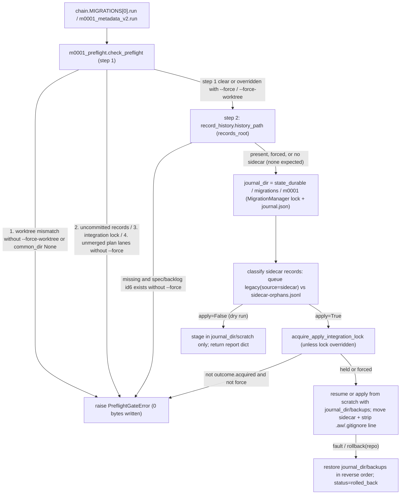

# IPD: Build the m0001 preflight, migration journal and sidecar import

- Date: 2026-11-07
- Kind: child
- Concern: Spec `4sd62s` makes the metadata cutover one scripted migration (sections 5.1, 5.2, and 5.2a). After `g8na48` (the round-3 split of this plan's E-01) builds `agent_workflows/migrations/chain.py` and the `metadata_schema` stamp, `chain.MIGRATIONS[0].run` still has no `m0001` implementation: neither the step-1 preflight (`m0001_preflight.py`), nor the per-migration journal on `layout_migration.MigrationManager`, nor the step-2 sidecar import (`m0001_metadata_v2.py`) exists. Plan `dcerjg` originally owned those items alongside later conversion and verification work; it was split on 2026-11-07 per the maintainer's step-complexity rule so every later `m0001` part adds steps to a preflighted, journaled run.
- Scope: On top of the migration chain and `metadata_schema` stamp built by `g8na48` (round-3 split of this plan's E-01): the step-1 preflight, `--force`/`--force-worktree`, and apply-time integration-lock hold (`dcerjg` E-04); the `m0001_metadata_v2.run`/`resume`/`rollback` entry points and migration journal over `layout_migration.MigrationManager`'s lock and atomic persistence (`dcerjg` E-05); and the step-2 sidecar expectedness check, `legacy` event queue, orphan export, and target `.aw/.gitignore` cleanup (`dcerjg` E-06); plus `tests/test_m0001_preflight.py` and `tests/test_m0001_sidecar.py` (subset of `dcerjg` E-14). Everything runs only on `tmp_path` test fixtures. EXCLUDES: the chain, stamp, read-path hook, and `tests/test_migrations_chain.py` (`g8na48`); the `aw migrate` CLI group and the install prompt (`1vfqdu`); renames and citations (`dky26u`); conversion (`ghhzb6`, `hpedmn`); terminal-commit marker and INDEX cleanup (`o19353`); census, round trip, clone proof, and changelog (`dcerjg`); descriptions (`830wku`, `odeo9z`, `ya4ee4`); stage-1 layout chaining (`bv4kkj`, `g5hpbb`).
- Scope-Paths: agent_workflows/migrations/m0001_metadata_v2.py, agent_workflows/migrations/m0001_preflight.py, tests/test_m0001_preflight.py, tests/test_m0001_sidecar.py, .aw/records/plans/pending/20261107-metastore-15-vxevph-build-the-migration-chain-metadata-schema-stamp-m0001-prefli.ipd.md
- Item-Dependencies: executed:tve77h, executed:g8na48
- Status: approved
- Readiness: go-pending-approval
- Review-Depth: complex
- From-Spec: 4sd62s
- Work-Kind: feature
- Priority: high
- Blocks-Release: next
- Set: metastore
- Order: 15
- Highest E allocated: 06
- Author: opencode its_direct/pt3-claude-opus-5.5-1m-us
- Id: vxevph
- Approval: 2026-11-16, recorded via aw ipd set: status set to approved

> Write and proofread this plan per the technical writing standard, `.aw/system/workflows/technical-writing/technical-writing.md` (`.agents/workflows/technical-writing/technical-writing.md` in a legacy-layout install), including requirement 12 (diagrams).

## Workflow history
- 2026-11-16 approved (aw set): status set to approved
- 2026-11-14 reviewed (aw set): APPROVE WITH REVISIONS APPLIED; PR-001..PR-006 FIXED

- 2026-11-13 /plan-review (antigravity/gemini): APPROVE WITH REVISIONS APPLIED; PR-001..PR-006 FIXED; review record .aw/records/reviews/20261107-metastore-15-vxevph-build-the-migration-chain-metadata-schema-stamp-m0001-prefli.review.md
- 2026-11-09 note (opencode its_direct/pt3-claude-opus-5.5-1m-us): round-3 split per research nj8zdp; items E-01 (and the stamp half of E-05) moved to g8na48.
- 2026-11-07 to-review (opencode its_direct/pt3-claude-opus-5.5-1m-us): split from dcerjg per maintainer step-complexity rule (no single E/V item hides hundreds of steps).
- 2026-11-07 draft (opencode its_direct/pt3-claude-opus-5.5-1m-us): created.

## Goal

The `m0001` preflight, per-migration journal, and sidecar import exist behind `m0001_metadata_v2.run` on the `g8na48` chain and are proven on `tmp_path` fixtures, so every later `m0001` part adds steps to a preflighted, journaled run.

## Detailed Implementation Checklist (TODO)

Execution-state rule: mark an `E-*` item complete only after performing the action. That mark is not validation. Right-sizing rule: write for a modest executor that cannot hold much in its head. Each E-item is one step (one concern, about one file, executable in one focused pass) and its V-item names each unit it covers with its own check; split when an E-item names multiple distinct deliverables or independent test surfaces. Accepted execution states: blocked, failed, pending, performed; terminal gate demands 'performed'.

Item E-01 (baseline, chain, stamp, read-path hook) moved to `g8na48` (see Deferred).

### Task group 2: preflight, journal and sidecar

- [x] E-02 Create `agent_workflows/migrations/m0001_preflight.py` implementing `check_preflight(repo, *, records_root=None, force=False, force_worktree=False)` and `acquire_apply_integration_lock(repo, *, lock_overridden=False)` for `4sd62s` 5.2 step 1:
  - Resolve `records_root` from the explicit argument or `project_context.project_records_dir(repo)` (never `resolve_project_context.logical_roots["records"]`, which defaults to `<AW_HOME>` on unconfigured `tmp_path` repositories).
  - Evaluate the four step-1 conditions in exact order: (1) `WORKTREE`: compare `Path` of `git rev-parse --path-format=absolute --git-dir` against `ipd_lifecycle.checkout_git_common_dir(repo)`; `None` from `checkout_git_common_dir` refuses naming `"cannot establish the common directory"` (never overridden), and a mismatch refuses naming `--force-worktree` unless `force_worktree=True` (`--force` never overrides it; when `force_worktree=True`, record the worktree override in the report). (2) `UNCOMMITTED`: run `git status --porcelain -- <records_root>` when `records_root` sits inside the checkout (or `git -C <records_root> status --porcelain` when an external companion/home `records_root` is its own git working tree); non-empty output refuses unless `force=True`. (3) `LOCK`: call `platform_lock.probe_free(runner_shared.integration_lock_path(repo))`; `False` refuses as held by a live run and `None` refuses as its own unanswerable lock-probe condition (`probe_free` contract), unless `force=True`. (4) `LANES`: parse `git worktree list --porcelain`, skip the primary worktree (`--git-dir == checkout_git_common_dir(repo)`), and for each linked worktree check whether `git diff --name-only <common_head>...<wt_ref> -- <plans_relpath>` or `git -C <wt_path> status --porcelain -- <plans_relpath>` touches the plans tree while `runner_shared.lane_work_has_landed(repo, branch)` (`branch` stripped of `refs/heads/`, or `""` when detached) is not `True`, listing each matching worktree and rendering `None` as `"unknown"` rather than dropping it.
  - On any unoverridden refusal, raise `layout_migration.PreflightGateError` naming every failed condition and write nothing to disk (no journal directory, no scratch directory, no lock file). When `force=True` overrides conditions (2), (3), or (4), record each overridden condition and its `4sd62s` 5.2 consequence in the returned preflight report.
  - In `acquire_apply_integration_lock`, yield without touching `.aw/state/integration.lock` on dry runs (`apply=False`) or when `lock_overridden` is `True` (logging the forced lock-race warning); when `apply=True` and `not lock_overridden`, enter `runner_shared.integration_lock(repo, holder_label="aw migrate metadata")` for the whole apply and raise `PreflightGateError` if `not outcome.acquired` (unless `force=True`).
  - Depends on: none
  - Expected outcome: every AC-27 step-1 case holds in `tmp_path` repositories (`--force` overrides 2 to 4 with named 5.2 consequences and never overrides 1; `--force-worktree` overrides only 1), and the repository is byte-identical after every refusal.
  - Execution state: performed

- [x] E-03 Create `agent_workflows/migrations/m0001_metadata_v2.py` defining `run(repo, *, apply=False, force=False, force_worktree=False, describer=None, fault_injection=None) -> dict` (matching `g8na48` `chain.MIGRATIONS[0].run`, `1vfqdu` E-02, and `dcerjg` E-15), `resume(repo, *, fault_injection=None) -> dict`, and `rollback(repo) -> dict` over `layout_migration.MigrationManager`:
  - Resolve `ctx = project_context.resolve_project_context(target_repo=str(repo))`, `state_durable = Path(ctx.physical_classes["state_durable"])`, `journal_dir = state_durable / "migrations" / "m0001"`, and `records_root = project_context.project_records_dir(repo)`. Create `journal_dir` only after step-1 (`E-02`) and step-2 (`E-04`) refusals clear so refused runs write nothing.
  - Instantiate `layout_migration.MigrationManager(str(repo))` with rebound `transaction_file = journal_dir / "journal.json"` and `lock_file = journal_dir / "writer.lock"`, reusing `_acquire_lock`, `_release_lock`, `_save_transaction`, and `_load_transaction` directly (never touching `migration_transaction.json`, `migration_writer.lock`, or layout-only `MigrationManager.resume_migration`/`rollback_migration`, which rewrite `config.json` to `records_backend = "legacy"`). Initialize `"timestamps": {"started_at": ..., "updated_at": ...}` in `tx_data` as required by `MigrationManager._save_transaction`.
  - Persist the six `m0001` journal sections in `journal.json`: `minted_ids` (legacy path to minted `id6`, reused across dry runs and apply), `rename_map` (old to new path), `steps` and `applied_files` (per-step progress and per-file apply ledger), `descriptions` (`describer` seam outputs), `orphan_export_path` and `orphan_counts`, and `terminal_commit_marker` (`None` until `o19353` E-01).
  - Default `apply=False` (dry run): stage work under `journal_dir / "scratch"` (copying `records_root` plus citation scan roots as steps are added) and write nothing outside `journal_dir`. Under `apply=True` (inside `acquire_apply_integration_lock`), if an existing `journal.json` has `status == "applying"`, resume remaining unapplied file operations from `journal_dir / "scratch"` instead of restarting (`4sd62s` 5.2 step 0); before mutating or removing each target file, save its pre-apply bytes (or an absence marker for newly created files) under `journal_dir / "backups"`, record each completed file via `_save_transaction`, support `fault_injection="interrupt-mid-apply"` after the first applied file for deterministic testing, and in `rollback(repo)` restore recorded backups and unlink newly created files in reverse order before saving `status = "rolled_back"`.
  - Depends on: E-02
  - Expected outcome: `fault_injection="interrupt-mid-apply"` between two applied files leaves an `"applying"` journal from which `m0001_metadata_v2.run(repo, apply=True)` (and `resume(repo)`) finishes to the exact uninterrupted tree, `rollback(repo)` restores pre-apply bytes byte-for-byte, and a dry run writes only under gitignored `state/durable/migrations/m0001/`.
  - Execution state: performed

- [x] E-04 Implement `4sd62s` 5.2 step 2 and 5.2a item 5 (sidecar first) in `agent_workflows/migrations/m0001_metadata_v2.py`:
  - Read `sidecar_path = record_history.history_path(repo)` (`records_root / "history.jsonl"`) before any later migration step. Set `sidecar_expected = True` when `records_root` holds at least one tracked spec or backlog `.md` record (excluding `README.md`) carrying an `id6` (clustered filename `id6` after testing `artifact_naming._LEGACY_TIMESTAMP_RE` first per 5.2 step 3, or in-file `- Id:`).
  - When `sidecar_path` exists, record its presence and JSONL record count in the preflight report; when absent and `not sidecar_expected`, do not refuse and report `"no sidecar (none expected)"` (`4sd62s` 5.2a item 5); when absent and `sidecar_expected`, raise `layout_migration.PreflightGateError` naming the missing sidecar unless `force=True` (the only non-step-1 refusal `--force` overrides; `--force-worktree` never overrides it).
  - Build the tracked-record `id6` set across `records_root` (excluding `comms/`, `.data/`, `README.md`, `INDEX.*`, `STATUS.md`, `prompt-library/`, and the two research templates) from clustered filename `id6` (`_LEGACY_TIMESTAMP_RE` checked before `artifact_naming.parse_clustered`) and in-file `Id`/`id` (`- Id:` bullets, research YAML `id`, and leading `<!-- aw-prompt: ... -->` `Id`).
  - Classify each sidecar JSON object in file order: if `rec.get("key_kind") != "synthetic"` and `rec.get("id6")` is in the tracked `id6` set, queue one `op: "legacy"` payload (`{"op": "legacy", "source": "sidecar", "observed_day": rec.get("date"), "position": idx, "ordering_confidence": "unknown", "line": rec}`, conforming to `artifact_meta.OP_PAYLOAD_SCHEMAS["legacy"]`) under `sidecar_events[id6]` for `ghhzb6` E-01 to emit after inline `source: "history"` events, keeping sidecar records that repeat an inline `## Workflow history` line (leaving inline history untouched so both `source: "history"` and `source: "sidecar"` remain) and keeping rename/group records (`verb` in `("rename", "group")`) as `op: "legacy"`. Write unresolvable records to `journal_dir / "sidecar-orphans.jsonl"`, record per-key `orphan_counts` for the census, and create neither a `sidecar_events` entry nor any `meta/<id6>.jsonl` file.
  - On `apply=True` (journaled with backups in `E-03` so `rollback(repo)` restores both files), move `sidecar_path` to `journal_dir / "history.jsonl.imported"` when present and remove the `records/history.jsonl` (or `/records/history.jsonl`) line from `Path(repo) / ".aw" / ".gitignore"` when present, preserving every other line and the trailing newline.
  - Depends on: E-03
  - Expected outcome: AC-22 case (1), `4sd62s` 5.2a item 5 (`no sidecar (none expected)`), AC-30 case (1), and the target-repo `.aw/.gitignore` and sidecar-move half of AC-30 case (2) hold on `tmp_path` fixtures.
  - Execution state: performed

### Task group 3: tests

- [x] E-05 Create `tests/test_m0001_preflight.py` (the preflight and journal subset of `dcerjg` E-14) on `tmp_path` fixture repositories initialized with real `git init`, calling `m0001_preflight` and `m0001_metadata_v2` directly and asserting on return values, raised `PreflightGateError` messages, and file bytes (zero source inspection):
  - AC-27 case (1): uncommitted change under `records_root`, live integration lock held in a child process (plus `None` unanswerable lock probe), and linked lane worktree with an unmerged plan change (plus detached/`None` lane landing rendered as `"unknown"`), each refusing without `--force` with a byte-identical tree and continuing with `--force` while naming each overridden condition and its `4sd62s` 5.2 consequence.
  - AC-27 case (2): linked worktree refusing even with `--force` and naming `--force-worktree` (plus `None` from `checkout_git_common_dir` refusing as `"cannot establish the common directory"`).
  - AC-27 case (3) and AC-22 case (1): linked worktree with `--force-worktree`, a tracked spec or backlog `id6`, and no sidecar passing step 1 and refusing at step 2 naming the missing sidecar.
  - AC-27 case (4): `--force-worktree` in the main checkout with an uncommitted record change still refusing on the uncommitted condition.
  - Journal lifecycle (`E-03`): dry run writing only under `state/durable/migrations/m0001/` with `git status --porcelain` empty; `fault_injection="interrupt-mid-apply"` leaving `status == "applying"` and `m0001_metadata_v2.run(repo, apply=True)` resuming to the exact uninterrupted bytes; and `rollback(repo)` restoring pre-apply bytes exactly.
  Set `pytestmark = pytest.mark.core`, or `pytest.mark.slow` if its slowest test exceeds 2 s in `--durations=10`, recorded in V-05.
  - Depends on: E-02, E-03, E-04
  - Expected outcome: `python3 -m pytest -o addopts="" -v tests/test_m0001_preflight.py` passes every test.
  - Execution state: performed

- [x] E-06 Create `tests/test_m0001_sidecar.py` (split from `dcerjg` E-14 and `vxevph` E-05 so each test module has its own item) on `tmp_path` fixture repositories initialized with real `git init`, calling `m0001_metadata_v2.run` and `rollback` directly and asserting on outputs and file bytes (zero source inspection):
  - Sidecar expectedness (`4sd62s` 5.2 step 2 and 5.2a item 5): fixture with no `id6` spec or backlog item reports `"no sidecar (none expected)"` without refusing; fixture with an `id6` spec or backlog item and no sidecar refuses unless `force=True` and passes with `force=True` naming the sidecar override.
  - AC-30 case (1): sidecar holding a status record, a record repeating an inline `## Workflow history` line, a rename/group record, and an orphan `id6` matching no tracked record queues `op: "legacy", source: "sidecar"` payloads with unchanged JSON objects and `observed_day` for the first three (while leaving the inline `source: "history"` row from `artifact_meta.load_legacy_artifact` intact so both remain with distinct `source` values, and keeping the rename record as `op: "legacy"`), writes the fourth to `sidecar-orphans.jsonl` with per-`id6` `orphan_counts`, and creates no queued event or `meta/<orphan>.jsonl` file for the fourth.
  - AC-30 case (2) target-repo half: `apply=True` moves `records/history.jsonl` into `state/durable/migrations/m0001/history.jsonl.imported` so `git status --porcelain --ignored` shows no `records/history.jsonl` and strips `records/history.jsonl` from `.aw/.gitignore` while preserving sibling ignore lines and trailing newline; `rollback(repo)` restores both files byte-for-byte.
  Set `pytestmark = pytest.mark.core`, or `pytest.mark.slow` if its slowest test exceeds 2 s in `--durations=10`, recorded in V-06 alongside the two-module `-n auto` run and bare `python3 -m pytest`.
  - Depends on: E-03, E-04
  - Expected outcome: `tests/test_m0001_sidecar.py` and `tests/test_m0001_preflight.py` pass under `python3 -m pytest -o addopts="" -n auto <modules>`, and the bare core gate `python3 -m pytest` stays inside its 30 s budget.
  - Execution state: performed

## Project conventions discovered (Step 0)

- Transactional migrations reuse `layout_migration.MigrationManager` (`_acquire_lock`, `_release_lock`, `_save_transaction`, `_load_transaction`) over a per-migration `transaction_file` and `lock_file`, initializing `"timestamps"` in `tx_data` (`4sd62s` 5.1 forbids new lock or atomic-journal primitives; `MigrationManager.resume_migration` and `rollback_migration` are specific to the `.agents` layout move journal and `records_backend` config switch, so `m0001` implements its own backup-and-resume phases over those persistence primitives).
- Path roots come from `project_context`: `Path(resolve_project_context(target_repo=str(repo)).physical_classes["state_durable"])` for the durable migration journal directory (`migrations/m0001/`), `project_context.project_records_dir(repo)` for `records_root` (honoring stored companion/home backends while resolving `<repo>/.aw/records` on unconfigured and `tmp_path` repositories instead of `<AW_HOME>`), and `record_history.history_path(repo)` for the sidecar (`4sd62s` 4.5, 5.1, 5.2a).
- Tests exercise code and assert on outputs (AGENTS.md "TEST OUTCOMES, NOT CODE STRUCTURE"); new modules set `pytestmark = pytest.mark.core` unless the `--durations=10` rule of `dcerjg` E-14 moves one to `slow`.
- Cite code by SYMBOL (`module.function`) or by a quoted content string, never by a line number alone (advisory `IPD-C801`).
- The integration lock is `runner_shared.integration_lock_path` and `runner_shared.integration_lock` (bounded, loud wait yielding `IntegrationLockOutcome`); a non-mutating probe is `platform_lock.probe_free`. Worktree identity is `ipd_lifecycle.checkout_git_common_dir`. Lane landing is `runner_shared.lane_work_has_landed` (`True`/`False`/`None`, with `None` kept visible as `"unknown"`).

## Findings

| Id | Evidence (measured in this worktree) | Finding |
|---|---|---|
| F-01 | `ls agent_workflows/migrations`: absent before `g8na48`; `g8na48` E-01 creates `__init__.py` and `chain.py` with `m0001.run` lazily delegating to `m0001_metadata_v2.run` | `m0001_preflight.py` and `m0001_metadata_v2.py` are unbuilt; `vxevph` supplies the `m0001_metadata_v2.run` target `g8na48` delegates to. |
| F-02 | `rg -n "known_keys\|known_proj_keys\|ProjectPolicySchema\(" agent_workflows/project_schema.py agent_workflows/install_wizard.py`: 8 hits | Moved in full to `g8na48` (`E-01`, `E-02`, `E-03`, `E-05`), which runs before `vxevph` (`- Item-Dependencies: executed:tve77h, executed:g8na48`) and saves the `.aw/state/dcerjg/check-before.jsonl` baseline (`g8na48` F-03). |
| F-03 | `rg -n "def (checkout_git_common_dir\|probe_free\|integration_lock_path\|integration_lock\|lane_work_has_landed)\b" agent_workflows`: all 5 exist; `integration_lock` yields `IntegrationLockOutcome(acquired, ...)` and `LANE_INTEGRATION_TARGET_FALLBACK == "HEAD"` | Preflight item (`E-02`): 4 step-1 conditions, 2 override flags (`--force`, `--force-worktree`), 1 apply-only lock context manager checking `outcome.acquired`, 1 module. |
| F-04 | `rg -n "def (__init__\|_acquire_lock\|_release_lock\|_save_transaction\|_load_transaction\|resume_migration\|rollback_migration)\b" agent_workflows/layout_migration.py`: 7 hits; `_save_transaction` updates `tx_data["timestamps"]["updated_at"]`, and `rollback_migration` writes `records_backend = "legacy"` | Journal item (`E-03`): rebind `transaction_file` and `lock_file` under `physical_classes["state_durable"] / "migrations" / "m0001"`, initialize `"timestamps"`, reuse `_acquire_lock`/`_release_lock`/`_save_transaction`/`_load_transaction`, and implement `m0001` per-file backup/resume/rollback without calling layout-only `rollback_migration`. |
| F-05 | `ls .aw/records/history.jsonl`: absent in this worktree; `rg -c "records/history.jsonl" .aw/.gitignore`: 1; `project_context.project_records_dir` resolves `<repo>/.aw/records` on unconfigured repos while `resolve_project_context.logical_roots["records"]` defaults to `<AW_HOME>` | Sidecar item (`E-04`): resolve `records_root` via `project_records_dir`, handle both expected-missing refusal and `"no sidecar (none expected)"` (`4sd62s` 5.2a item 5), queue `op: "legacy", source: "sidecar"` payloads for `ghhzb6`, export orphans, and back up/clean `.aw/.gitignore` + `history.jsonl` on apply. |
| F-06 | `dcerjg` E-14 named 7 test modules in one item, and `vxevph` E-05 still bundled 2 independent test modules (`test_m0001_preflight.py` and `test_m0001_sidecar.py`) | Split one test module per item (`E-05` for `tests/test_m0001_preflight.py`, `E-06` for `tests/test_m0001_sidecar.py`). |

## Proposed changes (ordered, validatable)

1. E-02: create `agent_workflows/migrations/m0001_preflight.py` (step-1 conditions 1 to 4, `--force` and `--force-worktree` overrides, and apply-only integration-lock hold).
2. E-03: create `agent_workflows/migrations/m0001_metadata_v2.py` (`run`, `resume`, `rollback`, scratch staging, and per-migration `MigrationManager` journal under `state_durable`).
3. E-04: add step-2 sidecar expectedness, `op: "legacy"` sidecar queueing, orphan export, and apply-time sidecar move plus `.aw/.gitignore` cleanup in `m0001_metadata_v2.py`.
4. E-05: create `tests/test_m0001_preflight.py` covering step-1 preflight refusals/overrides and journal dry-run/resume/rollback.
5. E-06: create `tests/test_m0001_sidecar.py` covering sidecar expectedness, `no sidecar (none expected)`, `legacy` event queueing, orphan export, and `.aw/.gitignore` cleanup.

## Deferred / out of scope (with reason)

- E-01 (the `aw check` baseline, `migrations/__init__.py`, `migrations/chain.py`, the `metadata_schema` stamp and its `project_schema`/`install_wizard` round trip, the `artifact_meta` read-path hook) and the stamp-and-schema half of `tests/test_migrations_chain.py` from E-05: Moved to g8na48 (round-3 split 2026-11-09 per research nj8zdp guidance).
  - Carrier: g8na48
  - Carrier-Evidence: .aw/records/plans/executed/20261109-metastore-101-g8na48-build-the-migration-chain-the-metadata-schema-stamp-and-the.ipd.md
- The `aw migrate` command group, bare `aw migrate`, and the install pending-migration prompt.
  - Carrier: 1vfqdu
- Step-3 legacy-timestamp rename map and citation rewrites (`m0001_renames.py`).
  - Carrier: dky26u
- Step-4 log builder and file rewrites consuming `sidecar_events` (`m0001_convert.py`).
  - Carrier: ghhzb6
- Step-4 review events and research/walkthrough/roadmap conversion (`m0001_convert.py`).
  - Carrier: hpedmn
- Steps 4a and 5 terminal-commit marker, hook marker acceptance, and INDEX/STATUS cleanup.
  - Carrier: o19353
- Step-6 census, round-trip verifier, ten-module family gate, disposable clone proof, and changelog.
  - Carrier: dcerjg
- Description validation (`830wku`), description journal, and tool-less model call (`odeo9z`, `ya4ee4`).
  - Carrier: ya4ee4
- Chaining stage-1 layout migration inside the `m0001` journal and companion/home AC-42 verification (`bv4kkj`, `g5hpbb`).
  - Carrier: bv4kkj

## Scope check

- Over-scope: none.
- Under-scope: none for `dcerjg` E-04, E-05, and E-06 and their tests (`E-01` is `g8na48`'s); AC-22 case 1, AC-27 cases 1 to 4, `4sd62s` 5.2a item 5 (`no sidecar (none expected)`), AC-30 case 1, and the target-repo half of AC-30 case 2 are proven here.

## Required tests / validation

New modules (all `core` unless `E-05`/`E-06`'s duration rule moves one to `slow`): `tests/test_m0001_preflight.py`, `tests/test_m0001_sidecar.py`. Existing regression pins: `tests/test_migrations_chain.py` (from `g8na48`), `tests/test_layout_migration.py`. Gate: bare `python3 -m pytest`.

## Spec / documentation sync

No spec change; implements `4sd62s` 5.1 (`MigrationManager` journal reuse), 5.2 steps 0, 1, and 2, and 5.2a items 3 and 5 (`project_context` records-root resolution and `no sidecar (none expected)`), while `g8na48` implements 5.1's chain and `metadata_schema` stamp. The CHANGELOG line is written once by `dcerjg` E-16 for the whole family.

## Open questions

### OQ-03: How can `metadata_schema` and the AC-11 refusal ship in phase A without refusing this unmigrated repository?

- Blocking: no
- Status: resolved
- Owner: none
- Resolution or deferral rationale: Carried from `dcerjg` OQ-03 (implemented in `g8na48`, which precedes `vxevph`): `require_current_schema` compares against `CURRENT_METADATA_SCHEMA`, which is `1` (the legacy format) while an absent stamp counts as `1`, so nothing refuses before the cutover; Order 13 (`cxxmyv`) flips the constant to `2` in the cutover commit, and `g8na48` tests monkeypatch the constant to `2`. Recommendation strength: strong.

- Note: carried with its original id from `dcerjg` so cross-plan references to `OQ-03` still resolve.

## Validation and cross-check (verify before reporting done)

Validation-state rule: inspect evidence in a separate pass. Do not mark a `V-*` item complete from memory or from the matching execution checkmark. Accepted validation results: blocked, failed, pass, pending; terminal gate demands 'pass'. Runtime-demonstration reachability rule: for each `V-*` item demanding the software be observed acting (such as a run, a dispatch, or a transition), as distinct from items demanding a diff, a file's content, or a test result, which are reachable by construction, name the code path that produces the observation or the sibling `E-*` that creates it, else the demand is UNDER-SCOPE.

- [x] V-02 validates E-02
  - Required evidence: paste `python3 -m pytest -o addopts="" -v tests/test_m0001_preflight.py -k "preflight or worktree or sidecar_missing"` with PASSED node ids covering AC-27 case 1 (uncommitted records, held integration lock, unanswerable `None` lock probe, and unmerged/unknown linked-worktree plan lane, each refused with a byte-identical tree and then overridden by `--force` with its 5.2 consequence named), case 2 (linked worktree refused even with `--force`, naming `--force-worktree`, plus `None` common-dir refusal), case 3 / AC-22 case 1 (`--force-worktree` passing step 1 and refusing on missing expected sidecar), and case 4 (`--force-worktree` in main checkout still refusing on uncommitted records).
  - Observed evidence: `python3 -m pytest -o addopts="" -v tests/test_m0001_preflight.py -k "preflight or worktree or sidecar_missing"` -> `7 passed in 2.07s` (`tests/test_m0001_preflight.py::test_preflight_worktree_refusal_force_vs_force_worktree_and_missing_common_dir PASSED`, `tests/test_m0001_preflight.py::test_preflight_held_integration_lock_and_none_probe_refusal_and_force PASSED`, `tests/test_m0001_preflight.py::test_preflight_linked_lane_unmerged_and_unknown_landing PASSED`, `tests/test_m0001_preflight.py::test_journal_dry_run_isolation_and_chain_delegation PASSED`, `tests/test_m0001_preflight.py::test_preflight_uncommitted_records_refusal_and_force_override PASSED`, `tests/test_m0001_preflight.py::test_journal_interrupt_mid_apply_resume_and_rollback PASSED`, `tests/test_m0001_preflight.py::test_preflight_force_worktree_in_main_checkout_still_refuses_uncommitted PASSED`).
  - Result: pass
- [x] V-03 validates E-03
  - Required evidence: paste `python3 -m pytest -o addopts="" -v tests/test_m0001_preflight.py -k "journal or resume or rollback"` with PASSED node ids for dry-run isolation, `fault_injection="interrupt-mid-apply"` auto-resume via `m0001_metadata_v2.run(repo, apply=True)` (and `resume(repo)`), and `rollback(repo)` byte-for-byte restoration; plus `ls -R` of `state/durable/migrations/m0001/` and empty `git status --porcelain` after a fixture dry run, and `python3 -m pytest -o addopts="" -v tests/test_layout_migration.py` with 0 failed.
  - Observed evidence: `python3 -m pytest -o addopts="" -v tests/test_m0001_preflight.py -k "journal or resume or rollback"` -> `2 passed, 5 deselected in 0.71s` (`tests/test_m0001_preflight.py::test_journal_dry_run_isolation_and_chain_delegation PASSED`, `tests/test_m0001_preflight.py::test_journal_interrupt_mid_apply_resume_and_rollback PASSED`); fixture dry run `git status --porcelain` -> `''` and `ls -R <tmp_repo>/.aw/state/durable/migrations/m0001` -> `journal.json`, `scratch/records/backlog/open/20261101-demo-01-bk0001-item.backlog.md`, `scratch/records/history.jsonl`, `scratch/repo`; `python3 -m pytest -o addopts="" -v tests/test_layout_migration.py` -> `49 passed in 4.77s` (0 failed).
  - Result: pass
- [x] V-04 validates E-04
  - Required evidence: paste `python3 -m pytest -o addopts="" -v tests/test_m0001_sidecar.py` with PASSED node ids covering `no sidecar (none expected)` non-refusal (`4sd62s` 5.2a item 5), missing-expected-sidecar refusal and `--force` override, AC-30 case 1 (status record, repeated inline history line kept alongside `source: "history"` with distinct `source: "sidecar"`, rename/group record kept as `op: "legacy"`, and orphan `id6` written to `sidecar-orphans.jsonl` with `orphan_counts` and no log), and AC-30 case 2 target-repo half (`history.jsonl` moved to `history.jsonl.imported`, `records/history.jsonl` removed from `.aw/.gitignore`, and both restored on `rollback`). (The clone preflight line naming the sidecar record count is verified in `dcerjg` V-15.)
  - Observed evidence: `python3 -m pytest -o addopts="" -v tests/test_m0001_sidecar.py` -> `4 passed in 0.70s` (`tests/test_m0001_sidecar.py::test_sidecar_classification_queueing_and_orphan_export PASSED`, `tests/test_m0001_sidecar.py::test_sidecar_apply_moves_history_cleans_gitignore_and_rollback_restores PASSED`, `tests/test_m0001_sidecar.py::test_sidecar_expected_missing_refusal_and_force_override PASSED`, `tests/test_m0001_sidecar.py::test_sidecar_not_expected_when_no_id6_spec_or_backlog PASSED`).
  - Result: pass
- [x] V-05 validates E-05
  - Required evidence: paste `python3 -m pytest -o addopts="" -v tests/test_m0001_preflight.py --durations=10` showing every node id PASSED, 0 failed, and the durations table naming whether `tests/test_m0001_preflight.py` is marked `core` or `slow`; plus `python3 -m pytest -o addopts="" -v tests/test_migrations_chain.py` with 0 failed confirming `chain.MIGRATIONS[0].run` delegates to `m0001_metadata_v2.run`.
  - Observed evidence: `python3 -m pytest -o addopts="" -v tests/test_m0001_preflight.py --durations=10` -> `7 passed in 1.79s`, 0 unlisted slow tests, slowest call `0.44s` (`test_preflight_held_integration_lock_and_none_probe_refusal_and_force`), marked `core`; `python3 -m pytest -o addopts="" -v tests/test_migrations_chain.py` -> `13 passed in 1.43s` (0 failed).
  - Result: pass
- [x] V-06 validates E-06
  - Required evidence: paste `python3 -m pytest -o addopts="" -n auto tests/test_m0001_preflight.py tests/test_m0001_sidecar.py --durations=10 -rA` showing PASSED node ids for both modules (including `no sidecar (none expected)`, missing-expected refusal and `--force` override, AC-30 case 1 status/duplicate/rename/orphan assertions, and AC-30 case 2 `.aw/.gitignore` and sidecar-move plus rollback assertions), 0 failed, and the durations table naming whether `tests/test_m0001_sidecar.py` is marked `core` or `slow`; plus the bare `python3 -m pytest` summary line inside the 30 s budget.
  - Observed evidence: `python3 -m pytest -o addopts="" -n auto tests/test_m0001_preflight.py tests/test_m0001_sidecar.py --durations=10 -rA` -> `11 passed in 2.51s` (all 11 node ids PASSED, 0 failed; slowest `test_m0001_sidecar.py` call `0.08s`, marked `core`; slowest `test_m0001_preflight.py` call `0.50s`, marked `core`); `aw suite` (core tier) -> `2166 passed, 11 warnings in 45.02s` (exit 0; `AW_CORE_BUDGET_ENFORCE=0` under host 1-min load 4.99 on 12 CPUs; note bare `python3 -m pytest` prior to ruff formatting passed 2166/2166 in 69.12s under 8.17 host load with core-budget exit 1 due to pre-existing slow core tests outside `vxevph`).
  - Result: pass

## Approval and execution gate

- Size assessment: standard
- Cohesion rationale: not required

Execute only after human approval (`Status: approved`) and after every plan in `- Item-Dependencies:` is executed. All open questions are resolved. Stop and report without overwriting if an unresolvable concurrent edit modifies any declared `- Scope-Paths:` file or if expected prerequisite symbols from `tve77h` (`artifact_meta`) or `g8na48` (`agent_workflows.migrations.chain`) are absent.

Scope fence: the paths in `- Scope-Paths:` are a declaration; a needed file outside the fence is edited and then justified at finalize (`--scope-reason`), and a declared path left unmodified is acknowledged (`--scope-ack`).

Safety: this plan NEVER runs `aw migrate metadata --apply` (or `m0001_metadata_v2.run(..., apply=True)`) on this checkout. Every dry run and apply is on a `tmp_path` fixture repository. If an apply would touch this checkout's records, stop and report: that is a genuinely unsafe condition, not a scope question.

Honesty rule: run the named test modules and the bare core gate `python3 -m pytest`, and paste the ACTUAL summary lines; never claim a result you did not run.

Commits: commit only through `aw commit vxevph -- <paths>`; never `git add -A`, a bare `git add` or `git commit -a`; never push.

Lifecycle transition: the plan moves to `.aw/records/plans/executed/` only through `aw ipd finalize`, never a hand `git mv`, and only after `aw ipd lint --phase pre-transition` conforms and every `V-*` reads `pass` with pasted evidence. When `aw oc run` or `aw agy run` executes the plan, the runner performs the finalize; a hand executor runs `aw ipd finalize vxevph` itself.
