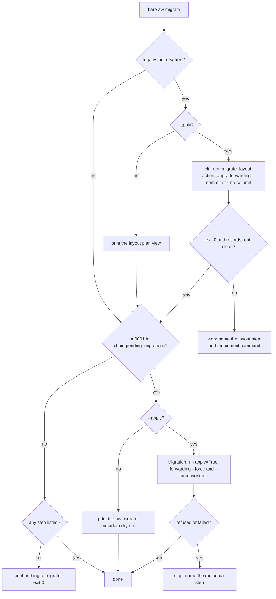

# IPD: Add the aw migrate command group, bare aw migrate, and the install pending-migration prompt

- Date: 2026-11-07
- Kind: child
- Concern: Spec `4sd62s` 5.1 asks for one `aw migrate <name>` family and for `aw install` to offer a pending migration. Today the only migration verbs are the top-level `aw migrate-layout` and `aw specs migrate` (`cli._build_parser`); `aw install`'s `-y/--yes` is documented as "Skip preflight confirmations." The maintainer added on 2026-11-07 that a bare `aw migrate` runs every pending step in order (layout first when a legacy `.agents/` tree exists, then metadata), dry-run by default. Plan `dcerjg` owned the CLI work; it was split 2026-11-07 per the maintainer's step-complexity rule.
- Scope: Add the `aw migrate` group with `metadata` and `layout` leaves (`dcerjg` E-02), the bare-`aw migrate` runner over every pending step (new, maintainer requirement), and the `aw install`/`aw setup` pending-migration question and `--migrate` (`dcerjg` E-03), with their tests (a subset of `dcerjg` E-14). Adds one helper, `chain.pending_migrations`, to the `g8na48` chain module. EXCLUDES: the chain and stamp (`g8na48`); the preflight and journal (`vxevph`); every `m0001` step body (`dky26u`, `ghhzb6`, `hpedmn`, `dcerjg`); the `--describe-*` options (`ya4ee4`).
- Scope-Paths: agent_workflows/cli.py, agent_workflows/command_surface.py, agent_workflows/completion.py, agent_workflows/engine.py, agent_workflows/migrations/chain.py, tests/test_migrate_cli.py, tests/test_install_migrate_prompt.py, tests/test_completion.py, .aw/records/plans/pending/20261107-metastore-16-1vfqdu-add-the-aw-migrate-command-group-bare-aw-migrate-and-the-ins.ipd.md
- Item-Dependencies: executed:tve77h, executed:g8na48, executed:vxevph
- Status: approved
- Readiness: go-pending-approval
- Review-Depth: complex
- From-Spec: 4sd62s
- Work-Kind: feature
- Priority: high
- Blocks-Release: next
- Set: metastore
- Order: 16
- Highest E allocated: 05
- Author: opencode its_direct/pt3-claude-opus-5.5-1m-us
- Id: 1vfqdu
- Approval: 2026-11-16, recorded via aw ipd set: status set to approved

> Write and proofread this plan per the technical writing standard, `.aw/system/workflows/technical-writing/technical-writing.md` (`.agents/workflows/technical-writing/technical-writing.md` in a legacy-layout install), including requirement 12 (diagrams).

## Workflow history
- 2026-11-16 approved (aw set): status set to approved

- 2026-11-14 reviewed (aw set): REVIEWED - OPEN QUESTIONS; PR-001..PR-006, PR-008..PR-011 FIXED; PR-007 OPEN as non-blocking OQ-08
- 2026-11-14 /plan-review (antigravity/claude-opus-5.5): REVIEWED - OPEN QUESTIONS; PR-001..PR-006, PR-008..PR-011 FIXED; PR-007 OPEN as non-blocking OQ-08; E-05/V-05 added; review record .aw/records/reviews/20261107-metastore-16-1vfqdu-add-the-aw-migrate-command-group-bare-aw-migrate-and-the-ins.review.md
- 2026-11-09 note (opencode its_direct/pt3-claude-opus-5.5-1m-us): round-3 review per research nj8zdp; within the guidance, no items moved; V-01 and V-04 evidence now name each module's node ids beside the summary lines.
- 2026-11-07 to-review (opencode its_direct/pt3-claude-opus-5.5-1m-us): split from dcerjg per maintainer step-complexity rule (no single E/V item hides hundreds of steps).
- 2026-11-07 draft (opencode its_direct/pt3-claude-opus-5.5-1m-us): created.

## Goal

One `aw migrate` family exists: `aw migrate layout`, `aw migrate metadata`, and a bare `aw migrate` that previews or performs every pending step in order; `aw install` and `aw setup` report a pending migration and run it only on a terminal yes or `--migrate`.

## Detailed Implementation Checklist (TODO)

Execution-state rule: mark an `E-*` item complete only after performing the action. That mark is not validation. Right-sizing rule: each E-item must address one concern and be executable in one focused pass; split when an E-item names multiple distinct deliverables or independent test-surfaces. Accepted execution states: blocked, failed, pending, performed; terminal gate demands 'performed'.

### Task group 1: the command group and bare aw migrate

- [ ] E-01 Add the `aw migrate` command group in `cli._build_parser` with leaves `metadata` (dry run by default; `--apply`, `--force`, `--force-worktree`, plus `--agent` and `--json` from the shared `common` parent) and `layout` (the same arguments as `aw migrate-layout`, dispatching to the existing `cli._run_migrate_layout`; `aw migrate-layout` stays as an alias printing no new warning). The `metadata` leaf dispatches to the `m0001` entry of `chain.MIGRATIONS` through its `Migration.run(repo, apply=..., force=..., force_worktree=...)` contract (`g8na48` E-01, which lazily delegates to `m0001_metadata_v2.run` built by `vxevph`) and does not import `m0001_metadata_v2` itself. The `metadata` leaf is NOT gated on `CURRENT_METADATA_SCHEMA`: it is the explicit entry point that `dcerjg` E-15 runs on a copy of this repository before the cutover. Declare both leaves in `command_surface` (`metadata` as `command_class="mutation"`, `mutation_gate="confirmation"`, `human_recipe="preview"`, mirroring the `migrate-layout` declaration; `layout` with the same fields as the `migrate-layout` declaration). Completion needs no hand-written entry: `completion.introspect_cli_tree` reads each node's first positional `choices` through `completion._positional_choices`, so the `migrate` > `layout` node gets the eight actions from the parser; edit `completion.py` only if the E-04 nested-completion assertion fails.
  - Depends on: none
  - Expected outcome: `aw migrate --help` lists `metadata` and `layout`; `aw migrate layout status` and `aw migrate-layout status` produce identical output; `tests/test_command_surface_declarations.py` reports no undeclared leaf; the completion tree's `migrate` > `layout` node carries the same eight choices as `migrate-layout`.
  - Execution state: pending

- [ ] E-05 Add `pending_migrations(repo)` to `agent_workflows/migrations/chain.py` as the one definition of an OFFERED migration: the `chain.MIGRATIONS` entries, in chain order, whose `is_pending(repo)` is True AND whose `target_schema` is at most `CURRENT_METADATA_SCHEMA`. The second condition keeps `m0001` out of bare `aw migrate` (E-02) and out of the install question (E-03) until the Order 13 cutover sets `CURRENT_METADATA_SCHEMA` to 2, because phase-A code reads only the legacy format (`dcerjg` OQ-03) and a repository converted before the cutover could no longer be read by the toolkit that converted it. The explicit `aw migrate metadata` leaf (E-01) does not consult it.
  - Depends on: none
  - Expected outcome: in `tmp_path` repositories, `pending_migrations` returns `[m0001]` for an unstamped repository with legacy records when `CURRENT_METADATA_SCHEMA` is patched to 2, and `[]` for the same repository when the constant is 1, for a repository stamped 2, and for an empty repository with no legacy records.
  - Execution state: pending

- [ ] E-02 Make a bare `aw migrate` (no subcommand) run every PENDING migration step in order, as one more leaf-free entry point of the group E-01 creates (maintainer requirement 2026-11-07). The order is fixed: first the layout stage when the repository holds a legacy `.agents/` tree (detected the way `aw migrate layout` already detects it: `layout_inventory._default_roots(repo)` returns the `agents` root, or `engine.detect_split_brain_layout(repo)` is True), then the metadata stage when `chain.pending_migrations(repo)` (E-05) includes `m0001`, so before the cutover the bare runner never offers the metadata stage. It is a DRY RUN by default: it prints, per step, the step name, whether it is pending, and that step's own dry-run report (the layout `plan` view and the `aw migrate metadata` dry run), and writes nothing outside the gitignored journal directory. `--apply` performs the pending steps in the same order, each through the same code path as its leaf: the layout step calls `cli._run_migrate_layout` with `action="apply"`, so the backend default, the leftovers default, the rename question and `cli._report_and_commit_migration` behave exactly as in `aw migrate layout apply`; the metadata step calls `Migration.run(repo, apply=True, ...)` as E-01's `metadata` leaf does. Register the shared `--commit`/`--no-commit` flags (`cli._add_commit_flags`) on the bare group and forward them to the layout step only. The metadata step starts only when the layout step exited 0 and `git status --porcelain -- <records root>` prints nothing, because the metadata preflight refuses uncommitted records (`vxevph` E-02 condition (2)); otherwise the runner stops, names the layout step, and prints the commands that commit its moves (`aw migrate --apply --commit`, or a hand `aw commit`). The runner stops at the first step that refuses or fails, naming it, without starting the next. `--force` and `--force-worktree` pass through to the metadata step only, exactly as `aw migrate metadata` takes them; `--agent` and `--json` emit one record per step. Register the group-level options under `dest` names distinct from the `layout` leaf's (for example `migrate_apply`), because argparse copies a subparser's defaults over the parent namespace and the `layout` leaf's own `--apply` default would otherwise erase the group's value. A repository with nothing offered prints "nothing to migrate" and exits 0. Because the group root now takes action, declare the bare form in `command_surface` (`command_class="mutation"`, `mutation_gate="confirmation"`, `human_recipe="preview"`, as E-01 declares `metadata`) and make the parser dispatch the bare group to this runner rather than to `_show_family_help`.
  - Depends on: E-01, E-05
  - Expected outcome: in `tmp_path` repositories, with `chain.CURRENT_METADATA_SCHEMA` patched to 2 unless the case says otherwise: (1) a repository with a legacy `.agents/` tree and legacy records lists the layout step then the metadata step and changes no tracked byte; (2) the same with `--apply --commit` runs the layout step, commits its moves, then runs the metadata step, in that order; (3) the same with `--apply` and no `--commit`, non-interactively, applies the layout step, leaves its moves uncommitted, does not start the metadata step, and names the commit command; (4) a repository with only `.aw/` legacy records lists only the metadata step; (5) a fully migrated repository prints "nothing to migrate"; (6) when the layout step refuses under `--apply`, the metadata step does not start; (7) with `CURRENT_METADATA_SCHEMA` left at 1, a repository with only `.aw/` legacy records prints "nothing to migrate".
  - Execution state: pending

### Task group 2: the install prompt

- [ ] E-03 Add the pending-migration step to `aw install` and `aw setup` (`cli._run_install`, `cli._install_all`, `cli._run_setup`, and the `engine` install path they call): after the bundle install, if the repository has NO legacy records (`chain.repo_has_legacy_records`) and no stamp (`chain.read_metadata_schema` returns `None`), write the stamp with `chain.write_metadata_schema(repo, chain.CURRENT_METADATA_SCHEMA)` and report nothing pending (5.3). The value is the constant, not a literal 2: it is 2 after the Order 13 cutover, as 5.3 requires, and 1 before it, because a repository installed before the cutover still receives legacy-format records and must be offered `m0001` after the cutover. Otherwise list each migration in `chain.pending_migrations(repo)` (E-05) and, only when `term.is_interactive()` is True (the shared terminal predicate, which honors `--interactive`, `--no-interactive` and `AW_NONINTERACTIVE`), ask for each one "Run migration <NNNN> <name> now? [y/N]" (for `m0001`: "Run migration 0001 metadata-v2 now? [y/N]"). A yes runs it through `Migration.run(repo, apply=True)`; a no, or no terminal, prints the pending migration and the exact command that runs it (`aw migrate metadata`). `-y/--yes` never answers this question. Add `--migrate` to `install` and `setup` (which covers `aw install all`), which answers yes without a terminal and passes neither `--force` nor `--force-worktree`, so a step-1 preflight refusal still stops the migration and is reported with the migration's own message. A repository with legacy records is never stamped by install.
  - Depends on: E-01, E-05
  - Expected outcome: with `chain.CURRENT_METADATA_SCHEMA` patched to 2, the four AC-28 cases and AC-11 cases (2) and (3) hold in tmp repositories, with every record byte-identical whenever the migration does not run; with the constant left at 1, `aw install --migrate` on a repository with legacy records asks nothing, runs nothing, and leaves every record byte-identical.
  - Execution state: pending

### Task group 3: tests

- [ ] E-04 Add the test modules for E-01, E-02, E-03 and E-05, moved here from `dcerjg` E-14 (subset: the CLI half of `tests/test_migrations_chain.py` and `tests/test_install_migrate_prompt.py`), all on `tmp_path` fixture repositories built with real `git init`, calling the real `aw` CLI leaves and asserting on outputs, exit codes and file bytes (no source reading): `tests/test_migrate_cli.py` (E-01: `aw migrate --help`, `aw migrate layout status` equal to `aw migrate-layout status`; E-05: the four `pending_migrations` cases of its Expected outcome, calling the function directly; E-02: the seven bare-`aw migrate` cases of its Expected outcome); `tests/test_install_migrate_prompt.py` (the AC-28 cases, AC-11 cases 2 and 3, and the E-03 constant-at-1 case). A case that patches `chain.CURRENT_METADATA_SCHEMA` calls the CLI in-process (`cli.main([...])`, the way `tests/conformance_matrix.py::run_cli_inproc` does), because a subprocess does not see the patch; the terminal yes and no cases pass `--interactive` and supply the answer on stdin. In `tests/test_completion.py`, add an assertion that the introspected tree's `migrate` > `layout` node carries the eight `migrate-layout` choices and that `aw migrate layout <TAB>` offers them; the existing top-level assertion `with_choices == ["completion", "migrate-layout", "path"]` stays unchanged, because the `migrate` group itself has no positional choices. Mark each new module `core`; any module whose slowest test exceeds 2 s in `--durations=10` is marked `slow` instead and named in V-04.
  - Depends on: E-01, E-02, E-03, E-05
  - Expected outcome: both new modules, `tests/test_command_surface_declarations.py`, `tests/test_completion.py`, `tests/test_migrate_layout_cli.py`, `tests/test_exit_contract_conformance.py` and `tests/test_agent_surface_conformance.py` pass under `python3 -m pytest -o addopts="" -n auto <modules>`; the bare core gate stays inside its 30 s budget.
  - Execution state: pending

## Project conventions discovered (Step 0)

- Transactional migrations reuse `layout_migration.MigrationManager` (`_acquire_lock`, `_save_transaction`, `_load_transaction`, `resume_migration`, `rollback_migration`); spec 5.1 forbids new journal or lock components (carried from `dcerjg` Step 0).
- Path roots come from `project_context.resolve_project_context` (`config_project`, `state_durable`, `records`), never `<repo>/.aw/...` literals (spec 4.5, 5.1).
- Tests exercise code and assert on outputs (AGENTS.md "TEST OUTCOMES, NOT CODE STRUCTURE"); new modules set `pytestmark = pytest.mark.core` unless the `--durations=10` rule of `dcerjg` E-14 moves one to `slow`.
- Cite code by SYMBOL (`module.function`) or by a quoted content string, never by a line number alone (advisory `IPD-C801`).
- Every CLI leaf must be declared in `command_surface` (`command_surface.find_undeclared_leaves`, enforced by `tests/test_command_surface_declarations.py`); `migrate-layout`'s declaration is the template for a mutation verb with a confirmation gate (carried from `dcerjg` Step 0).
- A family root is not a leaf (`command_surface.discover_parser_leaves` reports only parsers without subparsers), and bare-invokable roots such as `aw runs` and `aw ipd` are deliberately undeclared; bare `aw migrate` is different because it MUTATES under `--apply`, so E-02 declares it. No parser root is declared today (the intersection of `command_surface.discover_parser_roots` and `command_surface.get_declared_leaves` is empty, measured 2026-11-13), and every declared command also feeds `tests/test_exit_contract_conformance.py` and the `tests/conformance_matrix.py` suites, so V-04 runs those modules as well as `tests/test_command_surface_declarations.py` to prove the root declaration is accepted.
- The parser is built by `cli._build_parser` (there is no public `build_parser`); the shared `--commit`/`--no-commit` pair is registered by `cli._add_commit_flags`; the shared terminal predicate is `term.is_interactive`, which honors `--interactive`, `--no-interactive` and `AW_NONINTERACTIVE`.
- `aw migrate-layout apply` commits its own moves only with `--commit` or `--yes`, or after a yes on a terminal (`cli._report_and_commit_migration`); non-interactively without either flag it leaves them uncommitted.
- Phase A: `chain.CURRENT_METADATA_SCHEMA` is 1 until the Order 13 cutover (`g8na48` E-01, `dcerjg` OQ-03), and phase-A code reads only the legacy format.

## Findings

| Id | Evidence (measured 2026-11-07 in this worktree; F-05 to F-07 measured 2026-11-13) | Finding |
|---|---|---|
| F-01 | `rg -n "migrate-layout\|migrate_layout" agent_workflows/cli.py agent_workflows/command_surface.py agent_workflows/completion.py \| wc -l`: 29; `rg -n '"migrate-layout"' agent_workflows/cli.py`: parser at `cli._build_parser` (`sub.add_parser("migrate-layout", ...)`), dispatch `if args.command == "migrate-layout"`, help table entry | E-01: 1 group parser, 2 leaves, 2 declarations, 1 metadata dispatch, 1 layout dispatch: about 7 units. |
| F-02 | `rg -n "def _run_migrate_layout\|def _split_brain_guard" agent_workflows/cli.py`; `rg -n "def detect_split_brain_layout" agent_workflows/engine.py`; `layout_inventory.DEFAULT_ROOTS` lists `("agents", ".agents")` | E-02 reuses the existing layout detection and entry points: 1 runner, 2 step adapters, 1 commit-flag forward, 1 declaration, 1 dispatch change, 7 behaviors: about 11 units (the `pending_migrations` helper is its own item, E-05). |
| F-03 | `rg -n "def (_run_install\|_install_all\|_run_setup)\b" agent_workflows/cli.py`: 3; `rg -n "Skip preflight confirmations\|Install without per-repo prompts" agent_workflows/cli.py`: 2; `engine.install_into_repo` is the one engine call | E-03: 3 call sites, 1 engine path, 2 `--migrate` flags, 4 AC-28 behaviors, 1 phase-A behavior: about 11 units. |
| F-04 | `tests/test_completion.py` asserts the TOP-LEVEL `with_choices == ["completion", "migrate-layout", "path"]`; `completion._positional_choices` and `completion.introspect_cli_tree` read positional `choices` at every depth | The top-level expectation does not change, because the `migrate` group has no positional choices; the nested `migrate` > `layout` choices come from the parser without a `completion.py` edit, so E-04 adds a nested assertion instead of editing the existing one. |
| F-05 | `cli._run_migrate_layout` (`if action == "apply":` calls `mgr.execute_migration(...)` and then `return _report_and_commit_migration(args, term, mgr, json_out)`); `vxevph` E-02 condition (2) refuses when `git status --porcelain -- <records root>` is non-empty | Calling `MigrationManager.execute_migration` directly would skip the CLI's backend, leftovers and rename resolution and the commit step, and uncommitted layout moves make the metadata preflight refuse, so E-02 routes the layout step through `cli._run_migrate_layout` and forwards `--commit`. |
| F-06 | `g8na48` E-01 defines `Migration.run(repo, *, apply=False, force=False, force_worktree=False, describer=None)` delegating to `m0001_metadata_v2.run`; `rg -n "m0001_metadata_v2.run" .aw/records/plans/pending` matches the `g8na48`, `dcerjg` and `1vfqdu` plans and not the `vxevph` plan, which is to create it | The CLI calls the chain contract (`Migration.run`), not the module function; the gate stops when the delegate is absent. |
| F-07 | `chain.MIGRATIONS` `m0001.is_pending(repo)` is True for every unstamped repository with legacy records whatever `CURRENT_METADATA_SCHEMA` is (`g8na48` E-01) | Without a phase gate, `aw install`, `aw setup` and bare `aw migrate` would offer `m0001` on real repositories before the cutover; `chain.pending_migrations` adds the `target_schema` condition. |

## Proposed changes (ordered, validatable)

1. E-01: the group and its two leaves.
2. E-05: `chain.pending_migrations`.
3. E-02: bare `aw migrate`.
4. E-03: the install prompt and `--migrate`.
5. E-04: tests.

The bare `aw migrate` runner (E-02):

## Deferred / out of scope (with reason)

- The chain and the stamp this CLI calls (`chain.MIGRATIONS`, `Migration.run`, `CURRENT_METADATA_SCHEMA`, `read_metadata_schema`, `write_metadata_schema`, `repo_has_legacy_records`).
  - Carrier: g8na48
  - Carrier-Evidence: .aw/records/plans/executed/20261109-metastore-101-g8na48-build-the-migration-chain-the-metadata-schema-stamp-and-the.ipd.md
- The preflight and the journal this CLI calls.
  - Carrier: vxevph
  - Carrier-Evidence: .aw/records/plans/executed/20261107-metastore-15-vxevph-build-the-migration-chain-metadata-schema-stamp-m0001-prefli.ipd.md
- The `--describe-host`, `--describe-model`, `--describe-limit` and `--no-describe` options on `aw migrate metadata`.
  - Carrier: ya4ee4
- The CHANGELOG line for the family (it names `aw migrate`, `aw migrate layout` and `aw install --migrate`).
  - Carrier: dcerjg

## Scope check

- Over-scope: none. `migrations/chain.py` gains only the public `pending_migrations(repo)` helper over `MIGRATIONS` that E-02 and E-03 share.
- Under-scope: none for `dcerjg` E-02 and E-03, the bare-`aw migrate` requirement, AC-11 cases 2 and 3, and AC-28 cases 1 to 4. User documentation for the family has no verified carrier (OQ-08).

## Required tests / validation

New modules (all `core` unless E-04's duration rule moves one to `slow`): `tests/test_migrate_cli.py`, `tests/test_install_migrate_prompt.py`. Existing: `tests/test_command_surface_declarations.py`, `tests/test_completion.py`, `tests/test_migrate_layout_cli.py`, `tests/test_exit_contract_conformance.py`, `tests/test_agent_surface_conformance.py`. Gate: bare `python3 -m pytest`.

## Spec / documentation sync

No spec change; implements `4sd62s` 5.1 (naming, install question, `--migrate`) and 5.3 (install stamp). The bare `aw migrate` runner is a maintainer requirement of 2026-11-07 that 5.1's "one `aw migrate <name>` family" admits. `--help` text for every new leaf and flag is part of E-01 to E-03. User documentation (README) is NOT carried by this plan, and no other plan carries it yet: `README.md` (section "Layout Migration") documents only `aw migrate-layout`, which keeps working as an alias, and neither `90iqr1` nor the plans that write the cutover docs patch (`qhay6a`, `a49djh`, `y1zihp`, `ngc2a2`) mention `aw migrate`, `aw migrate layout` or `aw install --migrate` (measured 2026-11-13 with `rg -n "migrat"` on each plan). OQ-08 asks which plan carries it.

## Open questions

### OQ-06: Does `aw migrate-layout` become `aw migrate layout` (5.1, research `ffi66q`)?

- Blocking: no
- Status: resolved
- Owner: none
- Resolution or deferral rationale: Carried from `dcerjg` OQ-06 (resolved there): yes, as an added spelling; `aw migrate layout` dispatches to the existing `cli._run_migrate_layout`, and `aw migrate-layout` stays as an alias with unchanged output.

- Note: carried unchanged from `dcerjg` with its id, so item text that cites it still resolves.

### OQ-07: Does bare `aw migrate --apply` run the layout stage that `bv4kkj` later chains into `aw migrate metadata`?

- Blocking: no
- Status: resolved
- Owner: none
- Resolution or deferral rationale: Yes, and the two do not conflict. Bare `aw migrate` sequences the two existing entry points; `bv4kkj` E-01 (carried verbatim from `g5hpbb` E-06 in the round-3 split) later makes `aw migrate metadata` itself run the layout stage first inside one journal. The bare runner runs its layout step first, so after `bv4kkj` the metadata step's own layout stage finds nothing pending, and no step runs twice; E-02's Expected outcome already covers the nothing-pending case.

### OQ-08: Which plan documents `aw migrate`, `aw migrate layout`, bare `aw migrate` and `aw install --migrate` for users?

- Blocking: no
- Status: resolved
- Owner: maintainer
- Carrier: a6s7na
- Resolution or deferral rationale: The previous text named `90iqr1`, which does not carry it (see Spec / documentation sync). Placing user documentation in the Set is a scope decision for the maintainer. Recommended answer: add the family to the cutover docs patch written by `y1zihp` (README and reference documents), because `aw migrate metadata` and the install question only reach users after the cutover; this plan keeps the `--help` text. Recommendation strength: medium. RESOLVED 2026-11-14 by the user via /askme: add README and reference docs for the whole aw migrate family (aw migrate, aw migrate layout, bare aw migrate, aw install --migrate, aw migrate metadata and its --describe-* / --no-describe options) to the y1zihp cutover docs patch; y1zihp to gain dependencies on 1vfqdu and ya4ee4 and return to review. No reason was given.

## Validation and cross-check (verify before reporting done)

Validation-state rule: inspect evidence in a separate pass. Do not mark a `V-*` item complete from memory or from the matching execution checkmark. Accepted validation results: blocked, failed, pass, pending; terminal gate demands 'pass'. Runtime-demonstration reachability rule: for each `V-*` item demanding the software be observed acting (such as a run, a dispatch, or a transition), as distinct from items demanding a diff, a file's content, or a test result, which are reachable by construction, name the code path that produces the observation or the sibling `E-*` that creates it, else the demand is UNDER-SCOPE.

- [ ] V-01 validates E-01
  - Required evidence: paste `aw migrate --help` output listing `metadata` and `layout`; `diff <(aw migrate layout status) <(aw migrate-layout status)` printing nothing; and `python3 -m pytest -o addopts="" -v tests/test_command_surface_declarations.py tests/test_completion.py` with each module's node ids PASSED and 0 failed, including the declaration check covering the `migrate metadata` and `migrate layout` leaves and the nested `migrate` > `layout` completion assertion.
  - Observed evidence:
  - Result: pending
- [ ] V-02 validates E-02
  - Required evidence: paste `python3 -m pytest -o addopts="" -v tests/test_migrate_cli.py -k bare` with one PASSED test per E-02 case, seven in all (legacy layout plus legacy records lists layout then metadata with a SHA-256 tree listing equal before and after; `--apply --commit` runs layout, commits it, then runs metadata in that order, shown by the per-step records and the new commit; `--apply` without `--commit` leaves the layout moves uncommitted and the metadata step unstarted; `.aw/`-only repository lists only metadata; migrated repository prints "nothing to migrate"; a refused layout step leaves the metadata step unstarted; with `CURRENT_METADATA_SCHEMA` at 1 a `.aw/`-only legacy repository prints "nothing to migrate"); and the `aw migrate --help` usage line showing the group accepts no subcommand plus `--apply` and `--commit`.
  - Observed evidence:
  - Result: pending
- [ ] V-03 validates E-03
  - Required evidence: paste `python3 -m pytest -o addopts="" -v tests/test_install_migrate_prompt.py` with each AC-28 case (terminal no, printing `aw migrate metadata`; terminal yes; no terminal; `--yes`; `install all --yes`; `--migrate` with a step-1 condition true, refused), AC-11 cases 2 and 3, and the E-03 constant-at-1 `--migrate` case PASSED, each asserting record bytes by SHA-256 before and after.
  - Observed evidence:
  - Result: pending
- [ ] V-04 validates E-04
  - Required evidence: paste `python3 -m pytest -o addopts="" -n auto tests/test_migrate_cli.py tests/test_install_migrate_prompt.py tests/test_command_surface_declarations.py tests/test_completion.py tests/test_migrate_layout_cli.py tests/test_exit_contract_conformance.py tests/test_agent_surface_conformance.py --durations=10 -rA` PASSED node ids for each of the seven modules, the summary with 0 failed and the durations table, naming any module marked `slow`; and the bare `python3 -m pytest` summary line inside the 30 s budget.
  - Observed evidence:
  - Result: pending
- [ ] V-05 validates E-05
  - Required evidence: paste `python3 -m pytest -o addopts="" -v tests/test_migrate_cli.py -k pending_migrations` with one PASSED test per E-05 case (four in all) and 0 failed, and the `agent_workflows/migrations/chain.py` diff hunk from this plan's commit, showing `pending_migrations` as the only addition to that file.
  - Observed evidence:
  - Result: pending

## Approval and execution gate

- Size assessment: standard
- Cohesion rationale: not required

Execute only after human approval (`Status: approved`) and after every plan in `- Item-Dependencies:` is executed. Every blocking open question is resolved; OQ-08 is non-blocking and does not change any E-item. Stop and report, without writing a substitute, if `chain.Migration.run`, `chain.CURRENT_METADATA_SCHEMA` or `m0001_metadata_v2.run` is absent after the prerequisites executed: that is a missing prerequisite symbol, not a scope question.

Scope fence: the paths in `- Scope-Paths:` are a declaration; a needed file outside the fence is edited and then justified at finalize (`--scope-reason`), and a declared path left unmodified is acknowledged (`--scope-ack`).

Safety: this plan NEVER runs `aw migrate metadata --apply` (or bare `aw migrate --apply`) in this checkout. Every apply is on a `tmp_path` fixture repository. If an apply would touch this checkout's records, stop and report: that is a genuinely unsafe condition, not a scope question.

Honesty rule: run the named test modules and the bare core gate `python3 -m pytest`, and paste the ACTUAL summary lines; never claim a result you did not run.

Commits: commit only through `aw commit 1vfqdu -- <paths>`; never `git add -A`, a bare `git add` or `git commit -a`; never push.

Lifecycle transition: the plan moves to `.aw/records/plans/executed/` only through `aw ipd finalize`, never a hand `git mv`, and only after `aw ipd lint --phase pre-transition` conforms and every `V-*` reads `pass` with pasted evidence. When `aw oc run` or `aw agy run` executes the plan, the runner performs the finalize; a hand executor runs `aw ipd finalize 1vfqdu` itself.
