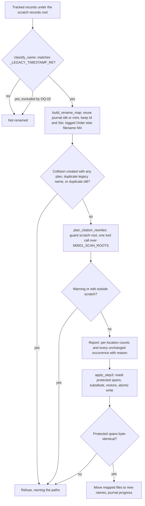

# IPD: Build the m0001 legacy-name rename map and citation rewrite

- Date: 2026-11-07
- Kind: child
- Concern: Spec `4sd62s` 5.2 step 3 renames every legacy-timestamp record and rewrites every citation of it. Measured 2026-11-07: 35 tracked records outside comms match `artifact_naming._LEGACY_TIMESTAMP_RE` (34 after the OQ-02 template exclusion), and `dcerjg` F-05 measured 2,035 citation hits in 457 files over the widened scan roots (re-measured at review 2026-11-13 at `01c564538`: 2,067 hits in 472 files, 0 warnings; the count is context, the bar is re-derived at execution). Plan `dcerjg` owned this step; it was split 2026-11-07 per the maintainer's step-complexity rule.
- Scope: Create `agent_workflows/migrations/m0001_renames.py` with `classify_name`, `build_rename_map` (`dcerjg` E-07), `plan_citation_rewrites` (`dcerjg` E-08) and `apply_step3` (the scratch-copy citation apply and file moves of 5.2 step 3, wired into `m0001_metadata_v2.py`), and its test module (subset of `dcerjg` E-14). Citation PLANNING is ONE call to `artifact_refs.plan_reference_rewrites_with_warnings` over the scratch copy, and the APPLY is one loop over its output with protected text masked; the executor writes no per-citation edit by hand, so the 2,035 hits are the tool's output, not hidden manual steps. EXCLUDES: preflight, journal and sidecar (`vxevph`); conversion (`ghhzb6`, `hpedmn`); census, round trip and the end-to-end clone proof (`dcerjg`).
- Scope-Paths: agent_workflows/migrations/m0001_renames.py, agent_workflows/migrations/m0001_metadata_v2.py, tests/test_m0001_renames.py, .aw/records/plans/pending/20261107-metastore-17-dky26u-build-the-m0001-legacy-name-rename-map-and-citation-rewrite.ipd.md
- Item-Dependencies: executed:tve77h, executed:vxevph
- Status: approved
- Readiness: go-pending-approval
- Review-Depth: complex
- From-Spec: 4sd62s
- Work-Kind: feature
- Priority: high
- Blocks-Release: next
- Set: metastore
- Order: 17
- Highest E allocated: 04
- Author: opencode its_direct/pt3-claude-opus-5.5-1m-us
- Id: dky26u
- Approval: 2026-11-16, recorded via aw ipd set: status set to approved

> Write and proofread this plan per the technical writing standard, `.aw/system/workflows/technical-writing/technical-writing.md` (`.agents/workflows/technical-writing/technical-writing.md` in a legacy-layout install), including requirement 12 (diagrams).

## Workflow history
- 2026-11-16 approved (aw set): status set to approved
- 2026-11-14 reviewed (opencode its_direct/pt3-claude-opus-5.5-1m-us): APPROVE WITH REVISIONS APPLIED; PR-001..PR-008 FIXED
- 2026-11-13 /plan-review (opencode its_direct/pt3-claude-opus-5.5-1m-us): APPROVE WITH REVISIONS APPLIED; PR-001..PR-008 FIXED
- 2026-11-07 to-review (opencode its_direct/pt3-claude-opus-5.5-1m-us): split from dcerjg per maintainer step-complexity rule (no single E/V item hides hundreds of steps).
- 2026-11-07 draft (opencode its_direct/pt3-claude-opus-5.5-1m-us): created.

## Goal

`m0001` can compute, on a scratch copy, the full legacy-name rename map and the citation rewrite with its per-location report, proven on fixtures; the clone dry-run evidence is pasted by `dcerjg` V-15.

## Detailed Implementation Checklist (TODO)

Execution-state rule: mark an `E-*` item complete only after performing the action. That mark is not validation. Right-sizing rule: each E-item must address one concern and be executable in one focused pass; split when an E-item names multiple distinct deliverables or independent test-surfaces. Accepted execution states: blocked, failed, pending, performed; terminal gate demands 'performed'.

### Task group 1: rename map and citations

- [ ] E-01 Create `agent_workflows/migrations/m0001_renames.py` with `classify_name(name)`, which tests `artifact_naming._LEGACY_TIMESTAMP_RE` BEFORE `artifact_naming.parse_clustered` (so `20260712-1033-01-assess-bugs-...` is legacy, not `set=1033, id6=assess`), and `build_rename_map(repo, journal)` for every tracked artifact, walkthrough and roadmap with a legacy name, excluding comms, `.data/` files, READMEs and the six templates named in OQ-02: mint a repository-unique `id6` with `artifact_core.mint_id6` for each id-less record and journal it; keep an existing `- Id:`; `set` is the existing `- Set:` or else the record's `id6`; `order` is the logged `- Order:` when present, otherwise the filename `NN` (OQ-26 correction); emit `YYYYMMDD-<set>-<NN>-<id6>-<slug>.<type>.md` with `artifact_naming.build_clustered_name` from the original date, slug and facet (the facet must be in `artifact_naming.ARTIFACT_TYPE_FACETS`; a legacy name with no such facet is refused by name, never guessed). Do not call `artifact_rename.compute_target_name`, which hard-codes `set_id=mint_id6, order=1`. ID REUSE: when the `vxevph` E-03 journal already holds a minted `id6` for the legacy path, reuse it. Otherwise mint with `artifact_core.mint_id6(root, existing=<ids already minted in this pass and in the journal>)` and write it to the journal before returning, so a second dry run and the apply produce the identical map. With `journal=None` it mints in memory and writes nothing (the read-only preview of V-01). Each refusal names the paths involved. Refusal (a): a mapped plan whose new (Set, order) equals the (Set, order) of ANY other plan in the records tree, mapped or not (for example `wvlk84` keeping `01` would collide with `awphysical` Order 1, `cwjnj0`). Duplicates that already exist between two UNMAPPED plans are reported, not refused, because this step does not create them (22 such pairs measured at review, F-05). Refusal (b): two mapped records with the same legacy filename, because the citation `name_map` is keyed by filename. Refusal (c): a minted or reused `id6` that equals another record's `id6`.
  - Depends on: none
  - Expected outcome: on this repository (measured at authoring and re-checked at review: 35 legacy-timestamp files outside comms, minus the one OQ-02 template) the map has 34 entries: 28 minted (17 specs, 11 walkthroughs) and 6 preserved; the BAR is re-derived at execution time as "every `_LEGACY_TIMESTAMP_RE` record outside comms and the OQ-02 exclusions is mapped, each id-less one minted, each `- Id:` one preserved", and the fixed rows below are stable code facts of terminal records, with `wvlk84` mapped to `20260817-awphysical-17-wvlk84-assess-bugs-leftover-remove-dataloss.ipd.md`, `lus9ou`/`7qx7ys`/`8q6yr9` to `plans-adopter` orders 00, 06, 07, and `4o5lt9`/`4w7d6s` to Sets equal to their own `id6`.
  - Execution state: pending

- [ ] E-02 In `m0001_renames.py`, add `plan_citation_rewrites(scratch_root, rename_map) -> CitationPlan`. (1) GUARD: refuse unless `project_context.project_records_dir(scratch_root).resolve()` lies inside `scratch_root.resolve()`, because a copied `project.json` with a stored records placement can resolve to the real checkout's records (`project_context._stored_physical_classes`), and the tool would then plan edits there. (2) PLAN: call `artifact_refs.plan_reference_rewrites_with_warnings(scratch_root, name_map, scan_roots=M0001_SCAN_ROOTS)` once, with `name_map` the old filename to new filename of every E-01 entry and `M0001_SCAN_ROOTS = artifact_core.REFERENCE_SCAN_ROOTS + ("agent_workflows", "docs", ".aw/system", "CHANGELOG.md", "TODO.md", ".gitignore", ".aw/.gitignore")` defined in this module (`REFERENCE_SCAN_ROOTS` itself is unchanged, so `aw rename` keeps its roots; the last three are file roots that cite legacy specs and that no other root covers, F-06). Refuse when any returned `RefEdit.file` lies outside `scratch_root` or any warning is returned. (3) PROTECTED SPANS: the tool returns one `RefEdit` per (file, kind, old) covering every occurrence in that file, so a protected occurrence cannot be dropped by filtering edits; instead the plan records, per file, the spans the apply (E-04) masks before substituting: the whole `## Workflow history` section (from the exact heading line to the next `## ` heading, the rule `record_history._inline_history_records` uses), every `- Verdict:` line of a review record, and each exemption below. The sidecar (`record_history.history_path`, `.jsonl`) is never scanned because its suffix is not in `artifact_core._REFERENCE_TEXT_SUFFIXES`, and the plan refuses if it appears. (4) EXEMPTIONS, keyed by (repo-relative path, legacy filename) and masked for every derived stem of that name: `tests/test_plans_rename_selectors.py` with `20260808-0004-06-migrate-existing-plans.ipd.md` (a fixture that builds a legacy-named file to test legacy selectors); `agent_workflows/selectors.py` and `agent_workflows/check_engine.py` with `20260817-1357-01-assess-bugs-leftover-remove-dataloss.ipd.md` (comments that use that string as the `parse_clustered` misparse example). Spec citations in `artifact_naming` and `artifact_rename` comments (`20260817-2147-01`, `20260808-1958-01-prompt-purity-lint`) are ordinary citations and ARE rewritten; `artifact_refs` and `plans_refs` cite no legacy name (F-02). (5) REPORT: per location (the first path segment, or `records/<type>` under the records root) the count of occurrences that the apply will substitute, recomputed on the masked text so the counts sum to the substituted total; and every occurrence left unchanged with file, line and reason: `history-section`, `verdict-line`, `exemption`, or `fenced-or-permalink` (the tool already masks fenced code blocks and pinned permalinks through `artifact_refs._mask_fenced_code` and `_mask_permalinks`, so pasted evidence and pinned links are never rewritten; F-07).
  - Depends on: E-01
  - Expected outcome: on a fixture repository, the plan names a citation in body prose for rewrite, lists a citation inside `## Workflow history`, a `- Verdict:` line, an exempted pair and a fenced block as unchanged with their reasons, sums its per-location counts to the substituted total, and refuses a scratch root whose records directory resolves outside it.
  - Execution state: pending

- [ ] E-04 In `m0001_renames.py`, add `apply_step3(scratch_root, rename_map, citation_plan, journal)` and call it from the step-3 slot of the journaled run in `agent_workflows/migrations/m0001_metadata_v2.py` (the module `vxevph` E-03 creates), in both the dry run and `--apply`, always on the scratch copy. In order: (0) pass `M0001_SCAN_ROOTS` to the `vxevph` E-03 scratch builder in `m0001_metadata_v2.py`, so the scratch copy holds every root that exists in the checkout, and refuse when one is missing from the scratch copy. (1) For each file of the plan, read it, replace every protected span from E-02 (3) and (4) with an inert token (the same token-and-restore technique as `artifact_refs._mask_fenced_code`, applied before the tool's own fenced-code and permalink masks), substitute every `RefEdit` of that file in `artifact_refs.apply_reference_rewrites` order (full name, then bare stem, then facet-less stem), restore the tokens, and write with `artifact_core.atomic_write`. Do NOT call `apply_reference_rewrites` itself, which has no protected-span hook. (2) assert that every protected span is byte-identical before and after (refuse otherwise), so step 4 imports the ORIGINAL history and verdict text. (3) only then move each mapped file to its new name in the same directory of the scratch copy, skipping an entry already moved (new path present, old path absent) and refusing when both paths exist. Citations are applied before the moves because the plan's `RefEdit.file` paths are the pre-move paths (18 of the 34 records cite a legacy name, F-06). (4) Record per-step progress in the journal so an interrupted run resumes after the last completed file. The moves are filesystem renames (`Path.rename`) inside the scratch copy and never `git mv`; carrying them into the checkout is `vxevph` E-03's `--apply` path, and recording them as `rename` events is `ghhzb6` E-01's (OQ-28).
  - Depends on: E-01, E-02
  - Expected outcome: on a fixture repository, after `apply_step3` every legacy name outside protected spans is replaced, every protected span is byte-identical, every mapped file exists only under its new name, and a second call on the result changes no file.
  - Execution state: pending

### Task group 2: tests

- [ ] E-03 Add `tests/test_m0001_renames.py`, moved here from `dcerjg` E-14 (subset), on `tmp_path` fixture repositories built with real `git init`, calling the real functions and asserting on outputs and file bytes (no source reading): AC-41 case 2 (a legacy name whose slug starts with a 6-letter word classifies as legacy, and a clustered name with a 4-digit Set id does not) and case 3 on fixtures (after `apply_step3`, no mapped name matches `_LEGACY_TIMESTAMP_RE` and no two plans share a Set and order); the logged-Order rule; journal reuse of a minted id across two calls; each E-01 refusal, including a collision with an UNMAPPED plan; the scratch-root guard, including a scratch copy placed under a gitignored directory of a `git init` fixture (the `vxevph` layout), which must still be scanned; history-section, verdict-line, exemption and fenced-block protection, asserted as byte-identical spans after apply; per-location counts summing to the substituted total; and a second `apply_step3` changing no file. Mark it `core`, or `slow` if its slowest test exceeds 2 s in `--durations=10`, named in V-03.
  - Depends on: E-01, E-02, E-04
  - Expected outcome: the module passes under `python3 -m pytest -o addopts="" -v tests/test_m0001_renames.py`.
  - Execution state: pending

## Project conventions discovered (Step 0)

- Transactional migrations reuse `layout_migration.MigrationManager` (`_acquire_lock`, `_save_transaction`, `_load_transaction`, `resume_migration`, `rollback_migration`); spec 5.1 forbids new journal or lock components (carried from `dcerjg` Step 0).
- Path roots come from `project_context.resolve_project_context` (`config_project`, `state_durable`, `records`), never `<repo>/.aw/...` literals (spec 4.5, 5.1).
- Tests exercise code and assert on outputs (AGENTS.md "TEST OUTCOMES, NOT CODE STRUCTURE"); new modules set `pytestmark = pytest.mark.core` unless the `--durations=10` rule of `dcerjg` E-14 moves one to `slow`.
- Cite code by SYMBOL (`module.function`) or by a quoted content string, never by a line number alone (advisory `IPD-C801`).
- Naming authority is `artifact_naming` (`_LEGACY_TIMESTAMP_RE`, `parse_clustered`); citations go through `artifact_refs.plan_reference_rewrites_with_warnings`, whose `scan_roots` is a parameter; ids are minted by `artifact_core.mint_id6` (repository-wide collision check) (carried from `dcerjg` Step 0).

## Findings

| Id | Evidence (F-01 to F-03 measured 2026-11-07; F-04 to F-09 and the F-02 re-measure at review, 2026-11-13, `01c564538`) | Finding |
|---|---|---|
| F-01 | `git ls-files .aw/records` filtered by `artifact_naming._LEGACY_TIMESTAMP_RE`, comms excluded: 35 | E-01 hidden work: 1 classifier, 1 map builder, 34 mapped records produced by code (not by hand), 4 rules (mint, keep Id, Set, logged Order), 1 collision refusal: about 8 code units. |
| F-02 | `artifact_core.REFERENCE_SCAN_ROOTS` holds 19 roots; `artifact_refs.plan_reference_rewrites_with_warnings(repo_root, name_map, scan_roots=...)` takes them as an argument. Review re-measure (2026-11-13, `01c564538`, real tool, widened roots): 2,067 hits in 472 files, 0 warnings; legacy-name hits in code comments: `artifact_naming` 2 (`20260817-2147-01`, `20260808-1958-01-prompt-purity-lint`), `artifact_rename` 1, `selectors` 4 and `check_engine` 2 (all the `20260817-1357-01-assess-...` misparse example); `artifact_refs` and `plans_refs` 0 | E-02 hidden work: 1 guarded call, 7 added roots, 3 protected span classes plus the tool's fenced and permalink masks, 1 exemption list of 3 (path, name) pairs, 1 report: about 10 units. The authored exemption list (`artifact_refs`, `plans_refs` comments) named files with no legacy citation and missed `selectors` and `check_engine`, and the spec citations in `artifact_naming`/`artifact_rename` are ordinary citations, not old-grammar examples. |
| F-03 | `rg -n "def compute_target_name" agent_workflows/artifact_rename.py`: builds `set_id=mint_id6, order=1` | It cannot be reused for the OQ-26 rule (carried from `dcerjg` F-13). |
| F-04 | `artifact_refs.RefEdit(file, kind, old, new, hits)` is one row per (file, kind, old) and counts every occurrence; `artifact_refs.apply_reference_rewrites` reads the whole file, masks only fenced code and permalinks, and substitutes every occurrence (`text.replace(e.old, e.new)` or `_boundaried(e.old).sub`) | "Drop every edit inside a history line" cannot be done by filtering `RefEdit` rows: one row covers the history and body occurrences of the same file. The protected spans must be masked at apply time, so the apply is this plan's own loop (E-04), not `apply_reference_rewrites`. |
| F-05 | Review probe over every tracked `*.ipd.md`: 1,920 plans, 22 (Set, Order) pairs already shared by two or more plans (for example `awoptimize` 2 to 8 executed versus superseded, `trimgap` 25 four executed); `awphysical` Order 1 is `cwjnj0` | A map-internal collision check misses a mapped plan landing on an existing unmapped plan; a repository-wide refusal on any duplicate would refuse this repository for 22 pairs the step did not create. E-01 refuses only collisions it creates and reports the rest. |
| F-06 | Review probe: legacy-name prefixes appear outside the widened roots in `TODO.md` (2), `.gitignore` (2) and `.aw/.gitignore` (1); 18 of the 34 renamed records themselves cite a legacy name | The three files join the roots (spec "every scanned location"). Because renamed records carry citations, the citation apply must run before the file moves or the `RefEdit.file` paths go stale (E-04 order). |
| F-07 | Review probe with one placeholder map over the same roots: 2,194 hits unmasked versus 1,472 with the tool's `_mask_fenced_code` and `_mask_permalinks` | About a third of the occurrences sit in fenced code or pinned permalinks and are left unchanged by the tool. They are pasted evidence and pinned links whose bytes must not change; E-02 reports them as `fenced-or-permalink` so AC-41 (5)'s list of unchanged citations is complete. Old names stay resolvable through path history (OQ-28). |
| F-08 | `artifact_core.iter_scan_files` resolves records through `project_context.project_records_dir(repo_root)`, which returns a stored records placement from `project.json` when one exists (`_stored_physical_classes`); this repository's `project.json` declares `records_backend: repository` | A scratch copy that carries a placement pointing elsewhere would make the tool plan edits outside the scratch copy; E-02 refuses that. A review probe placed a scratch root under the gitignored `.aw/state/`: `iter_scan_files(scratch, (".aw/records",))` still returned the file inside it, so a scratch copy under the journal directory is scannable. |
| F-09 | `ghhzb6` E-01 writes the checkpoint with the OLD path and one `rename` event; `vxevph` E-03 journals the minted `id6` and the rename map and applies scratch to checkout; no sibling item performs the step-3 file moves or the citation apply in scratch | Without E-04, 5.2 step 3 "moves the files" and the citation apply have no owner, and `m0001_metadata_v2.py` was in `- Scope-Paths:` with no item editing it. |

## Proposed changes (ordered, validatable)

1. E-01: classifier and rename map.
2. E-02: citation plan and report.
3. E-04: protected-span citation apply, file moves and wiring into `m0001_metadata_v2.py`.
4. E-03: tests.

Step 3 data flow (all on the scratch copy; every refusal stops before any write):

## Deferred / out of scope (with reason)

- The end-to-end clone proof with apply, commit and second apply, and its rename and citation sections.
  - Carrier: dcerjg

## Scope check

- Over-scope: none. `m0001_metadata_v2.py` is touched only by E-04, to call `apply_step3` in the journaled run.
- Under-scope: none for `dcerjg` E-07 and E-08 on fixtures (AC-41 cases 2 and 3); AC-41 cases 1 and 5 on the clone are pasted by `dcerjg` V-15. The step-3 file moves and protected citation apply, which no sibling owned (F-09), are E-04. AC-41 case 4 (history recovered byte for byte, `aw show --history`) is `ghhzb6`/`dcerjg`'s; this plan supplies its precondition, the byte-identical protected spans proven in V-04.
- Downstream contract: `3g20ms` E-01 later replaces this module's repository-specific values with discovered ones; this plan keeps every repository fact (the exemption pairs, the OQ-02 template names) in named module-level constants so that replacement is a data change.

## Required tests / validation

New module: `tests/test_m0001_renames.py` (`core`). Existing: `tests/test_plans_rename_selectors.py` and `tests/test_m0001_preflight.py` (the `vxevph` journal tests; E-04 calls into the journal and edits `m0001_metadata_v2.py`). Gate: bare `python3 -m pytest`.

## Spec / documentation sync

No spec change; implements `4sd62s` 5.2 step 3, OQ-26, OQ-27 and OQ-28.

## Open questions

### OQ-02: How are roadmaps, prompt-library files, research templates, reference packages and READMEs handled (spec 4.1 "the plan must also decide, by name")?

- Blocking: no
- Status: resolved
- Owner: none
- Resolution or deferral rationale: Carried from `dcerjg` OQ-02 (resolved there; the full decision text stays in `dcerjg`). For this part: the six templates named there are excluded from the rename map, the legacy-named research template stays the one `_LEGACY_TIMESTAMP_RE` match, and READMEs, comms and `.data/` files are never renamed.

- Note: carried unchanged from `dcerjg` with its id, so item text that cites it still resolves.

## Validation and cross-check (verify before reporting done)

Validation-state rule: inspect evidence in a separate pass. Do not mark a `V-*` item complete from memory or from the matching execution checkmark. Accepted validation results: blocked, failed, pass, pending; terminal gate demands 'pass'. Runtime-demonstration reachability rule: for each `V-*` item demanding the software be observed acting (such as a run, a dispatch, or a transition), as distinct from items demanding a diff, a file's content, or a test result, which are reachable by construction, name the code path that produces the observation or the sibling `E-*` that creates it, else the demand is UNDER-SCOPE.

- [ ] V-01 validates E-01
  - Required evidence: paste the `-v` node-id lines of `tests/test_m0001_renames.py` (from the V-03 run) showing PASSED for the tests that prove these behaviours, naming each node id beside its behaviour: a legacy name whose slug starts with a 6-letter word is classified legacy and a clustered name with a 4-digit Set id is not; an id-less record gets a minted `id6` that a second `build_rename_map` call with the same journal returns unchanged; a record with `- Id:`, `- Set:` and `- Order: 17` maps to `<date>-<set>-17-<id6>-<slug>`; and each E-01 refusal (collision with an unmapped plan, duplicate legacy name, duplicate `id6`, unknown facet) refuses with the paths named. Plus the output of one `build_rename_map` call on this checkout's records tree (read-only: no journal path, so nothing is written) showing the entry count and the `wvlk84`, `lus9ou`, `7qx7ys`, `8q6yr9`, `4o5lt9` and `4w7d6s` rows against the E-01 expected outcome. (The clone dry-run rename-map section moved to `dcerjg` V-15, because the clone proof runs after every part.)
  - Observed evidence:
  - Result: pending
- [ ] V-02 validates E-02
  - Required evidence: paste the `-v` node-id lines (from the V-03 run) showing PASSED, each named beside its behaviour: a body-prose citation is planned for rewrite; a citation in `## Workflow history`, a `- Verdict:` line, an exempted (path, name) pair and a fenced block are each listed unchanged with the matching reason; per-location counts sum to the substituted total; and a scratch root whose records directory resolves outside it is refused. Plus the `CitationPlan` report of one dry `plan_citation_rewrites` call against a throwaway copy of this checkout (made with `git clone --no-hardlinks` into a temporary directory outside this checkout), showing 0 warnings, the per-location table and the count of unchanged occurrences by reason. (The clone dry-run citation section of the full migration stays `dcerjg` V-15's.)
  - Observed evidence:
  - Result: pending
- [ ] V-03 validates E-03
  - Required evidence: paste `python3 -m pytest -o addopts="" -v tests/test_m0001_renames.py --durations=10` with 0 failed and each node id PASSED, and the `--durations=10` lines showing the slowest test under 2 s (or the module marked `slow`); and the summary line of the bare `python3 -m pytest` gate.
  - Observed evidence:
  - Result: pending
- [ ] V-04 validates E-04
  - Required evidence: paste the `-v` node-id lines (from the V-03 run) showing PASSED, each named beside its behaviour: after `apply_step3` on a fixture, no mapped legacy name remains outside protected spans, every protected span is byte-identical (the test compares bytes captured before the call), every mapped file exists only under its new name, and a second call changes no file (compared by content hash); and an interrupted call resumes from the journal. Plus the `git diff` hunk of `agent_workflows/migrations/m0001_metadata_v2.py` showing the `apply_step3` call in the step-3 slot, and `python3 -m pytest -o addopts="" -v tests/test_m0001_preflight.py` with 0 failed.
  - Observed evidence:
  - Result: pending

## Approval and execution gate

- Size assessment: standard
- Cohesion rationale: not required

Execute only after human approval (`Status: approved`) and after every plan in `- Item-Dependencies:` is executed. All open questions are resolved.

Scope fence: the paths in `- Scope-Paths:` are a declaration; a needed file outside the fence is edited and then justified at finalize (`--scope-reason`), and a declared path left unmodified is acknowledged (`--scope-ack`).

Safety: this plan NEVER runs `aw migrate metadata --apply` (or bare `aw migrate --apply`) in this checkout. Every apply is on a `tmp_path` fixture repository. If an apply would touch this checkout's records, stop and report: that is a genuinely unsafe condition, not a scope question.

Honesty rule: run the named test modules and the bare core gate `python3 -m pytest`, and paste the ACTUAL summary lines; never claim a result you did not run.

Commits: commit only through `aw commit dky26u -- <paths>`; never `git add -A`, a bare `git add` or `git commit -a`; never push.

Lifecycle transition: the plan moves to `.aw/records/plans/executed/` only through `aw ipd finalize`, never a hand `git mv`, and only after `aw ipd lint --phase pre-transition` conforms and every `V-*` reads `pass` with pasted evidence. When `aw oc run` or `aw agy run` executes the plan, the runner performs the finalize; a hand executor runs `aw ipd finalize dky26u` itself.
