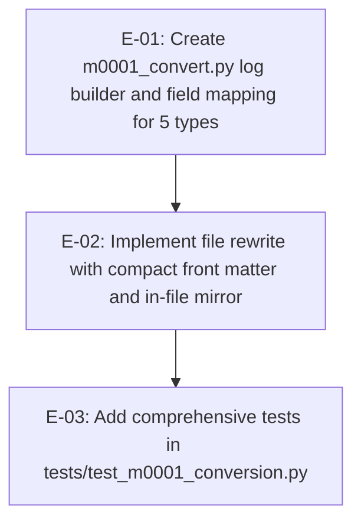

# IPD: Build the m0001 log builder and convert plans, backlog items, releases, specs and staged prompts

- Date: 2026-11-07
- Kind: child
- Concern: Spec `4sd62s` 5.2 step 4 converts every record into a log plus compact front matter. Plan `dcerjg` E-09 and E-10 owned the conversion of every record type in two items; measured 2026-11-07, the corpus carries 99 distinct metadata keys (70 bullet names, 12 research YAML keys, 17 `aw-prompt` comment keys) across eight record trees, of which 55 have no same-named `artifact_meta.REGISTRY` field and so each need an explicit destination. That is more hidden work than one item may hold, so the conversion was split by record type on 2026-11-07 per the maintainer's step-complexity rule.
- Scope: Create `agent_workflows/migrations/m0001_convert.py`: the log builder (checkpoint, rename, legacy events; `dcerjg` E-09 subset) and the file rewrite (`dcerjg` E-10 subset) for plans, backlog items, releases, specs and staged prompts, with their tests (subset of `dcerjg` E-14). EXCLUDES: research records, walkthroughs, the roadmap, review files and review events (`hpedmn`); the census and round trip (`dcerjg`).
- Scope-Paths: agent_workflows/migrations/m0001_convert.py, agent_workflows/migrations/m0001_metadata_v2.py, tests/test_m0001_conversion.py, .aw/records/plans/pending/20261107-metastore-18-ghhzb6-build-the-m0001-log-builder-and-convert-plans-backlog-items.ipd.md
- Item-Dependencies: executed:tve77h, executed:vxevph, executed:dky26u
- Status: approved
- From-Spec: 4sd62s
- Work-Kind: feature
- Priority: high
- Blocks-Release: next
- Set: metastore
- Order: 18
- Highest E allocated: 03
- Author: opencode its_direct/pt3-claude-opus-5.5-1m-us
- Id: ghhzb6
- Approval: 2026-11-16, recorded via aw ipd set: status set to approved
- Readiness: go-pending-approval
- Review-Depth: complex

## Workflow history
- 2026-11-16 approved (aw set): status set to approved
- 2026-11-14 reviewed (aw set): APPROVE WITH REVISIONS APPLIED; PR-001..PR-004 FIXED

- 2026-11-14 /plan-review (antigravity/gemini): APPROVE WITH REVISIONS APPLIED; PR-001..PR-004 FIXED; review record .aw/records/reviews/20261107-metastore-18-ghhzb6-build-the-m0001-log-builder-and-convert-plans-backlog-items.review.md
- 2026-11-09 note (opencode its_direct/pt3-claude-opus-5.5-1m-us): round-3 review per research nj8zdp; within the guidance, no items moved; V-03 evidence now names the per-type node ids beside the summary line.
- 2026-11-07 to-review (opencode its_direct/pt3-claude-opus-5.5-1m-us): split from dcerjg per maintainer step-complexity rule (no single E/V item hides hundreds of steps).
- 2026-11-07 draft (opencode its_direct/pt3-claude-opus-5.5-1m-us): created.

## Goal

Plans, backlog items, releases, specs and staged prompts convert, on a scratch copy, into logs with the 4.2a layout and compact front matter, with every metadata key they use at a named destination.

## Detailed Implementation Checklist (TODO)

Execution-state rule: mark an `E-*` item complete only after performing the action. That mark is not validation. Right-sizing rule: each E-item must address one concern and be executable in one focused pass; split when an E-item names multiple distinct deliverables or independent test-surfaces. Accepted execution states: blocked, failed, pending, performed; terminal gate demands 'performed'.

### Task group 1: log builder and file rewrite

- [ ] E-01 Create `agent_workflows/migrations/m0001_convert.py` that builds each log through `artifact_meta`'s event model (tve77h) using the legacy loader for parsing: one append with `append` 0: `seq` 0 `checkpoint` with every registry field under its 4.2/4.5c name (`Kind` to `plan_role`, research `kind` to `research_kind`, prompt `Kind` to `prompt_kind`, D177 facets to `ace`/`model`), `path` (the OLD path for a renamed record), `filename_date`, `created_day` when known (never the filename date), `last_history_day` from `attention_contract.newest_history_record`, parsed `item_dependencies`, `scope_result: exceeded` plus `out_of_scope_paths` and `scope_exceeded_raw` for a `Scope-Exceeded` bullet, and `short_description` plus `description_source`, `description_model`, `description_prompt_version` only when the `describer` seam returned a value; then for a renamed record one `rename` event (verb `rename`, new `path`, `actor.tool: aw migrate metadata`); then `legacy` events (`source: history` in file order, then `source: sidecar` in sidecar order) with the original line, `observed_day`, original position and `ordering_confidence: unknown`. (The `review` events of the subject's review files are added by `hpedmn` E-01 to the same `append` 0, after these events.) Every event's `at` is the migration time; imported strings bypass only the length and control-character refusal (SR-903). Never write `finalize` or `turn`. SUBSET of `dcerjg` E-09's record set owned here (split 2026-11-07): plans, backlog items, releases, specs and staged prompts; research records, walkthroughs, the roadmap and the review events are `hpedmn`'s. Give each field name these types use and that no `artifact_meta.REGISTRY` field has the same name (30 names, measured below) its explicit 4.2/4.5c destination in the converter's per-type mapping table: `Canonical` 6, `Concern` 1722, `Constrained-by` 6, `Core` 1, `Date` 1771, `Evidence` 1, `Executor` 1, `Extends` 1, `Id` 2901, `Implemented-by` 1, `Kind` 1621, `Motivation` 8, `Note` 1, `Origin` 3, `Parent` 5, `Purpose` 1, `Related` 2, `Scope` 1754, `Scope-Exceeded` 43, `Self-note` 1, `Sources` 1, `Summary` 1147, `Supersedes-Note` 1, `Thorough` 1, `Version` 1, comment `Created` 24, comment `Id` 24, comment `Kind` 24, comment `hygiene` 1, comment `tiers` 1.
  - Depends on: none
  - Expected outcome: a fixture plan with two inline history lines and one sidecar record produces exactly checkpoint, legacy, legacy, legacy(sidecar) in `seq` 0 to 3, all `append` 0, and replay equals the checkpoint state; a renamed fixture plan's path history is old path then new path; a fixture of each of the five types converts with every field of the table above at its named destination; a plan with a `Scope-Exceeded` bullet gets `scope_result: exceeded`, parsed `out_of_scope_paths` and the raw `scope_exceeded_raw`.
  - Execution state: pending

- [ ] E-02 In `m0001_convert.py`, rewrite each file in the scratch copy: artifacts get `---`/`id`/`status`/`---` plus the `aw-managed` banner of 4.1, both rendered by the same `artifact_meta` mirror writer; staged prompts get line 1 the single `aw-managed-prompt` comment rendered by `artifact_meta`'s in-file mirror writer (`tve77h` E-07 and E-15 own the exact text of 4.1; this plan never spells the banner or mirror text itself, so the migration and the post-cutover writer cannot disagree) and no `---`, with every key of the old `aw-prompt` comment moved to a log field or a census-recorded drop, and a prompt with no comment taking `status` from its disposition and `id`/`set`/`order` from its filename; prose fields (`Summary`, `Scope`, `Concern`, `Motivation`, `Relation to prior work`) move to body sections; the bullet block and the `## Workflow history` section are deleted. Comms, `.data/` files, READMEs and the six templates stay byte-identical. SUBSET of `dcerjg` E-10's file set owned here (split 2026-11-07): plans, backlog items, releases, specs and staged prompts; walkthroughs, the roadmap, research records and review files are `hpedmn` E-02's. The byte-identical exclusions above hold for every type.
  - Depends on: E-01
  - Expected outcome: AC-40 cases (1) and (2) hold on fixtures; a migrated staged prompt has no `---` line and its comment contains no instruction addressed to an agent; a migrated plan, backlog item, release and spec each start with `---`/`id`/`status`/`---` and the banner, with no bullet block and no `## Workflow history` section.
  - Execution state: pending

### Task group 2: tests

- [ ] E-03 Add `tests/test_m0001_conversion.py`, moved here from `dcerjg` E-14 (subset: the cases for the five types above), on `tmp_path` fixture repositories built with real `git init`, calling the real functions and asserting on outputs and file bytes (no source reading): the AC-32 case-1 layout for a plan without review files, path history, AC-19 migration cases for a plan, AC-40 cases 1 and 2, and one per-type field-destination case each for plans, backlog items, releases, specs and staged prompts. Mark it `core`, or `slow` if its slowest test exceeds 2 s in `--durations=10`, named in V-03.
  - Depends on: E-01, E-02
  - Expected outcome: the module passes under `python3 -m pytest -o addopts="" -v tests/test_m0001_conversion.py`.
  - Execution state: pending

## Project conventions discovered (Step 0)

- Transactional migrations reuse `layout_migration.MigrationManager` (`_acquire_lock`, `_save_transaction`, `_load_transaction`, `resume_migration`, `rollback_migration`); spec 5.1 forbids new journal or lock components (carried from `dcerjg` Step 0).
- Path roots come from `project_context.resolve_project_context` (`config_project`, `state_durable`, `records`), never `<repo>/.aw/...` literals (spec 4.5, 5.1).
- Tests exercise code and assert on outputs (AGENTS.md "TEST OUTCOMES, NOT CODE STRUCTURE"); new modules set `pytestmark = pytest.mark.core` unless the `--durations=10` rule of `dcerjg` E-14 moves one to `slow`.
- Cite code by SYMBOL (`module.function`) or by a quoted content string, never by a line number alone (advisory `IPD-C801`).
- The log event model, `validate_new_events(..., migration_import=True)` and the in-file mirror writer are `artifact_meta`'s (`tve77h`); this plan never spells the banner or mirror text.
- Descriptive-value safety is `attention_contract.refuse_unsafe_descriptive` with `MAX_DESCRIPTIVE_LEN` 300 and `MAX_PROSE_DESCRIPTIVE_LEN` 4,300; imported strings bypass only the length and control-character refusal (SR-903).

## Findings

| Id | Evidence (measured 2026-11-07 in this worktree) | Finding |
|---|---|---|
| F-01 | A `python3` scan of `git ls-files .aw/records` (`.md`, READMEs, comms and `.data/` excluded): keys before the first `##`, research YAML keys and leading `aw-prompt` comment keys, compared with the field names in `artifact_meta.REGISTRY` (7 types, 58 distinct fields) | 99 distinct keys corpus-wide; 55 have no same-named registry field. |
| F-02 | Same scan restricted to plans, backlog, releases, specs and prompts | 65 keys; 35 same-named (mapped by name); 30 need an explicit destination (listed in E-01 with record counts). E-01 hidden work: 5 type tables plus 30 explicit mappings, about 25 units after the event layout is shared. |
| F-03 | `rg -c '"item_dependencies"\|"plan_role"\|"short_description"' agent_workflows/artifact_meta.py`: 16; the registry has no `roadmap` type | The registry already names the target fields; the roadmap entry is `hpedmn`'s. |
| F-04 | the staged-prompt tree: 30 `.md` (README excluded), 25 with a leading `aw-prompt` comment (`dcerjg` F-09, re-measured) | E-02 covers both prompt forms. |

## Proposed changes (ordered, validatable)

1. E-01: the log builder for the five types.
2. E-02: their file rewrite.
3. E-03: tests.

## Deferred / out of scope (with reason)

- Research records, walkthroughs, the roadmap, review files and every `review` event.
  - Carrier: hpedmn
- The field census and round trip over all types.
  - Carrier: dcerjg

## Scope check

- Over-scope: none. `m0001_metadata_v2.py` is touched only to call step 4 in the journaled run.
- Under-scope: none for the five types; AC-32 cases 1 to 3 and 5 for a subject without review files, AC-19 migration cases for plans, AC-40 cases 1 and 2.

## Required tests / validation

New module: `tests/test_m0001_conversion.py` (`core`); `hpedmn` adds its own cases in `tests/test_m0001_review_conversion.py`. Existing: `tests/test_date_reader_clock_parity.py`. Gate: bare `python3 -m pytest`.

## Spec / documentation sync

No spec change; implements `4sd62s` 5.2 step 4 and 4.2a for the five types.

## Open questions

### OQ-04: Are the 3 non-leading `aw-prompt` comments in research files metadata or body prose (4.2c row)?

- Blocking: no
- Status: resolved
- Owner: none
- Resolution or deferral rationale: Carried from `dcerjg` OQ-04 (resolved there): body prose, unchanged. This part's prompt converter reads only a LEADING `aw-prompt` comment, so it never touches them; `hpedmn` keeps them in the research body.

- Note: carried unchanged from `dcerjg` with its id, so item text that cites it still resolves.

### OQ-05: Does the migration infer `inferred-from-git` ordering?

- Blocking: no
- Status: resolved
- Owner: none
- Resolution or deferral rationale: Carried from `dcerjg` OQ-05 (resolved there): no; every imported event records its original file position and `ordering_confidence: unknown`.

- Note: carried unchanged from `dcerjg` with its id, so item text that cites it still resolves.

## Validation and cross-check (verify before reporting done)

Validation-state rule: inspect evidence in a separate pass. Do not mark a `V-*` item complete from memory or from the matching execution checkmark. Accepted validation results: blocked, failed, pass, pending; terminal gate demands 'pass'. Runtime-demonstration reachability rule: for each `V-*` item demanding the software be observed acting (such as a run, a dispatch, or a transition) - as distinct from items demanding a diff, a file's content, or a test result, which are reachable by construction - name the code path that produces the observation or the sibling `E-*` that creates it, else the demand is UNDER-SCOPE.

- [ ] V-01 validates E-01
  - Required evidence: paste `python3 -m pytest -o addopts="" -v tests/test_m0001_conversion.py -k "layout or path_history or clock or fields"` all PASSED, naming one field-destination test per type (plans, backlog, releases, specs, prompts) and the `Scope-Exceeded` test; and the four JSON lines (seq 0 to 3) of the fixture plan log printed by a `python3 -c` dump, showing `op` checkpoint, legacy, legacy, legacy and `append` 0 on each.
  - Observed evidence:
  - Result: pending
- [ ] V-02 validates E-02
  - Required evidence: paste `python3 -m pytest -o addopts="" -v tests/test_m0001_conversion.py -k "mirror or prompt or excluded"` all PASSED; and `head -3` of one migrated staged prompt and one migrated plan from a fixture run.
  - Observed evidence:
  - Result: pending
- [ ] V-03 validates E-03
  - Required evidence: paste `python3 -m pytest -o addopts="" -v tests/test_m0001_conversion.py --durations=10` with every test PASSED by node id, including one field-destination test each for plans, backlog items, releases, specs and staged prompts and the AC-40 case 1 and 2 tests, and the durations table; and, beside it, the bare `python3 -m pytest` summary line.
  - Observed evidence:
  - Result: pending

## Approval and execution gate

- Size assessment: standard
- Cohesion rationale: not required

Execute only after human approval (`Status: approved`) and after every plan in `- Item-Dependencies:` is executed. All open questions are resolved.

Scope fence: the paths in `- Scope-Paths:` are a declaration; a needed file outside the fence is edited and then justified at finalize (`--scope-reason`), and a declared path left unmodified is acknowledged (`--scope-ack`). Stop and report rather than editing production code outside Scope-Paths or weakening test assertions if an unexpected failure occurs on unmodified code, or if an unresolvable concurrent-edit conflict occurs.

Safety: this plan NEVER runs `aw migrate metadata --apply` (or bare `aw migrate --apply`) in this checkout. Every apply is on a `tmp_path` fixture repository. If an apply would touch this checkout's records, stop and report: that is a genuinely unsafe condition, not a scope question.

Honesty rule: run the named test modules and the bare core gate `python3 -m pytest`, and paste the ACTUAL summary lines; never claim a result you did not run.

Commits: commit only through `aw commit ghhzb6 -- <paths>`; never `git add -A`, a bare `git add` or `git commit -a`; never push.

Lifecycle transition: the plan moves to `.aw/records/plans/executed/` only through `aw ipd finalize`, never a hand `git mv`, and only after `aw ipd lint --phase pre-transition` conforms and every `V-*` reads `pass` with pasted evidence. When `aw oc run` or `aw agy run` executes the plan, the runner performs the finalize; a hand executor runs `aw ipd finalize ghhzb6` itself.
